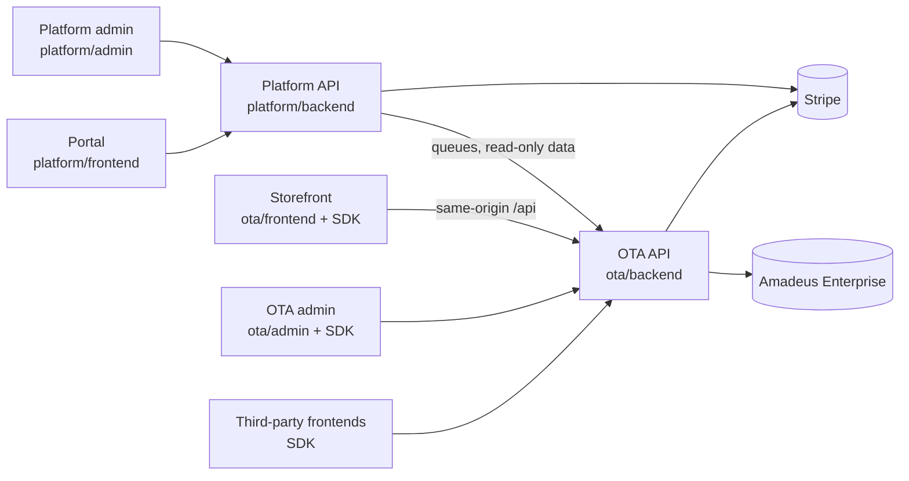

# Velexis OTA platform

Velexis is a multi-tenant online travel agency (OTA) platform. A person signs up on the Velexis **portal**, subscribes to a plan and gets their own **OTA** (a tenant). The OTA sells flights from **Amadeus Enterprise** to its customers through a hosted **storefront**, or its own frontend built with the Velexis **JS SDK**, and runs its operations in the **OTA admin**. This repository holds the whole system: six components in two groups, the SDK, shared libraries, deployment files, and the planning and reference documents.

**Status:** planning is done. Implementation starts with milestone **M0 Foundations**. The application directories below are created by the M0 tasks.

## Where to start

Read in this order:

1. [`docs/mvp/decisions.md`](docs/mvp/decisions.md): the product owner's decisions. Everything else follows them.
2. [`docs/mvp/architecture.md`](docs/mvp/architecture.md): components, hosts and ports, data ownership, request flows, configuration, failure domains.
3. [`docs/mvp/plans/roadmap.md`](docs/mvp/plans/roadmap.md) and the milestones M0–M6 in [`docs/mvp/README.md`](docs/mvp/README.md).
4. The plans: [`docs/mvp/plans/`](docs/mvp/plans/) (foundation), [`platform/docs/plans/`](platform/docs/plans/) and [`ota/docs/plans/`](ota/docs/plans/) (component tasks and week-by-week plans).

Then, depending on what you do:

- **Writing code**, as a person or an AI agent: [`AGENTS.md`](AGENTS.md), [`docs/mvp/conventions.md`](docs/mvp/conventions.md), [`docs/mvp/tech-stack.md`](docs/mvp/tech-stack.md).
- **Why something is the way it is:** the [architecture decision records](docs/mvp/adr/README.md).
- **Everything else:** the full index in [`docs/mvp/README.md`](docs/mvp/README.md).

## Repository map

| Path | What it is |
|---|---|
| [`docs/`](docs/) | All documentation. [`docs/mvp/`](docs/mvp/README.md) is the MVP's decisions, architecture, conventions, tech stack, ADRs and foundation plan. The reference material is listed below. |
| `platform/` | The **platform** group: everything about Velexis as a business and the tenants it hosts. |
| `platform/backend` | Platform API and worker (NestJS 11, TypeScript): accounts, MFA, tenants, Stripe Billing subscriptions, API keys, domains, Amadeus and Stripe connections, provisioning, audit, reference data. |
| `platform/frontend` | Portal at `platform.example.com` (Next.js 15, Tailwind): sign-up, OTA creation, billing, keys, domains, connections, team. |
| `platform/admin` | Platform admin at `admin.platform.example.com` (Next.js 15, Tailwind) for Velexis staff: tenants, plans, subscriptions, shared Amadeus account and offices, settlements, provisioning jobs, audit. |
| `platform/docs/` | Platform-specific documentation and plans. |
| `ota/` | The **OTA** group: what each OTA and its travellers use. |
| `ota/backend` | OTA booking API and worker (NestJS 11, TypeScript): implements the [OTA OpenAPI contract](docs/velexis-sdk/openapi/velexis-ota-booking-api.openapi.yaml), owns the tenant schemas, calls Amadeus and Stripe, sends e-mails, renders documents. |
| `ota/frontend` | Hosted storefront for every OTA on `<key>.ota.example.com` or a custom domain: vanilla HTML + Tailwind CSS + vanilla JS, all booking functionality through the SDK. |
| `ota/admin` | OTA admin at `admin.ota.example.com` (Next.js 15, Tailwind) for OTA staff: bookings console, PNR import, queues, payments, customers, markups, storefront settings, templates. |
| `ota/sdk` | `@velexis/ota-sdk`: vanilla JavaScript ES modules with JSDoc types, no framework dependency. Its contract is [`docs/velexis-sdk/sdk/src/`](docs/velexis-sdk/sdk/src/). |
| `ota/docs/` | OTA-specific documentation and plans. |
| `packages/` | Shared TypeScript libraries: `config`, `logger`, `db` (Kysely, tenancy, migrations, storage), `crypto` (envelope encryption), `errors`, `api-types` (generated contract types), and `testing` (test support, devDependency only). |
| `deploy/` | Single-VM deployment: Caddyfile, systemd units, VM provisioning, deploy and backup scripts, environment templates. No Docker. |
| [`tools/`](tools/) | Developer tools: [`plan-lint`](tools/plan-lint/plan-lint.mjs) (validates the task plans), `reference-data` (vendored reference datasets and their loader, shipped in releases), `amadeus-stub` (Amadeus test double), `e2e` (Playwright suite). |
| [`AGENTS.md`](AGENTS.md), [`CLAUDE.md`](CLAUDE.md) | Operating manual for AI coding agents, and its short pointer. |

How the components fit together:



## Reference material (reuse, do not redo)

These documents were designed and validated before the MVP plans. The MVP builds on them. They are not rewritten.

| Path | Content |
|---|---|
| [`docs/velexis-sdk/README.md`](docs/velexis-sdk/README.md) | Overview of the database, API and SDK design (`index.html` and `api.html` are offline HTML versions). |
| [`docs/velexis-sdk/db/`](docs/velexis-sdk/db/README.md) | Multi-tenant PostgreSQL 16 design: `platform.sql` (16 tables), `reference.sql` (7), `tenant.sql` (42), tenancy design, data dictionary, ER diagrams. These become the baseline migrations. |
| [`docs/velexis-sdk/openapi/`](docs/velexis-sdk/openapi/) | The OTA booking API contract: OpenAPI 3.1, 96 operations with `x-sdk-method`, `x-amadeus`, `x-tenant-tables`, `x-scope`. |
| [`docs/velexis-sdk/sdk/`](docs/velexis-sdk/sdk/) | SDK contract (`src/*.d.ts`) and developer guides (`docs/*.md`). |
| [`docs/velexis-sdk/examples/next-storefront/`](docs/velexis-sdk/examples/next-storefront/) | Reference storefront and console flows (Next.js). The MVP storefront re-implements them in vanilla HTML and JS. |
| [`docs/amadeus-api/`](docs/amadeus-api/) | The 9 Amadeus Enterprise specifications (12 operations). |
| [`docs/ota-build/`](docs/ota-build/), [`docs/ota-architecture-review.html`](docs/ota-architecture-review.html) | Broader OTA models and an earlier architecture review. Background only. |

## Working in the repository

Once M0 has created the workspace:

```sh
pnpm install          # Node.js 22, pnpm 9
pnpm dev              # all apps in development mode
pnpm lint && pnpm typecheck && pnpm test
node tools/plan-lint/plan-lint.mjs   # validate the task plans (works today)
```

The full command list is in [`AGENTS.md`](AGENTS.md#10-commands-cheat-sheet). All host names in this repository are placeholders (`example.com`), as [`decisions.md`](docs/mvp/decisions.md) §4 requires.
