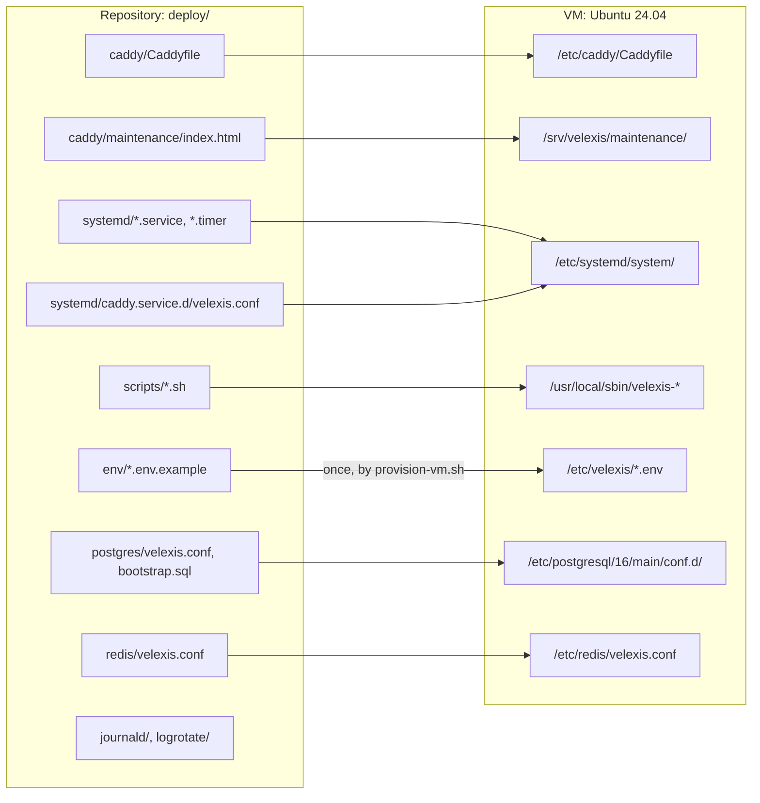

# Velexis deployment files

This folder holds everything that runs Velexis on its single VM without Docker: the Caddy configuration, the systemd unit templates, the provisioning, deploy, backup and restore scripts, the PostgreSQL, Redis, journald and logrotate settings, and one environment template per app. It implements [ADR-0007](../docs/mvp/adr/0007-single-vm-without-docker.md) and [ADR-0018](../docs/mvp/adr/0018-hosted-storefront-custom-domains.md). The files are **templates**: the foundation tasks X-019 to X-024, X-030, X-031, X-033 and X-037 to X-039 in [`docs/mvp/plans/foundation-tasks.md`](../docs/mvp/plans/foundation-tasks.md) finalise and test them.

Read first: [`docs/mvp/deployment-single-vm.md`](../docs/mvp/deployment-single-vm.md) (the operations guide). Related: [`docs/mvp/architecture.md`](../docs/mvp/architecture.md) §3 (hosts and ports), [`docs/mvp/decisions.md`](../docs/mvp/decisions.md) §4 (placeholder hosts), [ADR-0023](../docs/mvp/adr/0023-release-artefact-and-deploy-user.md) (release layout and the deploy user), [ADR-0026](../docs/mvp/adr/0026-system-users-per-trust-zone.md) (users per trust zone), [ADR-0027](../docs/mvp/adr/0027-pci-scope-and-vm-controls.md) (PCI scope and controls).

## How the files map to the VM



| Repository file | Installed on the VM as | Installed by | Notes |
|---|---|---|---|
| `caddy/Caddyfile` | `/etc/caddy/Caddyfile` | `provision-vm.sh`, then `deploy.sh` when changed | Validated with `caddy validate` before it replaces the live file. Hosts come from `/etc/velexis/caddy.env`. The admin API listens only on `/run/caddy/admin.sock`. |
| `caddy/maintenance/index.html` | `/srv/velexis/maintenance/index.html` | `provision-vm.sh`, `deploy.sh` | Shown by Caddy when a Next.js app is down. Also the M0 "hello world" page. |
| `systemd/velexis-*.service` (7 apps) | `/etc/systemd/system/` | `provision-vm.sh`, `deploy.sh` | Enabled by `deploy.sh` once a release contains the app. |
| `systemd/velexis-backup.{service,timer}` | `/etc/systemd/system/` | `provision-vm.sh` | Nightly 02:30 UTC. |
| `systemd/velexis-alert@.service` | `/etc/systemd/system/` | `provision-vm.sh` | `OnFailure=` target of every unit. The app units restart with `RestartMode=direct`, so it mails once, when a unit's start limit gives up. Runs `velexis-alert` as root without capabilities on a read-only file system. |
| `systemd/caddy.service.d/velexis.conf` | `/etc/systemd/system/caddy.service.d/` | `provision-vm.sh`, `deploy.sh` | Loads `/etc/velexis/caddy.env` into Caddy and creates `/run/caddy` (0700, user `caddy`) for the admin socket. |
| `scripts/deploy.sh` | `/usr/local/sbin/velexis-deploy` (root, 0755) | `provision-vm.sh`, then each deploy re-installs it | The only command the `deploy` user may run with sudo. |
| `scripts/backup.sh`, `restore.sh`, `alert.sh` | `/usr/local/sbin/velexis-backup`, `velexis-restore`, `velexis-alert` | `provision-vm.sh`, `deploy.sh` | Root-owned copies, so no app user can change code that root runs. |
| `scripts/run-as.sh` | `/usr/local/sbin/velexis-run` | `provision-vm.sh`, `deploy.sh` | `velexis-run <zone> <command…>`: a one-off command as the zone's user, with the identity, env files, folder and sandbox of the zone's installed unit ([ADR-0026](../docs/mvp/adr/0026-system-users-per-trust-zone.md)). |
| `scripts/provision-vm.sh` | not installed | the developer, once per VM | Run from a copy of `deploy/` on the VM. Idempotent; logs its runs to `/var/log/velexis/provision.log`. |
| `scripts/check-vm.sh` | not installed | the developer, after provisioning and after changes in `/etc/velexis` | Read-only: one `PASS` or `FAIL` per item of [`deployment-single-vm.md`](../docs/mvp/deployment-single-vm.md) §3 (services, firewall, SSH, roles, Redis, Caddy, users, owners and modes, env files against their templates). Prints no value. |
| `scripts/pack-release.sh` | not installed | CI (`.github/workflows/deploy.yml`) | Builds the release folder. |
| `env/<name>.env.example` | `/etc/velexis/<name>.env` (`root:root 0600`) | `provision-vm.sh` (only if missing) | `@@...@@` values are generated; `CHANGE_ME` values are filled in by the developer. systemd reads the files as root, so no app user can open any of them. |
| `postgres/velexis.conf` | `/etc/postgresql/16/main/conf.d/velexis.conf` | `provision-vm.sh` | Tuning for 8 GB. |
| `postgres/bootstrap.sql` | not installed | `provision-vm.sh`, `dev-setup.sh`, CI | Database, four roles (migrator, provisioner, two app roles), schemas, default privileges. |
| `redis/velexis.conf` | `/etc/redis/velexis.conf` (included by `redis.conf`) | `provision-vm.sh` | Password, `noeviction`, AOF. |
| `journald/velexis.conf` | `/etc/systemd/journald.conf.d/velexis.conf` | `provision-vm.sh` | 4 GB, 30 days. |
| `logrotate/velexis` | `/etc/logrotate.d/velexis` | `provision-vm.sh` | Deploy and backup logs in `/var/log/velexis/`. |

## Units, ports and env files

Every unit binds to `127.0.0.1`, loads its settings from `/etc/velexis/<app>.env` (`root:root 0600`, read by systemd before it starts the unit) and runs as its trust zone's system user ([ADR-0026](../docs/mvp/adr/0026-system-users-per-trust-zone.md)), with `SupplementaryGroups=velexis`. The group `velexis` has the five zone users as its only members and only lets them read releases (`root:velexis`, `u=rX,g=rX,o=`). The unit names follow [ADR-0007](../docs/mvp/adr/0007-single-vm-without-docker.md).

| Component | Unit | User | Release folder | Port | Env files |
|---|---|---|---|---|---|
| Platform backend API | `velexis-platform-api` | `velexis-platform` | `platform-backend/` (`dist/main.js`) | 3100 | `platform-backend.env` |
| Platform backend worker | `velexis-platform-worker` | `velexis-platform` | `platform-backend/` (`dist/worker.js`) | 3101 (health) | `platform-backend.env`, optional `platform-worker.env` |
| Platform frontend (portal) | `velexis-portal` | `velexis-portal` | `platform-frontend/` (`platform/frontend/server.js`) | 3000 | `platform-frontend.env` |
| Platform admin | `velexis-platform-admin` | `velexis-platform-admin` | `platform-admin/` (`platform/admin/server.js`) | 3001 | `platform-admin.env` |
| OTA backend API | `velexis-ota-api` | `velexis-ota` | `ota-backend/` (`dist/main.js`) | 4000 | `ota-backend.env` |
| OTA backend worker | `velexis-ota-worker` | `velexis-ota` | `ota-backend/` (`dist/worker.js`) | 4001 (health) | `ota-backend.env`, `ota-worker.env` (provisioner DSN) |
| OTA admin | `velexis-ota-admin` | `velexis-ota-admin` | `ota-admin/` (`ota/admin/server.js`) | 3002 | `ota-admin.env` |
| OTA frontend (storefront) | none: Caddy serves `/srv/velexis/current/storefront` | `storefront/` | — | none (runtime data comes from `storefront.get`) |
| Caddy | `caddy` (apt package) + drop-in | `caddy` | — | 80, 443 | `caddy.env` |
| Deploy-time migrations | transient unit started by `velexis-deploy` | dynamic (`DynamicUser=yes`) | `db/`, `migrations/` | — | `migrator.env` (root only; `DATABASE_MIGRATOR_URL` is its only DSN) |
| Reference data loader | transient unit started by `velexis-deploy` | dynamic (`DynamicUser=yes`) | `reference-data/` | — | `reference-loader.env` (root only; `DATABASE_URL` of the platform role is its only DSN) |
| One-off CLI commands | `velexis-run <zone> <command…>` | the zone's user | the zone's folder | — | the zone's env files (a backend zone: those of its worker unit) |

The separate users are the boundary: a process cannot read another user's `/proc/<pid>/environ` or files through `/proc/<pid>/root`, and `ProtectProc=invisible` hides the other zones' processes. Keys live in one folder per backend zone, `/etc/velexis/keys/platform/` and `/etc/velexis/keys/ota/` (`0500`, files `0400`, owned by the zone's user); `master-v1.key` and `api-key-pepper` are identical copies in both, the JWT keys and `document-url.key` exist in one zone only. `/etc/velexis` and `/etc/velexis/keys` are `0711 root:root`: a zone reaches its own folder but can list neither. Each unit also hides the other zones' env files and key folders and root's files with `InaccessiblePaths=`; that is defence in depth only, since it cannot stop a process from reading what a process of the same user holds, nor root. `systemd-analyze security` rates the app units 1.4 and `velexis-alert@` 1.7 ("OK"); CI fails any of them above 2.0.

`velexis-deploy` never hands a DSN to a process of an app user: it runs the migrations and the reference data loader with `systemd-run --pipe --wait --collect -p DynamicUser=yes -p SupplementaryGroups=velexis -p EnvironmentFile=/etc/velexis/migrator.env` (or `reference-loader.env`), so systemd reads the root-only file for a transient unit whose dynamic user can only read the release. The DSN is never in `velexis-deploy`'s own environment or on a command line. The tenant fan-out writes its report into that unit's `StateDirectory=` (`/var/lib/velexis-migrate`), from where `velexis-deploy` copies it, root-only, to `/var/lib/velexis/migrate-<sha>.json` and `/var/log/velexis/`.

## Release and deploy flow

```mermaid
sequenceDiagram
  autonumber
  actor Dev as Developer
  participant GH as GitHub Actions (deploy.yml)
  participant VM as VM (deploy user)
  participant D as velexis-deploy (root)
  participant PG as PostgreSQL
  participant SD as systemd
  Dev->>GH: Run workflow "Deploy" from main or a v* tag
  GH->>GH: job build (no secrets): install, lint, test, build, pack-release.sh, tarball artefact + SHA-256
  GH->>GH: job deploy (production environment, approval): download, re-check SHA-256 and SHA256SUMS
  GH->>VM: rsync release/<sha>/ to /srv/velexis/incoming/<sha>/
  GH->>VM: ssh: sudo velexis-deploy <sha>
  D->>D: verify SHA256SUMS and Node major, check env files against the templates
  D->>D: snapshot units and Caddyfile, install root-owned scripts and units, move to releases/<sha>
  D->>PG: migrate platform, reference, tenant fan-out (transient unit, dynamic user, velexis_migrator)
  D->>D: switch /srv/velexis/current
  D->>SD: restart workers, APIs, front ends one by one
  D->>D: poll /health/ready; on failure restore the previous snapshot, switch back and restart (rollback)
  D-->>GH: exit 0 or 1
```

Commands on the VM:

| Command | What it does |
|---|---|
| `sudo /usr/local/sbin/velexis-deploy --status` | Active release and unit states |
| `sudo /usr/local/sbin/velexis-deploy --rollback` | Re-install the previous release's units and Caddyfile, switch back to it and restart (migrations stay; they are N-1 compatible) |
| `sudo /usr/local/sbin/velexis-run platform node dist/cli.js admin:grant <email>` | Run a one-off CLI command as a zone's user (`platform`, `ota`, `portal`, `platform-admin`, `ota-admin`) with its env files, folder and sandbox. The exit code is the command's; `125` means `velexis-run` refused to start it. |
| `sudo systemctl start velexis-backup` | Run a backup now |
| `sudo /usr/local/sbin/velexis-restore drill <dir> --identity <key>` | Restore drill into a scratch database |
| `journalctl -u velexis-ota-api -f -o cat \| jq` | Follow one app's JSON logs |

## Checking the files locally

| Check | Command |
|---|---|
| Shell scripts | `shellcheck -S style deploy/scripts/*.sh deploy/scripts/test/*.sh deploy/systemd/test/*.sh deploy/caddy/test/*.sh` |
| `check-vm.sh` and the env file checks of `provision-vm.sh` | `sudo bash deploy/scripts/test/check-vm.test.sh` (root, Ubuntu 24.04, no services: `provision-vm.sh --steps users,keys,envfiles` under a temporary `VELEXIS_ROOT`, then `check-vm.sh` with fake system tools; never on a provisioned VM) |
| Users, keys and env files | `sudo env SMOKE_NODE="$(command -v node)" bash deploy/systemd/test/units-smoke.sh` runs `provision-vm.sh --steps users,keys,envfiles` under a temporary `VELEXIS_ROOT` and checks the user boundary on the host even without systemd (steps 1 to 3; it then stops with a `FAIL` where systemd is not PID 1) |
| Caddyfile | `VELEXIS_EDGE_SECRET=x caddy validate --config deploy/caddy/Caddyfile --adapter caddyfile` |
| Caddyfile end to end | `bash deploy/caddy/test/caddy-smoke.sh` (Caddy 2.8.4 and Node 22, no root; [`caddy/test/README.md`](caddy/test/README.md)) |
| Unit files | `systemd-analyze verify deploy/systemd/*.service` (reports only the missing `/usr/bin/node` off the VM) |
| Unit sandboxing | `systemd-analyze security --offline=true --threshold=20 deploy/systemd/velexis-ota-api.service` (every app unit and `velexis-alert@` must stay at 2.0 or lower) |
| Units under systemd | `sudo env SMOKE_NODE="$(command -v node)" bash deploy/systemd/test/units-smoke.sh` (needs systemd as PID 1, PostgreSQL, Redis and Mailpit; a CI runner or a throwaway VM, never the production VM) |
| Release folder | `RELEASE_SHA=$(git rev-parse HEAD) bash deploy/scripts/pack-release.sh /tmp/release` |

CI runs the shell, Caddyfile (including the end-to-end smoke test) and unit checks in the `deploy-files` job on every pull request (tasks X-019 and X-022) and the units smoke test in the `systemd-units` job (tasks X-021 and X-033). The smoke test first runs `provision-vm.sh --steps users,keys,envfiles` twice with `VELEXIS_ROOT` set to a temporary prefix and checks the five users, the group `velexis`, the folder modes, the two key folders with identical master-key and pepper copies, the `root:root 0600` env files and that the second run changes nothing. It shows the user boundary on the host without any sandbox: `velexis-portal` is denied the environment and the root of a `velexis-ota` process, and file modes alone deny every zone the env files and the other zones' keys. It then installs all seven app units from these templates with their paths moved under the prefix and a stand-in Node app as `dist/main.js`, `dist/worker.js` and `server.js`. The stand-in proves that the sandbox still lets the apps do what they need (release folder through the `velexis` group, key files, PostgreSQL, Redis, DNS and outside HTTPS, `os.cpus()`, `os.networkInterfaces()`), that every unit gets every variable of its root-only env files (names only), and that it hides what they must not read: from inside the portal unit the OTA API's `/proc/<pid>/environ`, its `/proc/<pid>/root/…/keys/ota/master-v1.key` and every env file; from inside the platform API the OTA key folder. In each unit's mount namespace the `InaccessiblePaths=` entries are inaccessible nodes. A migration started with `deploy.sh`'s own `run_transient` runs as a dynamic user while no process of an app user has `DATABASE_MIGRATOR_URL` in its environment (and a static check shows that `deploy.sh` starts `migrate.js` and `load.js` in no other way), and `velexis-run platform node -e "process.exit(3)"` runs as `velexis-platform` and exits 3. Last, it kills the OTA API until the start limit puts it in `failed` and checks that `velexis-alert@` mails Mailpit once, with the unit name, its status and its last log lines, and that no env value reached the journal or the mail. Loosen a sandboxing option only when this test proves the apps need it, and write the reason next to it in the unit.
