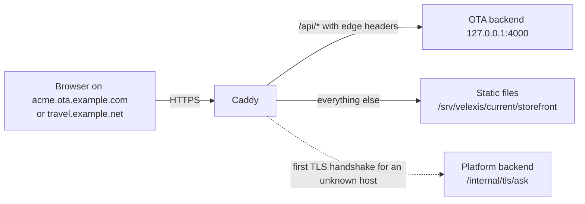

# ADR-0018: Hosted storefront and custom domains

**Status:** Accepted
**Date:** 2026-10-12
**Deciders:** Product owner (one hosted multi-tenant storefront on `<key>.ota.example.com` or a custom domain, same-origin `/api/*` through Caddy, httpOnly cookies + CSRF, Caddy on-demand TLS), lead architect (Caddy configuration, `ask` rules, edge credential, CSP)
**Revisions:** 2026-10-12 (planning review): custom-domain examples use the reserved name `travel.example.net`; Caddy's admin API listens only on a unix socket.

## Context

[`decisions.md`](../decisions.md) §2, §4 and §5 decide that Velexis serves **one storefront for every OTA**:

- on `<key>.ota.example.com` or a verified custom domain;
- as static files plus a **same-origin `/api/*` proxy** to the OTA backend;
- with **httpOnly cookie sessions + a CSRF token**, so no token is readable by JavaScript;
- with **Caddy** providing automatic and on-demand TLS for custom domains.

The OTA contract resolves the tenant from `X-Api-Key` and never from the host alone ([db README §5](../../velexis-sdk/db/README.md)). `platform.tenant_domains` already models sub-domains and custom domains with DNS verification and TLS status.

## Decision

### Request path



### Caddy configuration (sketch; the real file is `deploy/caddy/Caddyfile`)

```caddyfile
{
	email ops@example.com
	# Admin API only on a unix socket that only the caddy user can reach (never TCP 2019).
	admin unix//run/caddy/admin.sock
	on_demand_tls {
		ask http://127.0.0.1:3100/internal/tls/ask
	}
}

# Named sites (platform.example.com, admin.*, api.*) come first; see architecture.md.

# Hosted storefront: any other host, gated by the ask endpoint.
https:// {
	tls {
		on_demand
	}
	header {
		Strict-Transport-Security "max-age=31536000"
		Content-Security-Policy "default-src 'self'; script-src 'self' https://js.stripe.com https://*.js.stripe.com; style-src 'self'; img-src 'self' data:; font-src 'self'; connect-src 'self' https://api.stripe.com; frame-src https://js.stripe.com https://*.js.stripe.com https://hooks.stripe.com; frame-ancestors 'none'; base-uri 'self'; form-action 'self'; object-src 'none'"
		Referrer-Policy "strict-origin-when-cross-origin"
		X-Content-Type-Options "nosniff"
		Permissions-Policy "camera=(), microphone=(), geolocation=()"
	}
	handle /api/* {
		uri strip_prefix /api
		reverse_proxy 127.0.0.1:4000 {
			header_up X-Velexis-Edge {env.VELEXIS_EDGE_SECRET}
			header_up X-Velexis-Host {host}
		}
	}
	handle {
		root * /srv/velexis/current/storefront
		try_files {path} {path}.html {path}/index.html
		file_server
	}
}
```

- `header_up` **replaces** any client-supplied `X-Velexis-Edge` and `X-Velexis-Host`, so a browser cannot forge them.
- Hashed assets get `Cache-Control: public, max-age=31536000, immutable`. HTML gets `no-cache`.

### The `ask` endpoint (platform backend)

`GET /internal/tls/ask?domain=<host>`, reachable only from `127.0.0.1`. Caddy blocks `/internal/*` on public hosts. It answers `200` only when one of these holds:

1. the host is `<key>.ota.example.com` and `<key>` belongs to a tenant with `status` `provisioning`, `active` or `suspended`; or
2. the host is a `tenant_domains` row with `kind = 'custom'`, `purpose = 'storefront'`, `verification_status = 'verified'`, its tenant is `active`, and the tenant's plan allows custom domains.

Otherwise it answers `404`, and Caddy does not request a certificate. Answers are cached in Redis for 60 s.

This protects the ACME rate limits and stops anyone from pointing arbitrary domains at the VM.

### Custom domain lifecycle (M5)

1. The OTA owner adds `travel.example.net` in the portal. A `tenant_domains` row is created with `kind = 'custom'`, `verification_status = 'pending'` and a `verification_token`.
2. The portal shows two DNS records:
   - `CNAME travel.example.net → acme.ota.example.com`;
   - `TXT _velexis.travel.example.net = <token>`.
3. A `platform-domains` job checks DNS every 5 minutes for 72 hours. On success it sets `verified` and publishes a cache invalidation. On timeout it sets `failed`.
4. The first HTTPS request triggers on-demand issuance through the `ask` endpoint. A daily job probes the host and records `tls_status` and `tls_expires_at`.
5. The OTA may mark the custom domain primary. E-mail links then use it.
6. Apex domains need an `A`/`AAAA` record to the VM's address instead of a CNAME. The portal explains both.

### How the OTA backend treats edge requests

- An **edge guard** accepts a request as a hosted-storefront request only when `X-Velexis-Edge` matches the configured secret (constant-time compare).
- **Tenant:** the verified host from `X-Velexis-Host`, through the cached `tenant_domains` lookup (purpose `storefront`).
- **Environment:** the tenant's hosted-storefront environment. This is a platform delta, `tenants.storefront_environment`, `test` until the OTA switches to live in M5.
- **Scope:** customer scope only, with the same rights as a publishable key and no origin allow-list (same origin). Console operations answer `403 SCOPE_NOT_ALLOWED`.
- **Sessions:** customer and guest sessions are in `__Host-` cookies. State-changing requests need the CSRF header ([ADR-0008](0008-identity-accounts-customers-sessions.md)).
- The edge headers and the cookie session mode are added spec-first to the OTA document ([ADR-0006](0006-contract-first-openapi.md)).

### Storefront build and content

- One static build for all OTAs. Branding, locales, currencies, features and the payment provider's public configuration come from `storefront.get` at runtime ([ADR-0014](0014-frontend-stack-nextjs-tailwind.md)).
- In the test environment the storefront shows a permanent **Test mode** banner.
- OTA logos and images are uploaded through the OTA admin and served same-origin, so `img-src 'self'` holds.
- No third-party scripts other than Stripe.js, and Stripe.js only on payment pages ([ADR-0011](0011-payments-stripe-and-airline-card.md)).

## Consequences

### Positive

- Same origin means no CORS, `SameSite=Lax` cookies work, and no token ever reaches JavaScript.
- One build and one Caddy site block serve every OTA and every custom domain.
- The `ask` gate makes on-demand TLS safe.

### Negative

- **Let's Encrypt limits:** sub-domains also use on-demand certificates, one per OTA, and Let's Encrypt allows about 50 new certificates per registered domain per week. This is fine for MVP sign-up volumes.
- The edge secret is a shared credential between Caddy and the OTA backend. It is stored in both environment files and rotated by restarting both.
- Cookies are host-only, so a customer signed in on `acme.ota.example.com` is not signed in on `travel.example.net`. The primary-domain redirect (below) limits this.

### Follow-ups

- Decided during planning; revisit when sign-ups approach 30 per week. Then use a wildcard certificate for `*.ota.example.com` with a DNS-01 challenge (a Caddy binary built with `xcaddy` and a DNS provider module).
- Once an OTA marks a custom domain primary, redirect its sub-domain to it (301), so customers stay on one host.

## Alternatives considered

- **Cross-origin calls to `api.ota.example.com` with a publishable key.** Needs CORS and third-party cookies, or tokens in JavaScript, which `decisions.md` §5 forbids for the hosted storefront.
- **A Velexis hosting key (`hk_`) injected by Caddy.** Hosting keys fix the environment per key, but the hosted storefront's environment is a per-tenant switch. A dedicated edge guard is simpler and narrower.
- **A Node edge server (Next.js) in front of the storefront.** An extra process for what Caddy does natively.
- **Per-OTA static builds.** Slower deploys and more disk, for no benefit, since branding is runtime data.

## References

- [`../decisions.md`](../decisions.md) §2, §4, §5
- [`../../velexis-sdk/db/platform.sql`](../../velexis-sdk/db/platform.sql) (`tenant_domains`)
- [`../../velexis-sdk/db/README.md`](../../velexis-sdk/db/README.md) §5 (tenant resolution)
- [ADR-0008](0008-identity-accounts-customers-sessions.md), [ADR-0011](0011-payments-stripe-and-airline-card.md), [ADR-0019](0019-vanilla-js-sdk-jsdoc.md)
- [`../architecture.md`](../architecture.md), flow (e)
- Caddy on-demand TLS: <https://caddyserver.com/docs/automatic-https#on-demand-tls>
