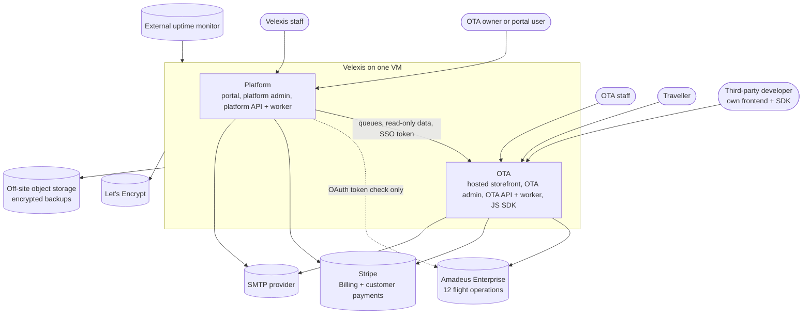
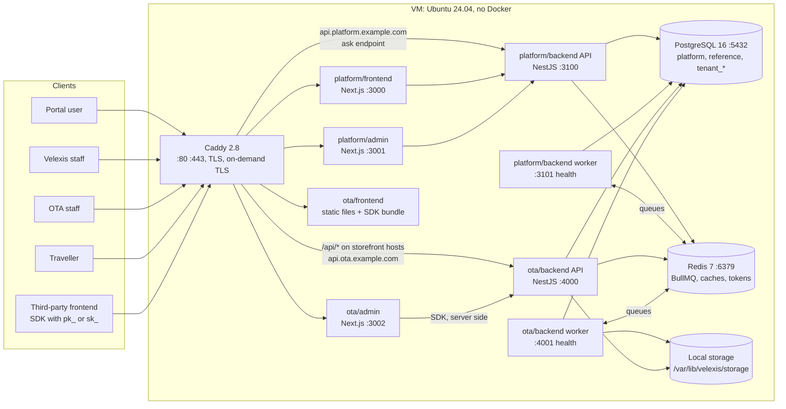
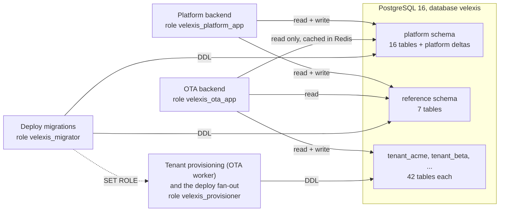
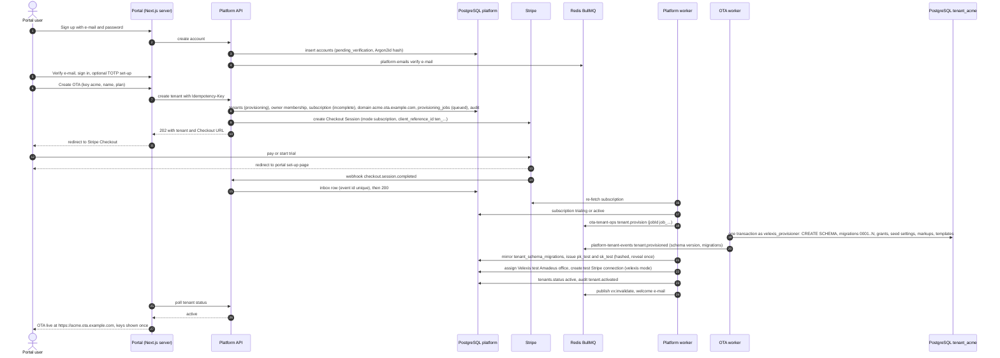
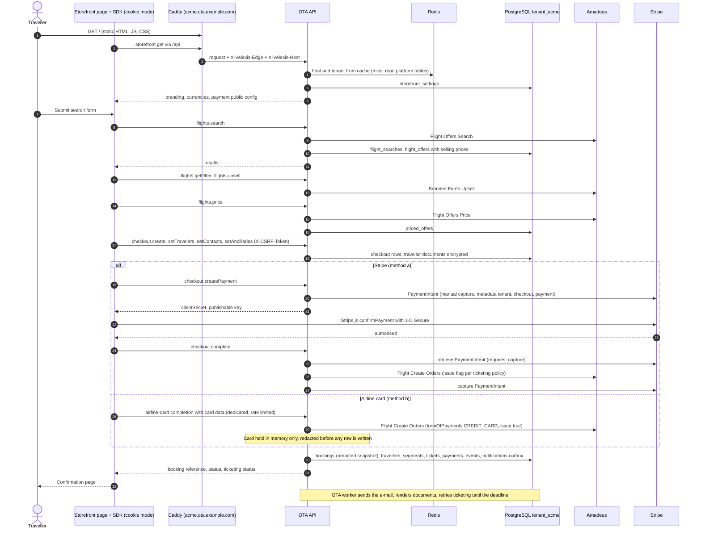
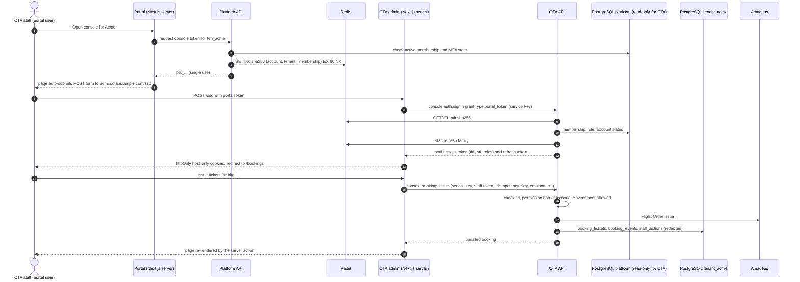
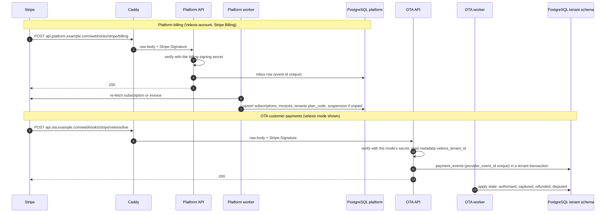
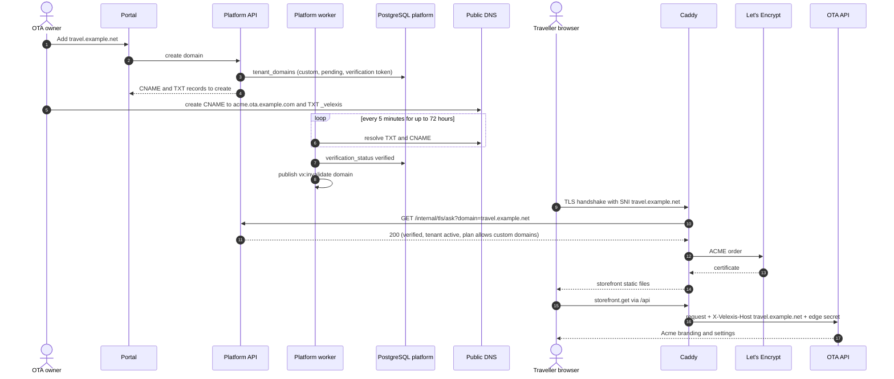

# Velexis MVP architecture

This document describes how the Velexis MVP fits together:

- the system context and the containers;
- the six components, the JS SDK and the shared packages;
- the hosts and ports on the single VM;
- who owns which data;
- the main request flows, as sequence diagrams;
- the configuration of each app;
- what fails, and how, on one machine.

It implements the product owner's answers in [`decisions.md`](decisions.md) and the cross-cutting [ADRs](adr/README.md). The detailed database design is reused from [`docs/velexis-sdk/db/README.md`](../velexis-sdk/db/README.md), and the OTA API from the [OpenAPI document](../velexis-sdk/openapi/velexis-ota-booking-api.openapi.yaml).

Related: [`tech-stack.md`](tech-stack.md) (versions), [`conventions.md`](conventions.md) (code rules), [`README.md`](README.md) (index and milestones).

## 1. System context

| Actor or system | Uses | Through |
|---|---|---|
| OTA owner or portal user | Sign-up, OTA creation, billing, API keys, domains, Amadeus and Stripe connections, team | Portal `platform.example.com` |
| Velexis staff | Tenants, plans, subscriptions, shared Amadeus account and offices, settlements, provisioning jobs, audit | Platform admin `admin.platform.example.com` |
| OTA staff | Bookings console, PNR import, queues, payments, customers, markups, storefront settings, templates | OTA admin `admin.ota.example.com` (SSO from the portal) |
| Traveller | Search, book, pay, manage bookings | Hosted storefront `<key>.ota.example.com` or a custom domain |
| Third-party developer | Own storefront in any framework | SDK + `api.ota.example.com` with `pk_`/`sk_` keys |
| Amadeus Enterprise | Shopping, pricing, orders, issue, queues ([`docs/amadeus-api/`](../amadeus-api/)) | Flight operations: OTA backend only. The platform worker only requests OAuth tokens to verify credentials ([ADR-0012](adr/0012-amadeus-account-model.md)). |
| Stripe | Subscriptions and Connect account events (platform), customer payments (OTA) | Both backends ([ADR-0011](adr/0011-payments-stripe-and-airline-card.md), [ADR-0013](adr/0013-subscription-billing-stripe-billing.md)) |
| Public DNS resolvers | TXT and CNAME checks of custom domains (M5) | Platform worker ([ADR-0018](adr/0018-hosted-storefront-custom-domains.md)) |

## 2. Containers

### Components

| # | Component | Directory | Runtime and framework | Public host | Local port | Talks to |
|---|---|---|---|---|---|---|
| 1 | Platform backend | `platform/backend` | Node 22, NestJS 11. Two processes: API and worker | `api.platform.example.com` | 3100 (API), 3101 (worker health) | PostgreSQL (`platform`, `reference`), Redis, Stripe, SMTP, the Amadeus OAuth token endpoint (credential verification only), public DNS resolvers (custom-domain checks) |
| 2 | Platform frontend (portal) | `platform/frontend` | Next.js 15 App Router, React 19 | `platform.example.com` | 3000 | Platform API (server side) |
| 3 | Platform admin | `platform/admin` | Next.js 15 App Router, React 19 | `admin.platform.example.com` | 3001 | Platform API (server side) |
| 4 | OTA backend | `ota/backend` | Node 22, NestJS 11. Two processes: API and worker | `api.ota.example.com`, plus `/api/*` on storefront hosts | 4000 (API), 4001 (worker health) | PostgreSQL (tenant schemas, `reference`, platform read-only), Redis, Amadeus, Stripe, SMTP, local storage |
| 5 | OTA frontend (storefront) | `ota/frontend` | Static HTML + Tailwind + vanilla JS, built by Vite | `<key>.ota.example.com`, verified custom domains | none (Caddy `file_server`); 5173 in development | OTA API through the SDK, same origin |
| 6 | OTA admin | `ota/admin` | Next.js 15 App Router, React 19 | `admin.ota.example.com` | 3002 | OTA API through the SDK (server side) |
| — | JS SDK | `ota/sdk` | Vanilla JS ES modules + JSDoc, no dependencies | none (library) | none | OTA API |

### Shared packages

| Package | Directory | Purpose | Used by |
|---|---|---|---|
| `@velexis/config` | `packages/config` | Load and validate environment variables and key files; fail fast on missing or unsafe config | All Node apps |
| `@velexis/logger` | `packages/logger` | pino setup, standard fields, the central redaction list ([ADR-0016](adr/0016-observability.md)) | All Node apps |
| `@velexis/db` | `packages/db` | Kysely pools, `platformDb`, `tenantTx`, migration runner, generated table types, `StorageAdapter` ([ADR-0005](adr/0005-data-access-kysely-sql-migrations.md)) | Both backends |
| `@velexis/crypto` | `packages/crypto` | Envelope encryption, HMAC, token hashing, key providers ([ADR-0010](adr/0010-secrets-envelope-encryption.md)) | Both backends |
| `@velexis/errors` | `packages/errors` | Error codes generated from the OpenAPI error catalogues, `AppError` | Both backends, Next.js apps |
| `@velexis/api-types` | `packages/api-types` | Types generated from both OpenAPI documents; queue message contracts under `/jobs` ([ADR-0006](adr/0006-contract-first-openapi.md)) | Everything, including the SDK (types only) |
| `@velexis/testing` | `packages/testing` | Test databases, Redis, clock, response checks, Mailpit, Stripe and Amadeus stub helpers ([ADR-0022](adr/0022-shared-test-support-package.md)) | Every package and app, **devDependency only** |

Tools: `tools/reference-data` (`@velexis/reference-data`: vendored datasets and the loader that deploys run, [ADR-0024](adr/0024-reference-data-sources-and-loader.md)), `tools/amadeus-stub` (`@velexis/amadeus-stub`, port 4900), `tools/e2e` (`@velexis/e2e`, Playwright), `tools/plan-lint` (plain script), plus Mailpit (SMTP 1025, UI 8025) in development and CI.

## 3. Hosts, ports and the VM

All hosts are placeholders from [`decisions.md`](decisions.md) §4. Every app port binds to `127.0.0.1`, and only Caddy is public.

| Host | Caddy routes to | Notes |
|---|---|---|
| `platform.example.com` | `127.0.0.1:3000` | Portal |
| `admin.platform.example.com` | `127.0.0.1:3001` | Platform admin. MFA mandatory. Optionally restricted by IP. |
| `api.platform.example.com` | `127.0.0.1:3100` | Platform API, `/webhooks/stripe/billing` and `/webhooks/stripe/connect-accounts` (M5). `/internal/*` is blocked publicly. |
| `admin.ota.example.com` | `127.0.0.1:3002` | OTA admin. The OTA is chosen after sign-in. |
| `api.ota.example.com` | `127.0.0.1:4000` | OTA API for SDK users with keys, and Stripe payment webhooks. `/internal/*` is blocked publicly. |
| `<key>.ota.example.com` and verified custom domains | static files at `/srv/velexis/current/storefront`; `/api/*` → `127.0.0.1:4000` with edge headers | On-demand TLS gated by `GET 127.0.0.1:3100/internal/tls/ask` ([ADR-0018](adr/0018-hosted-storefront-custom-domains.md)) |

The VM runs seven systemd units, plus `postgresql`, `redis-server`, `caddy` and two timers (`velexis-backup`, `velexis-healthcheck`). Unit names, directories, deploy steps and backups are in [ADR-0007](adr/0007-single-vm-without-docker.md).

**Memory budget** on the 8 GB starting size. Each Node unit has `MemoryMax`.

| Process | Budget |
|---|---|
| PostgreSQL (`shared_buffers` 1.5 GB + work memory) | ~2.5 GB |
| Redis (`maxmemory` 512 MB) | 0.5 GB |
| Platform API, OTA API | 768 MB each |
| Platform worker, OTA worker | 512 MB each |
| Portal, platform admin, OTA admin | 512 MB each |
| Caddy, OS, page cache | the rest (~1 GB) |

The budgets add up to about 7 GB (2.5 + 0.5 + 2 × 0.75 + 5 × 0.5), which leaves about 1 GB for Caddy, the OS and the page cache. That is tight: the M6 measurements (PBE-063, OBE-088) check real use against the resize rule of [ADR-0007](adr/0007-single-vm-without-docker.md).

## 4. Data ownership

| Schema | Owner (writes, migrations) | Readers | Migrations live in |
|---|---|---|---|
| `platform` | Platform backend | OTA backend, read-only role, selected tables only ([ADR-0004](adr/0004-postgresql-schema-per-tenant.md)) | `platform/backend/migrations/platform/` |
| `reference` | Platform backend (reference data loaders) | OTA backend | `platform/backend/migrations/reference/` |
| `tenant_<key>` | OTA backend (API, worker, provisioning) | Nobody else. The platform role has no privileges. | `ota/backend/migrations/tenant/` |

Rules from [`decisions.md`](decisions.md) §5 and [ADR-0003](adr/0003-six-components-two-nestjs-backends.md):

- **Platform → OTA work** goes through the BullMQ queue `ota-tenant-ops`: `tenant.provision` and `tenant.migrate` (M1), `tenant.suspend` and `tenant.resume` (sent from M1, consumed by the OTA worker from M4). **Results** come back through `platform-tenant-events`: `tenant.provisioned`, `tenant.provision_failed`, `tenant.migrated`, `tenant.migration_failed`, `tenant.suspended`, `tenant.resumed`. `platform.provisioning_jobs` is the durable record; each attempt is the BullMQ job `<job_id>-<attempt>`, and a reconciler re-enqueues lost messages. The deploy fan-out's `tenant.migrated` reports carry `jobId = null` ([ADR-0009](adr/0009-background-jobs-bullmq.md)).
- **The OTA backend reads platform data** through `velexis_ota_app` (`SELECT` only) and caches it in Redis. The platform backend publishes a message on the Redis channel `vx:invalidate` after every change to a cached row.
- **The OTA backend never writes platform tables.** API key usage (`last_used_at`) is counted in Redis and flushed to `platform.api_keys` by the platform worker every 5 minutes. Staff sessions live in Redis ([ADR-0008](adr/0008-identity-accounts-customers-sessions.md)).
- **Settlement figures** for the Velexis Stripe account come from Stripe balance transactions, not from tenant tables ([ADR-0011](adr/0011-payments-stripe-and-airline-card.md)).

### Redis keys shared between the backends

| Key | Written by | Read by | TTL | Invalidation |
|---|---|---|---|---|
| `tenant:<tenantId>` | OTA backend (cache fill) | OTA backend | 60 s | `vx:invalidate` `{type: "tenant", id}` |
| `host:<hostname>` | OTA backend (cache fill) | OTA backend | 60 s | `{type: "domain", hostname}` |
| `apikey:<prefix>` | OTA backend (cache fill) | OTA backend | 60 s | `{type: "api_key", prefix}` |
| `conn:amadeus:<tenantId>:<env>`, `conn:payment:<tenantId>:<env>` | OTA backend (cache fill, ciphertext stays encrypted) | OTA backend | 60 s | `{type: "connection", tenantId}` |
| `member:<accountId>:<tenantId>` | OTA backend (cache fill) | OTA backend | 60 s | `{type: "membership", accountId, tenantId}` |
| `ptk:<sha256>` | Platform backend | OTA backend (`GETDEL`) | 60 s | single use |
| `apikey:used:<keyId>` | OTA backend | Platform worker | 1 day | flushed every 5 minutes |
| `staffsess:<familyId>`, `staffdeny:<familyId>` | OTA backend | OTA backend | family lifetime | — |
| `staffdeny:acct:<accountId>` | Platform backend, on sign out everywhere, password change or reset, MFA reset and account disable | OTA backend (staff guard and refresh) | 30 days | Epoch-ms cut-off: staff families created before it are refused ([PADR-0007](../../platform/docs/adr/0007-portal-to-ota-admin-sso-token.md)) |
| `staffdeny:tenant:<tenantId>` | OTA worker, on `tenant.suspend` | OTA backend | 30 days | Deleted on `tenant.resume` ([OADR-0007](../../ota/docs/adr/0007-tenant-migration-runner-and-provisioning-worker.md)) |
| `amadeus:token:<credId>:<env>`, `amadeus:tokenlock:<credId>:<env>` | OTA backend | OTA backend | `expires_in` − 60 s; lock 10 s | Per credential set, envelope-encrypted, shared by every OTA on the shared account ([ADR-0012](adr/0012-amadeus-account-model.md), [OADR-0001](../../ota/docs/adr/0001-amadeus-client-design.md)) |
| `rl:amadeus:cred:<credId>:<env>`, `rl:amadeus:ten:<tenantId>:<env>` | OTA backend | OTA backend | 2 s | Token buckets per credential set and per tenant |
| `t:<tenantId>:<env>:…` | OTA backend | OTA backend | per use | per use (offer caches and other tenant state; db README §5) |

### Schema deltas named by the cross-cutting ADRs

The component plans own the exact DDL. Each delta is a new numbered migration on top of `0001_baseline`.

| Schema | Delta | Milestone | Source |
|---|---|---|---|
| platform | `schema_migrations` ledger for `platform` and `reference` (created by the runner) | M0 | [ADR-0005](adr/0005-data-access-kysely-sql-migrations.md) |
| platform | `amadeus_accounts`, `amadeus_offices`; `supplier_connections.credential_source`, `amadeus_account_id`, nullable credentials + CHECK | M1 | [ADR-0012](adr/0012-amadeus-account-model.md) |
| platform | `payment_provider_connections.account_mode` (`velexis`, `connect_standard`, `api_keys`) | M1 (`velexis` rows), M5 (others) | [ADR-0011](adr/0011-payments-stripe-and-airline-card.md) |
| platform | `tenants.storefront_environment` (`test` or `live`) | M2 (column), M5 (switch) | [ADR-0018](adr/0018-hosted-storefront-custom-domains.md) |
| platform | `plans.stripe_product_id`, `stripe_price_id_month`, `stripe_price_id_year`; Stripe webhook inbox table | M5 | [ADR-0013](adr/0013-subscription-billing-stripe-billing.md) |
| platform | Settlement statements table | M5 | [ADR-0011](adr/0011-payments-stripe-and-airline-card.md) |
| tenant | `payments.provider` CHECK adds `airline` | M3 | [ADR-0011](adr/0011-payments-stripe-and-airline-card.md) |

## 5. Request flows

API paths in these diagrams are illustrative where the platform OpenAPI document does not exist yet. The documents fix the real paths ([ADR-0006](adr/0006-contract-first-openapi.md)). OTA operations are named by their SDK method (`x-sdk-method`).

### (a) Sign-up → create OTA → Stripe Checkout → provisioning → tenant live

Before M5, steps 9–15 are skipped. Create OTA makes a `trialing` subscription with `billing_provider = 'manual'` and enqueues provisioning at once ([ADR-0013](adr/0013-subscription-billing-stripe-billing.md)).

On failure, the OTA worker sends `tenant.provision_failed`. The platform worker retries with backoff, and after `max_attempts` marks the job and the tenant `failed`, alerts Velexis staff, and lets the portal offer "retry" (db README §3).

### (b) Storefront search → price → checkout → payment → order and issue → confirmation

Failure handling follows the contract's `checkout.complete` semantics:

- if Amadeus rejects the order, the Stripe authorisation is voided and the checkout stays open (`SOLD_OUT`, `PRICE_CHANGED`, `TRAVELER_DATA_INVALID`);
- an issuance failure leaves the booking `confirmed` with `ticketing.status = failed`, and the ticketing job retries.

### (c) OTA admin SSO from the portal and console booking actions

Other console actions follow the same path: retrieve, patch with `If-Match`, cancel, notes, PNR lookup and import, queues, capture and refund. Every console call writes `staff_actions` ([db README §8](../velexis-sdk/db/README.md)).

### (d) Stripe webhooks: platform billing vs OTA payments

| Endpoint | Backend | Stripe events | Tenant comes from |
|---|---|---|---|
| `/webhooks/stripe/billing` | Platform | `checkout.session.completed` (subscription mode), `customer.subscription.*`, `invoice.*` | `client_reference_id` or subscription metadata |
| `/webhooks/stripe/connect-accounts` (M5) | Platform | `account.updated`, `account.application.deauthorized` (Connect endpoint, `STRIPE_CONNECT_WEBHOOK_SECRET`) | `event.account` → `payment_provider_connections.account_reference` ([PADR-0011](../../platform/docs/adr/0011-stripe-connect-standard-and-api-key-connections.md)) |
| `/webhooks/stripe/velexis/{test,live}` | OTA | `payment_intent.*`, `charge.refunded`, `charge.dispute.*` | `metadata.velexis_tenant_id` |
| `/webhooks/stripe/connect/{test,live}` (M5) | OTA | Same payment events from connected accounts | `event.account` → `payment_provider_connections.account_reference` |
| `/webhooks/stripe/c/<ppc_id>` (M5) | OTA | Same payment events from an OTA's own account (API-key mode) | The connection id in the path, verified with that connection's secret |

Events without a known tenant are logged and acknowledged, so Stripe does not retry them forever.

### (e) Custom domain with Caddy on-demand TLS

## 6. Configuration matrix

Every Node app reads its configuration through `@velexis/config`, which validates types and refuses to start on missing values. On the VM the values come from `/etc/velexis/<app>.env`; `velexis-deploy` refuses a release whose `deploy/env/*.env.example` templates name a variable that the VM's file lacks, so a new variable is added on the VM before the deploy that needs it ([`deployment-single-vm.md`](deployment-single-vm.md) §8). In development they come from `.env.local` files based on the root `.env.example`. Key files are described in [ADR-0010](adr/0010-secrets-envelope-encryption.md); on the VM each trust zone has its own key directory ([ADR-0026](adr/0026-system-users-per-trust-zone.md)).

| Variable | Platform API + worker | Portal | Platform admin | OTA API + worker | OTA admin | Caddy | Example or note |
|---|---|---|---|---|---|---|---|
| `APP_ENV`, `LOG_LEVEL`, `PORT` | ✓ | ✓ | ✓ | ✓ | ✓ | | `production`, `info`, ports from §3 |
| `HEALTH_PORT` | worker | | | worker | | | 3101, 4001 |
| `TRUST_PROXY` | API | | | API | | | Express `trust proxy`, default `loopback` (Caddy on the VM); presets, addresses or CIDR ranges only |
| `DATABASE_URL` | ✓ | | | ✓ | | | Role `velexis_platform_app` / `velexis_ota_app` |
| `DATABASE_MIGRATOR_URL` | deploy only | | | deploy only | | | Role `velexis_migrator` (`migrator.env`, root only; local `pnpm db:migrate`) |
| `DATABASE_PROVISIONER_URL` | | | | worker | | | Role `velexis_provisioner`: tenant schemas only ([ADR-0004](adr/0004-postgresql-schema-per-tenant.md)) |
| `REDIS_URL` | ✓ | | | ✓ | | | `redis://:password@127.0.0.1:6379/0` |
| `MASTER_KEY_DIR`, `MASTER_KEY_CURRENT` | ✓ | | | ✓ | | | The zone's key directory, `local:v1` |
| `API_KEY_PEPPER_FILE` | ✓ | | | ✓ | | | Same pepper for both backends: identical copies in each zone's key directory ([ADR-0026](adr/0026-system-users-per-trust-zone.md)) |
| `JWT_PRIVATE_KEY_FILE` | ✓ | | | ✓ | | | Separate Ed25519 key per backend (PKCS#8 PEM, mode 0400 or 0600); `kid` is its JWK thumbprint. The platform API signs the portal and admin access tokens with it; its worker validates the file too, since both read `platform-backend.env` |
| `SMTP_URL`, `MAIL_FROM` | ✓ | | | ✓ | | | Mailpit `smtp://127.0.0.1:1025` in development |
| `PUBLIC_PORTAL_URL` | ✓ | ✓ | ✓ | | ✓ | | `https://platform.example.com` (platform admin: the "enable MFA in the portal" link) |
| `PUBLIC_PLATFORM_ADMIN_URL` | ✓ | | ✓ | | | | `https://admin.platform.example.com` |
| `PUBLIC_OTA_ADMIN_URL` | ✓ | ✓ | | | ✓ | | `https://admin.ota.example.com` |
| `PUBLIC_OTA_API_URL` | | | | ✓ | | | `https://api.ota.example.com` |
| `STOREFRONT_BASE_DOMAIN` | ✓ | ✓ | | ✓ | | | `ota.example.com` |
| `PLATFORM_API_URL` | | ✓ | ✓ | | | | `http://127.0.0.1:3100` |
| `OTA_API_URL` | | | | | ✓ | | `http://127.0.0.1:4000` |
| `OTA_ADMIN_SERVICE_KEY` | | | | ✓ | ✓ | | First-party service credential ([ADR-0008](adr/0008-identity-accounts-customers-sessions.md)) |
| `PLATFORM_BFF_KEY` | ✓ | ✓ | ✓ | | | | First-party key of the portal and platform admin servers (`X-Velexis-Bff-Key`): the API believes their forwarded end-user IP and user agent only with it ([PADR-0019](../../platform/docs/adr/0019-end-user-ip-forwarding-from-the-portal-and-admin.md)). Generated by `provision-vm.sh` (64 hex characters); at least 32 characters of `[A-Za-z0-9_-]`. Only the API uses it; the worker validates it too, since both read `platform-backend.env` |
| `VELEXIS_EDGE_SECRET` | | | | ✓ | | ✓ | Storefront edge credential ([ADR-0018](adr/0018-hosted-storefront-custom-domains.md)) |
| `STRIPE_SECRET_KEY`, `STRIPE_BILLING_WEBHOOK_SECRET` | ✓ | | | | | | Velexis account, billing (M5) |
| `STRIPE_CONNECT_CLIENT_ID` | ✓ | | | | | | Connect Standard OAuth (M5) |
| `STRIPE_CONNECT_WEBHOOK_SECRET` | ✓ | | | | | | `/webhooks/stripe/connect-accounts` (M5); required when `FEATURE_OWN_STRIPE` is on |
| `STRIPE_SECRET_KEY_TEST`, `STRIPE_SECRET_KEY_LIVE`, `STRIPE_PUBLISHABLE_KEY_TEST`, `STRIPE_PUBLISHABLE_KEY_LIVE` | | | | ✓ | | | Velexis account for `velexis` mode payments (M3) |
| `STRIPE_WEBHOOK_SECRET_VELEXIS_TEST`, `…_LIVE`, `STRIPE_WEBHOOK_SECRET_CONNECT_TEST`, `…_LIVE` | | | | ✓ | | | Payment webhook endpoints |
| `AMADEUS_BASE_URL_TEST`, `AMADEUS_BASE_URL_LIVE` | ✓ | | | ✓ | | | Optional override. The platform worker uses it only for OAuth token requests that verify credentials. The stub is `http://127.0.0.1:4900` in development and CI. |
| `AIRLINE_CARD_ENABLED` | | | | ✓ | | | Global kill switch, `false` by default ([ADR-0011](adr/0011-payments-stripe-and-airline-card.md)) |
| `MAX_TENANTS_PER_ACCOUNT` | ✓ | | | | | | OTAs that are not `failed` one account may own, default `3` (`422 UNPROCESSABLE`, `details.reason = "tenant_limit"` beyond it) |
| `FEATURE_STRIPE_BILLING`, `FEATURE_OWN_STRIPE`, `FEATURE_SETTLEMENTS`, `FEATURE_OWN_AMADEUS`, `FEATURE_CUSTOM_DOMAINS`, `FEATURE_LIVE_SWITCH` | ✓ | | | | | | Milestone switches, `false` by default and until M5 ([PADR-0015](../../platform/docs/adr/0015-milestone-feature-switches.md)): an operation with `x-feature` answers `403 FEATURE_DISABLED` while its switch is off, and the worker skips that feature's schedulers. The portal and the admin read them from `GET /v1/me`, never from their own environment |
| `STORAGE_DRIVER`, `STORAGE_DIR` | reserved | | | ✓ | | | `local`, `/var/lib/velexis/storage`. Not read by the platform in the MVP (CSV exports are streamed). |
| `DOCUMENT_URL_KEY_FILE` | | | | ✓ | | | Signed document URLs, OTA backend only ([ADR-0010](adr/0010-secrets-envelope-encryption.md)) |
| `ACME_EMAIL` | | | | | | ✓ | Let's Encrypt account e-mail |
| `SENTRY_DSN` | optional | optional | optional | optional | optional | | Off when empty ([ADR-0016](adr/0016-observability.md)) |

The storefront has **no runtime environment**. It is static, and everything tenant-specific comes from `storefront.get`. Shared Amadeus credentials are **not** environment variables: they are stored encrypted in `platform.amadeus_accounts` and managed in the platform admin ([ADR-0012](adr/0012-amadeus-account-model.md)).

## 7. Failure domains on a single VM

| Failure | Effect | Detection | Mitigation and recovery |
|---|---|---|---|
| VM or provider outage | Everything is down | External uptime monitor | Rebuild with `deploy/scripts/provision-vm.sh` and restore the latest backup. RTO hours, RPO up to 24 h ([ADR-0007](adr/0007-single-vm-without-docker.md)). |
| Disk full | PostgreSQL stops accepting writes, logs stop | On-VM check at 80 % | journald cap, retention purge jobs (db README §6), resize the disk |
| PostgreSQL down | Both APIs answer `503`. Storefront pages load but `/api` fails. Workers pause. | `/health/ready`, unit `OnFailure` | systemd restart. Restore from backup if data is damaged. |
| Redis down or restarted without data | Queues stop. Caches miss and fall back to PostgreSQL. Portal tokens and staff sessions are lost (staff sign in again). Rate-limited routes, including the airline-card route, refuse requests. | `/health/ready` | systemd restart, AOF restore. The provisioning reconciler re-enqueues jobs from `provisioning_jobs`. Webhook inboxes keep their events. |
| Platform API down | Portal and platform admin down, no sign-ups. The `ask` endpoint fails, so **no new certificates** (existing ones keep working). OTA traffic is unaffected. | Uptime monitor, `/health/ready` | systemd restart |
| Platform worker down | Provisioning results, e-mails and billing sync are delayed. Events wait in Redis and the inbox. | Queue-age check | systemd restart. Jobs resume. |
| OTA API down | Storefronts show pages but cannot search or book. OTA admin and SDK users get `502`. | Uptime monitor | systemd restart |
| OTA worker down | No e-mails, documents, ticketing retries or booking sync. Provisioning stalls. | Queue-age check | systemd restart. Jobs resume from Redis. |
| One Next.js app down | Only that UI | `/health/live`, `OnFailure` | systemd restart |
| Caddy down | Everything public is down | Uptime monitor | systemd restart. The Caddyfile is validated (`caddy validate`) before each deploy. |
| Amadeus slow or down | Search, price and book fail with `SUPPLIER_TIMEOUT` or `SUPPLIER_UNAVAILABLE`. Stored bookings and documents stay readable. | `supplier_requests` error rate | Per-operation timeouts, no blind retry of order creation, the ticketing retry job ([ADR-0012](adr/0012-amadeus-account-model.md)) |
| Stripe down | Card payments cannot start. Checkout sign-ups wait. Webhooks are delayed (Stripe retries for 3 days). | Error rates | The airline-card method still works where enabled. Re-fetch on webhook processing heals the state. |
| SMTP provider down | E-mails pile up in the outbox | Job failures | Retries with backoff, no booking failure ([ADR-0017](adr/0017-email-documents-storage.md)) |
| Let's Encrypt down or rate-limited | New sub-domains and custom domains get no certificate | Daily TLS probe | Existing certificates keep working. Wildcard certificate follow-up ([ADR-0018](adr/0018-hosted-storefront-custom-domains.md)). |
| Bad deploy | New processes fail readiness | Deploy script health checks | Automatic rollback: the previous release's units and Caddyfile are re-installed from their snapshot and `current` switches back |
| Master key lost | Encrypted secrets cannot be decrypted | — | Separate encrypted backup of `/etc/velexis` ([ADR-0010](adr/0010-secrets-envelope-encryption.md)) |
| One noisy tenant | Shared Amadeus quota and worker capacity are used up | Rate-limit hits per tenant | Per-tenant token buckets, bounded queue concurrency ([ADR-0009](adr/0009-background-jobs-bullmq.md)) |
