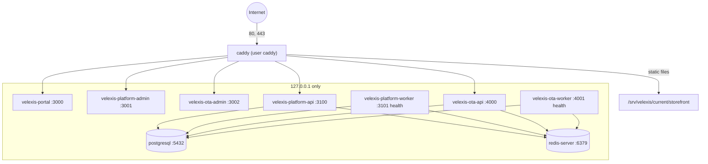

# Deployment on a single VM

This is the operations guide for running the whole Velexis MVP on one Ubuntu 24.04 VM without Docker, as [`decisions.md`](decisions.md) §2 and [ADR-0007](adr/0007-single-vm-without-docker.md) require. It covers VM sizing and hardening, the process layout, ports and users, PostgreSQL, Redis and Caddy (including on-demand TLS for custom domains), secrets and the master key, the deploy and rollback procedure, migrations, backups and the restore drill, logs, monitoring, capacity limits, and the step-by-step move to managed PostgreSQL and Redis later. The files it describes are in [`deploy/`](../../deploy/README.md); the tasks that finalise them are in [`plans/foundation-tasks.md`](plans/foundation-tasks.md).

Related: [`architecture.md`](architecture.md) §3 and §7 (hosts, ports, failure domains), [`local-development.md`](local-development.md), [ADR-0010](adr/0010-secrets-envelope-encryption.md) (keys), [ADR-0016](adr/0016-observability.md) (logs and alerts), [ADR-0018](adr/0018-hosted-storefront-custom-domains.md) (Caddy and custom domains), [ADR-0023](adr/0023-release-artefact-and-deploy-user.md) (release layout and the deploy user).

## 1. VM sizing

| Resource | Start | Why | Resize when |
|---|---|---|---|
| vCPU | 4 | Seven Node processes, PostgreSQL, Redis and Caddy; Node is mostly I/O-bound (Amadeus and Stripe calls). | Load average above 3 for an hour on most days, or p95 API latency rising without an Amadeus cause |
| RAM | 8 GB | The memory budget in [`architecture.md`](architecture.md) §3: PostgreSQL ~2.5 GB, Redis 0.5 GB, two APIs 768 MB each, two workers and three Next.js servers 512 MB each, about 7 GB in all, which leaves ~1 GB for Caddy, the OS and the page cache. | Memory use above 70 % most of the day (ADR-0007), or any OOM kill |
| Disk | 160 GB SSD (ADR-0007). 100 GB is the minimum that works for the first months. | Database with its WAL and dumps, journald (4 GB cap), local document storage, five releases, two days of local backups. | Disk use above 70 % (alert at 80 %) |
| Network | Public IPv4 (and IPv6 if offered), ports 22, 80, 443 | Let's Encrypt and storefront custom domains need a stable address. | — |

Pick a provider that offers snapshots and lets you resize the VM and the disk in place. Keep the off-VM backup bucket at a **different** provider ([§10](#10-backups)).

## 2. OS hardening

[`provision-vm.sh`](../../deploy/scripts/provision-vm.sh) applies all of this; the table is the checklist to review it against, and [`check-vm.sh`](../../deploy/scripts/check-vm.sh) checks the result on the VM ([§3](#3-provisioning-a-new-vm)).

| Area | Setting | Why |
|---|---|---|
| Updates | `unattended-upgrades` for security updates daily; no automatic reboot. Weekly `apt list --upgradable` review. | Patches without surprise restarts |
| SSH | Keys only, no root login, `AllowUsers <admin> deploy`, `MaxAuthTries 3`, in `/etc/ssh/sshd_config.d/00-velexis.conf`: sshd keeps the first value it reads, and `00-` sorts before cloud-init's `50-cloud-init.conf`, which enables password logins on some providers' images. `fail2ban` on `sshd`. The admin user needs a second factor, set by `ADMIN_MFA` in `/etc/ssh/sshd_config.d/01-velexis-mfa.conf` (task X-037): `fido2` (the default) accepts only FIDO2 keys (`sk-ssh-ed25519@openssh.com`, `PubkeyAuthOptions touch-required verify-required`), `totp` asks for the key and then a TOTP code (`AuthenticationMethods publickey,keyboard-interactive:pam`, `pam_google_authenticator` instead of the password in `/etc/pam.d/sshd`). The same file makes `deploy` a system account: `AuthenticationMethods publickey`, no TTY, no forwarding. Both read keys only from `~/.ssh/authorized_keys`. `provision-vm.sh` writes the file only while the admin has the factor enrolled; enrolment, backup key, lost key and break-glass: [`runbooks/ssh-access.md`](runbooks/ssh-access.md). | PCI 8.4.2 and 8.6 ([ADR-0027](adr/0027-pci-scope-and-vm-controls.md)) |
| Firewall | `ufw`: deny incoming; allow 22/tcp (rate-limited), 80/tcp, 443/tcp, 443/udp. Optionally restrict 22 to the developer's address (`SSH_ALLOW_FROM`, an IPv4 or IPv6 address or range), but GitHub-hosted runners deploy over SSH from changing addresses; `provision-vm.sh` refuses, changing nothing, a run whose own SSH login comes from outside that range ([`runbooks/ssh-access.md`](runbooks/ssh-access.md) §1, lead decision (15d) of 2026-11-11). | Only Caddy and SSH are reachable |
| Outbound | Deny by default (task X-041): the nftables table `inet velexis_egress` allows loopback, replies, DHCP, IPv6 neighbour discovery and only the connections of [`deploy/egress/allowed-hosts.conf`](../../deploy/egress/allowed-hosts.conf) (DNS, NTP, Stripe, Amadeus, the mail relays, the backup bucket, Let's Encrypt and ZeroSSL, the Ubuntu and vendor apt repositories, the provider's metadata service), and logs every other attempt with the prefix `VELEXIS-EGRESS-DENY` (at most 10 a minute, with the user) into the kernel log. `velexis-egress` loads it at boot and refreshes the hosts' addresses every 2 minutes (`velexis-egress-refresh.timer`), keeping the last good ones when a lookup fails. ufw keeps `allow outgoing`: a packet must pass every base chain, so the table's `drop` is final and ufw's own deny would refuse what the table allows. Adding a host, reading a refusal, the emergency opening: [`runbooks/outbound-allow-list.md`](runbooks/outbound-allow-list.md). | PCI DSS 11.5.1.1, covert malware channels ([ADR-0027](adr/0027-pci-scope-and-vm-controls.md) row 11.5) |
| Swap | Off (`swapoff -a`, commented in `/etc/fstab`) | Card data held in memory must never be written to disk |
| Core dumps | `kernel.core_pattern` piped to `/bin/false`, `fs.suid_dumpable=0`, `LimitCORE=0` on every unit. `apport.service` (package `apport-core-dump-handler`, part of the Ubuntu cloud image) is masked, because it rewrites `kernel.core_pattern` at every boot. | Same reason |
| Kernel | `kptr_restrict`, `dmesg_restrict`, `rp_filter`, no ICMP redirects, `vm.overcommit_memory=1` and THP off for Redis | Standard hardening plus Redis guidance |
| Audit | `auditd` rules on `/etc/velexis`, keys, `/etc/caddy`, systemd units, `/usr/local/sbin`, sudoers, sshd | Who changed what, when |
| File integrity | AIDE, daily check by the Ubuntu package's `dailyaidecheck.timer` (enabled by `harden`, checked by `check-vm.sh` since 2026-11-10); data and release folders excluded | PCI file-integrity monitoring |
| Time | UTC, `chrony` | Token expiry, ticketing deadlines and logs depend on correct time |
| Users | One system user per trust zone, no shell: `velexis-platform`, `velexis-ota`, `velexis-portal`, `velexis-platform-admin`, `velexis-ota-admin` ([ADR-0026](adr/0026-system-users-per-trust-zone.md), task X-033). Releases are uploaded by `deploy` (SSH key, `restrict`, sudo for `velexis-deploy` only). The developer uses the image's admin user with sudo. | Least privilege ([§4](#4-process-layout-ports-users-and-permissions)) |
| Security logs | auditd, sshd, sudo, Caddy and app security events kept 3 months on the VM and shipped off the VM with 12-month retention; daily automated review (task X-038, M6) | PCI 10.4 and 10.5 ([ADR-0027](adr/0027-pci-scope-and-vm-controls.md)) |

## 3. Provisioning a new VM

Do this once per VM, and again when rebuilding after a disaster. Allow one to two hours.

1. Create the VM (Ubuntu 24.04 LTS, sizes in [§1](#1-vm-sizing)) with your SSH key for the admin user. Note its IPv4/IPv6 address. The admin user must be a sudo user other than `root` with your key in `~/.ssh/authorized_keys` (`ubuntu` on most cloud images). If the provider only gives you `root`, create that user first: `provision-vm.sh` forbids root logins over SSH, so it refuses to run while `ADMIN_USER` does not exist or has no key, instead of locking you out. Have the second factor of the admin ready: two FIDO2 security keys with a PIN (`ADMIN_MFA=fido2`, the default), or an authenticator app (`ADMIN_MFA=totp`), and set up the provider's console access for break-glass ([`runbooks/ssh-access.md`](runbooks/ssh-access.md) §5).
2. Create DNS records (A and AAAA) pointing at the VM for every host of [`decisions.md`](decisions.md) §4: `platform.example.com`, `admin.platform.example.com`, `api.platform.example.com`, `admin.ota.example.com`, `api.ota.example.com` and the wildcard `*.ota.example.com`.
3. Generate the deploy key pair on your machine (`ssh-keygen -t ed25519 -f velexis-deploy -C github-actions`). Keep the private key for the GitHub `production` environment secret `DEPLOY_SSH_KEY`.
4. Copy the files: `scp -r deploy/ velexis-deploy.pub caddy ubuntu@<vm>:/tmp/`. `caddy` is the Velexis Caddy build of the same commit ([§6](#the-velexis-caddy-build-and-the-web-application-firewall)): `caddy/bin/caddy` of that commit's release (the artefact of a **Deploy** run's build job), or the output of `bash deploy/caddy/build/build-caddy.sh /tmp/caddy-build` on a Linux x86_64 machine. The provisioning refuses any binary whose SHA-256 is not `CADDY_SHA256` of `deploy/caddy/build/versions.env`.
5. Run `sudo DEPLOY_SSH_PUBKEY_FILE=/tmp/velexis-deploy.pub ADMIN_USER=ubuntu CADDY_BINARY=/tmp/caddy bash /tmp/deploy/scripts/provision-vm.sh`, then `sudo bash /tmp/deploy/scripts/check-vm.sh`: every line must read `PASS`. The provisioning script is idempotent; re-run it after fixing any error:
   - A re-run never overwrites a key file, an env file or `/etc/velexis/.provision-secrets`, and rewrites the deploy key only when `DEPLOY_SSH_PUBKEY_FILE` holds a different one. It must be the `.pub` file: the script refuses anything but one OpenSSH public key, without printing it.
   - It restarts PostgreSQL, Redis, Caddy and journald only when their configuration changed or they are not running. Its `packages` step, however, runs `apt-get upgrade`, and a package upgrade restarts its own service. On the production VM, re-run only the steps you need (`--steps …` without `packages`) unless a short interruption is acceptable.
   - It re-installs the units and root-owned scripts of the `deploy/` folder it runs from. Later runs therefore start from the deploy folder of the active release or a newer one (`sudo bash /srv/velexis/current/deploy/scripts/provision-vm.sh --steps …`), never from an older copy.
   - Its own messages (steps, warnings, errors; never a value) are appended to `/var/log/velexis/provision.log`.
   - Its step `caddy` installs the caddy package (its unit, user and folders) and the Velexis Caddy build as `/usr/local/bin/caddy-velexis`, then once moves the package's binary aside with `dpkg-divert` (to `/usr/bin/caddy.distrib`, where package upgrades now write) and makes `/usr/bin/caddy`, which the caddy service runs, a link to the build. Later runs take the build from `CADDY_BINARY` or from the release they run from (`/srv/velexis/current/caddy/bin/caddy`); `velexis-deploy` keeps it up to date ([§8](#8-release-artefact-deploy-and-rollback)).
   - The step `node` runs before `harden`, because `harden` ends with the step `egress`, the outbound allow-list (task X-041, [`runbooks/outbound-allow-list.md`](runbooks/outbound-allow-list.md)), which leaves out the npm registry that corepack fetches pnpm from. The step `egress` refuses, changing nothing, while an apt source of the VM has no line in `deploy/egress/allowed-hosts.conf`: a cloud image whose sources name the provider's mirror needs that mirror added by pull request first (or its sources pointed at `archive.ubuntu.com`). Until steps 6 and 7 below are done, `check-vm.sh` reports the SMTP and bucket lines of the list as lines without an address; the list follows the env files and `rclone.conf` within 2 minutes.
   - It never locks out the person who runs it (lead decision (13k) of 2026-11-10): run through `sudo` by a user the new `AllowUsers` leaves out (anyone but `ADMIN_USER` and `deploy`), a run with `harden` or `ssh` refuses before its first step and changes nothing; the step `ssh` also refuses a second factor that would ask you for one you have not enrolled. A root session without `sudo`, such as the provider's console, is not checked ([`runbooks/ssh-access.md`](runbooks/ssh-access.md) §1).
   - The SSH second factor of the admin (task X-037): on a new VM none is enrolled yet, so the step `harden` applies everything but it, prints why and the enrolment steps, and leaves sshd's per-user settings as they are; `check-vm.sh` reports `FAIL` for the admin's second factor and the `deploy` user's methods until then. Enrol it and apply it now, keeping your SSH session open: FIDO2 keys as [`runbooks/ssh-access.md`](runbooks/ssh-access.md) §2 says (TOTP: §3), then `sudo ADMIN_USER=ubuntu ADMIN_MFA=fido2 bash /tmp/deploy/scripts/provision-vm.sh --steps ssh`. It checks a copy of the sshd configuration with `sshd -t` and `sshd -T -C` before it writes anything, and reloads `ssh`, which keeps open sessions. From a second terminal, check that a plain key is refused and the security key logs in; then remove the plain key from `authorized_keys` and run `check-vm.sh` again. Pass the same `ADMIN_MFA` on later runs.
6. Edit `/etc/velexis/*.env`: replace every `CHANGE_ME` and the placeholder hosts with the real ones (SMTP; Stripe keys when their milestone arrives). Edit `/etc/velexis/caddy.env` (`PLATFORM_BASE_DOMAIN`, `STOREFRONT_BASE_DOMAIN`, `ACME_EMAIL`). Then `sudo systemctl restart caddy`.
7. Set up backups ([§10](#10-backups)): age public keys, rclone remote, then `sudo systemctl start velexis-backup` and check the bucket.
8. **Back up `/etc/velexis` now**, encrypted, to your offline password manager (it holds the master key; [§7](#7-secrets-and-the-master-key)).
9. In GitHub, set the `production` environment secrets `DEPLOY_HOST`, `DEPLOY_USER` (`deploy`), `DEPLOY_SSH_KEY` and `DEPLOY_KNOWN_HOSTS` (`ssh-keyscan -t ed25519 <vm>`), with yourself as required reviewer and a deployment branch policy that allows only `main` and tags `v*`.
10. Run the **Deploy** workflow from `main` and approve its deploy job. In M0 the result is the hello-world release: `https://platform.example.com/` shows the maintenance page with a valid certificate, `velexis-deploy --status` shows the release, and the database has the baseline schemas (the `platform` and `reference` ledgers list `0001_baseline`, `platform` also `R__ota_read_access`). What to record, and how to show that a second run of the same commit changes nothing: [`deploy/README.md`](../../deploy/README.md#first-deploy-human-steps-of-x-023).

**What `check-vm.sh` checks.** It is read-only (it writes no file and changes no setting) and prints one `PASS` or `FAIL` line per item, then a total; it exits 0 only when everything passes. `--only <group,…>` runs some groups, `--templates <folder>` compares the env files with another release's templates (for example `/srv/velexis/current/deploy/env`).

| Group | Items |
|---|---|
| `system` | Ubuntu 24.04, time zone UTC, no swap (`swapon --show` empty, no swap line in `/etc/fstab`), no core dumps (`kernel.core_pattern`, `fs.suid_dumpable`, `apport.service` masked), unattended upgrades, the AIDE database and `dailyaidecheck.timer` active and enabled (lead decision (13j) of 2026-11-10) |
| `services` | `postgresql` (and the cluster `postgresql@16-main`), `redis-server`, `caddy`, `velexis-backup.timer`, `velexis-healthcheck.timer`, `fail2ban`, `auditd` and `chrony` active and enabled; Node.js 22 |
| `firewall` | `ufw` active, incoming denied by default, only 22, 80 and 443 allowed; the outbound allow-list (X-041): outgoing denied by default (`inet velexis_egress`, policy `drop`), only its rules, refusals logged, every address of its sets on a line of `/etc/velexis/egress/allowed-hosts.conf` (an extra destination is named) and every line with an address, the SMTP URLs on their lines' ports, the resolvers of `DNS_RESOLVERS` and any other Amadeus base URL on lines of their own, no emergency opening, the installed list, `velexis-egress` and the VM's apt sources matching the release, the last refresh not failing, `velexis-egress-refresh.timer` active and enabled and its service enabled for boot |
| `ssh` | `sshd -T`: no password or keyboard-interactive authentication, no root login, public keys allowed, `AllowUsers` set. Every `AllowUsers` user but `deploy` is an admin, and `sshd -T -C user=<admin>` shows a second factor: FIDO2 (`publickey` with `sk-ssh-ed25519@openssh.com` only, `verify-required`) with only such keys in its `authorized_keys`, or TOTP (`publickey,keyboard-interactive:pam`, `pam_google_authenticator` in `/etc/pam.d/sshd` without `nullok` and without the password, a `0400` secret file). `sshd -T -C user=deploy`: public key only, no TTY, no forwarding. Both read keys only from `.ssh/authorized_keys` ([`runbooks/ssh-access.md`](runbooks/ssh-access.md) §7) |
| `database` | PostgreSQL 16 with `conf.d/velexis.conf` in effect and on loopback only, the database owned by `velexis_migrator`, the four roles (login, not superuser), `velexis_ota_app`'s `search_path` `pg_catalog` |
| `redis` | Redis 7.4 on loopback only, clients without the password refused, `maxmemory 512mb` with `maxmemory-policy noeviction`, AOF on |
| `caddy` | Caddy 2.8, `caddy validate` with `caddy.env` as the `caddy` user, no admin API on TCP (no `:2019` in `ss -ltn`), `/run/caddy` `0700 caddy` with `admin.sock` |
| `users` | the five zone users (no shell, locked), the group `velexis` with exactly them, the locked `deploy` user whose keys carry `restrict` |
| `files` | the owners and modes of [§4](#4-process-layout-ports-users-and-permissions): key folders `0500` and key files `0400` per zone, identical master-key and pepper copies, env files and `.provision-secrets` `root:root 0600`, `/srv/velexis` with read-only releases, the root-owned scripts (`velexis-deploy`, `-backup`, `-restore`, `-alert`, `-run`, `-healthcheck`) and the sudoers rule |
| `envfiles` | every `/etc/velexis/<app>.env` has every variable of its `deploy/env/<app>.env.example` (an empty value is fine; missing ones are listed by name), and the edge secret and the OTA admin service key are the same in the files that share them |

It never prints a value: env files are compared by variable name, the shared values and key copies are compared without output, the Redis password reaches `redis-cli` through its environment, `caddy validate` messages are shown with every value of `caddy.env` replaced by `<redacted>` (bash's own errors about a malformed line of that file are dropped, because they would quote part of a value), and of a TOTP secret file only the owner, the mode and its time-based marker line are read. Run it after provisioning, after editing anything in `/etc/velexis`, and when a deploy is refused for missing variables. [`deploy/scripts/test/check-vm.test.sh`](../../deploy/scripts/test/check-vm.test.sh) tests it, with fake system tools, against the layout `provision-vm.sh` creates.

**Rehearsal on a throwaway VM.** Before the production VM, and whenever `provision-vm.sh` changes a lot, run it twice on a throwaway Ubuntu 24.04 VM (never the production VM; at least 4 GB of RAM, because `velexis.conf` gives PostgreSQL 1.5 GB of shared buffers) and keep both outputs. Enrol the admin's second factor first ([`runbooks/ssh-access.md`](runbooks/ssh-access.md) §2 steps 1 to 3, with the throwaway VM's `authorized_keys`), so that the first run applies it. Both `check-vm.sh` runs must show only `PASS`, and the second provisioning run must change no generated file and no sshd drop-in:

```bash
scp -r deploy/ velexis-deploy.pub ubuntu@<throwaway-vm>:/tmp/
ssh ubuntu@<throwaway-vm>
sudo DEPLOY_SSH_PUBKEY_FILE=/tmp/velexis-deploy.pub ADMIN_USER=ubuntu ADMIN_MFA=fido2 bash /tmp/deploy/scripts/provision-vm.sh 2>&1 | tee ~/provision-1.txt
sudo bash /tmp/deploy/scripts/check-vm.sh | tee ~/check-1.txt   # after removing the plain key (ssh-access.md §2 steps 5 and 6)
fp() { sudo find /etc/velexis /home/deploy/.ssh /etc/redis/velexis.conf /etc/ssh/sshd_config.d /etc/pam.d/sshd -type f -printf '%p %i %T@ %C@ %s %m %u:%g\n' | sort; }
fp > ~/fp-1.txt
sudo DEPLOY_SSH_PUBKEY_FILE=/tmp/velexis-deploy.pub ADMIN_USER=ubuntu ADMIN_MFA=fido2 bash /tmp/deploy/scripts/provision-vm.sh 2>&1 | tee ~/provision-2.txt
sudo bash /tmp/deploy/scripts/check-vm.sh | tee ~/check-2.txt
fp > ~/fp-2.txt && diff ~/fp-1.txt ~/fp-2.txt && echo "second run changed no generated file"
```

The fingerprints hold paths, inodes, modification and change times, sizes, modes and owners, never contents: a rewritten file gets a new time or inode. The same session also gives the human check of X-037: a plain key refused and the security key accepted for the admin, and a Deploy workflow run to the throwaway VM ([`runbooks/ssh-access.md`](runbooks/ssh-access.md) §7). Delete the VM afterwards; its generated keys and passwords are never reused.

## 4. Process layout, ports, users and permissions



| Unit | Runs | Port | Memory limit | Restart order on deploy |
|---|---|---|---|---|
| `velexis-platform-worker` | `platform-backend/dist/worker.js` | 3101 (health) | 512 MB | 1 |
| `velexis-ota-worker` | `ota-backend/dist/worker.js` | 4001 (health) | 512 MB | 2 |
| `velexis-platform-api` | `platform-backend/dist/main.js` | 3100 | 768 MB | 3 |
| `velexis-ota-api` | `ota-backend/dist/main.js` | 4000 | 768 MB | 4 |
| `velexis-portal` | Next.js standalone | 3000 | 512 MB | 5 |
| `velexis-platform-admin` | Next.js standalone | 3001 | 512 MB | 6 |
| `velexis-ota-admin` | Next.js standalone | 3002 | 512 MB | 7 |
| `postgresql`, `redis-server`, `caddy` | vendor packages; `caddy` runs the Velexis build `/usr/local/bin/caddy-velexis` as `/usr/bin/caddy` ([§6](#the-velexis-caddy-build-and-the-web-application-firewall)) | 5432, 6379, 80/443; Caddy's admin API only on the unix socket `/run/caddy/admin.sock` (no TCP port) | — | not restarted by deploys, but Caddy is reloaded when its Caddyfile or rule files change and restarted when its build changes |
| `velexis-backup.timer` | `/usr/local/sbin/velexis-backup` | — | — | nightly 02:30 UTC |
| `velexis-healthcheck.timer` | `/usr/local/sbin/velexis-healthcheck` (the on-VM health check, [§13](#13-monitoring-and-uptime)) | — | — | every 5 minutes; not restarted by deploys |
| `velexis-egress-refresh.service`, `.timer` | `/usr/local/sbin/velexis-egress refresh` (the outbound allow-list, [§2](#2-os-hardening)) | — | — | at boot before `network-online.target`, then every 2 minutes; not restarted by deploys |

Workers restart first so new consumers run before new producers ([ADR-0009](adr/0009-background-jobs-bullmq.md)). Every app unit has `Restart=always` with `RestartMode=direct` and a start limit of 10 starts in 5 minutes, sandboxing (`ProtectSystem=strict`, `PrivateTmp`, `ProtectProc=invisible`, no capabilities, a system-call filter; exposure 2.0 or lower in `systemd-analyze security`), `MemoryMax`, `LimitCORE=0` and `OnFailure=velexis-alert@%n.service`, which mails once when the start limit gives up ([`deploy/systemd/`](../../deploy/systemd/); proven under systemd by `deploy/systemd/test/units-smoke.sh`).

**What separates the apps.** Each trust zone runs as its own user ([ADR-0026](adr/0026-system-users-per-trust-zone.md)): the platform API and worker as `velexis-platform`, the OTA API and worker as `velexis-ota`, and each Next.js app as its own user. That is the boundary: a process cannot read another user's `/proc/<pid>/environ` or `/proc/<pid>/root`, and with `ProtectProc=invisible` it does not even see the other zones' processes. Env files are `root:root 0600` and read only by systemd, and key folders belong to their zone's user. `InaccessiblePaths=` additionally hides the other zones' env files and key folders from each unit's mount namespace; it is defence in depth only, because it cannot stop a process from reading what another process of the **same** user holds, and it does nothing against root. Within a zone, the API and its worker can read each other's memory and environment; that is accepted (same code, same keys). One-off processes follow the same rule: `velexis-deploy` runs the migrations and the reference data loader as transient units with a dynamic user (`systemd-run -p DynamicUser=yes -p SupplementaryGroups=velexis -p EnvironmentFile=…`), so no app user's process ever holds the migrator DSN, and `velexis-run <zone> <command>` runs a CLI command as the zone's user with the identity, env files, folder and sandbox of the zone's installed unit. `deploy/systemd/test/units-smoke.sh` proves all of this under systemd in CI.

| Path | Owner, mode | Content |
|---|---|---|
| `/srv/velexis/incoming/<sha>/` | `deploy`, 0750 | Upload target of the deploy workflow |
| `/srv/velexis/releases/<sha>/` | `root:velexis`, read-only (`u=rX,g=rX,o=`; `storefront/` world-readable for Caddy). `velexis` is a group of all app users that only grants reading releases. | One release; the last five are kept |
| `/srv/velexis/current` | symlink | Active release |
| `/srv/velexis/maintenance/` | root, 0755 | Maintenance page served by Caddy when a Next.js app is down |
| `/etc/velexis/`, `/etc/velexis/keys/` | `root:root` 0711 | Can be crossed, not listed: each zone reaches only its own key folder |
| `/etc/velexis/<app>.env` | `root:root` 0600, read by systemd before it starts the unit (`caddy.env` the same, loaded through the drop-in; `migrator.env` and `reference-loader.env` for the transient units of `velexis-deploy`) | Environment files |
| `/etc/velexis/keys/platform/`, `/etc/velexis/keys/ota/` | the zone's user (`velexis-platform`, `velexis-ota`), 0500 folder, 0400 per file | Master key and pepper (identical copies in both), the zone's JWT key, the document URL key (OTA only) |
| `/etc/velexis/backup/` | root, 0700 | age recipients, rclone config |
| `/etc/velexis/egress/allowed-hosts.conf` | `root:root` 0644 (folder 0755) | The outbound allow-list, installed by `provision-vm.sh --steps egress` from the release ([`runbooks/outbound-allow-list.md`](runbooks/outbound-allow-list.md)) |
| `/var/lib/velexis/` | root, 0711 | Deploy history, reference data checksum, tenant fan-out reports (`migrate-<sha>.json`, root 0600) |
| `/var/lib/velexis/healthcheck/` | root, 0700 (`StateDirectory=` of `velexis-healthcheck.service`) | One state file per health check (`<check>.state`: `ok` or `fail`, since when, the first problem), `payment-pages.day` (the UTC day of the last payment page check) and the run lock ([§13](#13-monitoring-and-uptime)) |
| `/var/lib/velexis/storage/` | `velexis-ota`, 0700 | Documents and exports ([ADR-0017](adr/0017-email-documents-storage.md)) |
| `/var/lib/velexis/egress/` | root, 0700 (`StateDirectory=` of `velexis-egress-refresh.service`) | The addresses of each line of the allow-list with the time a lookup last returned them, the failure marker and the run lock |
| `/var/lib/velexis/system/<sha>/` | root, 0755 | Root-owned snapshot of a release's units, Caddyfile, firewall rule files (`caddy-waf/`), Caddy build (`caddy-velexis`) and maintenance page, re-installed on rollback ([§8](#8-release-artefact-deploy-and-rollback)) |
| `/var/lib/velexis-migrate/` | systemd (`StateDirectory=` of the transient migration unit; a link into `/var/lib/private/`, root 0700) | The tenant fan-out report while the migration runs; `velexis-deploy` moves it to `/var/lib/velexis/` and `/var/log/velexis/` |
| `/var/cache/velexis/<app>/` | the app's user (systemd `CacheDirectory`) | Next.js runtime cache |
| `/var/backups/velexis/` | root, 0700 | Encrypted backups before upload (two days) |
| `/var/log/velexis/` | `root:adm` 0750 | Deploy log, `provision.log` (the runs of `provision-vm.sh`), migration reports, restore-drill logs |
| `/usr/local/bin/caddy-velexis` | root, 0755 | The Velexis Caddy build with the web application firewall; `/usr/bin/caddy` is a link to it, the package's binary is diverted to `/usr/bin/caddy.distrib` ([§6](#the-velexis-caddy-build-and-the-web-application-firewall)) |
| `/etc/caddy/Caddyfile`, `/etc/caddy/waf/` | root, 0644 (folder 0755) | The Caddyfile and the firewall's rule files (`coraza.conf`, `exclusions.conf`, `logdata.conf`) of the active release |
| `/usr/local/sbin/velexis-{deploy,backup,restore,alert,run,healthcheck}` | root, 0755 | Root-owned copies of `deploy/scripts/*.sh`; `velexis-run <zone> <command>` (`run-as.sh`) runs one-off CLI commands as the zone's user, with the env files, folder and sandbox of the zone's installed unit; the exit code is the command's |
| `/usr/local/sbin/velexis-egress` | root, 0755 | `deploy/scripts/egress.sh`, installed by `provision-vm.sh --steps egress` (not by deploys: a release that changes it or the list needs that step run again) |

## 5. PostgreSQL and Redis

### PostgreSQL 16

Installed from the PGDG repository, configured by [`deploy/postgres/velexis.conf`](../../deploy/postgres/velexis.conf) in `conf.d`.

| Setting | Value | Reason |
|---|---|---|
| `listen_addresses` | `localhost` | Only local apps connect; `scram-sha-256` passwords |
| `max_connections` | 100 | Pools: platform API 10 + worker 5, OTA API 20 + worker 10, migrator 4, plus ops headroom. No PgBouncer below ~80 app connections ([ADR-0004](adr/0004-postgresql-schema-per-tenant.md)). |
| `shared_buffers` / `effective_cache_size` | 1.5 GB / 4 GB | ~20 % / ~50 % of RAM |
| `work_mem` / `maintenance_work_mem` | 16 MB / 256 MB | Many connections, small sorts |
| `max_locks_per_transaction` | 256 | A whole-database `pg_dump` and the tenant fan-out lock ~42 tables per tenant schema. 256 × 100 = 25,600 locks covers about 500 tenants. |
| `wal_level`, `wal_compression` | `replica`, `zstd` | WAL archiving (pgBackRest) can be added later without a restart |
| `random_page_cost`, `effective_io_concurrency` | 1.1, 200 | SSD |
| `idle_in_transaction_session_timeout` | 5 min (app roles 60 s) | No transaction stays open across a slow external call |
| Logging | slow statements ≥ 500 ms, lock waits, DDL; **never** bound parameter values. `ALTER ROLE … PASSWORD` is DDL, so a password is set only in a session with `log_statement = none` (and `pg_stat_statements.track_utility = off`): `provision-vm.sh` does this, and so must a manual rotation ([§7](#7-secrets-and-the-master-key)). | Personal data and passwords stay out of logs |
| `pg_stat_statements` | on | Find slow queries without extra tooling |

Roles ([`deploy/postgres/bootstrap.sql`](../../deploy/postgres/bootstrap.sql), [ADR-0004](adr/0004-postgresql-schema-per-tenant.md)):

| Role | Used by | Privileges |
|---|---|---|
| `velexis_migrator` | `velexis-deploy` (migrations, tenant fan-out) only; its DSN is in the root-only `migrator.env`, which systemd reads for a transient unit with a dynamic user, so no app user's process ever holds it | Owns the database, `platform` and `reference`; member of `velexis_provisioner` (the fan-out uses `SET LOCAL ROLE`). DDL only; never serves requests. `lock_timeout 5s`. |
| `velexis_provisioner` | OTA worker (tenant provisioning, `ota-worker.env`) | `CREATE` on the database, owns every `tenant_<key>`, nothing on `platform` or `reference` ([ADR-0004](adr/0004-postgresql-schema-per-tenant.md)). DDL only; never serves requests. |
| `velexis_platform_app` | Platform API and worker; the reference data loader at deploy (`reference-loader.env`) | DML on `platform` and `reference` (default privileges), none on tenant schemas. Audit log is insert-only (platform migration). |
| `velexis_ota_app` | OTA API and worker | DML on tenant schemas (granted at provisioning), `SELECT` on `reference`, **read-only** `SELECT` on the listed platform tables and on the non-secret columns of `accounts` (repeatable grants file, [ADR-0021](adr/0021-migration-cli-and-repeatable-grants.md)); never password hashes or MFA secrets. `search_path = pg_catalog`. |

Backups and restores run as the `postgres` superuser through peer authentication on the VM only.

### Redis 7.4

From packages.redis.io, pinned to 7.4 with an apt preference, configured by [`deploy/redis/velexis.conf`](../../deploy/redis/velexis.conf):

- loopback only, `requirepass` (generated), `protected-mode yes`;
- `maxmemory 512mb` with `maxmemory-policy noeviction` (BullMQ requirement): **every cache key has a TTL** ([ADR-0009](adr/0009-background-jobs-bullmq.md));
- BullMQ keeps failed jobs 30 days and completed jobs a day, but the completed jobs of the OTA's `ota-maintenance` (its schedulers' jobs, 5 258 a day per active OTA) an hour ([ADR-0009](adr/0009-background-jobs-bullmq.md) item 7, revised on 2026-11-11 by OBE-101). Measured: about 0.3 MiB per active OTA, and about 9 KiB per booking of the last day for the other queues ([`performance.md`](../../ota/docs/performance.md) §7);
- AOF with `appendfsync everysec`, no RDB snapshots; `FLUSHALL` and `DEBUG` disabled;
- logs to journald.

Redis is a transport and cache. PostgreSQL holds every durable record; the provisioning reconciler and webhook inboxes replay what Redis loses ([`architecture.md`](architecture.md) §7).

## 6. Caddy and TLS

[`deploy/caddy/Caddyfile`](../../deploy/caddy/Caddyfile) (Caddy 2.8.4, the Velexis build with the web application firewall below; the official package provides the unit and the user) serves every public host:

| Host | Handling |
|---|---|
| `platform.example.com`, `admin.platform.example.com`, `admin.ota.example.com` | Reverse proxy to 3000, 3001, 3002. Maintenance page on 502/503/504. Optional IP allow-list for the platform admin. |
| `api.platform.example.com`, `api.ota.example.com` | Reverse proxy to 3100, 4000. `/internal/*` and `/health/*` (except `/health/live`) answer 404. Client copies of the edge headers are removed. JSON `SERVICE_UNAVAILABLE` envelope on 502/503/504. 1 MB body limit, except `POST /v1/console/settings/assets` on `api.ota.example.com` (the storefront asset upload: 1100 KiB, lead decision (2c) of 2026-10-30). |
| `*.ota.example.com` | Hosted storefront: static files from `/srv/velexis/current/storefront`, `/api/*` proxied to 4000 with `X-Velexis-Edge` and `X-Velexis-Host` set by Caddy (`/api/internal/*` and `/api/health/*` except `/api/health/live` answer 404), strict CSP (the OTA API's public images, `/api/v1/assets/*`, keep the API's own `default-src 'none'`, lead decision (2b) of 2026-10-30), immutable caching for `/assets/*` |
| any other host (`https://`) | Same storefront block for **verified custom domains** |

**Certificates.** The five named hosts get certificates at start-up (Let's Encrypt, ZeroSSL as fallback). Storefront hosts use **on-demand TLS**: on the first TLS handshake for an unknown name Caddy calls `GET http://127.0.0.1:3100/internal/tls/ask?domain=<host>`, and obtains a certificate only on `200` ([ADR-0018](adr/0018-hosted-storefront-custom-domains.md)). The platform API answers `200` for `<key>.ota.example.com` of a provisioning, active or suspended tenant, and for verified custom domains of active tenants whose plan allows them.

Consequences to know:

- Until the platform API exists (M1), storefront hosts cannot get certificates. The M0 hello world therefore uses `platform.example.com`.
- If the platform API is down, **existing** certificates keep working; only new hosts wait.
- Let's Encrypt allows about 50 new certificates per registered domain per week. Above ~30 sign-ups per week, switch to a DNS-01 wildcard certificate for `*.ota.example.com` (ADR-0018 follow-up).
- Custom-domain owners create `CNAME travel.example.net → acme.ota.example.com` (or A/AAAA for an apex) and the `_velexis` TXT record; the platform worker verifies them (M5).
- Caddy's admin API listens only on the unix socket `/run/caddy/admin.sock`, inside `/run/caddy` (mode 0700, user `caddy`, created by the `RuntimeDirectory=` of the drop-in). No app user can open it, so no app process can replace the live configuration (for example the payment-page CSP). `systemctl reload caddy` reads the socket address from the Caddyfile; changing that address needs `systemctl restart caddy`. X-022's smoke test proves a reload through the socket ([ADR-0027](adr/0027-pci-scope-and-vm-controls.md)).
- The access log of every host keeps no secret and no personal value of a URL ([§12](#12-logs)): Stripe's 3-D Secure return puts the PaymentIntent's client secret into the storefront's `/checkout/complete.html` address, Stripe Connect's return puts its single-use OAuth code and state into the portal's `/connect/stripe/callback` address, and the portal and the admin sites put e-mail addresses, names and searches into theirs (list filters, sign-in links and their `next` path). Every same-origin request of such a page carries its address in `Referer`, and a redirect may carry it in `Location`, so the filter cleans those two headers as well. A page that puts a new secret or personal value into its URL adds its parameter to `(log_query_filter)` and to the smoke test.

**Validation.** In CI every Caddyfile change is checked with `caddy validate` and run end to end by [`deploy/caddy/test/caddy-smoke.sh`](../../deploy/caddy/test/README.md). On the VM `velexis-deploy` runs `caddy validate` again (with the real `caddy.env`, the release's firewall rule files and the Caddy build the service will run) before the file is installed and reloaded (`systemctl reload caddy`, no dropped connections).

### The Velexis Caddy build and the web application firewall

PCI DSS 6.4.2 asks for an automated technical solution in front of public-facing web applications ([ADR-0027](adr/0027-pci-scope-and-vm-controls.md) row 6.4.2, task X-039). Caddy therefore runs a build of its own: Caddy 2.8.4 with the [Coraza](https://coraza.io/) module (`coraza-caddy`) and the OWASP Core Rule Set v4 embedded.

**The build.** [`deploy/caddy/build/build-caddy.sh`](../../deploy/caddy/build/build-caddy.sh) builds it with `xcaddy` from the versions that [`versions.env`](../../deploy/caddy/build/versions.env) pins: the Go toolchain (the `golang.org/toolchain` zip from `proxy.golang.org`, checked by its SHA-256; Go 1.26, because a Caddy 2.8.4 built with Go 1.27 panics at start-up), xcaddy, Caddy, `coraza-caddy` v2.0.0 (the last release for Caddy 2.8), Coraza v3.8.1 (3.3.3 fixed CVE-2025-29914; before 3.8.0 the temporary file of a multipart body's file part could stay behind for good, in 3.3.3 for every part without its closing boundary, so anyone could fill the disk) and `coraza-coreruleset` v4.7.0. Modules come only from `proxy.golang.org` and are checked against `sum.golang.org`; the build uses `-trimpath`, no cgo and no VCS stamp, and the binary's modification time is the fixed `SOURCE_DATE_EPOCH`. The build is reproducible, so `versions.env` also pins the binary's SHA-256 (`CADDY_SHA256`): the build fails on any other result, which makes every CI run and every release build a reproducibility check. `pack-release.sh` builds it into every release as `caddy/bin/caddy` (the build job of `deploy.yml`, and CI's dry run); CI's `deploy-files` job builds it for the smoke test. Changing a version: edit `versions.env`, build (it fails and prints the new SHA-256), pin it, build again into another folder to see the same SHA-256, run the smoke test, and say why in the commit.

**On the VM.** `provision-vm.sh --steps caddy` installs the build once as `/usr/local/bin/caddy-velexis` and points the caddy service at it: `dpkg-divert` moves the package's `/usr/bin/caddy` to `/usr/bin/caddy.distrib` (package upgrades write there from then on) and `/usr/bin/caddy` becomes a link to the build ([§3](#3-provisioning-a-new-vm) steps 4 and 5). From then on `velexis-deploy` installs a release's build from its root-owned snapshot when its content changed: staged, it validates the release's Caddyfile with the release's rule files, and after the units are healthy it is moved into place and Caddy is restarted (a running Caddy keeps its old binary; the restart costs a few seconds of connections). Should Caddy not start with it, the deploy stops with an error and the caddy unit's failure alert, the release stays current (its units are healthy), and `sudo velexis-deploy --rollback` re-installs the previous release's build from its snapshot and restarts Caddy with it. An unchanged build restarts nothing; rule files and Caddyfile alone are reloaded. A VM without the link keeps its package binary: `velexis-deploy` then leaves the release's build aside and validates the Caddyfile with the package's binary, which refuses the firewall's directives, so the deploy stops before it changes anything and asks for the step `caddy`. **For a VM provisioned before X-039**, once: set `VELEXIS_WAF_ENGINE=DetectionOnly` in `/etc/velexis/caddy.env` (the detection week, below); take the `caddy/bin/caddy` of the release to deploy (its build-job artefact, or the refused upload in `/srv/velexis/incoming/<sha>/caddy/bin/caddy`); from a copy of that commit's `deploy/`, run `sudo CADDY_BINARY=<it> bash /tmp/deploy/scripts/provision-vm.sh --steps caddy,scripts` (the step `caddy` checks the binary's SHA-256 against that copy's `versions.env`; the step `scripts` installs that commit's `velexis-deploy`, because the one on such a VM predates X-039: it validates a new Caddyfile without the release's rule files, which are not in `/etc/caddy/waf` yet, and refuses it); then deploy again. auditd's watch on the build (key `caddy-binary`) belongs to the step `harden`: such a VM gets it the next time `harden` runs with the VM's own settings.

**What it does.** Every site of the Caddyfile has a WAF (snippet `(waf)`, `order coraza_waf first`, so it runs before every other handler), with the rule files of [`deploy/caddy/waf/`](../../deploy/caddy/waf) installed as `/etc/caddy/waf/`:

| Host and path | Mode | A request the Core Rule Set flags |
|---|---|---|
| storefront `/api/*` and `/checkout/*` (every `*.ota.example.com` and custom domain), `api.ota.example.com` | blocking: `{$VELEXIS_WAF_ENGINE:On}` | refused with `403` (`400` for a body that cannot be parsed): the API's error envelope (`FORBIDDEN`, `INVALID_REQUEST`, with the request id) on the APIs, a short text on the payment pages, both with the host's security headers and `no-store`; `413` for arguments or a body above the limits below, without a body, as Caddy's own `request_body` limits answer |
| the other storefront pages, the portal, `admin.platform.example.com`, `api.platform.example.com`, `admin.ota.example.com` | `DetectionOnly` | logged, passed on |
| Stripe's webhook paths on `api.ota.example.com` (`/webhooks/stripe/…`) | detection only (`exclusions.conf`, rule 10001) | logged, passed on: the API accepts only events signed by Stripe, and a refused event stalls a payment until Stripe gives up |

- The OWASP Core Rule Set v4 at paranoia level 1 with its anomaly scoring (one critical match, score 5, blocks); only its request rules and its per-request summary (RESPONSE-980) are loaded, and the rules of paranoia levels 2 to 4 are removed after loading (level 1 skips them anyway). Responses are not inspected. The allowed methods include `PUT`, `PATCH` and `DELETE`, and the allowed body types `text/plain` (the Next.js server actions); [`coraza.conf`](../../deploy/caddy/waf/coraza.conf) lists every setting that differs from Coraza's recommended configuration.
- **What one request may cost.** The Core Rule Set costs about 7 ms of CPU per KiB of arguments (a 100 KB JSON field 0.6 to 0.8 s). Arguments (query, form and JSON fields together) above 128 KiB are therefore refused (`413`) in blocking mode and not inspected in detection mode, more than 1000 arguments are refused (`400`), request headers are limited to 32 KiB (Caddy's `max_header_size`; the apps take 16 KiB), and each WAF reads a body only up to its own limit (the third argument of `import waf`; rule 200006 refuses a longer one with `413` in blocking mode, Caddy's `request_body` limit in detection mode). The WAF runs before `request_body`, so each limit is just above the `request_body` limit of its requests: 256 KiB on the storefront, which is also the WAF's in-memory limit, so a storefront body is never buffered in a temporary file and the airline-card details (a JSON body) never reach the disk; 1200 KiB on `api.ota.example.com`, 1 MiB on the platform API, 5 MiB on the portal and the platform admin, 10 MiB on the OTA admin. On those hosts a body above 256 KiB, and on every host each file part of a multipart body, is written to the caddy service's private `/tmp` and removed when the request ends ([`caddy-smoke.sh`](../../deploy/caddy/test/README.md) step 6e checks that nothing stays behind). Files of a multipart upload do not count as arguments. The longest fields the OTA API takes, a notification template's `bodyHtml` (100,000 characters) and `bodyText` (50,000) and a content page's markdown (50,000; more bytes in non-Latin scripts), can exceed 128 KiB: the OTA admin sends them on the loopback, without the WAF, but a console automation by API key (`console:automation`) that sends them through `api.ota.example.com` (`consolePutNotificationTemplate`, `consolePreviewNotificationTemplate`, `consoleCreateStorefrontPage`, `consoleUpdateStorefrontPage`) gets `413` above 128 KiB of arguments. The contract states it in those four operations' descriptions ([OTA OpenAPI document](../../ota/backend/openapi/velexis-ota-booking-api.openapi.yaml), **Long bodies through `api.ota.example.com`**; lead decision (17j) of 2026-11-11), and the [build-your-own-frontend guide](../../ota/frontend/docs/build-your-own-frontend.md) §2.4 points to them.
- **Streamed answers.** `coraza-caddy` v2.0.0 does not pass a flush on to the client (its response writer's `Flush` sends nothing), so behind every WAF, in detection mode too, an answer that an app streams in parts (chunked, without `Content-Length`) reaches the client only when Go's write buffer of a few KiB fills or the answer ends (measured with this build: the first part of a chunked answer that ends 1.5 s later arrived after 1.5 s, without a WAF at once). No Velexis answer depends on it today: there are no server-sent events, and the Next.js apps have no `loading.tsx` or `Suspense` boundary that streams a page in parts. A feature that needs streaming changes this first (a `coraza-caddy` that flushes, or that path without the WAF).
- **Memory.** The nine WAF instances of the Caddyfile add about 50 MB to Caddy (measured with this build: about 24 MB for the first, which loads the Core Rule Set, and about 3 MB for each further one; Caddy alone about 45 MB, with the nine about 92 MB), and a reload briefly holds the old and the new configuration.
- **The WAF log** is Caddy's log in journald (logger `http.handlers.waf`): one line per matched rule with the client address, the rule's id, file, message and tags, the name of the variable that matched (`ARGS:json.travellers.0.lastName`) and the request's path and query (`[uri]`), and a final line for the blocking decision (949110) and the summary (980170). [`logdata.conf`](../../deploy/caddy/waf/logdata.conf), generated by `build-caddy.sh` for the Core Rule Set of `versions.env`, replaces every rule's own log data, which would quote what matched, by the variable's name, so no value of a body, header or cookie (a password, a token, card data, a name) reaches the log; Coraza's audit log, which would hold headers and bodies, stays off. What remains is the request's query in `[uri]` when a rule matched that request: a signed URL's `sig`, a link's `token` or a Stripe client secret reaches the WAF log only together with an attack-shaped value of the same request. Read it with `journalctl -u caddy -o cat | jq -r 'select(.logger == "http.handlers.waf") | .msg'`; X-038 ships it with the other security logs and its daily review counts its findings. *Note (2026-11-11, lead decision (17i), approved by the owner):* X-038 blanks the query values of these lines (every value in the query of `[uri "…"]`, the names kept) before any log leaves the VM, in the hour's chunk it ships and in the daily files of `/var/log/velexis/security/`, and its daily summary and alerts never quote a `[uri]`; an acceptance criterion of X-038 with its test. The values stay only in the VM's own journald (30 days, root and the administrators who may read the journal), the residual that the PCI pack records with X-038 as its control ([`ota/docs/pci/README.md`](../../ota/docs/pci/README.md) §8).
- **Exclusions** go into [`exclusions.conf`](../../deploy/caddy/waf/exclusions.conf), each by rule id, as narrow as possible (one rule, one argument, one path) and with its reason; add the legitimate request it lets through to the smoke test's normal requests.

**The detection week (human step of X-039).** Before the blocking paths block, the WAF runs in detection mode everywhere for at least one week: set `VELEXIS_WAF_ENGINE=DetectionOnly` in `/etc/velexis/caddy.env` before the first deploy with the WAF (or `sudo systemctl reload caddy` after setting it). Review the WAF log daily (`journalctl -u caddy`, later X-038's daily summary): every match on legitimate traffic gets an exclusion in `exclusions.conf` through a pull request and a deploy. When a week passes without a new legitimate match, remove the line from `caddy.env` and run `sudo systemctl reload caddy`: the storefront's `/api/*` and `/checkout/*` and `api.ota.example.com` block from then on (`{$VELEXIS_WAF_ENGINE:On}`). Keep the review notes with the PCI evidence ([`ota/docs/pci/`](../../ota/docs/pci/README.md)).

## 7. Secrets and the master key

| Secret | Where on the VM | Created by | Rotation |
|---|---|---|---|
| Master key (KEK) `master-v1.key` | `/etc/velexis/keys/platform/` and `/etc/velexis/keys/ota/` (identical copies, each 0400 for its zone's user) | `provision-vm.sh` (32 random bytes) | Add `master-v2.key` to both folders (`NEW_MASTER_KEY=v2 provision-vm.sh --steps keys`), set `MASTER_KEY_CURRENT=local:v2`, run both backends' `secrets:rewrap`, remove v1 when both report zero rows ([ADR-0010](adr/0010-secrets-envelope-encryption.md), [master-key rotation runbook](runbooks/master-key-rotation.md)) |
| API key pepper, document URL key, JWT Ed25519 keys | The zone's key folder (pepper in both, document URL key in `ota/` only) | `provision-vm.sh` | JWT by `kid`, with an overlap of one token lifetime (`JWT_PREVIOUS_PUBLIC_KEY_FILE`; the OTA API's key: [`jwt-key-rotation.md`](../../ota/docs/runbooks/jwt-key-rotation.md), FIX-W48-OTA; the platform's: [`platform-operations.md`](../../platform/docs/runbooks/platform-operations.md)); pepper not rotated in the MVP |
| Database and Redis passwords, edge secret, OTA admin service key, platform BFF key | `/etc/velexis/*.env` (generated values also in `/etc/velexis/.provision-secrets`, root 0600) | `provision-vm.sh` | Change the value in `.provision-secrets` **first**: every `provision-vm.sh` run sets the role passwords and the Redis password from it again. Then change it in the env files, apply it (`provision-vm.sh --steps database` for the role passwords, in a session that logs nothing; `--steps redis` for Redis), restart the units and run `check-vm.sh`. A manual change uses `\password <role>` in a `psql` session started with `PGOPTIONS='-c log_statement=none -c pg_stat_statements.track_utility=off'`, never a typed `ALTER ROLE … PASSWORD`, which psql would also keep in its history file |
| Stripe keys, SMTP credentials | `/etc/velexis/*.env` | The developer | Rotate in the provider's dashboard, update, restart |
| Amadeus credentials | **Not** on the VM: encrypted in `platform.amadeus_accounts` / `supplier_connections` | Platform admin, portal | Through the UI |
| age **private** keys (backups) | **Never on the VM** | The developer, offline | Generate a new pair, replace the recipients file |
| Deploy SSH key | GitHub `production` environment | The developer | Replace the key in GitHub and `~deploy/.ssh/authorized_keys` |

Rules:

- **Losing the master key loses every encrypted secret.** `/etc/velexis` is backed up nightly to a separate age key, and once by hand after provisioning.
- Nothing secret is committed; templates hold `@@GENERATED@@` or `CHANGE_ME` values only.
- Env files are `root:root 0600` and read by systemd only ([ADR-0026](adr/0026-system-users-per-trust-zone.md)). Each one-off process of a deploy gets exactly one DSN: the migrations `DATABASE_MIGRATOR_URL` from `migrator.env`, the reference data loader `DATABASE_URL` (platform role) from `reference-loader.env`. Both run as transient units with a dynamic user, so neither DSN is ever in the environment of an app user's process, of `velexis-deploy` itself, or on a command line.
- `master-v1.key` and `api-key-pepper` exist twice, as identical copies in `/etc/velexis/keys/platform/` and `/etc/velexis/keys/ota/`. `provision-vm.sh` generates them once, never overwrites a key file, restores a missing copy from the other folder and stops if the two copies differ. A rotation installs the new key in both folders ([master-key rotation runbook](runbooks/master-key-rotation.md)).
- Anyone with root, or with a backend zone's user, can read that zone's copy of the master key; that is the accepted single-VM limit. The Next.js apps cannot read any key or env file. A KMS-backed `KeyProvider` is the follow-up ([§15](#15-moving-to-managed-postgresql-and-redis)).

## 8. Release artefact, deploy and rollback

Deploys are **manual** (`workflow_dispatch` of [`.github/workflows/deploy.yml`](../../.github/workflows/deploy.yml) from `main` or a `v*` tag), run by the developer only ([ADR-0020](adr/0020-ai-agent-development-workflow.md), [ADR-0023](adr/0023-release-artefact-and-deploy-user.md)). The workflow has three jobs, so that no dependency, build or test code runs next to the root-equivalent deploy key:

- **build** (no secrets, no environment; Ubuntu 24.04 runner, Node 22): its first step fails for any ref other than `main` or a `v*` tag; then install (dependency install scripts only for the `pnpm.onlyBuiltDependencies` allow-list), lint, typecheck, unit tests (always), `pnpm build`, then [`pack-release.sh`](../../deploy/scripts/pack-release.sh) assembles `release/<sha>/`, which is uploaded as one tarball artefact; the tarball's SHA-256 is a job output.
- **e2e** (since lead decision (15c) of 2026-11-11, approved by the owner; no environment, only for `main` and `v*` tags): calls [`.github/workflows/e2e.yml`](../../.github/workflows/e2e.yml) (`workflow_call`) for the commit being deployed, in parallel with **build**: the `portal`, `platform-admin`, `storefront` and `ota-admin` projects, `storefront-stripe` when the Stripe test secrets exist (OFE-026: before each deploy; `portal-stripe` stays nightly only, PADR-0017 item 4) and the SDK smoke tests. It gets the three Stripe test secrets of the E2E workflow, passed one by one, never the `production` environment's. Its runs have a concurrency group of their own, so they never cancel a nightly or on-demand E2E run, nor are cancelled by one ([`tools/e2e/README.md`](../../tools/e2e/README.md), CI). With both Stripe steps a run takes up to 45 minutes.
- **deploy** (GitHub `production` environment: the developer's approval, the SSH secrets, a branch policy for `main` and `v*` tags; the job itself also runs only for those refs): starts only when **build** and **e2e** both passed, so nothing reaches the VM before a green end-to-end run of the same commit, and its first step refuses a release whose sha is not the run's commit (the one **e2e** tested). It downloads the tarball, re-checks its SHA-256 and `SHA256SUMS`, and runs `rsync` and `ssh` through one host alias (only the deploy key, only the pinned host key, never a prompt). It checks out no code and installs nothing. Its smoke check fails unless `velexis-deploy --status` shows `releases/<sha>` as current.

A red **e2e** job blocks the deploy: fix the cause (its artefact `e2e-<run id>-<attempt>` holds every step's traces and logs) and run Deploy again; there is no way to deploy past it. For an emergency fix, the same rule holds: the fix goes through Deploy and its end-to-end run like any release.

Every action is pinned to a full commit SHA. The release folder:

| Folder | Content |
|---|---|
| `RELEASE.json`, `SHA256SUMS` | Manifest (sha, ref, build time, Node version, apps) and checksums of every file |
| `db/`, `migrations/{platform,reference,tenant}/` | Migration CLI (`@velexis/db`, `pnpm deploy --prod`) and SQL files |
| `reference-data/` | Reference data loader and vendored datasets ([ADR-0024](adr/0024-reference-data-sources-and-loader.md)) |
| `platform-backend/`, `ota-backend/` | `pnpm deploy --prod` output: `dist/`, production `node_modules` |
| `platform-frontend/`, `platform-admin/`, `ota-admin/` | Next.js `standalone` trees with `.next/static` and `public/` |
| `storefront/` | Static storefront build (an M0 placeholder page until `ota/frontend` exists) |
| `caddy/bin/caddy` | The Velexis Caddy build with the web application firewall ([§6](#the-velexis-caddy-build-and-the-web-application-firewall)), built by `pack-release.sh` and checked against `CADDY_SHA256` |
| `deploy/` | The deploy files of the same commit |

Apps that do not exist yet are skipped, so the same pipeline ships the M0 hello world and the full system. Native modules (`argon2`) are built on the same OS and Node major as the VM; `velexis-deploy` refuses a release built with another Node major.

**Activate (on the VM):** the deploy job uploads with `rsync` to `/srv/velexis/incoming/<sha>/` as `deploy`, then runs `sudo /usr/local/sbin/velexis-deploy <sha>`, which:

1. verifies `SHA256SUMS` (every regular file of the upload is listed and intact, nothing unlisted, no special file), the sha in `RELEASE.json` and the Node major;
2. checks that every `/etc/velexis/<app>.env` has every variable that the release's `deploy/env/<app>.env.example` names (an empty value is fine) and refuses the release otherwise, before changing anything. `provision-vm.sh` never rewrites env files, so a task that adds a variable comes with a human step: add it on the VM first ([`plans/roadmap.md`](plans/roadmap.md) §2). `provision-vm.sh --steps envfiles` lists missing variables too;
3. copies the release's systemd units, Caddy drop-in, Caddyfile, firewall rule files, Caddy build (checked again against `SHA256SUMS`) and maintenance page into a root-owned snapshot, `/var/lib/velexis/system/<sha>/`, then installs from the snapshot a changed Caddyfile, changed rule files and a changed Caddy build (validated together with `caddy.env` first, with the build the caddy service will run, so that a set that does not validate changes nothing; kept as `Caddyfile.next`, `/etc/caddy/waf.next/` and `/usr/local/bin/caddy-velexis.next` until the end; caddy's messages reach the log with every value of `caddy.env` redacted), changed units (`daemon-reload`) and a changed maintenance page, then from the upload the root-owned scripts, all before the folder is handed over;
4. moves the folder to `/srv/velexis/releases/<sha>/`, owned by `root:velexis` and read-only. Re-deploying a release that is already on the VM re-installs its units and Caddyfile from its snapshot, keeps the newest root scripts and removes the new, unused upload; a second deploy of the same sha therefore changes no release, snapshot, unit, Caddyfile or script (only the deploy history and the log get new lines, and the migration report is written again);
5. runs the migrations ([§9](#9-migrations-at-deploy)) and, when the datasets changed, the reference data loader, each as a transient unit with a dynamic user that only has the `velexis` group added (`systemd-run -p DynamicUser=yes`, with `migrator.env` or `reference-loader.env` read by systemd). Right after the tenant fan-out, when the release has `ota-backend/dist/cli.js`, it publishes the fan-out report to the platform as the OTA zone: `velexis-run ota node "$REL/ota-backend/dist/cli.js" tenants:report-migrations --report /var/lib/velexis/migrate-<sha>.json` (the report made readable, `0644`, for `velexis-ota`; it holds schema names, versions and error texts, no secret), with `ota-backend.env` and `ota-worker.env` and never the migrator DSN ([§9](#9-migrations-at-deploy)). The first deploy skips this step: `velexis-run` starts commands in the running release's folder, and there is none yet. A failure of any of these stops here: the running release's units are re-installed from its snapshot, nothing was switched and the old release keeps running; deploying again repeats the fan-out (nothing is applied twice) and the report;
6. switches `/srv/velexis/current` atomically (`ln -sfn` + `mv -T`);
7. restarts workers, then APIs, then front ends, one at a time, polling `GET 127.0.0.1:<port>/health/ready` for up to 90 s each;
8. on the first unhealthy unit, re-installs the previous release's units and Caddyfile from its snapshot, switches `current` back, restarts the units and exits non-zero (**automatic rollback**);
9. puts the staged Caddy files live and reloads Caddy if its file or rule files changed, or restarts it if its build changed, records the sha in `/var/lib/velexis/deploy-history`, and prunes all but the last five releases (by build time) and their snapshots. The active release and the one `--rollback` would switch to are never pruned, even when they are older than the five (for example after re-deploying an old release; they are compared by sha, so a symbolic link in the path cannot hide them), and a snapshot whose release is gone (a deploy refused after the snapshot) goes too.

Each restart causes a few seconds of errors on that process; the maintenance page and the JSON `SERVICE_UNAVAILABLE` envelope cover them. That is accepted for the MVP (ADR-0007).

**Testing `velexis-deploy`.** [`deploy/scripts/test/deploy.test.sh`](../../deploy/scripts/test/deploy.test.sh) runs `deploy.sh` unchanged, without root or systemd, against fake releases (CI: the `deploy-files` job). `deploy.sh` has five test-only overrides, which take effect only together with `VELEXIS_ROOT` and are dropped by sudo on the VM anyway: `VELEXIS_ROOT` moves every path under a temporary folder and hands files to the calling user instead of `root`, `SYSTEMCTL` names a stand-in (`fake-systemctl.sh`, which runs `fake-app.mjs` per unit on its health port), `RUN_TRANSIENT` replaces the transient `systemd-run` unit of the migrations and the reference loader, `VELEXIS_RUN` replaces `/usr/local/sbin/velexis-run` for the fan-out report (the stand-in records its arguments and runs the command as `run-as.sh` would from the installed `velexis-ota-worker` unit), and `HEALTH_HOST` moves the health checks off `127.0.0.1`. The test covers the happy path with the migrations, a second deploy of the same sha, a tampered or unlisted file, a Node major mismatch, env drift (and optional templates), an unhealthy release with its automatic rollback, `--rollback` and re-deploying a release on the VM (both from the snapshot, never from the release folder's copies), a failing migration, a masked unit, a Caddyfile that does not validate (no installed file changes), the Caddy build (X-039: a build waiting for the link of `provision-vm.sh --steps caddy`, an unchanged build that restarts nothing, a changed build installed from the snapshot and Caddy restarted after the units, `--rollback` re-installing the previous build, a build that does not validate changing nothing), pruning (through a symbolic link in the VM's paths, keeping the active release and the `--rollback` target), and the tenant migration report (OBE-007): skipped by the first deploy, repeated by a second deploy of the same sha, run after the fan-out and before the switch with the release's own `cli.js`, the report of its sha (`0644`) and the OTA zone's env files only, a failing report that leaves the previous release current, and a release without `ota-backend/` that skips it.

**Manual rollback:** `sudo /usr/local/sbin/velexis-deploy --rollback` re-installs the previously activated release's units, drop-in, Caddyfile, firewall rule files and Caddy build from its snapshot (so the old code never runs under newer sandboxing or a newer payment-page CSP), switches to it and restarts. The root-owned scripts stay at their newest version, which is kept backward compatible. Migrations are not reversed: they are expand-only and the code supports schema versions N-1 and N ([`conventions.md`](conventions.md) §9). If a release must never run again, fix forward with a new commit.

## 9. Migrations at deploy

| Set | Files | Applied by | Role |
|---|---|---|---|
| `platform` | `platform/backend/migrations/platform/` (schema-qualified; `0001_baseline.sql` = `docs/velexis-sdk/db/platform.sql`; repeatable `R__ota_read_access.sql`) | `migrate.js platform` | `velexis_migrator` |
| `reference` | `platform/backend/migrations/reference/` | `migrate.js reference` | `velexis_migrator` |
| tenant | `ota/backend/migrations/tenant/` (unqualified; `0001_baseline.sql` = `tenant.sql`) | `migrate.js tenants` fan-out, and the OTA worker at provisioning | `velexis_provisioner` (the fan-out connects as `velexis_migrator` and uses `SET LOCAL ROLE velexis_provisioner`) |

- Each file runs in its own transaction with `lock_timeout 5s` (except `-- velexis:no-transaction` files) and is recorded with its SHA-256 in the schema's `schema_migrations` ledger. An edited, already-applied file fails the run.
- `migrate.js` runs as a transient unit with a dynamic user (`systemd-run --pipe --wait --collect -p DynamicUser=yes -p SupplementaryGroups=velexis -p EnvironmentFile=/etc/velexis/migrator.env`): it can read the release, nothing of the apps, and its DSN never reaches a process of an app user ([ADR-0026](adr/0026-system-users-per-trust-zone.md)). Concurrency and failure ratio come from `migrator.env` (`MIGRATE_TENANT_CONCURRENCY`, `MIGRATE_TENANT_MAX_FAILURE_RATIO`).
- The tenant fan-out migrates 4 schemas at a time, each under `pg_advisory_xact_lock(hashtext(schema))`, continues past a failed schema, and stops (exit code 3, deploy aborted) when more than 10 % fail. The report is in `/var/log/velexis/migrate-<sha>.json` (root-only) and in `/var/lib/velexis/migrate-<sha>.json` (made `0644` for the report step below; it holds no secret).
- **The report reaches the platform** right after the fan-out, still before the switch: `velexis-run ota node "$REL/ota-backend/dist/cli.js" tenants:report-migrations --report /var/lib/velexis/migrate-<sha>.json` runs the new release's OTA CLI as `velexis-ota` with `ota-backend.env` and `ota-worker.env` (`REDIS_URL`, the `velexis_ota_app` DSN; never `migrator.env`), and publishes one `tenant.migrated` (with the schema's full ledger) or `tenant.migration_failed` event per migrated or failed schema on `platform-tenant-events`, with `jobId = null`, so the platform's `tenant_schema_migrations` mirror and `tenants.schema_version` stay right ([OADR-0007](../../ota/docs/adr/0007-tenant-migration-runner-and-provisioning-worker.md) item 7, [`ota/backend/README.md`](../../ota/backend/README.md) §4). When it cannot publish (Redis refuses the events, an unreadable report), the deploy stops like a failed migration; deploying again repeats both steps, and each report re-sends every schema's full ledger. The first deploy on a VM skips it (no running release for `velexis-run` to start in), as does a release without `ota-backend/`.
- Only **expand** files ship with the code that needs them; **contract** files ship in a later release, once every tenant reports the version ([ADR-0005](adr/0005-data-access-kysely-sql-migrations.md)).
- **One-off backfills of tenant data** are not migrations ([`conventions.md`](conventions.md) §9): they are CLI commands of the OTA backend, run per tenant in batches by the developer after the deploy of the release that has them, as the OTA zone (`ota-backend.env`, the `velexis_ota_app` DSN). Each is idempotent: running it again changes nothing. The release notes name the ones a release needs.
  - `tenants:scrub-card-copies` (FIX-W30-OTA, lead decision (1) of 2026-10-26): drops the card holder and expiry that copies of airline-card bookings stored before 2026-10-24 may still hold (`bookings.form_of_payments`, `bookings.order_snapshot`, `supplier_requests` bodies; [OADR-0004](../../ota/docs/adr/0004-airline-card-data-handling.md) note of 2026-10-26). Once, after the deploy of the release that adds it: `sudo velexis-run ota node dist/cli.js tenants:scrub-card-copies --all` (every `active` and `suspended` OTA; `--tenant <key>` for one, `--batch-size <n>`, 100 by default). It prints per schema the rows read, scrubbed and changed meanwhile, never a copy; exit `1` names a schema that failed, and running the command again is harmless. A second run that scrubs `0` everywhere confirms it is done ([`ota/backend/README.md`](../../ota/backend/README.md) §5).
- Deploys get slower as tenants grow: about 0.2 s per tenant schema per pending file. Above ~500 tenants, run the fan-out as a background job instead of inside the deploy.

## 10. Backups

`velexis-backup.timer` runs [`backup.sh`](../../deploy/scripts/backup.sh) nightly at 02:30 UTC (ADR-0007):

| Item | How | Encrypted to |
|---|---|---|
| Database (all schemas) | `pg_dump --format=custom --compress=zstd:3 velexis` | data age key |
| Roles and grants | `pg_dumpall --globals-only --no-role-passwords` | data age key |
| Document storage | `tar` of `/var/lib/velexis/storage` + zstd | data age key |
| Redis AOF | `tar` of `/var/lib/redis/appendonlydir` + zstd, taken when no AOF rewrite runs (it waits up to 2 minutes, then copies anyway with a warning; the incr file growing during the copy is expected) | data age key |
| `/etc/velexis` (master key, env files) | `tar` + zstd | **config** age key (a different key) |
| Manifest | time, host, release, PostgreSQL version, database, the restore drill's figures (tenants, tenant schemas, reference airports, last audit time; taken just before the dump, `none` before the first deploy), SHA-256 and size of each file, `redis=included` (`skipped` only with the test override `SKIP_REDIS=1`) | plain (no secrets) |

The set is uploaded with `rclone copy --immutable` to `<remote>/daily/<date>/` (and `monthly/<yyyy-mm>/` on the 1st) and verified with `rclone check`. Nothing uploaded is ever replaced: a second run on the same day (a manual run after the nightly one) puts its set beside the first, in `daily/<UTC stamp>/`, and the monthly copy is made once per month. **The bucket, not the VM, enforces retention**: lifecycle rules expire `daily/` after 14 days and `monthly/` after 6 months, and object lock (14-day default retention) protects every new object. The VM's key may only put, list and read; it has no `DeleteObject` or `DeleteObjectVersion` right, and `backup.sh` never deletes, moves or syncs anything remotely. A root compromise of the VM can therefore not destroy the off-site copies. Local copies are kept two days (only the `<UTC stamp>` set folders of `/var/backups/velexis` are pruned). A marker file records the last success; the health check alerts when it is older than 26 hours.

Before it writes or uploads anything, `backup.sh` refuses to run when the data and config recipients files share a key (also one key among several), when a recipients file holds anything but `age1…` public keys and comments, or a private key, and when a private age key (`AGE-SECRET-KEY-…`) is anywhere in `/etc/velexis`. The run fails, and `OnFailure=` sends the alert.

Setting it up (once, task X-024):

1. On your machine: `age-keygen -o velexis-data.key` and `age-keygen -o velexis-config.key`. Store both private keys offline (password manager plus a printed copy in a safe place).
2. On the VM: put the two **public** keys (`age1…`, the `Public key:` line of `age-keygen`, or `age-keygen -y <key>`) in `/etc/velexis/backup/data-recipients.txt` and `config-recipients.txt`. Never copy a private key to the VM.
3. Create a bucket at another provider with versioning and object lock (default retention 14 days), and lifecycle rules: `daily/` expires after 14 days, `monthly/` after 186 days, noncurrent versions after 1 day, incomplete multipart uploads are aborted after 1 day. Create an access key limited to that bucket with put, list and get rights only (S3: `PutObject`, `GetObject`, `ListBucket`; no `DeleteObject`, `DeleteObjectVersion`, bucket or retention changes). Write `/etc/velexis/backup/rclone.conf` (root 0600: `[offsite]`, `type = s3`, `provider`, `access_key_id`, `secret_access_key`, `endpoint`, `region`, and `no_check_bucket = true`, because the key may not create buckets) and set `RCLONE_REMOTE=offsite:<bucket>` in `/etc/velexis/backup.env`. Keep the bucket's admin credentials off the VM, in the password manager, with MFA on the provider account.
4. `sudo systemctl start velexis-backup && journalctl -u velexis-backup -n 30`. The last line gives the duration, the destination and the size of the set.
5. Check, and keep the output (it holds no secret) for the record of X-024:

   ```bash
   R=offsite:<bucket>; C=/etc/velexis/backup/rclone.conf; D=$(date -u +%F)
   SET=$(sudo find /var/backups/velexis -mindepth 1 -maxdepth 1 -type d -name '????-??-??T??????Z' | sort | tail -n 1)
   sudo rclone --config "$C" lsl "$R/daily/$D/"         # the five .age files and MANIFEST.txt
   sudo rclone --config "$C" check "$SET" "$R/daily/$D" --one-way
   date -u -d "@$(sudo cat /var/lib/velexis/backup-last-success)"
   sudo find / -name '*.key' -path '*age*' 2>/dev/null  # no private age key on the VM: no output
   sudo grep -rl 'AGE-SECRET-KEY-' /etc /root /home      # no output either
   echo canary | sudo rclone --config "$C" rcat "$R/daily/delete-canary.txt"
   sudo rclone --config "$C" deletefile "$R/daily/delete-canary.txt"   # must fail with AccessDenied (403)
   ```

   The delete test uses a canary object, never a backup: a delete that is wrongly allowed only hides that object behind a delete marker, and the lifecycle rule expires it with `daily/`. If it is not refused, fix the key's policy before going on.

**Size and duration.** Measured with the local test setup (PostgreSQL 16, empty tables): the dump of the platform and reference schemas with two tenant schemas is 0.5 MB, and each tenant schema adds about 0.2 MB of DDL (20 tenants: 4.3 MB, dumped in 1 s, restored in 10 s with one job, about 0.45 s per tenant schema). Data comes on top. At 300 tenant schemas expect about 65 MB before data and a few minutes of restore; record the VM's first figures (duration, set size from the last log line) with the human step, and the restore time in the drill (X-031).

**RPO is up to 24 hours.** Bookings made after the last dump can be rebuilt from Amadeus orders and Stripe payments. Continuous WAL archiving (pgBackRest, RPO ~5 minutes) is the first follow-up before significant live volume (ADR-0007).

**Testing `backup.sh` and `restore.sh`.** [`deploy/scripts/test/backup-restore.test.sh`](../../deploy/scripts/test/backup-restore.test.sh) runs both scripts unchanged against the local development PostgreSQL: `bash deploy/scripts/test/backup-restore.test.sh` (no root, no systemd, under a minute; besides the local setup of [`local-development.md`](local-development.md) it needs `age`, `rclone` 1.6x, `zstd` and the PostgreSQL 16 client tools; it refuses to run on a host with `/etc/velexis`). The scripts have overrides for it that the VM never sets: `PG_RUNAS=env` runs `pg_dump`, `pg_dumpall`, `pg_restore` and `psql` as `velexis_test_admin` through `PG*` variables instead of `runuser -u postgres --` (only then may they run without root), `PG_DATABASE`, `BACKUP_DIR`, `STORAGE_DIR`, `REDIS_AOF_DIR`, `CONFIG_DIR`, `CONFIG_RESTORE_DIR` and `LOG_DIR` point into a temporary folder, `SYSTEMCTL` names a stand-in, and `SKIP_REDIS=1` leaves out the Redis archive. The source is a scratch database built like the local development one (the Database section of `bootstrap.sql`, `schemas.sql`, the platform and reference migrations, two tenant schemas through the migration CLI, a few rows), the two age key pairs are made by the test, and the bucket is an rclone `local` remote behind a wrapper that refuses, and fails the test on, every command that could delete. It covers the set on both sides, the key separation, the MANIFEST and its figures, `fetch` and `drill`, a flipped byte (refused by the MANIFEST check, and by age when the MANIFEST is "fixed"), no delete and no replaced object across a second run, the monthly copy (two runs stamped on the 1st of a month through a `date` stand-in: copied once, never replaced), the refused key mistakes, `db --target`, and `db --replace-live` against a scratch live database with a wrong hostname, a corrupt file, a wrong identity and a failing `pg_restore` (each leaves the live database unchanged and connectable) and with a good set, plus `storage` and `config`. CI does not run it yet; run it whenever either script changes.

## 11. Restore and the restore drill

[`restore.sh`](../../deploy/scripts/restore.sh) (`/usr/local/sbin/velexis-restore`) restores into a **scratch database by default** (`velexis_restore`, or `--target <db>`; it refuses the live database, `postgres`, the templates and a `velexis_before_restore_*` database); replacing live data needs `--replace-live` and typing the hostname. Every command but `list` first checks the set's files against the SHA-256 lines of its `MANIFEST.txt` (`fetch` right after the download), and age itself refuses a file that was changed or encrypted to another key. `pg_restore` reads the dump straight from `age`, so no decrypted copy of the database is ever written to disk; that rules out a parallel restore (`--jobs`), which needs a seekable file (see the figures in [§10](#10-backups)). `globals.sql.age` is not restored by any command: the roles come from `bootstrap.sql` on the new VM, and the file is there to compare against.

**How `db --replace-live` stays safe.** It never drops the live database first. It restores into `velexis_restore_<stamp>` beside it, re-applies the database-level grants of `bootstrap.sql` (a `pg_dump` without `--create` does not carry them) and runs the sanity checks. Any failure up to here (wrong key, corrupt file, full disk, `pg_restore` error) leaves the live database untouched and the apps running, and drops the staging database. Only then does it stop the app units and, in one transaction, rename `velexis` to `velexis_before_restore_<stamp>` and the restored database to `velexis`. It does not start the apps: run the **Deploy** workflow (pending migrations), or `systemctl start` the units. **Rollback:** stop the app units, rename `velexis` away and `velexis_before_restore_<stamp>` back to `velexis`, start the units. Drop the old database once the checks pass. `storage --replace-live` and `redis` work the same way: they unpack into a staging folder beside the live one first, and only then move the live folder aside (`<folder>.before-restore-<stamp>`) and the restored one into its place; a failure removes the staging folder and leaves the live folder as it was.

**Full rebuild after losing the VM** (target RTO: a few hours):

1. Provision a new VM ([§3](#3-provisioning-a-new-vm)) and point DNS at it.
2. Bring the age private keys to the VM (`/root/restore/`, mode 0600).
3. `velexis-restore fetch daily/<date> /root/restore/set` (after copying `rclone.conf` and `backup.env` into place).
4. `velexis-restore config /root/restore/set --identity /root/restore/velexis-config.key`, then copy the restored `keys/` and env files into `/etc/velexis/` (keep the new VM's generated database and Redis passwords, or set the old ones back on the roles).
5. `velexis-restore db /root/restore/set --identity /root/restore/velexis-data.key --replace-live`, then `storage … --replace-live` and, optionally, `redis …`.
6. Run the **Deploy** workflow for the last good sha. It runs any pending migration and starts every unit.
7. Check the portal, one storefront and the OTA admin; then `shred -u` the private keys on the VM.

**Restore one tenant** without touching the others follows [db README §7](../velexis-sdk/db/README.md): restore the dump into a scratch database, `pg_dump -n tenant_<key>` from it, restore beside the live schema, migrate it, then swap schema names in one transaction.

**Restore drill** (M6, then quarterly, task X-031): on a scratch VM or the live VM, `velexis-restore drill <set> --identity <key>` restores into `velexis_drill_<date>`, prints tenant, schema, airport and last-audit figures, says whether they match the set's `MANIFEST.txt` (they can differ by a write made during the backup), and drops the database, also when the restore fails. Compare the figures with the live database too, and record the date, duration and result in `/var/log/velexis/restore-drill-<date>.log` and the M6 launch checklist.

**A scratch VM must never act as production.** The restored database still holds live Amadeus credentials (and OTA-owned Stripe keys) that the restored master key decrypts, and the workers' schedulers (`ticketing.scan`, `bookings.sync_scan`, `queues.poll`, `bookings.reconcile_scan`) would call live Amadeus at once and could issue tickets that production has since cancelled, or issue them twice. Before **any** unit starts on a scratch VM:

1. Block outbound traffic. The VM's outbound allow-list (X-041) is already on after provisioning, but it allows Stripe and Amadeus; on a scratch VM add `ufw default deny outgoing` and `ufw allow out` rules for DNS, the Ubuntu and vendor package mirrors and the backup bucket only. A connection must pass both ufw and the allow-list's table, so ufw then refuses Stripe and Amadeus although the table allows them (ufw's refusals carry no `VELEXIS-EGRESS-DENY` prefix; step 4 checks that no call left the VM).
2. In the restored env files, point `AMADEUS_BASE_URL_TEST` and `AMADEUS_BASE_URL_LIVE` at a black hole (`http://127.0.0.1:9`), point `SMTP_URL` at a sink, and replace every Stripe key and webhook secret with test-mode values.
3. Mask both workers (`systemctl mask velexis-platform-worker velexis-ota-worker`); `velexis-deploy` and the health check skip masked units. Start them, if at all, only after steps 1 and 2.
4. After the drill, check that the journal and `supplier_requests` show no Amadeus or Stripe call made from the scratch VM.

## 12. Logs

| Source | Where | Retention |
|---|---|---|
| Velexis apps (pino JSON on stdout) | journald, `SyslogIdentifier=<unit>` | `SystemMaxUse=4G`, 30 days ([`deploy/journald/velexis.conf`](../../deploy/journald/velexis.conf)) |
| Caddy access and error logs (JSON) | journald (`caddy`); credential headers and Next.js's router state (`Next-Router-State-Tree`) deleted; the `sig` and `token` query values, Stripe's client secrets (`payment_intent_client_secret`, `setup_intent_client_secret`, `client_secret`), the OAuth `code` and `state` of Stripe Connect's return to the portal (`/connect/stripe/callback`) and the query values with personal data that the portal and the admin sites put into URLs (`q`, `email`, `customerEmail`, `travelerLastName`, `targetId`, `next`) deleted from the request's URI, its `Referer` and a redirect's `Location` (the Caddyfile's `(log_query_filter)` snippet, on every host) | same |
| Web application firewall (X-039) | journald (`caddy`, logger `http.handlers.waf`): one line per matched rule with its id, message and the name of the variable that matched, never a value of a body, header or cookie; the line holds the request's path and query (`[uri]`), the residual of [§6](#the-velexis-caddy-build-and-the-web-application-firewall), whose query values X-038 blanks before the line leaves the VM (lead decision (17i) of 2026-11-11) | as Caddy's other logs |
| Security logs: auditd, sshd, sudo, Caddy access and WAF, app security events | `/var/log/velexis/security/` (daily compressed files) and the off-site bucket's `logs/` prefix | 3 months on the VM, 12 months off the VM with object lock; hourly shipping and a daily automated review (task X-038, [ADR-0027](adr/0027-pci-scope-and-vm-controls.md)) |
| Refused outbound connections (X-041) | journald, kernel log: `journalctl -k -g VELEXIS-EGRESS-DENY` (one line per refusal, at most 10 a minute, with `DST`, `DPT`, `PROTO` and the socket's `UID`); the allow-list's own changes in `journalctl -u velexis-egress-refresh` | 30 days; counted by destination and user in X-038's daily review ([`runbooks/outbound-allow-list.md`](runbooks/outbound-allow-list.md) §3) |
| Redis | journald | same |
| PostgreSQL | `/var/log/postgresql/postgresql-16-main.log` | the package's logrotate rules |
| Deploys, migration reports, restore drills | `/var/log/velexis/*.log`, `*.json` | weekly, 12 rotations ([`deploy/logrotate/velexis`](../../deploy/logrotate/velexis)) |
| Audit | `platform.platform_audit_log`, tenant `staff_actions` (tables, not logs) | with the data |

Everyday commands: `journalctl -u velexis-ota-api -f -o cat | jq`, `journalctl -u velexis-ota-api --since -1h -o cat | jq 'select(.requestId=="<id>")'`, `journalctl -p err -S today`. Never paste log lines with personal data into tickets or chats; the `requestId` is enough.

## 13. Monitoring and uptime

| Check | Tool | Alert |
|---|---|---|
| Public liveness: `https://api.platform.example.com/health/live`, `https://api.ota.example.com/health/live`, the portal's landing page `https://platform.example.com/`, the demo storefront `https://demo.ota.example.com/` | External uptime monitor (an HTTP checker service outside the VM, task X-029, [below](#the-external-uptime-monitor)), every minute from at least two locations | One down notice and one recovery notice per monitor, by e-mail to the operations mailbox and by push to the developer's phone |
| A unit enters `failed`: with `RestartMode=direct`, only when its start limit (10 starts in 5 minutes) gives up; single crashes restart silently and stay in the journal | systemd `OnFailure=velexis-alert@%n.service` → `velexis-alert` (proven by `deploy/systemd/test/units-smoke.sh`) | One e-mail with the unit's status and last 40 log lines |
| Every enabled unit's `/health/ready`, more than 20 failed BullMQ jobs in the last hour and a job waiting more than 10 minutes (both workers' queues), disk > 80 %, Redis memory > 70 % of `maxmemory`, last backup > 26 h, TLS expiry < 14 days for the five named hosts, and daily the integrity of both payment pages (the HTML, its scripts in order, every first-party script's and stylesheet's SHA-256 and every header per path, against the release's inventory) | `velexis-healthcheck.timer` every 5 minutes (`velexis-healthcheck`, task X-030, below) | One e-mail when a check fails, one when it recovers |
| Security log review: failed and accepted SSH logins, sudo use, auditd hits on keys and units, AIDE changes, WAF blocks, airline-card route error spikes, refused outbound connections by destination and user (X-041's `VELEXIS-EGRESS-DENY` lines), a failed log shipment | `velexis-log-review.timer` daily (task X-038, M6) | E-mail (critical events, a burst of refusals among them, at once) |
| The outbound allow-list cannot be loaded (a malformed list, nft refusing the table; the table then stays as it was) | `velexis-egress-refresh.service` (`OnFailure=velexis-alert@%n.service`, the first failure of a run of them; [`runbooks/outbound-allow-list.md`](runbooks/outbound-allow-list.md)) | One e-mail; `check-vm.sh --only firewall` reports `FAIL` until a refresh succeeds |
| Errors in code (optional) | Sentry when `SENTRY_DSN` is set, with the same redaction | Sentry |

Business visibility (provisioning jobs, failed jobs, per-tenant counts, `supplier_requests` errors) comes from the platform admin and OTA admin, not from a metrics store ([ADR-0016](adr/0016-observability.md)).

### The external uptime monitor

An HTTP checker service outside the VM asks for four public URLs once a minute, sends a down notice when one stops answering `200` and a recovery notice when it answers again: the "External uptime monitor" of [ADR-0016](adr/0016-observability.md), task X-029. It covers what the on-VM check cannot see from inside: a VM, network or DNS record that is down altogether, the public route through Caddy to each app (the on-VM check asks the apps on their loopback ports), and an alert path that is broken on the VM (SMTP, the outbound allow-list of [§2](#2-os-hardening)), because its notices leave from the service, not from the VM.

**The monitors.** The service holds the real host names; the repository keeps the placeholders of [`decisions.md`](decisions.md) §4.

| Monitor | URL | Up when | Down means | Behind it |
|---|---|---|---|---|
| Platform API | `https://api.platform.example.com/health/live` | `200` within 10 s, and the body holds `"status":"ok"` | The platform API does not answer through Caddy: no sign-in to the portal or the platform admin, and no certificate for a new storefront host (the `ask` endpoint, [architecture §7](architecture.md#7-failure-domains-on-a-single-vm)) | `velexis-platform-api` (3100), Caddy, the VM |
| OTA API | `https://api.ota.example.com/health/live` | `200` within 10 s, and the body holds `"status":"ok"` | The OTA API does not answer: storefronts show their pages but cannot search or book, and the OTA admin and SDK users get errors | `velexis-ota-api` (4000), Caddy and its blocking WAF, the VM |
| Portal | `https://platform.example.com/` (the landing page, which the portal renders without any API call) | `200` within 10 s | The portal process is down or keeps restarting: Caddy answers with the maintenance page and `503` | `velexis-portal` (3000), Caddy, the VM |
| Demo storefront | `https://demo.ota.example.com/` (the demo OTA's storefront: the host of the on-VM check's `HEALTHCHECK_STOREFRONT_HOST`, `demo.<STOREFRONT_BASE_DOMAIN>` by default, so both checks watch the same storefront) | `200` within 10 s | Caddy cannot serve a storefront: its on-demand certificate, or the current release's files in `/srv/velexis/current/storefront` | Caddy and the VM only: a storefront's pages are static files, so this monitor stays up while the OTA API is down (the OTA API's monitor covers that) |

Every monitor: HTTPS, `GET` (the two API monitors need the body for their keyword; `HEAD` is enough for the portal and the storefront), every minute, a timeout of 10 s, from at least two locations, and down only when a second check confirms the failure, so that one lost request does not page anyone but an outage alerts within 3 minutes. A plan that checks every 3 or 5 minutes, as some free plans do, cannot meet that: choose a service whose plan checks every minute (a free plan is fine). The workers (no public port) and the two admin hosts are left to the on-VM check (`ready-<unit>`, below), and so are PostgreSQL and Redis, because `/health/live` checks no dependency; Amadeus, Stripe and SMTP are the runbooks' signals.

**Their requests at the edge.** A monitor's request has no query and no body, so it matches no rule of the web application firewall ([§6](#the-velexis-caddy-build-and-the-web-application-firewall)), which blocks on `api.ota.example.com`, and leaves no WAF log line on any host; neither API counts `/health/live` against a rate limit. A service whose user agent is on the Core Rule Set's scanner list (rule 913100; among monitoring services, Hexometer's) gets `403` from the OTA API host and cannot be used. Each check is one access log line in journald, about 1,440 a day per monitor and location. [`caddy-smoke.sh`](../../deploy/caddy/test/caddy-smoke.sh) proves this with the production Caddyfile (CI's `deploy-files` job): in step 6f the four URLs answer `200` to `GET` and `HEAD` with curl's user agent, a checker's or none and without `Accept`, and no WAF rule matches them; in step 9, with the apps stopped, the monitors of both APIs and the portal see `503` and the storefront's `200`.

**Who receives the alerts.**

| Recipient | Channel | Receives |
|---|---|---|
| The developer, Velexis's first responder ([`platform-operations.md`](../../platform/docs/runbooks/platform-operations.md) §1, level 2 of the OTA runbooks' [escalation](../../ota/docs/runbooks/README.md#3-escalation)) | Push notifications of the service's phone app, signed in to the service's account | Every down and recovery notice of the four monitors |
| The operations mailbox: the address of `ALERT_TO` in `/etc/velexis/alert.env`, which is also `OPS_ALERT_EMAIL` ([`platform/docs/runbooks/launch-checklist.md`](../../platform/docs/runbooks/launch-checklist.md) §3) | E-mail from the service | The same notices |

The repository keeps no address, account name, password or key of the service: the account, with a second factor, is in the developer's password manager.

**The test outage (human step of X-029).** In a quiet hour, on the VM; for these 3 minutes the storefronts cannot search or book, and their pages stay up:

1. Note the time (UTC) and run `sudo systemctl stop velexis-ota-api`.
2. From outside the VM, `curl -sS -o /dev/null -w '%{http_code}\n' https://api.ota.example.com/health/live` prints `503` (Caddy's `SERVICE_UNAVAILABLE` envelope). Within 3 minutes of the stop the OTA API monitor's down notice arrives by e-mail and by push; the other three monitors stay up.
3. After 3 minutes run `sudo systemctl start velexis-ota-api`; within 2 minutes the recovery notice arrives by both channels.
4. A stopped unit is not `failed`, so no `velexis-alert@` e-mail comes. When a run of the on-VM check (every 5 minutes) falls into the 3 minutes, it also e-mails `velexis-ota-api readiness` and `velexis-ota-admin readiness` (the OTA admin's readiness asks the OTA API's liveness), then their recoveries.
5. Record the result in the table below, without real host names or addresses.

| Record | Value |
|---|---|
| Service and plan; check interval and locations | not yet (X-029, human step) |
| The four monitors created and green (date) | not yet (X-029, human step) |
| Test outage: date, stop and start (UTC) | not yet (X-029, human step) |
| Down notice: e-mail and push (UTC), minutes after the stop | not yet (X-029, human step) |
| Recovery notice: e-mail and push (UTC), minutes after the start | not yet (X-029, human step) |

**Checking it by hand** (X-029's Verify command), from outside the VM with the real API hosts; it prints `{"status":"ok"}{"status":"ok"}` and exits 0:

```bash
export REAL_PLATFORM_API_HOST=api.<platform domain> REAL_OTA_API_HOST=api.<storefront domain>
curl -fsS "https://${REAL_PLATFORM_API_HOST:?}/health/live" && curl -fsS "https://${REAL_OTA_API_HOST:?}/health/live"
```

**Planned work.** A deploy needs no pause: it restarts one app at a time for a few seconds ([§8](#8-release-artefact-deploy-and-rollback)), which the second check's confirmation absorbs. Work that stops an app or the VM for longer (a reboot, a resize, `velexis-restore db --replace-live` of [§11](#11-restore-and-the-restore-drill), the cut-over of [§15](#15-moving-to-managed-postgresql-and-redis)) starts a maintenance window in the service first and ends it after the checks of that work; the restore drill needs none, as it restores beside the live database and stops no app.

### The on-VM health check

[`deploy/scripts/healthcheck.sh`](../../deploy/scripts/healthcheck.sh), root-owned as `/usr/local/sbin/velexis-healthcheck`, runs every 5 minutes from `velexis-healthcheck.timer` (`OnCalendar=*:0/5`) as the oneshot `velexis-healthcheck.service`. It is the "On-VM check" of [ADR-0016](adr/0016-observability.md); the [external uptime monitor](#the-external-uptime-monitor) (X-029) covers a VM that is down altogether. Each check keeps its own state:

| Check (state file) | Fails when | Notes |
|---|---|---|
| `ready-<unit>` | `GET http://127.0.0.1:<port>/health/ready` does not answer `200` within 5 s | Only units that `systemctl is-enabled` reports `enabled` (ports of [§4](#4-process-layout-ports-users-and-permissions)); masked units (a restore drill, [§11](#11-restore-and-the-restore-drill)), disabled and missing ones are skipped. While `velexis-deploy` holds its lock (`/run/velexis-deploy.lock`) no unit is checked, so a deploy's restarts raise no alert; the lock is read from `/proc/locks`, never taken, so a deploy is never refused because of the health check. The alert quotes the answer's `status` and `checks`. |
| `failed-jobs-<unit>` | more than 20 jobs failed in the last hour, over all the worker's queues (`failedLastHour`) | From the worker's readiness answer: both workers list `queues` in the same shape, the OTA worker since OBE-025 and the platform worker since FIX-W46-PLATFORM (lead decision (11d) of 2026-11-06), so both have the job checks. An answer without `queues` (Redis did not answer the queue report within 1 s) is unknown: skipped, never counted as a recovery. The alert names each queue with failures. |
| `queue-age-<unit>` | a queue's oldest waiting job has waited more than 10 minutes (`oldestWaitingSeconds`) | The threshold of [OADR-0014](../../ota/docs/adr/0014-per-tenant-workers-and-schedulers.md) point 8; the worker keeps answering `200` however old a job is. |
| `disk-root`, `disk-var-lib-postgresql` | `df -P` shows more than 80 % used on `/` or `/var/lib/postgresql` | Each file system once: `/var/lib/postgresql` on the root file system is checked as `/`. |
| `redis-memory` | `used_memory` is more than 70 % of `maxmemory` (or `maxmemory` is 0, or Redis does not answer within 10 s) | `redis-cli INFO memory` on 127.0.0.1:6379 with `REDIS_PASSWORD` of `.provision-secrets` in `REDISCLI_AUTH`, never on a command line. |
| `backup-age` | the marker `BACKUP_MARKER_FILE` of `backup.env` (`/var/lib/velexis/backup-last-success`) is missing or older than 26 hours | `backup.sh` writes it after an upload that `rclone check` confirmed ([§10](#10-backups)). |
| `tls-<host>` | the certificate this VM's Caddy serves for the host expires within 14 days, or none can be read | `openssl s_client -connect 127.0.0.1:443 -servername <host>` for `PLATFORM_BASE_DOMAIN`, `admin.` and `api.` of it, `admin.` and `api.` of `STOREFRONT_BASE_DOMAIN` (read from `caddy.env` without sourcing it). |
| `payment-inventory`, `payment-page-<page>` | once a UTC day (the first run after midnight, or `--payment-pages`): a payment page differs from `storefront/payment-page-inventory.json` of the current release | Below. |

**Alerts only on changes.** A check that fails (or fails on its first run) sends one e-mail, `[velexis][<host label>] health check failed: <check>: <first problem>`, with every problem in the body; the same check failing again sends nothing, whatever its numbers; the first passing run after a failure sends one `health check recovered: <check>`. A skipped check keeps its state. The e-mails go through `velexis-alert message` with the SMTP settings of `alert.env`, which only `velexis-alert` reads. When `velexis-alert` cannot send, the state stays as it was, so the next run sends the alert again, and the run exits 1, which starts `velexis-alert@velexis-healthcheck.service` (`OnFailure=`) as for every unit. Any other run exits 0: a failing check is the e-mail's business, not the unit's. Messages hold names, numbers, paths and the storefront's public headers, never a secret. Until `alert.env` has real SMTP settings and the first backup and certificates exist (provisioning, [§3](#3-provisioning-a-new-vm)), the runs report those checks as failing and retry their alerts; that is expected.

**The payment page check** (ADR-0011 §C, PCI DSS 6.4.3 and 11.6.1, [ADR-0027](adr/0027-pci-scope-and-vm-controls.md)). The release carries the storefront build's inventory as `storefront/payment-page-inventory.json` (OFE-023; `deploy/scripts/pack-release.sh` copies `ota/frontend/dist/` whole, so the file is in the release's `SHA256SUMS`; format version 1 of [`ota/frontend/README.md`](../../ota/frontend/README.md) §10). Once a day the check reads `/srv/velexis/current/storefront/payment-page-inventory.json` and fetches `/checkout/pay-card.html` and `/checkout/pay-airline.html` of the demo storefront from this VM's Caddy (`https://<host>` resolved to 127.0.0.1:443, with the certificate checked), without `Accept-Encoding`, as the inventory hashes the stored files. Per page it compares, naming the page, the path and the item in the alert:

- the ordered `<script src>` list (an extra, missing or reordered script; Stripe.js on the card page by its URL), the module preloads, and that the page has no inline script;
- the SHA-256 of the HTML on every path of the page (the airline-card page also on `/checkout/pay-airline`);
- every header of the inventory on every path: its exact value, or its absence where the inventory has `null` (`Server`, and `Cross-Origin-Opener-Policy` everywhere but the airline-card page), so a CSP changed on one path alone is found;
- then the SHA-256 of every first-party script the page can run (its scripts, preloads and the chunks they import) and of its stylesheets, so a script whose body changed under the same hashed name is found.

It fetches only the paths the inventory lists, never a URL found in a page, and once the storefront gives no answer it asks nothing more in that run (each page then alerts that it could not be fetched), so a Caddy that hangs cannot hold the run past the unit's 4 minutes. While `velexis-deploy` holds its lock the check waits for the first run after the deploy, which switches `current` and may reload Caddy. A release without the inventory skips the check with a warning in the journal (until the next day); an inventory of another `format` or `version` fails `payment-inventory`. An alert from this check means the card pages or their headers differ from what was built and reviewed: treat it as a possible compromise of the payment pages ([§16](#16-incident-quick-reference)).

**Settings**: `/etc/velexis/healthcheck.env` (root 0600, optional; [`deploy/env/healthcheck.env.example`](../../deploy/env/healthcheck.env.example), only comments, so `provision-vm.sh` writes it with the options commented and `velexis-deploy` requires nothing of it), read without sourcing it:

| Variable | Default | Meaning |
|---|---|---|
| `HEALTHCHECK_STOREFRONT_HOST` | `demo.<STOREFRONT_BASE_DOMAIN>` | The storefront whose payment pages are fetched: a host Caddy has a certificate for (an OTA that is provisioning, active or suspended, or a verified custom domain). |
| `HEALTHCHECK_PAGES` | `payment` | `payment`: the two payment pages; `all`: every page of the inventory (the request of [OADR-0017](../../ota/docs/adr/0017-airline-card-form-isolation.md) point 8). |

The thresholds are those of ADR-0016 and are not settings.

**Commands on the VM:**

| Command | What it does |
|---|---|
| `sudo /usr/local/sbin/velexis-healthcheck --status` | The last state of every check, since when, and its first problem; the day of the last payment page check. Checks nothing, sends nothing. |
| `sudo /usr/local/sbin/velexis-healthcheck --payment-pages` | One run now, with the payment page check even if it ran today (after a deploy, or to confirm a fix). |
| `systemctl list-timers velexis-healthcheck.timer`, `journalctl -u velexis-healthcheck -n 50` | When it runs next, and what the last runs found (one `ok`, `FAIL` or `skip` line per check). |

**Installing.** `provision-vm.sh` (step `scripts`) installs the script and both units and enables the timer; every deploy re-installs the script, and the units come with the release's snapshot ([§8](#8-release-artefact-deploy-and-rollback)). On a VM provisioned before X-030, enable it once after deploying a release that has it: `sudo bash /srv/velexis/current/deploy/scripts/provision-vm.sh --steps scripts`. The unit runs as root without any capability, on a read-only file system except its state folder, with the sandbox of `velexis-alert@` (`systemd-analyze security` rates it 1.7, like `velexis-alert@`).

**Testing.** [`deploy/scripts/test/healthcheck.test.sh`](../../deploy/scripts/test/healthcheck.test.sh) runs `healthcheck.sh` unchanged, without root or systemd (about 50 s; bash, curl, jq, openssl and Node 18 or newer for its fake endpoints). With `VELEXIS_ROOT` it moves `/etc/velexis`, `/srv/velexis`, `/var/lib/velexis` and `/run` under a temporary folder and takes stand-ins for `systemctl is-enabled` and `velexis-alert`, a random `127.x.y.z` for the health ports, a fake storefront and a TLS server with a certificate per host made by `openssl`; `df` and `redis-cli` are stand-ins on `PATH`. It covers a clean pass, a failing disk check with its recovery and the de-duplication, a script body changed under the same name, an extra script and a CSP changed on `/checkout/pay-airline.html` only (each one alert naming the page and the item, then one recovery), a storefront that gives no answer, the unit, queue, Redis (one that never answers included), backup and TLS checks, a running deploy (no unit check, the payment pages wait), an alert that cannot be sent, a missing or unknown inventory and `HEALTHCHECK_PAGES=all`, and that no secret reaches an output. `systemd-analyze verify deploy/systemd/velexis-healthcheck.service deploy/systemd/velexis-healthcheck.timer` reports only the missing `/usr/local/sbin/velexis-healthcheck` off the VM. CI's `deploy-files` job runs the test and keeps the unit at exposure 2.0 or lower with `systemd-analyze security`, as it does the app units (lead decision (11i) of 2026-11-06; [`tools/ci/README.md`](../../tools/ci/README.md)).

**On the VM (human step of X-030).** After the first deploy with the timer enabled, run `sudo velexis-healthcheck --status` (every check `ok`), then `sudo systemctl stop velexis-platform-worker`: within 10 minutes one `health check failed: velexis-platform-worker readiness` e-mail arrives, and no second one while it stays stopped; `sudo systemctl start velexis-platform-worker`: the next run sends one `health check recovered` e-mail. Record both e-mails' times and the `--status` output (it holds no secret) in the PR.

## 14. Capacity limits of one VM

Rough limits for the 4 vCPU / 8 GB start. Measure in the M6 performance sanity check and adjust.

| Dimension | Comfortable | First bottleneck | First remedy |
|---|---|---|---|
| Tenants (schemas) | up to ~300 | Catalog size (~320 relations each), deploy fan-out time, `pg_dump` duration | `max_locks_per_transaction`, fan-out as a job, then a bigger VM |
| Flight searches | ~5 per second sustained | Amadeus latency and quota, OTA API CPU | Per-tenant rate limits, offer caching in Redis, second CPU pair |
| Bookings | thousands per day | Amadeus order creation latency, not the VM | — |
| Connections | ~50 pooled | `max_connections = 100` | PgBouncer (ADR-0004 follow-up) |
| Redis memory | 512 MB. Completed jobs, measured by OBE-101: about 0.3 MiB per active OTA (its scheduled jobs, kept an hour) and about 9 KiB per booking of the last day, so ~300 OTAs with 5 000 bookings a day hold about 130 MiB ([`performance.md`](../../ota/docs/performance.md) §7) | `noeviction` refuses writes when full; the on-VM check alerts above 70 % | TTL review, a shorter retention of completed jobs, raise `maxmemory`, separate Redis for queues |
| Disk | 160 GB | Storage documents + dumps + journald | Resize disk, move documents to S3 (`STORAGE_DRIVER=s3`) |
| New certificates | ~50 per week | Let's Encrypt rate limit | DNS-01 wildcard certificate |

## 15. Moving to managed PostgreSQL and Redis

The code reaches every service through configuration only ([`decisions.md`](decisions.md) §2): DSNs and URLs in env files, the `StorageAdapter`, and the `KeyProvider`. Nothing assumes `localhost`. The move is an operations change:

1. **Prepare.** Create the managed PostgreSQL 16 instance in the same region as the VM, with private networking or TLS required. Create the four roles with `bootstrap.sql` (the provider's admin user replaces `postgres`). Check that the provider allows `CREATE SCHEMA` by `velexis_migrator` and `pg_stat_statements`.
2. **Rehearse.** Restore last night's dump into it (`pg_restore --no-owner --role=velexis_migrator` if ownership cannot be preserved) and point a staging copy of the apps at it. Run the restore-drill queries and the end-to-end suite.
3. **Cut over** in a maintenance window: announce, stop the app units, take a fresh `pg_dump`, restore it to the managed instance, change `DATABASE_URL` and `DATABASE_MIGRATOR_URL` (with `?sslmode=verify-full`) in `/etc/velexis/*.env`, start the units, run the checks.
4. **Redis** next: create a managed Redis 7 with persistence (AOF) and `noeviction`, change `REDIS_URL` (`rediss://`). Queues drain on the old one first: stop producers (APIs), let workers finish, then switch.
5. **Adjust the VM:** stop and disable local PostgreSQL and Redis, remove their memory budget, move backups to the provider's PITR (keep the off-site logical dump weekly).
6. **Later, configuration only as well:** `STORAGE_DRIVER=s3` for documents, a `KmsKeyProvider` for the master key, a second app VM behind a load balancer (Caddy on both, or the provider's load balancer with on-demand TLS kept on one edge).

## 16. Incident quick reference

| Symptom | First checks | Fix |
|---|---|---|
| Everything public is down | `systemctl status caddy`, uptime monitor, provider status page | `systemctl restart caddy`; if the VM is gone, [§11](#11-restore-and-the-restore-drill) |
| A down notice of the uptime monitor (one monitor) | From outside the VM, `curl -sS -o /dev/null -w '%{http_code}\n' <the monitor's URL>`: `503` means Caddy answers and the app behind it does not (`systemctl status` and `journalctl -u` of the monitor's unit, [§13](#the-external-uptime-monitor)); no answer or a TLS error, Caddy, the certificate or the network (the row above, `sudo velexis-healthcheck --status` for `tls-<host>`) | Restart or fix the unit, as for a `health check failed` e-mail; the recovery notice follows within 2 minutes. A notice during planned work means its maintenance window was not set |
| One app shows the maintenance page | `systemctl status velexis-<unit>`, `journalctl -u velexis-<unit> -n 100` | `systemctl restart`; if a deploy caused it, `velexis-deploy --rollback` |
| APIs answer 503 | `/health/ready` on 3100 and 4000, `systemctl status postgresql redis-server` | Restart the failed service; check disk space |
| New storefront host gets no certificate | `journalctl -u caddy --grep ask`, `curl '127.0.0.1:3100/internal/tls/ask?domain=<host>'` | Platform API up? Tenant active? Domain verified? |
| Backup alert | `journalctl -u velexis-backup -n 50` | Fix credentials or space, `systemctl start velexis-backup` |
| `health check failed: …` e-mail | `sudo velexis-healthcheck --status`, `journalctl -u velexis-healthcheck -n 50`, then the row of that check here | Fix the cause; the next run (within 5 minutes) sends the recovery. `health check failed: velexis-healthcheck.service` means the alerts themselves could not be sent: check `alert.env` and the SMTP provider |
| `health check failed: payment page …` e-mail | The alert's lines (page, path, script or header); `sha256sum` of the named file under `/srv/velexis/current/storefront/` against `payment-page-inventory.json`; `diff` of `/etc/caddy/Caddyfile` with the release's snapshot in `/var/lib/velexis/system/<sha>/`; `aide --check` | Treat it as a possible compromise of the card pages: if nobody changed the release or the Caddyfile, follow the incident response plan and consider `AIRLINE_CARD_ENABLED=false` until it is understood; re-deploy the release (or roll back) and run `sudo velexis-healthcheck --payment-pages` |
| No admin SSH login works (security key or phone lost, PIN locked) | The backup security key or a TOTP scratch code; `journalctl -u ssh -n 50` from the provider's console | [`runbooks/ssh-access.md`](runbooks/ssh-access.md) §4 (lost key) and §5 (break-glass through the provider's console); keep the second factor, enrol a replacement |
| A call to Stripe, Amadeus, the mail relay or the bucket fails at once with "Operation not permitted" | `journalctl -k -g VELEXIS-EGRESS-DENY --since -1h` (the refused destination and user), `journalctl -u velexis-egress-refresh -n 50` (failing lookups), `check-vm.sh --only firewall` | [`runbooks/outbound-allow-list.md`](runbooks/outbound-allow-list.md) §3; a host the list lacks goes in by pull request (§2), or for an outage through the time-limited emergency opening (§4) |
| Disk above 80 % | `df -h`, `du -sh /var/lib/postgresql /var/backups/velexis /srv/velexis/releases`, `journalctl --disk-usage` | Prune local backups and old releases, resize the disk |
| Suspected compromise | `aide --check`, `ausearch -k velexis-keys`, `last`, `journalctl -u ssh`, the off-VM security logs | Rotate secrets ([§7](#7-secrets-and-the-master-key); master key: [`runbooks/master-key-rotation.md`](runbooks/master-key-rotation.md)), rebuild the VM from scripts and backups, follow the incident response plan (M6) |
