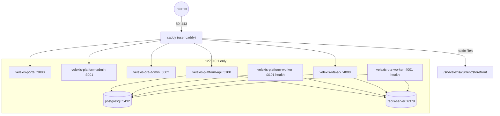

# Deployment on a single VM

This is the operations guide for running the whole Velexis MVP on one Ubuntu 24.04 VM without Docker, as [`decisions.md`](decisions.md) §2 and [ADR-0007](adr/0007-single-vm-without-docker.md) require. It covers VM sizing and hardening, the process layout, ports and users, PostgreSQL, Redis and Caddy (including on-demand TLS for custom domains), secrets and the master key, the deploy and rollback procedure, migrations, backups and the restore drill, logs, monitoring, capacity limits, and the step-by-step move to managed PostgreSQL and Redis later. The files it describes are in [`deploy/`](../../deploy/README.md); the tasks that finalise them are in [`plans/foundation-tasks.md`](plans/foundation-tasks.md).

Related: [`architecture.md`](architecture.md) §3 and §7 (hosts, ports, failure domains), [`local-development.md`](local-development.md), [ADR-0010](adr/0010-secrets-envelope-encryption.md) (keys), [ADR-0016](adr/0016-observability.md) (logs and alerts), [ADR-0018](adr/0018-hosted-storefront-custom-domains.md) (Caddy and custom domains), [ADR-0023](adr/0023-release-artefact-and-deploy-user.md) (release layout and the deploy user).

## 1. VM sizing

| Resource | Start | Why | Resize when |
|---|---|---|---|
| vCPU | 4 | Seven Node processes, PostgreSQL, Redis and Caddy; Node is mostly I/O-bound (Amadeus and Stripe calls). | Load average above 3 for an hour on most days, or p95 API latency rising without an Amadeus cause |
| RAM | 8 GB | The memory budget in [`architecture.md`](architecture.md) §3: PostgreSQL ~2.5 GB, Redis 0.5 GB, two APIs 768 MB each, two workers and three Next.js servers 512 MB each, about 7 GB in all, which leaves ~1 GB for Caddy, the OS and the page cache. | Memory use above 70 % most of the day (ADR-0007), or any OOM kill |
| Disk | 160 GB SSD (ADR-0007). 100 GB is the minimum that works for the first months. | Database with its WAL and dumps, journald (4 GB cap), local document storage, five releases, two days of local backups. | Disk use above 70 % (alert at 80 %) |
| Network | Public IPv4 (and IPv6 if offered), ports 22, 80, 443 | Let's Encrypt and storefront custom domains need a stable address. | — |

Pick a provider that offers snapshots and lets you resize the VM and the disk in place. Keep the off-VM backup bucket at a **different** provider ([§10](#10-backups)).

## 2. OS hardening

[`provision-vm.sh`](../../deploy/scripts/provision-vm.sh) applies all of this; the table is the checklist to review it against, and [`check-vm.sh`](../../deploy/scripts/check-vm.sh) checks the result on the VM ([§3](#3-provisioning-a-new-vm)).

| Area | Setting | Why |
|---|---|---|
| Updates | `unattended-upgrades` for security updates daily; no automatic reboot. Weekly `apt list --upgradable` review. | Patches without surprise restarts |
| SSH | Keys only, no root login, `AllowUsers <admin> deploy`, `MaxAuthTries 3`, in `/etc/ssh/sshd_config.d/00-velexis.conf`: sshd keeps the first value it reads, and `00-` sorts before cloud-init's `50-cloud-init.conf`, which enables password logins on some providers' images. `fail2ban` on `sshd`. The admin user also needs a second factor: a FIDO2 key (`sk-ssh-ed25519` with `verify-required`) or key plus TOTP (task X-037, M6). `deploy` is a restricted system account. | PCI 8.4.2 and 8.6 ([ADR-0027](adr/0027-pci-scope-and-vm-controls.md)) |
| Firewall | `ufw`: deny incoming; allow 22/tcp (rate-limited), 80/tcp, 443/tcp, 443/udp. Optionally restrict 22 to the developer's address (`SSH_ALLOW_FROM`), but GitHub-hosted runners deploy over SSH from changing addresses. | Only Caddy and SSH are reachable |
| Swap | Off (`swapoff -a`, commented in `/etc/fstab`) | Card data held in memory must never be written to disk |
| Core dumps | `kernel.core_pattern` piped to `/bin/false`, `fs.suid_dumpable=0`, `LimitCORE=0` on every unit. `apport.service` (package `apport-core-dump-handler`, part of the Ubuntu cloud image) is masked, because it rewrites `kernel.core_pattern` at every boot. | Same reason |
| Kernel | `kptr_restrict`, `dmesg_restrict`, `rp_filter`, no ICMP redirects, `vm.overcommit_memory=1` and THP off for Redis | Standard hardening plus Redis guidance |
| Audit | `auditd` rules on `/etc/velexis`, keys, `/etc/caddy`, systemd units, `/usr/local/sbin`, sudoers, sshd | Who changed what, when |
| File integrity | AIDE, daily check by the Ubuntu package; data and release folders excluded | PCI file-integrity monitoring |
| Time | UTC, `chrony` | Token expiry, ticketing deadlines and logs depend on correct time |
| Users | One system user per trust zone, no shell: `velexis-platform`, `velexis-ota`, `velexis-portal`, `velexis-platform-admin`, `velexis-ota-admin` ([ADR-0026](adr/0026-system-users-per-trust-zone.md), task X-033). Releases are uploaded by `deploy` (SSH key, `restrict`, sudo for `velexis-deploy` only). The developer uses the image's admin user with sudo. | Least privilege ([§4](#4-process-layout-ports-users-and-permissions)) |
| Security logs | auditd, sshd, sudo, Caddy and app security events kept 3 months on the VM and shipped off the VM with 12-month retention; daily automated review (task X-038, M6) | PCI 10.4 and 10.5 ([ADR-0027](adr/0027-pci-scope-and-vm-controls.md)) |

## 3. Provisioning a new VM

Do this once per VM, and again when rebuilding after a disaster. Allow one to two hours.

1. Create the VM (Ubuntu 24.04 LTS, sizes in [§1](#1-vm-sizing)) with your SSH key for the admin user. Note its IPv4/IPv6 address. The admin user must be a sudo user other than `root` with your key in `~/.ssh/authorized_keys` (`ubuntu` on most cloud images). If the provider only gives you `root`, create that user first: `provision-vm.sh` forbids root logins over SSH, so it refuses to run while `ADMIN_USER` does not exist or has no key, instead of locking you out.
2. Create DNS records (A and AAAA) pointing at the VM for every host of [`decisions.md`](decisions.md) §4: `platform.example.com`, `admin.platform.example.com`, `api.platform.example.com`, `admin.ota.example.com`, `api.ota.example.com` and the wildcard `*.ota.example.com`.
3. Generate the deploy key pair on your machine (`ssh-keygen -t ed25519 -f velexis-deploy -C github-actions`). Keep the private key for the GitHub `production` environment secret `DEPLOY_SSH_KEY`.
4. Copy the files: `scp -r deploy/ velexis-deploy.pub ubuntu@<vm>:/tmp/`.
5. Run `sudo DEPLOY_SSH_PUBKEY_FILE=/tmp/velexis-deploy.pub ADMIN_USER=ubuntu bash /tmp/deploy/scripts/provision-vm.sh`, then `sudo bash /tmp/deploy/scripts/check-vm.sh`: every line must read `PASS`. The provisioning script is idempotent; re-run it after fixing any error:
   - A re-run never overwrites a key file, an env file or `/etc/velexis/.provision-secrets`, and rewrites the deploy key only when `DEPLOY_SSH_PUBKEY_FILE` holds a different one. It must be the `.pub` file: the script refuses anything but one OpenSSH public key, without printing it.
   - It restarts PostgreSQL, Redis, Caddy and journald only when their configuration changed or they are not running. Its `packages` step, however, runs `apt-get upgrade`, and a package upgrade restarts its own service. On the production VM, re-run only the steps you need (`--steps …` without `packages`) unless a short interruption is acceptable.
   - It re-installs the units and root-owned scripts of the `deploy/` folder it runs from. Later runs therefore start from the deploy folder of the active release or a newer one (`sudo bash /srv/velexis/current/deploy/scripts/provision-vm.sh --steps …`), never from an older copy.
   - Its own messages (steps, warnings, errors; never a value) are appended to `/var/log/velexis/provision.log`.
6. Edit `/etc/velexis/*.env`: replace every `CHANGE_ME` and the placeholder hosts with the real ones (SMTP; Stripe keys when their milestone arrives). Edit `/etc/velexis/caddy.env` (`PLATFORM_BASE_DOMAIN`, `STOREFRONT_BASE_DOMAIN`, `ACME_EMAIL`). Then `sudo systemctl restart caddy`.
7. Set up backups ([§10](#10-backups)): age public keys, rclone remote, then `sudo systemctl start velexis-backup` and check the bucket.
8. **Back up `/etc/velexis` now**, encrypted, to your offline password manager (it holds the master key; [§7](#7-secrets-and-the-master-key)).
9. In GitHub, set the `production` environment secrets `DEPLOY_HOST`, `DEPLOY_USER` (`deploy`), `DEPLOY_SSH_KEY` and `DEPLOY_KNOWN_HOSTS` (`ssh-keyscan -t ed25519 <vm>`), with yourself as required reviewer and a deployment branch policy that allows only `main` and tags `v*`.
10. Run the **Deploy** workflow from `main` and approve its deploy job. In M0 the result is the hello-world release: `https://platform.example.com/` shows the maintenance page with a valid certificate, `velexis-deploy --status` shows the release, and the database has the baseline schemas (the `platform` and `reference` ledgers list `0001_baseline`, `platform` also `R__ota_read_access`). What to record, and how to show that a second run of the same commit changes nothing: [`deploy/README.md`](../../deploy/README.md#first-deploy-human-steps-of-x-023).

**What `check-vm.sh` checks.** It is read-only (it writes no file and changes no setting) and prints one `PASS` or `FAIL` line per item, then a total; it exits 0 only when everything passes. `--only <group,…>` runs some groups, `--templates <folder>` compares the env files with another release's templates (for example `/srv/velexis/current/deploy/env`).

| Group | Items |
|---|---|
| `system` | Ubuntu 24.04, time zone UTC, no swap (`swapon --show` empty, no swap line in `/etc/fstab`), no core dumps (`kernel.core_pattern`, `fs.suid_dumpable`, `apport.service` masked), unattended upgrades, the AIDE database |
| `services` | `postgresql` (and the cluster `postgresql@16-main`), `redis-server`, `caddy`, `velexis-backup.timer`, `fail2ban`, `auditd` and `chrony` active and enabled; Node.js 22 |
| `firewall` | `ufw` active, incoming denied by default, only 22, 80 and 443 allowed |
| `ssh` | `sshd -T`: no password or keyboard-interactive authentication, no root login, public keys allowed |
| `database` | PostgreSQL 16 with `conf.d/velexis.conf` in effect and on loopback only, the database owned by `velexis_migrator`, the four roles (login, not superuser), `velexis_ota_app`'s `search_path` `pg_catalog` |
| `redis` | Redis 7.4 on loopback only, clients without the password refused, `maxmemory 512mb` with `maxmemory-policy noeviction`, AOF on |
| `caddy` | Caddy 2.8, `caddy validate` with `caddy.env` as the `caddy` user, no admin API on TCP (no `:2019` in `ss -ltn`), `/run/caddy` `0700 caddy` with `admin.sock` |
| `users` | the five zone users (no shell, locked), the group `velexis` with exactly them, the locked `deploy` user whose keys carry `restrict` |
| `files` | the owners and modes of [§4](#4-process-layout-ports-users-and-permissions): key folders `0500` and key files `0400` per zone, identical master-key and pepper copies, env files and `.provision-secrets` `root:root 0600`, `/srv/velexis` with read-only releases, the root-owned scripts and the sudoers rule |
| `envfiles` | every `/etc/velexis/<app>.env` has every variable of its `deploy/env/<app>.env.example` (an empty value is fine; missing ones are listed by name), and the edge secret and the OTA admin service key are the same in the files that share them |

It never prints a value: env files are compared by variable name, the shared values and key copies are compared without output, the Redis password reaches `redis-cli` through its environment, and `caddy validate` messages are shown with every value of `caddy.env` replaced by `<redacted>` (bash's own errors about a malformed line of that file are dropped, because they would quote part of a value). Run it after provisioning, after editing anything in `/etc/velexis`, and when a deploy is refused for missing variables. [`deploy/scripts/test/check-vm.test.sh`](../../deploy/scripts/test/check-vm.test.sh) tests it, with fake system tools, against the layout `provision-vm.sh` creates.

**Rehearsal on a throwaway VM.** Before the production VM, and whenever `provision-vm.sh` changes a lot, run it twice on a throwaway Ubuntu 24.04 VM (never the production VM; at least 4 GB of RAM, because `velexis.conf` gives PostgreSQL 1.5 GB of shared buffers) and keep both outputs. Both `check-vm.sh` runs must show only `PASS`, and the second provisioning run must change no generated file:

```bash
scp -r deploy/ velexis-deploy.pub ubuntu@<throwaway-vm>:/tmp/
ssh ubuntu@<throwaway-vm>
sudo DEPLOY_SSH_PUBKEY_FILE=/tmp/velexis-deploy.pub ADMIN_USER=ubuntu bash /tmp/deploy/scripts/provision-vm.sh 2>&1 | tee ~/provision-1.txt
sudo bash /tmp/deploy/scripts/check-vm.sh | tee ~/check-1.txt
fp() { sudo find /etc/velexis /home/deploy/.ssh /etc/redis/velexis.conf -type f -printf '%p %i %T@ %C@ %s %m %u:%g\n' | sort; }
fp > ~/fp-1.txt
sudo DEPLOY_SSH_PUBKEY_FILE=/tmp/velexis-deploy.pub ADMIN_USER=ubuntu bash /tmp/deploy/scripts/provision-vm.sh 2>&1 | tee ~/provision-2.txt
sudo bash /tmp/deploy/scripts/check-vm.sh | tee ~/check-2.txt
fp > ~/fp-2.txt && diff ~/fp-1.txt ~/fp-2.txt && echo "second run changed no generated file"
```

The fingerprints hold paths, inodes, modification and change times, sizes, modes and owners, never contents: a rewritten file gets a new time or inode. Delete the VM afterwards; its generated keys and passwords are never reused.

## 4. Process layout, ports, users and permissions



| Unit | Runs | Port | Memory limit | Restart order on deploy |
|---|---|---|---|---|
| `velexis-platform-worker` | `platform-backend/dist/worker.js` | 3101 (health) | 512 MB | 1 |
| `velexis-ota-worker` | `ota-backend/dist/worker.js` | 4001 (health) | 512 MB | 2 |
| `velexis-platform-api` | `platform-backend/dist/main.js` | 3100 | 768 MB | 3 |
| `velexis-ota-api` | `ota-backend/dist/main.js` | 4000 | 768 MB | 4 |
| `velexis-portal` | Next.js standalone | 3000 | 512 MB | 5 |
| `velexis-platform-admin` | Next.js standalone | 3001 | 512 MB | 6 |
| `velexis-ota-admin` | Next.js standalone | 3002 | 512 MB | 7 |
| `postgresql`, `redis-server`, `caddy` | vendor packages | 5432, 6379, 80/443; Caddy's admin API only on the unix socket `/run/caddy/admin.sock` (no TCP port) | — | not restarted by deploys |
| `velexis-backup.timer` | `/usr/local/sbin/velexis-backup` | — | — | nightly 02:30 UTC |

Workers restart first so new consumers run before new producers ([ADR-0009](adr/0009-background-jobs-bullmq.md)). Every app unit has `Restart=always` with `RestartMode=direct` and a start limit of 10 starts in 5 minutes, sandboxing (`ProtectSystem=strict`, `PrivateTmp`, `ProtectProc=invisible`, no capabilities, a system-call filter; exposure 2.0 or lower in `systemd-analyze security`), `MemoryMax`, `LimitCORE=0` and `OnFailure=velexis-alert@%n.service`, which mails once when the start limit gives up ([`deploy/systemd/`](../../deploy/systemd/); proven under systemd by `deploy/systemd/test/units-smoke.sh`).

**What separates the apps.** Each trust zone runs as its own user ([ADR-0026](adr/0026-system-users-per-trust-zone.md)): the platform API and worker as `velexis-platform`, the OTA API and worker as `velexis-ota`, and each Next.js app as its own user. That is the boundary: a process cannot read another user's `/proc/<pid>/environ` or `/proc/<pid>/root`, and with `ProtectProc=invisible` it does not even see the other zones' processes. Env files are `root:root 0600` and read only by systemd, and key folders belong to their zone's user. `InaccessiblePaths=` additionally hides the other zones' env files and key folders from each unit's mount namespace; it is defence in depth only, because it cannot stop a process from reading what another process of the **same** user holds, and it does nothing against root. Within a zone, the API and its worker can read each other's memory and environment; that is accepted (same code, same keys). One-off processes follow the same rule: `velexis-deploy` runs the migrations and the reference data loader as transient units with a dynamic user (`systemd-run -p DynamicUser=yes -p SupplementaryGroups=velexis -p EnvironmentFile=…`), so no app user's process ever holds the migrator DSN, and `velexis-run <zone> <command>` runs a CLI command as the zone's user with the identity, env files, folder and sandbox of the zone's installed unit. `deploy/systemd/test/units-smoke.sh` proves all of this under systemd in CI.

| Path | Owner, mode | Content |
|---|---|---|
| `/srv/velexis/incoming/<sha>/` | `deploy`, 0750 | Upload target of the deploy workflow |
| `/srv/velexis/releases/<sha>/` | `root:velexis`, read-only (`u=rX,g=rX,o=`; `storefront/` world-readable for Caddy). `velexis` is a group of all app users that only grants reading releases. | One release; the last five are kept |
| `/srv/velexis/current` | symlink | Active release |
| `/srv/velexis/maintenance/` | root, 0755 | Maintenance page served by Caddy when a Next.js app is down |
| `/etc/velexis/`, `/etc/velexis/keys/` | `root:root` 0711 | Can be crossed, not listed: each zone reaches only its own key folder |
| `/etc/velexis/<app>.env` | `root:root` 0600, read by systemd before it starts the unit (`caddy.env` the same, loaded through the drop-in; `migrator.env` and `reference-loader.env` for the transient units of `velexis-deploy`) | Environment files |
| `/etc/velexis/keys/platform/`, `/etc/velexis/keys/ota/` | the zone's user (`velexis-platform`, `velexis-ota`), 0500 folder, 0400 per file | Master key and pepper (identical copies in both), the zone's JWT key, the document URL key (OTA only) |
| `/etc/velexis/backup/` | root, 0700 | age recipients, rclone config |
| `/var/lib/velexis/` | root, 0711 | Deploy history, reference data checksum, tenant fan-out reports (`migrate-<sha>.json`, root 0600) |
| `/var/lib/velexis/storage/` | `velexis-ota`, 0700 | Documents and exports ([ADR-0017](adr/0017-email-documents-storage.md)) |
| `/var/lib/velexis/system/<sha>/` | root, 0755 | Root-owned snapshot of a release's units, Caddyfile and maintenance page, re-installed on rollback ([§8](#8-release-artefact-deploy-and-rollback)) |
| `/var/lib/velexis-migrate/` | systemd (`StateDirectory=` of the transient migration unit; a link into `/var/lib/private/`, root 0700) | The tenant fan-out report while the migration runs; `velexis-deploy` moves it to `/var/lib/velexis/` and `/var/log/velexis/` |
| `/var/cache/velexis/<app>/` | the app's user (systemd `CacheDirectory`) | Next.js runtime cache |
| `/var/backups/velexis/` | root, 0700 | Encrypted backups before upload (two days) |
| `/var/log/velexis/` | `root:adm` 0750 | Deploy log, `provision.log` (the runs of `provision-vm.sh`), migration reports, restore-drill logs |
| `/usr/local/sbin/velexis-{deploy,backup,restore,alert,run}` | root, 0755 | Root-owned copies of `deploy/scripts/*.sh`; `velexis-run <zone> <command>` (`run-as.sh`) runs one-off CLI commands as the zone's user, with the env files, folder and sandbox of the zone's installed unit; the exit code is the command's |

## 5. PostgreSQL and Redis

### PostgreSQL 16

Installed from the PGDG repository, configured by [`deploy/postgres/velexis.conf`](../../deploy/postgres/velexis.conf) in `conf.d`.

| Setting | Value | Reason |
|---|---|---|
| `listen_addresses` | `localhost` | Only local apps connect; `scram-sha-256` passwords |
| `max_connections` | 100 | Pools: platform API 10 + worker 5, OTA API 20 + worker 10, migrator 4, plus ops headroom. No PgBouncer below ~80 app connections ([ADR-0004](adr/0004-postgresql-schema-per-tenant.md)). |
| `shared_buffers` / `effective_cache_size` | 1.5 GB / 4 GB | ~20 % / ~50 % of RAM |
| `work_mem` / `maintenance_work_mem` | 16 MB / 256 MB | Many connections, small sorts |
| `max_locks_per_transaction` | 256 | A whole-database `pg_dump` and the tenant fan-out lock ~42 tables per tenant schema. 256 × 100 = 25,600 locks covers about 500 tenants. |
| `wal_level`, `wal_compression` | `replica`, `zstd` | WAL archiving (pgBackRest) can be added later without a restart |
| `random_page_cost`, `effective_io_concurrency` | 1.1, 200 | SSD |
| `idle_in_transaction_session_timeout` | 5 min (app roles 60 s) | No transaction stays open across a slow external call |
| Logging | slow statements ≥ 500 ms, lock waits, DDL; **never** bound parameter values. `ALTER ROLE … PASSWORD` is DDL, so a password is set only in a session with `log_statement = none` (and `pg_stat_statements.track_utility = off`): `provision-vm.sh` does this, and so must a manual rotation ([§7](#7-secrets-and-the-master-key)). | Personal data and passwords stay out of logs |
| `pg_stat_statements` | on | Find slow queries without extra tooling |

Roles ([`deploy/postgres/bootstrap.sql`](../../deploy/postgres/bootstrap.sql), [ADR-0004](adr/0004-postgresql-schema-per-tenant.md)):

| Role | Used by | Privileges |
|---|---|---|
| `velexis_migrator` | `velexis-deploy` (migrations, tenant fan-out) only; its DSN is in the root-only `migrator.env`, which systemd reads for a transient unit with a dynamic user, so no app user's process ever holds it | Owns the database, `platform` and `reference`; member of `velexis_provisioner` (the fan-out uses `SET LOCAL ROLE`). DDL only; never serves requests. `lock_timeout 5s`. |
| `velexis_provisioner` | OTA worker (tenant provisioning, `ota-worker.env`) | `CREATE` on the database, owns every `tenant_<key>`, nothing on `platform` or `reference` ([ADR-0004](adr/0004-postgresql-schema-per-tenant.md)). DDL only; never serves requests. |
| `velexis_platform_app` | Platform API and worker; the reference data loader at deploy (`reference-loader.env`) | DML on `platform` and `reference` (default privileges), none on tenant schemas. Audit log is insert-only (platform migration). |
| `velexis_ota_app` | OTA API and worker | DML on tenant schemas (granted at provisioning), `SELECT` on `reference`, **read-only** `SELECT` on the listed platform tables and on the non-secret columns of `accounts` (repeatable grants file, [ADR-0021](adr/0021-migration-cli-and-repeatable-grants.md)); never password hashes or MFA secrets. `search_path = pg_catalog`. |

Backups and restores run as the `postgres` superuser through peer authentication on the VM only.

### Redis 7.4

From packages.redis.io, pinned to 7.4 with an apt preference, configured by [`deploy/redis/velexis.conf`](../../deploy/redis/velexis.conf):

- loopback only, `requirepass` (generated), `protected-mode yes`;
- `maxmemory 512mb` with `maxmemory-policy noeviction` (BullMQ requirement): **every cache key has a TTL** ([ADR-0009](adr/0009-background-jobs-bullmq.md));
- AOF with `appendfsync everysec`, no RDB snapshots; `FLUSHALL` and `DEBUG` disabled;
- logs to journald.

Redis is a transport and cache. PostgreSQL holds every durable record; the provisioning reconciler and webhook inboxes replay what Redis loses ([`architecture.md`](architecture.md) §7).

## 6. Caddy and TLS

[`deploy/caddy/Caddyfile`](../../deploy/caddy/Caddyfile) (Caddy 2.8 from the official repository, pinned) serves every public host:

| Host | Handling |
|---|---|
| `platform.example.com`, `admin.platform.example.com`, `admin.ota.example.com` | Reverse proxy to 3000, 3001, 3002. Maintenance page on 502/503/504. Optional IP allow-list for the platform admin. |
| `api.platform.example.com`, `api.ota.example.com` | Reverse proxy to 3100, 4000. `/internal/*` and `/health/*` (except `/health/live`) answer 404. Client copies of the edge headers are removed. JSON `SERVICE_UNAVAILABLE` envelope on 502/503/504. 1 MB body limit. |
| `*.ota.example.com` | Hosted storefront: static files from `/srv/velexis/current/storefront`, `/api/*` proxied to 4000 with `X-Velexis-Edge` and `X-Velexis-Host` set by Caddy (`/api/internal/*` and `/api/health/*` except `/api/health/live` answer 404), strict CSP, immutable caching for `/assets/*` |
| any other host (`https://`) | Same storefront block for **verified custom domains** |

**Certificates.** The five named hosts get certificates at start-up (Let's Encrypt, ZeroSSL as fallback). Storefront hosts use **on-demand TLS**: on the first TLS handshake for an unknown name Caddy calls `GET http://127.0.0.1:3100/internal/tls/ask?domain=<host>`, and obtains a certificate only on `200` ([ADR-0018](adr/0018-hosted-storefront-custom-domains.md)). The platform API answers `200` for `<key>.ota.example.com` of a provisioning, active or suspended tenant, and for verified custom domains of active tenants whose plan allows them.

Consequences to know:

- Until the platform API exists (M1), storefront hosts cannot get certificates. The M0 hello world therefore uses `platform.example.com`.
- If the platform API is down, **existing** certificates keep working; only new hosts wait.
- Let's Encrypt allows about 50 new certificates per registered domain per week. Above ~30 sign-ups per week, switch to a DNS-01 wildcard certificate for `*.ota.example.com` (ADR-0018 follow-up).
- Custom-domain owners create `CNAME travel.example.net → acme.ota.example.com` (or A/AAAA for an apex) and the `_velexis` TXT record; the platform worker verifies them (M5).
- Caddy's admin API listens only on the unix socket `/run/caddy/admin.sock`, inside `/run/caddy` (mode 0700, user `caddy`, created by the `RuntimeDirectory=` of the drop-in). No app user can open it, so no app process can replace the live configuration (for example the payment-page CSP). `systemctl reload caddy` reads the socket address from the Caddyfile; changing that address needs `systemctl restart caddy`. X-022's smoke test proves a reload through the socket ([ADR-0027](adr/0027-pci-scope-and-vm-controls.md)).
- From M6 Caddy is a build with the Coraza web application firewall and the OWASP Core Rule Set, in detection mode first and then blocking on the storefront `/api/*`, the payment pages and `api.ota.example.com` (task X-039).

**Validation.** In CI every Caddyfile change is checked with `caddy validate` and run end to end by [`deploy/caddy/test/caddy-smoke.sh`](../../deploy/caddy/test/README.md). On the VM `velexis-deploy` runs `caddy validate` again (with the real `caddy.env`) before the file is installed and reloaded (`systemctl reload caddy`, no dropped connections).

## 7. Secrets and the master key

| Secret | Where on the VM | Created by | Rotation |
|---|---|---|---|
| Master key (KEK) `master-v1.key` | `/etc/velexis/keys/platform/` and `/etc/velexis/keys/ota/` (identical copies, each 0400 for its zone's user) | `provision-vm.sh` (32 random bytes) | Add `master-v2.key` to both folders, set `MASTER_KEY_CURRENT=local:v2`, run both backends' `secrets:rewrap`, remove v1 when both report zero rows ([ADR-0010](adr/0010-secrets-envelope-encryption.md), runbook of X-040) |
| API key pepper, document URL key, JWT Ed25519 keys | The zone's key folder (pepper in both, document URL key in `ota/` only) | `provision-vm.sh` | JWT by `kid`; pepper not rotated in the MVP |
| Database and Redis passwords, edge secret, OTA admin service key | `/etc/velexis/*.env` (generated values also in `/etc/velexis/.provision-secrets`, root 0600) | `provision-vm.sh` | Change the value in `.provision-secrets` **first**: every `provision-vm.sh` run sets the role passwords and the Redis password from it again. Then change it in the env files, apply it (`provision-vm.sh --steps database` for the role passwords, in a session that logs nothing; `--steps redis` for Redis), restart the units and run `check-vm.sh`. A manual change uses `\password <role>` in a `psql` session started with `PGOPTIONS='-c log_statement=none -c pg_stat_statements.track_utility=off'`, never a typed `ALTER ROLE … PASSWORD`, which psql would also keep in its history file |
| Stripe keys, SMTP credentials | `/etc/velexis/*.env` | The developer | Rotate in the provider's dashboard, update, restart |
| Amadeus credentials | **Not** on the VM: encrypted in `platform.amadeus_accounts` / `supplier_connections` | Platform admin, portal | Through the UI |
| age **private** keys (backups) | **Never on the VM** | The developer, offline | Generate a new pair, replace the recipients file |
| Deploy SSH key | GitHub `production` environment | The developer | Replace the key in GitHub and `~deploy/.ssh/authorized_keys` |

Rules:

- **Losing the master key loses every encrypted secret.** `/etc/velexis` is backed up nightly to a separate age key, and once by hand after provisioning.
- Nothing secret is committed; templates hold `@@GENERATED@@` or `CHANGE_ME` values only.
- Env files are `root:root 0600` and read by systemd only ([ADR-0026](adr/0026-system-users-per-trust-zone.md)). Each one-off process of a deploy gets exactly one DSN: the migrations `DATABASE_MIGRATOR_URL` from `migrator.env`, the reference data loader `DATABASE_URL` (platform role) from `reference-loader.env`. Both run as transient units with a dynamic user, so neither DSN is ever in the environment of an app user's process, of `velexis-deploy` itself, or on a command line.
- `master-v1.key` and `api-key-pepper` exist twice, as identical copies in `/etc/velexis/keys/platform/` and `/etc/velexis/keys/ota/`. `provision-vm.sh` generates them once, never overwrites a key file, restores a missing copy from the other folder and stops if the two copies differ. A rotation installs the new key in both folders (runbook of X-040).
- Anyone with root, or with a backend zone's user, can read that zone's copy of the master key; that is the accepted single-VM limit. The Next.js apps cannot read any key or env file. A KMS-backed `KeyProvider` is the follow-up ([§15](#15-moving-to-managed-postgresql-and-redis)).

## 8. Release artefact, deploy and rollback

Deploys are **manual** (`workflow_dispatch` of [`.github/workflows/deploy.yml`](../../.github/workflows/deploy.yml) from `main` or a `v*` tag), run by the developer only ([ADR-0020](adr/0020-ai-agent-development-workflow.md), [ADR-0023](adr/0023-release-artefact-and-deploy-user.md)). The workflow has two jobs, so that no dependency or build code runs next to the root-equivalent deploy key:

- **build** (no secrets, no environment; Ubuntu 24.04 runner, Node 22): its first step fails for any ref other than `main` or a `v*` tag; then install (dependency install scripts only for the `pnpm.onlyBuiltDependencies` allow-list), lint, typecheck, unit tests (always), `pnpm build`, then [`pack-release.sh`](../../deploy/scripts/pack-release.sh) assembles `release/<sha>/`, which is uploaded as one tarball artefact; the tarball's SHA-256 is a job output.
- **deploy** (GitHub `production` environment: the developer's approval, the SSH secrets, a branch policy for `main` and `v*` tags; the job itself also runs only for those refs): downloads the tarball, re-checks its SHA-256 and `SHA256SUMS`, and runs `rsync` and `ssh` through one host alias (only the deploy key, only the pinned host key, never a prompt). It checks out no code and installs nothing. Its smoke check fails unless `velexis-deploy --status` shows `releases/<sha>` as current.

Every action is pinned to a full commit SHA. The release folder:

| Folder | Content |
|---|---|
| `RELEASE.json`, `SHA256SUMS` | Manifest (sha, ref, build time, Node version, apps) and checksums of every file |
| `db/`, `migrations/{platform,reference,tenant}/` | Migration CLI (`@velexis/db`, `pnpm deploy --prod`) and SQL files |
| `reference-data/` | Reference data loader and vendored datasets ([ADR-0024](adr/0024-reference-data-sources-and-loader.md)) |
| `platform-backend/`, `ota-backend/` | `pnpm deploy --prod` output: `dist/`, production `node_modules` |
| `platform-frontend/`, `platform-admin/`, `ota-admin/` | Next.js `standalone` trees with `.next/static` and `public/` |
| `storefront/` | Static storefront build (an M0 placeholder page until `ota/frontend` exists) |
| `deploy/` | The deploy files of the same commit |

Apps that do not exist yet are skipped, so the same pipeline ships the M0 hello world and the full system. Native modules (`argon2`) are built on the same OS and Node major as the VM; `velexis-deploy` refuses a release built with another Node major.

**Activate (on the VM):** the deploy job uploads with `rsync` to `/srv/velexis/incoming/<sha>/` as `deploy`, then runs `sudo /usr/local/sbin/velexis-deploy <sha>`, which:

1. verifies `SHA256SUMS` (every regular file of the upload is listed and intact, nothing unlisted, no special file), the sha in `RELEASE.json` and the Node major;
2. checks that every `/etc/velexis/<app>.env` has every variable that the release's `deploy/env/<app>.env.example` names (an empty value is fine) and refuses the release otherwise, before changing anything. `provision-vm.sh` never rewrites env files, so a task that adds a variable comes with a human step: add it on the VM first ([`plans/roadmap.md`](plans/roadmap.md) §2). `provision-vm.sh --steps envfiles` lists missing variables too;
3. copies the release's systemd units, Caddy drop-in, Caddyfile and maintenance page into a root-owned snapshot, `/var/lib/velexis/system/<sha>/`, then installs from the snapshot a changed Caddyfile (validated with `caddy.env` first, so that one that does not validate changes nothing; kept as `Caddyfile.next` until the end; caddy's messages reach the log with every value of `caddy.env` redacted), changed units (`daemon-reload`) and a changed maintenance page, then from the upload the root-owned scripts, all before the folder is handed over;
4. moves the folder to `/srv/velexis/releases/<sha>/`, owned by `root:velexis` and read-only. Re-deploying a release that is already on the VM re-installs its units and Caddyfile from its snapshot, keeps the newest root scripts and removes the new, unused upload; a second deploy of the same sha therefore changes no release, snapshot, unit, Caddyfile or script (only the deploy history and the log get new lines, and the migration report is written again);
5. runs the migrations ([§9](#9-migrations-at-deploy)) and, when the datasets changed, the reference data loader, each as a transient unit with a dynamic user that only has the `velexis` group added (`systemd-run -p DynamicUser=yes`, with `migrator.env` or `reference-loader.env` read by systemd). A failure stops here: the running release's units are re-installed from its snapshot, nothing was switched and the old release keeps running;
6. switches `/srv/velexis/current` atomically (`ln -sfn` + `mv -T`);
7. restarts workers, then APIs, then front ends, one at a time, polling `GET 127.0.0.1:<port>/health/ready` for up to 90 s each;
8. on the first unhealthy unit, re-installs the previous release's units and Caddyfile from its snapshot, switches `current` back, restarts the units and exits non-zero (**automatic rollback**);
9. reloads Caddy if its file changed, records the sha in `/var/lib/velexis/deploy-history`, and prunes all but the last five releases (by build time) and their snapshots. The active release and the one `--rollback` would switch to are never pruned, even when they are older than the five (for example after re-deploying an old release; they are compared by sha, so a symbolic link in the path cannot hide them), and a snapshot whose release is gone (a deploy refused after the snapshot) goes too.

Each restart causes a few seconds of errors on that process; the maintenance page and the JSON `SERVICE_UNAVAILABLE` envelope cover them. That is accepted for the MVP (ADR-0007).

**Testing `velexis-deploy`.** [`deploy/scripts/test/deploy.test.sh`](../../deploy/scripts/test/deploy.test.sh) runs `deploy.sh` unchanged, without root or systemd, against fake releases (CI: the `deploy-files` job). `deploy.sh` has four test-only overrides, which take effect only together with `VELEXIS_ROOT` and are dropped by sudo on the VM anyway: `VELEXIS_ROOT` moves every path under a temporary folder and hands files to the calling user instead of `root`, `SYSTEMCTL` names a stand-in (`fake-systemctl.sh`, which runs `fake-app.mjs` per unit on its health port), `RUN_TRANSIENT` replaces the transient `systemd-run` unit of the migrations and the reference loader, and `HEALTH_HOST` moves the health checks off `127.0.0.1`. The test covers the happy path with the migrations, a second deploy of the same sha, a tampered or unlisted file, a Node major mismatch, env drift (and optional templates), an unhealthy release with its automatic rollback, `--rollback` and re-deploying a release on the VM (both from the snapshot, never from the release folder's copies), a failing migration, a masked unit, a Caddyfile that does not validate (no installed file changes), and pruning (through a symbolic link in the VM's paths, keeping the active release and the `--rollback` target).

**Manual rollback:** `sudo /usr/local/sbin/velexis-deploy --rollback` re-installs the previously activated release's units, drop-in and Caddyfile from its snapshot (so the old code never runs under newer sandboxing or a newer payment-page CSP), switches to it and restarts. The root-owned scripts stay at their newest version, which is kept backward compatible. Migrations are not reversed: they are expand-only and the code supports schema versions N-1 and N ([`conventions.md`](conventions.md) §9). If a release must never run again, fix forward with a new commit.

## 9. Migrations at deploy

| Set | Files | Applied by | Role |
|---|---|---|---|
| `platform` | `platform/backend/migrations/platform/` (schema-qualified; `0001_baseline.sql` = `docs/velexis-sdk/db/platform.sql`; repeatable `R__ota_read_access.sql`) | `migrate.js platform` | `velexis_migrator` |
| `reference` | `platform/backend/migrations/reference/` | `migrate.js reference` | `velexis_migrator` |
| tenant | `ota/backend/migrations/tenant/` (unqualified; `0001_baseline.sql` = `tenant.sql`) | `migrate.js tenants` fan-out, and the OTA worker at provisioning | `velexis_provisioner` (the fan-out connects as `velexis_migrator` and uses `SET LOCAL ROLE velexis_provisioner`) |

- Each file runs in its own transaction with `lock_timeout 5s` (except `-- velexis:no-transaction` files) and is recorded with its SHA-256 in the schema's `schema_migrations` ledger. An edited, already-applied file fails the run.
- `migrate.js` runs as a transient unit with a dynamic user (`systemd-run --pipe --wait --collect -p DynamicUser=yes -p SupplementaryGroups=velexis -p EnvironmentFile=/etc/velexis/migrator.env`): it can read the release, nothing of the apps, and its DSN never reaches a process of an app user ([ADR-0026](adr/0026-system-users-per-trust-zone.md)). Concurrency and failure ratio come from `migrator.env` (`MIGRATE_TENANT_CONCURRENCY`, `MIGRATE_TENANT_MAX_FAILURE_RATIO`).
- The tenant fan-out migrates 4 schemas at a time, each under `pg_advisory_xact_lock(hashtext(schema))`, continues past a failed schema, and stops (exit code 3, deploy aborted) when more than 10 % fail. The report is in `/var/log/velexis/migrate-<sha>.json` (and, root-only, in `/var/lib/velexis/migrate-<sha>.json`).
- Only **expand** files ship with the code that needs them; **contract** files ship in a later release, once every tenant reports the version ([ADR-0005](adr/0005-data-access-kysely-sql-migrations.md)).
- Deploys get slower as tenants grow: about 0.2 s per tenant schema per pending file. Above ~500 tenants, run the fan-out as a background job instead of inside the deploy.

## 10. Backups

`velexis-backup.timer` runs [`backup.sh`](../../deploy/scripts/backup.sh) nightly at 02:30 UTC (ADR-0007):

| Item | How | Encrypted to |
|---|---|---|
| Database (all schemas) | `pg_dump --format=custom --compress=zstd:3 velexis` | data age key |
| Roles and grants | `pg_dumpall --globals-only --no-role-passwords` | data age key |
| Document storage | `tar` of `/var/lib/velexis/storage` + zstd | data age key |
| Redis AOF | `tar` of `/var/lib/redis/appendonlydir`, taken when no AOF rewrite runs | data age key |
| `/etc/velexis` (master key, env files) | `tar` + zstd | **config** age key (a different key) |
| Manifest | sizes, SHA-256 of each file, release, PostgreSQL version, tenant count | plain (no secrets) |

The set is uploaded with `rclone` to `<remote>/daily/<date>/` (and `monthly/<yyyy-mm>/` on the 1st) and verified with `rclone check`. **The bucket, not the VM, enforces retention**: lifecycle rules expire `daily/` after 14 days and `monthly/` after 6 months, and object lock (14-day default retention) protects every new object. The VM's key may only put, list and read; it has no `DeleteObject` or `DeleteObjectVersion` right, and `backup.sh` never deletes anything remotely. A root compromise of the VM can therefore not destroy the off-site copies. Local copies are kept two days. A marker file records the last success; the health check alerts when it is older than 26 hours.

Setting it up (once):

1. On your machine: `age-keygen -o velexis-data.key` and `age-keygen -o velexis-config.key`. Store both private keys offline (password manager plus a printed copy in a safe place).
2. On the VM: put the two **public** keys (`age1…`) in `/etc/velexis/backup/data-recipients.txt` and `config-recipients.txt`.
3. Create a bucket at another provider with versioning and object lock (default retention 14 days), and lifecycle rules: `daily/` expires after 14 days, `monthly/` after 186 days, noncurrent versions after 1 day. Create an access key limited to that bucket with put, list and get rights only (no delete of objects or versions). Write `/etc/velexis/backup/rclone.conf` (`[offsite]`, type `s3`, provider, keys, endpoint) and set `RCLONE_REMOTE=offsite:<bucket>` in `/etc/velexis/backup.env`. Keep the bucket's admin credentials off the VM, in the password manager, with MFA on the provider account.
4. `sudo systemctl start velexis-backup && journalctl -u velexis-backup -n 30`.

**RPO is up to 24 hours.** Bookings made after the last dump can be rebuilt from Amadeus orders and Stripe payments. Continuous WAL archiving (pgBackRest, RPO ~5 minutes) is the first follow-up before significant live volume (ADR-0007).

## 11. Restore and the restore drill

[`restore.sh`](../../deploy/scripts/restore.sh) (`/usr/local/sbin/velexis-restore`) restores into a **scratch database by default**; replacing live data needs `--replace-live` and typing the hostname.

**How `db --replace-live` stays safe.** It never drops the live database first. It restores into `velexis_restore_<stamp>` beside it, re-applies the database-level grants of `bootstrap.sql` (a `pg_dump` without `--create` does not carry them) and runs the sanity checks. Any failure up to here (wrong key, corrupt file, full disk, `pg_restore` error) leaves the live database untouched and the apps running. Only then does it stop the app units and, in one transaction, rename `velexis` to `velexis_before_restore_<stamp>` and the restored database to `velexis`. **Rollback:** stop the app units, rename `velexis` away and `velexis_before_restore_<stamp>` back to `velexis`, start the units. Drop the old database once the checks pass.

**Full rebuild after losing the VM** (target RTO: a few hours):

1. Provision a new VM ([§3](#3-provisioning-a-new-vm)) and point DNS at it.
2. Bring the age private keys to the VM (`/root/restore/`, mode 0600).
3. `velexis-restore fetch daily/<date> /root/restore/set` (after copying `rclone.conf` and `backup.env` into place).
4. `velexis-restore config /root/restore/set --identity /root/restore/velexis-config.key`, then copy the restored `keys/` and env files into `/etc/velexis/` (keep the new VM's generated database and Redis passwords, or set the old ones back on the roles).
5. `velexis-restore db /root/restore/set --identity /root/restore/velexis-data.key --replace-live`, then `storage … --replace-live` and, optionally, `redis …`.
6. Run the **Deploy** workflow for the last good sha. It runs any pending migration and starts every unit.
7. Check the portal, one storefront and the OTA admin; then `shred -u` the private keys on the VM.

**Restore one tenant** without touching the others follows [db README §7](../velexis-sdk/db/README.md): restore the dump into a scratch database, `pg_dump -n tenant_<key>` from it, restore beside the live schema, migrate it, then swap schema names in one transaction.

**Restore drill** (M6, then quarterly, task X-031): on a scratch VM or the live VM, `velexis-restore drill <set> --identity <key>` restores into `velexis_drill_<date>`, prints tenant, schema, airport and last-audit figures, and drops it. Compare the figures with the manifest and record the date, duration and result in `/var/log/velexis/restore-drill-<date>.log` and the M6 launch checklist.

**A scratch VM must never act as production.** The restored database still holds live Amadeus credentials (and OTA-owned Stripe keys) that the restored master key decrypts, and the workers' schedulers (`ticketing.scan`, `bookings.sync_scan`, `queues.poll`, `bookings.reconcile_scan`) would call live Amadeus at once and could issue tickets that production has since cancelled, or issue them twice. Before **any** unit starts on a scratch VM:

1. Block outbound traffic: `ufw default deny outgoing`, then allow only DNS, the Ubuntu and vendor package mirrors and the backup bucket.
2. In the restored env files, point `AMADEUS_BASE_URL_TEST` and `AMADEUS_BASE_URL_LIVE` at a black hole (`http://127.0.0.1:9`), point `SMTP_URL` at a sink, and replace every Stripe key and webhook secret with test-mode values.
3. Mask both workers (`systemctl mask velexis-platform-worker velexis-ota-worker`); `velexis-deploy` and the health check skip masked units. Start them, if at all, only after steps 1 and 2.
4. After the drill, check that the journal and `supplier_requests` show no Amadeus or Stripe call made from the scratch VM.

## 12. Logs

| Source | Where | Retention |
|---|---|---|
| Velexis apps (pino JSON on stdout) | journald, `SyslogIdentifier=<unit>` | `SystemMaxUse=4G`, 30 days ([`deploy/journald/velexis.conf`](../../deploy/journald/velexis.conf)) |
| Caddy access and error logs (JSON) | journald (`caddy`); sensitive headers and `sig`/`token` query values deleted | same |
| Security logs: auditd, sshd, sudo, Caddy access and WAF, app security events | `/var/log/velexis/security/` (daily compressed files) and the off-site bucket's `logs/` prefix | 3 months on the VM, 12 months off the VM with object lock; hourly shipping and a daily automated review (task X-038, [ADR-0027](adr/0027-pci-scope-and-vm-controls.md)) |
| Redis | journald | same |
| PostgreSQL | `/var/log/postgresql/postgresql-16-main.log` | the package's logrotate rules |
| Deploys, migration reports, restore drills | `/var/log/velexis/*.log`, `*.json` | weekly, 12 rotations ([`deploy/logrotate/velexis`](../../deploy/logrotate/velexis)) |
| Audit | `platform.platform_audit_log`, tenant `staff_actions` (tables, not logs) | with the data |

Everyday commands: `journalctl -u velexis-ota-api -f -o cat | jq`, `journalctl -u velexis-ota-api --since -1h -o cat | jq 'select(.requestId=="<id>")'`, `journalctl -p err -S today`. Never paste log lines with personal data into tickets or chats; the `requestId` is enough.

## 13. Monitoring and uptime

| Check | Tool | Alert |
|---|---|---|
| Public liveness: `https://api.platform.example.com/health/live`, `https://api.ota.example.com/health/live`, the portal, one demo storefront | External uptime monitor (any free HTTP checker), every minute | E-mail and push to the developer |
| A unit enters `failed`: with `RestartMode=direct`, only when its start limit (10 starts in 5 minutes) gives up; single crashes restart silently and stay in the journal | systemd `OnFailure=velexis-alert@%n.service` → `velexis-alert` (proven by `deploy/systemd/test/units-smoke.sh`) | One e-mail with the unit's status and last 40 log lines |
| Every unit's `/health/ready`, disk > 80 %, Redis memory > 70 % of `maxmemory`, last backup > 26 h, failed BullMQ jobs in the last hour, TLS expiry < 14 days for the named hosts, and daily the integrity of both payment pages (script contents and per-path headers against the inventory) | `velexis-healthcheck.timer` every 5 minutes (task X-030, M6) | E-mail |
| Security log review: failed and accepted SSH logins, sudo use, auditd hits on keys and units, AIDE changes, WAF blocks, airline-card route error spikes, a failed log shipment | `velexis-log-review.timer` daily (task X-038, M6) | E-mail (critical events at once) |
| Errors in code (optional) | Sentry when `SENTRY_DSN` is set, with the same redaction | Sentry |

Business visibility (provisioning jobs, failed jobs, per-tenant counts, `supplier_requests` errors) comes from the platform admin and OTA admin, not from a metrics store ([ADR-0016](adr/0016-observability.md)).

## 14. Capacity limits of one VM

Rough limits for the 4 vCPU / 8 GB start. Measure in the M6 performance sanity check and adjust.

| Dimension | Comfortable | First bottleneck | First remedy |
|---|---|---|---|
| Tenants (schemas) | up to ~300 | Catalog size (~320 relations each), deploy fan-out time, `pg_dump` duration | `max_locks_per_transaction`, fan-out as a job, then a bigger VM |
| Flight searches | ~5 per second sustained | Amadeus latency and quota, OTA API CPU | Per-tenant rate limits, offer caching in Redis, second CPU pair |
| Bookings | thousands per day | Amadeus order creation latency, not the VM | — |
| Connections | ~50 pooled | `max_connections = 100` | PgBouncer (ADR-0004 follow-up) |
| Redis memory | 512 MB | `noeviction` refuses writes when full | TTL review, raise `maxmemory`, separate Redis for queues |
| Disk | 160 GB | Storage documents + dumps + journald | Resize disk, move documents to S3 (`STORAGE_DRIVER=s3`) |
| New certificates | ~50 per week | Let's Encrypt rate limit | DNS-01 wildcard certificate |

## 15. Moving to managed PostgreSQL and Redis

The code reaches every service through configuration only ([`decisions.md`](decisions.md) §2): DSNs and URLs in env files, the `StorageAdapter`, and the `KeyProvider`. Nothing assumes `localhost`. The move is an operations change:

1. **Prepare.** Create the managed PostgreSQL 16 instance in the same region as the VM, with private networking or TLS required. Create the four roles with `bootstrap.sql` (the provider's admin user replaces `postgres`). Check that the provider allows `CREATE SCHEMA` by `velexis_migrator` and `pg_stat_statements`.
2. **Rehearse.** Restore last night's dump into it (`pg_restore --no-owner --role=velexis_migrator` if ownership cannot be preserved) and point a staging copy of the apps at it. Run the restore-drill queries and the end-to-end suite.
3. **Cut over** in a maintenance window: announce, stop the app units, take a fresh `pg_dump`, restore it to the managed instance, change `DATABASE_URL` and `DATABASE_MIGRATOR_URL` (with `?sslmode=verify-full`) in `/etc/velexis/*.env`, start the units, run the checks.
4. **Redis** next: create a managed Redis 7 with persistence (AOF) and `noeviction`, change `REDIS_URL` (`rediss://`). Queues drain on the old one first: stop producers (APIs), let workers finish, then switch.
5. **Adjust the VM:** stop and disable local PostgreSQL and Redis, remove their memory budget, move backups to the provider's PITR (keep the off-site logical dump weekly).
6. **Later, configuration only as well:** `STORAGE_DRIVER=s3` for documents, a `KmsKeyProvider` for the master key, a second app VM behind a load balancer (Caddy on both, or the provider's load balancer with on-demand TLS kept on one edge).

## 16. Incident quick reference

| Symptom | First checks | Fix |
|---|---|---|
| Everything public is down | `systemctl status caddy`, uptime monitor, provider status page | `systemctl restart caddy`; if the VM is gone, [§11](#11-restore-and-the-restore-drill) |
| One app shows the maintenance page | `systemctl status velexis-<unit>`, `journalctl -u velexis-<unit> -n 100` | `systemctl restart`; if a deploy caused it, `velexis-deploy --rollback` |
| APIs answer 503 | `/health/ready` on 3100 and 4000, `systemctl status postgresql redis-server` | Restart the failed service; check disk space |
| New storefront host gets no certificate | `journalctl -u caddy --grep ask`, `curl '127.0.0.1:3100/internal/tls/ask?domain=<host>'` | Platform API up? Tenant active? Domain verified? |
| Backup alert | `journalctl -u velexis-backup -n 50` | Fix credentials or space, `systemctl start velexis-backup` |
| Disk above 80 % | `df -h`, `du -sh /var/lib/postgresql /var/backups/velexis /srv/velexis/releases`, `journalctl --disk-usage` | Prune local backups and old releases, resize the disk |
| Suspected compromise | `aide --check`, `ausearch -k velexis-keys`, `last`, `journalctl -u ssh`, the off-VM security logs | Rotate secrets ([§7](#7-secrets-and-the-master-key); master key: `docs/mvp/runbooks/master-key-rotation.md`, task X-040), rebuild the VM from scripts and backups, follow the incident response plan (M6) |
