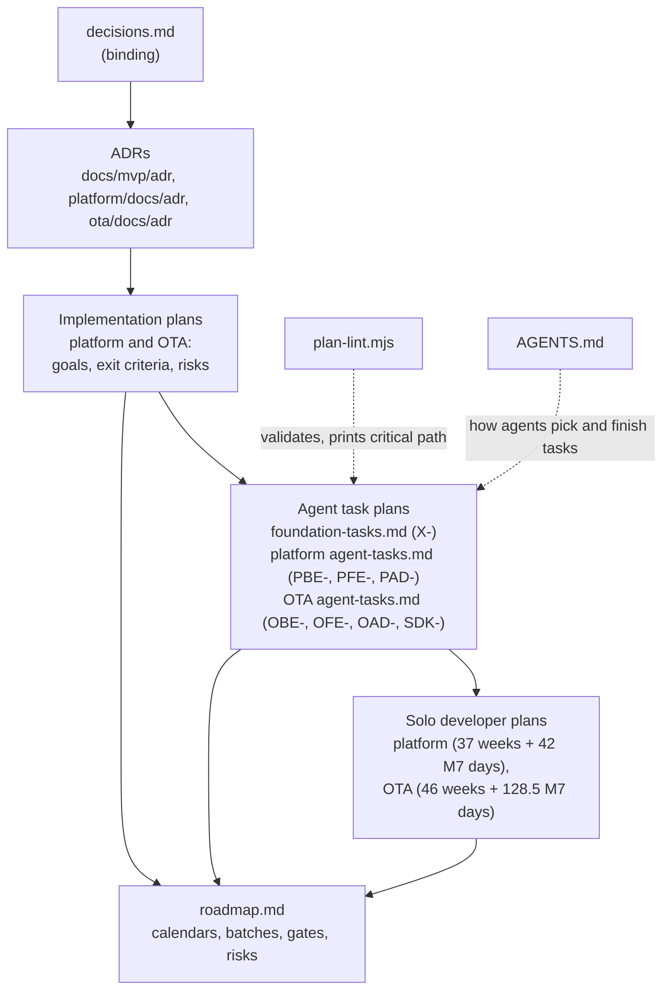

# Velexis MVP plans: index

This page lists every plan file of the Velexis MVP, says which question each one answers, and shows how they relate. There is one master roadmap, one foundation task plan, and three plans for each component group (platform and OTA): an implementation plan, an agent task plan and a solo developer plan. All plans use the shared milestones M0–M8 of [`../README.md`](../README.md#1-shared-milestones) and follow [`../decisions.md`](../decisions.md). The two plan styles (agent tasks and week by week) come from [ADR-0020](../adr/0020-ai-agent-development-workflow.md). How they are combined into one calendar is recorded in [ADR-0025](../adr/0025-roadmap-scheduling-and-tracking.md).

Related: [`roadmap.md`](roadmap.md), [`../../../AGENTS.md`](../../../AGENTS.md) (how agents pick and finish tasks), [`../../../tools/plan-lint/plan-lint.mjs`](../../../tools/plan-lint/plan-lint.mjs) (validation and progress, [README](../../../tools/plan-lint/README.md)), [`../README.md`](../README.md) (all MVP documents).

## 1. The plan files

| File | Style | Scope | Task ids | Answers |
|---|---|---|---|---|
| [`roadmap.md`](roadmap.md) | Master plan | Foundation and both groups | References all ids | When does each milestone happen, with and without agents? Which tasks run in parallel? What are the review gates, demos, go/no-go criteria, critical path and risks? |
| [`foundation-tasks.md`](foundation-tasks.md) | Agent tasks | Monorepo, shared packages, CI, baselines, migration runner, VM, users per trust zone, deploy, backups, monitoring, Amadeus stub, PCI controls of the VM | `X-001` … `X-075` | What exactly is built for the shared base, and which task provides what the components depend on? |
| [`platform/docs/plans/implementation-plan.md`](../../../platform/docs/plans/implementation-plan.md) | Implementation plan | Platform backend, portal, platform admin | `PBE-`, `PFE-`, `PAD-` (referenced) | Per milestone: goal, epics, demo, exit criteria, interface with the OTA group, risks; traceability from PF features to tasks |
| [`platform/docs/plans/agent-tasks.md`](../../../platform/docs/plans/agent-tasks.md) | Agent tasks | Platform backend, portal, platform admin | `PBE-001` … `PBE-107`, `PFE-001` … `PFE-034`, `PAD-001` … `PAD-025` | What exactly does each platform task change, and how is it proven? |
| [`platform/docs/plans/solo-developer-plan.md`](../../../platform/docs/plans/solo-developer-plan.md) | Solo developer (week by week) | Platform group, without agents | References platform ids | In which order does one developer build the platform, week by week (37 platform weeks: Weeks 1–31, the follow-up Weeks 30a and 30b of 2026-11-06, Weeks 30c and 30d of 2026-11-11, Week 30e of 2026-11-13 and Week 30f of 2026-11-16; since 2026-11-25 also M7's 42 days, by phase, in the roadmap's calendar weeks C87–C133, and M8's 6 days after the launch)? |
| [`ota/docs/plans/implementation-plan.md`](../../../ota/docs/plans/implementation-plan.md) | Implementation plan | OTA backend, storefront, OTA admin, JS SDK | `OBE-`, `OFE-`, `OAD-`, `SDK-` (referenced) | Per milestone: goal, epics, demo, exit criteria, interface with the platform group, risks; traceability from OF features and operations to tasks |
| [`ota/docs/plans/agent-tasks.md`](../../../ota/docs/plans/agent-tasks.md) | Agent tasks | OTA backend, storefront, OTA admin, JS SDK | `OBE-001` … `OBE-216`, `OFE-001` … `OFE-033`, `OAD-001` … `OAD-029`, `SDK-001` … `SDK-021` | What exactly does each OTA task change, and how is it proven? |
| [`ota/docs/plans/solo-developer-plan.md`](../../../ota/docs/plans/solo-developer-plan.md) | Solo developer (week by week) | OTA group, without agents | References OTA ids | In which order does one developer build the OTA side, week by week (46 OTA weeks: Weeks 1–40, the follow-up Week 39a of 2026-11-06, Weeks 39b, 39c and 39d of 2026-11-11, Week 39e of 2026-11-13 and Week 39f of 2026-11-16; since 2026-11-25 also M7's 128.5 days, by phase, in the roadmap's calendar weeks C87–C133, and M8's 15 days after the launch)? |
| [`multi-supplier-plan.md`](multi-supplier-plan.md) | Plan (Proposed on 2026-11-24; **in force for milestone M7 since 2026-11-25**, as re-scoped in its [section 0](multi-supplier-plan.md#0-re-scope-of-2026-11-25), [ADR-0030](../adr/0030-suppliers-supply-sources-and-ingestion-engine.md) items 19 to 25). The owner's decisions it lists were recorded on 2026-11-25 in `decisions.md` and ADR-0030 | A second supplier (PKFare) beside Amadeus: the ingestion engine, supplier adapters, hooks and rules, supply sources and switches, the Suppliers page, Velexis's supplier accounts and wallet, the reconciliation role; since 2026-11-25 also the Amadeus tools hidden and the daily limit per OTA (M7, before the launch), and an OTA's own supplier accounts (M8, after the launch) | Real ids since 2026-11-25 ([Annex C](multi-supplier-plan.md#annex-c-plan-keys-and-task-ids) maps each plan key to its id): `X-051` … `X-075`, `PBE-078` … `PBE-107`, `PFE-032` … `PFE-034`, `PAD-018` … `PAD-025`, `OBE-106` … `OBE-216`, `OFE-033`, `OAD-024` … `OAD-029`, `SDK-020` … `SDK-021` | What does milestone M7 build before the launch, and M8 after it, in which phases, for how many agent-hours and review weeks, and what must the owner still confirm? Since 2026-11-25 the task blocks in the three task files are the source for the work; the plan's assumptions and proposals stay proposals. |

## 2. How they relate

- **Decisions flow down.** [`decisions.md`](../decisions.md) wins over everything. The ADRs refine it, the implementation plans apply it per milestone, and the task blocks turn it into work.
- **Task blocks are the single source of scope.** Each task is defined once, in one agent task plan. The solo plans and the roadmap reference task ids and never redefine a task.
- **Dependencies cross files.** Component tasks depend on `X-` tasks, and some platform and OTA tasks depend on each other (for example OBE-003 on PBE-002, and OAD-016 on PFE-017). A few platform tasks carry a **Gate** that names an OTA feature (PBE-035, PBE-036, PAD-011, PFE-019).
- **The roadmap combines them.** It schedules all 540 tasks (317 at its re-baseline of 2026-11-06, then OFE-029, X-041 and OFE-030 of 2026-11-10, seven more at its re-baseline of 2026-11-11, OBE-101, which OBE-088 added the same day, five more at its second re-baseline of that day, X-042, which X-032 added the same day, X-043, which X-031 added on 2026-11-12, five more at its re-baseline of 2026-11-13, PFE-031 of 2026-11-15, X-045 and SDK-018 of the same day, the nine tasks of the move to Node.js 24 at its re-baseline of 2026-11-16, OBE-104, which the lead added on 2026-11-18, OBE-105, which its re-baseline of 2026-11-19 places after the launch, and the 169 tasks of M7 and the 17 of M8 of 2026-11-25, which its re-baseline of that day places before and after the launch) in one calendar, maps the two solo plans' week numbers to calendar weeks, and keeps the milestone status, outside steps and change log.

## 3. Which file to open

| I want to … | Open |
|---|---|
| Know what to work on this week | [`roadmap.md`](roadmap.md) §2 (batches and target weeks with agents), or §1.3 with the matching solo plan week (without agents) |
| Hand a task to an agent | The task block in its agent task plan, plus [`AGENTS.md`](../../../AGENTS.md) §3–§5 |
| Know why a task exists, or what a milestone must prove | The group's implementation plan (§4 milestones, §6 traceability) |
| Check dependencies or the critical path | `node tools/plan-lint/plan-lint.mjs --graph` |
| See progress, or which tasks are ready to pick | `node tools/plan-lint/plan-lint.mjs` (second block), `node tools/plan-lint/plan-lint.mjs --remaining` |
| See the risks and outside steps | [`roadmap.md`](roadmap.md) §3 and §4.4; the risk tables of each implementation plan |
| Start the project today | [`roadmap.md`](roadmap.md) §4.1 and §4.2 |
| See totals per component and milestone | [`roadmap.md`](roadmap.md) §5 |

## 4. Rules shared by every plan

- **Milestones.** Every plan uses M0–M8 with the meanings of [`../README.md`](../README.md#1-shared-milestones).
- **Task format.** Task blocks follow [ADR-0020](../adr/0020-ai-agent-development-workflow.md): Component, Milestone, Depends on, Size, Read first, Files, Steps, Acceptance, Verify. Sizes are S (up to 2 h), M (up to 4 h) and L (up to 1 day) of agent and review time.
- **Ids.** Ids are unique across the three task files. The prefix matches the component (`X`, `PBE`, `PFE`, `PAD`, `OBE`, `OFE`, `OAD`, `SDK`).
- **Status.** A task's PR adds `- **Status:** in progress (PR #n)`. In the PR's last commit it appends ` ✅` to the heading and sets `done (PR #n)`, so both hold on `main` from the merge on ([ADR-0025](../adr/0025-roadmap-scheduling-and-tracking.md) item 6, which amends [ADR-0020](../adr/0020-ai-agent-development-workflow.md); [`AGENTS.md`](../../../AGENTS.md) §4). When a task has a Status line, plan-lint reports a ` ✅` without a done status, and a done status without ` ✅`, as errors.
- **Validation.** `node tools/plan-lint/plan-lint.mjs` runs in CI on every PR that touches a plan and must report `ERRORS: 0`.
- **Progress.** The second block of `node tools/plan-lint/plan-lint.mjs` counts the done markers: done and total tasks and hours per milestone and per file, the remaining hours, and the critical path of the tasks without ` ✅`. `node tools/plan-lint/plan-lint.mjs --remaining` lists the ready tasks of the lowest open milestone, critical path first ([`tools/plan-lint/README.md`](../../../tools/plan-lint/README.md)). 2026-11-27 (X-053): when M7 has open tasks and is not the lowest open milestone, a second block follows in the same form, with M7's ready tasks and then those that wait for a dependency; it never lists M8.

## 5. Baseline numbers

`node tools/plan-lint/plan-lint.mjs` on 2026-10-13, after the review fixes: `tasks: 301  estimated hours: 1406`, `ERRORS: 0`, critical path 162 h over 29 tasks.

| Plan | Tasks | Agent-hours | Solo days |
|---|---|---|---|
| Foundation (`X-`) | 40 | 170 | 42.5 |
| Platform (`PBE-` 66, `PFE-` 28, `PAD-` 16) | 110 | 552 | 138 |
| OTA (`OBE-` 91, `OFE-` 26, `OAD-` 19, `SDK-` 15) | 151 | 684 | 171 |
| **Total** | **301** | **1,406** | **351.5** |

Calendars: **30 working weeks** with AI agents, **76 working weeks** without ([`roadmap.md`](roadmap.md) §1).

**Re-baseline (2026-11-06, [ADR-0025](../adr/0025-roadmap-scheduling-and-tracking.md) item 6, the owner's decision (11g)).** `node tools/plan-lint/plan-lint.mjs`: `tasks: 317  estimated hours: 1466`, `ERRORS: 0`, the same critical path. The 16 tasks added since the baseline are M6 follow-ups of the milestone's reviews ([`roadmap.md`](roadmap.md) §4.5). Since 2026-11-10 the table also counts OFE-029 (S, 2 h, ½ solo day), which OFE-027 added on 2026-11-10 when its measurement found the header's shift: `tasks: 318  estimated hours: 1468`; and since lead decisions (13a) and (13h) of the same day X-041 (M, 4 h, 1 solo day: the VM's outbound allow-list, PCI DSS 11.5.1.1) and OFE-030 (M, 4 h, 1 solo day: the layout shifts left on phones), with OFE-029 closed as met: `tasks: 320  estimated hours: 1476`.

| Plan | Tasks | Agent-hours | Solo days |
|---|---|---|---|
| Foundation (`X-`) | 41 | 174 | 43.5 |
| Platform (`PBE-` 71, `PFE-` 30, `PAD-` 17) | 118 | 590 | 147.5 |
| OTA (`OBE-` 96, `OFE-` 30, `OAD-` 20, `SDK-` 15) | 161 | 712 | 178 |
| **Total** | **320** | **1,476** | **369** |

Calendars: **30 working weeks** with AI agents (M6's buffer holds the follow-ups), **79 working weeks** without (the platform's Weeks 30a and 30b and the OTA's Week 39a get calendar weeks of their own; [`roadmap.md`](roadmap.md) §1.3).

**Re-baseline (2026-11-11, [ADR-0025](../adr/0025-roadmap-scheduling-and-tracking.md) item 6, lead decision (15a) of 2026-11-11, approved by the owner; FIX-W48-SHARED).** `node tools/plan-lint/plan-lint.mjs`: `tasks: 327  estimated hours: 1504`, `ERRORS: 0`, the same critical path. Seven M6 tasks join: OBE-097 (M, CORS, planned by the lead on 2026-11-11), OBE-098 and OAD-021 (S each, a storefront's offers per search in the console), OBE-099 (L) and OAD-022 (M) (a booking in Reconciliation review closed in the console) and PBE-072 and OBE-100 (M each, each backend's `secrets:rewrap`) ([`roadmap.md`](roadmap.md) §4.5). Since the same day the table also counts OBE-101 (M, 4 h, 1 solo day; the completed jobs Redis keeps, added by OBE-088's measurement): `tasks: 328  estimated hours: 1508`; it takes M6's buffer and OTA Week 40's day of buffer, so neither calendar changes.

| Plan | Tasks | Agent-hours | Solo days |
|---|---|---|---|
| Foundation (`X-`) | 41 | 174 | 43.5 |
| Platform (`PBE-` 72, `PFE-` 30, `PAD-` 17) | 119 | 594 | 148.5 |
| OTA (`OBE-` 101, `OFE-` 30, `OAD-` 22, `SDK-` 15) | 168 | 740 | 185 |
| **Total** | **328** | **1,508** | **377** |

Calendars: **31 working weeks** with AI agents (M6 gets a fourth week), **81 working weeks** without (the OTA's Week 39b, and the OTA's Week 39c, the platform's Week 30c and X-041 get calendar weeks of their own before the launch block; [`roadmap.md`](roadmap.md) §1.3).

**Re-baseline (2026-11-11, second set; [ADR-0025](../adr/0025-roadmap-scheduling-and-tracking.md) item 6, lead decisions (17b), (17d), (17g), (17k) and (17l) of 2026-11-11, approved by the owner; FIX-W49-SHARED).** `node tools/plan-lint/plan-lint.mjs`: `tasks: 333  estimated hours: 1532`, `ERRORS: 0`, and a critical path of 166 h over 30 tasks (OFE-031, an L task after OFE-030, makes the storefront chain 4 h longer than the console chain; [`roadmap.md`](roadmap.md) §3.1). Five M6 tasks join: PBE-073 (M, portal passwords against the rule-meeting entries of a public list of about a million breached passwords), PBE-074 (M, no Velexis Amadeus account outside the official Amadeus hosts in production), SDK-016 (M, one refresh shared by the SDK clients derived from one cookie-mode client), OBE-102 (M, a share of the Amadeus buckets kept free for shopping during the booking sync) and OFE-031 (L, a signed-in customer's phone page kept still, the search form's fallback and the OTA's full name in the footer) ([`roadmap.md`](roadmap.md) §4.5).

| Plan | Tasks | Agent-hours | Solo days |
|---|---|---|---|
| Foundation (`X-`) | 43 | 180 | 45 |
| Platform (`PBE-` 74, `PFE-` 30, `PAD-` 17) | 121 | 602 | 150.5 |
| OTA (`OBE-` 102, `OFE-` 31, `OAD-` 22, `SDK-` 16) | 171 | 756 | 189 |
| **Total** | **335** | **1,538** | **384.5** |

Calendars: **31 working weeks** with AI agents (M6's buffer falls from 20 h to 8 h, and to 7 h with X-042), **82 working weeks** without (a calendar week C79 holds the OTA's new Week 39d and the platform's new Week 30d before the launch block, and PBE-073 joins the platform's Week 30c in C78; [`roadmap.md`](roadmap.md) §1.3). The foundation row and the totals include X-042 (M, 4 h, 1 solo day), which X-032 added the same day (`tasks: 334  estimated hours: 1536`): it took the launch block's ½ day of buffer and ran ½ day over it until the lead confirmed its milestone ([`roadmap.md`](roadmap.md) §4.5).

**Re-baseline (2026-11-12, [ADR-0025](../adr/0025-roadmap-scheduling-and-tracking.md) item 6, lead decision (19h) of 2026-11-12, approved by the owner; FIX-W50-SHARED).** `node tools/plan-lint/plan-lint.mjs` still prints `tasks: 334  estimated hours: 1536`, `ERRORS: 0`, and the same critical path, so the table above stands. X-042 keeps its M6 tag and runs after the launch, as PBE-064 does: with agents M6's buffer is 8 h again, without agents the launch block keeps its ½ day of buffer (27 buffer days); both calendars keep their 31 and 82 weeks ([`roadmap.md`](roadmap.md) §1 and §4.5). The table above includes X-043 (S, 2 h, ½ solo day; `systemctl mask` for the VM's units), which X-031 added the same day (`tasks: 335  estimated hours: 1538`): with agents it leaves M6 7 h of buffer, and without agents it takes the launch block's ½ day of buffer (26.5 buffer days), until the lead confirms its place ([`roadmap.md`](roadmap.md) §4.5).

**Re-baseline (2026-11-13, [ADR-0025](../adr/0025-roadmap-scheduling-and-tracking.md) item 6, lead decisions (20n) and (20r) of 2026-11-13, approved by the owner; FIX-W51-SHARED).** `node tools/plan-lint/plan-lint.mjs`: `tasks: 340  estimated hours: 1552`, `ERRORS: 0`, and a critical path of 168 h over 31 tasks (OFE-032, an S task after OFE-031; [`roadmap.md`](roadmap.md) §3.1). X-043 runs after the launch, as X-042 does, and five M6 tasks join, each from a lead decision of the same day: PBE-075 (M, Velexis's production demo OTA with the reserved key `demo`, created by a platform command), SDK-017 (M, one refresh per refresh token in the SDK's token and server modes, and the shared cookie-mode refresh with the root client's settings), OFE-032 (S, the compact signed-in account menu up to the large breakpoint) and X-044 (S, the log review compares the detail of each AIDE change) before the launch, and OAD-023 (S, the booking page keeps the last action's message after it re-renders) after it ([`roadmap.md`](roadmap.md) §4.5). Since 2026-11-15 the table also counts PFE-031 (S, 2 h, ½ solo day: the product owner's approved terms of service and privacy notice in the portal, lead decision (23n) of 2026-11-15, approved by the owner; FIX-W54-DOCS): `tasks: 341  estimated hours: 1554`, `ERRORS: 0`, the same critical path; with agents it takes about 1 h of M6's buffer (3 h to 2 h), without agents ½ day of the buffer of the platform's Week 30e, so neither calendar changes ([`roadmap.md`](roadmap.md) §4.5). Since the same day the table also counts X-045 (M, 4 h, 1 solo day: AIDE's own baseline protected, with an immediate alert when the daily AIDE check gave no result or an AIDE error, audit rules of its own on AIDE's database and the re-baseline record, and both in the off-VM configuration backup; lead decision (24c)) and SDK-018 (S, 2 h, ½ solo day: when `adopt` keeps newer tokens the client already follows, `onSessionRefreshed` gets a session with those tokens, and an empty refresh token counts as none; lead decisions (24l) and (24m)), both of 2026-11-15, approved by the owner, and both before the launch (FIX-W55-DOCS): `tasks: 343  estimated hours: 1560`, `ERRORS: 0`, the same critical path. With agents M6's 2 h of buffer cannot hold their 2.8 developer-hours, so M6 runs about 1 h over its four weeks; without agents SDK-018 takes ½ day of the OTA's Week 39e buffer and X-045, after X-038 and X-044, runs the launch block 1 day over its three weeks. Both are less than the week after which [ADR-0025](../adr/0025-roadmap-scheduling-and-tracking.md) item 6 asks for a re-baseline, so neither calendar changed its length then; settled by the re-baseline of 2026-11-16 (below; [`roadmap.md`](roadmap.md) §1.2, §1.3 and §4.5).

| Plan | Tasks | Agent-hours | Solo days |
|---|---|---|---|
| Foundation (`X-`) | 45 | 186 | 46.5 |
| Platform (`PBE-` 75, `PFE-` 31, `PAD-` 17) | 123 | 608 | 152 |
| OTA (`OBE-` 102, `OFE-` 32, `OAD-` 23, `SDK-` 18) | 175 | 766 | 191.5 |
| **Total** | **343** | **1,560** | **390** |

Calendars: **31 working weeks** with AI agents (without X-043 M6 has 8 h of buffer, the four tasks before the launch leave about 3 h, PFE-031 about 2 h, and X-045 and SDK-018 run M6 about 1 h over its four weeks, until the lead decides), **83 working weeks** without (X-044 takes the launch block's ½ day of buffer that X-043 gives back, and a calendar week C80 holds the OTA's new Week 39e and the platform's new Week 30e before the launch block, now C81–C83; PFE-031 takes ½ day of Week 30e's buffer, which leaves 28.5 buffer days; SDK-018 takes ½ day of the OTA's Week 39e buffer, which leaves 28, and X-045 runs the launch block 1 day over its three weeks, until the lead decides; [`roadmap.md`](roadmap.md) §1.3). The launch exceptions are PBE-064, OBE-086, X-042, X-043 and OAD-023 ([ADR-0025](../adr/0025-roadmap-scheduling-and-tracking.md) item 4). Both open overruns are settled by the re-baseline of 2026-11-16 (below).

**Re-baseline (2026-11-16, [ADR-0025](../adr/0025-roadmap-scheduling-and-tracking.md) item 6, lead decisions (25a) and (25n) of 2026-11-16, approved by the owner; FIX-W56-PLAN).** `node tools/plan-lint/plan-lint.mjs`: `tasks: 352  estimated hours: 1606`, `ERRORS: 0`, and the same critical path of 168 h over 31 tasks. One re-baseline covers X-045 and SDK-018 of 2026-11-15 and the nine tasks of the move to Node.js 24 ([ADR-0029](../adr/0029-nodejs-24-runtime.md), the owner's request of 2026-11-15, the upgrade plan's decisions D1–D18 approved on 2026-11-16; 46 agent-hours, 11½ solo days). M0: PBE-077 (S, host names whose punycode labels do not decode refused in custom domains and API-key origins), X-046 (L, the whole repository run on Node 24 without switching it), X-047 (L, the Node major kept in step and `NODE_MAJOR` moving the VM both ways), X-050 (L, each app unit's young generation pinned and its heap limit proven) and X-048 (L, the switch in one change, alone in its wave); they carry the M0 tag so that agents take them before M0's VM steps, which wait for X-048 by a dated note in X-020, X-021, X-023, X-024, X-030, X-037, X-038, X-039 and X-041. M6: X-049 (S, the remaining "Node 22" in comments and READMEs), OBE-103 and PBE-076 (M each, both backends measured on Node 24 against Node 22) and SDK-019 (S, the SDK's supported Node.js versions, tested on the oldest). plan-lint's remaining critical path stays 32 h (X-021 → X-020 → X-023 → X-024 → X-030 → X-038), because that gate is a note, not a dependency; the effective path to the first VM rehearsal is about 48 h ([`roadmap.md`](roadmap.md) §3.1 and §4.5).

| Plan | Tasks | Agent-hours | Solo days |
|---|---|---|---|
| Foundation (`X-`) | 50 | 220 | 55 |
| Platform (`PBE-` 77, `PFE-` 31, `PAD-` 17) | 125 | 614 | 153.5 |
| OTA (`OBE-` 105, `OFE-` 32, `OAD-` 23, `SDK-` 19) | 179 | 784 | 196 |
| **Total** | **354** | **1,618** | **404.5** |

Calendars: **32 working weeks** with AI agents (M0 keeps its three weeks with 13 h of buffer; M6 gets a fifth week for X-045, SDK-018 and the four M6 Node.js 24 tasks, with 23 h of buffer), **86 working weeks** without (a Node.js 24 block C81–C83 before the launch block holds the nine tasks, because PBE-077 needs PBE-049 of M5, together with X-029 and X-032, which leave the launch block so that X-045's day fits it; the launch block is C84–C86; 30.5 buffer days; [`roadmap.md`](roadmap.md) §1.2 and §1.3). The launch exceptions are unchanged.

*Note (2026-11-18, lead decision (29c), approved by the owner).* The table above includes OBE-104 (M, 4 h, 1 solo day; after OBE-103: the OTA API and the worker run for three hours on Node.js 24 to show whether their memory settles), which the lead added on 2026-11-18. `node tools/plan-lint/plan-lint.mjs`: `tasks: 353  estimated hours: 1610`, `ERRORS: 0`, the same critical path of 168 h over 31 tasks. The 4 h are added to M6 without a new re-baseline: with agents M6 keeps its five weeks and its buffer falls from 23 h to 22 h; without agents OBE-104 joins the OTA's Week 39f in the Node.js 24 block and takes 1 of its 2½ days of buffer, so both calendars keep their 32 and 86 weeks and the buffer days are 29.5 ([`roadmap.md`](roadmap.md) §1 and §4.5).

**Re-baseline (2026-11-19, [ADR-0025](../adr/0025-roadmap-scheduling-and-tracking.md) item 6, lead decision (30d) of 2026-11-19, approved by the owner; FIX-W61-PLAN).** The table above includes OBE-105 (L, 8 h, 2 solo days; after OBE-024 and OBE-104: the offer purge deletes the offers, upsells and priced offers that no checkout or booking needs of the searches they hold, by the dated revision of [OADR-0002](../../../ota/docs/adr/0002-offer-and-priced-offer-caching.md) point 6, so a checkout no longer keeps its search's whole answer for good, as OBE-104 found). `node tools/plan-lint/plan-lint.mjs`: `tasks: 354  estimated hours: 1618`, `ERRORS: 0`, the same critical path of 168 h over 31 tasks. OBE-105 runs after the launch, a sixth named launch exception beside PBE-064, OBE-086, X-042, X-043 and OAD-023 ([ADR-0025](../adr/0025-roadmap-scheduling-and-tracking.md) item 4), so both calendars keep their 32 and 86 weeks, M6's 22 h of buffer and the 29.5 buffer days ([`roadmap.md`](roadmap.md) §1 and §4.5).

**Re-baseline (2026-11-25, [ADR-0025](../adr/0025-roadmap-scheduling-and-tracking.md) item 6, the owner's decisions of 2026-11-25 ([ADR-0030](../adr/0030-suppliers-supply-sources-and-ingestion-engine.md) items 19 to 25)).** `node tools/plan-lint/plan-lint.mjs`: `tasks: 540  estimated hours: 2478`, `ERRORS: 0`, and the same critical path of 168 h over 31 tasks. The owner decided that the multi-supplier engine is built before the launch and asked for all its tasks to be published. The lead's re-scope of the [multi-supplier plan](multi-supplier-plan.md) (its section 0) puts them in two new milestones: **M7** (169 tasks: 24 S, 108 M, 37 L; 776 agent-hours, 363.75 developer-hours, 194 solo days), built before the launch in the phases A to L, with 25 foundation, 35 platform and 109 OTA tasks; and **M8** (17 tasks: 2 S, 10 M, 5 L; 84 agent-hours, 39.4 developer-hours, 21 solo days), an OTA's own supplier accounts after the launch, with 6 platform and 11 OTA tasks. The review of the blocks on 2026-11-25 added seven of these tasks (PBE-105, PAD-025 and X-075 in M7; OBE-215, PBE-106, OBE-216 and PBE-107 in M8) and grew OBE-151 from S to M ([`roadmap.md`](roadmap.md) §4.5).

| Plan | Tasks | Agent-hours | Solo days |
|---|---|---|---|
| Foundation (`X-`) | 75 | 314 | 78.5 |
| Platform (`PBE-` 107, `PFE-` 34, `PAD-` 25) | 166 | 806 | 201.5 |
| OTA (`OBE-` 216, `OFE-` 33, `OAD-` 29, `SDK-` 21) | 299 | 1,358 | 339.5 |
| **Total** | **540** | **2,478** | **619.5** |

Calendars: **47 working weeks** to the launch with AI agents (M7 in W33–W47, 15 weeks from 14 June to 8 October 2027, with 86.25 h of buffer and a two-week break from 9 to 21 August 2027; M8 in W48–W49 after the launch), **133 working weeks** to the launch without (M7 in C87–C133, 47 weeks from 24 July 2028 to 13 July 2029: its 194 task days in the order of the phases, then 41 days of buffer, with two-week breaks in August 2028 and at the 2028 year end; M8 in C134–C139 after the launch; [`roadmap.md`](roadmap.md) §1.2 and §1.3). M0–M6 keep their weeks, and the example launch date moves to the end of M7: from 11 June 2027 to 8 October 2027 with agents, and from 21 July 2028 to 13 July 2029 without. The breaks, M7's 20 % buffer in the calendar without agents, M7 after M6's weeks in both example calendars (in fact M7's tasks start now) and M8 outside the calendars' length are the lead's choices. The six launch exceptions are unchanged; the lead proposes X-073, PKFare's live step, as a named exception (the lead's reading of ADR-0025 item 5, question (44b) of ADR-0030, open).

*Note (2026-11-26, the owner's decision (44b), [ADR-0030](../adr/0030-suppliers-supply-sources-and-ingestion-engine.md) item 28).* The owner: "PKFare stays off in production until it is certified, and the launch doesn't wait." The lead reads this as: X-073, PKFare's live step, is a named launch exception beside the six above, now resting on the owner's decision; it may stay open after the launch while PKFare's certification and the live co-test are missing ([ADR-0025](../adr/0025-roadmap-scheduling-and-tracking.md) items 4 and 5, dated notes of 2026-11-26). X-073 keeps its place in M7, so the table and the calendars above do not change.

## 6. Changing a plan

Edit in this order, so that nothing contradicts what it depends on:

1. [`decisions.md`](../decisions.md), only if a product-owner decision changes.
2. The ADR that records the decision (new ones start as `Proposed`).
3. The group's implementation plan (milestone scope, exit criteria, traceability).
4. The agent task plan: add or change task blocks, using the next free id for new work. Run `node tools/plan-lint/plan-lint.mjs` until it reports `ERRORS: 0`.
5. The solo developer plan, if the week order changes.
6. [`roadmap.md`](roadmap.md): the batch tables of §2, the calendar of §1 if the length changes, and a dated line in the change log (§4.5).

When you add, rename or remove a plan file, update this index and [`../README.md`](../README.md) §5 in the same pull request.
