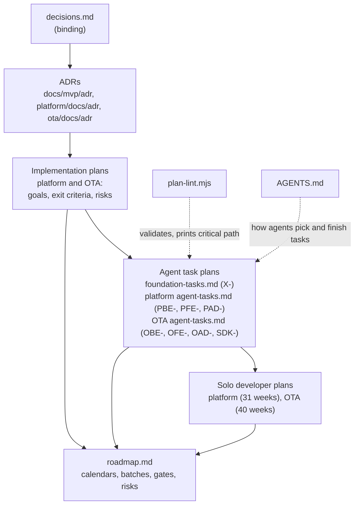

# Velexis MVP plans: index

This page lists every plan file of the Velexis MVP, says which question each one answers, and shows how they relate. There is one master roadmap, one foundation task plan, and three plans for each component group (platform and OTA): an implementation plan, an agent task plan and a solo developer plan. All plans use the shared milestones M0–M6 of [`../README.md`](../README.md#1-shared-milestones) and follow [`../decisions.md`](../decisions.md). The two plan styles (agent tasks and week by week) come from [ADR-0020](../adr/0020-ai-agent-development-workflow.md). How they are combined into one calendar is recorded in [ADR-0025](../adr/0025-roadmap-scheduling-and-tracking.md).

Related: [`roadmap.md`](roadmap.md), [`../../../AGENTS.md`](../../../AGENTS.md) (how agents pick and finish tasks), [`../../../tools/plan-lint/plan-lint.mjs`](../../../tools/plan-lint/plan-lint.mjs) (validation), [`../README.md`](../README.md) (all MVP documents).

## 1. The plan files

| File | Style | Scope | Task ids | Answers |
|---|---|---|---|---|
| [`roadmap.md`](roadmap.md) | Master plan | Foundation and both groups | References all ids | When does each milestone happen, with and without agents? Which tasks run in parallel? What are the review gates, demos, go/no-go criteria, critical path and risks? |
| [`foundation-tasks.md`](foundation-tasks.md) | Agent tasks | Monorepo, shared packages, CI, baselines, migration runner, VM, users per trust zone, deploy, backups, monitoring, Amadeus stub, PCI controls of the VM | `X-001` … `X-040` | What exactly is built for the shared base, and which task provides what the components depend on? |
| [`platform/docs/plans/implementation-plan.md`](../../../platform/docs/plans/implementation-plan.md) | Implementation plan | Platform backend, portal, platform admin | `PBE-`, `PFE-`, `PAD-` (referenced) | Per milestone: goal, epics, demo, exit criteria, interface with the OTA group, risks; traceability from PF features to tasks |
| [`platform/docs/plans/agent-tasks.md`](../../../platform/docs/plans/agent-tasks.md) | Agent tasks | Platform backend, portal, platform admin | `PBE-001` … `PBE-065`, `PFE-001` … `PFE-028`, `PAD-001` … `PAD-016` | What exactly does each platform task change, and how is it proven? |
| [`platform/docs/plans/solo-developer-plan.md`](../../../platform/docs/plans/solo-developer-plan.md) | Solo developer (week by week) | Platform group, without agents | References platform ids | In which order does one developer build the platform, week by week (31 platform weeks)? |
| [`ota/docs/plans/implementation-plan.md`](../../../ota/docs/plans/implementation-plan.md) | Implementation plan | OTA backend, storefront, OTA admin, JS SDK | `OBE-`, `OFE-`, `OAD-`, `SDK-` (referenced) | Per milestone: goal, epics, demo, exit criteria, interface with the platform group, risks; traceability from OF features and operations to tasks |
| [`ota/docs/plans/agent-tasks.md`](../../../ota/docs/plans/agent-tasks.md) | Agent tasks | OTA backend, storefront, OTA admin, JS SDK | `OBE-001` … `OBE-089`, `OFE-001` … `OFE-026`, `OAD-001` … `OAD-019`, `SDK-001` … `SDK-015` | What exactly does each OTA task change, and how is it proven? |
| [`ota/docs/plans/solo-developer-plan.md`](../../../ota/docs/plans/solo-developer-plan.md) | Solo developer (week by week) | OTA group, without agents | References OTA ids | In which order does one developer build the OTA side, week by week (40 OTA weeks)? |

## 2. How they relate

- **Decisions flow down.** [`decisions.md`](../decisions.md) wins over everything. The ADRs refine it, the implementation plans apply it per milestone, and the task blocks turn it into work.
- **Task blocks are the single source of scope.** Each task is defined once, in one agent task plan. The solo plans and the roadmap reference task ids and never redefine a task.
- **Dependencies cross files.** Component tasks depend on `X-` tasks, and some platform and OTA tasks depend on each other (for example OBE-003 on PBE-002, and OAD-016 on PFE-017). A few platform tasks carry a **Gate** that names an OTA feature (PBE-035, PBE-036, PAD-011, PFE-019).
- **The roadmap combines them.** It schedules all 298 tasks in one calendar, maps the two solo plans' week numbers to calendar weeks, and keeps the milestone status, outside steps and change log.

## 3. Which file to open

| I want to … | Open |
|---|---|
| Know what to work on this week | [`roadmap.md`](roadmap.md) §2 (batches and target weeks with agents), or §1.3 with the matching solo plan week (without agents) |
| Hand a task to an agent | The task block in its agent task plan, plus [`AGENTS.md`](../../../AGENTS.md) §3–§5 |
| Know why a task exists, or what a milestone must prove | The group's implementation plan (§4 milestones, §6 traceability) |
| Check dependencies or the critical path | `node tools/plan-lint/plan-lint.mjs --graph` |
| See the risks and outside steps | [`roadmap.md`](roadmap.md) §3 and §4.4; the risk tables of each implementation plan |
| Start the project today | [`roadmap.md`](roadmap.md) §4.1 and §4.2 |
| See totals per component and milestone | [`roadmap.md`](roadmap.md) §5 |

## 4. Rules shared by every plan

- **Milestones.** Every plan uses M0–M6 with the meanings of [`../README.md`](../README.md#1-shared-milestones).
- **Task format.** Task blocks follow [ADR-0020](../adr/0020-ai-agent-development-workflow.md): Component, Milestone, Depends on, Size, Read first, Files, Steps, Acceptance, Verify. Sizes are S (up to 2 h), M (up to 4 h) and L (up to 1 day) of agent and review time.
- **Ids.** Ids are unique across the three task files. The prefix matches the component (`X`, `PBE`, `PFE`, `PAD`, `OBE`, `OFE`, `OAD`, `SDK`).
- **Status.** A task's PR adds `- **Status:** in progress (PR #n)`. In the PR's last commit it appends ` ✅` to the heading and sets `done (PR #n)`, so both hold on `main` from the merge on ([ADR-0025](../adr/0025-roadmap-scheduling-and-tracking.md) item 6, which amends [ADR-0020](../adr/0020-ai-agent-development-workflow.md); [`AGENTS.md`](../../../AGENTS.md) §4).
- **Validation.** `node tools/plan-lint/plan-lint.mjs` runs in CI on every PR that touches a plan and must report `ERRORS: 0`.

## 5. Baseline numbers

`node tools/plan-lint/plan-lint.mjs` on 2026-10-13, after the review fixes: `tasks: 301  estimated hours: 1406`, `ERRORS: 0`, critical path 162 h over 29 tasks.

| Plan | Tasks | Agent-hours | Solo days |
|---|---|---|---|
| Foundation (`X-`) | 40 | 170 | 42.5 |
| Platform (`PBE-` 66, `PFE-` 28, `PAD-` 16) | 110 | 552 | 138 |
| OTA (`OBE-` 91, `OFE-` 26, `OAD-` 19, `SDK-` 15) | 151 | 684 | 171 |
| **Total** | **301** | **1,406** | **351.5** |

Calendars: **30 working weeks** with AI agents, **76 working weeks** without ([`roadmap.md`](roadmap.md) §1).

## 6. Changing a plan

Edit in this order, so that nothing contradicts what it depends on:

1. [`decisions.md`](../decisions.md), only if a product-owner decision changes.
2. The ADR that records the decision (new ones start as `Proposed`).
3. The group's implementation plan (milestone scope, exit criteria, traceability).
4. The agent task plan: add or change task blocks, using the next free id for new work. Run `node tools/plan-lint/plan-lint.mjs` until it reports `ERRORS: 0`.
5. The solo developer plan, if the week order changes.
6. [`roadmap.md`](roadmap.md): the batch tables of §2, the calendar of §1 if the length changes, and a dated line in the change log (§4.5).

When you add, rename or remove a plan file, update this index and [`../README.md`](../README.md) §5 in the same pull request.
