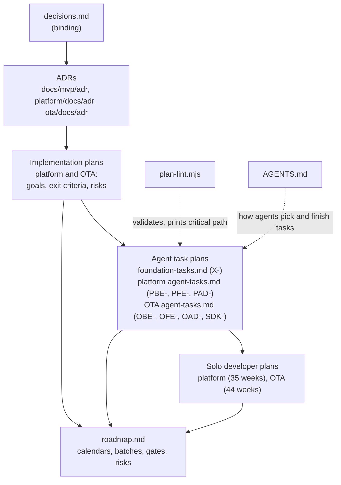

# Velexis MVP plans: index

This page lists every plan file of the Velexis MVP, says which question each one answers, and shows how they relate. There is one master roadmap, one foundation task plan, and three plans for each component group (platform and OTA): an implementation plan, an agent task plan and a solo developer plan. All plans use the shared milestones M0–M6 of [`../README.md`](../README.md#1-shared-milestones) and follow [`../decisions.md`](../decisions.md). The two plan styles (agent tasks and week by week) come from [ADR-0020](../adr/0020-ai-agent-development-workflow.md). How they are combined into one calendar is recorded in [ADR-0025](../adr/0025-roadmap-scheduling-and-tracking.md).

Related: [`roadmap.md`](roadmap.md), [`../../../AGENTS.md`](../../../AGENTS.md) (how agents pick and finish tasks), [`../../../tools/plan-lint/plan-lint.mjs`](../../../tools/plan-lint/plan-lint.mjs) (validation and progress, [README](../../../tools/plan-lint/README.md)), [`../README.md`](../README.md) (all MVP documents).

## 1. The plan files

| File | Style | Scope | Task ids | Answers |
|---|---|---|---|---|
| [`roadmap.md`](roadmap.md) | Master plan | Foundation and both groups | References all ids | When does each milestone happen, with and without agents? Which tasks run in parallel? What are the review gates, demos, go/no-go criteria, critical path and risks? |
| [`foundation-tasks.md`](foundation-tasks.md) | Agent tasks | Monorepo, shared packages, CI, baselines, migration runner, VM, users per trust zone, deploy, backups, monitoring, Amadeus stub, PCI controls of the VM | `X-001` … `X-043` | What exactly is built for the shared base, and which task provides what the components depend on? |
| [`platform/docs/plans/implementation-plan.md`](../../../platform/docs/plans/implementation-plan.md) | Implementation plan | Platform backend, portal, platform admin | `PBE-`, `PFE-`, `PAD-` (referenced) | Per milestone: goal, epics, demo, exit criteria, interface with the OTA group, risks; traceability from PF features to tasks |
| [`platform/docs/plans/agent-tasks.md`](../../../platform/docs/plans/agent-tasks.md) | Agent tasks | Platform backend, portal, platform admin | `PBE-001` … `PBE-074`, `PFE-001` … `PFE-030`, `PAD-001` … `PAD-017` | What exactly does each platform task change, and how is it proven? |
| [`platform/docs/plans/solo-developer-plan.md`](../../../platform/docs/plans/solo-developer-plan.md) | Solo developer (week by week) | Platform group, without agents | References platform ids | In which order does one developer build the platform, week by week (35 platform weeks: Weeks 1–31, the follow-up Weeks 30a and 30b of 2026-11-06 and Weeks 30c and 30d of 2026-11-11)? |
| [`ota/docs/plans/implementation-plan.md`](../../../ota/docs/plans/implementation-plan.md) | Implementation plan | OTA backend, storefront, OTA admin, JS SDK | `OBE-`, `OFE-`, `OAD-`, `SDK-` (referenced) | Per milestone: goal, epics, demo, exit criteria, interface with the platform group, risks; traceability from OF features and operations to tasks |
| [`ota/docs/plans/agent-tasks.md`](../../../ota/docs/plans/agent-tasks.md) | Agent tasks | OTA backend, storefront, OTA admin, JS SDK | `OBE-001` … `OBE-102`, `OFE-001` … `OFE-031`, `OAD-001` … `OAD-022`, `SDK-001` … `SDK-016` | What exactly does each OTA task change, and how is it proven? |
| [`ota/docs/plans/solo-developer-plan.md`](../../../ota/docs/plans/solo-developer-plan.md) | Solo developer (week by week) | OTA group, without agents | References OTA ids | In which order does one developer build the OTA side, week by week (44 OTA weeks: Weeks 1–40, the follow-up Week 39a of 2026-11-06 and Weeks 39b, 39c and 39d of 2026-11-11)? |

## 2. How they relate

- **Decisions flow down.** [`decisions.md`](../decisions.md) wins over everything. The ADRs refine it, the implementation plans apply it per milestone, and the task blocks turn it into work.
- **Task blocks are the single source of scope.** Each task is defined once, in one agent task plan. The solo plans and the roadmap reference task ids and never redefine a task.
- **Dependencies cross files.** Component tasks depend on `X-` tasks, and some platform and OTA tasks depend on each other (for example OBE-003 on PBE-002, and OAD-016 on PFE-017). A few platform tasks carry a **Gate** that names an OTA feature (PBE-035, PBE-036, PAD-011, PFE-019).
- **The roadmap combines them.** It schedules all 334 tasks (317 at its re-baseline of 2026-11-06, then OFE-029, X-041 and OFE-030 of 2026-11-10, seven more at its re-baseline of 2026-11-11, OBE-101, which OBE-088 added the same day, five more at its second re-baseline of that day, and X-042, which X-032 added the same day) in one calendar, maps the two solo plans' week numbers to calendar weeks, and keeps the milestone status, outside steps and change log.

## 3. Which file to open

| I want to … | Open |
|---|---|
| Know what to work on this week | [`roadmap.md`](roadmap.md) §2 (batches and target weeks with agents), or §1.3 with the matching solo plan week (without agents) |
| Hand a task to an agent | The task block in its agent task plan, plus [`AGENTS.md`](../../../AGENTS.md) §3–§5 |
| Know why a task exists, or what a milestone must prove | The group's implementation plan (§4 milestones, §6 traceability) |
| Check dependencies or the critical path | `node tools/plan-lint/plan-lint.mjs --graph` |
| See progress, or which tasks are ready to pick | `node tools/plan-lint/plan-lint.mjs` (second block), `node tools/plan-lint/plan-lint.mjs --remaining` |
| See the risks and outside steps | [`roadmap.md`](roadmap.md) §3 and §4.4; the risk tables of each implementation plan |
| Start the project today | [`roadmap.md`](roadmap.md) §4.1 and §4.2 |
| See totals per component and milestone | [`roadmap.md`](roadmap.md) §5 |

## 4. Rules shared by every plan

- **Milestones.** Every plan uses M0–M6 with the meanings of [`../README.md`](../README.md#1-shared-milestones).
- **Task format.** Task blocks follow [ADR-0020](../adr/0020-ai-agent-development-workflow.md): Component, Milestone, Depends on, Size, Read first, Files, Steps, Acceptance, Verify. Sizes are S (up to 2 h), M (up to 4 h) and L (up to 1 day) of agent and review time.
- **Ids.** Ids are unique across the three task files. The prefix matches the component (`X`, `PBE`, `PFE`, `PAD`, `OBE`, `OFE`, `OAD`, `SDK`).
- **Status.** A task's PR adds `- **Status:** in progress (PR #n)`. In the PR's last commit it appends ` ✅` to the heading and sets `done (PR #n)`, so both hold on `main` from the merge on ([ADR-0025](../adr/0025-roadmap-scheduling-and-tracking.md) item 6, which amends [ADR-0020](../adr/0020-ai-agent-development-workflow.md); [`AGENTS.md`](../../../AGENTS.md) §4). When a task has a Status line, plan-lint reports a ` ✅` without a done status, and a done status without ` ✅`, as errors.
- **Validation.** `node tools/plan-lint/plan-lint.mjs` runs in CI on every PR that touches a plan and must report `ERRORS: 0`.
- **Progress.** The second block of `node tools/plan-lint/plan-lint.mjs` counts the done markers: done and total tasks and hours per milestone and per file, the remaining hours, and the critical path of the tasks without ` ✅`. `node tools/plan-lint/plan-lint.mjs --remaining` lists the ready tasks of the lowest open milestone, critical path first ([`tools/plan-lint/README.md`](../../../tools/plan-lint/README.md)).

## 5. Baseline numbers

`node tools/plan-lint/plan-lint.mjs` on 2026-10-13, after the review fixes: `tasks: 301  estimated hours: 1406`, `ERRORS: 0`, critical path 162 h over 29 tasks.

| Plan | Tasks | Agent-hours | Solo days |
|---|---|---|---|
| Foundation (`X-`) | 40 | 170 | 42.5 |
| Platform (`PBE-` 66, `PFE-` 28, `PAD-` 16) | 110 | 552 | 138 |
| OTA (`OBE-` 91, `OFE-` 26, `OAD-` 19, `SDK-` 15) | 151 | 684 | 171 |
| **Total** | **301** | **1,406** | **351.5** |

Calendars: **30 working weeks** with AI agents, **76 working weeks** without ([`roadmap.md`](roadmap.md) §1).

**Re-baseline (2026-11-06, [ADR-0025](../adr/0025-roadmap-scheduling-and-tracking.md) item 6, the owner's decision (11g)).** `node tools/plan-lint/plan-lint.mjs`: `tasks: 317  estimated hours: 1466`, `ERRORS: 0`, the same critical path. The 16 tasks added since the baseline are M6 follow-ups of the milestone's reviews ([`roadmap.md`](roadmap.md) §4.5). Since 2026-11-10 the table also counts OFE-029 (S, 2 h, ½ solo day), which OFE-027 added on 2026-11-10 when its measurement found the header's shift: `tasks: 318  estimated hours: 1468`; and since lead decisions (13a) and (13h) of the same day X-041 (M, 4 h, 1 solo day: the VM's outbound allow-list, PCI DSS 11.5.1.1) and OFE-030 (M, 4 h, 1 solo day: the layout shifts left on phones), with OFE-029 closed as met: `tasks: 320  estimated hours: 1476`.

| Plan | Tasks | Agent-hours | Solo days |
|---|---|---|---|
| Foundation (`X-`) | 41 | 174 | 43.5 |
| Platform (`PBE-` 71, `PFE-` 30, `PAD-` 17) | 118 | 590 | 147.5 |
| OTA (`OBE-` 96, `OFE-` 30, `OAD-` 20, `SDK-` 15) | 161 | 712 | 178 |
| **Total** | **320** | **1,476** | **369** |

Calendars: **30 working weeks** with AI agents (M6's buffer holds the follow-ups), **79 working weeks** without (the platform's Weeks 30a and 30b and the OTA's Week 39a get calendar weeks of their own; [`roadmap.md`](roadmap.md) §1.3).

**Re-baseline (2026-11-11, [ADR-0025](../adr/0025-roadmap-scheduling-and-tracking.md) item 6, lead decision (15a) of 2026-11-11, approved by the owner; FIX-W48-SHARED).** `node tools/plan-lint/plan-lint.mjs`: `tasks: 327  estimated hours: 1504`, `ERRORS: 0`, the same critical path. Seven M6 tasks join: OBE-097 (M, CORS, planned by the lead on 2026-11-11), OBE-098 and OAD-021 (S each, a storefront's offers per search in the console), OBE-099 (L) and OAD-022 (M) (a booking in Reconciliation review closed in the console) and PBE-072 and OBE-100 (M each, each backend's `secrets:rewrap`) ([`roadmap.md`](roadmap.md) §4.5). Since the same day the table also counts OBE-101 (M, 4 h, 1 solo day; the completed jobs Redis keeps, added by OBE-088's measurement): `tasks: 328  estimated hours: 1508`; it takes M6's buffer and OTA Week 40's day of buffer, so neither calendar changes.

| Plan | Tasks | Agent-hours | Solo days |
|---|---|---|---|
| Foundation (`X-`) | 41 | 174 | 43.5 |
| Platform (`PBE-` 72, `PFE-` 30, `PAD-` 17) | 119 | 594 | 148.5 |
| OTA (`OBE-` 101, `OFE-` 30, `OAD-` 22, `SDK-` 15) | 168 | 740 | 185 |
| **Total** | **328** | **1,508** | **377** |

Calendars: **31 working weeks** with AI agents (M6 gets a fourth week), **81 working weeks** without (the OTA's Week 39b, and the OTA's Week 39c, the platform's Week 30c and X-041 get calendar weeks of their own before the launch block; [`roadmap.md`](roadmap.md) §1.3).

**Re-baseline (2026-11-11, second set; [ADR-0025](../adr/0025-roadmap-scheduling-and-tracking.md) item 6, lead decisions (17b), (17d), (17g), (17k) and (17l) of 2026-11-11, approved by the owner; FIX-W49-SHARED).** `node tools/plan-lint/plan-lint.mjs`: `tasks: 333  estimated hours: 1532`, `ERRORS: 0`, and a critical path of 166 h over 30 tasks (OFE-031, an L task after OFE-030, makes the storefront chain 4 h longer than the console chain; [`roadmap.md`](roadmap.md) §3.1). Five M6 tasks join: PBE-073 (M, portal passwords against the rule-meeting entries of a public list of about a million breached passwords), PBE-074 (M, no Velexis Amadeus account outside the official Amadeus hosts in production), SDK-016 (M, one refresh shared by the SDK clients derived from one cookie-mode client), OBE-102 (M, a share of the Amadeus buckets kept free for shopping during the booking sync) and OFE-031 (L, a signed-in customer's phone page kept still, the search form's fallback and the OTA's full name in the footer) ([`roadmap.md`](roadmap.md) §4.5).

| Plan | Tasks | Agent-hours | Solo days |
|---|---|---|---|
| Foundation (`X-`) | 42 | 178 | 44.5 |
| Platform (`PBE-` 74, `PFE-` 30, `PAD-` 17) | 121 | 602 | 150.5 |
| OTA (`OBE-` 102, `OFE-` 31, `OAD-` 22, `SDK-` 16) | 171 | 756 | 189 |
| **Total** | **334** | **1,536** | **384** |

Calendars: **31 working weeks** with AI agents (M6's buffer falls from 20 h to 8 h, and to 7 h with X-042), **82 working weeks** without (a calendar week C79 holds the OTA's new Week 39d and the platform's new Week 30d before the launch block, and PBE-073 joins the platform's Week 30c in C78; [`roadmap.md`](roadmap.md) §1.3). The foundation row and the totals include X-042 (M, 4 h, 1 solo day), which X-032 added the same day (`tasks: 334  estimated hours: 1536`): it took the launch block's ½ day of buffer and ran ½ day over it until the lead confirmed its milestone ([`roadmap.md`](roadmap.md) §4.5).

**Re-baseline (2026-11-12, [ADR-0025](../adr/0025-roadmap-scheduling-and-tracking.md) item 6, lead decision (19h) of 2026-11-12, approved by the owner; FIX-W50-SHARED).** `node tools/plan-lint/plan-lint.mjs` still prints `tasks: 334  estimated hours: 1536`, `ERRORS: 0`, and the same critical path, so the table above stands. X-042 keeps its M6 tag and runs after the launch, as PBE-064 does: with agents M6's buffer is 8 h again, without agents the launch block keeps its ½ day of buffer (27 buffer days); both calendars keep their 31 and 82 weeks ([`roadmap.md`](roadmap.md) §1 and §4.5).

## 6. Changing a plan

Edit in this order, so that nothing contradicts what it depends on:

1. [`decisions.md`](../decisions.md), only if a product-owner decision changes.
2. The ADR that records the decision (new ones start as `Proposed`).
3. The group's implementation plan (milestone scope, exit criteria, traceability).
4. The agent task plan: add or change task blocks, using the next free id for new work. Run `node tools/plan-lint/plan-lint.mjs` until it reports `ERRORS: 0`.
5. The solo developer plan, if the week order changes.
6. [`roadmap.md`](roadmap.md): the batch tables of §2, the calendar of §1 if the length changes, and a dated line in the change log (§4.5).

When you add, rename or remove a plan file, update this index and [`../README.md`](../README.md) §5 in the same pull request.
