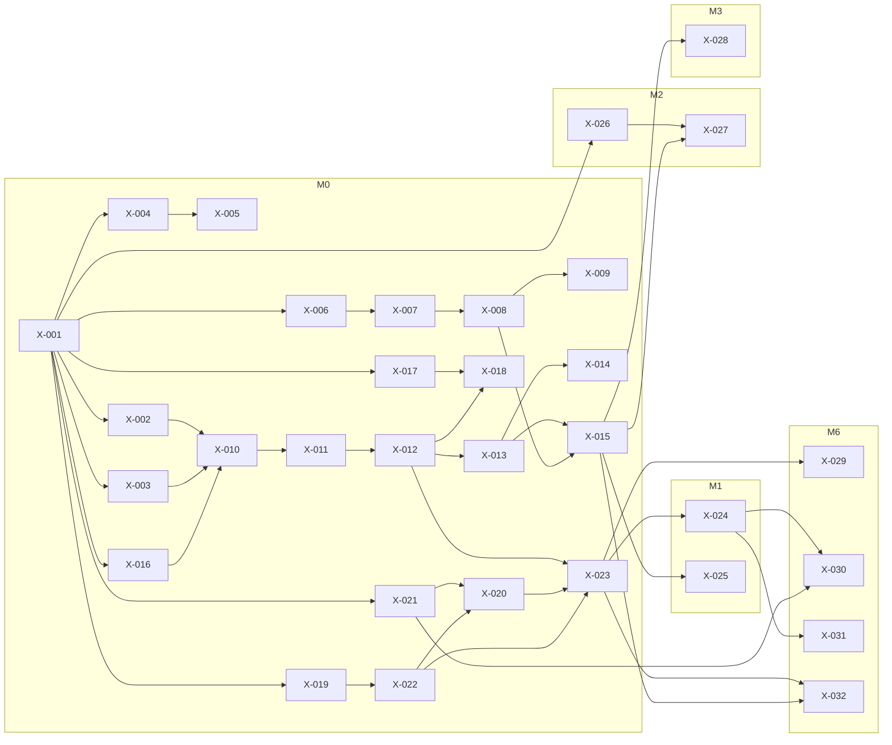

# Foundation agent tasks (`X-`)

This plan lists the cross-cutting **foundation** tasks of the Velexis MVP as small, self-contained tasks for AI coding agents:

- the monorepo bootstrap and the shared packages;
- the contract generation pipeline and the database baseline migrations with the migration runner;
- the reference data loader, CI and local development;
- VM provisioning, Caddy, systemd, the release and deploy pipeline, backups, monitoring and the restore drill.

Most of it is milestone **M0 Foundations**, which ends with a hello-world deploy on the single VM. A few tasks land later, when a milestone first needs them. Each task block follows the format of [ADR-0020](../adr/0020-ai-agent-development-workflow.md) and is validated by `node tools/plan-lint/plan-lint.mjs docs/mvp/plans/foundation-tasks.md`.

Related: [`../decisions.md`](../decisions.md) (binding), [`../architecture.md`](../architecture.md), [`../tech-stack.md`](../tech-stack.md), [`../conventions.md`](../conventions.md), [`../deployment-single-vm.md`](../deployment-single-vm.md), [`../local-development.md`](../local-development.md), [`../../../packages/README.md`](../../../packages/README.md), [`../../../deploy/README.md`](../../../deploy/README.md), [`../../../AGENTS.md`](../../../AGENTS.md). Decisions taken while writing this plan: [ADR-0021](../adr/0021-migration-cli-and-repeatable-grants.md) (migration CLI and repeatable grants), [ADR-0022](../adr/0022-shared-test-support-package.md) (`@velexis/testing`), [ADR-0023](../adr/0023-release-artefact-and-deploy-user.md) (release artefact and deploy user), [ADR-0024](../adr/0024-reference-data-sources-and-loader.md) (reference data).

## How to use this plan

- Pick tasks as [`AGENTS.md`](../../../AGENTS.md) §3 says: lowest milestone first, all **Depends on** merged, not claimed, critical path first.
- A task's **Status** line moves from `todo` to `in progress (PR #n)` to `done (PR #n)` in the task's own pull request.
- **Human step** in a task means a step only the developer can do: an action on a VM, a GitHub setting, or a secret. The agent prepares everything else and lists the step in the PR under "Questions and follow-ups".
- Root config files (`package.json`, `turbo.json`, `tsconfig.base.json`, `eslint.config.mjs`, `.prettierrc.json`, `.editorconfig`, `.gitignore`, `.nvmrc`, `.env.example`, `pnpm-workspace.yaml`) and the `deploy/` templates already exist. Tasks finalise and test them; they do not start over.
- Plans of the components may depend on these ids. The table below says which task provides what.

## Milestone outcomes

| Milestone | Foundation tasks | Demonstrable at the end |
|---|---|---|
| **M0** Foundations | X-001 to X-023 | `pnpm install && pnpm build && pnpm test` is green in CI. `pnpm db:migrate` creates the platform and reference baselines locally. A tenant schema can be created with `migrate.js tenant --create`. The reference data is loaded. The VM is provisioned. The **Deploy** workflow puts the hello-world release on it: `https://platform.example.com/` answers over TLS, and `velexis-deploy --status` shows the release. |
| **M1** Platform core | X-024, X-025 | Nightly encrypted backups reach the off-site bucket. Integration tests assert e-mails through Mailpit. |
| **M2** Search & price | X-026, X-027 | `pnpm stub:amadeus` serves token and flight-offers search; tests start the stub in-process. |
| **M3** Book & pay | X-028 | Signed Stripe webhook fixtures in tests; Stripe CLI forwarding for manual checks. |
| **M6** Hardening & launch | X-029 to X-032 | Uptime monitor and on-VM health checks alert. The restore drill is documented with a measured RTO. The move to managed services is proven to be configuration only. |

## What the component plans can depend on

| Need | Task |
|---|---|
| Typed config in an app (`src/config.ts`) | X-002 |
| Logger, `pinoHttpOptions`, redaction, `redactPayload` | X-003 |
| Envelope encryption, key providers | X-004 |
| API key hashing, tokens, signed URLs, `newId` | X-005 |
| OTA OpenAPI document at `ota/backend/openapi/` | X-006 |
| `contracts:lint` | X-007 |
| `@velexis/api-types` (OTA, platform, operations index, job envelope) | X-008 |
| `@velexis/errors`, `AppError` | X-009 |
| `createPool`, `platformDb`, `tenantTx`, `StorageAdapter` | X-010 |
| Migration runner and CLI (platform, reference) | X-011 |
| Baselines `0001` and `R__ota_read_access.sql` (the platform `0002` deltas build on them) | X-012 |
| Tenant fan-out, `migrateTenantSchema` for provisioning | X-013 |
| Generated Kysely table types | X-014 |
| Integration test harness (`@velexis/testing`) | X-015 |
| Local roles, keys, Mailpit setup | X-016 |
| Reference data in the database | X-018 |
| CI with PostgreSQL, Redis and Mailpit | X-019 |
| Running VM, systemd units, Caddy | X-020, X-021, X-022 |
| Deploy pipeline (apps join it by existing) | X-023 |
| Mailpit, Amadeus stub and Stripe test helpers | X-025, X-026, X-027, X-028 |

## M0 Foundations

### X-001 · Verify the monorepo bootstrap and commit the lockfile
- **Status:** todo
- **Component:** foundation
- **Milestone:** M0
- **Depends on:** —
- **Size:** S
- **Read first:** AGENTS.md §10; docs/mvp/adr/0002-monorepo-pnpm-turborepo.md; docs/mvp/tech-stack.md §1 and §2; package.json; turbo.json; eslint.config.mjs; tsconfig.base.json
- **Files:** `package.json`, `vitest.workspace.ts`, `AGENTS.md`, `README.md`
- **Steps:**
  1. With Node 22 (`nvm use`) and `corepack enable`, run `pnpm install`. Commit the generated `pnpm-lock.yaml` together with this task: the lockfile is always allowed.
  2. Create `vitest.workspace.ts` (Vitest 3, `defineWorkspace` from `vitest/config`). It lists the globs `packages/*/vitest.config.ts`, `platform/*/vitest.config.ts`, `ota/*/vitest.config.ts` and `tools/*/vitest.config.ts`, so editors can run any test file. CI keeps running tests per package through Turborepo.
  3. Run every root script on the still-empty workspace: `build`, `lint`, `typecheck`, `test`, `format:check`, `plan:lint`. Fix only root configuration problems; do not create packages. Turborepo must report that there are no tasks, not fail.
  4. Check that ESLint loads the shared config with `pnpm exec eslint --print-config eslint.config.mjs`. Check that Prettier ignores `docs/velexis-sdk/` and Markdown: `pnpm exec prettier --check .`.
  5. If a script name in `package.json` differs from the cheat sheet in `AGENTS.md` §10, fix the table, because `package.json` wins. Keep the "Status" line of `README.md` as it is.
- **Acceptance:**
  - `pnpm install --frozen-lockfile` succeeds on a clean clone with Node 22 and pnpm 9.15.9.
  - `pnpm build`, `pnpm lint`, `pnpm typecheck`, `pnpm test` and `pnpm format:check` exit 0 on the empty workspace.
  - `node tools/plan-lint/plan-lint.mjs` exits 0.
  - The lockfile contains only the root devDependencies listed in `docs/mvp/tech-stack.md`, all with exact versions.
- **Verify:** `pnpm install --frozen-lockfile && pnpm build && pnpm lint && pnpm typecheck && pnpm test && pnpm format:check && pnpm plan:lint`

### X-002 · Create @velexis/config with typed environment and key-file validation
- **Status:** todo
- **Component:** foundation
- **Milestone:** M0
- **Depends on:** X-001
- **Size:** M
- **Read first:** packages/README.md (rules and `@velexis/config`); docs/mvp/conventions.md §8; docs/mvp/adr/0010-secrets-envelope-encryption.md (Key material on the VM); docs/mvp/architecture.md §6; .env.example
- **Files:** `packages/config/package.json`, `packages/config/tsconfig.json`, `packages/config/vitest.config.ts`, `packages/config/src/index.ts`, `packages/config/src/env.ts`, `packages/config/src/define-config.ts`, `packages/config/src/dev-env-files.ts`, `packages/config/src/key-files.ts`, `packages/config/src/define-config.test.ts`, `packages/config/src/key-files.test.ts`, `packages/config/src/dev-env-files.test.ts`, `packages/config/README.md`
- **Steps:**
  1. Scaffold the package by the rules of `packages/README.md`:
     - `"private": true`, CommonJS output through `tsc -b` with `composite: true`, an `exports` map;
     - scripts `build`, `typecheck`, `lint`, `test`, `clean`;
     - exact devDependencies `typescript` 5.6.3, `vitest` 3.2.7, `@types/node` 22.x.
  2. Write the builders in `src/env.ts`: `string({ pattern, default, optional })`, `int({ min, max })`, `port()`, `bool()` (only `true`, `false`, `1`, `0`), `url({ protocols })`, `enum(values)`, `dir()`, `secretFile({ minBytes })`, `list()`. The types are inferred: `optional` gives `T | undefined`, `default` gives `T`.
  3. Write `defineConfig(schema, source = process.env)` in `src/define-config.ts`. It validates every entry and collects all problems. It throws one `ConfigError` that names each variable and the reason, **never the value**. It returns a deep-frozen object. This is the only file in the repository allowed to read `process.env`.
  4. Write `loadDevEnvFiles({ appDir, rootDir })` in `src/dev-env-files.ts`, using Node 22 `util.parseEnv`:
     - it reads `<appDir>/.env.local`, then `<rootDir>/.env.local`, and sets only variables that are still unset, so the real environment wins, then the app file, then the root file;
     - it does nothing and logs nothing when `APP_ENV` or `NODE_ENV` is `production`;
     - `rootDir` defaults to the folder that holds `pnpm-workspace.yaml`.
  5. Write `readKeyFile(path, { minBytes, encoding: "base64" | "pem" })` in `src/key-files.ts`. It throws when the file is missing, is readable by group or others (`mode & 0o077`), or is shorter than `minBytes` after decoding. `env.secretFile` uses it.
  6. Write the tests named below, and a README with a usage example.
- **Acceptance:**
  - `defineConfig` with three invalid variables throws a single `ConfigError` whose message names all three and contains none of their values.
  - Type tests (`expectTypeOf`) show that an `optional` string is `string | undefined`, an `int` with `default` is `number`, and an `enum` is the literal union.
  - `secretFile` rejects a missing file, a file with mode 0644, and a file shorter than `minBytes`; it accepts a 0400 file.
  - The precedence of `loadDevEnvFiles` is environment, then app file, then root file; with `APP_ENV=production` it reads no file.
  - `pnpm lint` passes with `n/no-process-env` active for every package except this one.
- **Verify:** `pnpm --filter @velexis/config build && pnpm --filter @velexis/config test && pnpm --filter @velexis/config lint`

### X-003 · Create @velexis/logger with the central redaction list
- **Status:** todo
- **Component:** foundation
- **Milestone:** M0
- **Depends on:** X-001
- **Size:** M
- **Read first:** docs/mvp/adr/0016-observability.md (Logs); docs/mvp/conventions.md §7; docs/mvp/adr/0011-payments-stripe-and-airline-card.md §C; docs/velexis-sdk/db/README.md §8; packages/README.md (`@velexis/logger`)
- **Files:** `packages/logger/package.json`, `packages/logger/tsconfig.json`, `packages/logger/vitest.config.ts`, `packages/logger/src/index.ts`, `packages/logger/src/create-logger.ts`, `packages/logger/src/redact-paths.ts`, `packages/logger/src/http.ts`, `packages/logger/src/redact-payload.ts`, `packages/logger/src/mask.ts`, `packages/logger/src/redaction.test.ts`, `packages/logger/src/redact-payload.test.ts`, `packages/logger/src/http.test.ts`, `packages/logger/README.md`
- **Steps:**
  1. Scaffold the package. Dependencies: `pino` 9.x and `pino-http` 10.x, with exact versions. `nestjs-pino` stays in the apps.
  2. Write `REDACT_PATHS` in `src/redact-paths.ts` from the ADR-0016 list. Spell out every depth that pino needs:
     - top level and `*.` for `password`, `newPassword`, `currentPassword`, `mfaCode`, `accessToken`, `refreshToken`, `portalToken`, `bookingToken`, `token`, `clientSecret`, `secret`, `apiKey`, `securityCode`, `cvc`, `cardNumber`, `certificateNumber`;
     - `*.card.number`, `*.creditCard.number`, `*.documents[*].number`;
     - `req.headers.authorization`, `req.headers.cookie`, `res.headers["set-cookie"]`, `req.headers["x-api-key"]`, `req.headers["x-csrf-token"]`, `req.headers["x-booking-token"]`, `req.headers["x-velexis-edge"]`.

     The censor is `[REDACTED]`.
  3. Write `createLogger({ app, env, level })` with base fields `app` and `env`, ISO timestamps, an `err` serializer that keeps type, message, stack and `code`, and the redaction list.
  4. Write `pinoHttpOptions({ app, logger })` in `src/http.ts`:
     - `genReqId` keeps a valid `X-Request-Id` (`^[A-Za-z0-9._-]{8,128}$`, as in the Caddyfile), otherwise it uses `crypto.randomUUID()`, and sets the response header;
     - one line per request with method, route template, status and `durationMs`;
     - no headers or bodies in the serializers;
     - `/health/*` is not logged.
  5. Write `redactPayload(value)` in `src/redact-payload.ts`, the shared redactor for persisted payload copies (db README §8). It returns a deep copy and never mutates its input:
     - card `number` fields are replaced by their last 4 digits;
     - `securityCode`, `cvc` and `cvv` are dropped;
     - password, token, secret and apiKey keys become `[REDACTED]`;
     - arrays are handled and cycles do not loop.

     Write `maskPan(pan)` in `src/mask.ts`, which keeps BIN and last 4 (ADR-0011).
  6. Write the tests below, using the test PAN `4111111111111111`, the password `Hunter2!` and a bearer token.
- **Acceptance:**
  - A log line produced through `pinoHttpOptions` for a request whose headers and body contain the test PAN, the password and a bearer token contains none of them (`redaction.test.ts`).
  - `redactPayload` on an Amadeus-shaped `formOfPayments[0].creditCard` object keeps `1111` as the number, removes `securityCode`, and leaves the input unchanged.
  - A valid incoming `X-Request-Id` is reused; an invalid one (`<script>`) is replaced by a UUID.
  - The README states the rule "a new sensitive field = a new path here plus a test".
- **Verify:** `pnpm --filter @velexis/logger build && pnpm --filter @velexis/logger test`

### X-004 · Create @velexis/crypto with envelope encryption and key providers
- **Status:** todo
- **Component:** foundation
- **Milestone:** M0
- **Depends on:** X-001
- **Size:** M
- **Read first:** docs/mvp/adr/0010-secrets-envelope-encryption.md (whole); packages/README.md (`@velexis/crypto`); docs/velexis-sdk/db/README.md §8
- **Files:** `packages/crypto/package.json`, `packages/crypto/tsconfig.json`, `packages/crypto/vitest.config.ts`, `packages/crypto/src/index.ts`, `packages/crypto/src/envelope.ts`, `packages/crypto/src/key-provider.ts`, `packages/crypto/src/local-file-key-provider.ts`, `packages/crypto/src/aad.ts`, `packages/crypto/src/envelope.test.ts`, `packages/crypto/src/local-file-key-provider.test.ts`, `packages/crypto/README.md`
- **Steps:**
  1. Scaffold the package. It has no runtime dependency other than Node `crypto`.
  2. Define `KeyProvider` (`currentKekId()`, `wrap(dek)`, `unwrap(wrapped, kekId)`) in `src/key-provider.ts`.
  3. Write `LocalFileKeyProvider.fromDir(dir, current)` in `src/local-file-key-provider.ts`:
     - it loads every `master-v<N>.key` in the folder (base64, exactly 32 bytes after decoding) as KEK id `local:v<N>`;
     - it fails when `current` (for example `local:v1`) has no file;
     - it refuses files readable by group or others.
  4. Write `encryptValue(plaintext, { aad, keys })` in `src/envelope.ts`:
     - a fresh 32-byte data key per value, used with AES-256-GCM (12-byte IV, 16-byte tag);
     - the data key is wrapped with the current KEK;
     - the output follows the ADR-0010 format: `0x01 | kekId length + kekId | wrapped DEK (iv, tag, ct) | iv | tag | ciphertext`;
     - it returns `{ ciphertext: Buffer, kekId }`.

     Also write `decryptValue(ciphertext, { aad, keys })`, and `rewrapValue(ciphertext, { keys })`, which re-wraps only the data key under the current KEK.
  5. Write `aadFor(schema, table, column, rowId)` in `src/aad.ts`, giving `"<schema>.<table>.<column>:<rowId>"`. Decryption errors throw `DecryptionError` with no detail about the cause.
  6. Write the tests below and a README that covers the rotation procedure of ADR-0010.
- **Acceptance:**
  - Round trip works. The same plaintext encrypted twice gives different ciphertexts.
  - Decryption fails with a different AAD, with any single flipped byte, and with a wrapped key from another KEK.
  - A value encrypted under `local:v1` decrypts after `current` becomes `local:v2`. `rewrapValue` moves it to `local:v2` without changing the plaintext.
  - `package.json` lists no third-party crypto library.
- **Verify:** `pnpm --filter @velexis/crypto build && pnpm --filter @velexis/crypto test`

### X-005 · Add token, hashing, signed-URL and id helpers to @velexis/crypto
- **Status:** todo
- **Component:** foundation
- **Milestone:** M0
- **Depends on:** X-004
- **Size:** S
- **Read first:** platform/docs/adr/0005-api-key-format-and-hashing.md; docs/mvp/adr/0017-email-documents-storage.md (Signed URLs); docs/velexis-sdk/db/README.md §2.1 (ids); docs/mvp/adr/0008-identity-accounts-customers-sessions.md (tokens)
- **Files:** `packages/crypto/src/tokens.ts`, `packages/crypto/src/hash.ts`, `packages/crypto/src/signed-url.ts`, `packages/crypto/src/ids.ts`, `packages/crypto/src/tokens.test.ts`, `packages/crypto/src/hash.test.ts`, `packages/crypto/src/signed-url.test.ts`, `packages/crypto/src/ids.test.ts`, `packages/crypto/src/index.ts`, `packages/crypto/package.json`
- **Steps:**
  1. Write `generateToken(prefix, bytes = 32)` in `src/tokens.ts`. It returns `{ token: "<prefix>_<base64url>", hash: sha256Hex(token) }`.
  2. Write the hashing helpers in `src/hash.ts`:
     - `sha256Hex` and `hmacSha256(key, data)` as hex;
     - `hashApiKey(fullKey, pepper: Buffer)` as `hex(HMAC-SHA-256(pepper, fullKey))`, exactly as PADR-0005 says;
     - `verifyApiKey(fullKey, pepper, expectedHex)` using `crypto.timingSafeEqual`;
     - `timingSafeEqualStr(a, b)`, which is safe for different lengths.
  3. Write `signUrl(path, { expiresAt, key })` and `verifySignedUrl(url, { key, now })` in `src/signed-url.ts`. The signature is `sig = base64url(HMAC-SHA-256(key, "<path>?exp=<unix>"))`, compared in constant time, and the link is rejected after `exp`. Take `now` as a parameter so tests are deterministic.
  4. Write `newId(prefix)` in `src/ids.ts` with `ulid` 3.x. Every id gets 80 **fresh** CSPRNG bits; never use the monotonic factory (db README §2.1). The prefix must match `^[a-z]{2,4}$`. Export the `IdPrefix` type.
  5. Export everything from `src/index.ts` and add the tests below.
- **Acceptance:**
  - `hashApiKey` matches a known HMAC test vector, and `verifyApiKey` rejects a key that differs in one character.
  - A signed URL verifies before `exp`, fails one second after it, and fails with a changed path or a changed `exp`.
  - 10,000 `newId("bkg")` values are unique, match `^bkg_[0-9A-HJKMNP-TV-Z]{26}$`, and two ids made in the same millisecond do not share their random part.
- **Verify:** `pnpm --filter @velexis/crypto test`

### X-006 · Copy the OTA OpenAPI document to ota/backend/openapi
- **Status:** todo
- **Component:** foundation
- **Milestone:** M0
- **Depends on:** X-001
- **Size:** S
- **Read first:** docs/mvp/adr/0006-contract-first-openapi.md (Documents); AGENTS.md §6; docs/velexis-sdk/openapi/velexis-ota-booking-api.openapi.yaml (grep only: `info`, `x-error-catalogue`, `x-sdk-method`)
- **Files:** `ota/backend/openapi/velexis-ota-booking-api.openapi.yaml`, `ota/backend/openapi/README.md`
- **Steps:**
  1. Copy `docs/velexis-sdk/openapi/velexis-ota-booking-api.openapi.yaml` byte for byte to `ota/backend/openapi/`. Do not copy the JSON form, which is generated when needed. The original under `docs/velexis-sdk/` stays frozen and is never edited.
  2. Write `ota/backend/openapi/README.md`. It covers:
     - this document is the source of truth;
     - the workflow (`pnpm contracts:lint`, `pnpm contracts:generate`, then handler, then SDK method);
     - the rule "additive changes only, unless an ADR approves a breaking change";
     - the planned spec-first extensions of ADR-0006 (cookie session mode and CSRF header, edge headers, service credentials, airline-card operation, `Internal` tag with `x-internal: true`).
  3. Do not create a `package.json` in `ota/backend/`; the OTA plan scaffolds the app there.
- **Acceptance:**
  - The copy is identical to the original (`cmp` exits 0).
  - Nothing under `docs/velexis-sdk/` changed.
  - The README links ADR-0006 and AGENTS.md §6.
- **Verify:** `cmp ota/backend/openapi/velexis-ota-booking-api.openapi.yaml docs/velexis-sdk/openapi/velexis-ota-booking-api.openapi.yaml`

### X-007 · Create the @velexis/api-types package with contract linting
- **Status:** todo
- **Component:** foundation
- **Milestone:** M0
- **Depends on:** X-006
- **Size:** S
- **Read first:** docs/mvp/adr/0006-contract-first-openapi.md (Workflow, Checks in CI); docs/mvp/tech-stack.md §2 (`@redocly/cli`, `openapi-typescript`); turbo.json (`contracts:lint`)
- **Files:** `packages/api-types/package.json`, `packages/api-types/tsconfig.json`, `packages/api-types/redocly.yaml`, `packages/api-types/README.md`
- **Steps:**
  1. Scaffold `packages/api-types` with exact devDependencies `@redocly/cli` 1.x and `openapi-typescript` 7.x.
  2. Write `redocly.yaml` with two APIs:
     - `ota`, pointing to `../../ota/backend/openapi/velexis-ota-booking-api.openapi.yaml`;
     - `platform`, pointing to `../../platform/backend/openapi/velexis-platform-api.openapi.yaml`.

     Use the `recommended` ruleset plus `operation-operationId-unique: error` and `no-unused-components: warn`. Allow the `x-*` extensions that the OTA document uses.
  3. Add the `contracts:lint` script. It lints each document that exists, skips the platform document with a notice until the platform plan creates it (ADR-0006: M1), and fails on any error.
  4. Write the README: what is generated, from where, and the commands.
- **Acceptance:**
  - `pnpm contracts:lint` passes on the copied OTA document with zero errors.
  - When the platform document is missing, lint passes and prints that it was skipped.
  - A deliberately broken copy of the OTA document (a duplicated `operationId`) makes the command fail.
- **Verify:** `pnpm install && pnpm contracts:lint`

### X-008 · Generate @velexis/api-types from the OpenAPI documents
- **Status:** todo
- **Component:** foundation
- **Milestone:** M0
- **Depends on:** X-007
- **Size:** M
- **Read first:** docs/mvp/adr/0006-contract-first-openapi.md; docs/mvp/adr/0009-background-jobs-bullmq.md (item 3); platform/docs/adr/0001-tenant-provisioning-orchestration.md (item 9, message envelope); docs/velexis-sdk/sdk/src/shared.d.ts; docs/velexis-sdk/sdk/src/api-types.d.ts (grep schema names only); packages/README.md (`@velexis/api-types`)
- **Files:** `packages/api-types/package.json`, `packages/api-types/scripts/generate.mjs`, `packages/api-types/src/index.ts`, `packages/api-types/src/platform.ts`, `packages/api-types/src/operations.ts`, `packages/api-types/src/jobs/index.ts`, `packages/api-types/src/jobs/envelope.ts`, `packages/api-types/src/generated/ota.ts`, `packages/api-types/src/generated/platform.ts`, `packages/api-types/src/generated/operations.ts`, `packages/api-types/src/api-types.test.ts`, `packages/api-types/README.md`
- **Steps:**
  1. In `scripts/generate.mjs`, run `openapi-typescript` (Node API) on the OTA document into `src/generated/ota.ts`. `src/index.ts` re-exports `paths`, `components`, `operations` and `$defs`, so `import type { components } from "@velexis/api-types"` works as the SDK contract expects.
  2. If the platform document exists, generate `src/generated/platform.ts` from it. Otherwise write a placeholder with empty `paths`, `components` and `operations` interfaces and a header comment saying the platform plan creates the document in M1. `src/platform.ts` re-exports it.
  3. Parse both documents with `yaml` 2.x and generate `src/generated/operations.ts`: a frozen array of `{ operationId, method, path, sdkMethod, scope, tags, internal }`. Route-parity and SDK-parity tests use it.
  4. Write the `./jobs` subpath, `src/jobs/envelope.ts`. It defines `JobEnvelope<TName, TPayload>` with `v`, `name`, `jobId`, `tenantId`, `requestedAt`, `requestId`, `payload`, matching PADR-0001 item 9, plus a JSON Schema of the envelope for Ajv. Concrete message types (`tenant.provision`, `tenant.provisioned`, …) are added by the provisioning tasks of the platform and OTA plans.
  5. Add an `exports` map for `.`, `./platform`, `./operations` and `./jobs`, a `generate` script, and a `build` script with `tsc -b`. Generated files start with `// Generated by scripts/generate.mjs — do not edit` and are committed. The output must be deterministic, with stable ordering and no timestamps.
  6. Write the tests below.
- **Acceptance:**
  - Running `pnpm contracts:generate` twice leaves no diff.
  - The operations index has 96 OTA operations, and every operation without `x-internal` has an `sdkMethod`.
  - The schema names in `components["schemas"]` equal those of `docs/velexis-sdk/sdk/src/api-types.d.ts`, the SDK contract's generated file (compared by a test).
  - A type test compiles `components["schemas"]["Money"]` and fails on a misspelt schema name (`// @ts-expect-error`).
- **Verify:** `pnpm contracts:generate && pnpm --filter @velexis/api-types build && pnpm --filter @velexis/api-types test && git diff --exit-code packages/api-types`

### X-009 · Generate @velexis/errors from the error catalogues
- **Status:** todo
- **Component:** foundation
- **Milestone:** M0
- **Depends on:** X-008
- **Size:** M
- **Read first:** docs/mvp/conventions.md §6; docs/mvp/adr/0006-contract-first-openapi.md (Error catalogue); ota/backend/openapi/velexis-ota-booking-api.openapi.yaml (grep `x-error-catalogue:` and `Error:` schema); packages/README.md (`@velexis/errors`)
- **Files:** `packages/errors/package.json`, `packages/errors/tsconfig.json`, `packages/errors/vitest.config.ts`, `packages/errors/scripts/generate.mjs`, `packages/errors/src/generated/catalogue.ts`, `packages/errors/src/app-error.ts`, `packages/errors/src/envelope.ts`, `packages/errors/src/index.ts`, `packages/errors/src/app-error.test.ts`, `packages/errors/src/envelope.test.ts`, `packages/errors/README.md`
- **Steps:**
  1. In `scripts/generate.mjs`, read `x-error-catalogue` from the OTA document and, when present, from the platform document. Write `src/generated/catalogue.ts` with the `ErrorCode` union, `OtaErrorCode`, `PlatformErrorCode`, and `ERROR_CATALOGUE: Record<ErrorCode, { status, description, source }>`. Generation fails when one code has different statuses in the two documents.
  2. Write `AppError` in `src/app-error.ts`, with the constructor `(code: ErrorCode, { message?, details?, fieldErrors?, supplier?, cause? })`. The default message is the catalogue description, and `status` comes from the catalogue.
  3. Write `toErrorEnvelope(err, requestId, { exposeSupplier })` in `src/envelope.ts`. It returns `{ status, body: { error: { code, message, status, requestId, details?, fieldErrors?, supplier? } } }`:
     - an unknown error gives `500 INTERNAL_ERROR` with a generic message;
     - there is never a stack trace or a `cause`;
     - `fieldErrors` appear only with `VALIDATION_FAILED`;
     - `supplier` appears only when `exposeSupplier` is true (console scope).
  4. Keep the package free of NestJS; backends wrap it in their own exception filter. Add a `generate` script: the root `pnpm contracts:generate` (`turbo run generate`) runs it together with the `@velexis/api-types` generator; both read the YAML documents directly.
- **Acceptance:**
  - Every catalogue code maps to its status. `new AppError("NOT_A_CODE")` does not compile (`// @ts-expect-error` type test).
  - An envelope built from an `AppError` validates with Ajv against the OTA document's `Error` schema.
  - A thrown `TypeError` becomes status 500, code `INTERNAL_ERROR`, with the given `requestId` and no stack in the body.
  - Regeneration is deterministic: the generated file shows no diff after a second run.
- **Verify:** `pnpm contracts:generate && pnpm --filter @velexis/errors build && pnpm --filter @velexis/errors test`

### X-010 · Create @velexis/db with pools, platformDb and tenantTx
- **Status:** todo
- **Component:** foundation
- **Milestone:** M0
- **Depends on:** X-002, X-003, X-016
- **Size:** L
- **Read first:** docs/mvp/adr/0004-postgresql-schema-per-tenant.md (Kept from the reference design, Database roles); docs/mvp/adr/0005-data-access-kysely-sql-migrations.md (Query layer); docs/velexis-sdk/db/README.md §5 and §8; docs/mvp/adr/0017-email-documents-storage.md (Storage); deploy/postgres/bootstrap.sql; packages/README.md (`@velexis/db`)
- **Files:** `packages/db/package.json`, `packages/db/tsconfig.json`, `packages/db/vitest.config.ts`, `packages/db/src/index.ts`, `packages/db/src/pool.ts`, `packages/db/src/type-parsers.ts`, `packages/db/src/platform-db.ts`, `packages/db/src/tenant-db.ts`, `packages/db/src/tenant-schema.ts`, `packages/db/src/storage/index.ts`, `packages/db/src/storage/local-disk-storage.ts`, `packages/db/src/tenant-schema.test.ts`, `packages/db/src/storage/local-disk-storage.test.ts`, `packages/db/test/integration/helpers.ts`, `packages/db/test/integration/tenant-tx.int.test.ts`, `packages/db/README.md`
- **Steps:**
  1. Scaffold the package with exact dependencies `kysely` 0.28.x, `pg` 8.x and `@types/pg`, plus the workspace dependency `@velexis/logger`. Add an `exports` map for `.`, `./migrate` (filled in by X-011) and `./storage`. Add a `test:int` script (`vitest run --config vitest.int.config.ts` or a `test/integration` include).
  2. Write `createPool(url, { max, applicationName, statementTimeoutMs, idleTimeoutMillis })` in `src/pool.ts`. It installs the type parsers on a **per-pool** `types` object, without mutating the global `pg.types`: `numeric` (1700) and `int8` (20) stay strings, `timestamptz` becomes `Date`, `jsonb` is parsed.
  3. Write `createPlatformDb<DB>(pool)` in `src/platform-db.ts`: Kysely with `PostgresDialect`, used with schema-qualified table names.
  4. Write `createTenantDb<DB>(pool)` and `tenantTx(db, schema, fn, { statementTimeoutMs = 5000 })` in `src/tenant-db.ts`:
     - it validates the schema name with `assertTenantSchema` (`^tenant_[a-z][a-z0-9_]{1,39}$`, `src/tenant-schema.ts`) before anything else;
     - it opens a transaction and runs ``sql`SELECT set_config('search_path', ${schema + ', reference'}, true)` ``, then the same for `statement_timeout`, then `fn(trx)`;
     - no identifier is concatenated into SQL.
  5. Leak guard: when `APP_ENV` is not `production`, the first statement inside `tenantTx` reads `current_setting('search_path')` and throws `SearchPathLeakError` unless it is the role default (`pg_catalog` for `velexis_ota_app`). This catches session-level `SET search_path` anywhere else.
  6. Write `StorageAdapter` (`put`, `get`, `delete`, `signedUrl`) and `LocalDiskStorage(dir)` in `src/storage/`, as ADR-0017 describes: keys `tenant_<key>/…` or `platform/…`, `..` rejected, atomic writes (temp file + rename), mode 0600. Add `createStorage({ driver, dir })`; `s3` throws "not implemented" until it is needed.
  7. Write integration tests with a small helper in `test/integration/helpers.ts`. As `TEST_DATABASE_ADMIN_URL` it creates `velexis_dbtest_<random>` owned by `velexis_migrator`, creates `tenant_a` and `tenant_b`, each with an `items` table holding different rows, and grants DML to `velexis_ota_app`. The roles come from `dev-setup.sh` (X-016) locally and from the CI bootstrap. `@velexis/testing` (X-015) later replaces this helper.
- **Acceptance:**
  - Through a pool of **size 1**, 50 interleaved `tenantTx` calls for `tenant_a` and `tenant_b` each see only their own rows (the mandatory isolation test of ADR-0004).
  - After a `tenantTx` commits or rolls back, the same connection's `search_path` is the role default again.
  - `tenantTx(db, "tenant_a; DROP TABLE x", …)` and `"public"` are rejected before any SQL runs.
  - A connection with a session-level `SET search_path TO tenant_a` triggers `SearchPathLeakError` in the next `tenantTx` (test environment).
  - `numeric` values come back as strings (`"12.30"`), `timestamptz` as `Date`.
  - `LocalDiskStorage` rejects a key with `..` and writes files with mode 0600.
- **Verify:** `pnpm --filter @velexis/db build && pnpm --filter @velexis/db test && pnpm --filter @velexis/db test:int`

### X-011 · Build the migration runner and the migrate CLI
- **Status:** todo
- **Component:** foundation
- **Milestone:** M0
- **Depends on:** X-010
- **Size:** L
- **Read first:** docs/mvp/adr/0005-data-access-kysely-sql-migrations.md (Migrations); docs/mvp/adr/0021-migration-cli-and-repeatable-grants.md; docs/velexis-sdk/db/README.md §4; docs/mvp/conventions.md §9; docs/velexis-sdk/db/tenant.sql (grep `CREATE TABLE schema_migrations`)
- **Files:** `packages/db/src/migrate/index.ts`, `packages/db/src/migrate/files.ts`, `packages/db/src/migrate/ledger.ts`, `packages/db/src/migrate/run-set.ts`, `packages/db/src/migrate/repeatable.ts`, `packages/db/src/cli/migrate.ts`, `packages/db/src/migrate/files.test.ts`, `packages/db/src/migrate/repeatable.test.ts`, `packages/db/test/integration/migrate.int.test.ts`, `packages/db/package.json`, `packages/db/README.md`
- **Steps:**
  1. Write file discovery in `src/migrate/files.ts`:
     - numbered files match `^\d{4}_[a-z0-9_]+\.sql$` and are sorted;
     - repeatable files match `^R__[a-z0-9_]+\.sql$` and are allowed in the `platform` and `reference` sets only;
     - a duplicated number fails;
     - the header `-- velexis:phase (expand|migrate|contract)` is required, except for `0001_baseline.sql`, which is a byte copy without headers and counts as `expand`;
     - `-- velexis:no-transaction` is recognised;
     - the SHA-256 is computed over the raw bytes.
  2. Write the ledgers in `src/migrate/ledger.ts`. For `platform` and `reference` the runner creates `<schema>.schema_migrations` before the first file, with the same columns as the tenant ledger in `tenant.sql` (`id`, `description`, `checksum`, `phase`, `status`, `execution_ms`, `created_at`, `updated_at`), plus `repeatable` as an allowed phase. The ledger id is the file name without `.sql`.
  3. Write `runMigrations({ set, dir, url })` in `src/migrate/run-set.ts`:
     - take `pg_advisory_lock(hashtext('velexis:migrate:' || set))` for the whole run;
     - verify the checksums of applied files and exit with code 2 on a mismatch, before applying anything;
     - apply each pending file in its own transaction (`SET LOCAL lock_timeout = '5s'`, `SET LOCAL statement_timeout = '10min'`) and record it in the same transaction;
     - run `no-transaction` files on the connection outside a transaction, then record them;
     - a failing file rolls back and stops the run with exit code 1.
  4. Write the repeatable files in `src/migrate/repeatable.ts`. They are applied after the numbered files when their checksum changed. Each statement, comments stripped, must start with `GRANT`, `REVOKE` or `COMMENT ON`; anything else is rejected (ADR-0021).
  5. Write the CLI in `src/cli/migrate.ts` (built to `dist/cli/migrate.js`):
     - commands `platform --dir` and `reference --dir`; X-013 adds `tenants` and `tenant`;
     - `DATABASE_MIGRATOR_URL` through `@velexis/config`, with dev env files loaded locally; no `--url` flag;
     - one JSON line per file on stdout;
     - exit codes 0, 1, 2, 3 as in ADR-0021.
  6. Add the package scripts. `migrate` runs `node dist/cli/migrate.js platform --dir ../../platform/backend/migrations/platform && node dist/cli/migrate.js reference --dir ../../platform/backend/migrations/reference`; the root `pnpm db:migrate` calls it.
- **Acceptance:**
  - On a fresh database, the files are applied in order. A second run applies nothing and exits 0.
  - Editing an applied file makes the next run exit 2 and apply nothing.
  - A file with an SQL error rolls back, leaves no ledger row and exits 1. Files before it stay applied.
  - A `-- velexis:no-transaction` file with `CREATE INDEX CONCURRENTLY` applies and is recorded.
  - A repeatable file is applied once, re-applied after an edit, and a repeatable file containing `CREATE TABLE` is rejected.
  - Two concurrent runs on the same set do not apply a file twice.
- **Verify:** `pnpm --filter @velexis/db build && pnpm --filter @velexis/db test && pnpm --filter @velexis/db test:int`

### X-012 · Add the baseline migrations and the OTA read grants
- **Status:** todo
- **Component:** foundation
- **Milestone:** M0
- **Depends on:** X-011
- **Size:** M
- **Read first:** docs/mvp/adr/0004-postgresql-schema-per-tenant.md (Database roles, Migration ownership); docs/mvp/adr/0005-data-access-kysely-sql-migrations.md (Baselines); docs/mvp/adr/0021-migration-cli-and-repeatable-grants.md; platform/docs/data-model.md (the platform `0002` deltas; do not create them here); docs/velexis-sdk/db/platform.sql (grep `CREATE TABLE platform.accounts`)
- **Files:** `platform/backend/migrations/platform/0001_baseline.sql`, `platform/backend/migrations/platform/R__ota_read_access.sql`, `platform/backend/migrations/reference/0001_baseline.sql`, `ota/backend/migrations/tenant/0001_baseline.sql`, `platform/backend/migrations/README.md`, `ota/backend/migrations/README.md`, `packages/db/src/migrate/baselines.test.ts`, `packages/db/test/integration/baselines.int.test.ts`
- **Steps:**
  1. Copy `docs/velexis-sdk/db/platform.sql`, `reference.sql` and `tenant.sql` byte for byte to the three `0001_baseline.sql` files.
  2. Write `R__ota_read_access.sql` with a header that explains the file (repeatable, idempotent, ADR-0004 list, ADR-0021). It contains:
     - `GRANT SELECT ON platform.tenants, platform.tenant_domains, platform.api_keys, platform.api_key_tenant_grants, platform.tenant_memberships, platform.plans, platform.supplier_connections, platform.payment_provider_connections TO velexis_ota_app;`
     - a column-level `GRANT SELECT (id, email, email_verified_at, password_hash, full_name, locale, time_zone, mfa_enabled, mfa_secret_ciphertext, encryption_key_id, status, is_platform_admin, failed_login_count, locked_until, deleted_at, version) ON platform.accounts TO velexis_ota_app;`
  3. Write the two migration READMEs: naming, headers, expand/migrate/contract, "never edit a merged numbered file", how to run (`pnpm db:migrate`, `pnpm db:migrate:tenants`). Note that platform deltas start at `0002_add_mvp_platform_deltas.sql` (platform plan).
  4. Unit test `baselines.test.ts`: the SHA-256 of each baseline equals that of its `docs/velexis-sdk/db/` source.
  5. Integration test `baselines.int.test.ts` on a fresh database bootstrapped with `deploy/postgres/bootstrap.sql` semantics:
     - after `platform` and `reference` there are 16 platform tables plus the ledger, and 7 reference tables;
     - applying the tenant set to `tenant_alpha` (through the runner library) gives 42 tables;
     - then check the privileges listed under Acceptance.
- **Acceptance:**
  - The baseline checksums equal the reference DDL (CI also runs `cmp`, X-019).
  - `velexis_ota_app` can `SELECT` the eight listed tables and the listed `accounts` columns.
  - `velexis_ota_app` cannot `SELECT` `platform.subscriptions`, `platform.invoices`, `platform.account_sessions`, `platform.provisioning_jobs` or `platform.platform_audit_log`, and cannot `UPDATE` any platform table.
  - `velexis_platform_app` has no privilege on `tenant_alpha` and can insert into `reference.airports`.
  - `pnpm db:migrate` on a developer database prints one applied line per file, then nothing on a second run.
- **Verify:** `pnpm db:migrate && pnpm --filter @velexis/db test && pnpm --filter @velexis/db test:int`

### X-013 · Add the tenant fan-out and single-schema commands to the runner
- **Status:** todo
- **Component:** foundation
- **Milestone:** M0
- **Depends on:** X-012
- **Size:** M
- **Read first:** docs/mvp/adr/0005-data-access-kysely-sql-migrations.md (item 4); docs/mvp/adr/0021-migration-cli-and-repeatable-grants.md; docs/velexis-sdk/db/README.md §3 and §4; docs/velexis-sdk/db/platform.sql (grep `CREATE TABLE platform.tenants`)
- **Files:** `packages/db/src/migrate/tenants.ts`, `packages/db/src/migrate/tenant-schema.ts`, `packages/db/src/cli/migrate.ts`, `packages/db/src/migrate/index.ts`, `packages/db/test/integration/tenants.int.test.ts`, `packages/db/package.json`, `packages/db/README.md`
- **Steps:**
  1. Write `migrateTenantSchema({ schema, dir, url, create })` in `src/migrate/tenant-schema.ts`. Each schema gets one transaction:
     - `SET LOCAL lock_timeout = '5s'` and `SET LOCAL statement_timeout = '10min'`;
     - `pg_advisory_xact_lock(hashtext(schema))`;
     - `set_config('search_path', schema || ', reference', true)`;
     - verify checksums, apply the pending files, insert ledger rows into the schema's own `schema_migrations`. The baseline creates that table, so its own row is inserted right after it runs.
  2. With `create: true`, in the same transaction:
     - `CREATE SCHEMA <ident> AUTHORIZATION velexis_migrator`, with the identifier quoted by `pg`'s `escapeIdentifier` after `assertTenantSchema`;
     - `GRANT USAGE` and DML on all tables to `velexis_ota_app`;
     - `ALTER DEFAULT PRIVILEGES … IN SCHEMA` for future tables and sequences.

     This is the `create_schema` and `run_migrations` step that the OTA provisioning job calls (db README §3).
  3. Write `migrateTenants({ dir, url, concurrency = 4, maxFailureRatio = 0.1, report })` in `src/migrate/tenants.ts`:
     - targets are `SELECT schema_name FROM platform.tenants WHERE status IN ('provisioning','active','suspended') ORDER BY key`;
     - it uses a hand-written concurrency limiter (no new dependency) and continues past a failed schema;
     - it writes the report JSON `{ target, total, applied: [...], failed: [{ schema, file, error }] }`;
     - it returns exit code 3 when `failed / total > maxFailureRatio`.
  4. `no-transaction` files in the tenant set run on a dedicated migrator connection with a session `search_path`, which is closed afterwards. Never do this on an app pool: the runner is the only place allowed to set `search_path` at session level.
  5. Mirroring results into `platform.tenant_schema_migrations` is **not** done here. The provisioning tasks send them through `platform-tenant-events` (PADR-0001); the report carries everything they need.
  6. CLI: `tenants --dir [--concurrency] [--max-failure-ratio] [--report]` and `tenant --schema --dir [--create]`. Package script `migrate:tenants` uses `../../ota/backend/migrations/tenant`.
- **Acceptance:**
  - `tenant --schema tenant_demo --create` creates a 42-table schema. `velexis_ota_app` can insert into `tenant_demo.customers`; `velexis_platform_app` cannot select from it.
  - With 10 tenant schemas where one has a conflicting pre-created table, 9 are migrated, the report lists the failure, and the exit code is 0.
  - With 3 schemas and one failure (33 % > 10 %), the exit code is 3.
  - No more than `--concurrency` schemas are migrated at the same time (asserted through an instrumentation hook).
  - Re-running applies nothing.
- **Verify:** `pnpm --filter @velexis/db build && pnpm --filter @velexis/db test:int`

### X-014 · Generate Kysely table types with pnpm db:codegen
- **Status:** todo
- **Component:** foundation
- **Milestone:** M0
- **Depends on:** X-013
- **Size:** S
- **Read first:** docs/mvp/adr/0005-data-access-kysely-sql-migrations.md (Query layer item 2, type parsers); docs/mvp/tech-stack.md (`kysely-codegen`)
- **Files:** `packages/db/scripts/codegen.mjs`, `packages/db/src/generated/platform.ts`, `packages/db/src/generated/reference.ts`, `packages/db/src/generated/tenant.ts`, `packages/db/src/index.ts`, `packages/db/src/tenant-db.ts`, `packages/db/src/types.test.ts`, `packages/db/package.json`
- **Steps:**
  1. Add `kysely-codegen` 0.18.x (exact) as a devDependency, and a `codegen` script that runs `scripts/codegen.mjs`.
  2. The script:
     - creates a scratch database `velexis_codegen_<pid>` as `TEST_DATABASE_ADMIN_URL`;
     - applies the platform and reference sets and creates `tenant_template` with the tenant set, using the runner library;
     - runs `kysely-codegen` once per schema;
     - post-processes so that `numeric` and `int8` are `string`, `timestamptz` is `Date`, and tenant table names are **unqualified**;
     - drops the scratch database.
  3. Export the types `PlatformDatabase` (platform tables, qualified as `platform.<table>`), `ReferenceDatabase` (`reference.<table>`) and `TenantDatabase` (unqualified tenant tables plus the reference tables, because the tenant `search_path` includes `reference`). Make them the default type parameters of `createPlatformDb` and `createTenantDb`.
  4. Generated files carry a "do not edit" header and are deterministic (sorted). CI regenerates them and fails on a diff (X-019).
- **Acceptance:**
  - Running `pnpm db:codegen` twice gives no diff.
  - A type test: inside `tenantTx`, `trx.selectFrom("bookings")` compiles and `trx.selectFrom("tenants")` does not (`// @ts-expect-error`).
  - Columns of type `numeric(12,2)` are typed `string`.
- **Verify:** `pnpm db:codegen && pnpm --filter @velexis/db typecheck && pnpm --filter @velexis/db test && git diff --exit-code packages/db/src/generated`

### X-015 · Create @velexis/testing with test databases, Redis, clock and response checks
- **Status:** todo
- **Component:** foundation
- **Milestone:** M0
- **Depends on:** X-013, X-008
- **Size:** L
- **Read first:** docs/mvp/adr/0022-shared-test-support-package.md; docs/mvp/adr/0015-testing-strategy.md (Dependencies in tests, Contract tests); packages/README.md (`@velexis/testing`); deploy/postgres/bootstrap.sql
- **Files:** `packages/testing/package.json`, `packages/testing/tsconfig.json`, `packages/testing/vitest.config.ts`, `packages/testing/src/index.ts`, `packages/testing/src/roles.ts`, `packages/testing/src/test-database.ts`, `packages/testing/src/vitest-global-setup.ts`, `packages/testing/src/redis.ts`, `packages/testing/src/clock.ts`, `packages/testing/src/builders.ts`, `packages/testing/src/openapi-response.ts`, `packages/testing/src/clock.test.ts`, `packages/testing/src/openapi-response.test.ts`, `packages/testing/test/integration/test-database.int.test.ts`, `packages/testing/README.md`, `packages/testing/src/schemas-sql.test.ts`, `deploy/postgres/schemas.sql`
- **Steps:**
  1. Create `deploy/postgres/schemas.sql` with exactly the in-database statements of `deploy/postgres/bootstrap.sql`, from `REVOKE ALL ON SCHEMA public` to the end, with no psql meta-commands. Leave `bootstrap.sql` unchanged: `provision-vm.sh` feeds it through stdin, where `\ir` would not resolve. The unit test `schemas-sql.test.ts` asserts that `bootstrap.sql` contains `schemas.sql` verbatim, so the two cannot drift.
  2. Write `src/vitest-global-setup.ts`. As `TEST_DATABASE_ADMIN_URL` it:
     - creates `velexis_test_tpl_<runId>` owned by `velexis_migrator`;
     - runs `schemas.sql`;
     - applies the platform and reference sets with `runMigrations`, and `tenant_alpha` and `tenant_beta` with `migrateTenantSchema({ create: true })`;
     - inserts a tiny reference fixture (3 currencies, 3 countries, 5 airports, 3 airlines);
     - drops the template at teardown.
  3. Write `createTestDatabase()` in `src/test-database.ts`. It clones the template (`CREATE DATABASE … TEMPLATE … OWNER velexis_migrator`) and returns:
     - `{ name, urlFor(role: "migrator" | "platform" | "ota"), drop() }`;
     - the role passwords from `src/roles.ts`, which are the development values of `.env.example` and are test-only.
  4. Write the other helpers:
     - `useRedis()` in `src/redis.ts`: database index `1 + (VITEST_POOL_ID % 15)` and `FLUSHDB` before each file, returning an `ioredis` client and the URL;
     - `FakeClock` (`now()`, `advance(ms)`) in `src/clock.ts`;
     - `defineBuilder<T>(defaults)` in `src/builders.ts`;
     - `expectResponseToMatch(operationId, res, { document: "ota" | "platform" })` in `src/openapi-response.ts`: it validates status and body with Ajv 2020 and `ajv-formats` against the operation's response schema, and its error message names the failing paths.
  5. Mark the package devDependency-only in its README. X-019 adds the CI check.
- **Acceptance:**
  - Two integration test files running in parallel each get their own database with `tenant_alpha` and `tenant_beta`, and changes in one are invisible to the other.
  - The template is built once per run; each clone takes less than 1 s locally.
  - `drop()` removes the database even while connections are open (`WITH (FORCE)`).
  - `expectResponseToMatch("getBooking", { status: 200, body: { foo: 1 } })` fails with a message naming the missing required properties.
  - `schemas-sql.test.ts` fails when `bootstrap.sql` and `schemas.sql` differ, and passes on the committed files.
- **Verify:** `pnpm --filter @velexis/testing build && pnpm --filter @velexis/testing test && pnpm --filter @velexis/testing test:int`

### X-016 · Local development setup with dev-setup.sh, dev keys and the runbook
- **Status:** todo
- **Component:** foundation
- **Milestone:** M0
- **Depends on:** X-001
- **Size:** M
- **Read first:** docs/mvp/local-development.md (whole); deploy/postgres/bootstrap.sql; docs/mvp/adr/0010-secrets-envelope-encryption.md (Key material on the VM); .env.example; deploy/scripts/provision-vm.sh (step_keys)
- **Files:** `deploy/scripts/dev-setup.sh`, `tools/dev/dev-keys.mjs`, `tools/dev/README.md`, `docs/mvp/local-development.md`, `.env.example`
- **Steps:**
  1. Write `deploy/scripts/dev-setup.sh` (bash, `set -euo pipefail`, Ubuntu and macOS):
     - refuse to run when `/etc/velexis` exists (a production host);
     - find superuser access (`sudo -u postgres psql` on Linux, the current user with Homebrew);
     - start PostgreSQL and Redis if they are stopped;
     - run `bootstrap.sql` with the development passwords passed as `\set` lines on stdin;
     - create `velexis_test_admin` (`LOGIN CREATEDB`, `GRANT velexis_migrator TO velexis_test_admin`) idempotently;
     - if Redis answers without a password, `CONFIG SET requirepass dev_redis` and `CONFIG REWRITE`, warning if the rewrite is refused;
     - print a summary.
  2. Write `tools/dev/dev-keys.mjs` (plain Node, no dependency):
     - create `.local/keys/` (mode 0700) with `master-v1.key`, `api-key-pepper` and `document-url.key` (32 random bytes, base64) and `platform-jwt-ed25519.pem` and `ota-jwt-ed25519.pem` (`crypto.generateKeyPairSync("ed25519")`, PKCS#8 PEM), all mode 0600;
     - create `.local/storage/`;
     - never overwrite an existing file without `--force`.
  3. Follow `docs/mvp/local-development.md` §2 on a clean Ubuntu 24.04 machine and on macOS if available. Fix every step that differs, both in the doc and in the scripts.
  4. Make `.env.example` match the roles, passwords and paths that the scripts create.
- **Acceptance:**
  - On a clean machine, `docs/mvp/local-development.md` §2 up to `pnpm db:migrate` works without manual fixes (recorded in the PR).
  - Running `dev-setup.sh` a second time succeeds and changes nothing. `shellcheck -S style` is clean.
  - `node tools/dev/dev-keys.mjs` creates the five files with mode 0600, and a second run keeps them unchanged.
  - The script refuses to run on a host with `/etc/velexis`.
- **Verify:** `shellcheck -S style deploy/scripts/dev-setup.sh && bash deploy/scripts/dev-setup.sh && node tools/dev/dev-keys.mjs && ls -l .local/keys`

### X-017 · Vendor the reference datasets
- **Status:** todo
- **Component:** foundation
- **Milestone:** M0
- **Depends on:** X-001
- **Size:** M
- **Read first:** docs/mvp/adr/0024-reference-data-sources-and-loader.md; docs/velexis-sdk/db/reference.sql (all CHECK constraints); docs/velexis-sdk/db/dictionary.json (grep the `reference` tables)
- **Files:** `tools/reference-data/package.json`, `tools/reference-data/scripts/fetch.mjs`, `tools/reference-data/scripts/validate.mjs`, `tools/reference-data/data/currencies.csv`, `tools/reference-data/data/countries.csv`, `tools/reference-data/data/time_zones.csv`, `tools/reference-data/data/cities.csv`, `tools/reference-data/data/airports.csv`, `tools/reference-data/data/airlines.csv`, `tools/reference-data/data/aircraft.csv`, `tools/reference-data/data/overrides.csv`, `tools/reference-data/SOURCES.md`, `tools/reference-data/README.md`
- **Steps:**
  1. Create the workspace package `@velexis/reference-data` (`"private": true`). Its `files` field includes `dist` and `data`, so `pnpm deploy` ships the datasets.
  2. Write `scripts/fetch.mjs` (Node 22 `fetch`, plain JavaScript, a tiny CSV parser, no new dependency). It is run by hand, **never in CI**, and downloads:
     - OpenTravelData `optd_por_public.csv`, `optd_airlines.csv` and `optd_aircraft.csv` (caret-separated);
     - the CLDR JSON files for territory names, code mappings, currency data, telephone codes and currency names.
  3. Map the sources to the exact columns of `reference.sql`:
     - airports: only rows with an IATA code and location type airport, heliport, rail or bus station; `is_active = false` for closed ones; `search_rank` from the OPTD page rank × 1,000,000, rounded;
     - cities: from the OPTD city codes;
     - time zones: standard and daylight offsets computed with `Intl` for a January and a July date;
     - countries: continent from OPTD, `is_eu` from a 27-code list in the script.
  4. Write `scripts/validate.mjs`, also used offline by `fetch.mjs --check`:
     - every row meets the CHECK constraints of `reference.sql` (code regexes, latitude and longitude ranges, kind and alliance lists);
     - foreign keys resolve inside the files (airport → city, country, time zone);
     - keys are unique and rows are sorted by key.
  5. Write deterministic CSVs (header row, LF line endings, sorted) and `SOURCES.md`: URL, retrieval date, licence (CC BY 4.0, Unicode License v3), the SHA-256 of each raw download, and the attribution line of ADR-0024. Add an empty `overrides.csv` (`table,key,column,value`) for urgent manual fixes.
  6. Keep the total size of `data/` under 3 MB.
- **Acceptance:**
  - `node tools/reference-data/scripts/fetch.mjs --check` validates the committed files offline and exits 0.
  - Counts are plausible: currencies ≥ 150, countries ≥ 240, time zones ≥ 300, airports with IATA codes ≥ 8,000, airlines ≥ 700, aircraft ≥ 200.
  - Every airport's `time_zone` exists in `time_zones.csv`, and every `city_code` exists in `cities.csv`.
  - `SOURCES.md` names each source, its licence and the attribution text.
- **Verify:** `node tools/reference-data/scripts/fetch.mjs --check && du -sh tools/reference-data/data`

### X-018 · Build the reference data loader and pnpm db:seed:reference
- **Status:** todo
- **Component:** foundation
- **Milestone:** M0
- **Depends on:** X-017, X-012
- **Size:** M
- **Read first:** docs/mvp/adr/0024-reference-data-sources-and-loader.md (Loader); docs/mvp/adr/0004-postgresql-schema-per-tenant.md (roles); docs/mvp/deployment-single-vm.md §8 (step 4); deploy/scripts/deploy.sh (section 3, reference data)
- **Files:** `tools/reference-data/tsconfig.json`, `tools/reference-data/vitest.config.ts`, `tools/reference-data/src/load.ts`, `tools/reference-data/src/csv.ts`, `tools/reference-data/src/cli/load.ts`, `tools/reference-data/test/integration/load.int.test.ts`, `tools/reference-data/package.json`, `tools/reference-data/README.md`
- **Steps:**
  1. Add TypeScript and a build to the package. Dependencies: `pg` (exact, as in `@velexis/db`), `@velexis/config` and `@velexis/logger`.
  2. Write `loadReferenceData({ url, dataDir })` in `src/load.ts`:
     - one transaction, in foreign-key order: currencies, countries, time zones, cities, airports, airlines, aircraft;
     - per table `INSERT … ON CONFLICT (<code>) DO UPDATE SET … , updated_at = now() WHERE (<columns>) IS DISTINCT FROM (EXCLUDED.<columns>)`;
     - then `overrides.csv`;
     - then codes missing from the files get `is_active = false` where the column exists; **never** `DELETE`;
     - it returns per-table counts (inserted, updated, deactivated).
  3. Write the CLI in `src/cli/load.ts` (`dist/cli/load.js --data <dir>`, `DATABASE_URL` through `@velexis/config`). It prints the counts as one JSON line and exits non-zero on error. Add the package script `load` (`node dist/cli/load.js --data data`); the root `pnpm db:seed:reference` already calls it.
  4. Integration test on a fresh database migrated with X-012: first load, second load, a removed airport, and a run as `velexis_ota_app`.
- **Acceptance:**
  - The first load inserts every row; a second load reports zero inserts and updates.
  - Removing an airport from the file and loading again sets its `is_active` to false and keeps the row.
  - Running with the `velexis_ota_app` DSN fails with a permission error and changes nothing.
  - A full load takes less than 30 s on a developer machine.
- **Verify:** `pnpm --filter @velexis/reference-data build && pnpm db:seed:reference && pnpm --filter @velexis/reference-data test:int`

### X-019 · Make CI green and add the repository guards and Dependabot
- **Status:** todo
- **Component:** foundation
- **Milestone:** M0
- **Depends on:** X-001
- **Size:** M
- **Read first:** .github/workflows/ci.yml; docs/mvp/adr/0015-testing-strategy.md (CI); docs/mvp/adr/0002-monorepo-pnpm-turborepo.md (item 7); AGENTS.md §7; docs/mvp/adr/0022-shared-test-support-package.md (item 2)
- **Files:** `.github/workflows/ci.yml`, `.github/dependabot.yml`, `tools/ci/check-package-json.mjs`, `tools/ci/README.md`
- **Steps:**
  1. Push a branch with the current `ci.yml` and make all three jobs green. Change the workflow only, never a lint rule or a test.
  2. Write `tools/ci/check-package-json.mjs` (plain Node). It fails when:
     - any workspace `package.json` has a `^` or `~` version range (ADR-0002 exact versions);
     - `@velexis/testing` or `@velexis/amadeus-stub` is listed in `dependencies` instead of `devDependencies` (ADR-0022);
     - a package under `packages/` depends on an app.

     Run it in the `build-test` job before the tests.
  3. Write `.github/dependabot.yml`:
     - weekly `npm` updates at the root, grouped as `nestjs`, `next-react`, `tooling` (eslint, prettier, turbo, vitest, typescript-eslint) and `types`, with minor and patch only;
     - `ignore` rules keep the majors and minors pinned by `docs/mvp/tech-stack.md` (TypeScript 5.6, Node types 22, Next.js 15, NestJS 11);
     - weekly `github-actions` updates.
  4. Confirm that the Turborepo cache works: the second CI run of the same commit shows cache hits in the log.
  5. Human step: the developer protects `main` (CI required, one approval, squash merge, linear history). Record it in the PR.
- **Acceptance:**
  - CI is green on `main` and on the PR.
  - A test PR containing `it.only` fails lint; one editing `docs/velexis-sdk/` fails the guards; one adding `SET search_path` in `platform/` fails the guards; a `^1.0.0` range fails `check-package-json`.
  - The plan-lint job runs without `pnpm install`.
  - GitHub accepts `dependabot.yml` without errors.
- **Verify:** `node tools/ci/check-package-json.mjs && node tools/plan-lint/plan-lint.mjs`

### X-020 · Finalise provision-vm.sh and provision the VM
- **Status:** todo
- **Component:** foundation
- **Milestone:** M0
- **Depends on:** X-021, X-022
- **Size:** M
- **Read first:** docs/mvp/deployment-single-vm.md §1 to §7; docs/mvp/adr/0007-single-vm-without-docker.md; docs/mvp/adr/0023-release-artefact-and-deploy-user.md; deploy/README.md; deploy/scripts/provision-vm.sh
- **Files:** `deploy/scripts/provision-vm.sh`, `deploy/scripts/check-vm.sh`, `deploy/postgres/velexis.conf`, `deploy/redis/velexis.conf`, `deploy/journald/velexis.conf`, `deploy/logrotate/velexis`, `deploy/env/platform-backend.env.example`, `deploy/env/ota-backend.env.example`, `docs/mvp/deployment-single-vm.md`
- **Steps:**
  1. Review `provision-vm.sh` against the hardening checklist of `deployment-single-vm.md` §2 and the directory table of §4. Keep it idempotent: no step may overwrite a key file, an env file or `/etc/velexis/.provision-secrets`.
  2. Write `deploy/scripts/check-vm.sh`, a read-only check that prints `PASS` or `FAIL` per item:
     - `postgresql`, `redis-server`, `caddy` and `velexis-backup.timer` are active;
     - `ufw status` allows only 22, 80 and 443; `sshd -T` shows no password authentication and no root login; `swapon --show` is empty;
     - the three database roles exist and `velexis_ota_app`'s `search_path` is `pg_catalog`;
     - `redis-cli CONFIG GET maxmemory-policy` returns `noeviction`;
     - `caddy validate` passes with `caddy.env`;
     - key files are `velexis` 0400, env files have the modes of §4, and `/srv/velexis` has the right owners.
  3. Test on a **throwaway** Ubuntu 24.04 VM, never the production VM. Run the script twice: the second run must change nothing.
  4. Human step: the developer runs the script on the production VM ([`deployment-single-vm.md`](../deployment-single-vm.md) §3 steps 1 to 9), then runs `check-vm.sh`. The developer pastes the output (no secrets) into the PR.
  5. Update `deployment-single-vm.md` wherever reality differed (package names, versions, paths).
- **Acceptance:**
  - `shellcheck -S style` is clean for both scripts.
  - On a fresh VM, `provision-vm.sh` completes and `check-vm.sh` reports only `PASS`. A second provisioning run completes without changing any generated secret, key or env file.
  - The script prints no secret value to stdout or to the log.
  - The production VM passes `check-vm.sh` (human step recorded in the PR).
- **Verify:** `shellcheck -S style deploy/scripts/provision-vm.sh deploy/scripts/check-vm.sh && sudo bash deploy/scripts/check-vm.sh`

### X-021 · Finalise the systemd units and the failure alert
- **Status:** todo
- **Component:** foundation
- **Milestone:** M0
- **Depends on:** X-001
- **Size:** S
- **Read first:** docs/mvp/adr/0007-single-vm-without-docker.md (systemd units); docs/mvp/adr/0016-observability.md (Metrics and alerting); docs/mvp/deployment-single-vm.md §4; deploy/systemd/; deploy/scripts/alert.sh
- **Files:** `deploy/systemd/velexis-platform-api.service`, `deploy/systemd/velexis-platform-worker.service`, `deploy/systemd/velexis-portal.service`, `deploy/systemd/velexis-platform-admin.service`, `deploy/systemd/velexis-ota-api.service`, `deploy/systemd/velexis-ota-worker.service`, `deploy/systemd/velexis-ota-admin.service`, `deploy/systemd/velexis-alert@.service`, `deploy/systemd/velexis-backup.service`, `deploy/systemd/velexis-backup.timer`, `deploy/systemd/caddy.service.d/velexis.conf`, `deploy/scripts/alert.sh`, `deploy/env/alert.env.example`
- **Steps:**
  1. Run `systemd-analyze verify` and `systemd-analyze security --offline=true` on every unit. App units must score 2.0 or lower ("OK").
  2. On a throwaway VM, install one unit with a stand-in `dist/main.js`: a 30-line Node HTTP server that answers `/health/ready` and, at start-up, does what the real apps need:
     - read its release folder and `/etc/velexis/keys` (backends only);
     - connect to `127.0.0.1:5432` and `127.0.0.1:6379`;
     - resolve DNS and open an HTTPS connection to an outside host;
     - call `os.cpus()` and `os.networkInterfaces()`.

     Loosen a sandboxing option only when the stand-in proves it is needed, and write the reason next to it.
  3. Show that a Next.js unit cannot read `/etc/velexis/keys` and that the OTA API cannot read `ota-worker.env` or `migrator.env`.
  4. Make `alert.sh` work with Mailpit for testing. Add `ALERT_SMTP_TLS=required|none` (default `required`) to the script and to `deploy/env/alert.env.example`.
- **Acceptance:**
  - The security exposure of every app unit is 2.0 or lower.
  - The stand-in app under the unit reaches PostgreSQL, Redis and an HTTPS host, and the forbidden files return "Permission denied" or "No such file".
  - Killing the unit 11 times within 5 minutes puts it in `failed`, and the alert e-mail arrives in Mailpit with the unit name and the last log lines.
  - `shellcheck -S style deploy/scripts/alert.sh` is clean.
- **Verify:** `systemd-analyze security --offline=true deploy/systemd/velexis-ota-api.service && shellcheck -S style deploy/scripts/alert.sh`

### X-022 · Finalise the Caddyfile with an end-to-end smoke test
- **Status:** todo
- **Component:** foundation
- **Milestone:** M0
- **Depends on:** X-019
- **Size:** M
- **Read first:** docs/mvp/adr/0018-hosted-storefront-custom-domains.md; docs/mvp/deployment-single-vm.md §6; deploy/caddy/Caddyfile; docs/mvp/decisions.md §4
- **Files:** `deploy/caddy/Caddyfile`, `deploy/caddy/maintenance/index.html`, `deploy/caddy/test/caddy-smoke.sh`, `deploy/caddy/test/echo-upstream.mjs`, `deploy/caddy/test/README.md`, `.github/workflows/ci.yml`
- **Steps:**
  1. Write `deploy/caddy/test/caddy-smoke.sh`. It builds a test copy of the Caddyfile in which only the global options block is replaced by:
     - `local_certs` and `http_port 8080`, `https_port 8443`;
     - an `ask` pointing at the echo server, which answers 200 only for `acme.ota.localhost`;
     - host names from `PLATFORM_BASE_DOMAIN=platform.localhost` and `STOREFRONT_BASE_DOMAIN=ota.localhost`.

     It then starts Caddy 2.8.4 and `echo-upstream.mjs`, a Node server on 3000, 3100 and 4000 that echoes request headers and serves the `ask` answers.
  2. With `curl --resolve … --cacert <Caddy local CA>`, assert:
     - on `acme.ota.localhost`, `/api/x` reaches 4000 with `X-Velexis-Edge` equal to the secret even when the client sends a forged one, and `X-Velexis-Host: acme.ota.localhost`;
     - the storefront has the CSP header, `/assets/a.js` is `immutable` and `/` is `no-cache`;
     - on `api.ota.localhost`, `/internal/x` and `/health/ready` give 404 and `/health/live` reaches the upstream; client edge headers are removed;
     - an unknown host (`evil.localhost`) gets no certificate, so the TLS handshake fails;
     - with the upstream stopped, `platform.localhost` serves the maintenance page with 503, and `api.platform.localhost` serves the JSON `SERVICE_UNAVAILABLE` envelope.
  3. Add a CI step to the `deploy-files` job that runs the smoke script (Caddy is already downloaded there).
  4. Fix any Caddyfile issue the test reveals. Keep `caddy fmt` clean.
- **Acceptance:**
  - `bash deploy/caddy/test/caddy-smoke.sh` passes locally and in CI, with every assertion listed in step 2.
  - `caddy validate` and `caddy fmt --diff` are clean.
  - The production Caddyfile still uses only the placeholder hosts of `decisions.md` §4 as defaults.
- **Verify:** `bash deploy/caddy/test/caddy-smoke.sh`

### X-023 · Build the release pipeline and deploy the hello world
- **Status:** todo
- **Component:** foundation
- **Milestone:** M0
- **Depends on:** X-012, X-020, X-022
- **Size:** L
- **Read first:** docs/mvp/adr/0023-release-artefact-and-deploy-user.md; docs/mvp/deployment-single-vm.md §8 and §9; deploy/README.md; deploy/scripts/pack-release.sh; deploy/scripts/deploy.sh; .github/workflows/deploy.yml
- **Files:** `deploy/scripts/pack-release.sh`, `deploy/scripts/deploy.sh`, `deploy/scripts/test/deploy.test.sh`, `deploy/scripts/test/fake-systemctl.sh`, `deploy/scripts/test/fake-app.mjs`, `.github/workflows/deploy.yml`, `.github/workflows/ci.yml`, `deploy/README.md`, `docs/mvp/deployment-single-vm.md`
- **Steps:**
  1. Make `deploy.sh` testable without changing its production defaults. Add environment overrides: `VELEXIS_ROOT` (prefix for `/srv/velexis`, `/etc/velexis`, `/var/lib/velexis`, `/var/log/velexis`, `/usr/local/sbin`), `SYSTEMCTL`, `RUN_AS_APP` (replaces `runuser` in tests) and `HEALTH_HOST`.
  2. Write `deploy/scripts/test/deploy.test.sh` (bash, no root). It uses `fake-systemctl.sh`, which starts and stops `fake-app.mjs` processes that answer `/health/ready` on the unit's port, healthy or not depending on a flag file. Cases:
     - happy path, with migrations run through a fake `db/dist/cli/migrate.js` that records its arguments;
     - a tampered file → `SHA256SUMS` refusal, `current` unchanged;
     - an unhealthy app → automatic rollback to the previous release, exit 1;
     - `--rollback`;
     - a failing migration → no switch;
     - a Node major mismatch → refusal;
     - pruning keeps 5 releases and never the active one.
  3. Add a CI step that runs `deploy.test.sh` in the `deploy-files` job.
  4. Human step: the developer creates the GitHub `production` environment with secrets `DEPLOY_HOST`, `DEPLOY_USER`, `DEPLOY_SSH_KEY` and `DEPLOY_KNOWN_HOSTS`, and themself as required reviewer. They then run **Deploy** for `main`.
  5. Record the hello-world result in the PR:
     - `curl -sI https://platform.example.com/` (real host) shows a valid certificate and the maintenance page;
     - `velexis-deploy --status` shows the sha;
     - `psql` lists the `platform` and `reference` ledgers with `0001_baseline`.
- **Acceptance:**
  - `deploy.test.sh` passes locally and in CI, covering every case in step 2.
  - The Deploy workflow uploads, activates and smoke-checks the M0 release on the VM. `/srv/velexis/current` points at it, and it is read-only and owned by `velexis`.
  - Migrations ran as `velexis_migrator` on the VM: the ledgers show the baselines and `R__ota_read_access`.
  - A second Deploy of the same sha succeeds and changes nothing.
- **Verify:** `bash deploy/scripts/test/deploy.test.sh`

## M1 Platform core

### X-024 · Finalise backups and run the first off-VM backup
- **Status:** todo
- **Component:** foundation
- **Milestone:** M1
- **Depends on:** X-023
- **Size:** M
- **Read first:** docs/mvp/deployment-single-vm.md §10 and §11; docs/mvp/adr/0007-single-vm-without-docker.md (Backups); docs/mvp/adr/0010-secrets-envelope-encryption.md (backup of the master key); deploy/scripts/backup.sh; deploy/scripts/restore.sh
- **Files:** `deploy/scripts/backup.sh`, `deploy/scripts/restore.sh`, `deploy/scripts/test/backup-restore.test.sh`, `deploy/env/backup.env.example`, `docs/mvp/deployment-single-vm.md`
- **Steps:**
  1. Make both scripts testable without changing their VM defaults: overridable `PG_DATABASE`, `BACKUP_DIR`, `STORAGE_DIR`, `REDIS_AOF_DIR`, a `PG_RUNAS` command (default `runuser -u postgres --`), and `SKIP_REDIS=1` for machines without an AOF directory.
  2. Write `deploy/scripts/test/backup-restore.test.sh` for the local development database:
     - two `age-keygen` keys in a temp folder and an rclone remote of type `local` (a temp folder) through a temp `RCLONE_CONFIG`;
     - run `backup.sh`, check the five `.age` files and `MANIFEST.txt` locally and on the remote;
     - run `restore.sh drill` and compare its figures with the source database;
     - flip a byte in an `.age` file and expect `restore.sh` to refuse;
     - set old modification times (`touch -d`) on remote folders and check that retention deletes only the expired ones;
     - check that using the same key for data and config is refused.
  3. Human step: on the VM, the developer creates the two age key pairs offline, installs the public keys and the rclone remote (`deployment-single-vm.md` §10), runs `systemctl start velexis-backup`, and checks the bucket and the marker file.
  4. Update §10 and §11 with anything learned (bucket settings, duration, sizes).
- **Acceptance:**
  - `backup-restore.test.sh` passes locally with every case listed in step 2.
  - On the VM the first backup set is in `<remote>/daily/<date>/`, `rclone check` passes, and `/var/lib/velexis/backup-last-success` is updated (human step, output in the PR without secrets).
  - No private age key exists on the VM (`find / -name '*.key' -path '*age*'` shows none; human step).
- **Verify:** `bash deploy/scripts/test/backup-restore.test.sh && shellcheck -S style deploy/scripts/backup.sh deploy/scripts/restore.sh`

### X-025 · Add Mailpit helpers to @velexis/testing
- **Status:** todo
- **Component:** foundation
- **Milestone:** M1
- **Depends on:** X-015
- **Size:** S
- **Read first:** docs/mvp/adr/0015-testing-strategy.md (E-mail); docs/mvp/adr/0017-email-documents-storage.md; docs/mvp/local-development.md §4; packages/README.md (`@velexis/testing`)
- **Files:** `packages/testing/src/mailpit.ts`, `packages/testing/src/mailpit.test.ts`, `packages/testing/test/integration/mailpit.int.test.ts`, `packages/testing/package.json`, `packages/testing/README.md`
- **Steps:**
  1. Write `mailpit` in `src/mailpit.ts` over the Mailpit API v1 (`MAILPIT_API_URL`), using `fetch` only:
     - `search({ to, subject })` with `GET /api/v1/search?query=…`;
     - `get(id)` with `GET /api/v1/message/{id}`;
     - `clear()` with `DELETE /api/v1/messages`.
  2. Write `waitForMessage({ to, subject, timeoutMs = 5000 })`. It polls every 100 ms until the timeout, with no fixed sleeps, and throws an error that lists the messages it did see.
  3. Write `uniqueEmail(label)`, which returns `label+<uuid>@example.com`, so parallel test files never read each other's mail. Write `extractLinks(message)`, which returns the `href`s of the HTML part and the URLs of the text part.
  4. Export the helpers as the subpath `@velexis/testing/mailpit`.
- **Acceptance:**
  - An integration test sends one e-mail with `nodemailer` to Mailpit and finds it with `waitForMessage` by recipient and subject regex, with its verification link extracted.
  - `waitForMessage` for a recipient that never gets mail fails after the timeout with a readable message.
  - Two parallel test files using `uniqueEmail` never see each other's messages.
- **Verify:** `pnpm --filter @velexis/testing test && pnpm --filter @velexis/testing test:int`

## M2 Search & price

### X-026 · Build the Amadeus stub server skeleton
- **Status:** todo
- **Component:** foundation
- **Milestone:** M2
- **Depends on:** X-001
- **Size:** L
- **Read first:** docs/mvp/adr/0015-testing-strategy.md (Amadeus stub server); docs/mvp/adr/0012-amadeus-account-model.md; docs/amadeus-api/FlightOffersSearch_v2_Version_1.0_swagger_specification.json (grep `paths`, `parameters`); docs/amadeus-api/*.json (grep the `paths` keys only); ota/backend/openapi/velexis-ota-booking-api.openapi.yaml (grep `x-amadeus`)
- **Files:** `tools/amadeus-stub/package.json`, `tools/amadeus-stub/tsconfig.json`, `tools/amadeus-stub/vitest.config.ts`, `tools/amadeus-stub/src/index.ts`, `tools/amadeus-stub/src/server.ts`, `tools/amadeus-stub/src/oauth.ts`, `tools/amadeus-stub/src/routes.ts`, `tools/amadeus-stub/src/scenarios.ts`, `tools/amadeus-stub/src/validate.ts`, `tools/amadeus-stub/src/cli.ts`, `tools/amadeus-stub/fixtures/flight-offers-search/success.json`, `tools/amadeus-stub/fixtures/README.md`, `tools/amadeus-stub/test/server.test.ts`, `tools/amadeus-stub/README.md`
- **Steps:**
  1. Create `@velexis/amadeus-stub`: a Node `http` server with no framework. Export `createStubServer({ port })`, which returns `{ url, close() }`. `src/cli.ts` reads `STUB_PORT` (default 4900) and is the `start` script used by the root `pnpm stub:amadeus`.
  2. OAuth: `POST /v1/security/oauth2/token` with `grant_type=client_credentials` returns `access_token`, `token_type`, `expires_in: 1799` and `state: approved`. Missing credentials give 401 in the Amadeus error format. API calls without a bearer token give 401.
  3. In `src/routes.ts`, build a route table of all 12 operations from the 9 specifications. In this task, implement Flight Offers Search (`GET` and `POST /v2/shopping/flight-offers`) from `fixtures/flight-offers-search/success.json`, which is synthetic data with no personal data. Every other operation answers 501 with an Amadeus-style error saying "not stubbed yet"; the OTA plan's tasks add them.
  4. Write the scenarios in `src/scenarios.ts`:
     - chosen by the header `X-Stub-Scenario`: `server-error` gives 500, `rate-limited` gives 429 with Amadeus code 38194, `timeout` holds the response until the client aborts or 30 s pass;
     - magic values: destination `ZZZ` returns `data: []`.
  5. Validate each request in `src/validate.ts` against the operation's Swagger 2.0 parameters and body schema, using Ajv with `strict: false`. A failure gives 400 in the Amadeus error format, listing the failing parameter, so a malformed request from our client fails loudly.
- **Acceptance:**
  - The token flow works, and a search without a token gives 401.
  - `GET /v2/shopping/flight-offers?originLocationCode=MAD&destinationLocationCode=PAR&departureDate=2027-01-15&adults=1` returns the fixture; the `POST` form works as well.
  - A search without `originLocationCode` returns 400 naming the parameter.
  - Each scenario and the `ZZZ` magic value behave as described, and an unimplemented operation returns 501.
  - The server starts in under 1 s, and `pnpm stub:amadeus` serves on 127.0.0.1:4900.
- **Verify:** `pnpm --filter @velexis/amadeus-stub build && pnpm --filter @velexis/amadeus-stub test`

### X-027 · Add the Amadeus stub client to @velexis/testing
- **Status:** todo
- **Component:** foundation
- **Milestone:** M2
- **Depends on:** X-026, X-015
- **Size:** S
- **Read first:** docs/mvp/adr/0022-shared-test-support-package.md (item 5); tools/amadeus-stub/README.md; packages/README.md (`@velexis/testing`)
- **Files:** `packages/testing/src/amadeus.ts`, `packages/testing/test/integration/amadeus.int.test.ts`, `packages/testing/package.json`, `packages/testing/README.md`
- **Steps:**
  1. Add `@velexis/amadeus-stub` as a `workspace:*` **devDependency** of `@velexis/testing`.
  2. Write `startAmadeusStub({ port = 0 })` in `src/amadeus.ts`. It returns:
     - `{ url, stop(), requests(), setDefaultScenario(name) }`;
     - `requests()` returns the recorded requests (method, path, query, redacted headers) for assertions.
  3. Write `stubScenario(name)`, which returns `{ "X-Stub-Scenario": name }`, with the scenario names typed from the stub package. Export both as the subpath `@velexis/testing/amadeus`.
- **Acceptance:**
  - An integration test starts the stub on a random port, gets a token, runs a search with and without `stubScenario("server-error")`, and asserts on `requests()`.
  - `stop()` frees the port, so the same test can run twice in one process.
- **Verify:** `pnpm --filter @velexis/testing test:int`

## M3 Book & pay

### X-028 · Add the Stripe CLI workflow and signed webhook fixtures
- **Status:** todo
- **Component:** foundation
- **Milestone:** M3
- **Depends on:** X-015
- **Size:** M
- **Read first:** docs/mvp/adr/0011-payments-stripe-and-airline-card.md; docs/mvp/adr/0013-subscription-billing-stripe-billing.md; docs/mvp/architecture.md §5 (d) (webhook table); docs/mvp/adr/0015-testing-strategy.md (Stripe); docs/mvp/local-development.md §6
- **Files:** `packages/testing/src/stripe.ts`, `packages/testing/src/stripe.test.ts`, `packages/testing/fixtures/stripe/payment_intent.amount_capturable_updated.json`, `packages/testing/fixtures/stripe/payment_intent.succeeded.json`, `packages/testing/fixtures/stripe/payment_intent.payment_failed.json`, `packages/testing/fixtures/stripe/charge.refunded.json`, `packages/testing/fixtures/stripe/charge.dispute.created.json`, `packages/testing/fixtures/stripe/checkout.session.completed.json`, `packages/testing/fixtures/stripe/customer.subscription.updated.json`, `packages/testing/fixtures/stripe/invoice.paid.json`, `packages/testing/fixtures/README.md`, `packages/testing/package.json`, `tools/dev/stripe-listen.sh`, `docs/mvp/local-development.md`
- **Steps:**
  1. Write the event fixtures, one per event type in the webhook table of `architecture.md` §5 (d). They are synthetic, with ids like `evt_test_…` and `pi_test_…`, `metadata.velexis_tenant_id` set to `ten_test_alpha`, and no real customer data. `fixtures/README.md` explains how to refresh them from `stripe trigger` output and scrub them.
  2. Write `signedStripeEvent(type, overrides, secret)` in `src/stripe.ts`:
     - it deep-merges the overrides into the fixture and serialises once;
     - it returns `{ payload, header }`, where `header` comes from `stripe.webhooks.generateTestHeaderString`;
     - `stripe` 18.x is an exact devDependency.
  3. Write `tools/dev/stripe-listen.sh`. It starts `stripe listen` for `localhost:4000/webhooks/stripe/velexis/test` and `localhost:3100/webhooks/stripe/billing`, and prints the `whsec_` secrets to put into `.env.local`. Document it in `local-development.md` §6.
  4. Export the helper as the subpath `@velexis/testing/stripe`.
- **Acceptance:**
  - `stripe.webhooks.constructEvent(payload, header, secret)` accepts every fixture, and rejects a payload changed after signing.
  - The fixtures cover every event type of the webhook table, and none contains a real key, e-mail address or card number (a test scans for `sk_live`, `@` outside `example.com`, and 13–19 digit runs).
  - `shellcheck -S style tools/dev/stripe-listen.sh` is clean.
- **Verify:** `pnpm --filter @velexis/testing test && shellcheck -S style tools/dev/stripe-listen.sh`

## M6 Hardening & launch

### X-029 · Set up external uptime monitoring
- **Status:** todo
- **Component:** foundation
- **Milestone:** M6
- **Depends on:** X-024
- **Size:** S
- **Read first:** docs/mvp/adr/0016-observability.md (Metrics and alerting); docs/mvp/deployment-single-vm.md §13
- **Files:** `docs/mvp/deployment-single-vm.md`
- **Steps:**
  1. Human step: the developer picks an HTTP uptime service (free tier is fine) and creates monitors, checked once a minute: `https://api.platform.example.com/health/live`, `https://api.ota.example.com/health/live`, the portal and one demo storefront, all on the real hosts. Alerts go by e-mail and push.
  2. Test the alerting: stop `velexis-ota-api` for 3 minutes during a quiet hour and confirm the alert and the recovery notice.
  3. Update §13 with the service, the monitors, who receives alerts, and the result of the test. Store no credentials in the repository.
- **Acceptance:**
  - Four monitors exist and are green.
  - The test outage produced an alert within 3 minutes and a recovery notice.
  - §13 lists the monitors and the alert recipients.
- **Verify:** `curl -fsS https://api.platform.example.com/health/live && curl -fsS https://api.ota.example.com/health/live`

### X-030 · Add the on-VM health check timer
- **Status:** todo
- **Component:** foundation
- **Milestone:** M6
- **Depends on:** X-024, X-021
- **Size:** M
- **Read first:** docs/mvp/adr/0016-observability.md (On-VM check); docs/mvp/adr/0011-payments-stripe-and-airline-card.md §C (payment page integrity); docs/mvp/deployment-single-vm.md §13; deploy/scripts/alert.sh
- **Files:** `deploy/scripts/healthcheck.sh`, `deploy/systemd/velexis-healthcheck.service`, `deploy/systemd/velexis-healthcheck.timer`, `deploy/scripts/test/healthcheck.test.sh`, `deploy/scripts/provision-vm.sh`, `deploy/scripts/deploy.sh`, `docs/mvp/deployment-single-vm.md`
- **Steps:**
  1. Write `deploy/scripts/healthcheck.sh` (root-owned copy `/usr/local/sbin/velexis-healthcheck`). It checks:
     - `/health/ready` of every **enabled** Velexis unit;
     - disk use above 80 % for `/` and `/var/lib/postgresql`;
     - Redis `used_memory` above 70 % of `maxmemory`;
     - backup marker older than 26 h;
     - more than 20 failed jobs in the last hour, read from the workers' `/health/ready` JSON;
     - TLS expiry within 14 days for the five named hosts (`openssl s_client`);
     - once a day, the payment page check: it fetches the demo storefront's payment page, hashes its `<script src>` list and security headers, and compares them with `storefront/payment-page-inventory.json` from the current release. When that file is missing (before the OTA plan adds it) the check is skipped with a warning.
  2. Alert only on changes. A state file per check in `/var/lib/velexis/healthcheck/` sends one alert on `ok → fail` and one recovery on `fail → ok`, through `velexis-alert message`.
  3. Add `velexis-healthcheck.service` (oneshot, root) and `.timer` (every 5 minutes). Install and enable them in `provision-vm.sh` (`step_scripts`) and re-install them in `deploy.sh`, like the other root-owned scripts.
  4. Write `deploy/scripts/test/healthcheck.test.sh`. With fake endpoints and a temp state folder, it covers a failing disk check, a recovery and alert de-duplication.
- **Acceptance:**
  - The test passes and shows exactly one alert per transition.
  - On the VM (human step), stopping `velexis-platform-worker` produces one alert within 10 minutes and one recovery after it restarts.
  - `shellcheck -S style` is clean, and `systemd-analyze verify` reports only the expected missing binaries off the VM.
- **Verify:** `bash deploy/scripts/test/healthcheck.test.sh && shellcheck -S style deploy/scripts/healthcheck.sh`

### X-031 · Run and document the restore drill
- **Status:** todo
- **Component:** foundation
- **Milestone:** M6
- **Depends on:** X-024
- **Size:** M
- **Read first:** docs/mvp/deployment-single-vm.md §3, §10 and §11; docs/mvp/adr/0007-single-vm-without-docker.md (Backups: restore drill); docs/velexis-sdk/db/README.md §7
- **Files:** `docs/mvp/runbooks/restore-drill.md`, `docs/mvp/deployment-single-vm.md`, `deploy/scripts/restore.sh`
- **Steps:**
  1. Write `docs/mvp/runbooks/restore-drill.md` as a checklist with timing columns:
     - provision a scratch VM with `provision-vm.sh`, without DNS records;
     - fetch last night's set and restore config, database and storage;
     - **before starting any unit**, point `SMTP_URL` at a sink and replace Stripe keys with test keys, so the scratch VM can never e-mail customers or touch live payments;
     - deploy the same sha and run the checks;
     - destroy the VM and `shred -u` the private keys.
  2. Human step: the developer runs the drill and records the start and end time of every step, the measured RTO, and the figures from `velexis-restore drill` compared with the manifest.
  3. Also rehearse the single-tenant restore of db README §7 on the scratch VM for one demo tenant, and record the commands that worked.
  4. Fix any problem found in `restore.sh` or §11. Every other issue becomes a new task in the right plan.
- **Acceptance:**
  - The drill log is in the runbook with date, duration per step and total RTO, and the RTO is 4 hours or less.
  - The restored tenant count, schema count and last audit time match the manifest of the set.
  - The single-tenant restore steps are verified and written down.
- **Verify:** `sudo /usr/local/sbin/velexis-restore drill /root/restore/set --identity /root/restore/velexis-data.key`

### X-032 · Prove that the move to managed services is configuration only
- **Status:** todo
- **Component:** foundation
- **Milestone:** M6
- **Depends on:** X-023, X-015
- **Size:** S
- **Read first:** docs/mvp/decisions.md §2 (Hosting); docs/mvp/deployment-single-vm.md §15; docs/mvp/adr/0007-single-vm-without-docker.md (Moving to managed services later); docs/mvp/adr/0017-email-documents-storage.md (Storage)
- **Files:** `tools/ci/check-no-hardcoded-hosts.mjs`, `.github/workflows/ci.yml`, `docs/mvp/deployment-single-vm.md`
- **Steps:**
  1. Write `tools/ci/check-no-hardcoded-hosts.mjs`. It fails when `localhost`, `127.0.0.1`, `:5432` or `:6379` appear in `platform/*/src`, `ota/*/src` or `packages/*/src`, outside configuration defaults that `@velexis/config` marks as development-only, and outside tests.
  2. Add a CI job `alt-hosts` that runs `pnpm test:int` with PostgreSQL and Redis reached through other host names and ports. Add `/etc/hosts` aliases `pg.internal.test` and `redis.internal.test`, map the services to ports 6543 and 6380, and use `?sslmode=prefer` in the DSNs.
  3. Walk through §15 against the code and update it: every step must be a change to an env file, `STORAGE_DRIVER` or the `KeyProvider`, never a code change.
- **Acceptance:**
  - `check-no-hardcoded-hosts.mjs` passes on `main` and fails on a test commit that hard-codes `127.0.0.1:5432` in `platform/backend/src`.
  - The `alt-hosts` job is green.
  - §15 lists only configuration changes.
- **Verify:** `node tools/ci/check-no-hardcoded-hosts.mjs`

## Dependency graph

Generated with `node tools/plan-lint/plan-lint.mjs --graph docs/mvp/plans/foundation-tasks.md`.

The critical path printed by plan-lint runs through the database work (X-002 → X-010 → X-011 → X-012 → X-013 → X-015). Start X-016, X-003, X-004, X-006, X-017, X-019 and X-021 in parallel on day one; they do not share files.
