# Foundation agent tasks (`X-`)

This plan lists the cross-cutting **foundation** tasks of the Velexis MVP as small, self-contained tasks for AI coding agents:

- the monorepo bootstrap and the shared packages;
- the contract generation pipeline and the database baseline migrations with the migration runner;
- the reference data loader, CI and local development;
- VM provisioning, Caddy, systemd, users per trust zone, the release and deploy pipeline, backups, monitoring and the restore drill;
- the Amadeus stub and its fixture recording, plan progress reporting, and the PCI DSS controls of the VM (SSH MFA, off-VM security logs, a web application firewall, master-key rotation);
- since 2026-11-25, for milestone **M7 Multi-supplier engine**: the PKFare recording tool, fixtures and fake, the test helpers and seeds with supply sources, and the end-to-end proofs, the operations pack and the launch steps of the supplier work.

Most of it is milestone **M0 Foundations**, which ends with a hello-world deploy on the single VM. A few tasks land later, when a milestone first needs them. *Since 2026-11-25* ([ADR-0030](../adr/0030-suppliers-supply-sources-and-ingestion-engine.md) items 19 to 25): 28 of the 75 tasks are M0 tasks, and 25 are tasks of milestone **M7 Multi-supplier engine** (X-051 to X-075), which the owner decided to build before the launch (item 19); milestone M8 (after the launch) has no foundation task. Each task block follows the format of [ADR-0020](../adr/0020-ai-agent-development-workflow.md) and is validated by `node tools/plan-lint/plan-lint.mjs`, which reads the three task plans (*note of 2026-11-16, lead decision (25n); FIX-W56-PLAN:* since X-048 depends on the platform's PBE-077, plan-lint run on this file alone reports PBE-077 as unknown). *Since 2026-11-25* M7's foundation tasks also depend on M7 tasks of the platform and OTA plans, which a run on this file alone reports as unknown too.

Related: [`../decisions.md`](../decisions.md) (binding), [`../architecture.md`](../architecture.md), [`../tech-stack.md`](../tech-stack.md), [`../conventions.md`](../conventions.md), [`../deployment-single-vm.md`](../deployment-single-vm.md), [`../local-development.md`](../local-development.md), [`../../../packages/README.md`](../../../packages/README.md), [`../../../deploy/README.md`](../../../deploy/README.md), [`../../../AGENTS.md`](../../../AGENTS.md). Decisions taken while writing this plan: [ADR-0021](../adr/0021-migration-cli-and-repeatable-grants.md) (migration CLI and repeatable grants), [ADR-0022](../adr/0022-shared-test-support-package.md) (`@velexis/testing`), [ADR-0023](../adr/0023-release-artefact-and-deploy-user.md) (release artefact and deploy user), [ADR-0024](../adr/0024-reference-data-sources-and-loader.md) (reference data), and from the planning review [ADR-0026](../adr/0026-system-users-per-trust-zone.md) (system users per trust zone) and [ADR-0027](../adr/0027-pci-scope-and-vm-controls.md) (PCI scope and VM controls).

## How to use this plan

- Pick tasks as [`AGENTS.md`](../../../AGENTS.md) §3 says: lowest milestone first, all **Depends on** merged, not claimed, critical path first. *Since 2026-11-25* (the owner's decision, [ADR-0025](../adr/0025-roadmap-scheduling-and-tracking.md) item 3): M7's tasks may start while every open task of M0–M6 waits on a human step, a nightly run or the launch, in the order of their phases (A to L); M8's tasks start after the launch.
- A task's **Status** line moves from `todo` to `in progress (PR #n)` to `done (PR #n)` in the task's own pull request. In the PR's last commit the heading also gets ` ✅` at the end (`### X-012 · Title ✅`), so the task counts as done on `main` from the merge on. This is the one status rule of all three task files ([ADR-0025](../adr/0025-roadmap-scheduling-and-tracking.md) item 6, [`AGENTS.md`](../../../AGENTS.md) §4).
- **Human step** in a task means a step only the developer can do: an action on a VM (including a throwaway test VM), a GitHub setting, or a secret. Agents have no VM access. The agent prepares everything else, makes as much as possible testable in CI (the `ubuntu-24.04` runner has `sudo` and systemd), and lists the human step in the PR under "Questions and follow-ups". Human steps count against the developer's non-task hours and the milestone buffer.
- A task that adds a variable to a `deploy/env/*.env.example` template lists a human step: add the variable to `/etc/velexis/<app>.env` before the next deploy (`velexis-deploy` refuses the release otherwise).
- Root config files (`package.json`, `turbo.json`, `tsconfig.base.json`, `eslint.config.mjs`, `.prettierrc.json`, `.editorconfig`, `.gitignore`, `.nvmrc`, `.env.example`, `pnpm-workspace.yaml`) and the `deploy/` templates already exist. Tasks finalise and test them; they do not start over.
- Plans of the components may depend on these ids. The table below says which task provides what.

## Milestone outcomes

| Milestone | Foundation tasks | Demonstrable at the end |
|---|---|---|
| **M0** Foundations | X-001 to X-023, X-033, X-046 to X-048, X-050 | `pnpm install && pnpm build && pnpm test` is green in CI. `pnpm db:migrate` creates the platform and reference baselines locally. A tenant schema can be created with `migrate.js tenant --create`. The reference data is loaded. The repository, CI, the release build and the VM run **on Node.js 24**, with the major kept in step everywhere and the VM able to move between majors with `NODE_MAJOR` (X-046 to X-048 and X-050, with the platform's PBE-077, since 2026-11-16, lead decision (25n); [ADR-0029](../adr/0029-nodejs-24-runtime.md)). The VM is provisioned on Node.js 24 with one system user per trust zone. The **Deploy** workflow puts the hello-world release on it: `https://platform.example.com/` answers over TLS, and `velexis-deploy --status` shows the release. |
| **M1** Platform core | X-024 to X-027, X-035 | Nightly encrypted backups reach the off-site bucket. Integration tests assert e-mails through Mailpit. `pnpm stub:amadeus` serves token and flight-offers search, and tests start the stub in-process (PBE-020 and the M1 end-to-end harness use it). plan-lint reports the remaining work. |
| **M2** Search & price | X-034, X-036 | Fixtures are recorded from the Amadeus test environment with scrubbing, and a scan keeps personal data out of them. The second-agent review procedure is ready for M3. |
| **M3** Book & pay | X-028 | Signed Stripe webhook fixtures in tests; Stripe CLI forwarding for manual checks. |
| **M6** Hardening & launch | X-029 to X-032, X-037 to X-045, X-049 | Uptime monitor and on-VM health checks alert. The restore drill is documented with a measured RTO and cannot reach live services; after the launch `systemctl mask` stops a unit on the VM (X-043, found by the drill's rehearsal on 2026-11-12; placed after the launch, as X-042 is, by lead decision (20n) of 2026-11-13). The move to managed services is proven to be configuration only; the VM's own checks and scripts follow it after the launch (X-042, since 2026-11-11; placed after the launch, as PBE-064 is, by lead decision (19h) of 2026-11-12). SSH needs a second factor, security logs are kept 12 months off the VM with an hourly review and a daily summary, and an AIDE change alerts again when the same file changes a second time (X-044, since 2026-11-13, lead decision (20p)); AIDE's own baseline is protected: a daily AIDE check that gave no result or an AIDE error alerts at once, audit rules of their own watch AIDE's database and the re-baseline record, and the off-VM configuration backup holds both (X-045, since 2026-11-15, lead decision (24c)), the WAF protects the public hosts, the master key can be rotated, and the VM reaches only the outside hosts it needs, with every refused attempt logged (X-041, since 2026-11-10). No comment, test header or component README names Node 22 as the runtime any more (X-049, since 2026-11-16, lead decision (25n)). |
| **M7** Multi-supplier engine | X-051 to X-075 | Built before the launch (since 2026-11-25, the owner's decision, [ADR-0030](../adr/0030-suppliers-supply-sources-and-ingestion-engine.md) item 19). Parts of this rest on the lead's proposals, which each block names (ADR-0030 item 26). ADR-0030 has its contract annex (X-051), and the privacy pack for the owner's counsel is written (X-052). `plan-lint --remaining` lists the open M7 tasks (X-053), and new OTA operations can carry `x-milestone: M7` or `M8` (X-054). A test OTA with its own Amadeus connection keeps the Amadeus tool suites running while the tools are hidden (X-055). PKFare's sandbox answers are recorded with allow-list scrubbing (X-056, X-057), and a PKFare fake answers search, pricing, fare rules, extras pricing and orders, with scripted failures (X-058, X-064); phase C closes with A6, A8 and A9 checked against the observed PKFare facts (X-059). A lint boundary separates business code from the supplier adapters (X-060). The supplier registry has its invalidation events and Redis keys, and the test helpers and seeds write each supplier connection with its supply source (X-061, X-075). End-to-end runs prove the supplier switches and the neutral Suppliers page (X-062), that an OTA on Velexis supply sees no supplier name anywhere (X-063), PKFare bookings on the fake, with three money runbooks (X-065), and the cases of plan §4.12 through both admins, with three runbooks (X-068). A balance refusal stops sales (X-066), and the supply report messages share one envelope (X-067). Tests prove by value that a PKFare booking leaves no key, signature, document or card number behind (X-069), and that credentials, caches, rate buckets, stops and rules never cross tenants or environments (X-070). The VM allows PKFare's test host for the pilot (X-071), the supplier operations pack has its alert inventory, runbooks and alert drill (X-072), and the launch checklist has the after-sales gate (X-074). X-073 adds PKFare's production host only once preconditions 1 to 6 of the go-live runbook are signed; the lead proposes that it may stay open at the launch as a named exception (ADR-0030 question (44b), not decided). Since 2026-11-26 the owner decided "PKFare stays off in production until it is certified, and the launch doesn't wait." (ADR-0030 item 28), and the lead reads this as: X-073 is a named exception that may stay open after the launch. |
| **M8** Own supplier accounts (after the launch) | none | No foundation task. The platform's and the OTA's M8 tasks start after the launch and build on these M7 tasks: `x-milestone: M8` (X-054), the PKFare recorder, fixtures and fake (X-056, X-057, X-064), the proof of the Suppliers page (X-062) and the helpers and seeds with supply sources (X-075). |

## What the component plans can depend on

| Need | Task |
|---|---|
| Typed config in an app (`src/config.ts`) | X-002 |
| Logger, `pinoHttpOptions`, redaction, `redactPayload` | X-003 |
| Envelope encryption, key providers | X-004 |
| API key hashing, tokens, signed URLs, `newId` | X-005 |
| OTA OpenAPI document at `ota/backend/openapi/` | X-006 |
| `contracts:lint` | X-007 |
| `@velexis/api-types` (OTA, platform, operations index, job envelope) | X-008 |
| `@velexis/errors`, `AppError` | X-009 |
| `createPool`, `platformDb`, `tenantTx`, `StorageAdapter` | X-010 |
| Migration runner and CLI (platform, reference) | X-011 |
| Baselines `0001` and `R__ota_read_access.sql` (the platform `0002` deltas build on them) | X-012 |
| Tenant fan-out, `migrateTenantSchema` for provisioning | X-013 |
| Generated Kysely table types | X-014 |
| Integration test harness (`@velexis/testing`) | X-015 |
| Local roles, keys, Mailpit setup | X-016 |
| Reference data in the database | X-018 |
| CI with PostgreSQL, Redis and Mailpit | X-019 |
| Running VM, systemd units, Caddy | X-020, X-021, X-022 |
| Deploy pipeline (apps join it by existing) | X-023 |
| Mailpit, Amadeus stub and Stripe test helpers | X-025, X-026, X-027, X-028 |
| Amadeus fixture recording (`record`) and the fixture scan | X-034 |
| Users per trust zone, per-zone key folders, `velexis-run` | X-033 |
| Shared re-wrap helper for master-key rotation | X-040 |
| Node.js 24 in the repository, CI, the release build and on the VM (since 2026-11-16, [ADR-0029](../adr/0029-nodejs-24-runtime.md)) | X-048 |
| The contract annex of ADR-0030: hiding rules, source values, changed meanings and the version rule (M7, since 2026-11-25) | X-051 |
| The privacy pack for the owner's counsel on hidden suppliers (M7) | X-052 |
| `x-milestone` values `M7` and `M8` for new operations of the OTA contract (M7) | X-054 |
| A test OTA with its own Amadeus connection in the integration helper, the end-to-end stack and the dev seed (M7) | X-055 |
| PKFare recording: the tool `pkfare:record` with allow-list scrubbing, and the fixture set with its manifest (M7) | X-056, X-057 |
| The PKFare fake `tools/pkfare-stub`: search, pricing, fare rules and extras pricing, then the order side with scripted failures (M7) | X-058, X-064 |
| The lint boundary between business code and supplier adapters (M7) | X-060 |
| Invalidation events and Redis keys of suppliers, supplier accounts and supply sources (M7) | X-061 |
| Test and seed connections and Velexis Amadeus accounts with their supply source, through shared helpers (M7) | X-075 |
| The sales stop after a balance refusal: the Redis flag, `supply.balance_refused` and the platform consumer (M7) | X-066 |
| The supply report messages `supply.booking_fact` and `supply.case_opened` under one envelope (M7) | X-067 |
| End-to-end proofs that later tasks build on: the supplier switches and the Suppliers page, PKFare bookings on the fake, the cases through both admins (M7) | X-062, X-065, X-068 |
| The proofs by value and of isolation, PKFare's test host on the VM, the supplier operations pack and the after-sales gate, for the pilot plan and the go-live runbook (M7) | X-069 … X-072, X-074 |

*Note (2026-11-25; [ADR-0030](../adr/0030-suppliers-supply-sources-and-ingestion-engine.md) items 19 to 25):* the rows marked M7 name the foundation tasks of milestone M7 that tasks of the platform and OTA plans name in their **Depends on**. M8 has no foundation task; its tasks depend on X-054, X-056, X-057, X-062, X-064 and X-075. X-053, X-059, X-063 and X-073 have no row: no task of the component plans depends on them.

## M0 Foundations

### X-001 · Verify the monorepo bootstrap and commit the lockfile ✅
- **Status:** done (branch claude/intelligent-bardeen-90hhu7)
- **Component:** foundation
- **Milestone:** M0
- **Depends on:** —
- **Size:** S
- **Read first:** AGENTS.md §10; docs/mvp/adr/0002-monorepo-pnpm-turborepo.md; docs/mvp/tech-stack.md §1 and §2; package.json; turbo.json; eslint.config.mjs; tsconfig.base.json
- **Files:** `package.json`, `vitest.config.ts` (vitest.workspace.ts until 2026-11-06, step 2), `AGENTS.md`, `README.md`
- **Steps:**
  1. With Node 22 (`nvm use`) and `corepack enable`, run `pnpm install`. Commit the generated `pnpm-lock.yaml` together with this task: the lockfile is always allowed.
  2. Create `vitest.workspace.ts` (Vitest 3, `defineWorkspace` from `vitest/config`). It lists the globs `packages/*/vitest.config.ts`, `platform/*/vitest.config.ts`, `ota/*/vitest.config.ts` and `tools/*/vitest.config.ts`, so editors can run any test file. CI keeps running tests per package through Turborepo.
     - **Note (2026-11-06, lead decision (11f), FIX-W46-SHARED):** Vitest 4 (PBE-070) has no `defineWorkspace` and reads no workspace file, so the root file is now `vitest.config.ts`, a projects config: `defineConfig` from `vitest/config` with `test.projects` globs `packages/*/vitest.config.{ts,js}`, `platform/*/vitest.config.{ts,js}`, `ota/*/vitest.config.{ts,js}` and `tools/*/vitest.config.{ts,js}`, which match every package's own config, the `.js` configs of the storefront and the SDK included. An editor or an ad-hoc run names it (`pnpm exec vitest run --config vitest.config.ts --project <name>`); each package's `pnpm test` keeps its own config, and CI still runs the tests per package through Turborepo ([ADR-0002](../adr/0002-monorepo-pnpm-turborepo.md) item 6).
  3. Run every root script on the still-empty workspace: `build`, `lint`, `typecheck`, `test`, `format:check`, `plan:lint`. Fix only root configuration problems; do not create packages. Turborepo must report that there are no tasks, not fail.
  4. Check that ESLint loads the shared config with `pnpm exec eslint --print-config eslint.config.mjs`. Check that Prettier ignores `docs/velexis-sdk/` and Markdown: `pnpm exec prettier --check .`.
  5. If a script name in `package.json` differs from the cheat sheet in `AGENTS.md` §10, fix the table, because `package.json` wins. Keep the "Status" line of `README.md` as it is.
- **Acceptance:**
  - `pnpm install --frozen-lockfile` succeeds on a clean clone with Node 22 and pnpm 9.15.9.
  - `pnpm build`, `pnpm lint`, `pnpm typecheck`, `pnpm test` and `pnpm format:check` exit 0 on the empty workspace.
  - `node tools/plan-lint/plan-lint.mjs` exits 0.
  - The lockfile contains only the root devDependencies listed in `docs/mvp/tech-stack.md`, all with exact versions.
- **Verify:** `pnpm install --frozen-lockfile && pnpm build && pnpm lint && pnpm typecheck && pnpm test && pnpm format:check && pnpm plan:lint`

### X-002 · Create @velexis/config with typed environment and key-file validation ✅
- **Status:** done (branch claude/intelligent-bardeen-90hhu7)
- **Component:** foundation
- **Milestone:** M0
- **Depends on:** X-001
- **Size:** M
- **Read first:** packages/README.md (rules and `@velexis/config`); docs/mvp/conventions.md §8; docs/mvp/adr/0010-secrets-envelope-encryption.md (Key material on the VM); docs/mvp/architecture.md §6; .env.example
- **Files:** `packages/config/package.json`, `packages/config/tsconfig.json`, `packages/config/vitest.config.ts`, `packages/config/src/index.ts`, `packages/config/src/env.ts`, `packages/config/src/define-config.ts`, `packages/config/src/dev-env-files.ts`, `packages/config/src/key-files.ts`, `packages/config/src/define-config.test.ts`, `packages/config/src/key-files.test.ts`, `packages/config/src/dev-env-files.test.ts`, `packages/config/README.md`
- **Steps:**
  1. Scaffold the package by the rules of `packages/README.md`:
     - `"private": true`, CommonJS output through `tsc -b` with `composite: true`, an `exports` map;
     - scripts `build`, `typecheck`, `lint`, `test`, `clean`;
     - exact devDependencies `typescript` 5.6.3, `vitest` 3.2.7, `@types/node` 22.x.
  2. Write the builders in `src/env.ts`: `string({ pattern, default, optional })`, `int({ min, max })`, `port()`, `bool()` (only `true`, `false`, `1`, `0`), `url({ protocols })`, `enum(values)`, `dir()`, `secretFile({ minBytes })`, `list()`. The types are inferred: `optional` gives `T | undefined`, `default` gives `T`.
  3. Write `defineConfig(schema, source = process.env)` in `src/define-config.ts`. It validates every entry and collects all problems. It throws one `ConfigError` that names each variable and the reason, **never the value**. It returns a deep-frozen object. This is the only file in the repository allowed to read `process.env`.
  4. Write `loadDevEnvFiles({ appDir, rootDir })` in `src/dev-env-files.ts`, using Node 22 `util.parseEnv`:
     - it reads `<appDir>/.env.local`, then `<rootDir>/.env.local`, and sets only variables that are still unset, so the real environment wins, then the app file, then the root file;
     - it does nothing and logs nothing when `APP_ENV` or `NODE_ENV` is `production`;
     - `rootDir` defaults to the folder that holds `pnpm-workspace.yaml`.
  5. Write `readKeyFile(path, { minBytes, encoding: "base64" | "pem" })` in `src/key-files.ts`. It throws when the file is missing, is readable by group or others (`mode & 0o077`), or is shorter than `minBytes` after decoding. `env.secretFile` uses it.
  6. Write the tests named below, and a README with a usage example.
- **Acceptance:**
  - `defineConfig` with three invalid variables throws a single `ConfigError` whose message names all three and contains none of their values.
  - Type tests (`expectTypeOf`) show that an `optional` string is `string | undefined`, an `int` with `default` is `number`, and an `enum` is the literal union.
  - `secretFile` rejects a missing file, a file with mode 0644, and a file shorter than `minBytes`; it accepts a 0400 file.
  - The precedence of `loadDevEnvFiles` is environment, then app file, then root file; with `APP_ENV=production` it reads no file.
  - `pnpm lint` passes with `n/no-process-env` active for every package except this one.
- **Verify:** `pnpm --filter @velexis/config build && pnpm --filter @velexis/config test && pnpm --filter @velexis/config lint`

### X-003 · Create @velexis/logger with the central redaction list ✅
- **Status:** done (branch claude/intelligent-bardeen-90hhu7)
- **Component:** foundation
- **Milestone:** M0
- **Depends on:** X-001
- **Size:** M
- **Read first:** docs/mvp/adr/0016-observability.md (Logs); docs/mvp/conventions.md §7; docs/mvp/adr/0011-payments-stripe-and-airline-card.md §C; docs/velexis-sdk/db/README.md §8; packages/README.md (`@velexis/logger`)
- **Files:** `packages/logger/package.json`, `packages/logger/tsconfig.json`, `packages/logger/vitest.config.ts`, `packages/logger/src/index.ts`, `packages/logger/src/create-logger.ts`, `packages/logger/src/redact-paths.ts`, `packages/logger/src/http.ts`, `packages/logger/src/redact-payload.ts`, `packages/logger/src/mask.ts`, `packages/logger/src/redaction.test.ts`, `packages/logger/src/redact-payload.test.ts`, `packages/logger/src/http.test.ts`, `packages/logger/README.md`
- **Steps:**
  1. Scaffold the package. Dependencies: `pino` 9.x and `pino-http` 10.x, with exact versions. `nestjs-pino` stays in the apps.
  2. Write `REDACT_PATHS` in `src/redact-paths.ts` from the ADR-0016 list. Spell out every depth that pino needs:
     - top level and `*.` for `password`, `newPassword`, `currentPassword`, `mfaCode`, `accessToken`, `refreshToken`, `portalToken`, `bookingToken`, `token`, `clientSecret`, `secret`, `apiKey`, `securityCode`, `cvc`, `cardNumber`, `certificateNumber`;
     - `*.card.number`, `*.creditCard.number`, `*.documents[*].number`;
     - the whole `card`, `creditCard` and `formOfPayments` objects at the top level and at every nesting depth up to six levels (`card`, `*.card`, `*.*.card`, … and the same for `creditCard` and `formOfPayments`), because pino paths are not recursive and Amadeus-shaped bodies nest deeply (`err.cause.body.data.formOfPayments[0].creditCard`);
     - `req.headers.authorization`, `req.headers.cookie`, `res.headers["set-cookie"]`, `req.headers["x-api-key"]`, `req.headers["x-csrf-token"]`, `req.headers["x-booking-token"]`, `req.headers["x-velexis-edge"]`.

     The censor is `[REDACTED]`.
  3. Write `createLogger({ app, env, level })` with base fields `app` and `env`, ISO timestamps, an `err` serializer that keeps type, message, stack and `code` (for each `cause` in the chain as well) and **drops** `body`, `data`, `request`, `response`, `config` and `headers` properties, so a supplier error never carries a request or response body into a log line, and the redaction list.
  4. Write `pinoHttpOptions({ app, logger })` in `src/http.ts`:
     - `genReqId` keeps a valid `X-Request-Id` (`^[A-Za-z0-9._-]{8,128}$`, as in the Caddyfile), otherwise it uses `crypto.randomUUID()`, and sets the response header;
     - one line per request with method, route template, status and `durationMs`;
     - no headers or bodies in the serializers;
     - `/health/*` is not logged.
  5. Write `redactPayload(value)` in `src/redact-payload.ts`, the shared redactor for persisted payload copies (db README §8). It returns a deep copy and never mutates its input:
     - card `number` fields are replaced by their last 4 digits;
     - `securityCode`, `cvc` and `cvv` are dropped;
     - password, token, secret and apiKey keys become `[REDACTED]`;
     - arrays are handled and cycles do not loop.

     Write `maskPan(pan)` in `src/mask.ts`, which keeps BIN and last 4 (ADR-0011).
  6. Write the tests below, using the test PAN `4111111111111111`, the password `Hunter2!` and a bearer token.
- **Acceptance:**
  - A log line produced through `pinoHttpOptions` for a request whose headers and body contain the test PAN, the password and a bearer token contains none of them (`redaction.test.ts`).
  - Logging an error whose `cause` carries a nested Amadeus Flight Create Orders body (`data.formOfPayments[0].creditCard` with the test PAN and CVV `123`) through `createLogger` produces a line without the PAN, the last 12 digits of the PAN, or the CVV; the same holds for a plain object logged at depths 1 to 6 (`redaction.test.ts`).
  - `redactPayload` on an Amadeus-shaped `formOfPayments[0].creditCard` object keeps `1111` as the number, removes `securityCode`, and leaves the input unchanged.
  - A valid incoming `X-Request-Id` is reused; an invalid one (`<script>`) is replaced by a UUID.
  - The README states the rule "a new sensitive field = a new path here plus a test".
- **Verify:** `pnpm --filter @velexis/logger build && pnpm --filter @velexis/logger test`

### X-004 · Create @velexis/crypto with envelope encryption and key providers ✅
- **Status:** done (branch claude/intelligent-bardeen-90hhu7)
- **Component:** foundation
- **Milestone:** M0
- **Depends on:** X-001
- **Size:** M
- **Read first:** docs/mvp/adr/0010-secrets-envelope-encryption.md (whole); packages/README.md (`@velexis/crypto`); docs/velexis-sdk/db/README.md §8
- **Files:** `packages/crypto/package.json`, `packages/crypto/tsconfig.json`, `packages/crypto/vitest.config.ts`, `packages/crypto/src/index.ts`, `packages/crypto/src/envelope.ts`, `packages/crypto/src/key-provider.ts`, `packages/crypto/src/local-file-key-provider.ts`, `packages/crypto/src/aad.ts`, `packages/crypto/src/envelope.test.ts`, `packages/crypto/src/local-file-key-provider.test.ts`, `packages/crypto/README.md`
- **Steps:**
  1. Scaffold the package. It has no runtime dependency other than Node `crypto`.
  2. Define `KeyProvider` (`currentKekId()`, `wrap(dek)`, `unwrap(wrapped, kekId)`) in `src/key-provider.ts`.
  3. Write `LocalFileKeyProvider.fromDir(dir, current)` in `src/local-file-key-provider.ts`:
     - it loads every `master-v<N>.key` in the folder (base64, exactly 32 bytes after decoding) as KEK id `local:v<N>`;
     - it fails when `current` (for example `local:v1`) has no file;
     - it refuses files readable by group or others.
  4. Write `encryptValue(plaintext, { aad, keys })` in `src/envelope.ts`:
     - a fresh 32-byte data key per value, used with AES-256-GCM (12-byte IV, 16-byte tag);
     - the data key is wrapped with the current KEK;
     - the output follows the ADR-0010 format: `0x01 | kekId length + kekId | wrapped DEK (iv, tag, ct) | iv | tag | ciphertext`;
     - it returns `{ ciphertext: Buffer, kekId }`.

     Also write `decryptValue(ciphertext, { aad, keys })`, and `rewrapValue(ciphertext, { keys })`, which re-wraps only the data key under the current KEK.
  5. Write `aadFor(schema, table, column, rowId)` in `src/aad.ts`, giving `"<schema>.<table>.<column>:<rowId>"`. Decryption errors throw `DecryptionError` with no detail about the cause.
  6. Write the tests below and a README that covers the rotation procedure of ADR-0010.
- **Acceptance:**
  - Round trip works. The same plaintext encrypted twice gives different ciphertexts.
  - Decryption fails with a different AAD, with any single flipped byte, and with a wrapped key from another KEK.
  - A value encrypted under `local:v1` decrypts after `current` becomes `local:v2`. `rewrapValue` moves it to `local:v2` without changing the plaintext.
  - `package.json` lists no third-party crypto library.
- **Verify:** `pnpm --filter @velexis/crypto build && pnpm --filter @velexis/crypto test`

### X-005 · Add token, hashing, signed-URL and id helpers to @velexis/crypto ✅
- **Status:** done (branch claude/intelligent-bardeen-90hhu7)
- **Component:** foundation
- **Milestone:** M0
- **Depends on:** X-004
- **Size:** S
- **Read first:** platform/docs/adr/0005-api-key-format-and-hashing.md; docs/mvp/adr/0017-email-documents-storage.md (Signed URLs); docs/velexis-sdk/db/README.md §2.1 (ids); docs/mvp/adr/0008-identity-accounts-customers-sessions.md (tokens)
- **Files:** `packages/crypto/src/tokens.ts`, `packages/crypto/src/hash.ts`, `packages/crypto/src/signed-url.ts`, `packages/crypto/src/ids.ts`, `packages/crypto/src/tokens.test.ts`, `packages/crypto/src/hash.test.ts`, `packages/crypto/src/signed-url.test.ts`, `packages/crypto/src/ids.test.ts`, `packages/crypto/src/index.ts`, `packages/crypto/package.json`
- **Steps:**
  1. Write `generateToken(prefix, bytes = 32)` in `src/tokens.ts`. It returns `{ token: "<prefix>_<base64url>", hash: sha256Hex(token) }`.
  2. Write the hashing helpers in `src/hash.ts`:
     - `sha256Hex` and `hmacSha256(key, data)` as hex;
     - `hashApiKey(fullKey, pepper: Buffer)` as `hex(HMAC-SHA-256(pepper, fullKey))`, exactly as PADR-0005 says;
     - `verifyApiKey(fullKey, pepper, expectedHex)` using `crypto.timingSafeEqual`;
     - `timingSafeEqualStr(a, b)`, which is safe for different lengths.
  3. Write `signUrl(path, { expiresAt, key })` and `verifySignedUrl(url, { key, now })` in `src/signed-url.ts`. The signature is `sig = base64url(HMAC-SHA-256(key, "<path>?exp=<unix>"))`, compared in constant time, and the link is rejected after `exp`. Take `now` as a parameter so tests are deterministic.
  4. Write `newId(prefix)` in `src/ids.ts` with `ulid` 3.x. Every id gets 80 **fresh** CSPRNG bits; never use the monotonic factory (db README §2.1). The prefix must match `^[a-z]{2,4}$`. Export the `IdPrefix` type.
  5. Export everything from `src/index.ts` and add the tests below.
- **Acceptance:**
  - `hashApiKey` matches a known HMAC test vector, and `verifyApiKey` rejects a key that differs in one character.
  - A signed URL verifies before `exp`, fails one second after it, and fails with a changed path or a changed `exp`.
  - 10,000 `newId("bkg")` values are unique, match `^bkg_[0-9A-HJKMNP-TV-Z]{26}$`, and two ids made in the same millisecond do not share their random part.
- **Verify:** `pnpm --filter @velexis/crypto test`

### X-006 · Copy the OTA OpenAPI document to ota/backend/openapi ✅
- **Status:** done (branch claude/intelligent-bardeen-90hhu7)
- **Component:** foundation
- **Milestone:** M0
- **Depends on:** X-001
- **Size:** S
- **Read first:** docs/mvp/adr/0006-contract-first-openapi.md (Documents); AGENTS.md §6; docs/velexis-sdk/openapi/velexis-ota-booking-api.openapi.yaml (grep only: `info`, `x-error-catalogue`, `x-sdk-method`)
- **Files:** `ota/backend/openapi/velexis-ota-booking-api.openapi.yaml`, `ota/backend/openapi/README.md`
- **Steps:**
  1. Copy `docs/velexis-sdk/openapi/velexis-ota-booking-api.openapi.yaml` byte for byte to `ota/backend/openapi/`. Do not copy the JSON form, which is generated when needed. The original under `docs/velexis-sdk/` stays frozen and is never edited.
  2. Write `ota/backend/openapi/README.md`. It covers:
     - this document is the source of truth;
     - the workflow (`pnpm contracts:lint`, `pnpm contracts:generate`, then handler, then SDK method);
     - the rule "additive changes only, unless an ADR approves a breaking change";
     - the planned spec-first extensions of ADR-0006 (cookie session mode and CSRF header, edge headers, service credentials, airline-card operation, `Internal` tag with `x-internal: true`).
  3. Do not create a `package.json` in `ota/backend/`; the OTA plan scaffolds the app there.
- **Acceptance:**
  - The copy is identical to the original (`cmp` exits 0).
  - Nothing under `docs/velexis-sdk/` changed.
  - The README links ADR-0006 and AGENTS.md §6.
- **Verify:** `cmp ota/backend/openapi/velexis-ota-booking-api.openapi.yaml docs/velexis-sdk/openapi/velexis-ota-booking-api.openapi.yaml`

### X-007 · Create the @velexis/api-types package with contract linting ✅
- **Status:** done (branch claude/intelligent-bardeen-90hhu7)
- **Component:** foundation
- **Milestone:** M0
- **Depends on:** X-006
- **Size:** S
- **Read first:** docs/mvp/adr/0006-contract-first-openapi.md (Workflow, Checks in CI); docs/mvp/tech-stack.md §2 (`@redocly/cli`, `openapi-typescript`); turbo.json (`contracts:lint`)
- **Files:** `packages/api-types/package.json`, `packages/api-types/tsconfig.json`, `packages/api-types/redocly.yaml`, `packages/api-types/README.md`
- **Steps:**
  1. Scaffold `packages/api-types` with exact devDependencies `@redocly/cli` 1.x and `openapi-typescript` 7.x.
  2. Write `redocly.yaml` with two APIs:
     - `ota`, pointing to `../../ota/backend/openapi/velexis-ota-booking-api.openapi.yaml`;
     - `platform`, pointing to `../../platform/backend/openapi/velexis-platform-api.openapi.yaml`.

     Use the `recommended` ruleset plus `operation-operationId-unique: error` and `no-unused-components: warn`. Allow the `x-*` extensions that the OTA document uses.
  3. Add the `contracts:lint` script. It lints each document that exists, skips the platform document with a notice until the platform plan creates it (ADR-0006: M1), and fails on any error.
  4. Write the README: what is generated, from where, and the commands.
- **Acceptance:**
  - `pnpm contracts:lint` passes on the copied OTA document with zero errors.
  - When the platform document is missing, lint passes and prints that it was skipped.
  - A deliberately broken copy of the OTA document (a duplicated `operationId`) makes the command fail.
- **Verify:** `pnpm install && pnpm contracts:lint`

### X-008 · Generate @velexis/api-types from the OpenAPI documents ✅
- **Status:** done (branch claude/intelligent-bardeen-90hhu7)
- **Component:** foundation
- **Milestone:** M0
- **Depends on:** X-007
- **Size:** M
- **Read first:** docs/mvp/adr/0006-contract-first-openapi.md; docs/mvp/adr/0009-background-jobs-bullmq.md (item 3); platform/docs/adr/0001-tenant-provisioning-orchestration.md (item 9, message envelope); docs/velexis-sdk/sdk/src/shared.d.ts; docs/velexis-sdk/sdk/src/api-types.d.ts (grep schema names only); packages/README.md (`@velexis/api-types`)
- **Files:** `packages/api-types/package.json`, `packages/api-types/scripts/generate.mjs`, `packages/api-types/src/index.ts`, `packages/api-types/src/platform.ts`, `packages/api-types/src/operations.ts`, `packages/api-types/src/jobs/index.ts`, `packages/api-types/src/jobs/envelope.ts`, `packages/api-types/src/generated/ota.ts`, `packages/api-types/src/generated/platform.ts`, `packages/api-types/src/generated/operations.ts`, `packages/api-types/src/api-types.test.ts`, `packages/api-types/README.md`
- **Steps:**
  1. In `scripts/generate.mjs`, run `openapi-typescript` (Node API) on the OTA document into `src/generated/ota.ts`. `src/index.ts` re-exports `paths`, `components`, `operations` and `$defs`, so `import type { components } from "@velexis/api-types"` works as the SDK contract expects.
  2. If the platform document exists, generate `src/generated/platform.ts` from it. Otherwise write a placeholder with empty `paths`, `components` and `operations` interfaces and a header comment saying the platform plan creates the document in M1. `src/platform.ts` re-exports it.
  3. Parse both documents with `yaml` 2.x and generate `src/generated/operations.ts`: a frozen array of `{ operationId, method, path, sdkMethod, scope, tags, internal }`. Route-parity and SDK-parity tests use it.
  4. Write the `./jobs` subpath, `src/jobs/envelope.ts`. It defines `JobEnvelope<TName, TPayload>` with `v`, `name`, `jobId`, `tenantId`, `requestedAt`, `requestId`, `payload`, matching PADR-0001 item 9, plus a JSON Schema of the envelope for Ajv. Concrete message types (`tenant.provision`, `tenant.provisioned`, …) are added by the provisioning tasks of the platform and OTA plans.
  5. Add an `exports` map for `.`, `./platform`, `./operations` and `./jobs`, a `generate` script, and a `build` script with `tsc -b`. Generated files start with `// Generated by scripts/generate.mjs — do not edit` and are committed. The output must be deterministic, with stable ordering and no timestamps.
  6. Write the tests below.
- **Acceptance:**
  - Running `pnpm contracts:generate` twice leaves no diff.
  - Every operation of the frozen contract (`docs/velexis-sdk/openapi/`, 96 operations) is in the operations index (the index may have more, as spec-first tasks add operations), and every operation without `x-internal` has an `sdkMethod`.
  - Every schema name of `docs/velexis-sdk/sdk/src/api-types.d.ts`, the SDK contract's generated file, is in `components["schemas"]` (compared by a test). Additions are allowed, as ADR-0006 and AGENTS.md §6 permit; the test never asserts equality, so later spec-first tasks (OBE-029, OBE-039, OBE-054, OBE-058, …) do not have to touch it.
  - A type test compiles `components["schemas"]["Money"]` and fails on a misspelt schema name (`// @ts-expect-error`).
- **Verify:** `pnpm contracts:generate && pnpm --filter @velexis/api-types build && pnpm --filter @velexis/api-types test && git diff --exit-code packages/api-types`

### X-009 · Generate @velexis/errors from the error catalogues ✅
- **Status:** done (branch claude/intelligent-bardeen-90hhu7)
- **Component:** foundation
- **Milestone:** M0
- **Depends on:** X-008
- **Size:** M
- **Read first:** docs/mvp/conventions.md §6; docs/mvp/adr/0006-contract-first-openapi.md (Error catalogue); ota/backend/openapi/velexis-ota-booking-api.openapi.yaml (grep `x-error-catalogue:` and `Error:` schema); packages/README.md (`@velexis/errors`)
- **Files:** `packages/errors/package.json`, `packages/errors/tsconfig.json`, `packages/errors/vitest.config.ts`, `packages/errors/scripts/generate.mjs`, `packages/errors/src/generated/catalogue.ts`, `packages/errors/src/app-error.ts`, `packages/errors/src/envelope.ts`, `packages/errors/src/index.ts`, `packages/errors/src/app-error.test.ts`, `packages/errors/src/envelope.test.ts`, `packages/errors/README.md`
- **Steps:**
  1. In `scripts/generate.mjs`, read `x-error-catalogue` from the OTA document and, when present, from the platform document. Write `src/generated/catalogue.ts` with the `ErrorCode` union, `OtaErrorCode`, `PlatformErrorCode`, and `ERROR_CATALOGUE: Record<ErrorCode, { status, description, source }>`. Generation fails when one code has different statuses in the two documents.
  2. Write `AppError` in `src/app-error.ts`, with the constructor `(code: ErrorCode, { message?, details?, fieldErrors?, supplier?, cause? })`. The default message is the catalogue description, and `status` comes from the catalogue.
  3. Write `toErrorEnvelope(err, requestId, { exposeSupplier })` in `src/envelope.ts`. It returns `{ status, body: { error: { code, message, status, requestId, details?, fieldErrors?, supplier? } } }`:
     - an unknown error gives `500 INTERNAL_ERROR` with a generic message;
     - there is never a stack trace or a `cause`;
     - `fieldErrors` appear only with `VALIDATION_FAILED`;
     - `supplier` appears only when `exposeSupplier` is true (console scope).
  4. Keep the package free of NestJS; backends wrap it in their own exception filter. Add a `generate` script: the root `pnpm contracts:generate` (`turbo run generate`) runs it together with the `@velexis/api-types` generator; both read the YAML documents directly.
- **Acceptance:**
  - Every catalogue code maps to its status. `new AppError("NOT_A_CODE")` does not compile (`// @ts-expect-error` type test).
  - An envelope built from an `AppError` validates with Ajv against the OTA document's `Error` schema.
  - A thrown `TypeError` becomes status 500, code `INTERNAL_ERROR`, with the given `requestId` and no stack in the body.
  - Regeneration is deterministic: the generated file shows no diff after a second run.
- **Verify:** `pnpm contracts:generate && pnpm --filter @velexis/errors build && pnpm --filter @velexis/errors test`

### X-010 · Create @velexis/db with pools, platformDb and tenantTx ✅
- **Status:** done (branch claude/intelligent-bardeen-90hhu7)
- **Component:** foundation
- **Milestone:** M0
- **Depends on:** X-002, X-003, X-016
- **Size:** L
- **Read first:** docs/mvp/adr/0004-postgresql-schema-per-tenant.md (Kept from the reference design, Database roles); docs/mvp/adr/0005-data-access-kysely-sql-migrations.md (Query layer); docs/velexis-sdk/db/README.md §5 and §8; docs/mvp/adr/0017-email-documents-storage.md (Storage); deploy/postgres/bootstrap.sql; packages/README.md (`@velexis/db`)
- **Files:** `packages/db/package.json`, `packages/db/tsconfig.json`, `packages/db/vitest.config.ts`, `packages/db/src/index.ts`, `packages/db/src/pool.ts`, `packages/db/src/type-parsers.ts`, `packages/db/src/platform-db.ts`, `packages/db/src/tenant-db.ts`, `packages/db/src/tenant-schema.ts`, `packages/db/src/storage/index.ts`, `packages/db/src/storage/local-disk-storage.ts`, `packages/db/src/tenant-schema.test.ts`, `packages/db/src/storage/local-disk-storage.test.ts`, `packages/db/test/integration/helpers.ts`, `packages/db/test/integration/tenant-tx.int.test.ts`, `packages/db/README.md`
- **Steps:**
  1. Scaffold the package with exact dependencies `kysely` 0.28.x, `pg` 8.x and `@types/pg`, plus the workspace dependency `@velexis/logger`. Add an `exports` map for `.`, `./migrate` (filled in by X-011) and `./storage`. Add a `test:int` script (`vitest run --config vitest.int.config.ts` or a `test/integration` include).
  2. Write `createPool(url, { max, applicationName, statementTimeoutMs, idleTimeoutMillis })` in `src/pool.ts`. It installs the type parsers on a **per-pool** `types` object, without mutating the global `pg.types`: `numeric` (1700) and `int8` (20) stay strings, `timestamptz` becomes `Date`, `jsonb` is parsed.
  3. Write `createPlatformDb<DB>(pool)` in `src/platform-db.ts`: Kysely with `PostgresDialect`, used with schema-qualified table names.
  4. Write `createTenantDb<DB>(pool)` and `tenantTx(db, schema, fn, { statementTimeoutMs = 5000 })` in `src/tenant-db.ts`:
     - it validates the schema name with `assertTenantSchema` (`^tenant_[a-z][a-z0-9_]{1,39}$`, `src/tenant-schema.ts`) before anything else;
     - it opens a transaction and runs ``sql`SELECT set_config('search_path', ${schema + ', reference'}, true)` ``, then the same for `statement_timeout`, then `fn(trx)`;
     - no identifier is concatenated into SQL.
  5. Leak guard: when `APP_ENV` is not `production`, the first statement inside `tenantTx` reads `current_setting('search_path')` and throws `SearchPathLeakError` unless it is the role default (`pg_catalog` for `velexis_ota_app`). This catches session-level `SET search_path` anywhere else.
  6. Write `StorageAdapter` (`put`, `get`, `delete`, `signedUrl`) and `LocalDiskStorage(dir)` in `src/storage/`, as ADR-0017 describes: keys `tenant_<key>/…` or `platform/…`, `..` rejected, atomic writes (temp file + rename), mode 0600. Add `createStorage({ driver, dir })`; `s3` throws "not implemented" until it is needed.
  7. Write integration tests with a small helper in `test/integration/helpers.ts`. As `TEST_DATABASE_ADMIN_URL` it creates `velexis_dbtest_<random>` owned by `velexis_migrator`, applies the database-level grants of `bootstrap.sql` to it (`CONNECT`, `TEMPORARY` for the app roles, plus `CREATE` for `velexis_provisioner`), creates `tenant_a` and `tenant_b`, each with an `items` table holding different rows, and grants DML to `velexis_ota_app`. The roles come from `dev-setup.sh` (X-016) locally and from the CI bootstrap. `@velexis/testing` (X-015) later replaces this helper.
- **Acceptance:**
  - Through a pool of **size 1**, 50 interleaved `tenantTx` calls for `tenant_a` and `tenant_b` each see only their own rows (the mandatory isolation test of ADR-0004).
  - After a `tenantTx` commits or rolls back, the same connection's `search_path` is the role default again.
  - `tenantTx(db, "tenant_a; DROP TABLE x", …)` and `"public"` are rejected before any SQL runs.
  - A connection with a session-level `SET search_path TO tenant_a` triggers `SearchPathLeakError` in the next `tenantTx` (test environment).
  - `numeric` values come back as strings (`"12.30"`), `timestamptz` as `Date`.
  - `LocalDiskStorage` rejects a key with `..` and writes files with mode 0600.
- **Verify:** `pnpm --filter @velexis/db build && pnpm --filter @velexis/db test && pnpm --filter @velexis/db test:int`

### X-011 · Build the migration runner and the migrate CLI ✅
- **Status:** done (branch claude/intelligent-bardeen-90hhu7)
- **Component:** foundation
- **Milestone:** M0
- **Depends on:** X-010
- **Size:** L
- **Read first:** docs/mvp/adr/0005-data-access-kysely-sql-migrations.md (Migrations); docs/mvp/adr/0021-migration-cli-and-repeatable-grants.md; docs/velexis-sdk/db/README.md §4; docs/mvp/conventions.md §9; docs/velexis-sdk/db/tenant.sql (grep `CREATE TABLE schema_migrations`)
- **Files:** `packages/db/src/migrate/index.ts`, `packages/db/src/migrate/files.ts`, `packages/db/src/migrate/ledger.ts`, `packages/db/src/migrate/run-set.ts`, `packages/db/src/migrate/repeatable.ts`, `packages/db/src/cli/migrate.ts`, `packages/db/src/migrate/files.test.ts`, `packages/db/src/migrate/repeatable.test.ts`, `packages/db/test/integration/migrate.int.test.ts`, `packages/db/package.json`, `packages/db/README.md`
- **Steps:**
  1. Write file discovery in `src/migrate/files.ts`:
     - numbered files match `^\d{4}_[a-z0-9_]+\.sql$` and are sorted;
     - repeatable files match `^R__[a-z0-9_]+\.sql$` and are allowed in the `platform` and `reference` sets only;
     - a duplicated number fails;
     - the header `-- velexis:phase (expand|migrate|contract)` is required, except for `0001_baseline.sql`, which is a byte copy without headers and counts as `expand`;
     - `-- velexis:no-transaction` is recognised;
     - the SHA-256 is computed over the raw bytes.
  2. Write the ledgers in `src/migrate/ledger.ts`. For `platform` and `reference` the runner creates `<schema>.schema_migrations` before the first file, with the same columns as the tenant ledger in `tenant.sql` (`id`, `description`, `checksum`, `phase`, `status`, `execution_ms`, `created_at`, `updated_at`), plus `repeatable` as an allowed phase. The ledger id is the file name without `.sql`.
  3. Write `runMigrations({ set, dir, url })` in `src/migrate/run-set.ts`:
     - take `pg_advisory_lock(hashtext('velexis:migrate:' || set))` for the whole run;
     - verify the checksums of applied files and exit with code 2 on a mismatch, before applying anything;
     - apply each pending file in its own transaction (`SET LOCAL lock_timeout = '5s'`, `SET LOCAL statement_timeout = '10min'`) and record it in the same transaction;
     - run `no-transaction` files on the connection outside a transaction, then record them;
     - a failing file rolls back and stops the run with exit code 1.
  4. Write the repeatable files in `src/migrate/repeatable.ts`. They are applied after the numbered files when their checksum changed. Each statement, comments stripped, must start with `GRANT`, `REVOKE` or `COMMENT ON`; anything else is rejected (ADR-0021).
  5. Write the CLI in `src/cli/migrate.ts` (built to `dist/cli/migrate.js`):
     - commands `platform --dir` and `reference --dir`; X-013 adds `tenants` and `tenant`;
     - a `--dir` that does not exist is an empty set: a notice on stderr, nothing applied, exit 0 (CI runs `pnpm db:migrate` as soon as `packages/db/package.json` exists, before X-012 creates the folders);
     - `DATABASE_MIGRATOR_URL` through `@velexis/config`, with dev env files loaded locally; no `--url` flag;
     - one JSON line per file on stdout;
     - exit codes 0, 1, 2, 3 as in ADR-0021.
  6. Add the package scripts. `migrate` runs `node dist/cli/migrate.js platform --dir ../../platform/backend/migrations/platform && node dist/cli/migrate.js reference --dir ../../platform/backend/migrations/reference`; the root `pnpm db:migrate` calls it.
- **Acceptance:**
  - On a fresh database, the files are applied in order. A second run applies nothing and exits 0.
  - Editing an applied file makes the next run exit 2 and apply nothing.
  - A file with an SQL error rolls back, leaves no ledger row and exits 1. Files before it stay applied.
  - A `-- velexis:no-transaction` file with `CREATE INDEX CONCURRENTLY` applies and is recorded.
  - A repeatable file is applied once, re-applied after an edit, and a repeatable file containing `CREATE TABLE` is rejected.
  - Two concurrent runs on the same set do not apply a file twice.
  - `migrate.js platform --dir <missing folder>` prints a notice on stderr, applies nothing and exits 0 (unit test in `files.test.ts`).
    - **Note (2026-11-21, KI-035, approved by the owner; FIX-W68-DEPLOYSCRIPT):** this criterion and step 5's empty set are superseded: every set folder exists now, so `migrate.js` refuses a `--dir` that does not exist as a usage error (exit 1, nothing applied, no connection) for every command, and the test tagged with this criterion in `files.test.ts` pins that refusal ([ADR-0021](../adr/0021-migration-cli-and-repeatable-grants.md)'s dated revision).
- **Verify:** `pnpm --filter @velexis/db build && pnpm --filter @velexis/db test && pnpm --filter @velexis/db test:int`

### X-012 · Add the baseline migrations and the OTA read grants ✅
- **Status:** done (branch claude/intelligent-bardeen-90hhu7)
- **Component:** foundation
- **Milestone:** M0
- **Depends on:** X-011
- **Size:** M
- **Read first:** docs/mvp/adr/0004-postgresql-schema-per-tenant.md (Database roles, Migration ownership); docs/mvp/adr/0005-data-access-kysely-sql-migrations.md (Baselines); docs/mvp/adr/0021-migration-cli-and-repeatable-grants.md; platform/docs/data-model.md (the platform `0002` deltas; do not create them here); docs/velexis-sdk/db/platform.sql (grep `CREATE TABLE platform.accounts`)
- **Files:** `platform/backend/migrations/platform/0001_baseline.sql`, `platform/backend/migrations/platform/R__ota_read_access.sql`, `platform/backend/migrations/reference/0001_baseline.sql`, `ota/backend/migrations/tenant/0001_baseline.sql`, `platform/backend/migrations/README.md`, `ota/backend/migrations/README.md`, `packages/db/src/migrate/baselines.test.ts`, `packages/db/test/integration/baselines.int.test.ts`
- **Steps:**
  1. Copy `docs/velexis-sdk/db/platform.sql`, `reference.sql` and `tenant.sql` byte for byte to the three `0001_baseline.sql` files.
  2. Write `R__ota_read_access.sql` with a header that explains the file (repeatable, idempotent, ADR-0004 list, ADR-0021). It contains:
     - `GRANT SELECT ON platform.tenants, platform.tenant_domains, platform.api_keys, platform.api_key_tenant_grants, platform.tenant_memberships, platform.plans, platform.supplier_connections, platform.payment_provider_connections TO velexis_ota_app;`
     - a column-level `GRANT SELECT (id, email, email_verified_at, full_name, locale, time_zone, mfa_enabled, status, deleted_at, version) ON platform.accounts TO velexis_ota_app;`. Secrets, hashes and security counters are **never** granted: not `password_hash`, `mfa_secret_ciphertext`, `encryption_key_id`, `failed_login_count`, `locked_until` or `is_platform_admin` (ADR-0004, ADR-0021). The file's header says so, and that a later third-party password grant is verified by the platform, not the OTA backend (ADR-0008).
  3. Write the two migration READMEs: naming, headers, expand/migrate/contract, "never edit a merged numbered file", how to run (`pnpm db:migrate`, `pnpm db:migrate:tenants`). Note that platform deltas start at `0002_add_mvp_platform_deltas.sql` (platform plan).
  4. Unit test `baselines.test.ts`: the SHA-256 of each baseline equals that of its `docs/velexis-sdk/db/` source.
  5. Integration test `baselines.int.test.ts` on a fresh database bootstrapped with `deploy/postgres/bootstrap.sql` semantics:
     - after `platform` and `reference` there are 16 platform tables plus the ledger, and 7 reference tables;
     - applying the tenant set to `tenant_alpha` (through the runner library) gives 42 tables;
     - then check the privileges listed under Acceptance.
- **Acceptance:**
  - The baseline checksums equal the reference DDL (CI also runs `cmp`, X-019).
  - `velexis_ota_app` can `SELECT` the eight listed tables and the listed `accounts` columns.
  - `velexis_ota_app` cannot `SELECT` `platform.accounts.password_hash`, `mfa_secret_ciphertext`, `encryption_key_id`, `failed_login_count`, `locked_until` or `is_platform_admin` (each a `permission denied` error in `baselines.int.test.ts`).
  - `velexis_ota_app` cannot `SELECT` `platform.subscriptions`, `platform.invoices`, `platform.account_sessions`, `platform.provisioning_jobs` or `platform.platform_audit_log`, and cannot `UPDATE` any platform table.
  - `velexis_platform_app` has no privilege on `tenant_alpha` and can insert into `reference.airports`.
  - `pnpm db:migrate` on a developer database prints one applied line per file, then nothing on a second run.
- **Verify:** `pnpm db:migrate && pnpm --filter @velexis/db test && pnpm --filter @velexis/db test:int`

### X-013 · Add the tenant fan-out and single-schema commands to the runner ✅
- **Status:** done (branch claude/intelligent-bardeen-90hhu7)
- **Component:** foundation
- **Milestone:** M0
- **Depends on:** X-012
- **Size:** M
- **Read first:** docs/mvp/adr/0005-data-access-kysely-sql-migrations.md (item 4); docs/mvp/adr/0021-migration-cli-and-repeatable-grants.md; docs/velexis-sdk/db/README.md §3 and §4; docs/velexis-sdk/db/platform.sql (grep `CREATE TABLE platform.tenants`)
- **Files:** `packages/db/src/migrate/tenants.ts`, `packages/db/src/migrate/tenant-schema.ts`, `packages/db/src/cli/migrate.ts`, `packages/db/src/migrate/index.ts`, `packages/db/test/integration/tenants.int.test.ts`, `packages/db/package.json`, `packages/db/README.md`
- **Steps:**
  1. Write `migrateTenantSchema({ schema, dir, url, create })` in `src/migrate/tenant-schema.ts`. Each schema gets one transaction:
     - `SET LOCAL lock_timeout = '5s'` and `SET LOCAL statement_timeout = '10min'`;
     - `pg_advisory_xact_lock(hashtext(schema))`;
     - `set_config('search_path', schema || ', reference', true)`;
     - verify checksums, apply the pending files, insert ledger rows into the schema's own `schema_migrations`. The baseline creates that table, so its own row is inserted right after it runs.
  2. With `create: true`, in the same transaction:
     - `SET LOCAL ROLE velexis_provisioner` first, so every object belongs to the provisioner whether the caller connects as `velexis_provisioner` (OTA worker, `DATABASE_PROVISIONER_URL`) or as `velexis_migrator` (deploy fan-out, CLI); the same `SET LOCAL ROLE` opens every tenant transaction of step 1 and step 3;
     - `CREATE SCHEMA <ident> AUTHORIZATION velexis_provisioner`, with the identifier quoted by `pg`'s `escapeIdentifier` after `assertTenantSchema`;
     - `GRANT USAGE` and DML on all tables to `velexis_ota_app`;
     - `ALTER DEFAULT PRIVILEGES FOR ROLE velexis_provisioner … IN SCHEMA` for future tables and sequences.

     This is the `create_schema` and `run_migrations` step that the OTA provisioning job calls (db README §3).
  3. Write `migrateTenants({ dir, url, concurrency = 4, maxFailureRatio = 0.1, report })` in `src/migrate/tenants.ts`:
     - targets are `SELECT schema_name FROM platform.tenants WHERE status IN ('provisioning','active','suspended') ORDER BY key`;
     - it uses a hand-written concurrency limiter (no new dependency) and continues past a failed schema;
     - it writes the report JSON `{ target, total, applied: [...], failed: [{ schema, file, error }] }`;
     - it returns exit code 3 when `failed / total > maxFailureRatio`.
  4. `no-transaction` files in the tenant set run on a dedicated migrator connection with a session `search_path`, which is closed afterwards. Never do this on an app pool: the runner is the only place allowed to set `search_path` at session level.
  5. Mirroring results into `platform.tenant_schema_migrations` is **not** done here. The provisioning tasks send them through `platform-tenant-events` (PADR-0001); the report carries everything they need.
  6. CLI: `tenants --dir [--concurrency] [--max-failure-ratio] [--report]` and `tenant --schema --dir [--create]`. Package script `migrate:tenants` uses `../../ota/backend/migrations/tenant`.
- **Acceptance:**
  - `tenant --schema tenant_demo --create` creates a 42-table schema owned by `velexis_provisioner`. `velexis_ota_app` can insert into `tenant_demo.customers`; `velexis_platform_app` cannot select from it.
  - Connected with the provisioner DSN, `migrateTenantSchema({ create: true })` works, and the same connection cannot `UPDATE platform.accounts`, `INSERT` into `platform.platform_audit_log`, `DROP SCHEMA platform` or write to `reference.airports` (permission errors in `tenants.int.test.ts`).
  - A tenant file applied later by the fan-out (as `velexis_migrator`) creates a table owned by `velexis_provisioner` that `velexis_ota_app` can write without a `GRANT`.
  - With 10 tenant schemas where one has a conflicting pre-created table, 9 are migrated, the report lists the failure, and the exit code is 0.
  - With 3 schemas and one failure (33 % > 10 %), the exit code is 3.
  - No more than `--concurrency` schemas are migrated at the same time (asserted through an instrumentation hook).
  - Re-running applies nothing.
- **Verify:** `pnpm --filter @velexis/db build && pnpm --filter @velexis/db test:int`

### X-014 · Generate Kysely table types with pnpm db:codegen ✅
- **Status:** done (branch claude/intelligent-bardeen-90hhu7)
- **Component:** foundation
- **Milestone:** M0
- **Depends on:** X-013
- **Size:** S
- **Read first:** docs/mvp/adr/0005-data-access-kysely-sql-migrations.md (Query layer item 2, type parsers); docs/mvp/tech-stack.md (`kysely-codegen`)
- **Files:** `packages/db/scripts/codegen.mjs`, `packages/db/src/generated/platform.ts`, `packages/db/src/generated/reference.ts`, `packages/db/src/generated/tenant.ts`, `packages/db/src/index.ts`, `packages/db/src/tenant-db.ts`, `packages/db/src/types.test.ts`, `packages/db/package.json`
- **Steps:**
  1. Add `kysely-codegen` 0.18.x (exact) as a devDependency, and a `codegen` script that runs `scripts/codegen.mjs`.
     - **Note (2026-11-06, lead decision (11e), FIX-W46-SHARED):** `packages/db` pins `kysely-codegen` 0.20.0 (zod 4, so no zod 3 is left in the lockfile); the script's Node API and its output did not change ([`../tech-stack.md`](../tech-stack.md)).
  2. The script:
     - creates a scratch database `velexis_codegen_<pid>` as `TEST_DATABASE_ADMIN_URL`;
     - applies the platform and reference sets and creates `tenant_template` with the tenant set, using the runner library;
     - runs `kysely-codegen` once per schema;
     - post-processes so that `numeric` and `int8` are `string`, `timestamptz` is `Date`, and tenant table names are **unqualified**;
     - drops the scratch database.
  3. Export the types `PlatformDatabase` (platform tables, qualified as `platform.<table>`), `ReferenceDatabase` (`reference.<table>`) and `TenantDatabase` (unqualified tenant tables plus the reference tables, because the tenant `search_path` includes `reference`). Make them the default type parameters of `createPlatformDb` and `createTenantDb`.
  4. Generated files carry a "do not edit" header and are deterministic (sorted). CI regenerates them and fails on a diff (X-019).
- **Acceptance:**
  - Running `pnpm db:codegen` twice gives no diff.
  - A type test: inside `tenantTx`, `trx.selectFrom("bookings")` compiles and `trx.selectFrom("tenants")` does not (`// @ts-expect-error`).
  - Columns of type `numeric(12,2)` are typed `string`.
- **Verify:** `pnpm db:codegen && pnpm --filter @velexis/db typecheck && pnpm --filter @velexis/db test && git diff --exit-code packages/db/src/generated`

### X-015 · Create @velexis/testing with test databases, Redis, clock and response checks ✅
- **Status:** done (branch claude/intelligent-bardeen-90hhu7)
- **Component:** foundation
- **Milestone:** M0
- **Depends on:** X-013, X-008
- **Size:** L
- **Read first:** docs/mvp/adr/0022-shared-test-support-package.md; docs/mvp/adr/0015-testing-strategy.md (Dependencies in tests, Contract tests); packages/README.md (`@velexis/testing`); deploy/postgres/bootstrap.sql
- **Files:** `packages/testing/package.json`, `packages/testing/tsconfig.json`, `packages/testing/vitest.config.ts`, `packages/testing/src/index.ts`, `packages/testing/src/roles.ts`, `packages/testing/src/test-database.ts`, `packages/testing/src/vitest-global-setup.ts`, `packages/testing/src/redis.ts`, `packages/testing/src/clock.ts`, `packages/testing/src/builders.ts`, `packages/testing/src/openapi-response.ts`, `packages/testing/src/clock.test.ts`, `packages/testing/src/openapi-response.test.ts`, `packages/testing/test/integration/test-database.int.test.ts`, `packages/testing/README.md`, `packages/testing/src/schemas-sql.test.ts`, `deploy/postgres/schemas.sql`
- **Steps:**
  1. Create `deploy/postgres/schemas.sql` with exactly the in-database statements of `deploy/postgres/bootstrap.sql`, from `REVOKE ALL ON SCHEMA public` to the end, with no psql meta-commands. Leave `bootstrap.sql` unchanged: `provision-vm.sh` feeds it through stdin, where `\ir` would not resolve. The unit test `schemas-sql.test.ts` asserts that `bootstrap.sql` contains `schemas.sql` verbatim, so the two cannot drift.
  2. Write `src/vitest-global-setup.ts`. As `TEST_DATABASE_ADMIN_URL` it:
     - creates `velexis_test_tpl_<runId>` owned by `velexis_migrator`, with the database-level grants of `bootstrap.sql` (`CONNECT`, `TEMPORARY` for the app roles, `CREATE` for `velexis_provisioner`), which clones inherit;
     - runs `schemas.sql`;
     - applies the platform and reference sets with `runMigrations`, and `tenant_alpha` and `tenant_beta` with `migrateTenantSchema({ create: true })`;
     - inserts a tiny reference fixture (3 currencies, 3 countries, 5 airports, 3 airlines);
     - drops the template at teardown.
  3. Write `createTestDatabase()` in `src/test-database.ts`. It clones the template (`CREATE DATABASE … TEMPLATE … OWNER velexis_migrator`) and returns:
     - `{ name, urlFor(role: "migrator" | "provisioner" | "platform" | "ota"), drop() }`;
     - the role passwords from `src/roles.ts`, which are the development values of `.env.example` and are test-only.
  4. Write the other helpers:
     - `useRedis()` in `src/redis.ts`: database index `1 + (VITEST_POOL_ID % 15)` and `FLUSHDB` before each file, returning an `ioredis` client and the URL;
     - `FakeClock` (`now()`, `advance(ms)`) in `src/clock.ts`;
     - `defineBuilder<T>(defaults)` in `src/builders.ts`;
     - `expectResponseToMatch(operationId, res, { document: "ota" | "platform" })` in `src/openapi-response.ts`: it validates status and body with Ajv 2020 and `ajv-formats` against the operation's response schema, and its error message names the failing paths.
  5. Mark the package devDependency-only in its README. X-019 adds the CI check.
- **Acceptance:**
  - Two integration test files running in parallel each get their own database with `tenant_alpha` and `tenant_beta`, and changes in one are invisible to the other.
  - The template is built once per run; each clone takes less than 1 s locally.
  - `drop()` removes the database even while connections are open (`WITH (FORCE)`).
  - `expectResponseToMatch("getBooking", { status: 200, body: { foo: 1 } })` fails with a message naming the missing required properties.
  - `schemas-sql.test.ts` fails when `bootstrap.sql` and `schemas.sql` differ, and passes on the committed files.
- **Verify:** `pnpm --filter @velexis/testing build && pnpm --filter @velexis/testing test && pnpm --filter @velexis/testing test:int`

### X-016 · Local development setup with dev-setup.sh, dev keys and the runbook ✅
- **Status:** done (branch claude/intelligent-bardeen-90hhu7)
- **Component:** foundation
- **Milestone:** M0
- **Depends on:** X-001
- **Size:** M
- **Read first:** docs/mvp/local-development.md (whole); deploy/postgres/bootstrap.sql; docs/mvp/adr/0010-secrets-envelope-encryption.md (Key material on the VM); .env.example; deploy/scripts/provision-vm.sh (step_keys)
- **Files:** `deploy/scripts/dev-setup.sh`, `tools/dev/dev-keys.mjs`, `tools/dev/README.md`, `docs/mvp/local-development.md`, `.env.example`, `.github/workflows/ci.yml`
- **Steps:**
  1. Write `deploy/scripts/dev-setup.sh` (bash, `set -euo pipefail`, Ubuntu and macOS):
     - refuse to run when `/etc/velexis` exists (a production host);
     - find superuser access (`sudo -u postgres psql` on Linux, the current user with Homebrew);
     - start PostgreSQL and Redis if they are stopped;
     - run `bootstrap.sql` with the development passwords (including `provisioner_password`) passed as `\set` lines on stdin;
     - create `velexis_test_admin` (`LOGIN CREATEDB`, `GRANT velexis_migrator TO velexis_test_admin`) idempotently;
     - if Redis answers without a password, `CONFIG SET requirepass dev_redis` and `CONFIG REWRITE`, warning if the rewrite is refused;
     - print a summary.
  2. Write `tools/dev/dev-keys.mjs` (plain Node, no dependency):
     - create `.local/keys/` (mode 0700) with `master-v1.key`, `api-key-pepper` and `document-url.key` (32 random bytes, base64) and `platform-jwt-ed25519.pem` and `ota-jwt-ed25519.pem` (`crypto.generateKeyPairSync("ed25519")`, PKCS#8 PEM), all mode 0600;
     - create `.local/storage/`;
     - never overwrite an existing file without `--force`.
  3. Add a CI job `dev-setup` to `.github/workflows/ci.yml` that runs on a clean `ubuntu-24.04` runner: install PostgreSQL 16 and Redis 7.4 from their apt repositories, run `dev-setup.sh` twice and `dev-keys.mjs` twice, and check the result (roles exist, Redis needs the password, five key files with mode 0600). Fix every step of `local-development.md` §2 that differs, in the doc and in the scripts. Human step (optional): follow §2 on macOS and record the result in the PR.
  4. Make `.env.example` match the roles, passwords and paths that the scripts create.
- **Acceptance:**
  - The `dev-setup` CI job passes on a clean runner, so `docs/mvp/local-development.md` §2 works up to `dev-keys` without manual fixes; the macOS result (human step, optional) is recorded in the PR.
  - Running `dev-setup.sh` a second time succeeds and changes nothing. `shellcheck -S style` is clean.
  - `node tools/dev/dev-keys.mjs` creates the five files with mode 0600, and a second run keeps them unchanged.
  - The script refuses to run on a host with `/etc/velexis`.
- **Verify:** `shellcheck -S style deploy/scripts/dev-setup.sh && bash deploy/scripts/dev-setup.sh && node tools/dev/dev-keys.mjs && ls -l .local/keys`

### X-017 · Vendor the reference datasets ✅
- **Status:** done (branch claude/intelligent-bardeen-90hhu7)
- **Component:** foundation
- **Milestone:** M0
- **Depends on:** X-001
- **Size:** M
- **Read first:** docs/mvp/adr/0024-reference-data-sources-and-loader.md; docs/velexis-sdk/db/reference.sql (all CHECK constraints); docs/velexis-sdk/db/dictionary.json (grep the `reference` tables)
- **Files:** `tools/reference-data/package.json`, `tools/reference-data/scripts/fetch.mjs`, `tools/reference-data/scripts/validate.mjs`, `tools/reference-data/data/currencies.csv`, `tools/reference-data/data/countries.csv`, `tools/reference-data/data/time_zones.csv`, `tools/reference-data/data/cities.csv`, `tools/reference-data/data/airports.csv`, `tools/reference-data/data/airlines.csv`, `tools/reference-data/data/aircraft.csv`, `tools/reference-data/data/overrides.csv`, `tools/reference-data/SOURCES.md`, `tools/reference-data/README.md`
- **Steps:**
  1. Create the workspace package `@velexis/reference-data` (`"private": true`). Its `files` field includes `dist` and `data`, so `pnpm deploy` ships the datasets.
  2. Write `scripts/fetch.mjs` (Node 22 `fetch`, plain JavaScript, a tiny CSV parser, no new dependency). It is run by hand, **never in CI**, and downloads:
     - OpenTravelData `optd_por_public.csv`, `optd_airlines.csv` and `optd_aircraft.csv` (caret-separated);
     - the CLDR JSON files for territory names, code mappings, currency data, telephone codes and currency names.
  3. Map the sources to the exact columns of `reference.sql`:
     - airports: only rows with an IATA code and location type airport, heliport, rail or bus station; `is_active = false` for closed ones; `search_rank` from the OPTD page rank × 1,000,000, rounded;
     - cities: from the OPTD city codes;
     - time zones: standard and daylight offsets computed with `Intl` for a January and a July date;
     - countries: continent from OPTD, `is_eu` from a 27-code list in the script.
  4. Write `scripts/validate.mjs`, also used offline by `fetch.mjs --check`:
     - every row meets the CHECK constraints of `reference.sql` (code regexes, latitude and longitude ranges, kind and alliance lists);
     - foreign keys resolve inside the files (airport → city, country, time zone);
     - keys are unique and rows are sorted by key.
  5. Write deterministic CSVs (header row, LF line endings, sorted) and `SOURCES.md`: URL, retrieval date, licence (CC BY 4.0, Unicode License v3), the SHA-256 of each raw download, and the attribution line of ADR-0024. Add an empty `overrides.csv` (`table,key,column,value`) for urgent manual fixes.
  6. Keep the total size of `data/` under 3 MB.
- **Acceptance:**
  - `node tools/reference-data/scripts/fetch.mjs --check` validates the committed files offline and exits 0.
  - Counts are plausible: currencies ≥ 150, countries ≥ 240, time zones ≥ 300, airports with IATA codes ≥ 8,000, airlines ≥ 700, aircraft ≥ 200.
  - Every airport's `time_zone` exists in `time_zones.csv`, and every `city_code` exists in `cities.csv`.
  - `SOURCES.md` names each source, its licence and the attribution text.
- **Verify:** `node tools/reference-data/scripts/fetch.mjs --check && du -sh tools/reference-data/data`

### X-018 · Build the reference data loader and pnpm db:seed:reference ✅
- **Status:** done (branch claude/intelligent-bardeen-90hhu7)
- **Component:** foundation
- **Milestone:** M0
- **Depends on:** X-017, X-012
- **Size:** M
- **Read first:** docs/mvp/adr/0024-reference-data-sources-and-loader.md (Loader); docs/mvp/adr/0004-postgresql-schema-per-tenant.md (roles); docs/mvp/deployment-single-vm.md §8 (step 4); deploy/scripts/deploy.sh (section 3, reference data)
- **Files:** `tools/reference-data/tsconfig.json`, `tools/reference-data/vitest.config.ts`, `tools/reference-data/src/load.ts`, `tools/reference-data/src/csv.ts`, `tools/reference-data/src/cli/load.ts`, `tools/reference-data/test/integration/load.int.test.ts`, `tools/reference-data/package.json`, `tools/reference-data/README.md`
- **Steps:**
  1. Add TypeScript and a build to the package. Dependencies: `pg` (exact, as in `@velexis/db`), `@velexis/config` and `@velexis/logger`.
  2. Write `loadReferenceData({ url, dataDir })` in `src/load.ts`:
     - one transaction, in foreign-key order: currencies, countries, time zones, cities, airports, airlines, aircraft;
     - per table `INSERT … ON CONFLICT (<code>) DO UPDATE SET … , updated_at = now() WHERE (<columns>) IS DISTINCT FROM (EXCLUDED.<columns>)`;
     - then `overrides.csv`;
     - then codes missing from the files get `is_active = false` where the column exists; **never** `DELETE`;
     - it returns per-table counts (inserted, updated, deactivated).
  3. Write the CLI in `src/cli/load.ts` (`dist/cli/load.js --data <dir>`, `DATABASE_URL` through `@velexis/config`). It prints the counts as one JSON line and exits non-zero on error. Add the package script `load` (`node dist/cli/load.js --data data`); the root `pnpm db:seed:reference` already calls it.
  4. Integration test on a fresh database migrated with X-012: first load, second load, a removed airport, and a run as `velexis_ota_app`.
- **Acceptance:**
  - The first load inserts every row; a second load reports zero inserts and updates.
  - Removing an airport from the file and loading again sets its `is_active` to false and keeps the row.
  - Running with the `velexis_ota_app` DSN fails with a permission error and changes nothing.
  - A full load takes less than 30 s on a developer machine.
- **Verify:** `pnpm --filter @velexis/reference-data build && pnpm db:seed:reference && pnpm --filter @velexis/reference-data test:int`

### X-019 · Make CI green and add the repository guards and Dependabot
- **Status:** in progress (branch claude/intelligent-bardeen-90hhu7; pending: a GitHub CI run with all nine jobs of `ci.yml` green (plan-lint, deploy-files, systemd-units, check-vm, dev-setup, build-test, integration, alt-hosts and sdk-node22) on the PR and on `main` (AC1), GitHub accepting `dependabot.yml` (AC4), Turborepo cache hits on a re-run of the same commit (step 4), human step 5 as revised on 2026-11-15: protect `main` (merge commits and squash merging allowed, no linear history, force pushes blocked, the six required checks, 0 approvals while the developer is the only person with write access), the developer's own deep review of X-037, X-038, X-039 and X-041, then the merge of the integration branch into `main` with a merge commit and `main` made the default branch)
- **Component:** foundation
- **Milestone:** M0
- **Depends on:** X-001
- **Size:** M
- **Read first:** .github/workflows/ci.yml; docs/mvp/adr/0015-testing-strategy.md (CI); docs/mvp/adr/0002-monorepo-pnpm-turborepo.md (item 7); AGENTS.md §7; docs/mvp/adr/0022-shared-test-support-package.md (item 2)
- **Files:** `.github/workflows/ci.yml`, `.github/dependabot.yml`, `tools/ci/check-package-json.mjs`, `tools/ci/README.md`
- **Steps:**
  1. Push a branch with the current `ci.yml` and make all three jobs green. Change the workflow only, never a lint rule or a test.
  2. Write `tools/ci/check-package-json.mjs` (plain Node). It fails when:
     - any workspace `package.json` has a `^` or `~` version range (ADR-0002 exact versions);
     - `@velexis/testing` or `@velexis/amadeus-stub` is listed in `dependencies` instead of `devDependencies` (ADR-0022);
     - a package under `packages/` depends on an app.

     Run it in the `build-test` job before the tests.
  3. Write `.github/dependabot.yml`:
     - weekly `npm` updates at the root, grouped as `nestjs`, `next-react`, `tooling` (eslint, prettier, turbo, vitest, typescript-eslint) and `types`, with minor and patch only;
     - `ignore` rules keep the majors and minors pinned by `docs/mvp/tech-stack.md` (TypeScript 5.6, Node types 22, Next.js 15, NestJS 11);
     - weekly `github-actions` updates, which keep the full-commit-SHA pins of every workflow current (the tag stays in the comment, ADR-0023).
  4. Confirm that the Turborepo cache works: the second CI run of the same commit shows cache hits in the log.
  5. Human step: the developer protects `main`: the six required checks of [`tools/ci/README.md`](../../../tools/ci/README.md#human-steps-the-developer), merge commits and squash merging allowed, linear history not required, force pushes blocked; required approvals 0 while the developer is the only person with write access (GitHub does not let a pull request's author approve it; the required checks and, where the runbook asks for one, the second-agent review comment of X-036 are the review record), 1 once a second person with write access joins. Then, after the developer's own deep review of X-037, X-038, X-039 and X-041 (decision (23l); the recorded agent reviews do not replace it), the developer merges the integration branch into `main` once with a merge commit, never a squash, and makes `main` the default branch. Record it in the PR. *Revised 2026-11-15 (lead decisions (23i), (23j), (23k) and (23l), approved by the owner; FIX-W54-DOCS; the Note of that day below); until then this step read "CI required, one approval, squash merge, linear history". Revised again 2026-11-15 (lead decisions (24f) and (24g), approved by the owner; FIX-W55-DOCS; [ADR-0028](../adr/0028-how-work-reaches-main.md)): squash merging stays allowed beside merge commits, because a task done outside a wave opens its own pull request, which the developer squash-merges.*
- **Acceptance:**
  - CI is green on `main` and on the PR.
  - A test PR containing `it.only` fails lint; one editing `docs/velexis-sdk/` fails the guards; one adding `SET search_path` in `platform/` fails the guards; a `^1.0.0` range fails `check-package-json`.
  - The plan-lint job runs without `pnpm install`.
  - GitHub accepts `dependabot.yml` without errors.
  - Every `uses:` in `.github/workflows/` is pinned to a 40-character commit SHA (`check-package-json.mjs` or a grep step fails otherwise).
- **Verify:** `node tools/ci/check-package-json.mjs && node tools/plan-lint/plan-lint.mjs`
- **Note (2026-11-05, lead decision (5o), approved by the owner, FIX-W43-SHARED):** `ci.yml` runs `pnpm test:int` and the PAN-absence proof that reads its report (OBE-052) in a job of their own, `integration` (check name **Integration tests**), in parallel with `build-test` (**Build and test**), with the same runner, service containers, environment, setup steps and 45-minute limit; `build-test` keeps everything else. Step 5's protection of `main` requires **Integration tests** too, beside **Plan lint**, **Deploy files** and **Build and test** ([`tools/ci/README.md`](../../../tools/ci/README.md), Human steps); `tools/ci/ci-workflow.test.mjs` covers the new job. This Note changes no Status.
- **Note (2026-11-15, lead decisions (23i), (23j), (23k) and (23l) of 2026-11-15, approved by the owner; FIX-W54-DOCS):** what the merge into `main` and its protection now are ([ADR-0020](../adr/0020-ai-agent-development-workflow.md), step 6 and "Gates and permissions", revised the same day; [AGENTS.md](../../../AGENTS.md) §4; [`tools/ci/README.md`](../../../tools/ci/README.md#human-steps-the-developer)). (23i) The integration branch `claude/intelligent-bardeen-90hhu7` is merged into `main` once with a merge commit, not a squash, so every task commit with its `Task:` footer stays in `main`'s history and the ancestry check of the airline-card go-live precondition P21 (`git merge-base --is-ancestor`) works as written. (23j) `main` then becomes the default branch, so the nightly E2E schedule and Dependabot run on it; later waves keep each task on its own branch, squash-merged by the integrator into the integration branch, and the integration branch reaches `main` as one pull request per wave, which the developer reviews and merges with a merge commit; a task done outside a wave still opens its own pull request. The protection allows merge commits, does not require linear history, keeps blocking force pushes and keeps the six required checks. (23k) Required approvals are 0 while the developer is the only person with write access, because GitHub does not let a pull request's author approve it; the required checks and, where the runbook asks for one, the second-agent review comment (X-036) are the review record; they become 1 when a second person with write access joins. (23l) The developer's own deep review of X-037, X-038, X-039 and X-041 (the roadmap's M6 deep-review gate) is required before the integration branch is merged into `main`; the recorded agent reviews do not replace it. Step 5 and the Status line say so. This task's files and workflows do not change (the owner changes the settings).
- **Note (2026-11-15, lead decisions (24d), (24f) and (24g) of 2026-11-15, approved by the owner; FIX-W55-DOCS):** [ADR-0028](../adr/0028-how-work-reaches-main.md) records how work reaches `main` and supersedes ADR-0020's points on merging and approvals (ADR-0020 is marked as superseded in part). (24f) The protection of step 5 allows squash merging as well as merge commits: a wave's pull request is merged with a merge commit, and a single task's pull request is squash-merged ([conventions §11](../conventions.md#11-git-workflow), line 3 of `.github/pull_request_template.md`). (24d) Agents never merge into `main` and never merge a pull request; only the wave integrator squash-merges task branches into the integration branch ([CLAUDE.md](../../../CLAUDE.md) rule 2, [AGENTS.md](../../../AGENTS.md) §4 item 9). Step 5 and the Status line's pending list say so; the Status stays in progress, and this task's files and workflows do not change.
- **Note (2026-11-19, lead decision (31j), approved by the owner, FIX-W62-DOCS):** step 5's protection also turns on **Require branches to be up to date before merging**, on `main` and on the integration branch if it is protected too, so that each Dependabot pull request runs CI on the base it will merge into: on 2026-11-19 the merges of Dependabot pull requests #47 and #48 broke the lockfile together (repaired by db7d3c3b). Until the protection exists, the developer merges Dependabot pull requests one at a time, each after a CI run on the current base ([`tools/ci/README.md`](../../../tools/ci/README.md#human-steps-the-developer), "Protect `main`"; [ADR-0028](../adr/0028-how-work-reaches-main.md) item 4). This Note changes no Status.
- **Note (2026-11-20, lead decisions (32a), (32b), (32c) and (32i), approved by the owner; FIX-W63-DOCS):** step 5 runs in this order: the developer protects `main` **before** the first merge, then does the deep review of X-037, X-038, X-039 and X-041, then merges the integration branch into `main` with a merge commit, then makes `main` the default branch (32c). The protection binds the developer too, because only pull requests reach `main`: a ruleset with an empty bypass list, or a classic branch protection rule with **Do not allow bypassing the above settings**; precondition P18 of [`airline-card-go-live.md`](../../../ota/docs/runbooks/airline-card-go-live.md) names where it is set (Settings → Branches or Rules → Rulesets). The integration branch `claude/intelligent-bardeen-90hhu7` gets one ruleset of its own, set by the developer (32b): the six required checks with **Require branches to be up to date before merging**, **Restrict deletions** and **Block force pushes**, no **Require a pull request before merging**, and the Repository admin role in the bypass list with **Always allow**, because the wave integrator pushes each wave to it directly under the developer's account and checks from `workflow_dispatch` runs never satisfy a required check; the bypass is never used to merge a Dependabot pull request (a stale one is refreshed with an `@dependabot rebase` comment), and the ruleset is disabled, not deleted, once `main` is the default branch ([`tools/ci/README.md`](../../../tools/ci/README.md#human-steps-the-developer), "Protect the integration branch"; [ADR-0028](../adr/0028-how-work-reaches-main.md) item 4). The integrator opens the pull request from the integration branch into `main` as a draft, which no agent ever merges, only after the developer has confirmed the plan of decision (32a) and `main` is protected; from then on that pull request's `pull_request` CI run is each wave's CI record (32i). The first merge now also gates SDK-015's 1.0.0 publish in December 2026: the merge about 4 December, the publish about 18 December, 31 December the hard limit, with a checkpoint on Friday 11 December 2026 (32a; [roadmap](roadmap.md) §3.4). This Note changes no Status.
- **Note (2026-11-20, lead decision (32h), approved by the owner; FIX-W63-DOCS):** the evidence for the fourth acceptance criterion (GitHub accepts `dependabot.yml`): Dependabot opened pull request #3 (the `github-actions` group) at 07:58:38Z on 2026-10-13, 23 minutes after commit 38505983 added `dependabot.yml` and wrote this task's Status, and has opened pull requests for both ecosystems since: `github-actions` #3 and #8; the npm groups `nestjs` #29, #40 and #51, `tooling` #30, #41 and #50, and `next-react` #33; the first npm pull requests, #4 (`next-react`) at 08:08:49Z and #5 (`tooling`) at 08:09:28Z on 2026-10-13, both closed unmerged (added by lead decision (33e) of 2026-11-20, approved by the owner; FIX-W64-DOCS). The criterion leaves the pending list only once the developer has looked at the repository's Dependabot status page (Insights → Dependency graph → Dependabot) and found no error. Step 4's check of Turborepo cache hits stays on `main` after the first merge, as the human step of [`tools/ci/README.md`](../../../tools/ci/README.md#human-steps-the-developer) says; no extra CI run is made for it now. This Note changes no Status.
- **Note (2026-11-20, lead decision (33h), approved by the owner; FIX-W64-DOCS):** corrects the Note of lead decisions (32a), (32b), (32c) and (32i) above. The integration branch's ruleset keeps the Repository admin bypass because each squash commit the integrator pushes has no check results until after the push (`ci.yml` runs on that branch only when dispatched), so a rule that requires the checks refuses the push for anyone not on the bypass list; the claim that checks from `workflow_dispatch` runs never satisfy a required check is withdrawn (it was not verified, and it is not the reason). **Restrict deletions** and **Block force pushes** are ticked explicitly on both branches, not relied on as defaults (in a classic branch protection rule on `main`, **Allow force pushes** and **Allow deletions** stay off); on the integration branch, with the bypass, they bind only actors outside the bypass list, so not the developer or the integrator pushing as the developer (agents still never force-push or delete a branch, [AGENTS.md](../../../AGENTS.md) §4). Making `main` the default branch in step 5 is not affected by the integration branch's ruleset, which targets that branch by name; the ruleset is disabled, not deleted, once `main` is the default branch, because from then on Dependabot targets `main`. The integrator's pull request into `main` is a draft, so for step 5's merge the developer clicks **Ready for review** before **Merge pull request** → **Create a merge commit**. A stale Dependabot pull request is refreshed with its **Update branch** button first, or with an `@dependabot rebase` comment when no agent has pushed to it. If GitHub refuses an integrator push after the ruleset exists, the integrator stops and reports it, and the developer adds their own user to the ruleset's bypass list ([`tools/ci/README.md`](../../../tools/ci/README.md#human-steps-the-developer), whose human steps are corrected in place; [ADR-0028](../adr/0028-how-work-reaches-main.md) item 4). This Note changes no Status.
- **Note (2026-11-20, lead decisions (34c) and (34f), approved by the owner; FIX-W65-DOCS):** corrects the Note of lead decision (33h) above in two points. (34c) Its fallback, that the developer adds their own user to the ruleset's bypass list, is withdrawn: GitHub's **Add bypass** dialog offers roles, teams and apps, not individual users, and the owner of a personal repository already holds the Repository admin role that the bypass list allows with **Always allow**. If GitHub refuses an integrator push after the ruleset exists, the integrator stops and reports GitHub's exact message, never working around the rule; the developer checks that the bypass list holds Repository admin set to **Always allow** (not **For pull requests only**) and corrects it if not; if it does, the developer sends GitHub's message to the lead, who decides. (34f) For step 5's merge, after **Ready for review** the developer opens the merge button's menu (the arrow beside it; the button may read **Squash and merge**), chooses **Create a merge commit**, clicks **Merge pull request**, then **Confirm merge**; a squash would lose the task commits and break P21's ancestry check (`git merge-base --is-ancestor`) ([`tools/ci/README.md`](../../../tools/ci/README.md#human-steps-the-developer), "Protect the integration branch" and "Merge the integration branch into `main` once", corrected in place; [ADR-0028](../adr/0028-how-work-reaches-main.md) item 4). This Note changes no Status.

### X-020 · Finalise provision-vm.sh and provision the VM
- **Status:** in progress (branch claude/intelligent-bardeen-90hhu7; pending: human step 3, two provision-vm.sh runs on a throwaway VM with only-PASS check-vm.sh outputs (AC2); human step 4, check-vm.sh on the production VM (AC5), the only place the Verify's `sudo bash deploy/scripts/check-vm.sh` can pass; step 5 after those runs)
- **Component:** foundation
- **Milestone:** M0
- **Depends on:** X-021, X-022, X-033
- **Size:** M
- **Read first:** docs/mvp/deployment-single-vm.md §1 to §7; docs/mvp/adr/0007-single-vm-without-docker.md; docs/mvp/adr/0023-release-artefact-and-deploy-user.md; docs/mvp/adr/0026-system-users-per-trust-zone.md; deploy/README.md; deploy/scripts/provision-vm.sh
- **Files:** `deploy/scripts/provision-vm.sh`, `deploy/scripts/check-vm.sh`, `deploy/postgres/velexis.conf`, `deploy/redis/velexis.conf`, `deploy/journald/velexis.conf`, `deploy/logrotate/velexis`, `deploy/env/platform-backend.env.example`, `deploy/env/ota-backend.env.example`, `docs/mvp/deployment-single-vm.md`
- **Steps:**
  1. Review `provision-vm.sh` against the hardening checklist of `deployment-single-vm.md` §2 and the directory table of §4. Keep it idempotent: no step may overwrite a key file, an env file or `/etc/velexis/.provision-secrets`.
  2. Write `deploy/scripts/check-vm.sh`, a read-only check that prints `PASS` or `FAIL` per item:
     - `postgresql`, `redis-server`, `caddy` and `velexis-backup.timer` are active;
     - `ufw status` allows only 22, 80 and 443; `sshd -T` shows no password authentication and no root login; `swapon --show` is empty;
     - the four database roles exist and `velexis_ota_app`'s `search_path` is `pg_catalog`;
     - `redis-cli CONFIG GET maxmemory-policy` returns `noeviction`;
     - `caddy validate` passes with `caddy.env`;
     - key folders and files belong to their zone's user with modes 0500/0400, env files are `root:root 0600`, and `/srv/velexis` has the owners of §4;
     - every `/etc/velexis/<app>.env` has every variable of its `deploy/env/<app>.env.example` template (an empty value is fine); missing ones are listed by name, never with values;
     - Caddy's admin API is not on TCP (`ss -ltn` shows no `:2019`) and `/run/caddy` is `0700 caddy`.
  3. Human step: the developer runs the script on a **throwaway** Ubuntu 24.04 VM (never the production VM), twice, and pastes both `check-vm.sh` outputs into the PR; the second run must change nothing. The agent prepares the exact commands in the PR.
  4. Human step: the developer runs the script on the production VM ([`deployment-single-vm.md`](../deployment-single-vm.md) §3 steps 1 to 9), then runs `check-vm.sh`. The developer pastes the output (no secrets) into the PR.
  5. Update `deployment-single-vm.md` wherever reality differed (package names, versions, paths).
- **Acceptance:**
  - `shellcheck -S style` is clean for both scripts.
  - On a fresh throwaway VM (human step), `provision-vm.sh` completes and `check-vm.sh` reports only `PASS`. A second provisioning run completes without changing any generated secret, key or env file.
  - With a variable removed from a test copy of an env file, `check-vm.sh` reports `FAIL` naming the variable, and `provision-vm.sh --steps envfiles` warns about it.
  - The script prints no secret value to stdout or to the log.
  - The production VM passes `check-vm.sh` (human step recorded in the PR).
- **Verify:** `shellcheck -S style deploy/scripts/provision-vm.sh deploy/scripts/check-vm.sh && sudo bash deploy/scripts/check-vm.sh`
- **Note (2026-11-15, lead decision (22d) of 2026-11-15, approved by the owner; FIX-W53-SHARED):** `provision-vm.sh` records each step's first completion in `/var/lib/velexis/provision/steps/` (written only after the step returned) and, at the end of the first run after which every step but `summary` has completed at least once on the VM (one full run, or the last of several runs in any order), re-runs `aideinit` and installs the new database once, so the files the steps after `harden` install (PostgreSQL, Redis, Caddy, the scripts, the Caddyfile) become ordinary database entries instead of daily detail blocks. `/var/lib/velexis/provision/aide-rebaseline` records it (`started`, then `rebaselined <time> <SHA-256>` or `failed`), is read before anything else, and no later run of any step re-baselines again, also not after a failed or interrupted attempt. `check-vm.sh` (group `system`) reports `PASS` once it is done (or a later re-baseline by hand is recorded) and `FAIL` before, naming the steps it waits for. The deliberate re-baseline stays a manual step after reviewing the `aide-change` alerts ([`deployment-single-vm.md`](../deployment-single-vm.md) §12, "AIDE's one-time re-baseline and re-baselining by hand"). `check-vm.test.sh` covers it with the step `keys` real, every other step a stub (`PROVISION_TEST_STUBS`, tests only) and a fake `aideinit`. Since lead decision (22b) of the same date every Caddy restart of `provision-vm.sh` (steps `caddy`, `scripts`, `caddyconf`) records the drop-in Caddy started with in `/var/lib/velexis/caddy-dropin.sha256`, which `velexis-deploy` compares with ([`deployment-single-vm.md`](../deployment-single-vm.md) §8). Human steps 3 and 4 see the re-baseline at the end of their first provisioning run and its `PASS` in `check-vm.sh`. This Note changes no Status.
- **Note (2026-11-15, lead decisions (23a) and (23d) of 2026-11-15, approved by the owner; FIX-W54-SHARED):** FIX-W53-SHARED's five choices are accepted as built: the `PROVISION_TEST_STUBS` test hook (only with `VELEXIS_ROOT`, its step names checked before `eval`); the record of the drop-in after every Caddy restart `provision-vm.sh` makes (steps `caddy`, `scripts` and `caddyconf`, through `restart_caddy`); the `restarting` mark, so that a failed or cut-off restart is made again; the strict single attempt of the one-time AIDE re-baseline, with no detection of VMs provisioned before the change; and the manual re-baseline of [`deployment-single-vm.md`](../deployment-single-vm.md) §12, which installs the `aide.db.new` of the reviewed `dailyaidecheck` run and appends a `manual` line. The `Killed` job-status line that `deploy.test.sh` case 16 prints (bash's report of the deploy it kills on purpose) stays as it is. Neither decision changes code. This Note changes no Status.
- **Note (2026-11-15, lead decisions (23b) and (23c) of 2026-11-15, approved by the owner; FIX-W54-SHARED):** the re-baseline gap is closed. Once `/var/lib/velexis/provision/aide-rebaseline` exists, in any state, the step `harden` never creates or replaces `/var/lib/aide/aide.db` by itself: with the database missing it warns (stderr and `provision.log`), names [`deployment-single-vm.md`](../deployment-single-vm.md) §12 and leaves it missing, and the step otherwise completes (`aide_database_at_harden`); before the re-baseline it still makes a database when none exists (the first provisioning). `check-vm.sh` (group `system`) reports `FAIL`, naming §12, when the re-baseline is recorded and the database is missing, or its SHA-256 differs from the one on the record's last `rebaselined` or `manual` line (aide-common's `COPYNEWDB=no` means nothing else changes it); its other results stay, and the database item's advice names §12 instead of `aideinit` after the re-baseline. §12 gains the way out for a missing database (find out why, `aideinit` by hand after review, a `manual` line with the new SHA-256). `check-vm.test.sh` covers both scripts (harden's AIDE part run as it is with the fake `aideinit`; `PASS` and `FAIL` cases of `check-vm.sh`), and a run with the Ubuntu package's AIDE 0.18.6 confirmed that the SHA-256 of the database `aideinit` writes is the record's and that a changed database is caught. §3 says that the SSH second factor (X-037) and the env files of step 6 come after the one-time re-baseline, so the next daily report lists them: expected, reviewed, then re-baselined by hand (23c). Human steps 3 and 4 see that report. This Note changes no Status.
- **Note (2026-11-16, lead decision (25n) of 2026-11-16, approved by the owner; FIX-W56-PLAN):** human steps 3 and 4 (the two `provision-vm.sh` runs on the throwaway VM, then the production VM) run after X-048 has been merged into the integration branch, on Node.js 24, with the VM checklist of `docs/mvp/runbooks/node-upgrade.md` §5 (written by X-046 and X-048; [ADR-0029](../adr/0029-nodejs-24-runtime.md) item 3). A VM provisioned before X-048 runs Node 22, and `check-vm.sh` with X-048's Node 24 default reports `FAIL` on it. This note is the gate, not a dependency: the task's **Status** and **Depends on** stay as they are.

### X-021 · Finalise the systemd units and the failure alert
- **Status:** in progress (branch claude/intelligent-bardeen-90hhu7; pending: the throwaway-VM repeat of steps 2–3 (human step))
- **Component:** foundation
- **Milestone:** M0
- **Depends on:** X-001
- **Size:** M
- **Read first:** docs/mvp/adr/0007-single-vm-without-docker.md (systemd units); docs/mvp/adr/0016-observability.md (Metrics and alerting); docs/mvp/deployment-single-vm.md §4; deploy/systemd/; deploy/scripts/alert.sh
- **Files:** `deploy/systemd/velexis-platform-api.service`, `deploy/systemd/velexis-platform-worker.service`, `deploy/systemd/velexis-portal.service`, `deploy/systemd/velexis-platform-admin.service`, `deploy/systemd/velexis-ota-api.service`, `deploy/systemd/velexis-ota-worker.service`, `deploy/systemd/velexis-ota-admin.service`, `deploy/systemd/velexis-alert@.service`, `deploy/systemd/velexis-backup.service`, `deploy/systemd/velexis-backup.timer`, `deploy/systemd/caddy.service.d/velexis.conf`, `deploy/scripts/alert.sh`, `deploy/env/alert.env.example`, `deploy/systemd/test/units-smoke.sh`, `.github/workflows/ci.yml`
- **Steps:**
  1. Run `systemd-analyze verify` and `systemd-analyze security --offline=true` on every unit. App units must score 2.0 or lower ("OK").
  2. Write `deploy/systemd/test/units-smoke.sh` and run it in a CI job on the `ubuntu-24.04` runner (it has `sudo` and systemd): it installs one backend unit and one Next.js unit with a stand-in `dist/main.js` under a temporary prefix: a 30-line Node HTTP server that answers `/health/ready` and, at start-up, does what the real apps need:
     - read its release folder and `/etc/velexis/keys` (backends only);
     - connect to `127.0.0.1:5432` and `127.0.0.1:6379`;
     - resolve DNS and open an HTTPS connection to an outside host;
     - call `os.cpus()` and `os.networkInterfaces()`.

     Loosen a sandboxing option only when the stand-in proves it is needed, and write the reason next to it.
  3. In the same job, show that a Next.js unit cannot read `/etc/velexis/keys` and that the OTA API cannot read `ota-worker.env` or `migrator.env`, and kill the stand-in unit 11 times within 5 minutes so that it enters `failed` and `velexis-alert@` sends its message to a Mailpit service container. Human step: repeat steps 2–3 on the throwaway VM of X-020 and paste the result into the PR.
  4. Make `alert.sh` work with Mailpit for testing. Add `ALERT_SMTP_TLS=required|none` (default `required`) to the script and to `deploy/env/alert.env.example`.
- **Acceptance:**
  - The security exposure of every app unit is 2.0 or lower.
  - The stand-in app under the unit reaches PostgreSQL, Redis and an HTTPS host, and the forbidden files return "Permission denied" or "No such file".
  - In the CI job, killing the unit 11 times within 5 minutes puts it in `failed`, and the alert e-mail arrives in Mailpit with the unit name and the last log lines.
  - `shellcheck -S style deploy/scripts/alert.sh` is clean.
- **Verify:** `systemd-analyze security --offline=true deploy/systemd/velexis-ota-api.service && shellcheck -S style deploy/scripts/alert.sh deploy/systemd/test/units-smoke.sh`
- **Note (2026-11-16, lead decision (25n) of 2026-11-16, approved by the owner; FIX-W56-PLAN):** the throwaway-VM repeat of steps 2–3 (human step) runs after X-048 has been merged into the integration branch, on Node.js 24, with the VM checklist of `docs/mvp/runbooks/node-upgrade.md` §5 (written by X-046 and X-048; [ADR-0029](../adr/0029-nodejs-24-runtime.md) item 3). A VM provisioned before X-048 runs Node 22, and `check-vm.sh` with X-048's Node 24 default reports `FAIL` on it. This note is the gate, not a dependency: the task's **Status** and **Depends on** stay as they are.

### X-022 · Finalise the Caddyfile with an end-to-end smoke test ✅
- **Status:** done (branch claude/intelligent-bardeen-90hhu7)
- **Component:** foundation
- **Milestone:** M0
- **Depends on:** X-019
- **Size:** M
- **Read first:** docs/mvp/adr/0018-hosted-storefront-custom-domains.md; docs/mvp/deployment-single-vm.md §6; deploy/caddy/Caddyfile; docs/mvp/decisions.md §4
- **Files:** `deploy/caddy/Caddyfile`, `deploy/caddy/maintenance/index.html`, `deploy/caddy/test/caddy-smoke.sh`, `deploy/caddy/test/echo-upstream.mjs`, `deploy/caddy/test/README.md`, `.github/workflows/ci.yml`
- **Steps:**
  1. Write `deploy/caddy/test/caddy-smoke.sh`. It builds a test copy of the Caddyfile in which only the global options block is replaced by:
     - `local_certs` and `http_port 8080`, `https_port 8443`;
     - an `ask` pointing at the echo server, which answers 200 only for `acme.ota.localhost`;
     - host names from `PLATFORM_BASE_DOMAIN=platform.localhost` and `STOREFRONT_BASE_DOMAIN=ota.localhost`.

     It then starts Caddy 2.8.4 and `echo-upstream.mjs`, a Node server on 3000, 3100 and 4000 that echoes request headers and serves the `ask` answers.
  2. With `curl --resolve … --cacert <Caddy local CA>`, assert:
     - on `acme.ota.localhost`, `/api/x` reaches 4000 with `X-Velexis-Edge` equal to the secret even when the client sends a forged one, and `X-Velexis-Host: acme.ota.localhost`;
     - the storefront has the CSP header, `/assets/a.js` is `immutable` and `/` is `no-cache`;
     - on `acme.ota.localhost`, `/api/internal/x`, `/api//internal/x`, `/api/health/ready` and `/api/health/ready/` give 404 without reaching 4000. Found by the OFE-001 review: Caddy 2.8.4 sorts a bare `respond @api_internal 404` of the `(storefront)` snippet after `handle /api/*`, so before this task these paths reached the OTA API with the edge secret. A matcher in its own `handle` placed before `handle /api/*` fixes it, and the matcher also needs `/api/health/ready/`, because Caddy keeps the trailing slash and Express routes `/health/ready/` like `/health/ready`;
     - on `api.ota.localhost`, `/internal/x` and `/health/ready` give 404 and `/health/live` reaches the upstream; client edge headers are removed;
     - an unknown host (`evil.localhost`) gets no certificate, so the TLS handshake fails;
     - with the upstream stopped, `platform.localhost` serves the maintenance page with 503, and `api.platform.localhost` serves the JSON `SERVICE_UNAVAILABLE` envelope;
     - the admin API answers only on the unix socket: the test copy keeps `admin unix/<tmp>/admin.sock`, `caddy reload --config <test copy>` succeeds through it after a header change (and the change is served), and nothing listens on TCP 2019.
  3. Add a CI step to the `deploy-files` job that runs the smoke script (Caddy is already downloaded there).
  4. Fix any Caddyfile issue the test reveals. Keep `caddy fmt` clean.
- **Acceptance:**
  - `bash deploy/caddy/test/caddy-smoke.sh` passes locally and in CI, with every assertion listed in step 2.
  - `caddy validate` and `caddy fmt --diff` are clean.
  - The production Caddyfile still uses only the placeholder hosts of `decisions.md` §4 as defaults, and its admin API is the unix socket `/run/caddy/admin.sock`.
- **Verify:** `bash deploy/caddy/test/caddy-smoke.sh`

### X-023 · Build the release pipeline and deploy the hello world
- **Status:** in progress (branch claude/intelligent-bardeen-90hhu7; pending: human step 5, the `production` environment and the first **Deploy** from `main` (AC2; X-013, which the M0 release needs for `migrate.js tenants`, is now integrated on this branch); human step 6, the hello-world record: certificate and maintenance page, `velexis-deploy --status`, the ledgers with the baselines and `R__ota_read_access` as `velexis_migrator` (AC3); a second **Deploy** of the same sha that changes nothing (AC4))
- **Component:** foundation
- **Milestone:** M0
- **Depends on:** X-012, X-020, X-022
- **Size:** L
- **Read first:** docs/mvp/adr/0023-release-artefact-and-deploy-user.md; docs/mvp/adr/0027-pci-scope-and-vm-controls.md (row 6.5); docs/mvp/deployment-single-vm.md §8 and §9; deploy/README.md; deploy/scripts/pack-release.sh; deploy/scripts/deploy.sh; .github/workflows/deploy.yml
- **Files:** `deploy/scripts/pack-release.sh`, `deploy/scripts/deploy.sh`, `deploy/scripts/test/deploy.test.sh`, `deploy/scripts/test/fake-systemctl.sh`, `deploy/scripts/test/fake-app.mjs`, `.github/workflows/deploy.yml`, `.github/workflows/ci.yml`, `deploy/README.md`, `docs/mvp/deployment-single-vm.md`
- **Steps:**
  1. Make `deploy.sh` testable without changing its production defaults. Add environment overrides: `VELEXIS_ROOT` (prefix for `/srv/velexis`, `/etc/velexis`, `/var/lib/velexis`, `/var/log/velexis`, `/usr/local/sbin`), `SYSTEMCTL`, `RUN_TRANSIENT` (replaces the transient `systemd-run` user of X-033 in tests) and `HEALTH_HOST`.
  2. Write `deploy/scripts/test/deploy.test.sh` (bash, no root). It uses `fake-systemctl.sh`, which starts and stops `fake-app.mjs` processes that answer `/health/ready` on the unit's port, healthy or not depending on a flag file. Cases:
     - happy path, with migrations run through a fake `db/dist/cli/migrate.js` that records its arguments;
     - a tampered file → `SHA256SUMS` refusal, `current` unchanged;
     - an unhealthy app → automatic rollback to the previous release, exit 1;
     - `--rollback`;
     - a failing migration → no switch, and the running release's units are re-installed from its snapshot;
     - a Node major mismatch → refusal;
     - an env file without a variable that the release's `deploy/env` template names → refusal before anything changes, with the variable named in the message; a template with only comments (optional file) is ignored;
     - rollback (automatic and `--rollback`) re-installs the target release's unit files and Caddyfile from `/var/lib/velexis/system/<sha>/` before the restart (a unit changed between two fake releases is back to the old content), and a staged new Caddyfile is never activated by a rollback;
     - re-deploying a release already on the VM re-installs its snapshot;
     - a masked unit is skipped;
     - pruning keeps 5 releases and their snapshots, and never the active one.
  3. Add a CI step that runs `deploy.test.sh` in the `deploy-files` job.
  4. Keep `.github/workflows/deploy.yml` in the two-job shape of ADR-0023 (build without secrets, deploy job that only downloads, re-checks and uploads; refs `main` and `v*` only; actions pinned by SHA) and make it work end to end; check with `actionlint`.
  5. Human step: the developer creates the GitHub `production` environment with secrets `DEPLOY_HOST`, `DEPLOY_USER`, `DEPLOY_SSH_KEY` and `DEPLOY_KNOWN_HOSTS`, themself as required reviewer, and a deployment branch policy for `main` and tags `v*`. They then run **Deploy** from `main`.
  6. Record the hello-world result in the PR:
     - `curl -sI https://platform.example.com/` (real host) shows a valid certificate and the maintenance page;
     - `velexis-deploy --status` shows the sha;
     - `psql` lists the `platform` and `reference` ledgers with `0001_baseline`.
- **Acceptance:**
  - `deploy.test.sh` passes locally and in CI, covering every case in step 2.
  - The Deploy workflow uploads, activates and smoke-checks the M0 release on the VM. `/srv/velexis/current` points at it, and it is read-only and owned by `root:velexis` (ADR-0026). The build job has no access to the deploy secrets, and a run from another branch is refused.
  - Migrations ran as `velexis_migrator` on the VM: the ledgers show the baselines and `R__ota_read_access`.
  - A second Deploy of the same sha succeeds and changes nothing.
- **Verify:** `bash deploy/scripts/test/deploy.test.sh`
- **Note (2026-11-16, lead decision (25n) of 2026-11-16, approved by the owner; FIX-W56-PLAN):** human steps 5 and 6 (the `production` environment, the first **Deploy** and the hello-world record) run after X-048 has been merged into the integration branch, on Node.js 24, with the VM checklist of `docs/mvp/runbooks/node-upgrade.md` §5 (written by X-046 and X-048; [ADR-0029](../adr/0029-nodejs-24-runtime.md) item 3). A VM provisioned before X-048 runs Node 22, and `check-vm.sh` with X-048's Node 24 default reports `FAIL` on it. This note is the gate, not a dependency: the task's **Status** and **Depends on** stay as they are.

### X-033 · Run each trust zone under its own system user ✅
- **Status:** done (branch claude/intelligent-bardeen-90hhu7)
- **Component:** foundation
- **Milestone:** M0
- **Depends on:** X-021
- **Size:** L
- **Read first:** docs/mvp/adr/0026-system-users-per-trust-zone.md; docs/mvp/adr/0023-release-artefact-and-deploy-user.md (Secrets per process); docs/mvp/adr/0010-secrets-envelope-encryption.md (Key material on the VM); docs/mvp/deployment-single-vm.md §4 and §7; deploy/scripts/provision-vm.sh (step_users, step_keys, step_envfiles); deploy/systemd/
- **Files:** `deploy/scripts/provision-vm.sh`, `deploy/scripts/deploy.sh`, `deploy/scripts/run-as.sh`, `deploy/systemd/velexis-platform-api.service`, `deploy/systemd/velexis-platform-worker.service`, `deploy/systemd/velexis-portal.service`, `deploy/systemd/velexis-platform-admin.service`, `deploy/systemd/velexis-ota-api.service`, `deploy/systemd/velexis-ota-worker.service`, `deploy/systemd/velexis-ota-admin.service`, `deploy/env/platform-backend.env.example`, `deploy/env/ota-backend.env.example`, `deploy/env/migrator.env.example`, `deploy/env/reference-loader.env.example`, `deploy/systemd/test/units-smoke.sh`, `deploy/README.md`, `docs/mvp/deployment-single-vm.md`
- **Steps:**
  1. In `provision-vm.sh` `step_users`, create the system users of ADR-0026 (`velexis-platform`, `velexis-ota`, `velexis-portal`, `velexis-platform-admin`, `velexis-ota-admin`; no shell, no password) and the group `velexis`, whose only members are those five users and whose only purpose is reading releases. Directories: `/etc/velexis` and `/etc/velexis/keys` `0711 root:root`, `/etc/velexis/keys/platform` `0500 velexis-platform`, `/etc/velexis/keys/ota` `0500 velexis-ota`, `/srv/velexis/releases` `0751 root:velexis`, `/var/lib/velexis/storage` `0700 velexis-ota`.
  2. In `step_keys`, generate `master-v1.key` and `api-key-pepper` once and install identical copies in both zone folders; the platform JWT key only in `platform/`, the OTA JWT key and `document-url.key` only in `ota/`; every file `0400` owned by its zone's user; existing files are never overwritten. Point `MASTER_KEY_DIR` and the `*_FILE` variables of the two backend templates at the zone folders.
  3. In `step_envfiles`, make every env file `root:root 0600` (systemd reads them before it drops privileges). Move `REFERENCE_DATABASE_URL` out of `migrator.env` into a new root-only `reference-loader.env` (`DATABASE_URL` with the platform role) so each one-off process gets exactly one DSN.
  4. In the seven unit files, set `User=` and `Group=` to the zone's user, `SupplementaryGroups=velexis`, keep `ProtectProc=invisible`, update `InaccessiblePaths=` to the other zones' key folders and env files, and replace the comment "all apps share the `velexis` user" with the ADR-0026 boundary.
  5. In `deploy.sh`, hand releases over as `root:velexis` (`u=rX,g=rX,o=`, storefront `o+rX`). Run the migrations and the reference loader as transient units with `systemd-run --pipe --wait --collect -p DynamicUser=yes -p SupplementaryGroups=velexis -p EnvironmentFile=/etc/velexis/migrator.env` (or `reference-loader.env`), so the migrator DSN is never in the environment of a process that an app user owns and never on a command line.
  6. Write `deploy/scripts/run-as.sh`, installed as `/usr/local/sbin/velexis-run <zone> <command…>`: it runs a one-off command (for example `node dist/cli.js admin:grant <email>`) with `systemd-run` as the zone's user, with the zone's env files, working directory and the units' sandbox basics, and returns the command's exit code. Install it in `step_scripts` and from `deploy.sh` like the other root-owned scripts.
  7. Extend `deploy/systemd/test/units-smoke.sh` (X-021) with the cross-zone checks below, and update `deploy/README.md` and `deployment-single-vm.md` §4 and §7 wherever reality differs.
- **Acceptance:**
  - In the CI units job, a stand-in process running as `velexis-portal` gets "Permission denied" or "No such process" for the OTA stand-in's `/proc/<pid>/environ`, for `/proc/<pid>/root/etc/velexis/keys/ota/master-v1.key` and for every `/etc/velexis/*.env`; `velexis-platform` cannot list `/etc/velexis/keys/ota/`.
  - `provision-vm.sh` creates both key folders with identical master-key and pepper copies (same SHA-256), modes `0500`/`0400`, and a second run changes no key file.
  - Env files are `root:root 0600`, and every unit still starts with its variables (the stand-in prints the variable names it sees, never values).
  - During a test deploy, no process owned by an app user has `DATABASE_MIGRATOR_URL` in its environment (the migration runs as a transient dynamic user).
  - `velexis-run platform node -e "process.exit(3)"` runs as `velexis-platform` and exits 3.
  - `shellcheck -S style` is clean for every changed script.
- **Verify:** `shellcheck -S style deploy/scripts/provision-vm.sh deploy/scripts/deploy.sh deploy/scripts/run-as.sh deploy/systemd/test/units-smoke.sh && sudo bash deploy/systemd/test/units-smoke.sh`

### X-046 · Run the whole repository on Node.js 24 without switching it, and record what breaks ✅
- **Status:** done (branch claude/intelligent-bardeen-90hhu7)
- **Component:** foundation
- **Milestone:** M0
- **Depends on:** X-001
- **Size:** L
- **Read first:** docs/mvp/adr/0029-nodejs-24-runtime.md (items 1 to 3; Accepted on 2026-11-16, the owner's request of 2026-11-15); docs/mvp/adr/0002-monorepo-pnpm-turborepo.md item 1; docs/mvp/tech-stack.md §1; AGENTS.md §4, §5, §7 and §10; .github/workflows/ci.yml (the steps of `build-test`, `integration`, `deploy-files`, `systemd-units`, `check-vm` and `dev-setup`, which this task replays by hand) and .github/workflows/e2e.yml; tools/e2e/README.md (running the suite, the machine's e2e lock); ota/sdk/README.md §8.1 (the smoke tests); the block of PBE-077 (the one break known before this trial)
- **Files:** `docs/mvp/runbooks/node-upgrade.md`, `docs/mvp/plans/foundation-tasks.md` (its status, and a new task block of step 6 if one is foundation work), `platform/docs/plans/agent-tasks.md` (a new task block of step 6 only), `ota/docs/plans/agent-tasks.md` (a new task block of step 6 only)
- **Steps:**
  1. Added by the lead for the Node.js 24 upgrade (the owner's request of 2026-11-15, ADR-0029 item 3): prove the repository on Node 24 before anything pins it. This task changes no code; it measures and records. In this task's worktree only, put the official Node 24 build first on `PATH`: download the newest `node-v24.*-linux-x64.tar.xz` from `https://nodejs.org/dist/latest-v24.x/` into a scratch folder outside the repository, check it against that folder's `SHASUMS256.txt` (`sha256sum -c`; v24.22.3, the security release of 2026-11-10, is `4f2b175a6d53a5c617a80dba2676238a0688cef28c6da4eba35c7d844e66fcfb`), unpack it and call its `bin` folder `NODE24` (`PATH="$NODE24:$PATH" node --version` prints `v24.*`). Do not use the agents' machine's `/opt/node24` for the trial: it is v24.22.1, older than that security release. Change nothing that pins the major (`.nvmrc`, `engines`, `@types/node`, `NODE_MAJOR`, `check-vm.sh`): the integration branch stays on Node 22 until X-048.
  2. On Node 24, in this order, with Turborepo's cache bypassed (`TURBO_FORCE=true`), record each command, its result and its duration: `pnpm install --frozen-lockfile` (expected: one ` WARN  Unsupported engine` line for the root's `>=22 <23`), `pnpm format:check`, `pnpm lint`, `pnpm typecheck`, `pnpm test`, `pnpm build`, `pnpm test:int`, the cross-backend tests (`pnpm --filter @velexis/platform-backend test:xb`, `pnpm --filter @velexis/ota-backend test:xb`, after the build, as ci.yml does), `pnpm test:e2e` under the machine's e2e lock (every project), the SDK's smoke tests (`pnpm --filter @velexis/ota-sdk test:smoke`) against an OTA API built and started on Node 24 as ota/sdk/README.md §8.1 says, `node --test tools/ci/*.test.mjs`, `node --test tools/perf/*.test.mjs`, `node --test tools/dev/dev-keys.test.mjs`, `node --test tools/plan-lint/test/`, `bash deploy/scripts/test/deploy.test.sh`, `bash deploy/scripts/test/healthcheck.test.sh`, `bash deploy/scripts/test/log-review.test.sh`, `bash deploy/scripts/test/ship-logs.test.sh`, `bash deploy/scripts/test/backup-restore.test.sh`, `sudo env PATH="$PATH" bash deploy/scripts/test/check-vm.test.sh`, and the release dry run of ci.yml's "Pack a release folder" step. Run `deploy/systemd/test/units-smoke.sh` (`SMOKE_NODE="$NODE24/node"`) and `deploy/caddy/test/caddy-smoke.sh` where the machine has root and systemd as PID 1; otherwise record that CI's `systemd-units` and `deploy-files` jobs on X-048 are their proof. One failure is known: until PBE-077 is merged into the commit this task started from, the case `["xn--zz.example.com"]` of hostname-rules.test.ts fails on Node 24; record it as PBE-077's.
  3. Once more on Node 24 with `NODE_OPTIONS="--trace-deprecation --trace-warnings"` for `pnpm test` and `pnpm test:int`, and with the e2e servers' logs kept: list every `DeprecationWarning`, `TimeoutNegativeWarning`, `TimeoutNaNWarning`, `ExperimentalWarning` and `SecurityWarning` with its source (file and line, or package and version). Expected and listed, not a finding: `[DEP0169]` (`url.parse()`), which pnpm 9.15.9 prints on Node 24 whenever pnpm runs from a path outside `node_modules` (corepack's shim, a global pnpm, `/usr/bin/pnpm` on the VM).
  4. Typecheck against the Node 24 types without committing them: set `@types/node` to the newest 24.x whose `typeScriptVersion` is 5.6 or lower (24.19.2 on 2026-11-15; `npm view @types/node@<version> typeScriptVersion`) in the 15 `package.json` files that declare it, `pnpm install --no-frozen-lockfile`, `pnpm typecheck`, record the result, then restore exactly those files with `git checkout -- <the 15 package.json files> pnpm-lock.yaml` (never `git checkout -- .`, which would also drop this task's runbook) and `pnpm install --frozen-lockfile`. X-048 commits the bump.
  5. Record `node -p process.versions` (node, modules, v8, openssl, ada, undici, icu, tz) and that the native addons the build and the tests load (argon2, sharp, msgpackr-extract, `@next/swc`, rollup, lightningcss, `@tailwindcss/oxide`) are N-API (`nm -D <addon> | grep -c napi_register_module_v1`) and load from the install pnpm made: nothing is rebuilt (`pnpm.onlyBuiltDependencies` is empty).
  6. Every failure or warning of steps 2 to 5 that comes from the repository's own code and is not PBE-077's becomes a new task block with the next free id of its component (AGENTS.md §4), `Depends on` its component's done tasks only, whose fix works on Node 22 and 24, named in the PR: the integrator adds it to X-048's `Depends on`. This task fixes nothing itself, and never relaxes a test, a timeout or one of the 30 assertions of an empty child stderr (`git grep -n 'stderr).toBe("")' -- ':!docs/mvp/plans'`).
  7. Write `docs/mvp/runbooks/node-upgrade.md`, "Moving Velexis to a new Node.js major": §1 what decides the Node version (the places ADR-0029 item 2 lists), §2 the trial and this run's record (date, commit, machine, `nproc`, load average, Node and pnpm versions, every command of steps 2 to 5 with its result and duration, the warnings and their sources, the findings and their tasks, what only CI can prove), and the empty headings §3 the switch, §4 the developer's machine, §5 the VM, §6 rollback, which X-048 fills.
- **Acceptance:**
  - Runbook §2 records every command of steps 2 to 5 on Node 24 (v24.22.3 or a newer 24.x, its checksum checked), each with its result and duration, and every failure with the task that fixes it: PBE-077, or a new block named in the PR.
  - The warnings run lists every warning with its source; none from the repository's own code is left without a task.
  - The diff touches only this task's Files: nothing that pins the Node major changes, and no test, timeout or stderr assertion changes.
- **Verify:** `test -x "$NODE24/node" && PATH="$NODE24:$PATH" node --version | grep -q '^v24\.' && node tools/plan-lint/plan-lint.mjs && pnpm format:check && grep -q '^## 2\. ' docs/mvp/runbooks/node-upgrade.md` (`NODE24` is step 1's `bin` folder)

### X-047 · Keep the Node.js major in step everywhere and make NODE_MAJOR move the VM both ways ✅
- **Status:** done (branch claude/intelligent-bardeen-90hhu7)
- **Component:** foundation
- **Milestone:** M0
- **Depends on:** X-001
- **Size:** L
- **Read first:** docs/mvp/adr/0029-nodejs-24-runtime.md (items 2, 4 and 6); turbo.json; tools/ci/README.md; tools/ci/ci-workflow.test.mjs (how a guard is written as a test); .github/workflows/*.yml (every `actions/setup-node` step); deploy/scripts/provision-vm.sh (`step_packages`: the NodeSource line and the Redis and Caddy pins; `step_node`); deploy/scripts/check-vm.sh (the header, group `services` and its Node item); deploy/scripts/test/check-vm.test.sh (the healthy fixture, `broken()`); deploy/scripts/deploy.sh (the Node-major check of step 1); deploy/demo-deployment.html (Part B1, `ensure_node22`); docs/mvp/deployment-single-vm.md §3; the file:line references of ota/docs/pci/*.md into the files below
- **Files:** `turbo.json`, `tools/ci/node-major.test.mjs`, `tools/ci/README.md`, `deploy/scripts/provision-vm.sh`, `deploy/scripts/check-vm.sh`, `deploy/scripts/test/check-vm.test.sh`, `docs/mvp/deployment-single-vm.md` (§3), `docs/mvp/plans/foundation-tasks.md` (its status), `ota/docs/pci/*.md` (only the file:line references this task's diff moves)
- **Steps:**
  1. Added by the lead for the Node.js 24 upgrade (ADR-0029 items 2, 4 and 6). This task changes nothing that runs on Node 22: it makes X-048's switch one number that CI checks, and gives the VM a way back. Turborepo hashes no runtime version and CI restores its cache by the prefix `turbo-Linux-` (ci.yml, "Restore the Turborepo cache"), so add `.nvmrc` to `globalDependencies` in turbo.json: a change of the major then misses every cached task, and a revert of it hits the old entries again.
  2. Write `tools/ci/node-major.test.mjs` (plain Node, run by ci.yml's `node --test tools/ci/*.test.mjs`, so no workflow changes): the major N of `.nvmrc` (one integer, nothing else) equals the root `engines.node` (`>=N <N+1`), the `NODE_MAJOR` default of provision-vm.sh, the default of check-vm.sh's Node item, the major of the healthy fixture's `node --version` and of its `node_N.x` source line in check-vm.test.sh, the major of every `@types/node` declared in a tracked `package.json`, and of every `@types/node@` entry of pnpm-lock.yaml; deploy/demo-deployment.html runs no `nvm install` or `nvm use` with another major; and every `actions/setup-node` step of .github/workflows/*.yml reads `node-version-file: .nvmrc` and sets no `node-version`, except the jobs of the test's own exemption list (empty now; SDK-019 adds `sdk-node22` there with its job). Each failure names the file, the line and both majors. Today such a mismatch is found only by `velexis-deploy` on the VM ("release built with Node …").
  3. check-vm.sh: the Node item compares with `${NODE_MAJOR:-22}` instead of the literal `v22.*`, on the same line, and the header names provision-vm.sh's `NODE_MAJOR` instead of "Node.js 22" without adding a line (the PCI pack points at lines below both). check-vm.test.sh gains a `broken()` case whose fake `node --version` prints another major: the item reports `FAIL` naming the expected and the found version. Add new cases after the existing ones where possible.
  4. `NODE_MAJOR` moves the VM both ways (ADR-0029 item 6). `step_node` becomes self-contained: it writes the NodeSource line for `node_${NODE_MAJOR}.x` (the same line `step_packages` writes, which keeps its own lines, so the PCI pack's references into provision-vm.sh, the last at #L1005, do not move) and `/etc/apt/preferences.d/velexis-nodejs` (`Package: nodejs`, `Pin: version ${NODE_MAJOR}.*`, `Pin-Priority: 1001`, as `step_packages` pins Redis and Caddy), runs `apt-get update` when either file changed, and installs with `apt_install --allow-downgrades nodejs`. So `sudo NODE_MAJOR=<n> bash provision-vm.sh --steps node` moves nodejs to that major in either direction without the full `apt-get upgrade` of step `packages`, and a second run changes nothing. check-vm.sh (group `services`) reports `FAIL` while the pin file is missing or pins another major, or the NodeSource line names another major, with `PASS` and `FAIL` cases in check-vm.test.sh. check-vm.sh compares with the `NODE_MAJOR` it is given, so after a rollback it runs as `sudo NODE_MAJOR=22 bash check-vm.sh` (runbook §6, X-048).
  5. Docs: tools/ci/README.md (the new test and its exemption list), deployment-single-vm.md §3 (step `node`, the nodejs pin, the lever `--steps node`, and the `services` row of the check-vm table). Re-point only the PCI pack's file:line references that this task's own diff moves (check-vm.sh #L411 to #L940, check-vm.test.sh #L1335 to #L1469 if new cases land above them), checking each with `sed -n <line>p` on the branch; shifts caused by the merge order are the integrator's post-merge OBE-085 pass.
- **Acceptance:**
  - `node --test tools/ci/node-major.test.mjs` passes on the branch, and against a scratch copy of the repository whose `.nvmrc` says another major it fails naming each file and line (`[X-047 AC1]`); a scratch workflow with a `node-version:` line fails it too.
  - turbo.json's `globalDependencies` include `.nvmrc`, and `pnpm exec turbo run build --dry=json` lists it among the global hash inputs.
  - check-vm.test.sh: the Node item passes for provision-vm.sh's major and fails for another; the nodejs pin and the NodeSource line pass, and fail when missing or naming another major (`[X-047 AC3]`).
  - `step_node` writes its own source line and pin and installs with `--allow-downgrades`; a run with another `NODE_MAJOR` is the documented lever, and `step_packages` is unchanged.
  - `shellcheck -S style` is clean, every PCI pack reference into the changed files points at the line it names, and nothing changes on Node 22.
- **Verify:** `node --test tools/ci/*.test.mjs && shellcheck -S style deploy/scripts/provision-vm.sh deploy/scripts/check-vm.sh deploy/scripts/test/check-vm.test.sh && sudo env PATH="$PATH" bash deploy/scripts/test/check-vm.test.sh && pnpm exec turbo run build --dry=json | grep -q '"\.nvmrc"'`

### X-050 · Pin every app unit's young generation and prove its heap limit under systemd ✅
- **Status:** done (branch claude/intelligent-bardeen-90hhu7)
- **Component:** foundation
- **Milestone:** M0
- **Depends on:** X-001
- **Size:** L
- **Read first:** docs/mvp/adr/0029-nodejs-24-runtime.md (item 5); docs/mvp/architecture.md §3 (memory budget); docs/mvp/deployment-single-vm.md §14; deploy/systemd/*.service (`NODE_OPTIONS`, `MemoryMax`; velexis-ota-api.service lines 24 to 26, the one quoted line); systemd.exec(5) on `Environment=` (assignments split at spaces unless quoted); deploy/systemd/test/units-smoke.sh (the stand-in app, step 5); ota/backend/test/load/search-load.mjs (`API_NODE_OPTIONS`, `startService`) and booking-load.mjs (`WORKER_NODE_OPTIONS`); ota/backend/test/load/README.md; tools/perf/README.md (Run it, step 4); ota/docs/performance.md §4 Step 4; the file:line references of ota/docs/pci/*.md into units-smoke.sh and velexis-ota-api.service
- **Files:** `deploy/systemd/velexis-platform-api.service`, `deploy/systemd/velexis-platform-worker.service`, `deploy/systemd/velexis-portal.service`, `deploy/systemd/velexis-platform-admin.service`, `deploy/systemd/velexis-ota-api.service` (its comment only), `deploy/systemd/velexis-ota-worker.service`, `deploy/systemd/velexis-ota-admin.service`, `deploy/systemd/test/units-smoke.sh`, `tools/perf/unit-node-options.mjs`, `tools/perf/unit-node-options.test.mjs`, `tools/perf/README.md`, `ota/backend/test/load/search-load.mjs`, `ota/backend/test/load/booking-load.mjs`, `ota/backend/test/load/README.md`, `docs/mvp/deployment-single-vm.md` (§14), `docs/mvp/plans/foundation-tasks.md` (its status), `ota/docs/pci/*.md` (only the file:line references this task's diff moves)
- **Steps:**
  1. Added by the lead for the Node.js 24 upgrade (ADR-0029 item 5). Node sizes V8's young generation (semi-space) from the memory limit it sees: on the VM each unit's `MemoryMax`, in a load test the whole machine; and the defaults change between V8 versions. Under the units' limits Node 22 picks 4 MiB for the platform API (768M) and 1 MiB for the 512M units, Node 24 16 MiB and 1 MiB; outside a limit Node 22 picks 16 MiB and Node 24 64 MiB. This task pins Node 24's values, so the VM stops depending on V8's heuristics and the load tests use the VM's own flags. It is not neutral on Node 22: the platform API under its `MemoryMax` goes from 4 to 16 MiB (heap limit 652 to 688 MiB, still under 768M), and outside a limit the workers and the Next.js servers go from 16 to 1 MiB. No VM runs yet, so production does not change; OBE-103 and PBE-076 re-run Node 22 with the pins instead of comparing with the older records.
  2. Give each app unit without one an explicit `--max-semi-space-size` in its `NODE_OPTIONS`, as one quoted assignment like velexis-ota-api.service's: `Environment="NODE_OPTIONS=--max-old-space-size=<old> --max-semi-space-size=<semi>"`. Unquoted, systemd splits the line at the space and drops the second word as an invalid assignment, silently. Values: 16 for the platform API (old 640), 1 for the platform and OTA workers (old 400) and for the portal, the platform admin and the OTA admin (old 384). The OTA API keeps its 32 (lead decision (11h)); only its two comment lines (24 and 25) are reworded, still two lines, because the PCI pack points at lines 40 to 69 of that unit. Each edited line stays one line.
  3. `tools/perf/unit-node-options.mjs` (plain Node, no dependency): reads a unit file's `NODE_OPTIONS` as systemd does (quoted or not, the last assignment wins) and returns the flags; run as a script with a unit path it prints them, for shell use. `tools/perf/unit-node-options.test.mjs`: parses all seven app units; each sets `--max-old-space-size` and `--max-semi-space-size` in one quoted assignment, and old + 3 × semi (the heap limit V8 then reports, in MiB) is below the unit's `MemoryMax` (688 < 768, 736 < 768, 403 and 387 < 512); a scratch unit whose line is unquoted fails with the file and line.
  4. The load scripts stop copying flags: search-load.mjs takes the OTA API's flags from `deploy/systemd/velexis-ota-api.service` and booking-load.mjs the worker's from `velexis-ota-worker.service` through the helper (no `"--max-old-space-size=…"` or `"--max-semi-space-size=…"` string left in either script), and tools/perf/README.md's `start()` reads the platform units' flags with `node tools/perf/unit-node-options.mjs <unit>`. Reword the prose that repeats the values (search-load.mjs's header near line 29, booking-load.mjs's near lines 28 and 29, ota/backend/test/load/README.md near lines 58 and 126, tools/perf/README.md near lines 73 to 77) to name the unit files.
  5. units-smoke.sh: the stand-in app logs `v8.getHeapStatistics().heap_size_limit` and `process.constrainedMemory()` at start-up, and for each of the seven app units the smoke test checks that the heap limit in MiB equals old + 3 × semi from that unit's `NODE_OPTIONS` (688, 736, 403 and 387, the same on Node 22.23.4 and 24.22.3: a dropped or misquoted flag fails) and that the constrained memory equals the unit's `MemoryMax`. CI's `systemd-units` job runs it under cgroup v2, on Node 22 today and on Node 24 once X-048 changes `.nvmrc`. If CI shows a constrained memory other than `MemoryMax`, stop and report: the heap analysis assumed cgroup-based sizing.
  6. Docs: deployment-single-vm.md §14 (each unit's young generation and heap limit, and that the units smoke test proves them), ota/backend/test/load/README.md and tools/perf/README.md (the flags come from the units). Re-point only the PCI pack's references this diff moves (units-smoke.sh #L710 if the new check lands above it), checking each with `sed -n <line>p`.
- **Acceptance:**
  - Every app unit's `NODE_OPTIONS` is one quoted assignment that sets `--max-old-space-size` and `--max-semi-space-size`, and `node --test tools/perf/unit-node-options.test.mjs` passes and fails for an unquoted scratch unit (`[X-050 AC1]`).
  - In CI's `systemd-units` job each of the seven app units reports a heap limit equal to old + 3 × semi of its own `NODE_OPTIONS` and a constrained memory equal to its `MemoryMax` (`[X-050 AC2]`).
  - `grep -nE '"--max-(old|semi)-space-size=' ota/backend/test/load/*.mjs` finds nothing, and the load scripts and tools/perf/README.md start their processes with the unit's own flags.
  - `shellcheck -S style` is clean, the OTA API unit has the same line count, and every PCI pack reference into the changed files points at the line it names.
- **Verify:** `node --test tools/perf/*.test.mjs tools/ci/*.test.mjs && shellcheck -S style deploy/systemd/test/units-smoke.sh && node --check ota/backend/test/load/search-load.mjs && node --check ota/backend/test/load/booking-load.mjs && pnpm --filter @velexis/ota-backend lint`

### X-048 · Switch the repository, CI, the release build and the VM to Node.js 24 in one change ✅
- **Status:** done (branch claude/intelligent-bardeen-90hhu7)
- **Component:** foundation
- **Milestone:** M0
- **Depends on:** X-046, X-047, X-050, PBE-077
- **Size:** L
- **Read first:** docs/mvp/adr/0029-nodejs-24-runtime.md (every item); docs/mvp/runbooks/node-upgrade.md §1 and §2 (X-046's record and the tasks it named, which this task also waits for); docs/mvp/adr/0002-monorepo-pnpm-turborepo.md item 1; docs/mvp/adr/0007-single-vm-without-docker.md (Host); docs/mvp/adr/0023-release-artefact-and-deploy-user.md (Release folder); docs/mvp/adr/0028-how-work-reaches-main.md (how the wave's runs prove this commit); docs/mvp/tech-stack.md §1, §3 and §4; docs/mvp/local-development.md §1, §2 and §8; docs/mvp/deployment-single-vm.md §2, §3, §8 and §12 (AIDE and package updates); deploy/scripts/deploy.sh (the Node-major check of step 1, `rollback_to`); deploy/demo-deployment.html (Part B1, `ensure_node22`); deploy/egress/allowed-hosts.conf (the hosts of the TLS check); .github/dependabot.yml (the `@types/node` rule); tools/ci/README.md (Dependabot)
- **Files:** `.nvmrc`, `package.json`, `ota/admin/package.json`, `ota/backend/package.json`, `packages/api-types/package.json`, `packages/config/package.json`, `packages/crypto/package.json`, `packages/db/package.json`, `packages/errors/package.json`, `packages/logger/package.json`, `packages/testing/package.json`, `platform/admin/package.json`, `platform/backend/package.json`, `platform/frontend/package.json`, `tools/amadeus-stub/package.json`, `tools/e2e/package.json`, `tools/reference-data/package.json` (and the regenerated lockfile), `deploy/scripts/provision-vm.sh`, `deploy/scripts/check-vm.sh`, `deploy/scripts/test/check-vm.test.sh`, `deploy/egress/allowed-hosts.conf` (its reason text), `deploy/demo-deployment.html`, `deploy/README.md`, `.github/dependabot.yml` (its comment), `tools/ci/ci-workflow.test.mjs` (one test title), `tools/ci/README.md`, `platform/backend/src/domains/hostname-rules.test.ts`, `docs/mvp/adr/0029-nodejs-24-runtime.md`, `docs/mvp/adr/0002-monorepo-pnpm-turborepo.md`, `docs/mvp/adr/0007-single-vm-without-docker.md`, `docs/mvp/adr/0023-release-artefact-and-deploy-user.md`, `docs/mvp/tech-stack.md`, `docs/mvp/local-development.md`, `docs/mvp/deployment-single-vm.md`, `docs/mvp/architecture.md`, `docs/mvp/runbooks/node-upgrade.md`, `README.md`, `AGENTS.md`, `docs/mvp/plans/foundation-tasks.md` (its status), `ota/docs/pci/*.md` (only the file:line references this task's diff moves)
- **Steps:**
  1. Added by the lead for the Node.js 24 upgrade (ADR-0029 items 1 and 3). One commit switches every place ADR-0029 item 2 lists, so reverting it is the whole rollback in git (runbook §6); the integrator squash-merges it alone in its wave. Work on Node 24 (X-046's `NODE24`, or `/opt/node24/bin` on the agents' machine). `.nvmrc` `24`; root `engines.node` `>=24 <25` on the same line (the `pnpm` range unchanged, and the PCI pack's package.json#L35 does not move); `@types/node` in the 15 `package.json` files that declare it at one exact 24.x whose `typeScriptVersion` is 5.6 or lower (24.19.2 on 2026-11-15; check `npm view @types/node@24 version` and `npm view @types/node@<version> typeScriptVersion` first); then `pnpm install` on Node 24 regenerates the lockfile. `grep -c '@types/node@22' pnpm-lock.yaml` prints `0` (the importers of the root, ota/frontend and ota/sdk included), and no other dependency changes: with the `(@types/node@…)` peer suffixes removed, the lockfile's package keys other than `@types/node@…` and `undici-types@…` are the same before and after (the command and its empty output go in the PR).
  2. The VM side lands in the same commit, because `velexis-deploy` refuses a release whose build major differs from the VM's: provision-vm.sh's `NODE_MAJOR` default `24` and step `node`'s header comment, check-vm.sh's `${NODE_MAJOR:-24}`, check-vm.test.sh's healthy fixture (`v24.22.3`) and its `node_24.x` source line, and the reason of `deb.nodesource.com` in deploy/egress/allowed-hosts.conf. `node --test tools/ci/node-major.test.mjs` (X-047) passes with 24.
  3. Text that names the runtime's major says 24, or "the `.nvmrc` major" where it describes a mechanism: the comment of the `@types/node` rule in .github/dependabot.yml (majors stay ignored, so later 24.x types come as patches and minors, each checked for `typeScriptVersion` 5.6 or lower) and the title of the `[X-019 AC4]` test in ci-workflow.test.mjs (its assertions unchanged); tools/ci/README.md (the Dependabot paragraph and the `deploy-files` row); deploy/demo-deployment.html Part B1 (`nvm install 24`, the expected `v24.`, and `ensure_node22` renamed to a check that reads the major from `.nvmrc`); deploy/README.md; README.md; AGENTS.md §10; architecture.md (the component table's runtime cells); local-development.md §1, §2 and §8 (corepack still ships with Node 24); deployment-single-vm.md §2 (Node patches come from NodeSource, which unattended-upgrades does not follow: the weekly `apt list --upgradable` review installs them with `apt-get install --only-upgrade nodejs` and restarts the app units; the files it replaces under `/usr/bin` and `/usr/lib/node_modules` raise one `aide-change` alert at the next daily check, explained by `/var/log/dpkg.log` and handled as §12 says for package updates), §3 (the `services` row of the check-vm table) and §8 (the build runs on the `.nvmrc` major; the release's native modules are N-API prebuilds, so the major check is a policy check, and `--rollback` to a release built on another major is not checked: runbook §6). tech-stack.md: §1's Node.js row (24 LTS, in maintenance since 2026-10-20 with security and critical fixes only, end of life 2028-04-30, the owner's decision of 2026-11-15, ADR-0029, and the next major per item 11), §3's runtime rows and §4's `fetch` line; the SDK's row is SDK-019's.
  4. Decision records: ADR-0029 (Accepted on 2026-11-16) gets this task's results (X-046's record, the runs of step 8); dated revisions of ADR-0002 item 1 (engines `>=24 <25`, `.nvmrc` `24`, and "Node 24 can require() ES modules" under Negative), ADR-0007 Host (Node.js 24 LTS from NodeSource) and ADR-0023 Release folder (built with the `.nvmrc` major on `ubuntu-24.04`; native modules are N-API prebuilds, so "so native modules match" becomes "a policy check"), each in the ADR's **Revisions** line with the date and pointing at ADR-0029.
  5. hostname-rules.test.ts: add a case for a label that ada 4.0.0 refuses and Node 22's ada 2.9.2 converted (`١٢٣.com`, Arabic-Indic digits; Node 22 stored it as `xn--9hbcd.com`), refused with `syntax` (`[X-048 AC3]`, ADR-0029 item 7). It fails on Node 22, which is why it lands with the switch.
  6. Runbook: §1 gains X-047's test and X-050's unit check; §3 the switch (this commit and its proof); §4 the developer's machine (`nvm install` in the repository root, `nvm alias default 24`, `corepack enable`, `pnpm install`, then `pnpm build` and `pnpm test`; nothing to rebuild, `pnpm.onlyBuiltDependencies` is empty; back with `nvm use` after a revert); §5 the VM checklist that the throwaway-VM steps of X-020 and X-021 run (`apt-cache policy nodejs` names `node_24.x`; step `node` passes; `node --version` `v24.*`, `corepack --version`, `/usr/bin/pnpm --version` `9.15.9` with one expected `[DEP0169]` line; check-vm.sh only `PASS`, `Node.js v24.*` and the nodejs pin included, on both runs; `units-smoke.sh` with `SMOKE_NODE=/usr/bin/node`; a Deploy run passes the Node-major check and `velexis-deploy --rollback` works; after 200 requests to each public host, each of the seven app units' `MemoryPeak` (`systemctl show -p MemoryPeak`) at least 64 MiB under its `MemoryMax`, the portal, the platform admin and the OTA admin included; `journalctl -u 'velexis-*' | grep -E 'DEP0|DeprecationWarning'` reviewed; from Node 24 on the VM, a TLS handshake at OpenSSL security level 2 to the SMTP relays of `SMTP_URL` and `ALERT_SMTP_URL`'s host as configured, `api.stripe.com:443`, `connect.stripe.com:443`, `test.travel.api.amadeus.com:443` and `travel.api.amadeus.com:443` (the hosts of deploy/egress/allowed-hosts.conf; ADR-0029 item 8); the round trip `NODE_MAJOR=22`, then 24, through `--steps node`, with check-vm.sh run with the same `NODE_MAJOR` each time; the files it replaces show up as `(expected)` in `log-review.sh`'s daily summary, because a `provision-vm.sh started` line in `/var/log/velexis/provision.log` falls between the two AIDE checks, and only a manual `apt-get install --only-upgrade nodejs` raises `aide-change`, which the operator explains (reworded 2026-11-18, (28c))); §6 rollback (revert the switch commit; on a provisioned VM `sudo NODE_MAJOR=22 bash <deploy folder>/scripts/provision-vm.sh --steps node`, then `sudo NODE_MAJOR=22 bash <deploy folder>/scripts/check-vm.sh`, restart the app units and deploy the reverted commit, with `registry.npmjs.org` opened for corepack as runbooks/outbound-allow-list.md says, until Node 22's end of life on 2027-04-30; the next daily AIDE check, which shows the replaced files as `(expected)` for the same reason, explained by `/var/log/velexis/provision.log` and `/var/log/dpkg.log` (reworded 2026-11-18, (28c)); if request or tenant context is lost, a drop-in of the affected unit whose one quoted `NODE_OPTIONS` assignment repeats the unit's own two heap flags and adds `--no-async-context-frame`, for example `Environment="NODE_OPTIONS=--max-old-space-size=640 --max-semi-space-size=16 --no-async-context-frame"` for the platform API, because the last assignment wins (ADR-0029 item 10 and its note, runbook §6.4; reworded 2026-11-18, (27d))).
  7. Re-point only the PCI pack's file:line references that this diff moves, checking each with `sed -n <line>p`; shifts caused by the merge order are the integrator's post-merge OBE-085 pass.
  8. Proof on Node 24 in the worktree: `pnpm lint`, `pnpm typecheck`, `pnpm test`, `pnpm test:int`, `pnpm build`, the node-major test and check-vm.test.sh; `pnpm test:e2e` under the machine's e2e lock. Proof in CI (the integrator's, as ADR-0028 has waves reach `main`; agents never dispatch deploy.yml): once this commit is on the integration branch, a CI run and an E2E run dispatched on it (Actions > Run workflow) are green, every `setup-node` step logs `v24.`, the units smoke test's heap check of X-050 passes under systemd, and the Turborepo runs of that first CI run show no cache hit. Otherwise the integrator reverts this commit on the integration branch. It is merged before anyone runs the throwaway-VM steps of X-020 or X-021 (their dated notes, added with this plan, say so).
- **Acceptance:**
  - `.nvmrc`, `engines.node`, `NODE_MAJOR`, check-vm.sh, its test fixture, every `@types/node` and the lockfile say 24 (`node --test tools/ci/node-major.test.mjs`), `grep -c '@types/node@22' pnpm-lock.yaml` prints `0`, and the lockfile's other package keys are unchanged (step 1's command, empty output in the PR).
  - `pnpm lint`, `pnpm typecheck`, `pnpm test`, `pnpm test:int` and `pnpm build` pass on Node 24, the `١٢٣.com` case among them (`[X-048 AC3]`), and the dispatched CI and E2E runs of step 8 are green with every job that reads `.nvmrc` on Node 24 and no Turborepo cache hit in the first CI run.
  - ADR-0002, ADR-0007 and ADR-0023 have dated revisions pointing at ADR-0029, and `git grep -n -E 'Node(\.js)? ?22([^0-9]|$)' -- docs/mvp/adr/0002-monorepo-pnpm-turborepo.md docs/mvp/adr/0007-single-vm-without-docker.md docs/mvp/adr/0023-release-artefact-and-deploy-user.md docs/mvp/tech-stack.md docs/mvp/local-development.md docs/mvp/deployment-single-vm.md docs/mvp/architecture.md deploy/README.md README.md AGENTS.md | grep -v -E '20[0-9]{2}-[0-9]{2}-[0-9]{2}|end of life|NODE_MAJOR=22|tech-stack\.md:[0-9]+:\| Runtime \| Browsers'` prints nothing: what is left is dated (a revision or a record), Node 22's end of life, the rollback lever, or the SDK's row (SDK-019's).
  - Runbook §3 to §6 are written, §5 with the hosts and the 64 MiB rule above, and no test, timeout or stderr assertion is relaxed.
- **Verify:** `node --version | grep -q '^v24\.' && node --test tools/ci/*.test.mjs tools/perf/*.test.mjs && pnpm lint && pnpm typecheck && pnpm test && pnpm test:int && sudo env PATH="$PATH" bash deploy/scripts/test/check-vm.test.sh && node tools/plan-lint/plan-lint.mjs`

## M1 Platform core

### X-024 · Finalise backups and run the first off-VM backup
- **Status:** in progress (branch claude/intelligent-bardeen-90hhu7; pending: human step 3, the bucket, the age keys and the rclone remote on the VM and the first `systemctl start velexis-backup`: the set in `<remote>/daily/<date>/` with `rclone check` and the marker file (AC2), no private age key on the VM (AC3), a delete refused by the bucket (AC4); step 4, the VM's duration and sizes in §10)
- **Component:** foundation
- **Milestone:** M1
- **Depends on:** X-023
- **Size:** M
- **Read first:** docs/mvp/deployment-single-vm.md §10 and §11; docs/mvp/adr/0007-single-vm-without-docker.md (Backups); docs/mvp/adr/0010-secrets-envelope-encryption.md (backup of the master key); deploy/scripts/backup.sh; deploy/scripts/restore.sh
- **Files:** `deploy/scripts/backup.sh`, `deploy/scripts/restore.sh`, `deploy/scripts/test/backup-restore.test.sh`, `deploy/env/backup.env.example`, `docs/mvp/deployment-single-vm.md`
- **Steps:**
  1. Make both scripts testable without changing their VM defaults: overridable `PG_DATABASE`, `BACKUP_DIR`, `STORAGE_DIR`, `REDIS_AOF_DIR`, a `PG_RUNAS` command (default `runuser -u postgres --`), and `SKIP_REDIS=1` for machines without an AOF directory.
  2. Write `deploy/scripts/test/backup-restore.test.sh` for the local development database:
     - two `age-keygen` keys in a temp folder and an rclone remote of type `local` (a temp folder) through a temp `RCLONE_CONFIG`;
     - run `backup.sh`, check the five `.age` files and `MANIFEST.txt` locally and on the remote;
     - run `restore.sh drill` and compare its figures with the source database;
     - flip a byte in an `.age` file and expect `restore.sh` to refuse;
     - check that `backup.sh` issues no delete on the remote: the test remote is wrapped so that any delete fails the test, and the script contains no `rclone delete`, `purge` or `rmdirs` (retention is the bucket's job);
     - check that using the same key for data and config is refused;
     - `restore.sh db --replace-live` against a scratch "live" database: a corrupt `.age` file, a wrong identity and a failing `pg_restore` each stop the script with the live database unchanged and still connectable; a good set swaps the names, keeps `<db>_before_restore_<stamp>`, and the database-level grants of `bootstrap.sql` are present on the new one.
  3. Human step: the developer creates the bucket with versioning, object lock and the lifecycle rules of `deployment-single-vm.md` §10, and an access key with put, list and get rights only; then, on the VM, installs the two age public keys and the rclone remote, runs `systemctl start velexis-backup`, and checks the bucket and the marker file. They also try `rclone delete` with the VM's key and record that it is refused.
  4. Update §10 and §11 with anything learned (bucket settings, duration, sizes).
- **Acceptance:**
  - `backup-restore.test.sh` passes locally with every case listed in step 2.
  - On the VM the first backup set is in `<remote>/daily/<date>/`, `rclone check` passes, and `/var/lib/velexis/backup-last-success` is updated (human step, output in the PR without secrets).
  - No private age key exists on the VM (`find / -name '*.key' -path '*age*'` shows none; human step).
  - A delete with the VM's bucket key is refused by the bucket (human step, output in the PR).
- **Verify:** `bash deploy/scripts/test/backup-restore.test.sh && shellcheck -S style deploy/scripts/backup.sh deploy/scripts/restore.sh`
- **Note (2026-11-16, lead decision (25n) of 2026-11-16, approved by the owner; FIX-W56-PLAN):** human step 3 (the bucket, the age keys, the rclone remote and the first backup on the VM) and step 4 run after X-048 has been merged into the integration branch, on Node.js 24, with the VM checklist of `docs/mvp/runbooks/node-upgrade.md` §5 (written by X-046 and X-048; [ADR-0029](../adr/0029-nodejs-24-runtime.md) item 3). A VM provisioned before X-048 runs Node 22, and `check-vm.sh` with X-048's Node 24 default reports `FAIL` on it. This note is the gate, not a dependency: the task's **Status** and **Depends on** stay as they are.

### X-025 · Add Mailpit helpers to @velexis/testing ✅
- **Status:** done (branch claude/intelligent-bardeen-90hhu7)
- **Component:** foundation
- **Milestone:** M1
- **Depends on:** X-015
- **Size:** S
- **Read first:** docs/mvp/adr/0015-testing-strategy.md (E-mail); docs/mvp/adr/0017-email-documents-storage.md; docs/mvp/local-development.md §4; packages/README.md (`@velexis/testing`)
- **Files:** `packages/testing/src/mailpit.ts`, `packages/testing/src/mailpit.test.ts`, `packages/testing/test/integration/mailpit.int.test.ts`, `packages/testing/package.json`, `packages/testing/README.md`
- **Steps:**
  1. Write `mailpit` in `src/mailpit.ts` over the Mailpit API v1 (`MAILPIT_API_URL`), using `fetch` only:
     - `search({ to, subject })` with `GET /api/v1/search?query=…`;
     - `get(id)` with `GET /api/v1/message/{id}`;
     - `clear()` with `DELETE /api/v1/messages`.
  2. Write `waitForMessage({ to, subject, timeoutMs = 5000 })`. It polls every 100 ms until the timeout, with no fixed sleeps, and throws an error that lists the messages it did see.
  3. Write `uniqueEmail(label)`, which returns `label+<uuid>@example.com`, so parallel test files never read each other's mail. Write `extractLinks(message)`, which returns the `href`s of the HTML part and the URLs of the text part.
  4. Export the helpers as the subpath `@velexis/testing/mailpit`.
- **Acceptance:**
  - An integration test sends one e-mail with `nodemailer` to Mailpit and finds it with `waitForMessage` by recipient and subject regex, with its verification link extracted.
  - `waitForMessage` for a recipient that never gets mail fails after the timeout with a readable message.
  - Two parallel test files using `uniqueEmail` never see each other's messages.
- **Verify:** `pnpm --filter @velexis/testing test && pnpm --filter @velexis/testing test:int`

### X-026 · Build the Amadeus stub server skeleton ✅
- **Status:** done (branch claude/intelligent-bardeen-90hhu7)
- **Component:** foundation
- **Milestone:** M1
- **Depends on:** X-001
- **Size:** L
- **Read first:** docs/mvp/adr/0015-testing-strategy.md (Amadeus stub server); docs/mvp/adr/0012-amadeus-account-model.md; docs/amadeus-api/FlightOffersSearch_v2_Version_1.0_swagger_specification.json (grep `paths`, `parameters`); docs/amadeus-api/*.json (grep the `paths` keys only); ota/backend/openapi/velexis-ota-booking-api.openapi.yaml (grep `x-amadeus`)
- **Files:** `tools/amadeus-stub/package.json`, `tools/amadeus-stub/tsconfig.json`, `tools/amadeus-stub/vitest.config.ts`, `tools/amadeus-stub/src/index.ts`, `tools/amadeus-stub/src/server.ts`, `tools/amadeus-stub/src/oauth.ts`, `tools/amadeus-stub/src/routes.ts`, `tools/amadeus-stub/src/scenarios.ts`, `tools/amadeus-stub/src/validate.ts`, `tools/amadeus-stub/src/cli.ts`, `tools/amadeus-stub/fixtures/flight-offers-search/success.json`, `tools/amadeus-stub/fixtures/README.md`, `tools/amadeus-stub/test/server.test.ts`, `tools/amadeus-stub/README.md`
- **Steps:**
  1. Create `@velexis/amadeus-stub`: a Node `http` server with no framework. Export `createStubServer({ port })`, which returns `{ url, close() }`. `src/cli.ts` reads `STUB_PORT` (default 4900) and is the `start` script used by the root `pnpm stub:amadeus`.
  2. OAuth: `POST /v1/security/oauth2/token` with `grant_type=client_credentials` returns `access_token`, `token_type`, `expires_in: 1799` and `state: approved`. Missing credentials give 401 in the Amadeus error format. API calls without a bearer token give 401.
  3. In `src/routes.ts`, build a route table of all 12 operations from the 9 specifications. M1 needs the OAuth endpoint (PBE-020 verifies credentials against it, PBE-034 seeds an account pointing at it, PFE-014 starts the stub). In this task, implement Flight Offers Search (`GET` and `POST /v2/shopping/flight-offers`) from `fixtures/flight-offers-search/success.json`, which is synthetic data with no personal data. Every other operation answers 501 with an Amadeus-style error saying "not stubbed yet"; the OTA plan's tasks add them.
  4. Write the scenarios in `src/scenarios.ts`:
     - chosen by the header `X-Stub-Scenario`: `server-error` gives 500, `rate-limited` gives 429 with Amadeus code 38194, `timeout` holds the response until the client aborts or 30 s pass;
     - magic values: destination `ZZZ` returns `data: []`.
  5. Validate each request in `src/validate.ts` against the operation's Swagger 2.0 parameters and body schema, using Ajv with `strict: false`. A failure gives 400 in the Amadeus error format, listing the failing parameter, so a malformed request from our client fails loudly.
- **Acceptance:**
  - The token flow works, and a search without a token gives 401.
  - `GET /v2/shopping/flight-offers?originLocationCode=MAD&destinationLocationCode=PAR&departureDate=2027-01-15&adults=1` returns the fixture; the `POST` form works as well.
  - A search without `originLocationCode` returns 400 naming the parameter.
  - Each scenario and the `ZZZ` magic value behave as described, and an unimplemented operation returns 501.
  - The server starts in under 1 s, and `pnpm stub:amadeus` serves on 127.0.0.1:4900.
- **Verify:** `pnpm --filter @velexis/amadeus-stub build && pnpm --filter @velexis/amadeus-stub test`

### X-027 · Add the Amadeus stub client to @velexis/testing ✅
- **Status:** done (branch claude/intelligent-bardeen-90hhu7)
- **Component:** foundation
- **Milestone:** M1
- **Depends on:** X-026, X-015
- **Size:** S
- **Read first:** docs/mvp/adr/0022-shared-test-support-package.md (item 5); tools/amadeus-stub/README.md; packages/README.md (`@velexis/testing`)
- **Files:** `packages/testing/src/amadeus.ts`, `packages/testing/test/integration/amadeus.int.test.ts`, `packages/testing/package.json`, `packages/testing/README.md`
- **Steps:**
  1. Add `@velexis/amadeus-stub` as a `workspace:*` **devDependency** of `@velexis/testing`.
  2. Write `startAmadeusStub({ port = 0 })` in `src/amadeus.ts`. It returns:
     - `{ url, stop(), requests(), setDefaultScenario(name) }`;
     - `requests()` returns the recorded requests (method, path, query, redacted headers) for assertions.
  3. Write `stubScenario(name)`, which returns `{ "X-Stub-Scenario": name }`, with the scenario names typed from the stub package. Export both as the subpath `@velexis/testing/amadeus`.
- **Acceptance:**
  - An integration test starts the stub on a random port, gets a token, runs a search with and without `stubScenario("server-error")`, and asserts on `requests()`.
  - `stop()` frees the port, so the same test can run twice in one process.
- **Verify:** `pnpm --filter @velexis/testing test:int`

### X-035 · Report remaining work and done markers in plan-lint ✅
- **Status:** done (branch claude/intelligent-bardeen-90hhu7)
- **Component:** foundation
- **Milestone:** M1
- **Depends on:** X-001
- **Size:** S
- **Read first:** tools/plan-lint/plan-lint.mjs; docs/mvp/adr/0025-roadmap-scheduling-and-tracking.md (item 6, follow-ups); docs/mvp/plans/roadmap.md §4.3; AGENTS.md §3
- **Files:** `tools/plan-lint/plan-lint.mjs`, `tools/plan-lint/README.md`, `tools/plan-lint/test/plan-lint.test.mjs`, `tools/plan-lint/test/fixtures/plan.md`, `docs/mvp/plans/roadmap.md`, `docs/mvp/plans/README.md`
- **Steps:**
  1. Recognise the done marker: a heading that ends with ` ✅` is a done task; strip the marker from the title. When a task has a Status line, ` ✅` without `done (PR #n)`, or `done (PR #n)` without ` ✅`, is an error.
  2. Print a second summary block: done and total tasks and hours per milestone and per file, remaining hours, and the critical path over tasks without ` ✅` (done tasks count 0 h).
  3. Add `--remaining`: it prints the ready tasks of the lowest open milestone (every dependency done), critical path first, which is the list that AGENTS.md §3 asks agents to pick from.
  4. Write tests with `node:test` (no dependency) on a small fixture plan, and a README for the tool. Update roadmap §4.3 and plans README §4 to use the new output instead of the `grep` count.
- **Acceptance:**
  - On the current plans the output is unchanged apart from the new summary block (0 done).
  - A fixture with 2 of 3 tasks marked ` ✅` reports 1 remaining task, its hours and a critical path without the done tasks; `--remaining` lists it only when its dependencies are done.
  - ` ✅` without `done (PR #n)`, and the reverse, are reported as errors.
  - The tool still runs with plain Node and no `pnpm install`.
- **Verify:** `node --test tools/plan-lint/test/ && node tools/plan-lint/plan-lint.mjs && node tools/plan-lint/plan-lint.mjs --remaining`

## M2 Search & price

### X-034 · Add fixture recording and the personal-data scan to the Amadeus stub ✅
- **Status:** done (branch claude/intelligent-bardeen-90hhu7)
- **Component:** foundation
- **Milestone:** M2
- **Depends on:** X-026
- **Size:** M
- **Read first:** docs/mvp/adr/0015-testing-strategy.md (Amadeus stub server); docs/mvp/local-development.md §5; tools/amadeus-stub/README.md; docs/velexis-sdk/db/README.md §8 (personal data); docs/amadeus-api/FlightCreateOrders_v1_Version_1.16_swagger_specification.json (grep `travelers`, `contacts`, `documents`)
- **Files:** `tools/amadeus-stub/src/record.ts`, `tools/amadeus-stub/src/scrub.ts`, `tools/amadeus-stub/src/cli.ts`, `tools/amadeus-stub/test/scrub.test.ts`, `tools/amadeus-stub/test/fixtures-scan.test.ts`, `tools/amadeus-stub/package.json`, `tools/amadeus-stub/fixtures/README.md`, `tools/amadeus-stub/README.md`, `docs/mvp/local-development.md`
- **Steps:**
  1. Add the CLI command and package script `record <operation> --request <file.json> [--scenario <name>]` (`pnpm --filter @velexis/amadeus-stub record <operation>`). It reads `AMADEUS_RECORD_BASE_URL` (default: the official test host), `AMADEUS_RECORD_CLIENT_ID` and `AMADEUS_RECORD_CLIENT_SECRET` from the environment only, requests a token, sends the request, scrubs the response and writes `fixtures/<operation>/<scenario>.json` with a header (operation, date, `scrubbed: true`). It refuses to run when `CI` is set and never prints the secret or the token.
  2. Write `src/scrub.ts`: it replaces traveller names, dates of birth, document numbers, e-mail addresses (to `@example.com`), phone numbers, postal addresses, record locators and ticket numbers with deterministic synthetic values, and keeps what the tests need (airports, carriers, fare bases, prices, offer ids).
  3. Write `test/fixtures-scan.test.ts`, which runs in `pnpm test` over every committed fixture and fails on an e-mail address outside `example.com`, a run of 13 to 19 digits that is not marked synthetic, a passport-like document number, a phone number outside the reserved test ranges, or a name field whose value is not in the synthetic list.
  4. Document recording, scrubbing and the scan in the stub README, `fixtures/README.md` and `local-development.md` §5.
- **Acceptance:**
  - A recorded-style Flight Create Orders response with names, a passport number, an e-mail address and a phone number comes out of `scrub` with none of them, and the same input always gives the same output (`scrub.test.ts`).
  - The fixture scan passes on the committed fixtures and fails on a copy with a real-looking e-mail address, a 16-digit number and a passport number.
  - `record` exits non-zero with a clear message when `CI` is set or a credential variable is missing.
- **Verify:** `pnpm --filter @velexis/amadeus-stub build && pnpm --filter @velexis/amadeus-stub test`

### X-036 · Write the second-agent review procedure
- **Status:** in progress (branch claude/intelligent-bardeen-90hhu7; pending: the dry run on one merged M2 PR (human step: the developer starts the session) and its record in the PR)
- **Component:** foundation
- **Milestone:** M2
- **Depends on:** X-019
- **Size:** S
- **Read first:** docs/mvp/adr/0020-ai-agent-development-workflow.md (Gates and permissions, Follow-ups); docs/mvp/conventions.md §12; docs/mvp/plans/roadmap.md (M3, Human review gates); AGENTS.md §5 and §8; .github/pull_request_template.md
- **Files:** `docs/mvp/runbooks/second-agent-review.md`, `docs/mvp/runbooks/second-agent-review-prompt.md`, `.github/pull_request_template.md`, `AGENTS.md`
- **Steps:**
  1. Write the procedure: when it is required (the deep-review PRs of M3 that the roadmap lists) and when it is optional; how it runs (a fresh agent session with read-only access to the repository and no secrets gets the PR diff, the task block, the security checklist and the prompt file); its output (one PR comment listing findings with severity, file, line and failure scenario, or an explicit "no findings"); and what the developer does with it (every high finding is fixed or answered before the merge).
  2. Write the prompt file: the checks for money and card code (card data never logged, stored or queued; idempotent Amadeus and Stripe writes; webhook signatures and de-duplication; no duplicate order or double charge in the timeout paths; tenant isolation; token handling), and the rule that the reviewing session never pushes commits.
  3. Link the procedure from AGENTS.md and from the PR template's checkbox.
- **Acceptance:**
  - The procedure and the prompt exist and are linked from AGENTS.md and the PR template.
  - A dry run on one merged M2 PR (human step: the developer starts the session) produces a findings comment in the described format; the PR records it.
- **Verify:** `test -f docs/mvp/runbooks/second-agent-review.md && test -f docs/mvp/runbooks/second-agent-review-prompt.md && grep -q second-agent-review AGENTS.md`

## M3 Book & pay

### X-028 · Add the Stripe CLI workflow and signed webhook fixtures ✅
- **Status:** done (branch claude/intelligent-bardeen-90hhu7)
- **Component:** foundation
- **Milestone:** M3
- **Depends on:** X-015
- **Size:** M
- **Read first:** docs/mvp/adr/0011-payments-stripe-and-airline-card.md; docs/mvp/adr/0013-subscription-billing-stripe-billing.md; docs/mvp/architecture.md §5 (d) (webhook table); docs/mvp/adr/0015-testing-strategy.md (Stripe); docs/mvp/local-development.md §6
- **Files:** `packages/testing/src/stripe.ts`, `packages/testing/src/stripe.test.ts`, `packages/testing/fixtures/stripe/payment_intent.amount_capturable_updated.json`, `packages/testing/fixtures/stripe/payment_intent.succeeded.json`, `packages/testing/fixtures/stripe/payment_intent.payment_failed.json`, `packages/testing/fixtures/stripe/charge.refunded.json`, `packages/testing/fixtures/stripe/charge.dispute.created.json`, `packages/testing/fixtures/stripe/checkout.session.completed.json`, `packages/testing/fixtures/stripe/customer.subscription.updated.json`, `packages/testing/fixtures/stripe/invoice.paid.json`, `packages/testing/fixtures/README.md`, `packages/testing/package.json`, `tools/dev/stripe-listen.sh`, `docs/mvp/local-development.md`
- **Steps:**
  1. Write the event fixtures, one per event type in the webhook table of `architecture.md` §5 (d). They are synthetic, with ids like `evt_test_…` and `pi_test_…`, `metadata.velexis_tenant_id` set to `ten_test_alpha`, and no real customer data. `fixtures/README.md` explains how to refresh them from `stripe trigger` output and scrub them.
  2. Write `signedStripeEvent(type, overrides, secret)` in `src/stripe.ts`:
     - it deep-merges the overrides into the fixture and serialises once;
     - it returns `{ payload, header }`, where `header` comes from `stripe.webhooks.generateTestHeaderString`;
     - `stripe` 18.x is an exact devDependency.
  3. Write `tools/dev/stripe-listen.sh`. It starts `stripe listen` for `localhost:4000/webhooks/stripe/velexis/test` and `localhost:3100/webhooks/stripe/billing`, and prints the `whsec_` secrets to put into `.env.local`. Document it in `local-development.md` §6.
  4. Export the helper as the subpath `@velexis/testing/stripe`.
- **Acceptance:**
  - `stripe.webhooks.constructEvent(payload, header, secret)` accepts every fixture, and rejects a payload changed after signing.
  - The fixtures cover every event type of the webhook table, and none contains a real key, e-mail address or card number (a test scans for `sk_live`, `@` outside `example.com`, and 13–19 digit runs).
  - `shellcheck -S style tools/dev/stripe-listen.sh` is clean.
- **Verify:** `pnpm --filter @velexis/testing test && shellcheck -S style tools/dev/stripe-listen.sh`
- **Note (2026-11-15, lead decision (23o) of 2026-11-15, approved by the owner; FIX-W54-DOCS):** the Stripe key of the CI `e2e` secrets, which the roadmap's §4.1 Stripe row lists beside this task (M3), is a test-mode secret key (`sk_test_…`, never a live key), not "a restricted test key" as that row said: `E2E_STRIPE_SECRET_KEY` reaches the platform as `STRIPE_SECRET_KEY`, which `tools/e2e/support/stack.ts` accepts only as `sk_test_…` ([`tools/e2e/README.md`](../../../tools/e2e/README.md#ci-githubworkflowse2eyml), human steps). This task's fixtures and `stripe-listen.sh` use no such key, and its test's scan for `sk_live` stays. This Note changes no Status.

## M6 Hardening & launch

### X-029 · Set up external uptime monitoring
- **Status:** in progress (branch claude/intelligent-bardeen-90hhu7; pending: the uptime service's account, the four monitors with their e-mail and push alerts and their first green checks, the test outage and its record in §13, human steps)
- **Component:** foundation
- **Milestone:** M6
- **Depends on:** X-024
- **Size:** S
- **Read first:** docs/mvp/adr/0016-observability.md (Metrics and alerting); docs/mvp/deployment-single-vm.md §13
- **Files:** `docs/mvp/deployment-single-vm.md`
- **Steps:**
  1. Human step: the developer picks an HTTP uptime service (free tier is fine) and creates monitors, checked once a minute: `https://api.platform.example.com/health/live`, `https://api.ota.example.com/health/live`, the portal and one demo storefront, all on the real hosts (the repository keeps the placeholders; the real API hosts are given to the Verify command as `REAL_PLATFORM_API_HOST` and `REAL_OTA_API_HOST`). Alerts go by e-mail and push.
  2. Test the alerting: stop `velexis-ota-api` for 3 minutes during a quiet hour and confirm the alert and the recovery notice.
  3. Update §13 with the service, the monitors, who receives alerts, and the result of the test. Store no credentials in the repository.
- **Acceptance:**
  - Four monitors exist and are green.
  - The test outage produced an alert within 3 minutes and a recovery notice.
  - §13 lists the monitors and the alert recipients.
- **Verify:** `curl -fsS "https://${REAL_PLATFORM_API_HOST:?}/health/live" && curl -fsS "https://${REAL_OTA_API_HOST:?}/health/live"` (human step: run by the developer with the real host names)

### X-030 · Add the on-VM health check timer
- **Status:** in progress (branch claude/intelligent-bardeen-90hhu7; pending: the VM check, human step)
- **Component:** foundation
- **Milestone:** M6
- **Depends on:** X-024, X-021
- **Size:** M
- **Read first:** docs/mvp/adr/0016-observability.md (On-VM check); docs/mvp/adr/0011-payments-stripe-and-airline-card.md §C (payment page integrity); docs/mvp/deployment-single-vm.md §13; deploy/scripts/alert.sh
- **Files:** `deploy/scripts/healthcheck.sh`, `deploy/systemd/velexis-healthcheck.service`, `deploy/systemd/velexis-healthcheck.timer`, `deploy/scripts/test/healthcheck.test.sh`, `deploy/scripts/provision-vm.sh`, `deploy/scripts/deploy.sh`, `docs/mvp/deployment-single-vm.md`
- **Steps:**
  1. Write `deploy/scripts/healthcheck.sh` (root-owned copy `/usr/local/sbin/velexis-healthcheck`). It checks:
     - `/health/ready` of every **enabled** Velexis unit;
     - disk use above 80 % for `/` and `/var/lib/postgresql`;
     - Redis `used_memory` above 70 % of `maxmemory`;
     - backup marker older than 26 h;
     - more than 20 failed jobs in the last hour, read from the workers' `/health/ready` JSON;
     - TLS expiry within 14 days for the five named hosts (`openssl s_client`);
     - once a day, the payment page check against `storefront/payment-page-inventory.json` of the current release (OFE-023): it fetches **both** payment pages of the demo storefront (`/checkout/pay-card.html` and `/checkout/pay-airline.html`), compares each page's ordered `<script src>` list with the inventory, fetches every first-party script they reference and compares its SHA-256 with the inventory's hash, and compares the full `Content-Security-Policy` and the other security headers **per path** with the inventory. Any difference raises an alert naming the page and the item. When the inventory is missing (before the OTA plan adds it) the check is skipped with a warning.
  2. Alert only on changes. A state file per check in `/var/lib/velexis/healthcheck/` sends one alert on `ok → fail` and one recovery on `fail → ok`, through `velexis-alert message`.
  3. Add `velexis-healthcheck.service` (oneshot, root) and `.timer` (every 5 minutes). Install and enable them in `provision-vm.sh` (`step_scripts`) and re-install them in `deploy.sh`, like the other root-owned scripts.
  4. Write `deploy/scripts/test/healthcheck.test.sh`. With fake endpoints and a temp state folder, it covers a failing disk check, a recovery and alert de-duplication, and for the payment page check: a changed script body under the same file name, an extra script, a changed CSP on `/checkout/pay-airline.html` only, and a clean pass.
- **Acceptance:**
  - The test passes and shows exactly one alert per transition.
  - A script body changed in place (same hashed file name) and a path-specific CSP change each raise a payment-page alert that names the page and the script or header.
  - On the VM (human step), stopping `velexis-platform-worker` produces one alert within 10 minutes and one recovery after it restarts.
  - `shellcheck -S style` is clean, and `systemd-analyze verify` reports only the expected missing binaries off the VM.
- **Verify:** `bash deploy/scripts/test/healthcheck.test.sh && shellcheck -S style deploy/scripts/healthcheck.sh`
- **Note (2026-11-16, lead decision (25n) of 2026-11-16, approved by the owner; FIX-W56-PLAN):** the VM check (human step) runs after X-048 has been merged into the integration branch, on Node.js 24, with the VM checklist of `docs/mvp/runbooks/node-upgrade.md` §5 (written by X-046 and X-048; [ADR-0029](../adr/0029-nodejs-24-runtime.md) item 3). A VM provisioned before X-048 runs Node 22, and `check-vm.sh` with X-048's Node 24 default reports `FAIL` on it. This note is the gate, not a dependency: the task's **Status** and **Depends on** stay as they are.

### X-031 · Run and document the restore drill
- **Status:** in progress (branch claude/intelligent-bardeen-90hhu7; pending: the drill on a scratch VM with its step times and RTO, the figures of `velexis-restore drill` against the MANIFEST, the single-tenant restore of a demo tenant, the outbound evidence and the failed `db --replace-live` there, human step)
- **Component:** foundation
- **Milestone:** M6
- **Depends on:** X-024
- **Size:** M
- **Read first:** docs/mvp/deployment-single-vm.md §3, §10 and §11; docs/mvp/adr/0007-single-vm-without-docker.md (Backups: restore drill); docs/velexis-sdk/db/README.md §7
- **Files:** `docs/mvp/runbooks/restore-drill.md`, `docs/mvp/deployment-single-vm.md`, `deploy/scripts/restore.sh`
- **Steps:**
  1. Write `docs/mvp/runbooks/restore-drill.md` as a checklist with timing columns:
     - provision a scratch VM with `provision-vm.sh`, without DNS records;
     - fetch last night's set and restore config, database and storage;
     - **before starting any unit**: `ufw default deny outgoing` with allow rules only for DNS, the package mirrors and the backup bucket; point `AMADEUS_BASE_URL_TEST` and `AMADEUS_BASE_URL_LIVE` at a black hole (`http://127.0.0.1:9`); point `SMTP_URL` at a sink; replace every Stripe key and webhook secret with test-mode values; and mask both workers (`systemctl mask velexis-platform-worker velexis-ota-worker`), whose schedulers (`ticketing.scan`, `bookings.sync_scan`, `queues.poll`, `bookings.reconcile_scan`) would otherwise call live Amadeus with the restored credentials and could issue tickets that production has since cancelled;
     - deploy the same sha and run the checks;
     - destroy the VM and `shred -u` the private keys.
  2. Human step: the developer runs the drill and records the start and end time of every step, the measured RTO, and the figures from `velexis-restore drill` compared with the manifest.
  3. Also rehearse the single-tenant restore of db README §7 on the scratch VM for one demo tenant, and record the commands that worked.
  4. Fix any problem found in `restore.sh` or §11. Every other issue becomes a new task in the right plan.
- **Acceptance:**
  - The drill log is in the runbook with date, duration per step and total RTO, and the RTO is 4 hours or less.
  - The restored tenant count, schema count and last audit time match the manifest of the set.
  - The single-tenant restore steps are verified and written down.
  - No Amadeus or Stripe live call was made from the scratch VM during the drill: the journal shows refused outbound connections only, and the restored `supplier_requests` have no row newer than the backup.
  - A deliberately failed `db --replace-live` (corrupt file) on the scratch VM left its live database intact (`deployment-single-vm.md` §11).
- **Verify:** `sudo /usr/local/sbin/velexis-restore drill /root/restore/set --identity /root/restore/velexis-data.key` (human step: run by the developer on the scratch VM)
- **Note (2026-11-12, X-031's rehearsal, [`../runbooks/restore-drill.md`](../runbooks/restore-drill.md) §8):** three points of step 1 do not work as written, and §11 of the guide and the runbook do instead: with `APP_ENV=production` the platform backend accepts only the official Amadeus hosts and live Stripe keys, and the OTA backend's `_LIVE` variables only live keys, so only the OTA backend's Amadeus URLs point at the black hole and every Stripe key and webhook secret is emptied (the platform's Stripe switches off) instead of replaced by test-mode values; `systemctl mask` refuses the VM's unit files, so the workers are masked with `/dev/null` links in `/etc/systemd/system.control` (X-043 makes `systemctl mask` work); and the outbound allow-list of X-041 has no address for the bucket on a scratch VM, so the drill opens the bucket's addresses in its emergency sets for the day, besides ufw's rules. This Note changes no Status.

### X-032 · Prove that the move to managed services is configuration only ✅
- **Status:** done (branch claude/intelligent-bardeen-90hhu7)
- **Component:** foundation
- **Milestone:** M6
- **Depends on:** X-023, X-015
- **Size:** S
- **Read first:** docs/mvp/decisions.md §2 (Hosting); docs/mvp/deployment-single-vm.md §15; docs/mvp/adr/0007-single-vm-without-docker.md (Moving to managed services later); docs/mvp/adr/0017-email-documents-storage.md (Storage)
- **Files:** `tools/ci/check-no-hardcoded-hosts.mjs`, `.github/workflows/ci.yml`, `docs/mvp/deployment-single-vm.md`
- **Steps:**
  1. Write `tools/ci/check-no-hardcoded-hosts.mjs`. It fails when `localhost`, `127.0.0.1`, `:5432` or `:6379` appear in `platform/*/src`, `ota/*/src` or `packages/*/src`, outside configuration defaults that `@velexis/config` marks as development-only, and outside tests.
  2. Add a CI job `alt-hosts` that runs `pnpm test:int` with PostgreSQL and Redis reached through other host names and ports. Add `/etc/hosts` aliases `pg.internal.test` and `redis.internal.test`, map the services to ports 6543 and 6380, and use `?sslmode=prefer` in the DSNs.
  3. Walk through §15 against the code and update it: every step must be a change to an env file, `STORAGE_DRIVER` or the `KeyProvider`, never a code change.
- **Acceptance:**
  - `check-no-hardcoded-hosts.mjs` passes on `main` and fails on a test commit that hard-codes `127.0.0.1:5432` in `platform/backend/src`.
  - The `alt-hosts` job is green.
  - §15 lists only configuration changes.
- **Verify:** `node tools/ci/check-no-hardcoded-hosts.mjs`

### X-037 · Require a second factor for administrative SSH
- **Status:** in progress (branch claude/intelligent-bardeen-90hhu7; pending: the VM check, human step: on the throwaway VM an admin login with a plain ed25519 key refused and with the FIDO2 key (or key and TOTP) accepted, and the Deploy workflow still deploying (AC1))
- **Component:** foundation
- **Milestone:** M6
- **Depends on:** X-020
- **Size:** M
- **Read first:** docs/mvp/adr/0027-pci-scope-and-vm-controls.md (rows 8.4.2 and 8.6); docs/mvp/deployment-single-vm.md §2 and §3; deploy/scripts/provision-vm.sh (step_harden); deploy/scripts/check-vm.sh
- **Files:** `deploy/scripts/provision-vm.sh`, `deploy/scripts/check-vm.sh`, `docs/mvp/runbooks/ssh-access.md`, `docs/mvp/deployment-single-vm.md`
- **Steps:**
  1. In `step_harden`, write an sshd drop-in chosen by `ADMIN_MFA=fido2|totp`. `fido2`: the admin user's `authorized_keys` accepts only `sk-ssh-ed25519@openssh.com` keys, each with the `verify-required` option. `totp`: `AuthenticationMethods publickey,keyboard-interactive:pam` for the admin user with `libpam-google-authenticator`. For `deploy`: `Match User deploy` with `AuthenticationMethods publickey`, no TTY and no forwarding (a system account used only by the deploy job, PCI 8.6).
  2. Make the change impossible to lock out: refuse to apply it while the admin user has no enrolled FIDO2 key or TOTP secret (print the enrolment steps instead), validate with `sshd -t`, and reload `ssh` without closing the current session.
  3. Extend `check-vm.sh`: `sshd -T -C user=<admin>` shows the second factor, and `sshd -T -C user=deploy` shows public key only.
  4. Write `docs/mvp/runbooks/ssh-access.md`: enrolment, a second key as backup, break-glass through the provider's console (with MFA on the provider account), removal of a lost key. Update `deployment-single-vm.md` §2 and §3.
- **Acceptance:**
  - On the throwaway VM (human step): an admin login with a plain ed25519 key alone is refused, and with the FIDO2 key (or key and TOTP) it succeeds; the Deploy workflow still deploys.
  - `check-vm.sh` reports PASS for both users' methods.
  - Without an enrolled factor, `provision-vm.sh` leaves sshd unchanged and says why.
  - `shellcheck -S style` is clean.
- **Verify:** `shellcheck -S style deploy/scripts/provision-vm.sh deploy/scripts/check-vm.sh`
- **Note (2026-11-16, lead decision (25n) of 2026-11-16, approved by the owner; FIX-W56-PLAN):** the VM check on the throwaway VM (human step) runs after X-048 has been merged into the integration branch, on Node.js 24, with the VM checklist of `docs/mvp/runbooks/node-upgrade.md` §5 (written by X-046 and X-048; [ADR-0029](../adr/0029-nodejs-24-runtime.md) item 3). A VM provisioned before X-048 runs Node 22, and `check-vm.sh` with X-048's Node 24 default reports `FAIL` on it. This note is the gate, not a dependency: the task's **Status** and **Depends on** stay as they are.

### X-038 · Ship security logs off the VM with 12-month retention and a daily review
- **Status:** in progress (branch claude/intelligent-bardeen-90hhu7; pending: step 2, the bucket's lifecycle rule for logs/ and its 12-month object lock, and the VM check of AC4, an SSH login's line in the bucket within the hour and in the next daily summary, with the record of the first two weeks of `aide-change` alerts, 14 consecutive daily reports with every alert explained (lead decision (23m) of 2026-11-15), and the paths in them that change by design (lead decision (21l) of 2026-11-13), human steps)
- **Component:** foundation
- **Milestone:** M6
- **Depends on:** X-024, X-030, X-037, X-039
- **Size:** L
- **Read first:** docs/mvp/adr/0027-pci-scope-and-vm-controls.md (rows 10.x); docs/mvp/adr/0016-observability.md; docs/mvp/deployment-single-vm.md §6 (the WAF log and its `[uri]` residual), §10, §12 and §13; ota/docs/pci/README.md §8 item 7; deploy/scripts/backup.sh; deploy/scripts/alert.sh
- **Files:** `deploy/scripts/ship-logs.sh`, `deploy/scripts/log-review.sh`, `deploy/systemd/velexis-ship-logs.service`, `deploy/systemd/velexis-ship-logs.timer`, `deploy/systemd/velexis-log-review.service`, `deploy/systemd/velexis-log-review.timer`, `deploy/scripts/provision-vm.sh`, `deploy/scripts/deploy.sh`, `deploy/scripts/test/ship-logs.test.sh`, `deploy/scripts/test/log-review.test.sh`, `deploy/env/backup.env.example`, `docs/mvp/deployment-single-vm.md`
- **Steps:**
  1. Write `ship-logs.sh` (hourly, root). Since the saved journald cursor it exports the entries of `ssh`, `sudo`, `auditd`, `caddy` (access and WAF logs), the `velexis-*` units at warning and above, and every line that marks a security event, at any level: the apps log `securityEvent: "<name>"` (for example `securityEvent: "stripe.webhook_signature_invalid"`), and `log-review.sh` logs its own alerts with `"security":true`; `ship-logs.sh` ships a line with either form (corrected by lead decision (20p) of 2026-11-13: the step said `"security":true` only). It appends them to a daily compressed file in `/var/log/velexis/security/` (kept 90 days), encrypts the hour's chunk to the data age key, uploads it to `<remote>/logs/<yyyy>/<mm>/<dd>/` with `--immutable`, and saves the cursor only after a verified upload.
  2. Human step: add a `logs/` lifecycle rule of 400 days to the bucket and make sure object lock covers 12 months for that prefix; the VM's key still cannot delete.
  3. Write `log-review.sh` (daily, root). It summarises the last 24 hours (failed and accepted SSH logins by user and source, sudo commands, auditd hits on the watched keys, AIDE changes, unit failures, WAF blocks by rule, 4xx and 5xx counts on the airline-card route) and sends the summary through `velexis-alert message`. It alerts at once, in a separate message, on a root login, a new SSH key, a change under `/etc/velexis/keys`, an AIDE change outside a deploy, and a log shipment that failed or is older than two hours.
  4. Install the scripts and timers in `provision-vm.sh` and re-install them from `deploy.sh`, like the other root-owned scripts. Alert when `/var/log/velexis/security/` grows above 5 GB.
  5. Write the two tests with a fake journal export and a local rclone remote: cursor handling (no lost and no duplicated entries after a failed upload), the summary, and each immediate alert.
  6. Added by FIX-W49-SHARED (lead decision (17i) of 2026-11-11, approved by the owner): the WAF's log lines (Caddy's logger `http.handlers.waf`, X-039) quote the matched request's path and query in `[uri "…"]` (coraza-caddy), so a signed URL's `sig`, a link's `token` or a Stripe client secret of a request with an attack-shaped value reaches them (deployment-single-vm.md §6). `ship-logs.sh` blanks every query value of such a line (`?sig=&token=`, the parameter names and the path kept; a value that is percent-encoded, repeated, empty or without `=` included) before the entry is written to the daily file or the hour's chunk, so no log that leaves the VM holds one, and `log-review.sh`'s summary and alerts quote no `[uri]`. `ship-logs.test.sh` covers it with WAF lines in the fake journal export: what is shipped and kept in `/var/log/velexis/security/` holds none of the values, and every other field of the line is unchanged. The values stay only in the VM's own journald, the residual the PCI pack records (README §8 item 7).
- **Acceptance:**
  - After an upload failure the cursor stays, and the next run ships the missed entries exactly once (`ship-logs.test.sh`).
  - The query values in the `[uri "…"]` of the WAF's log lines are blanked before any log leaves the VM: no shipped chunk, daily file, summary or alert holds one, and the lines keep their rule id, message, variable name and path (`ship-logs.test.sh`, `log-review.test.sh`; lead decision (17i) of 2026-11-11).
  - Each critical event above produces one immediate alert, and a quiet day produces one summary (`log-review.test.sh`).
  - On the VM (human step): an hour after a test SSH login its line is in the bucket, and the next daily summary lists it.
  - `shellcheck -S style` is clean, and `systemd-analyze verify` reports only the expected missing binaries off the VM.
- **Verify:** `bash deploy/scripts/test/ship-logs.test.sh && bash deploy/scripts/test/log-review.test.sh && shellcheck -S style deploy/scripts/ship-logs.sh deploy/scripts/log-review.sh`
- **Note (2026-11-10, lead decision (13h), FIX-W47-SHARED):** X-041 adds an outbound allow-list whose refused connections are logged with the prefix `VELEXIS-EGRESS-DENY` (PCI DSS 11.5.1.1). When X-041 is merged first, step 3's daily summary also counts those refusals by destination and user, and an unusual burst is an immediate alert, both covered by `log-review.test.sh`; when this task is merged first, X-041 adds them (its step 3). This Note changes no Status.
- **Note (2026-11-13, lead decision (20p) of 2026-11-13, approved by the owner; FIX-W51-SHARED):** accepted as built: `log-review.sh` runs every hour (`velexis-log-review.timer`, at :20), which sends the immediate alerts of step 3 within the hour, and sends the summary of step 3 once a day (its first run at or after 06:00 UTC), instead of a daily run. AIDE's own report file (`/var/log/aide/aide.log`) is not shipped: the journal's entries of AIDE's daily check (`dailyaidecheck`) are, and `log-review.sh` reads the report on the VM for its alert (X-044, planned by the same decision, makes it compare the detail of each change, not only its path). Since the same decision CI's Deploy files job runs `ship-logs.test.sh` and `log-review.test.sh` (with `rclone` and `zstd` from the runner's apt), its unit check accepts commands with hyphens (`/usr/local/sbin/velexis-[a-z-]+`; the commands keep their names), its sandbox loop rates `velexis-ship-logs.service` and `velexis-log-review.service` at 2.0 or lower, and `check-vm.sh` checks both timers and auditd's syslog plugin. This Note changes no Status.
- **Note (2026-11-13, lead decision (21l) of 2026-11-13, approved by the owner; FIX-W52-SHARED):** the human VM step of AC4 also records the first weeks of `aide-change` alerts (`security alert: AIDE found changes outside a deploy`): each alert's date and the paths it names, and which of them changed by design (a package's own state, a file a timer or a service rewrites), with no secret. Those paths then get rules in `/etc/aide/aide.conf.d/90_velexis`, as a change of `provision-vm.sh` (its step `harden`) with its own task or fix; package updates (`dpkg` runs) are not treated as expected changes for now (deployment-single-vm.md §12, "What the AIDE check compares"). Since the same decision `90_velexis` already holds `report_level=added_removed_entries` and aide-common's rule for apt's package lists (X-044's note). This Note keeps the Status in progress; its pending list names the record of those weeks.
- **Note (2026-11-15, lead decision (23m) of 2026-11-15, approved by the owner; FIX-W54-SHARED):** "the first weeks" of `aide-change` alerts in the note above means 2 weeks: 14 consecutive daily reports in which every `aide-change` alert is explained, by a package update (from the daily summary's sudo commands or `/var/log/dpkg.log`), a deploy, or a reviewed manual change (such as the setup changes after the one-time re-baseline, [`deployment-single-vm.md`](../deployment-single-vm.md) §3's note of the same date, and their re-baseline by hand). An unexplained alert restarts the count. The human VM step of AC4 records those 14 reports (each alert's date, the paths it names and its cause, with no secret) and the paths among them that change by design ([`deployment-single-vm.md`](../deployment-single-vm.md) §12, "What the AIDE check compares"). This Note keeps the Status in progress; its pending list names the 14 reports.
- **Note (2026-11-15, lead decision (24c) of 2026-11-15, approved by the owner; X-045):** step 3's review gains an immediate alert, `aide-error` (`security alert: AIDE's daily check gave no result`), for a daily AIDE check that gave no result (`dailyaidecheck`'s `database not present.`) or that AIDE ended with an error exit code (read inside `dailyaidecheck`'s frame of asterisks too), once per check; a deploy or provisioning run does not exempt it, unlike `aide-change`. The daily summary's AIDE line names it, and the summary counts and lists the auditd events of a new watched key, `velexis-aide` (`provision-vm.sh` watches `/var/lib/aide/` and `/var/lib/velexis/provision/aide-rebaseline`), apart from the daily check's own work files. `log-review.test.sh` covers both with AIDE's log in the layouts aide-common 0.18.6 writes ([`deployment-single-vm.md`](../deployment-single-vm.md) §12, X-045's note). This Note changes no Status.
- **Note (2026-11-16, lead decision (25n) of 2026-11-16, approved by the owner; FIX-W56-PLAN):** step 2's bucket rule and the VM check of AC4 (human steps) run after X-048 has been merged into the integration branch, on Node.js 24, with the VM checklist of `docs/mvp/runbooks/node-upgrade.md` §5 (written by X-046 and X-048; [ADR-0029](../adr/0029-nodejs-24-runtime.md) item 3). A VM provisioned before X-048 runs Node 22, and `check-vm.sh` with X-048's Node 24 default reports `FAIL` on it. This note is the gate, not a dependency: the task's **Status** and **Depends on** stay as they are.

### X-039 · Put a web application firewall in front of the public hosts
- **Status:** in progress (branch claude/intelligent-bardeen-90hhu7; pending: provision-vm.sh --steps caddy,scripts on the VM, one week of detection mode on the VM, the exclusions and the switch to blocking, human step)
- **Component:** foundation
- **Milestone:** M6
- **Depends on:** X-022, X-023
- **Size:** L
- **Read first:** docs/mvp/adr/0027-pci-scope-and-vm-controls.md (row 6.4.2); docs/mvp/adr/0018-hosted-storefront-custom-domains.md; docs/mvp/deployment-single-vm.md §6; deploy/caddy/Caddyfile; deploy/caddy/test/caddy-smoke.sh; deploy/scripts/pack-release.sh
- **Files:** `deploy/caddy/Caddyfile`, `deploy/caddy/waf/coraza.conf`, `deploy/caddy/waf/exclusions.conf`, `deploy/caddy/build/build-caddy.sh`, `deploy/caddy/build/versions.env`, `deploy/caddy/test/caddy-smoke.sh`, `deploy/scripts/pack-release.sh`, `deploy/scripts/deploy.sh`, `deploy/scripts/provision-vm.sh`, `deploy/scripts/test/deploy.test.sh`, `.github/workflows/ci.yml`, `docs/mvp/deployment-single-vm.md`
- **Steps:**
  1. Write `build-caddy.sh`: build Caddy 2.8.x with `xcaddy` and `github.com/corazawaf/coraza-caddy/v2`, at the versions (Go toolchain included) pinned in `versions.env`, reproducibly (`-trimpath`, fixed build time); print the binary's SHA-256. `pack-release.sh` runs it in the build job of `deploy.yml` and puts `caddy/bin/caddy` in the release.
  2. `deploy.sh` installs the binary root-owned as `/usr/local/bin/caddy-velexis` from the root-owned snapshot when its checksum changes, validates the Caddyfile with it, and restarts Caddy (a new binary needs a restart). `provision-vm.sh` points the Caddy service at it once (`dpkg-divert` of `/usr/bin/caddy`).
  3. In the Caddyfile: `order coraza_waf first`; the OWASP Core Rule Set v4 at paranoia level 1 with `coraza.conf` in `DetectionOnly` for every public host and blocking (`On`) for the storefront `/api/*`, `/checkout/*` and `api.ota.example.com`; the WAF audit log to journald without bodies; exclusions by rule id in `exclusions.conf`, each with its reason.
  4. Extend the smoke test: an SQL-injection and an XSS payload to `/api/x` on a storefront host get 403; the same request on the portal is logged but passes; normal SDK requests pass; the CSP and edge headers behave as in X-022.
  5. Human step: run in detection mode on the VM for at least one week, review the WAF log daily (`journalctl -u caddy`, later the daily summary of X-038), commit exclusions, then switch the listed paths to blocking.
- **Acceptance:**
  - Two builds from the same `versions.env` give the same SHA-256.
  - The smoke test proves blocking on the storefront `/api/*` and detection elsewhere, with the X-022 assertions still green.
  - The deploy test harness covers a changed binary (installed, Caddy restarted) and an unchanged one (no restart).
  - On the VM (human step): one week of detection reviewed, exclusions committed, blocking enabled.
- **Verify:** `bash deploy/caddy/build/build-caddy.sh /tmp/caddy-build && bash deploy/caddy/test/caddy-smoke.sh`
- **Note (2026-11-16, lead decision (25n) of 2026-11-16, approved by the owner; FIX-W56-PLAN):** `provision-vm.sh --steps caddy,scripts` on the VM, the week in detection mode and the switch to blocking (human step) run after X-048 has been merged into the integration branch, on Node.js 24, with the VM checklist of `docs/mvp/runbooks/node-upgrade.md` §5 (written by X-046 and X-048; [ADR-0029](../adr/0029-nodejs-24-runtime.md) item 3). A VM provisioned before X-048 runs Node 22, and `check-vm.sh` with X-048's Node 24 default reports `FAIL` on it. This note is the gate, not a dependency: the task's **Status** and **Depends on** stay as they are.

### X-040 · Add the shared re-wrap helper and the master-key rotation runbook ✅
- **Status:** done (branch claude/intelligent-bardeen-90hhu7)
- **Component:** foundation
- **Milestone:** M6
- **Depends on:** X-004, X-033
- **Size:** M
- **Read first:** docs/mvp/adr/0010-secrets-envelope-encryption.md (Rotation); docs/mvp/adr/0026-system-users-per-trust-zone.md (item 2); packages/crypto/README.md; docs/mvp/deployment-single-vm.md §7 and §16
- **Files:** `packages/crypto/src/rewrap-batch.ts`, `packages/crypto/src/rewrap-batch.test.ts`, `packages/crypto/src/index.ts`, `packages/crypto/README.md`, `docs/mvp/runbooks/master-key-rotation.md`, `deploy/scripts/provision-vm.sh`
- **Steps:**
  1. Write `rewrapBatch({ fetch, update, aadFor, keys, batchSize = 500 })`. It fetches rows whose `encryption_key_id` is not the current KEK (keyset pagination), re-wraps each ciphertext with `rewrapValue` and its associated data, and updates ciphertext and `encryption_key_id` with an optimistic check on the old ciphertext. It returns `{ rewrapped, skipped, remainingByKekId }`. No plaintext leaves the function, and it logs counts only. The platform and OTA backends call it from their own `secrets:rewrap` commands (tasks of those plans), because each owns its data.
  2. Add `NEW_MASTER_KEY=v<N>` to `provision-vm.sh --steps keys`: it creates `master-v<N>.key` once and installs identical copies in both zone folders, never overwriting a file.
  3. Write `docs/mvp/runbooks/master-key-rotation.md`: add the key (step 2), set `MASTER_KEY_CURRENT=local:v<N>` in both backend env files, restart, run both backends' `secrets:rewrap`, flush `amadeus:token:*`, check that both report zero rows under the old id, remove the old key files from both folders, back up `/etc/velexis`. Add the order for a suspected compromise: rotate the KEK and every credential an attacker could have read (deployment §16).
  4. Test the helper with an in-memory row source: mixed KEK ids, a concurrent update, a second run.
- **Acceptance:**
  - After `rewrapBatch` every row decrypts with the new KEK alone, `remainingByKekId` has no entry for the old id, and a second run changes nothing.
  - A row changed concurrently is skipped and counted, not overwritten.
  - The runbook names both component commands and the order; `provision-vm.sh` creates the new key in both folders with the same SHA-256.
- **Verify:** `pnpm --filter @velexis/crypto test && shellcheck -S style deploy/scripts/provision-vm.sh`

### X-041 · Allow only the outbound connections the VM needs and log the refused ones
- **Status:** in progress (branch claude/intelligent-bardeen-90hhu7; pending: the VM check, human step: on the throwaway VM every connection of step 1 works with the allow-list on and a host outside it is refused and logged once per rate window, then check-vm.sh on the production VM (AC2); the refusals' count in the daily review is in X-038's `log-review.sh` since 2026-11-12, whose own VM check is a human step of X-038 (X-038's note of 2026-11-10))
- **Component:** foundation
- **Milestone:** M6
- **Depends on:** X-020
- **Size:** M
- **Read first:** docs/mvp/adr/0027-pci-scope-and-vm-controls.md (row 11.5 and its note of 2026-11-10: PCI DSS 11.5.1.1, covert malware communication channels); ota/docs/pci/README.md §8 item 2; ota/docs/pci/responsibility-matrix.md (row 11); docs/mvp/deployment-single-vm.md §2, §4 and §12; docs/mvp/architecture.md §6 (the outside services and their env variables); deploy/scripts/provision-vm.sh (step_harden, the firewall); deploy/scripts/check-vm.sh (group firewall); deploy/scripts/test/check-vm.test.sh; this plan's X-031 (the restore drill's outbound rules) and X-038 (the daily review)
- **Files:** `deploy/scripts/provision-vm.sh`, `deploy/scripts/check-vm.sh`, `deploy/scripts/test/check-vm.test.sh`, `deploy/egress/allowed-hosts.conf`, `deploy/systemd/velexis-egress-refresh.service`, `deploy/systemd/velexis-egress-refresh.timer`, `deploy/scripts/log-review.sh`, `deploy/scripts/test/log-review.test.sh`, `docs/mvp/runbooks/outbound-allow-list.md`, `docs/mvp/deployment-single-vm.md`, `ota/docs/pci/README.md`, `ota/docs/pci/responsibility-matrix.md`
- **Steps:**
  1. List every outbound connection of the VM, from the code, the env templates and the units: DNS only to the configured resolvers (the system resolver and the platform's `DNS_RESOLVERS`), NTP (chrony's servers), Stripe's API hosts, Amadeus's API hosts (test and live, the token endpoint included), the mail relay of `SMTP_URL`, the backup bucket's endpoint (rclone), Let's Encrypt's ACME directory (Caddy), the Ubuntu archive and security mirrors and the vendor apt repositories of the step packages that unattended-upgrades and `apt-get update` read, the health check's TLS checks of the VM's own public hosts, and GitHub only where the deploy needs it (the Deploy workflow pushes over SSH, so the VM itself may need none: prove it). Write them to `deploy/egress/allowed-hosts.conf`, one host, port and protocol per line with the reason and the env variable or unit that uses it; placeholder hosts only where the real host is a secret of the VM (decisions.md §4).
  2. `provision-vm.sh` writes the allow-list in a step `egress` (named, also run by `harden`, allowed under `VELEXIS_ROOT` for the test): outgoing connections denied by default with `ufw default deny outgoing` and `ufw allow out` rules, or with nftables when ufw cannot express it (host names whose addresses change, such as CDN-fronted APIs: an `inet` table whose address sets a root timer, `velexis-egress-refresh.timer`, resolves from `allowed-hosts.conf` every few minutes through the allowed resolvers, keeping the last good set when a lookup fails). Loopback, established and related traffic stay allowed, IPv4 and IPv6 alike; the open SSH session and the inbound rules of X-020 never change. Idempotent: a second run changes nothing.
  3. Every refused outbound attempt is logged with the prefix `VELEXIS-EGRESS-DENY` (the one X-038's note of 2026-11-10 names), rate-limited (for example `log prefix "VELEXIS-EGRESS-DENY " limit rate 10/minute`, with the owning user where the kernel knows it), into the kernel log that journald keeps. X-038's daily review counts the refusals by destination and user and alerts at once on a burst (if X-038 is merged first, this task adds that to `log-review.sh` and its test; otherwise X-038 does, its note of 2026-11-10).
  4. `check-vm.sh` (group firewall) checks it: outgoing denied by default, the rules or sets equal `allowed-hosts.conf` (an extra destination fails, named), refusals logged, and the refresh timer active and enabled when nftables is used. `check-vm.test.sh` covers both scripts: the step writes the allow-list once under `VELEXIS_ROOT` and a second run changes nothing; `check-vm.sh` reports PASS on the healthy fixture and FAIL for outgoing allowed by default, an extra destination, logging off and a stopped refresh timer.
  5. Write `docs/mvp/runbooks/outbound-allow-list.md`: how to add a host (a pull request that changes `allowed-hosts.conf` with the reason, deploy, `provision-vm.sh --steps egress`, `check-vm.sh --only firewall`, the refusal log quiet), how to read a refusal, and the emergency opening (a time-limited rule, recorded, reviewed as an incident). Update `deployment-single-vm.md` §2 and §12, and the PCI pack: README §8 item 2 and the responsibility matrix's row 11 (11.5.1.1 in place, PCI DSS 11.5.1.1 cited).
  6. Human step: on the throwaway VM a deploy, a backup, an alert e-mail, a Stripe test call, an Amadeus test search, a certificate renewal and unattended-upgrades work with the allow-list on, and `curl https://example.org` from the VM is refused and logged; then the same `check-vm.sh` on the production VM.
- **Acceptance:**
  - `check-vm.test.sh`: the step `egress` writes the allow-list once (a second run changes nothing), and `check-vm.sh` reports PASS for it and FAIL, naming the item, for outgoing allowed by default, a destination missing from `allowed-hosts.conf`, refusals not logged and a stopped refresh timer.
  - On the throwaway VM (human step): every connection of step 1 works, a host outside the list is refused, and the refusal is logged once per rate window and counted in X-038's daily review.
  - The runbook says how to add a host, and the PCI pack names this control for PCI DSS 11.5.1.1.
  - `shellcheck -S style` is clean.
- **Verify:** `shellcheck -S style deploy/scripts/provision-vm.sh deploy/scripts/check-vm.sh && sudo bash deploy/scripts/test/check-vm.test.sh`
- **Note (2026-11-16, lead decision (25n) of 2026-11-16, approved by the owner; FIX-W56-PLAN):** the VM check, on the throwaway VM and then on the production VM (human step), runs after X-048 has been merged into the integration branch, on Node.js 24, with the VM checklist of `docs/mvp/runbooks/node-upgrade.md` §5 (written by X-046 and X-048; [ADR-0029](../adr/0029-nodejs-24-runtime.md) item 3). A VM provisioned before X-048 runs Node 22, and `check-vm.sh` with X-048's Node 24 default reports `FAIL` on it. This note is the gate, not a dependency: the task's **Status** and **Depends on** stay as they are.

### X-042 · Make the VM's checks and scripts follow managed PostgreSQL and Redis
- **Status:** todo
- **Component:** foundation
- **Milestone:** M6
- **Depends on:** X-032, X-030, X-041
- **Size:** M
- **Read first:** docs/mvp/deployment-single-vm.md §5, §10, §11, §13 and §15 (the settings of a move to managed services, found by X-032 on 2026-11-11); docs/mvp/adr/0007-single-vm-without-docker.md (Moving to managed services later); deploy/scripts/check-vm.sh (groups services, database and redis); deploy/scripts/healthcheck.sh (checks redis-memory and disk); deploy/scripts/provision-vm.sh (steps postgres, redis and database); deploy/scripts/restore.sh; deploy/scripts/backup.sh (PG_RUNAS, SKIP_REDIS); deploy/scripts/egress.sh (url_host)
- **Files:** `deploy/scripts/check-vm.sh`, `deploy/scripts/healthcheck.sh`, `deploy/scripts/provision-vm.sh`, `deploy/scripts/restore.sh`, `deploy/scripts/backup.sh` (its header only), `deploy/scripts/test/check-vm.test.sh`, `deploy/scripts/test/healthcheck.test.sh`, `deploy/scripts/test/backup-restore.test.sh`, `docs/mvp/deployment-single-vm.md`
- **Steps:**
  1. The apps already follow a move to managed services through their env files (X-032). The VM's own scripts do not: `check-vm.sh` requires `postgresql` and `redis-server` active and checks them as the local superuser and on `127.0.0.1:6379`, the health check reads Redis memory on `127.0.0.1:6379` and disk use under `/var/lib/postgresql`, `provision-vm.sh` installs, enables and restarts both services on every run, and `restore.sh` stops and starts `redis-server`. Give them one rule, read from the configuration only: PostgreSQL is local when the host of `DATABASE_URL` in `/etc/velexis/platform-backend.env` is `127.0.0.1`, `localhost` or `::1`, Redis when the host of `REDIS_URL` is (the host only, as `egress.sh`'s `url_host` reads it; no value is ever printed).
  2. `check-vm.sh`: for a managed service, group `services` requires the local unit masked (only disabled is a failure: the API and worker units `Wants=` it and would start it again); group `database` checks that every DSN of the env files (`DATABASE_URL`, `DATABASE_PROVISIONER_URL`, `DATABASE_MIGRATOR_URL`, the reference loader's) names the same host and port with `sslmode=verify-full`, that a `sslrootcert` it names is a readable file, and that a connection as `velexis_migrator` uses TLS (`pg_stat_ssl`) and finds the four roles; group `redis` checks `rediss://`, a refused client without the password and `maxmemory-policy noeviction` where the provider answers `CONFIG GET` (a skip with the reason otherwise). Each managed host must have its `env:` line in the allow-list (group `firewall` already checks the ports).
  3. `healthcheck.sh`: with managed Redis, `redis-memory` asks the managed instance through `REDIS_URL` (TLS, the password in the environment of `redis-cli`), or reports why it cannot; with managed PostgreSQL no disk check of `/var/lib/postgresql`.
  4. `provision-vm.sh`: the steps `postgres`, `redis` and `database` leave a masked local service alone when the configuration names a managed one, and say so; a second run changes nothing. `restore.sh`: with `PG_RUNAS=env` it restores into the database the `PG*` settings name, and it leaves a masked `redis-server` alone (a set with `redis=skipped` has no AOF to restore).
  5. Tests: `check-vm.test.sh` with a managed fixture (masked units, TLS DSNs and their CA file, the allow-list lines) and its failures; `healthcheck.test.sh` with a fake managed Redis; `backup-restore.test.sh` with `PG_RUNAS=env`. Update `deployment-single-vm.md` §13 and §15 (the paragraph "Code that the move still needs"), and the headers of `backup.sh` and `restore.sh`, which still call `PG_RUNAS` and `SKIP_REDIS` overrides that the VM never sets.
- **Acceptance:**
  - `check-vm.test.sh`: a VM with managed PostgreSQL and Redis passes the groups `services`, `database` and `redis`; a DSN without `sslmode=verify-full`, a local unit that is disabled but not masked, and a managed host without its allow-list line fail, each named.
  - `healthcheck.test.sh`: with managed Redis, `redis-memory` reads the managed instance (or says why it cannot), and no check alerts for the masked local services.
  - A second `provision-vm.sh` run on a VM with managed services changes nothing and starts neither local service; `restore.sh` restores a set through `PG_RUNAS=env` without touching a masked `redis-server` (`backup-restore.test.sh`).
  - `shellcheck -S style` is clean.
- **Verify:** `shellcheck -S style deploy/scripts/*.sh deploy/scripts/test/*.sh && sudo bash deploy/scripts/test/check-vm.test.sh && bash deploy/scripts/test/healthcheck.test.sh`
- **Note (2026-11-12, lead decision (19h), approved by the owner, FIX-W50-SHARED):** X-042 runs after the launch, as PBE-064 does, and keeps its M6 tag: a named exception to the M6 go criterion "every task done" ([roadmap](roadmap.md) §2.0 and the M6 go/no-go, [ADR-0025](../adr/0025-roadmap-scheduling-and-tracking.md) item 4). The launch keeps PostgreSQL and Redis on the VM, so nothing before it needs these changes: pick the task once the move to managed services is planned, and merge it before that move's step 6 (`systemctl mask --now postgresql redis-server`, [`deployment-single-vm.md`](../deployment-single-vm.md#15-moving-to-managed-postgresql-and-redis) §15). The roadmap's re-baseline of 2026-11-12 places it after the launch in both calendars (§1.3 and the M6 batches of §2).

### X-043 · Let `systemctl mask` stop a Velexis unit on the VM
- **Status:** todo
- **Component:** foundation
- **Milestone:** M6
- **Depends on:** X-031
- **Size:** S
- **Read first:** docs/mvp/runbooks/restore-drill.md step 2 and §7 (found by X-031 on 2026-11-12); docs/mvp/deployment-single-vm.md §4 and §11 (A scratch VM must never act as production, step 4); deploy/scripts/deploy.sh (install_if_changed, restart_units); deploy/scripts/provision-vm.sh (step scripts); deploy/scripts/test/fake-systemctl.sh; deploy/systemd/test/units-smoke.sh
- **Files:** `deploy/scripts/deploy.sh`, `deploy/scripts/provision-vm.sh`, `deploy/scripts/test/fake-systemctl.sh`, `deploy/scripts/test/deploy.test.sh`, `deploy/systemd/test/units-smoke.sh`, `docs/mvp/runbooks/restore-drill.md`, `docs/mvp/deployment-single-vm.md`
- **Steps:**
  1. Found by X-031: `provision-vm.sh` and `velexis-deploy` install the unit files as regular files in `/etc/systemd/system`, so `systemctl mask velexis-ota-worker` fails there ("already exists", systemd 255), a runtime mask in `/run/systemd/system` is shadowed by the file (`is-enabled` says `disabled`), and `velexis-deploy`'s `install_if_changed` replaces a `/dev/null` link at that path with the unit file (GNU `install` replaces a link), so the "skip a masked unit" of `restart_units` works only through the `/etc/systemd/system.control` link that the restore drill uses meanwhile. Make a mask a supported step: either install the unit files where a mask in `/etc/systemd/system` shadows them (`/usr/local/lib/systemd/system`, with `check-vm.sh`'s file checks and the rollback snapshot following), or keep a `/dev/null` link in `/etc/systemd/system` in place in `velexis-deploy` and `provision-vm.sh` (logged, never replaced) and name the command that makes one. Record the choice and why.
  2. `fake-systemctl.sh` refuses `mask` of a unit whose file is a regular file in the units folder, as systemd does, so `deploy.test.sh` cannot pass on a mask the VM refuses; `deploy.test.sh` masks the way the runbook says.
  3. `units-smoke.sh`, under systemd: both workers masked as the runbook says, `velexis-deploy` skips them, leaves them masked and does not start them, the health check skips them, and a `daemon-reload` keeps them masked.
  4. `restore-drill.md` step 2 and `deployment-single-vm.md` §11 name the supported mask instead of the `system.control` link.
- **Acceptance:**
  - Under systemd (`units-smoke.sh`), the documented mask of both workers succeeds, `systemctl is-enabled` says `masked`, and a `velexis-deploy` run leaves both masked and stopped.
  - `fake-systemctl.sh` refuses a mask that systemd refuses, and `deploy.test.sh` still proves that a masked worker is skipped.
  - The runbook and §11 name one mask command, the one the tests use.
  - `shellcheck -S style` is clean.
- **Verify:** `shellcheck -S style deploy/scripts/deploy.sh deploy/scripts/provision-vm.sh deploy/scripts/test/fake-systemctl.sh deploy/scripts/test/deploy.test.sh && bash deploy/scripts/test/deploy.test.sh`
- **Note (2026-11-13, lead decision (20n), approved by the owner, FIX-W51-SHARED):** X-043 runs after the launch, as X-042 and PBE-064 do, and keeps its M6 tag: a named exception to the M6 go criterion "every task done" ([roadmap](roadmap.md) §2.0 and the M6 go/no-go, [ADR-0025](../adr/0025-roadmap-scheduling-and-tracking.md) item 4), answering X-031's question of 2026-11-12. The restore drill does not need it: until X-043 is merged, the drill masks both workers on the scratch VM with the links in `/etc/systemd/system.control` that [`restore-drill.md`](../runbooks/restore-drill.md) step 2 names. The roadmap's re-baseline of 2026-11-13 places it after the launch in both calendars (§1.3 and the M6 batches of §2), and its ½ solo day leaves the launch block to X-044. This Note changes no Status.

### X-044 · Raise an AIDE change again when the same file changes a second time ✅
- **Status:** done (branch claude/intelligent-bardeen-90hhu7)
- **Component:** foundation
- **Milestone:** M6
- **Depends on:** X-038
- **Size:** S
- **Read first:** deploy/scripts/log-review.sh (`aide_check`: it keeps AIDE's report entries by section and path in /var/lib/velexis/log-review/aide and alerts on an entry the previous report did not hold); deploy/scripts/test/log-review.test.sh; docs/mvp/deployment-single-vm.md §12 (AIDE, COPYNEWDB=no, X-038's notes); X-038's review question (lead decision (20p) of 2026-11-13)
- **Files:** `deploy/scripts/log-review.sh`, `deploy/scripts/test/log-review.test.sh`, `docs/mvp/deployment-single-vm.md`
- **Steps:**
  1. Added by the lead for wave 51 (decision (20p) of 2026-11-13, approved by the owner; found by X-038's review): AIDE's database is never updated (COPYNEWDB=no), so once a deploy has changed a file every later report lists it with the same path, and a second change to that file outside a deploy raises no alert, because `log-review` compares entries by section and path only. Keep, per changed path, the detail AIDE's report gives for it (its "Detailed information about changes" block: the new hashes, size, mtime, permissions and owner) and alert when that detail differs from the previous report's, unless a deploy or provisioning ran since that report (as today). An entry whose only new detail is a directory's mtime or link count follows the same rule; say in §12 how much noise that gives on a VM between deploys and why it is acceptable, or leave such entries out with the reason.
  2. Tests in log-review.test.sh: a file changed by a deploy and listed again unchanged raises nothing; the same file changed again outside a deploy (new hashes) raises `aide-change`; a change after a later deploy raises nothing; the state file's old format (path only) is read without a false alert on the first run after the upgrade.
  3. deployment-single-vm.md §12 says what `log-review` compares.
- **Acceptance:**
  - A second change to a file that an earlier deploy changed, made outside a deploy, raises `aide-change` at the next review.
  - Unchanged entries and changes after a deploy raise nothing, and the first run after the upgrade raises no false alert.
  - `shellcheck -S style` is clean.
- **Verify:** `shellcheck -S style deploy/scripts/log-review.sh deploy/scripts/test/log-review.test.sh && bash deploy/scripts/test/log-review.test.sh`
- **Note (2026-11-13, lead decision (21l) of 2026-11-13, approved by the owner; FIX-W52-SHARED):** the two changes of `provision-vm.sh` this task left for the lead are made. Its step `harden` writes `report_level=added_removed_entries` into `/etc/aide/aide.conf.d/90_velexis` (AIDE details added entries, so a second change to a file that was new at `aideinit`, such as a Velexis script, raises `aide-change`: the first criterion for files installed after `aideinit` too) and `/var/lib/apt/lists/[^/]+$ f VarFile` (aide-common's relaxed rule for apt's package lists, which its `31_aide_apt` gives only to one-line sources, not to Ubuntu 24.04's deb822 `ubuntu.sources`), each with a comment saying why. `check-vm.sh` (group `system`) reports `FAIL` while either line is missing, with `PASS` and `FAIL` cases in `check-vm.test.sh`. Checked with the Ubuntu package's AIDE 0.18.6 and aide-common's own configuration: `aide --config-check` passes and `aide -p` names the new rule for the lists, and in an `--init`/`--check` run over a scratch tree reviewed by `log-review.sh` a script added after `--init` and rewritten in place outside a deploy raised `aide-change` while a day of new apt lists raised nothing (without the lines: no alert for the script, one a day for the lists). The residual of deployment-single-vm.md §12 is closed once `provision-vm.sh --steps harden` has run with these lines; the VM is not provisioned yet. A non-directory entry whose only new values are its times raises no alert (accepted as built, for systemd's `Persistent=true` timer stamps), and package updates (`dpkg` runs) are not treated as expected changes for now; X-038's human VM step records the first weeks of alerts so that `90_velexis` can get rules for the paths that change by design (X-038's note of the same date). This Note changes no Status.
- **Note (2026-11-15, lead decision (22d) of 2026-11-15, approved by the owner; FIX-W53-SHARED):** the files that did not exist at `harden`'s `aideinit` no longer stay added entries: `provision-vm.sh` re-baselines AIDE's database once, at the end of the first run after which every step has completed on the VM, and never again by itself (X-020's note of the same date; [`deployment-single-vm.md`](../deployment-single-vm.md) §12). After it they are ordinary entries, and a change to one outside a deploy is a changed entry that raises `aide-change` as this task's first criterion asks (checked with the Ubuntu package's AIDE 0.18.6 and aide-common's own `aideinit` over a scratch tree: no entry for those files after the re-baseline, `aide-change` for one rewritten in place a day later). A deliberate re-baseline later is a manual step after reviewing the alerts: install the `aide.db.new` that the reviewed daily check wrote, and append a `manual` line to `/var/lib/velexis/provision/aide-rebaseline`. This Note changes no Status.
- **Note (2026-11-15, lead decision (23b) of 2026-11-15, approved by the owner; FIX-W54-SHARED):** after the one-time re-baseline no run of `provision-vm.sh` makes a new AIDE database by itself: its step `harden` leaves a missing `/var/lib/aide/aide.db` missing, with a warning that names [`deployment-single-vm.md`](../deployment-single-vm.md) §12, and `check-vm.sh` (group `system`) reports `FAIL` while the database is missing or differs from the SHA-256 on the record's last `rebaselined` or `manual` line (X-020's note of the same date). So the database this task's review compares with changes only through a reviewed re-baseline by hand, which the record shows. This Note changes no Status.
- **Note (2026-11-15, lead decision (24c) of 2026-11-15, approved by the owner; X-045):** a daily check without a result (no database, or an AIDE error exit code) no longer replaces the state this task keeps (`/var/lib/velexis/log-review/aide`): it raises `aide-error` once, and the next check with a result is compared with the last one that had a result, so a day without a check neither hides a change nor turns every entry into a new one. The database this task's review relies on is now watched by auditd (key `velexis-aide`) and backed up off the VM with its SHA-256 and the re-baseline record in the nightly config backup, from which it can be put back after review ([`deployment-single-vm.md`](../deployment-single-vm.md) §10 and §12). This Note changes no Status.

### X-045 · Protect AIDE's own baseline: its daily result, its database and its record ✅
- **Status:** done (branch claude/intelligent-bardeen-90hhu7)
- **Component:** foundation
- **Milestone:** M6
- **Depends on:** X-038, X-044
- **Size:** M
- **Read first:** lead decision (24c) of 2026-11-15 and FIX-W54-SHARED's review, which found the three gaps; deploy/scripts/log-review.sh (`aide_check`, the immediate alerts, the summary's AIDE line, the deploy and provisioning exemption); deploy/scripts/provision-vm.sh (the step `harden`'s auditd rules, `aide_database_at_harden`, `aide_rebaseline_once` and `/var/lib/velexis/provision/aide-rebaseline`); deploy/scripts/check-vm.sh; deploy/scripts/backup.sh and restore.sh; docs/mvp/deployment-single-vm.md §2, §3, §10, §11, §12 ("AIDE's one-time re-baseline and re-baselining by hand") and §13; docs/mvp/runbooks/restore-drill.md step 3; the notes of 2026-11-15 in X-020, X-038 and X-044; aide-common 0.18.6's `dailyaidecheck` (what it writes into `/var/log/aide/aide.log` when it stops before AIDE's result, and its frame around an error code)
- **Files:** `deploy/scripts/log-review.sh`, `deploy/scripts/test/log-review.test.sh`, `deploy/scripts/provision-vm.sh`, `deploy/scripts/check-vm.sh`, `deploy/scripts/test/check-vm.test.sh`, `deploy/scripts/backup.sh`, `deploy/scripts/restore.sh`, `deploy/scripts/test/backup-restore.test.sh`, `deploy/README.md`, `docs/mvp/deployment-single-vm.md`, `docs/mvp/runbooks/restore-drill.md`, `docs/mvp/plans/foundation-tasks.md`, `ota/docs/pci/*.md` (their file:line references only)
- **Steps:**
  1. Added by the lead for wave 55 (decision (24c) of 2026-11-15, approved by the owner; found by FIX-W54-SHARED's review): AIDE's baseline itself was not protected. A daily check that gives no result (aide-common's `dailyaidecheck` writes `database not present.` and no exit code when `/var/lib/aide/aide.db` is missing) or that AIDE ends with an error exit code (14 and above, which `dailyaidecheck` prints inside a frame of asterisks that `log-review.sh` did not read) only made the next daily summary say `no result in its log`; nothing recorded writes to the database or to the re-baseline record; and the off-VM backups held neither, so a database replaced or removed on the VM could only be made anew.
  2. Alert: `log-review.sh` reads AIDE's exit code inside the frame too. When the latest daily check gave no result or an AIDE error exit code, it sends one immediate alert of the kind `aide-error` (`security alert: AIDE's daily check gave no result`) for that check, with `dailyaidecheck`'s reason, its script errors and AIDE's error output, and the daily summary's AIDE line names it. No deploy or provisioning run exempts it: neither removes the database (since lead decision (23b) the step `harden` leaves a missing one missing) nor explains an AIDE error. Such a check leaves the review's AIDE state as it was, so the next check with a result is compared with the last one that had one.
  3. Watch: the step `harden`'s auditd rules (`/etc/audit/rules.d/velexis.rules`) watch `/var/lib/aide/` and `/var/lib/velexis/provision/aide-rebaseline` for writes and attribute changes (`-p wa`) with a key of their own, `velexis-aide`, after making the folders the rules need (auditctl stops loading at the first watch whose folder is missing). The daily summary counts the key's events like every watched key and lists those on `aide.db`, the record or any other path apart from the daily check's own work files (`aide.db.new`, `dailyaidecheck/`), which it only counts. `check-vm.sh`'s new group `audit` reports `FAIL` while either watch is missing from the rules file or not loaded (`auditctl -l`).
  4. Backup: `backup.sh` puts AIDE's baseline into the off-VM config backup (`config.tar.zst.age`, the config age key) beside `/etc/velexis`: `aide-baseline/aide.db`, `aide-baseline/aide.db.sha256` and `aide-baseline/aide-rebaseline`. A database or record missing on the VM is left out with a warning, the backup goes on, and the MANIFEST says `aide_db=<SHA-256>` or `missing` and `aide_rebaseline=included` or `missing`. `restore.sh config` unpacks them beside the configuration, checks the database against its SHA-256 and against the record's last `rebaselined` or `manual` line, and names the section that says how to put it back after review; it never writes `/var/lib/aide`.
  5. Tests: `log-review.test.sh` with the logs in the layouts aide-common 0.18.6's `dailyaidecheck` writes (checked against the Ubuntu package's binary and script), `check-vm.test.sh` (as root, with the real `sshd` and `nft`), `backup-restore.test.sh`. Docs: deployment-single-vm.md §2, §3, §10, §11, §12, §13 and §16, restore-drill.md step 3, deploy/README.md, dated notes in X-038 and X-044, and the PCI pack's file:line references.
- **Acceptance:**
  - A daily AIDE check without a result, or one that AIDE ended with an error exit code, raises one `aide-error` alert, also after a deploy and a provisioning run, and never twice for the same check; the daily summary names it; the next check with a result is compared with the last one that had a result (`log-review.test.sh`).
  - `provision-vm.sh`'s auditd rules watch `/var/lib/aide/` and the re-baseline record with the key `velexis-aide`, loaded after the folders they need exist; the daily summary counts the key's events and lists those on the database, the record and other paths; `check-vm.sh --only audit` reports `PASS` with both watches in the rules file and loaded, and `FAIL` naming the missing one otherwise (`check-vm.test.sh`, `log-review.test.sh`).
  - The off-VM config backup holds AIDE's database, its SHA-256 and the re-baseline record, a missing one does not stop the backup, and `restore.sh config` unpacks and checks them (`backup-restore.test.sh`); deployment-single-vm.md §10, §11 and §12 and restore-drill.md say how to put a replaced database back after review.
  - `shellcheck -S style` (0.9.0 and 0.11.0) is clean.
- **Verify:** `shellcheck -S style deploy/scripts/log-review.sh deploy/scripts/test/log-review.test.sh deploy/scripts/provision-vm.sh deploy/scripts/check-vm.sh deploy/scripts/test/check-vm.test.sh deploy/scripts/backup.sh deploy/scripts/restore.sh deploy/scripts/test/backup-restore.test.sh && bash deploy/scripts/test/log-review.test.sh && sudo bash deploy/scripts/test/check-vm.test.sh && bash deploy/scripts/test/backup-restore.test.sh`
- **Note (2026-11-16, lead decisions (25g), (25h) and (25j) of 2026-11-16, approved by the owner; FIX-W56-SHARED):** the gaps this task reported are closed. `log-review.sh` raises the immediate alert `aide-stale` (`security alert: AIDE's daily check is overdue or switched off`) when AIDE's newest daily report started more than 27 hours before the review (or there is none 27 hours after the step `harden` first completed), or `dailyaidecheck.timer` is not active or not enabled: once per condition, with one recovery message (`AIDE's daily check is current again`), never exempted by a deploy or a provisioning run; the daily summary's line `Daily AIDE check:` gives the report's age and the timer's state. `provision-vm.sh`'s step `caddy` runs `augenrules --load` after the package has made `/etc/caddy`, so the watch `caddy-config` covers its files from the first run (on a new VM `harden` loads `-w /etc/caddy/` while the folder is missing, which `auditctl` makes a watch of that one path). The PCI pack's 10.x and 11.5 text names the `velexis-aide` watch, the `aide-error` and `aide-stale` alerts and the off-VM copy of AIDE's baseline. Decisions (25e), (25f) and (25i) accept the group `audit`, `aide-error` without exemption and the summary's split of `velexis-aide` events as built. Proof: `log-review.test.sh` case 10 ([FIX-W56-SHARED 25g]) and `check-vm.test.sh` ([FIX-W56-SHARED 25h]); [deployment-single-vm.md](../deployment-single-vm.md#aides-one-time-re-baseline-and-re-baselining-by-hand) §12, its note of 2026-11-16.

### X-049 · Replace the remaining "Node 22" in comments, test headers and component READMEs ✅
- **Status:** done (branch claude/intelligent-bardeen-90hhu7)
- **Component:** foundation
- **Milestone:** M6
- **Depends on:** X-048
- **Size:** S
- **Read first:** docs/mvp/adr/0029-nodejs-24-runtime.md (item 1); docs/mvp/runbooks/node-upgrade.md §1; the output of step 4's command on the branch
- **Files:** `deploy/scripts/test/deploy.test.sh` (its header), `deploy/systemd/test/units-smoke.sh` (its header), `deploy/caddy/test/caddy-smoke.sh` (its header), `deploy/caddy/test/README.md`, `tools/ci/check-package-json.mjs`, `tools/ci/check-no-hardcoded-hosts.mjs`, `tools/dev/dev-keys.mjs`, `tools/dev/dev-keys.test.mjs`, `tools/plan-lint/test/plan-lint.test.mjs`, `tools/reference-data/README.md`, `tools/reference-data/scripts/fetch.mjs`, `tools/reference-data/scripts/validate.mjs`, `platform/backend/scripts/breached-passwords.mjs`, `platform/backend/README.md`, `ota/backend/README.md`, `ota/admin/README.md`, `packages/api-types/README.md`, `packages/errors/README.md`, `tools/e2e/README.md`, `docs/mvp/plans/foundation-tasks.md` (its status)
- **Steps:**
  1. Added by the lead for the Node.js 24 upgrade (ADR-0029 item 1). Comments and Markdown only, no logic: where a line says a script needs "Node 22" or "plain Node 22", it says "plain Node (the `.nvmrc` major)"; where it states the runtime, it says Node 24. The headers of deploy.test.sh (its logic needs Node 18 or newer), units-smoke.sh and caddy-smoke.sh (any `node`) keep their line counts, because the PCI pack points into units-smoke.sh.
  2. The dependency tables of packages/api-types/README.md, packages/errors/README.md and tools/e2e/README.md name `@types/node` at X-048's version and Vitest 4.1.12 (they still say 22.20.5 and 3.2.7).
  3. Leave dated records as written: the run records of ota/docs/performance.md and platform/docs/performance.md, tools/reference-data/SOURCES.md (written by fetch.mjs from `process.versions` at the fetch), ota/sdk/CHANGELOG.md, ota/docs/security-review.md, done task blocks and change-log rows. The SDK's lines are SDK-019's; tools/perf and ota/backend/test/load are PBE-076's and OBE-103's, which may run in the same wave, so this task does not touch them.
  4. Check with this command, whose output must be empty: `git grep -n -E 'Node(\.js)? ?22([^0-9]|$)|22\.20\.5' -- . ':!pnpm-lock.yaml' ':!docs/mvp/plans' ':!ota/docs/plans' ':!platform/docs/plans' ':!ota/docs/performance.md' ':!platform/docs/performance.md' ':!tools/reference-data/SOURCES.md' ':!ota/sdk' ':!ota/docs/security-review.md' ':!docs/mvp/adr/0029-nodejs-24-runtime.md' ':!docs/mvp/runbooks/node-upgrade.md' ':!ota/frontend/docs/build-your-own-frontend.md' ':!docs/mvp/adr/0019-vanilla-js-sdk-jsdoc.md' ':!ota/docs/adr/0016-sdk-packaging-and-type-contract.md' ':!tools/perf' ':!ota/backend/test/load' | grep -v -E '20[0-9]{2}-[0-9]{2}-[0-9]{2}|end of life|NODE_MAJOR=22|tech-stack\.md:[0-9]+:\| Runtime \| Browsers'`. The excluded paths are the plans, the dated records of step 3, the ADR and runbook of the upgrade (which name the old major on purpose) and the files of SDK-019, PBE-076 and OBE-103; the filtered lines are dated, Node 22's end of life, or the rollback lever.
- **Acceptance:**
  - Step 4's command prints nothing (`[X-049 AC1]`).
  - The diff changes comments and Markdown only; the three test scripts keep their line counts; `pnpm lint` and `pnpm format:check` pass and `shellcheck -S style` is clean for the three scripts.
- **Verify:** `shellcheck -S style deploy/scripts/test/deploy.test.sh deploy/systemd/test/units-smoke.sh deploy/caddy/test/caddy-smoke.sh && node --test tools/dev/dev-keys.test.mjs tools/plan-lint/test/ && pnpm format:check && pnpm lint`
- **Note (2026-11-18, lead decision (29e) of 2026-11-18, approved by the owner with "yes to all"; FIX-W60-SHARED):** AC1 is met on the reading of lead decision (27f) of 2026-11-17. Besides the lines that name the SDK's supported floor (`sdk-node22`, "Node.js 22.12"), which (27f) skips, step 4's command may still print two kinds of line, and both stay: the comparisons of Node 22's and Node 24's URL parsers (ada 2.9.2 and 4.0.0) that PBE-077 and X-048 wrote in `platform/backend/src/api-keys/` and `platform/backend/src/domains/` (`api-key-rules.ts`, `api-key-rules.test.ts`, `hostname-rules.ts` and `hostname-rules.test.ts`, the `[X-048 AC3]` case among them, which fails on Node 22 by design), and SDK-019's fixtures of wrong wording in `tools/ci/ci-workflow.test.mjs` ("Node.js 22", "Node 22.13" and the comment that names them). On 2026-11-18 the command printed 31 lines, 13 of them skipped by (27f) and 18 of these two kinds (16 and 2). The two present-tense comments among them (`api-key-rules.test.ts` and `hostname-rules.test.ts`: "These cases run on Node 22 and on Node 24") now say that PBE-077's Verify ran the cases on both majors and that CI runs them on the `.nvmrc` major (24). This Note changes no Status.

## M7 Multi-supplier engine

The supplier ingestion engine with its adapters (Amadeus, PKFare), the platform registry with the supplier switches, the hidden supplier, the rules at the hooks and the reconciliation role. The owner decided on 2026-11-25 that M7 is built before the launch ([ADR-0030](../adr/0030-suppliers-supply-sources-and-ingestion-engine.md) items 19 to 25; [ADR-0025](../adr/0025-roadmap-scheduling-and-tracking.md) item 3, revision of 2026-11-25). The design is in the [multi-supplier plan](multi-supplier-plan.md). Each block names the plan task it comes from ("plan key") and the record items it builds. A record item that is still marked **Proposed** is accepted when the owner starts the wave of a task that names it (ADR-0030 item 26). Every task also keeps the guidebook current, as the definition of done in AGENTS.md asks; plan-lint does not accept `guidebook/` paths in Files, so the blocks do not list them, and a block that moves or renames something the guidebook cites names the update in its steps. Tasks that add a migration take the next free number; when two of them run in parallel, the wave integrator renumbers the later one at merge, with the tests that list the migrations. Seven tasks were added in the review of 2026-11-25 (PBE-105, PAD-025 and X-075 in M7; OBE-215, PBE-106, OBE-216 and PBE-107 in M8); they have no plan key. Tests written after X-075 write the platform's supplier rows (connections and supply sources) only through X-075's builders. The blocks cite the lead's rulings for the task blocks by their codes (G1 to G12, T, and S1 to S18); [Annex D of the plan](multi-supplier-plan.md#annex-d-the-leads-rulings-for-the-task-blocks) states each one, and a ruling that makes a design choice is a proposal of the lead (ADR-0030 item 26).

| Phase | Tasks in this file |
|---|---|
| A. Notes, packs and tooling | X-051, X-052, X-053, X-054 |
| B. Amadeus tools hidden | X-055 |
| C. PKFare facts, sandbox and fixtures | X-056, X-057, X-058, X-059 |
| D. Engine and interface, Amadeus search and pricing | X-060 |
| F. Platform: registry, switches, Velexis accounts, wallet, Suppliers page | X-061, X-062, X-075 |
| G. The supplier hidden | X-063 |
| I. PKFare booking, extras and low-cost | X-064, X-065, X-066 |
| K. Reconciliation | X-067, X-068 |
| L. Proof and launch readiness | X-069, X-070, X-071, X-072, X-073, X-074 |

### X-051 · Write the contract annex of ADR-0030: hiding rules, source values, changed meanings, version rule ✅
- **Status:** done (branch claude/intelligent-bardeen-90hhu7)
- **Component:** foundation
- **Milestone:** M7
- **Depends on:** —
- **Size:** S
- **Read first:** docs/mvp/plans/multi-supplier-plan.md §3 (A15, A28), §4.7 and §4.8 (plan key OS-02); docs/mvp/adr/0030-suppliers-supply-sources-and-ingestion-engine.md (items 6, 21 and 24; item 14, proposed; item 17, proposed; item 18, proposed; open question 9); ota/backend/openapi/README.md §4; ota/docs/adr/0016-sdk-packaging-and-type-contract.md points 4 and 8; ota/sdk/README.md §9 (the version rule); ota/backend/openapi/velexis-ota-booking-api.openapi.yaml (`AmadeusFlightOfferSource` and its eight references; the members of step 5); the blocks of OBE-149, OBE-152, OBE-153, OBE-154, OBE-185, OBE-188 and SDK-021
- **Files:** `docs/mvp/adr/0030-suppliers-supply-sources-and-ingestion-engine.md`
- **Steps:**
  1. Add the section "Annex A: contract rules" at the end of the record, and one line under Follow-ups that points to it. The annex changes no item and no status. Each rule names its item and says whether that item is Decided or Proposed on the day of the pull request.
  2. Part 1, the hiding rule per surface: the table of plan §4.7. For each surface it says what a Velexis source shows, and that an OTA's own source is shown as today. The Amadeus tools follow item 21 and the 15 operations of item 18. Two console reads beyond the 15 close in phase G (the lead's ruling S14): the PNR lookup (OBE-149, `403 FEATURE_DISABLED`) and the order read of a Velexis-supplied booking (OBE-152, `409 BOOKING_NOT_MODIFIABLE`).
  3. Part 2, the source values (item 17). The contract has no schema `FlightOfferSource`: `AmadeusFlightOfferSource` holds `GDS`, `LTC`, `PYTON`, `EAC` and `NDC`, and eight places reference it. The annex proposes a new schema `FlightOfferSource`, the content type whatever the supplier, with these five values and the new `LCC` and `OTHER` (A28). `FlightOffer.source`, `PricingRuleScope` and `FeeRuleScope` move to it; the four `Amadeus*` schemas keep Amadeus's own list; for the request body `FlightSearchAdvancedQuery` the annex names one choice and its reason.
  4. Part 2 also gives the Velexis mapping: which content a Velexis source answers as `LCC` and which as `OTHER`. A Velexis source never answers `LTC`, `PYTON` or `EAC`, and no value is ever removed.
  5. Part 3, the fields whose meaning changes. For each field it lists the members, gives the new meaning in one sentence that the contract's descriptions quote word for word, and names the task that ships it. `FlightOffer.source`: the content type, whatever the supplier (OBE-153). `netPrice` of `FlightOffer`, `PricedOffer` and `AncillaryOption`, and the console's net amounts of a booking (`ConsoleBookingSummary.net`, `ConsoleBookingPricing`): the OTA's cost price, never the supplier's net (A15; OBE-152). `recordLocator` of `Booking`, `BookingSummary` and `ConsoleBookingSummary`: for a Velexis source, the airline's reference or `null` (OBE-154; for low-cost bookings OBE-181). Today's extras lists, `AncillaryCatalogue.checkedBags`, `cabinBags`, `otherServices` and `seats` (of `AncillaryOption`, with `seatsSupported`) and `BookingAncillaryOptions.options` (of `BookingAncillaryOption`): for a Velexis source the lists are empty and `seatsSupported` is false; the options are in the neutral `extras` (OBE-185; under item 17, the lead's ruling S16). README §4 counts a change of meaning as breaking: item 17 approves it once the owner confirms it. Until then the published meaning stands.
  6. Part 4, the version rule, in one sentence that SDK-021 and `ota/sdk/README.md` §9 quote: a new response property or a new value of a response enumeration, also one that opens a closed enumeration (`SupplierIssue.provider`, OBE-188), is a minor SDK version, since the contract test (OADR-0016 points 4 and 8) does not reject it; removing or narrowing one stays breaking. A second sentence says that the changed meanings of Part 3 ship in the minor SDK version 1.1.0, which SDK-021 documents, once item 17 approves them (Proposed (lead), the lead's ruling S16; the wave proposal confirms it). It names SDK-020 as the task that writes the integrators' notes (item 24).
- **Acceptance:**
  - ADR-0030 has the annex with its four parts, and every rule names its item and that item's state.
  - Part 2 names `AmadeusFlightOfferSource`, its five values, `LCC` and `OTHER`, the schema each of the eight references uses, and the Velexis mapping.
  - Part 3 gives each changed field, today's extras lists (OBE-185) included, its members, one sentence that a description can quote as it stands, and its task. Part 4 gives the version rule in one sentence and names the minor version 1.1.0.
  - No OpenAPI document, generated file or other record changes.
- **Verify:** `grep -q 'Annex A: contract rules' docs/mvp/adr/0030-suppliers-supply-sources-and-ingestion-engine.md && grep -q 'FlightSearchAdvancedQuery' docs/mvp/adr/0030-suppliers-supply-sources-and-ingestion-engine.md && grep -q 'ConsoleBookingSummary' docs/mvp/adr/0030-suppliers-supply-sources-and-ingestion-engine.md && grep -q 'AncillaryCatalogue' docs/mvp/adr/0030-suppliers-supply-sources-and-ingestion-engine.md && grep -q 'BookingAncillaryOptions' docs/mvp/adr/0030-suppliers-supply-sources-and-ingestion-engine.md && grep -qF '1.1.0' docs/mvp/adr/0030-suppliers-supply-sources-and-ingestion-engine.md && git diff --exit-code -- ota/backend/openapi packages/api-types`
- **Note (2026-11-25):** The new schema of part 2 and the split of the references are the lead's proposal for OBE-153, whose step 1 follows the annex, so that `AmadeusFlightOfferSource` keeps describing Amadeus's own payloads. Proposed (lead); confirm in the pull request. 2026-11-27: accepted with the owner's go for wave 71.
- **Note (2026-11-25):** OBE-152, OBE-154 and SDK-021 quote Part 3 and Part 4 word for word (the lead's ruling S14), and OBE-185 quotes Part 3's sentence on today's extras lists (the lead's ruling S16). Part 4's sentence on the changed meanings and the version 1.1.0 are Proposed (lead), the lead's ruling S16; the wave proposal confirms it.
- **Note (2026-11-25):** Rests on ADR-0030, question 9: the airline's reference, or none until a ticket number exists, as item 17 drafts it. The wave proposal names it; the owner's go for the wave accepts it.
- **Note (2026-11-27, merged):** done in wave 71 (docs(adr): write the contract annex of ADR-0030: hiding rules, source values, changed meanings and the version rule [X-051]). The owner's go for wave 71 also accepted the lead's ruling S16 for SDK 1.1.0 and the draft of ADR-0030 question 9 that the notes above name; the annex records both (rules 3.3 and 4.2).

### X-052 · Write the privacy pack for the owner's counsel on hidden suppliers ✅
- **Status:** done (branch claude/intelligent-bardeen-90hhu7)
- **Component:** foundation
- **Milestone:** M7
- **Depends on:** —
- **Size:** S
- **Read first:** docs/mvp/plans/multi-supplier-plan.md §4.14, §8 and §9.6 item 6 (plan key RC-02); platform/docs/adr/0021-reconciliation-role-ledger-and-cases.md (item 3; item 10, proposed; item 11, proposed; open question 1; 2026-11-26: answered for Velexis supply, as relayed by the owner); docs/mvp/adr/0030-suppliers-supply-sources-and-ingestion-engine.md (items 3 and 9; open question 4; 2026-11-26: answered for Velexis supply, as relayed by the owner, with questions 19 and 20 following); the blocks of PFE-031 and PBE-100
- **Files:** `docs/mvp/privacy/`, `docs/mvp/privacy/README.md`, `docs/mvp/README.md`
- **Steps:**
  1. Create the folder with a README that lists the five parts. Every file says under its title: "Draft for counsel. Not legal advice. Nothing here is in force."
  2. The questions. The main one: is Velexis a processor for each OTA, or a controller of its own? If a processor, is disclosure "on request" enough? Add the facts that counsel needs: the traveller data that reach a supplier, the hidden supplier, Velexis's own contacts on a supplier's order (A35), and the agreement on traveller data that Velexis needs with each supplier.
  3. The disclosure procedure of PADR-0021 item 10: an OTA owner or admin asks on the Suppliers page; a platform admin answers within three working days from the id history, with the supplier's legal name, country and privacy contact at that date; the answer is stored and audited. Before the launch a platform admin sends the stored answer to the OTA by hand, once counsel's wording allows it (the lead's ruling S15; the runbook "disclosure request" of X-068). It always ends with a name (plan §4.14).
  4. Three drafts for counsel: the notice text block, the template of the dated recipients list, and the clause for the OTA terms. No text goes into `LEGAL_STRINGS` or any page: PFE-031 and PBE-100 publish approved text only, word for word.
  5. Add the pack to §2 of `docs/mvp/README.md`. The counsel gate (PADR-0021 item 11) stays open: only the owner records counsel's answer.
- **Acceptance:**
  - The folder holds the README and the five parts: questions, procedure, notice text block, recipients list, terms clause.
  - Every file carries the draft line, and a reading of the law is marked "the plan's reading, for counsel to confirm".
  - No application file changes, and no record marks the counsel question as answered.
- **Verify:** `test -f docs/mvp/privacy/README.md && test "$(ls docs/mvp/privacy/*.md | wc -l)" -ge 6 && test -z "$(grep -L 'Draft for counsel. Not legal advice.' docs/mvp/privacy/*.md)" && grep -q 'privacy/' docs/mvp/README.md`
- **Note (2026-11-25):** The pack prepares question (43d), counsel on Velexis's role (ADR-0030 question 4; PADR-0021 question 1), which the owner asked the lead to explain on 2026-11-25. It decides nothing. Counsel's answer is an outside step, and no supplier is hidden in live use before it (PADR-0021 item 11, proposed).
- **Note (2026-11-26):** On 2026-11-26 the owner relayed counsel's answer to the main question of step 2 for Velexis supply (ADR-0030 question 4; PADR-0021 question 1); whether it names Velexis's own role, and counsel's own date, are ADR-0030 question 19. The lead proposes, for the go of wave 71, that the pack keeps the rest. Its questions are now the follow-up questions of ADR-0030 questions 19 and 20, with the facts of step 2 that counsel needs for them. Its drafts stay for counsel to approve: the notice text block, the clause for the OTA terms, the disclosure procedure of step 3 and the template of the dated recipients list. The acceptance line "no record marks the counsel question as answered" now means that the pack itself marks nothing as answered: the records hold the relayed answer, and only the owner records counsel's words (step 5). As the lead reads it, the condition of the counsel gate of step 5 (PADR-0021 item 11, proposed) is met for Velexis supply (its dated note of that day); the pack changes nothing there. Proposed (lead); the wave proposal names it; the owner's go for the wave accepts it. 2026-11-27: accepted with the owner's go for wave 71.
- **Note (2026-11-27, merged):** done in wave 71 (docs(privacy): write the privacy pack for the owner's counsel on hidden suppliers [X-052]), as the re-scope note of 2026-11-26 has it. The pack marks nothing as answered, and the counsel gate stays as PADR-0021 item 11 records it.

### X-053 · Make `plan-lint --remaining` list the open M7 tasks beside the lowest open milestone ✅
- **Status:** done (branch claude/intelligent-bardeen-90hhu7)
- **Component:** foundation
- **Milestone:** M7
- **Depends on:** —
- **Size:** S
- **Read first:** docs/mvp/plans/multi-supplier-plan.md §5, the paragraph "Milestone M7" (plan key NX-01); docs/mvp/adr/0030-suppliers-supply-sources-and-ingestion-engine.md (item 19, decided; the reading under it is the lead's); docs/mvp/adr/0025-roadmap-scheduling-and-tracking.md item 3 (the revision of 2026-11-25); tools/plan-lint/plan-lint.mjs (`printRemaining`); tools/plan-lint/README.md; tools/plan-lint/test/plan-lint.test.mjs (`variant`); AGENTS.md §3
- **Files:** `tools/plan-lint/plan-lint.mjs`, `tools/plan-lint/README.md`, `tools/plan-lint/test/plan-lint.test.mjs`, `AGENTS.md`
- **Steps:**
  1. `printRemaining` keeps its first block, the lowest open milestone, unchanged. When M7 has open tasks and is not that milestone, a second block follows in the same form: a heading line that names M7 with its open, total and ready counts, the ready tasks in the same order, then the waiting tasks with what they wait for. One constant names the milestone. The second block never lists M8.
  2. A task is ready by the same rule in both blocks: every dependency is done, whatever its milestone.
  3. The usage comment and the README section describe both blocks and the reason: M7 is built before the launch, while the open tasks of M0 to M6 wait on the owner's steps.
  4. Add tests tagged `[X-053 AC<n>]` on variants of the fixture (the test file's `variant`, in its temporary folder): open tasks in M0 and in M7; an M7 task that waits for an open task; M7 as the lowest open milestone; a plan without M7. No existing test changes.
  5. `AGENTS.md` §3 says what `--remaining` now lists. It follows the revised ADR-0025 item 3 and adds no rule.
- **Acceptance:**
  - With open tasks in a lower milestone and in M7, `--remaining` prints the lowest milestone's block as today, then M7's ready and waiting tasks.
  - When M7 is the lowest open milestone, has no open task or is not in the plan, the output is byte-equal to today's, and every existing test passes unchanged.
  - An M7 task with an open dependency is listed as waiting. The second block lists no M8 task.
  - On the real plans the command exits 0 with `ERRORS: 0` and names M7.
- **Verify:** `node --test tools/plan-lint/test/ && out="$(node tools/plan-lint/plan-lint.mjs --remaining)" && printf '%s\n' "$out" | grep -q 'M7' && printf '%s\n' "$out" | grep -qx 'ERRORS: 0'`
- **Note (2026-11-27, merged):** done in wave 71 (feat(plan-lint): list the open M7 tasks in a second --remaining block [X-053]). plan-lint now ends with `process.exitCode`, so a pipe gets the whole output. The integrator brought `docs/mvp/plans/README.md`, the roadmap's §2.0 and §4.3, the multi-supplier plan's paragraph "Milestone M7" and the guidebook up to the two blocks.

### X-054 · Let `x-milestone` take `M7` and `M8` in the contract generator, its tests and the contract documents ✅
- **Status:** done (branch claude/intelligent-bardeen-90hhu7)
- **Component:** foundation
- **Milestone:** M7
- **Depends on:** —
- **Size:** S
- **Read first:** docs/mvp/plans/multi-supplier-plan.md §5, the paragraph "Milestone M7" (plan key NX-02); docs/mvp/adr/0030-suppliers-supply-sources-and-ingestion-engine.md (items 19 and 21, decided; M8 is the lead's reading under item 21); packages/api-types/scripts/generate.mjs (`MILESTONES`); packages/api-types/src/api-types.test.ts (the case of a bad `x-milestone`, the pinned interface line); ota/backend/test/contract/openapi-extensions.contract.test.ts (`MILESTONE_PATTERN`); ota/backend/test/contract/route-parity.contract.test.ts (`[OBE-075 AC2]`); ota/backend/openapi/README.md §2 and §6
- **Files:** `packages/api-types/scripts/generate.mjs`, `packages/api-types/src/generated/operations.ts`, `packages/api-types/src/api-types.test.ts`, `packages/api-types/README.md`, `ota/backend/test/contract/openapi-extensions.contract.test.ts`, `ota/backend/test/contract/route-parity.contract.test.ts`, `ota/backend/openapi/velexis-ota-booking-api.openapi.yaml` (one sentence of its description), `ota/backend/openapi/README.md`, `ota/docs/api-changes.md`
- **Steps:**
  1. In `generate.mjs`, `MILESTONES` gains `M7` and `M8` before `deferred`. Its comment says: M7 is the multi-supplier launch scope, M8 the release after the launch. Run `pnpm contracts:generate`: `operations.ts` changes in the type of `milestone` only.
  2. The tests that pin the list follow. In `api-types.test.ts` the pinned interface line gains both values, and the case of a bad value keeps its meaning with a value outside the new list. `MILESTONE_PATTERN` and the filter of served operations in the route-parity test accept `M7` and `M8`.
  3. The documents that name the list follow: the OTA contract's README (§2), `packages/api-types/README.md` (two places), `api-changes.md` §1, and the `x-milestone` bullet of the OTA document's `info.description`, with a change-log row ("descriptions only"). The plan's row names the README of both contracts: the platform document has no `x-milestone` and its README names no value list, so it does not change.
  4. No operation changes and none is added. From now on a new operation of the multi-supplier work carries `M7` or `M8`, not `M6` as the plan's A40 proposed.
- **Acceptance:**
  - A document with `x-milestone: M7` or `M8` generates. Another unknown value still fails with the error that lists the allowed values.
  - `ApiOperation.milestone` is typed with `"M7"` and `"M8"`, and `pnpm contracts:generate` leaves no diff.
  - No test is deleted or weakened. The 19 deferred operations and every operation's milestone are unchanged.
  - The four documents of step 3 name the same list.
- **Verify:** `pnpm contracts:lint && pnpm contracts:generate && git diff --exit-code -- packages/api-types && pnpm --filter @velexis/api-types test && pnpm --filter @velexis/ota-backend test openapi-extensions route-parity && grep -q 'M8' ota/backend/openapi/README.md && grep -q 'M8' packages/api-types/README.md && grep -q 'M8' ota/docs/api-changes.md`
- **Note (2026-11-25):** Files of the OTA group (the lead's ruling G4): two contract tests, the document's description, its README and `api-changes.md` pin or name the same list as the generator, so they merge together; the Verify runs those tests.
- **Note (2026-11-27, merged):** done in wave 71 (feat(api-types): let x-milestone take M7 and M8 [X-054]). `[OBE-075 AC2]` in the route-parity test still pins the 19 pending operations, so a task that adds a pending M7 or M8 operation amends that count in its own pull request (the dated note on ruling G1 of the multi-supplier plan's Annex D; ruling T).

### X-055 · Give the test stacks an OTA with its own Amadeus connection and move the tool suites to it ✅
- **Status:** done (branch claude/intelligent-bardeen-90hhu7)
- **Component:** foundation
- **Milestone:** M7
- **Depends on:** —
- **Size:** M
- **Read first:** docs/mvp/plans/multi-supplier-plan.md §4.7 and §4.15 (plan key HT-00, split from OS-17); docs/mvp/adr/0030-suppliers-supply-sources-and-ingestion-engine.md (item 21; item 18, proposed); ota/backend/src/amadeus/connection-resolver.ts (the file header); ota/backend/test/integration/amadeus/own-credentials.int.test.ts (`switchToOwn`); tools/e2e/support/seed.ts (`applyOwnLiveCredentials`); tools/e2e/test/stack.test.ts (`FEATURE_OWN_AMADEUS` is off in the stack); ota/backend/src/dev/dev-seed.command.ts (its header); ota/sdk/README.md §8.1
- **Files:** `ota/backend/test/helpers/amadeus-connection.ts`, `ota/backend/test/integration/console/raw-amadeus.int.test.ts`, `ota/backend/test/integration/console/pnr-import.int.test.ts`, `ota/backend/test/integration/console/queues.int.test.ts`, `ota/backend/test/integration/console/review-closure.int.test.ts`, `ota/backend/test/integration/m4/office-isolation.int.test.ts`, `ota/backend/test/integration/m4/staff-actions.int.test.ts`, `ota/backend/test/integration/m4/permission-matrix.int.test.ts`, `ota/backend/src/dev/dev-seed.command.ts`, `ota/backend/test/integration/dev/dev-seed.int.test.ts`, `ota/backend/README.md`, `ota/sdk/test/smoke/smoke-env.js`, `ota/sdk/test/smoke/server-mode.smoke.test.js`, `ota/sdk/test/unit/smoke-env.test.js`, `ota/sdk/README.md`, `.github/workflows/e2e.yml`, `tools/e2e/test/workflow.test.ts`, `tools/e2e/support/seed.ts`, `tools/e2e/test/seed.test.ts`, `tools/e2e/support/ota.ts`, `tools/e2e/specs/ota-admin/pnr-import.e2e.ts`, `tools/e2e/specs/ota-admin/a11y-headers.e2e.ts`, `tools/e2e/README.md`
- **Steps:**
  1. Integration helper: one function sets a tenant's Amadeus connection of one environment to `velexis` (today's inline row) or `tenant` (the row of `switchToOwn`: no account, an own `base_url`, a sealed client secret, own offices, `active`), as the migrator role, and publishes the `connection` invalidation. 43 integration files seed the row inline; only the files of step 2 change.
  2. Every integration file that calls one of the 15 tool operations runs it on an OTA with its own connection: raw Amadeus, PNR import, queues, and the m4 files `office-isolation`, `staff-actions` and `permission-matrix`. `review-closure.int.test.ts` calls `consoleImportBooking` only as a fixture: the helper switches the connection to `tenant` for the import call only, and the review closures stay on `velexis` (the lead's ruling S12). Every test keeps its assertions; if one cannot hold on an own connection, stop and tell the lead.
  3. End-to-end helper in `support/seed.ts`: the twin of `applyOwnLiveCredentials` for the test environment, written as that function writes (the platform API's own role, one transaction, the caller publishes the invalidations), with its unit test. `pnr-import.e2e.ts` and `a11y-headers.e2e.ts` run on an OTA made with it, with their assertions and axe checks.
  4. The SDK smoke test's stack: `dev:seed`, within its development-only exception, also creates a second test OTA whose test connection is `tenant` and `active` on the Amadeus stub, with a console automation key of the demo key's scopes, printed once under its own label. The nightly smoke step passes it as `SDK_SMOKE_OWN_CONSOLE_KEY`; `server-mode.smoke.test.js` makes its three raw reads with it, assertions unchanged.
  5. The three READMEs name the helpers, the second OTA and its key, and the reason: OBE-106 follows.
- **Acceptance:**
  - Each helper makes an OTA whose test connection is `tenant` and `active`: `ConnectionResolver.resolve()` answers `credentialSource: "tenant"` for it.
  - The console tool suites, the m4 files, the review closures, the two OTA admin specs and the smoke test pass with the same assertions; a second `dev:seed` run changes nothing.
  - No test is deleted, skipped or weakened. No file of an app's `src` changes except the development-only `dev-seed.command.ts`. No switch is turned on.
- **Verify:** `pnpm --filter @velexis/ota-backend exec vitest run --config vitest.int.config.ts test/integration/console test/integration/m4 test/integration/dev && pnpm --filter @velexis/e2e test && pnpm --filter @velexis/ota-sdk test && node --test tools/ci/*.test.mjs && E2E_WITH_OTA=1 pnpm test:e2e -- --project=ota-admin specs/ota-admin/pnr-import.e2e.ts specs/ota-admin/a11y-headers.e2e.ts && pnpm --filter @velexis/ota-sdk test:smoke`
- **Note (2026-11-25):** Files of the OTA backend and the OTA SDK (the lead's ruling G4): each suite moves with the helper that serves it; the Verify runs both components' tests. Step 4 follows the lead's ruling on OBE-106.
- **Note (2026-11-25):** The size stays M (the lead's ruling S12): if the pull request outgrows it, step 4 (the smoke stack) moves into OBE-106, and the lead moves its files there. OBE-149 and X-075 later extend these helpers with the supply source (the lead's ruling S14).
- **Note:** Workflow file: the owner approves this change with the wave. 2026-11-27: approved with the owner's go for wave 71.
- **Note (2026-11-27, merged):** done in wave 71 (test: run the Amadeus tool tests on OTAs with their own Amadeus connection [X-055]), with the one line of `.github/workflows/e2e.yml` approved by the owner's go. `dev:seed` now prints four keys: the second test OTA `demoown` (`tenant_demoown`, "Demo Own Amadeus Travel") has its own console automation key, which the nightly smoke step passes as `SDK_SMOKE_OWN_CONSOLE_KEY`. Known limit: for the end-to-end OTA, the acceptance proof checks the stored row (`tenant`, `active`), not `ConnectionResolver.resolve()`. Until OBE-106 lands, the demo OTA's console key can also make the raw reads, so the smoke test cannot tell the two keys apart; OBE-106 step 6 adds the refusal case (its dated note of this day). The comment above the smoke step in `e2e.yml` still says three keys; it changes only with a workflow change that the owner approves.

### X-056 · Add the recording tool `pkfare:record` with allow-list scrubbing for PKFare sandbox answers
- **Status:** todo
- **Component:** foundation
- **Milestone:** M7
- **Depends on:** OBE-107
- **Size:** M
- **Read first:** docs/mvp/plans/multi-supplier-plan.md §4.6, §4.15 and §8 (plan key G1-02); docs/mvp/adr/0030-suppliers-supply-sources-and-ingestion-engine.md (item 10); ota/docs/suppliers/pkfare-facts.md (OBE-107: the sandbox host, the signature rule); the block of X-034; tools/amadeus-stub/src/record.ts and src/scrub.ts (the pattern); packages/logger/src/card-number.ts (`holdsCardNumber`)
- **Files:** `package.json`, `tools/pkfare-stub/package.json`, `tools/pkfare-stub/tsconfig.json`, `tools/pkfare-stub/vitest.config.ts`, `tools/pkfare-stub/src/cli.ts`, `tools/pkfare-stub/src/record.ts`, `tools/pkfare-stub/src/scrub.ts`, `tools/pkfare-stub/test/tsconfig.json`, `tools/pkfare-stub/test/record.test.ts`, `tools/pkfare-stub/test/scrub.test.ts`, `tools/pkfare-stub/fixtures/README.md`, `tools/pkfare-stub/README.md`, `.env.example`, `docs/mvp/local-development.md`
- **Steps:**
  1. Read ota/docs/suppliers/pkfare-facts.md (OBE-107); if a fact there differs from this block, stop and tell the lead.
  2. Create the private workspace package `tools/pkfare-stub` (`@velexis/pkfare-stub`), laid out as `tools/amadeus-stub`, with the recorder only; X-058 adds the server. Its `tsconfig.json` references each workspace package it imports (`packages/logger`), as the Amadeus stub's references `packages/config`. The root script `pkfare:record <operation>` runs it. Commit the updated `pnpm-lock.yaml`: the lockfile is always allowed.
  3. The recorder reads the partner id, the key and the sandbox host from the local environment: `PKFARE_RECORD_PARTNER_ID`, `PKFARE_RECORD_KEY` and `PKFARE_RECORD_BASE_URL`, named as the Amadeus recorder's `AMADEUS_RECORD_*`, never the OTA backend's `PKFARE_BASE_URL_*`. It refuses to start when `CI` is set, a value is missing, or the host is not the sandbox host that the facts file states (a constant of the recorder, with the fact's id in its comment). It sends one request of the named operation with synthetic travellers and stores the answer with its status and response time.
  4. It scrubs by allow-list, one list per operation: a field off the list gets a fixed synthetic value. Names, contacts, document numbers, dates of birth, card data and the signature are on no list (the lead's ruling G12).
  5. Before it writes, it searches the scrubbed text for the key, the signature, every document number it sent and a card number (`holdsCardNumber` of `@velexis/logger`, the repository's one card detector); on a hit it writes nothing and exits with an error. It never prints the key or the signature.
  6. The tests use a loopback server and need no credentials. The plan's row names the sandbox credentials (a human step): only the real runs of X-057 and OBE-108 need them. Document the tool in the READMEs, `.env.example` (commented, as the Amadeus recorder's variables are) and the local development runbook.
- **Acceptance:**
  - `pnpm pkfare:record <operation>` exits with an error and sends nothing when `CI` is set or a credential is missing.
  - A test records an answer that holds the key, the signature, a document number or a card number: no file is written. With a clean answer only allow-listed fields keep their recorded value.
  - A test finds neither the key nor the signature in anything the tool prints or writes.
- **Verify:** `pnpm --filter @velexis/pkfare-stub build && pnpm --filter @velexis/pkfare-stub test && ! CI=true pnpm pkfare:record Shopping`
- **Note (2026-11-28, PKFare's facts for the recorder):** The facts file holds two signatures where step 3 names one, so step 1's stop is answered here; its rows PKF-001, PKF-005, PKF-006, PKF-007, PKF-009, PKF-103, PKF-105 and PKF-108 name this task, and OBE-107's notes of 2026-11-27 name it for Signature V2, the fixtures and the push. Facts: the sandbox host is `https://api.pkfare.com` (PKF-001, stated); PKFare gives the production address after testing (PKF-002, stated) and its value is unknown (PKF-003, assumed), so the host check stops a wrong host, not production credentials, and the README says to record with sandbox credentials only. The legacy `sign` is the MD5 of the partner id and the partner key, in the body's `authentication` object (PKF-004, stated). Signature V2 sends six `X-PK-*` headers; `X-PK-Signature` is an HMAC-SHA256 keyed with the decoded Base64 secret over the path, the query, the partner id, the key id, the timestamp, the request id and the SHA-256 of the exact body, and every request and retry gets a new timestamp, request id and signature (PKF-005, stated). PKFare sets the mode per Partner ID, and Legacy is the default for existing buyers (PKF-006, stated); Velexis's mode is unknown (PKF-007, assumed; money path). Proposed (lead), made after the owner's go for wave 72 and named in the wave's report, where the owner may change it:
  - Signing: both modes, chosen by `PKFARE_RECORD_SIGNATURE` (`legacy` or `v2`), with no default, because PKF-007 is assumed. Both need `PKFARE_RECORD_PARTNER_ID` and `PKFARE_RECORD_BASE_URL`; `legacy` needs `PKFARE_RECORD_KEY`, and `v2` needs `PKFARE_RECORD_KEY_ID` and `PKFARE_RECORD_SECRET` (Base64); a missing one refuses, as acceptance 1 says. In `v2` the body carries no `authentication` object, which PKF-008 (stated) allows: with Signature V2 it is optional. The body is serialised once, and those bytes are hashed and sent (PKF-009, stated); the recorder sends one request and no retry, so one timestamp, request id and signature (PKF-005). Step 5's search covers the key, the legacy `sign`, the V2 secret and the `X-PK-Signature` sent, which nothing prints (PKF-009 for the secret and the header, step 5 for the key and the `sign`), and the partner id, which no fixture holds (G12: no credentials). A refusal is reported by its code and HTTP status, and nothing is written: S201 to S207 and S001 for Signature V2 (PKF-012, stated), and B003 for a legacy `sign` in Signature mode (PKF-006, PKF-008, stated). The signing code lives in `record.ts`, the only source file of Files besides `cli.ts` and `scrub.ts`; X-058 may move it.
  - Versions: one table of operation and path. Its default is the newest set, because PKFare's UAT guide asks for the latest published version unless PKFare confirms an exception (PKF-123, stated). The default answers nothing: which set Velexis certifies on stays ADR-0030 question 21 (46a) and PKF-124 (assumed; money path). The newest paths are `/json/shoppingV10`, `/json/precisePricing_V12`, `/json/penaltyV4`, `/json/ancillaryPricingV7`, `/json/preciseBooking_V8`, `/json/orderPricingV6`, OrderDetail V14, `/json/cancel` and `/json/ticketing` (PKF-113 to PKF-119, PKF-121 and PKF-122, stated), and WalletBalance's `/json/walletBalance` (PKF-059, stated). OrderDetail V14's path is written `V14` on its page and `v14` in its version table and the release note (PKF-119, stated): the default is the page's. A path given for one run overrides the table, so X-057's real runs can use the set that the answer to (46a) names, and that answer changes only the table. The allow-lists follow the default versions' fields; a field they miss gets its synthetic value, so a stale list scrubs more, never less.
  - Travellers: as with the Amadeus recorder's `--request`, the request comes from a file outside the repository, and the recorder overwrites each traveller's name, birthday, document and contact with its own synthetic set before sending, so step 5 knows each document number it sent. The names sent use English letters and spaces only, and no obviously fake element such as TEST (P008; PKF-105, stated); the Amadeus scrubber's synthetic family names (`SYNTHETIC_FAMILY_NAMES` in `tools/amadeus-stub/src/scrub.ts`: TESTER, SAMPLE, DUMMY, …) are never sent. The README names AK, UO and TG, the airlines PKFare recommends for tests, and says that sandbox content is limited (PKF-103, stated).
  - ModifyOrderStatus is one of the operations, on the sandbox host only: in the sandbox it moves a flight order that is "Paid, to be issued" to ISSED (PKF-104, stated; the facts file names X-057 and X-064 for it, and OBE-107's note of 2026-11-27 names this task). So X-057, whose Files do not include `record.ts`, can record OrderDetail in that state. Its path is the one on the page that PKF-104 cites (`API Docs/API Reference/Air ticket booking APIs/ModifyOrderStatus.md:12`).
  - A push cannot be recorded: TicketIssuanceNotify is PKFare's POST to a URL of ours (PKF-075, stated), and how a push is registered and tested is assumed (PKF-083). The recorder has no listener; X-057 then marks "notifications" missing with that reason (its step 3).
  - No sample value of `docs/pkfare/` is used in code, tests or fixtures, the Signature V2 page's own test values included (`Docs/Guides/Signature V2.md:133`) (the facts file's rule 5; whether the pages' samples are live is PKF-108, assumed). The tests use made-up ids, keys and secrets; the V2 test pins the string to sign as a literal written from the page's layout (`Docs/Guides/Signature V2.md:79-98`), so that it checks the layout and not only `node:crypto`'s HMAC.

### X-057 · Record the PKFare fixture set with its manifest and test it for unscrubbed values
- **Status:** todo
- **Component:** foundation
- **Milestone:** M7
- **Depends on:** X-056, OBE-107
- **Size:** M
- **Read first:** docs/mvp/plans/multi-supplier-plan.md §4.10, §4.15 and §8 (plan key G1-03); docs/mvp/adr/0030-suppliers-supply-sources-and-ingestion-engine.md (items 10 and 12); ota/docs/adr/0020-suppliers-paid-from-a-balance.md (Context); tools/amadeus-stub/test/fixtures-scan.test.ts (the pattern); .prettierignore (the Amadeus stub's fixtures line)
- **Files:** `tools/pkfare-stub/fixtures/` (the recorded files, one folder per operation), `tools/pkfare-stub/fixtures/manifest.json`, `tools/pkfare-stub/fixtures/README.md`, `tools/pkfare-stub/test/fixtures-scan.test.ts`, `tools/pkfare-stub/test/manifest.test.ts`, `tools/pkfare-stub/src/scrub.ts`, `ota/docs/suppliers/pkfare-facts.md`
- **Steps:**
  1. **Human step first:** the developer runs `pnpm pkfare:record` in PKFare's sandbox for every entry of step 3 and hands over the scrubbed files. No agent holds the credentials; the tool never runs in CI.
  2. Read ota/docs/suppliers/pkfare-facts.md (OBE-107); if a fact there differs from this block, stop and tell the lead.
  3. The set: Shopping, PrecisePricing, Penalty, AncillaryPricing, PreciseBooking, OrderPricing, Ticketing, OrderDetail in each state, CancelOrder, WalletBalance, notifications, the refusals B022 and B024, and a statement sample. An entry that the sandbox cannot produce stays in the manifest as missing, with the reason.
  4. The manifest has one entry per fixture: the file, the operation, the state or case, the date, and the ids of the facts that cite it.
  5. `fixtures-scan.test.ts` fails on an unscrubbed value: a field off the allow-list that differs from its synthetic value, the shape of a key or a signature, a document number, or a card number (`holdsCardNumber` of `@velexis/logger`). `manifest.test.ts` fails on a file without a manifest entry and on a fixture that no fact cites.
  6. In the facts file, a row that a fixture shows becomes `observed` and names the fixture; the others stay `assumed`.
  7. `.prettierignore` gains `tools/pkfare-stub/fixtures/` beside the Amadeus stub's line, so that the files stay exactly as recorded.
- **Acceptance:**
  - Each entry of step 3 has a fixture, or a manifest entry "missing" with its reason.
  - A test fails on an unscrubbed value (it plants one in a copy) and on a fixture that no fact cites.
  - Every `observed` row of the facts file names an existing fixture.
  - No fixture holds the key, the signature, a card number, or a real traveller's name, contact or document number (the lead's ruling G12).
- **Verify:** `pnpm --filter @velexis/pkfare-stub test fixtures-scan manifest && pnpm format:check`
- **Note (2026-11-25):** OBE-107 is added: this task sets rows of its facts file to `observed`. That file is an OTA document (the lead's ruling G4): its rows change with the fixtures that show them, and `manifest.test.ts` reads it. plan-lint cannot list `.prettierignore` in Files, so step 7 names it.

### X-058 · Build the PKFare fake `tools/pkfare-stub` for search, pricing, fare rules and extras pricing
- **Status:** todo
- **Component:** foundation
- **Milestone:** M7
- **Depends on:** X-057, X-056, OBE-107
- **Size:** M
- **Read first:** docs/mvp/plans/multi-supplier-plan.md §4.6, §4.15 and §9.1 (plan key G1-05, merged with BM6-02); docs/mvp/adr/0030-suppliers-supply-sources-and-ingestion-engine.md (item 10; item 26, proposed; the list "Notes that wait for a decision", its ADR-0015 line); ota/docs/suppliers/pkfare-facts.md (the signature rule); tools/amadeus-stub/src/server.ts; packages/testing/src/amadeus.ts; tools/e2e/support/stack.ts (the service `amadeus-stub`)
- **Files:** `tools/pkfare-stub/src/`, `tools/pkfare-stub/test/`, `tools/pkfare-stub/package.json`, `tools/pkfare-stub/README.md`, `package.json` (the root script of the fake), `tools/e2e/support/stack.ts`, `tools/e2e/test/stack.test.ts`, `tools/e2e/README.md`, `tools/ci/check-no-hardcoded-hosts.mjs`, `tools/ci/check-package-json.mjs`, `tools/ci/check-package-json.test.mjs`, `tools/ci/README.md`, `docs/mvp/adr/0015-testing-strategy.md`, `docs/mvp/adr/0022-shared-test-support-package.md`, `docs/mvp/adr/0030-suppliers-supply-sources-and-ingestion-engine.md`, `.env.example`, `docs/mvp/local-development.md`
- **Steps:**
  1. Read ota/docs/suppliers/pkfare-facts.md (OBE-107); if a fact there differs from this block, stop and tell the lead.
  2. The server is a Node HTTP server on the loopback only. Its port comes from `PKFARE_STUB_PORT` through `@velexis/config`, with a default of its own: the Amadeus stub's `STUB_PORT` stays that stub's. The package's index exports it for tests, as the Amadeus stub's is (`packages/testing` wraps that one).
  3. The fake refuses a request whose signature does not follow the rule of the facts file, checked with its own synthetic partner id and key. Nothing logs a signature.
  4. A test sets and moves the clock, and can ask, per operation, for a refusal by code, a time-out, a dropped connection or a slow answer.
  5. The fixture loader reads the manifest of X-057. Shopping, PrecisePricing, Penalty and AncillaryPricing answer from the fixtures. An operation without a fixture answers an error that names it: the fake invents no PKFare answer. The order operations are X-064's.
  6. Add the fake to the end-to-end stack, with its own entry in `STACK_PORTS`. `DEV_ONLY` in `check-package-json.mjs` gains the package. The comment of `check-no-hardcoded-hosts.mjs` names the fake among the tools that never run on the VM.
  7. Write dated notes in ADR-0015 and ADR-0022, and take the ADR-0015 line out of ADR-0030's list of waiting notes, as the OADR-0016 line left it. Update the READMEs, `.env.example` (the fake's port only, commented as `STUB_PORT` is; the OTA backend's `PKFARE_BASE_URL_*` come with OBE-159, the lead's ruling S6) and the local development runbook.
- **Acceptance:**
  - The fake answers Shopping, PrecisePricing, Penalty and AncillaryPricing from the fixtures and refuses a wrong signature.
  - Tests move the clock and inject each kind of failure. The server binds to the loopback only.
  - The end-to-end stack starts the fake. `check-package-json.mjs` fails when the package is listed outside `devDependencies`. No existing test is weakened.
  - ADR-0015 and ADR-0022 carry dated notes; no app imports the package.
- **Verify:** `pnpm --filter @velexis/pkfare-stub build && pnpm --filter @velexis/pkfare-stub test && node --test tools/ci/*.test.mjs && pnpm --filter @velexis/e2e test`
- **Note (2026-11-25):** X-056 and OBE-107 are added: this task extends the package of X-056 and checks the signature rule of OBE-107's facts file. The note in ADR-0015 rests on the PKFare fake of plan §4.15, a proposal that ADR-0030 lists as waiting: the owner's go for the wave accepts it (item 26, proposed).

### X-059 · Close phase P1: check A6, A8 and A9 against the observed PKFare facts and list what is still assumed
- **Status:** todo
- **Component:** foundation
- **Milestone:** M7
- **Depends on:** X-057, OBE-108, OBE-107
- **Size:** S
- **Read first:** docs/mvp/plans/multi-supplier-plan.md §3 (A6, A8, A9), §6 (the exit of P1), §9.1 and §9.2 (plan key G1-06); docs/mvp/adr/0030-suppliers-supply-sources-and-ingestion-engine.md (items 5, 12 and 23; open question 6); ota/docs/adr/0020-suppliers-paid-from-a-balance.md (Context; items 4, 12 and 13, proposed: read for the assumptions A6, A8 and A9 they rest on, not built here; open question 1); platform/docs/adr/0020-supplier-registry-switches-and-suppliers-page.md (item 13, proposed: read for the assumption A6 it rests on, not built here)
- **Files:** `ota/docs/suppliers/pkfare-facts.md`, `docs/mvp/adr/0030-suppliers-supply-sources-and-ingestion-engine.md`, `ota/docs/adr/0020-suppliers-paid-from-a-balance.md`
- **Steps:**
  1. Read ota/docs/suppliers/pkfare-facts.md (OBE-107) with the manifest of X-057 and the measurements of OBE-108.
  2. Add the section "Exit of P1" to the facts file. For A6, A8 and A9 it lists each PKFare fact the assumption rests on, the fixture or reference page that shows it, and one verdict: holds, does not hold, or still assumed. The parts of A6 that are the owner's decisions (the wallet, item 5; the daily limit, item 23) are not checked. The task states what the evidence shows and decides nothing.
  3. Add the list "Still assumed": every `assumed` row with the tasks that rest on it and its question for PKFare. Mark the rows of the money path: they block going live.
  4. Write a dated note in ADR-0030 and in OADR-0020 with the outcome and a link to the facts file. The note in OADR-0020 says which facts of its Context are now observed. No item changes its status.
  5. If the fixtures show no reliable mark for low-cost content, the notes say so and point to OADR-0020, open question 1: the owner decides.
  6. If a verdict is "does not hold", stop and tell the lead before a task of PKFare search or booking starts.
- **Acceptance:**
  - The facts file has the checks of A6, A8 and A9: each fact with its evidence and one of the three verdicts.
  - The list "Still assumed" names, for each row, the tasks that rest on it and the question for PKFare, and marks the money-path rows.
  - ADR-0030 and OADR-0020 carry a dated note with the outcome; no item's status changes.
- **Verify:** `grep -q 'Still assumed' ota/docs/suppliers/pkfare-facts.md && grep -q 'pkfare-facts.md' docs/mvp/adr/0030-suppliers-supply-sources-and-ingestion-engine.md && grep -q 'pkfare-facts.md' ota/docs/adr/0020-suppliers-paid-from-a-balance.md`
- **Note (2026-11-25):** OBE-107 is added: this task writes the exit into its facts file. The facts file and OADR-0020 are OTA documents (the lead's ruling G4): the exit is recorded where the facts are; no test reads them.
- **Note (2026-11-25):** This task builds none of the Proposed record items its Read first names. It reads OADR-0020 items 4, 12 and 13 and PADR-0020 item 13 only for the assumptions they rest on, and it decides nothing (step 2). So, as for OBE-107, the lead lists none of them for this task when its wave is proposed, and the owner's go for that wave does not accept them on this task's account (ADR-0030 item 26, proposed). If a task that builds one of them is in the same wave, as PBE-083 may be for PADR-0020 item 13, the go accepts that item for that task.
- **Note (2026-11-26):** The owner's answer to (44a), "no ticket is paid from the wallet until staff set a limit." (ADR-0030 item 27), joins the parts of A6 that are the owner's decisions, which step 2 does not check.

### X-060 · Add the lint boundary between business code and supplier adapters
- **Status:** todo
- **Component:** foundation
- **Milestone:** M7
- **Depends on:** OBE-111, OBE-106
- **Size:** S
- **Read first:** docs/mvp/plans/multi-supplier-plan.md §4.2 and §6 (plan key E2-04; the line "Proof" and the exit of P3); docs/mvp/adr/0030-suppliers-supply-sources-and-ingestion-engine.md (items 1 and 13; item 16, proposed); ota/docs/adr/0019-supplier-ingestion-engine-and-adapters.md (item 1; item 7, proposed); ota/docs/adr/0001-amadeus-client-design.md (point 1); eslint.config.mjs (`AMADEUS_ONLY`, the block of the OTA backend's production code); ota/backend/src/lint-rules.test.ts (the tests tagged `[OBE-018]`); the blocks of OBE-106, OBE-127, OBE-128, OBE-138 and OBE-141 (the entries of the list and their removers)
- **Files:** `eslint.config.mjs`, `ota/backend/src/lint-rules.test.ts`, `ota/backend/README.md`
- **Steps:**
  1. No adapter import from business code: a file of `ota/backend/src` outside `src/supply/` may not import from `src/supply/adapters/`. Tests are excepted, as today.
  2. No business import from an adapter: a file under `src/supply/adapters/` imports its own adapter, `src/supply/interface/`, the common call log and the infrastructure that the Amadeus files import today (`common`, `config`, `tenancy`, `cli`). It imports no business module (`shopping`, `checkout`, `bookings`, `payments`, `console`, `pricing`). The readers and request builders that phase D moves into the adapter keep to this rule.
  3. HTTP clients only in adapters: today's rules on `fetch` and the HTTP clients allow `src/supply/adapters/**` only, and their message names the adapters.
  4. Business files import the Amadeus client until phase E ends. Name those that import an adapter at this task's merge base in one list in `eslint.config.mjs`. Each entry names the task that removes its import (the lead's ruling S4). OBE-138 removes the four tool files (`raw-amadeus.service.ts`, `pnr-import.service.ts`, `queues.service.ts`, `queue-poller.processor.ts`), OBE-106's gate `amadeus-tools.guard.ts` and `staff-auth.service.ts`. OBE-141 removes the Nest modules, `cli.ts` and the files that keep a re-export until then: `reconcile.service.ts` (OBE-135), `order-recorder.ts` (OBE-127) and `order-request.builder.ts` (OBE-128 and OBE-132). Every other entry names the phase D or E task whose block takes its import away. If a task that keeps a re-export merged before this task, its file is on the list at the merge base.
  5. A test holds a copy of the list as this task merges it and accepts exactly two later entries, each with OBE-141 as remover: `order-recorder.ts`, which OBE-127 adds, and `order-request.builder.ts`, which OBE-128 adds, if they merge after this task. The test fails on any other new entry, on a later entry with another remover, on an entry whose file imports no adapter and on an entry that names no task. So the list gains no other file and only shrinks: OBE-141 removes its last entries and the list, and the test stays to prove that no business file imports an adapter.
  6. Add a case to `lint-rules.test.ts` for each rule, for the list, and for `fetch` in `src/supply/engine/` (refused) and in the adapter (allowed). A later block of the flat config replaces a rule's options, so each new rule keeps the patterns that its rule has today; the case of ADR-0002 proves it. Describe the rules in README §2.
- **Acceptance:**
  - `pnpm lint` refuses an adapter import from a business file that is not on the list, a business import from an adapter, and `fetch` or an HTTP client outside `src/supply/adapters/`; a case in `lint-rules.test.ts` proves each.
  - The list holds exactly the files that import an adapter, each with the task that removes it; its test fails on a file outside its copy other than the two later entries of step 5, on a stale entry and on an entry without a task.
  - The existing cases of `lint-rules.test.ts` pass; none is deleted or weakened.
- **Verify:** `pnpm --filter @velexis/ota-backend test lint-rules && pnpm lint`
- **Note (2026-11-25):** The plan's row has no list (step 4); without one the rule cannot merge before phase E ends. The shrinking list with its test is the lead's ruling, and so are the removers of step 4 (S4) and the two later entries of step 5 (S16).
- **Note (2026-11-25):** OBE-106 is added as a dependency: its gate `amadeus-tools.guard.ts` is an entry of the list (step 4), so it must exist at this task's merge base.
- **Note (2026-11-25):** `lint-rules.test.ts` and the README belong to the OTA backend: the rules' cases are that package's tests and must merge with the rules, so Verify runs them.

### X-061 · Add the invalidation events and Redis keys of suppliers, supplier accounts and supply sources
- **Status:** todo
- **Component:** foundation
- **Milestone:** M7
- **Depends on:** PBE-078, PBE-079
- **Size:** M
- **Read first:** docs/mvp/plans/multi-supplier-plan.md §4.4 and §4.6 (plan key SP-03); docs/mvp/adr/0030-suppliers-supply-sources-and-ingestion-engine.md (item 2; item 14, proposed); platform/docs/adr/0020-supplier-registry-switches-and-suppliers-page.md (item 1; item 7, proposed; item 9, proposed); packages/api-types/src/jobs/invalidation.ts (the id patterns of `FIELDS`); ota/backend/src/tenancy/platform-cache.ts (`invalidatedKeys`); ota/backend/src/common/redis/redis.keys.ts (`redisKeys`); platform/docs/architecture.md §6.3 and §6.4; docs/mvp/architecture.md §4; ota/docs/architecture.md §7; the blocks of PBE-078 and PBE-079 (the id prefixes)
- **Files:** `packages/api-types/src/jobs/invalidation.ts`, `packages/api-types/src/jobs/validate.ts`, `packages/api-types/src/jobs/jobs.test.ts`, `packages/api-types/README.md`, `ota/backend/src/common/redis/redis.keys.ts`, `ota/backend/src/common/redis/redis.keys.test.ts`, `ota/backend/src/tenancy/platform-cache.ts`, `ota/backend/src/tenancy/platform-cache.test.ts`, `platform/backend/test/integration/common/invalidation-coverage.int.test.ts`, `platform/backend/README.md`, `platform/docs/architecture.md`, `ota/docs/architecture.md`, `docs/mvp/architecture.md`
- **Steps:**
  1. `invalidation.ts` gains three event types, each with its interface, JSON Schema and entry in `INVALIDATION_TYPES`: `supplier` (a supplier's global state changed), `supplier_account` (a Velexis supplier account changed) and `supply_source` (a source's stop or current id changed). An event is `{ v: 1, type, …ids }` with the ids of the changed row and no row value: the supplier and its environment for `supplier`, `ssr_` + ULID for a source (PBE-078) and `sac_` + ULID for a supplier account (PBE-079). The patterns use the prefixes that those two tasks added to `PLATFORM_ID_PREFIXES`. Update the pinned list of `jobs.test.ts`.
  2. `redis.keys.ts` gains builders for `conn:supply` (a tenant's supply rows of one environment), `supplier:` (a supplier's global state), `supply:src:` (a source), `supplier:acct:` (a Velexis supplier account) and `supply:id:` (an id, current or old, to its source). Each lives 60 s. List them in `redis.keys.test.ts`.
  3. `invalidatedKeys`: `connection` also deletes the tenant's `conn:supply` keys; `supplier`, `supplier_account` and `supply_source` delete their `supplier:`, `supplier:acct:` and `supply:src:` key. `supply:id:` is never invalidated: an id belongs to one source for ever.
  4. Platform side: the guard of `invalidation-coverage.int.test.ts` that every type has a row gets a pending list of the three new types, each with the task that adds its first row: `supply_source` PBE-080, `supplier` PBE-081, `supplier_account` PBE-084. That task removes its entry, so the list ends empty; the guard's assertion stays.
  5. Update platform architecture §6.3 and §6.4, the shared key table of `docs/mvp/architecture.md` §4 and OTA architecture §7. OBE-146 adds the readers of the keys.
- **Acceptance:**
  - `jobs.test.ts` names eleven types. Each new event validates with its ids and fails with an extra property.
  - `redis.keys.test.ts` lists the five builders with their prefix and their lifetime.
  - `invalidatedKeys` returns the keys of step 3 and no key of another tenant, supplier or source.
  - The pending list names each new type with its task, and the guard fails for a listed type that has a row.
  - The three architecture documents name the same keys and events. No test is deleted or weakened.
- **Verify:** `pnpm --filter @velexis/api-types build && pnpm --filter @velexis/api-types test && pnpm --filter @velexis/ota-backend test redis.keys platform-cache && pnpm --filter @velexis/platform-backend test:int common/invalidation-coverage`
- **Note (2026-11-25):** PBE-079 is added as a dependency: the schema of the `supplier_account` event pins the id form of its table. The prefixes `ssr_` and `sac_` are Proposed (lead). G4: the OTA backend's key builder and tenant cache and the platform's invalidation coverage test change with the event schemas, so that no event exists without its reader and its test; Verify runs both backends' tests.

### X-062 · Prove the supplier switches and the neutral Suppliers page end to end
- **Status:** todo
- **Component:** foundation
- **Milestone:** M7
- **Depends on:** PFE-032, PFE-033, PAD-018, PAD-019, OBE-146, OBE-115, PBE-086, PBE-085, X-075
- **Size:** M
- **Read first:** docs/mvp/plans/multi-supplier-plan.md §4.4, §4.5, §4.7 and §6, the exit of P4 (plan key SP-21); docs/mvp/adr/0030-suppliers-supply-sources-and-ingestion-engine.md (items 2, 3, 6 and 21; item 18, proposed); platform/docs/adr/0020-supplier-registry-switches-and-suppliers-page.md (items 1, 3 and 4; item 9, proposed; item 11, proposed); the block of X-075 (the e2e seed); tools/e2e/README.md; tools/e2e/support/stack.ts, ota.ts, seed.ts and mailpit.ts
- **Files:** `tools/e2e/specs/admin-supplier-switches.e2e.ts`, `tools/e2e/specs/portal-suppliers.e2e.ts`, `tools/e2e/specs/admin-a11y.e2e.ts`, `tools/e2e/specs/admin-headers.e2e.ts`, `tools/e2e/support/ota.ts`, `tools/e2e/support/seed.ts`, `tools/e2e/test/ota.test.ts`, `tools/e2e/test/seed.test.ts`, `tools/e2e/README.md`
- **Steps:**
  1. `admin-supplier-switches.e2e.ts` (project `platform-admin`, with the OTA backend): a platform admin switches the supplier off globally, with a reason. A search through the OTA's API then finds no offer, and a booking made before is still read. Switched on again, the search finds offers.
  2. The same journey for the per-tenant switch on the tenant page and for the source stop. Each step waits for the event or the 60 s cache, never for a fixed sleep. The audit page shows one row per switch with its reason.
  3. `portal-suppliers.e2e.ts` (project `portal`), for an OTA on Velexis supply: the Suppliers page; the answers of `getSuppliersPage`, `listAmadeusConnections`, `getOnboarding` and the go-live preconditions, called as the owner through the harness; and the rendered platform e-mails in Mailpit. The spec searches the Velexis section, those answers and the e-mails for the suppliers' names, the office id the stack assigned and the stub's host. The section "Amadeus" stays, since `FEATURE_OWN_AMADEUS` is on in the stack (plan SP-21).
  4. The same spec, for an OTA with its own Amadeus connection, written with its supply source by the e2e seed of X-075, and `FEATURE_OWN_AMADEUS` on in the stack: the section "Amadeus" shows the connection and its settings. There is no PKFare section: it is milestone M8.
  5. Add the new admin pages to `admin-a11y.e2e.ts` and `admin-headers.e2e.ts`, and describe the journeys in `tools/e2e/README.md`.
- **Acceptance:**
  - With each level off in turn (global, per tenant, stop) a new search returns no offer of the source and an existing booking is still served. Switched on again, the search returns offers.
  - For the Velexis-only OTA the Velexis section, the API answers and the e-mails of step 3 contain no supplier name, office id or supplier host; only the own-account section names "Amadeus".
  - The section "Amadeus" renders for the OTA with its own connection. axe finds no serious or critical violation on the new pages.
  - No existing spec is deleted or weakened.
- **Verify:** `pnpm --filter @velexis/e2e test && E2E_WITH_OTA=1 pnpm test:e2e -- --project=portal --project=platform-admin specs/portal-suppliers.e2e.ts specs/admin-supplier-switches.e2e.ts specs/admin-a11y.e2e.ts specs/admin-headers.e2e.ts`
- **Note (2026-11-25):** OBE-146 and OBE-115 are added as dependencies: a switch changes a search only through the resolver and the engine's search. PBE-086 is added: step 3 reads its `supply_test` and `supply_live`. PBE-085 (step 3 calls `getSuppliersPage`) and X-075 (the e2e seed writes the own connection of step 4 with its supply source) are added as producers. The section "Amadeus" is checked with `FEATURE_OWN_AMADEUS` on in the stack (since PFE-033). The PKFare section and the OTA's own choice are milestone M8, so "each level" means the global switch, the per-tenant switch and the stop. Rests on ADR-0030, question (44d): the lead recommends that an OTA's own PKFare account moves after the launch (milestone M8), so this task builds no check of a PKFare section. The wave proposal names it; the owner's go for the wave accepts it.
- **Note (2026-11-26):** Question (44d) was answered on 2026-11-26: "Yes." (ADR-0030 item 30). An OTA's own PKFare account moves after the launch, with own Amadeus, so this task builds no check of a PKFare section, on the owner's decision.

### X-075 · Write test and seed connections and Velexis Amadeus accounts with their supply source, through shared helpers
- **Status:** todo
- **Component:** foundation
- **Milestone:** M7
- **Depends on:** PBE-078, PBE-080, X-055
- **Size:** L
- **Read first:** the lead's rulings S10 and S14 of 2026-11-25 (this task); docs/mvp/adr/0030-suppliers-supply-sources-and-ingestion-engine.md (items 3 and 11; item 14, proposed; item 15, proposed); docs/mvp/adr/0022-shared-test-support-package.md; the blocks of PBE-078, PBE-080, X-055 and OBE-146; platform/backend/test/builders/platform-rows.ts (`insertAmadeusAccount`, `insertSupplierConnection`, `velexisSource`); ota/backend/test/integration/shopping/search.int.test.ts (`insertAccount`, `insertTenant`: the inline rows); ota/backend/src/dev/dev-seed.command.ts and platform/backend/src/dev/dev-seed.command.ts (their headers); tools/e2e/support/seed.ts (`applyOwnLiveCredentials`, `restoreVelexisLivePool`) and ota.ts (`meetLivePreconditions`)
- **Files:** `packages/testing/src/supply-rows.ts`, `packages/testing/src/supply-rows.test.ts`, `packages/testing/src/index.ts`, `packages/testing/test/integration/supply-rows.int.test.ts`, `packages/testing/README.md`, `platform/backend/test/builders/platform-rows.ts`, `ota/backend/test/builders/platform-rows.ts`, `ota/backend/test/helpers/amadeus-connection.ts`, `ota/backend/test/integration/` (the 43 files of step 3), `ota/backend/test/load/search-load.mjs`, `ota/backend/src/dev/dev-seed.command.ts`, `platform/backend/src/dev/dev-seed.command.ts`, `platform/backend/test/integration/dev/dev-seed.int.test.ts`, `tools/e2e/support/seed.ts`, `tools/e2e/support/ota.ts`, `tools/e2e/test/seed.test.ts`, `tools/e2e/test/ota.test.ts`, `tools/e2e/README.md`, `ota/backend/README.md`, `platform/backend/README.md`
- **Steps:**
  1. Added in the review of 2026-11-25 (the lead's rulings S10 and S14): OBE-146 relies on every connection having its supply source (PBE-078), and the rows that tests and seeds write today have none. `packages/testing/src/supply-rows.ts`, exported from the package root, writes on a pg pool or client of the caller's role, as `insertRow` of `platform-rows.ts` does: a Velexis Amadeus account with its source and first id; a connection that names its supplier in `provider`, is switched on and points at its source (the account's for `velexis`, its own for `tenant`); a connection's switch between the two. A source row gets an `ssr_` id (a prefixed ULID of `PLATFORM_ID_PREFIXES`, PBE-078; the lead's ruling S9), and its first `supply_source_ids` row a `sup_` id (16 base32 characters, PBE-078's pattern CHECK). The module writes no `supplier_accounts` row: Velexis's PKFare account and its source are X-065's, written in `seed.ts` (its step 1).
  2. Builders: `insertAmadeusAccount` and `insertSupplierConnection` of the platform's `platform-rows.ts` write through it, so their 20 callers keep their calls. A new `ota/backend/test/builders/platform-rows.ts` gives the OTA tests the same as `velexis_migrator`, and X-055's `test/helpers/amadeus-connection.ts` uses it.
  3. Inline inserts move to the builders, setup lines only. At commit 04127444, 43 OTA integration files insert the Velexis test account and 42 of them a connection (account 1, amadeus 4, bookings 9, checkout 2, console 7, dev 1, m2 3, m3 2, m4 2, notifications 1, payments 5, provisioning 1, settings 1, shopping 3, tenancy 1); `switchToOwn` of `own-credentials.int.test.ts` and `seedTenants` of `search-load.mjs` move too. The platform backend's tests insert none inline. These are this task's own counts; the pull request recounts them at its base commit (the lead's ruling S16).
  4. Seeds: the platform `dev:seed` writes the test account's source in the transaction that inserts it, as PBE-080 does for a new account. The OTA `dev:seed`, within its development-only exception, points the demo OTA's connection at that source and gives X-055's second OTA one of its own; without the account's source it exits 1 and asks for the platform's seed. So the end-to-end stack's OTAs on Velexis supply get their source from these seeds and from provisioning (PBE-078's repository). End-to-end harness, through the module of step 1: `applyOwnLiveCredentials`, its test twin of X-055 (the own-connection OTA of X-062 step 4) and `meetLivePreconditions` give an own connection its own source, as the verifier's apply does; `restoreVelexisLivePool` deletes a created account's source with it.
  5. Tests: the module's unit and integration tests, and added cases in both `dev-seed.int.test.ts`. `seed.test.ts` and `ota.test.ts` pin the statements of the harness functions that change: they gain the new statements, and the pull request lists each changed expectation with its reason (the lead's ruling T). Update the READMEs of `packages/testing` (its table of parts), both backends (the seeds) and `tools/e2e`.
- **Acceptance:**
  - Every connection and Velexis Amadeus account that a test, the load test or a seed writes has its supply source (an `ssr_` id) and a `sup_` supply id, and every such connection names its `provider`; a `velexis` connection shares its account's source, a `tenant` one has its own.
  - Outside the two row builders, no test or end-to-end harness file inserts a `platform.supplier_connections` or `platform.amadeus_accounts` row (the grep of Verify).
  - No assertion of a moved file changes: the 43 files and the load test change setup lines only, and every suite runs the same tests. The seeds' own tests gain cases and the new statements of step 5; no test is deleted, skipped or weakened. Of the apps' `src`, only the two development-only seeds change.
  - A second run of each `dev:seed` changes nothing.
- **Verify:** `pnpm --filter @velexis/testing build && pnpm --filter @velexis/testing test && pnpm --filter @velexis/testing test:int && pnpm --filter @velexis/platform-backend test:int && pnpm --filter @velexis/ota-backend test:int && pnpm --filter @velexis/platform-backend build && pnpm --filter @velexis/ota-backend build && pnpm --filter @velexis/platform-backend test:xb && pnpm --filter @velexis/ota-backend test:xb && node --test tools/perf/*.test.mjs && pnpm --filter @velexis/e2e test && ! grep -rlE 'insertInto\("platform\.(supplier_connections|amadeus_accounts)"\)|INSERT INTO platform\.(supplier_connections|amadeus_accounts)' ota/backend/test platform/backend/test tools/e2e/support | grep -v 'ota/backend/test/builders/platform-rows\.ts$' && E2E_WITH_OTA=1 pnpm test:e2e -- --project=platform-admin --project=portal --project=storefront --project=ota-admin specs/admin-live-office.e2e.ts specs/portal-go-live.e2e.ts specs/portal-a11y.e2e.ts specs/portal-headers.e2e.ts specs/portal-mfa-enrolment.e2e.ts specs/storefront/live-and-domains.e2e.ts specs/ota-admin/pnr-import.e2e.ts specs/ota-admin/a11y-headers.e2e.ts`
- **Note (2026-11-25):** Files of the OTA backend, the platform backend and the end-to-end harness (the lead's ruling G4): each test moves with the builder that serves it and the seeds write what the builders write; Verify runs the tests of each. The task extends X-055's helper and second OTA (phase B). PBE-106 (milestone M8) then makes the source NOT NULL and drops the `DEFAULT 'amadeus'` of `provider` (the lead's rulings S2 and S16).
- **Note (2026-11-25):** X-055 is listed because this task extends its integration helper, its end-to-end twin and its second dev-seed OTA (the lead's ruling S16).
- **Note (2026-11-25):** Every test written after X-075 writes the platform's supplier rows (connections and supply sources) only through X-075's builders: the module of step 1 and the row builders of step 2 (the lead's ruling S18). PBE-106's grep checks this for connections.
- **Note (2026-11-27, after PBE-078):** `applyOwnLiveCredentials` and its test twin `applyOwnTestCredentials` of X-055 (`tools/e2e/support/seed.ts`, both through `applyOwnCredentials`) switch a `velexis` connection to `tenant` with raw SQL and do not clear `supply_source_id`. That is safe today: the harness migrates an empty database, and no writer sets `amadeus_accounts.supply_source_id` before PBE-080, so its accounts and their `velexis` connections have no source. Once PBE-080 gives accounts their source, and until this task moves the harness to the builders (step 4), the switch hits the composite foreign key `supplier_connections_supply_source_fk`: a `tenant` row cannot keep the Velexis source. The dated note of this day on PBE-080 says the same.

### X-063 · Prove end to end that an OTA on Velexis supply sees no supplier name anywhere
- **Status:** todo
- **Component:** foundation
- **Milestone:** M7
- **Depends on:** OFE-033, OAD-024, OAD-025, OBE-157, OBE-158, X-055, X-075
- **Size:** M
- **Read first:** docs/mvp/plans/multi-supplier-plan.md §4.7, §4.8, §4.15 and §9.3 (plan key OS-17); docs/mvp/adr/0030-suppliers-supply-sources-and-ingestion-engine.md (items 3, 6 and 21; item 18, proposed); the blocks of X-055, X-075, OAD-024 and OAD-025; tools/e2e/README.md; tools/e2e/support/mailpit.ts; tools/e2e/support/seed.ts (the helpers of X-055); tools/e2e/specs/storefront/checkout-airline-card.e2e.ts (a full journey and its payment); ota/backend/test/support/pdf-text.ts
- **Files:** `tools/e2e/support/supplier-words.ts`, `tools/e2e/test/supplier-words.test.ts`, `tools/e2e/support/pdf-text.ts`, `tools/e2e/specs/ota-admin/no-supplier-crawl.e2e.ts`, `tools/e2e/specs/storefront/no-supplier-journey.e2e.ts`, `tools/e2e/README.md`
- **Steps:**
  1. One helper holds the supplier words: the supplier names, the stack's office ids and its supplier hosts. It answers the hits in a text, in any letter case; in a JSON body it reads the string values only, not the member names, which the contract keeps (plan §9.3). Its unit test covers each kind of word, a JSON body with an Amadeus-named member and a clean text.
  2. Crawl, `no-supplier-crawl.e2e.ts`: sign in to the OTA admin of an OTA on Velexis supply, in the test environment. Open every menu entry and follow every link inside the console, each page once, up to a fixed count. Open each dialog of a booking's page. Collect each page's title and rendered text. The spec fails on a hit, and on a page that shows an error.
  3. Journey, `no-supplier-journey.e2e.ts`, on the same OTA's storefront: search, offer, price, checkout, payment as `checkout-airline-card.e2e.ts` pays, confirmation, booking page, my bookings and a cancellation request. It collects the rendered text of each page and the body of every API answer that the pages receive.
  4. E-mails and PDFs: the spec reads every e-mail of the journey from Mailpit (subject, text and HTML) and the text of every attached or downloaded PDF, with a reader like the backend's `pdf-text.ts`. None may hold a hit.
  5. The fixture OTA with its own Amadeus connection exists since X-055. This task adds nothing to it, and the existing tool specs keep running on it. Positive control: the crawl of that OTA finds supplier words, so the check can fail.
  6. `tools/e2e/README.md` describes both specs and the word list.
- **Acceptance:**
  - For an OTA on Velexis supply, the crawl of the OTA admin, the storefront journey with the string values of its API answers, the rendered e-mails and the PDFs hold no supplier word.
  - The crawl of the fixture OTA with its own connection finds the word, and `pnr-import.e2e.ts` passes on that OTA without a change.
  - No test is deleted, skipped or weakened, and no file under a `src` folder changes.
- **Verify:** `pnpm --filter @velexis/e2e test && E2E_WITH_OTA=1 pnpm test:e2e -- --project=ota-admin --project=storefront specs/ota-admin/no-supplier-crawl.e2e.ts specs/storefront/no-supplier-journey.e2e.ts specs/ota-admin/pnr-import.e2e.ts`
- **Note (2026-11-25):** X-075 is added as a dependency: the OTA on Velexis supply and the fixture OTA with its own connection come from the end-to-end seed and helpers, which X-075 makes write each connection with its supply source.

### X-064 · Add the stateful order side to the PKFare fake: order store, six operations, scripted failures
- **Status:** todo
- **Component:** foundation
- **Milestone:** M7
- **Depends on:** X-058, OBE-107, X-057
- **Size:** L
- **Read first:** docs/mvp/plans/multi-supplier-plan.md §4.10 and §4.15 (plan key BM7-02; the money rules that a test must be able to break); docs/mvp/adr/0030-suppliers-supply-sources-and-ingestion-engine.md (items 5 and 10); ota/docs/adr/0020-suppliers-paid-from-a-balance.md (item 5, proposed; item 8, proposed); the blocks of X-057 (the fixtures) and X-058 (the server, the clock, the failure injection)
- **Files:** `tools/pkfare-stub/src/`, `tools/pkfare-stub/test/`, `tools/pkfare-stub/README.md`, `tools/e2e/README.md`
- **Steps:**
  1. Read ota/docs/suppliers/pkfare-facts.md (OBE-107); if a fact there differs from this block, stop and tell the lead.
  2. Order store, in memory: PreciseBooking creates an order with a number, the amounts of its price reference, a status and a hold end taken from the fake's clock. A test can reset the store.
  3. Six operations: PreciseBooking, OrderPricing, Ticketing, OrderDetail, CancelOrder and WalletBalance. Each answers the fixture of X-057 for that operation and state, filled with the stored order's values. Without a fixture the answer is an error that names the gap: the fake invents no PKFare answer.
  4. Wallet: the fake holds a balance that a test sets. An accepted Ticketing debits the order amount plus the fee; a short balance answers the fixture's refusal.
  5. Scripts, set by a test per order and operation: a refusal by code (B022 and B024 among them); a lost answer, before the fake applies the write or after it; a status change at a clock time or after a number of reads (issued with ticket numbers, issued without them, rejected, cancelled); the end of the hold.
  6. Counters: the fake counts the requests per order and operation, so that a test can prove that no second write arrived.
  7. Unit tests cover each operation, each script and the counters. Describe the order side in both READMEs.
- **Acceptance:**
  - Each of the six operations answers from a fixture with the stored order's values, and every request still passes the signature check of X-058.
  - A test can script a refusal, a lost answer before and after the write, each status change and the end of the hold, with the same result on every run.
  - The counters report the PreciseBooking, Ticketing and CancelOrder requests of an order; WalletBalance falls by the debit of an accepted Ticketing.
  - The server binds to the loopback only. No test of X-058 is deleted or weakened.
- **Verify:** `pnpm --filter @velexis/pkfare-stub build && pnpm --filter @velexis/pkfare-stub test`
- **Note (2026-11-25):** Added dependencies: OBE-107 (step 1 reads its facts file) and X-057 (step 3 answers from its fixtures and their manifest).

### X-065 · Prove PKFare bookings end to end on the fake and write the three money runbooks
- **Status:** todo
- **Component:** foundation
- **Milestone:** M7
- **Depends on:** OBE-185, OBE-186, OBE-178, OBE-181, OBE-180, OAD-027, X-064, X-058, X-075, PBE-079, OBE-159
- **Size:** M
- **Read first:** docs/mvp/plans/multi-supplier-plan.md §3 (A6), §4.10, §4.11, §4.12 and §6 (plan key BM7-23; the exit of P7); docs/mvp/adr/0030-suppliers-supply-sources-and-ingestion-engine.md (items 3, 5 and 12); ota/docs/adr/0020-suppliers-paid-from-a-balance.md (items 9 to 12, proposed); tools/e2e/README.md (the `storefront-stripe` project); tools/e2e/playwright.config.ts; tools/e2e/support/seed.ts (`withDatabase`, `applyOwnLiveCredentials`); tools/e2e/support/stack.ts (`STACK_PORTS`, `stackOverrides`); tools/e2e/specs/storefront/checkout-stripe.e2e.ts and specs/ota-admin/payments.e2e.ts (Stripe journeys); the blocks of X-055, X-075 and OBE-159 (the seed helpers that write platform rows, and the PKFare account writer of `supply-rows.ts`); ota/docs/runbooks/ticketing-failures.md (the form of a runbook)
- **Files:** `tools/e2e/specs/storefront/pkfare-booking.e2e.ts`, `tools/e2e/specs/ota-admin/open-cases.e2e.ts`, `tools/e2e/playwright.config.ts`, `tools/e2e/test/playwright-config.test.ts`, `tools/e2e/support/seed.ts`, `tools/e2e/support/ota.ts`, `tools/e2e/test/seed.test.ts`, `tools/e2e/support/stack.ts`, `tools/e2e/test/stack.test.ts`, `tools/e2e/README.md`, `ota/docs/runbooks/paid-and-not-ticketed.md`, `ota/docs/runbooks/lost-order-answer.md`, `ota/docs/runbooks/README.md`, `platform/docs/runbooks/balance-refusal.md`, `platform/docs/runbooks/platform-operations.md`
- **Steps:**
  1. Seed: the stack's test OTA gets Velexis's PKFare source, served by the fake that X-058 adds to the stack, switched on beside its Amadeus source. The seed writes the PKFare supplier account (PBE-079) with its supply source through the writer that OBE-159 adds to `supply-rows.ts` of `packages/testing`, and the OTA's PKFare connection on that source through X-075's writer, as the platform API's own role in one transaction, as `applyOwnLiveCredentials` and X-055's end-to-end helper do; `seed.ts` writes only what no helper writes. The seeded account's `host` is the fake's loopback URL (its `STACK_PORTS` entry of X-058), so the OTA client (the host order of OBE-146) and the platform's verify job and wallet watch (PBE-084, PBE-087) reach the fake; `stackOverrides` in `tools/e2e/support/stack.ts` sets `PKFARE_BASE_URL_TEST` of the stack's apps to the same URL, as it sets `AMADEUS_BASE_URL_TEST`, and `stack.test.ts` pins it. The scripts of X-064 are set from the spec.
  2. A PKFare source takes Stripe only (A6), so both specs need a captured Stripe payment: their tests carry the tag `@stripe` and run in the nightly `storefront-stripe` project. Its `testMatch` gains `specs/ota-admin/open-cases.e2e.ts`, as it lists `payments.e2e.ts`; `playwright-config.test.ts` follows.
  3. `pkfare-booking.e2e.ts`, three journeys from the search to the booking page, each with its e-mails read from Mailpit. Full-service: "We are finalising your booking", then the confirmation and the tickets after the fake issues them. Low-cost: "cannot be changed or refunded" before payment and the ticketless wording of OBE-186 after it. With extras: a bag chosen in the extras step, in the total and on the booking.
  4. `open-cases.e2e.ts`: the fake rejects the ticketing. The traveller sees the problem state and gets `booking.ticketing_problem`; the OTA admin lists the case with its deadline.
  5. Three runbooks, in the form of `ticketing-failures.md`: paid and not ticketed, and lost order answer, for OTA staff and Velexis support; balance refusal, for platform staff. Each names the alert, what it means, who acts, the steps, what is never done (a second Ticketing request, a refund before the outcome) and how the case ends.
  6. Link the runbooks from both indexes and describe the specs in `tools/e2e/README.md`.
- **Acceptance:**
  - The four runs pass on the fake in `storefront-stripe`: full-service, low-cost, with extras and an open case.
  - No page or e-mail of a run says "confirmed" before ticketing is accepted, and none says "not charged" after a capture.
  - The three runbooks exist, are linked from their index, and name no step that sends a second write to the supplier. The existing specs pass unchanged.
- **Verify:** `pnpm --filter @velexis/e2e test && E2E_WITH_OTA=1 E2E_STRIPE=1 pnpm test:e2e -- --project=storefront-stripe specs/storefront/pkfare-booking.e2e.ts specs/ota-admin/open-cases.e2e.ts specs/storefront/checkout-stripe.e2e.ts`, with the Stripe test keys that tools/e2e/README.md lists for the `storefront-stripe` project
- **Note (2026-11-25):** Added dependencies: OBE-180 (the run "with extras" needs PKFare extras in the order), OAD-027 (the open-case run reads the list in the OTA admin), X-064 (the specs set the scripts of its fake), X-058 (the fake in the end-to-end stack), X-075 (the seed helpers of step 1), PBE-079 (the supplier account that step 1 writes) and OBE-159 (the PKFare account writer of `supply-rows.ts` and the `PKFARE_BASE_URL_*` variables that step 1 uses; the lead's ruling S5). Step 2 follows the projects of `playwright.config.ts`: the `storefront` and `ota-admin` projects run no `@stripe` test. The OTA and platform runbooks are written here because the end-to-end runs prove the steps they describe; no code of those components changes.

### X-066 · Stop sales after a balance refusal: Redis flag, `supply.balance_refused`, the platform consumer
- **Status:** todo
- **Component:** foundation
- **Milestone:** M7
- **Depends on:** PBE-087, OBE-172, PBE-081, X-061
- **Size:** M
- **Read first:** docs/mvp/plans/multi-supplier-plan.md §4.4, §4.6 and §4.10 (plan key SP-18; the wallet table; money rule 8); docs/mvp/adr/0030-suppliers-supply-sources-and-ingestion-engine.md (items 2 and 5); platform/docs/adr/0020-supplier-registry-switches-and-suppliers-page.md (item 6; item 9, proposed; item 13, proposed); ota/docs/adr/0020-suppliers-paid-from-a-balance.md (item 10, proposed); the blocks of X-061, PBE-081 (step 4: the one stop function) and PBE-087; platform/backend/src/provisioning/tenant-events.processor.ts (its header)
- **Files:** `packages/api-types/src/jobs/`, `ota/backend/src/common/redis/redis.keys.ts`, `ota/backend/src/common/redis/redis.keys.test.ts`, `ota/backend/src/tenancy/platform-cache.ts`, `ota/backend/src/tenancy/platform-cache.test.ts`, `ota/backend/src/bookings/booking-orchestrator.service.ts`, `ota/backend/src/bookings/supply-events.producer.ts`, `ota/backend/test/integration/supply/balance-refusal-flag.int.test.ts`, `platform/backend/src/provisioning/tenant-events.processor.ts`, `platform/backend/src/provisioning/tenant-events.processor.test.ts`, `platform/backend/src/supplier-connections/`, `platform/backend/test/integration/supplier-connections/balance-refused.int.test.ts`, `platform/docs/architecture.md`, `ota/docs/architecture.md`
- **Steps:**
  1. Message `supply.balance_refused` in `supply-events.ts` of `packages/api-types/src/jobs/`, which this task creates if OBE-176 is not merged yet, registered in `validate.ts` and exported from `index.ts`, as OBE-176 does: tenant, environment, supply id, booking id and time, on the report envelope of `tenant-events.ts` with `jobId` null and with `additionalProperties: false`. It holds no amount, no balance and no traveller field. Update the pinned list of `jobs.test.ts`.
  2. OTA backend: when Request ticketing answers `balance_refused` (OBE-172), the stop flag of that source is set in Redis at once, under a key of `redis.keys.ts`. The message is published on `platform-tenant-events` after the commit, with a fixed job id per booking.
  3. The plan names the flag and not its lifetime. Proposed (lead); confirm in the pull request: the flag has none, and `invalidatedKeys` (X-061) deletes it on the next `supply_source` event of that source; from then on the stop in the registry decides.
  4. Platform consumer: the processor dispatches the message. It sets the stop on the supply source through the one stop function of PBE-081 (its step 4), recorded as set by a balance refusal: that function writes the audit row and publishes the `supply_source` event after the commit, so this task adds no audit action. The consumer also sends an `ops.alert` through the outbox. A second message for a stopped source changes nothing.
  5. Only staff lift this stop, with the operation of PBE-081; the wallet watch never lifts it (PBE-087). The OTA backend writes no platform table. The refusal of the next completion is OBE-177's.
  6. Tests: the schema; the key; `balance-refusal-flag.int.test.ts` (the flag at once, one message); `balance-refused.int.test.ts` on the platform (stop, audit row, event, alert, a repeated message, a wallet reading above the floor).
- **Acceptance:**
  - After a `balance_refused` answer the flag is in Redis before the request returns, and one `supply.balance_refused` message is published.
  - The platform stops the source for every OTA with one audit row, one event and one alert; a reading above the floor does not lift the stop.
  - The message fails validation with an extra property and holds no amount, balance or traveller field. No test is deleted or weakened.
- **Verify:** `pnpm --filter @velexis/api-types build && pnpm --filter @velexis/api-types test && pnpm --filter @velexis/ota-backend test redis.keys platform-cache booking-orchestrator && pnpm --filter @velexis/ota-backend test:int balance-refusal-flag && pnpm --filter @velexis/platform-backend test tenant-events && pnpm --filter @velexis/platform-backend test:int supplier-connections`
- **Note (2026-11-25):** Added dependencies: PBE-081 records who set a stop and lets staff lift it, and X-061 gives the `supply_source` event and `invalidatedKeys`. The message, its producer in the OTA backend and its consumer in the platform backend merge together; Verify runs the tests of both backends. Step 4 reuses PBE-081's stop function, the first option of the lead's ruling S15, so no audit action is added and no file of the platform admin changes.
- **Note (2026-11-25):** OBE-176 and X-066 both create or extend `supply-events.ts`, `supply-events.producer.ts` and the dispatch of `tenant-events.processor.ts`; whichever merges later keeps both messages in one `supply-events.ts`, one producer module and both dispatch branches (the lead's ruling S17).

### X-067 · Define the supply report messages `supply.booking_fact` and `supply.case_opened` under one envelope
- **Status:** todo
- **Component:** foundation
- **Milestone:** M7
- **Depends on:** OBE-176, X-066
- **Size:** M
- **Read first:** docs/mvp/plans/multi-supplier-plan.md §4.13, the table of the three channels (plan key RC-06; the rows BM7-10 and SP-18 of Annex B); docs/mvp/adr/0030-suppliers-supply-sources-and-ingestion-engine.md (items 7, 8 and 22); platform/docs/adr/0021-reconciliation-role-ledger-and-cases.md (item 5, proposed; item 6, proposed; "Notes that wait for a decision"); docs/mvp/adr/0009-background-jobs-bullmq.md (items 3, 6 and 10); docs/mvp/adr/0003-six-components-two-nestjs-backends.md (integration rules 2 and 5); packages/api-types/src/jobs/envelope.ts (`JobEnvelope`); packages/api-types/src/jobs/tenant-events.ts (`TenantReportEnvelope`); packages/api-types/src/jobs/validate.ts; the blocks of OBE-176 and X-066 (`supply-events.ts`)
- **Files:** `packages/api-types/src/jobs/`, `packages/api-types/src/jobs/supply-fact-schema.test.ts`, `packages/api-types/src/jobs/validate.ts`, `packages/api-types/src/jobs/index.ts`, `packages/api-types/src/jobs/jobs.test.ts`, `packages/api-types/README.md`, `platform/docs/architecture.md`, `ota/docs/architecture.md`, `docs/mvp/adr/0009-background-jobs-bullmq.md`
- **Steps:**
  1. Define one envelope for the supply reports on `platform-tenant-events`: a `JobEnvelope` whose `jobId` is always `null`, because no provisioning job asks for a report. Its schema refuses any other `jobId`.
  2. `supply.case_opened` (OBE-176) and `supply.balance_refused` (X-066) sit in `supply-events.ts` on `TenantReportEnvelope` with `jobId` null. Move both under the new envelope. No field on the wire changes, so their producers and consumers stay as they are.
  3. Add `supply.booking_fact`. Its payload holds the environment, the booking's id and reference, the supply id, the supplier's order number, the kind of fact (created, paid, ticketed, cancelled, reimbursed), the status, the OTA's cost price, the expected and the reported debit, the reimbursements, each amount with its currency, the date of the fact, and a `sequence` that rises per supplier order.
  4. `supply.case_opened` covers every kind of case of plan §4.12: add the kinds that its schema lacks, additively (OBE-198 adds them instead if it merges first). Like OBE-176's message it holds no supplier order number; the platform finds the order through the booking's ledger row (Proposed (lead)).
  5. Every schema and every nested object has `additionalProperties: false`. Register the messages in `validate.ts`, export them from `index.ts` and pin them in `jobs.test.ts`.
  6. `supply-fact-schema.test.ts` walks the payload of every supply schema and fails on a property that names a traveller field: a person's name, an e-mail address, a phone number, a date of birth, a document or an address. It also sends a valid message with such a field added and expects a refusal.
  7. Update platform architecture §6.1, OTA architecture §6 and the package README. Write the dated note under ADR-0009 item 3, which PADR-0021 lists as waiting.
- **Acceptance:**
  - `validateJob` accepts each of the three messages with `jobId: null`. It refuses a job id, and an unknown property at any depth.
  - `supply-fact-schema.test.ts` passes, and it fails when a traveller field is planted in a copy of a schema.
  - The messages of OBE-176 and X-066 validate as before, and their tests are unchanged. No test is deleted or weakened.
  - ADR-0009 item 3 names the supply messages and their `jobId`.
- **Verify:** `pnpm --filter @velexis/api-types build && pnpm --filter @velexis/api-types test && pnpm --filter @velexis/ota-backend test job-validation && pnpm --filter @velexis/platform-backend test tenant-events`
- **Note (2026-11-25):** The field list of step 3 is this block's reading of plan §4.13: "ids, status, amounts, dates". No message holds a secret, a key, a signature, a card number or a document number (ADR-0009 item 10).

### X-068 · Prove the cases of plan §4.12 end to end through both admins and write the three runbooks
- **Status:** todo
- **Component:** foundation
- **Milestone:** M7
- **Depends on:** PAD-022, PAD-023, PAD-024, OAD-028, PBE-099, PBE-100, X-063, X-065, PBE-098
- **Size:** L
- **Read first:** docs/mvp/plans/multi-supplier-plan.md §4.12 to §4.14 and §6, the exit of P9 (plan key RC-26); docs/mvp/adr/0030-suppliers-supply-sources-and-ingestion-engine.md (items 3, 8, 9 and 22; item 18, proposed); platform/docs/adr/0021-reconciliation-role-ledger-and-cases.md (items 1 to 3; item 8, proposed; item 9, proposed; item 10, proposed); tools/e2e/README.md; tools/e2e/support/stack.ts, seed.ts and mailpit.ts; the blocks of X-063, X-065, PAD-022, PAD-023, OAD-028, PBE-098 and PBE-100
- **Files:** `tools/e2e/specs/admin-reconciliation-cases.e2e.ts`, `tools/e2e/specs/admin-reconciliation-ledger.e2e.ts`, `tools/e2e/specs/portal-disclosure.e2e.ts`, `tools/e2e/specs/admin-a11y.e2e.ts`, `tools/e2e/specs/admin-headers.e2e.ts`, `tools/e2e/support/stack.ts`, `tools/e2e/support/seed.ts`, `tools/e2e/test/stack.test.ts`, `tools/e2e/README.md`, `platform/docs/runbooks/work-a-case.md`, `platform/docs/runbooks/daily-check.md`, `platform/docs/runbooks/disclosure-request.md`, `platform/docs/runbooks/platform-operations.md`, `ota/docs/runbooks/README.md`
- **Steps:**
  1. Stack: the platform admin starts with the support key and the loopback address of the OTA API. The seed adds a role holder with MFA.
  2. `admin-reconciliation-cases.e2e.ts` (project `platform-admin`, with the OTA backend and the fakes): one journey per row of the table of plan §4.12, and "order unknown" both with an order number and with "no order". Each journey moves between the role holder in the platform admin and OTA staff in the OTA admin.
  3. The journeys also prove the rules: no refund while a case is open; no "submitted" before the OTA's confirmation; "Open booking" needs a reason, and the booking's tab "Staff actions" then shows "Velexis support".
  4. No supplier word: at every step the spec checks the text of the OTA admin's pages and the alerts and e-mails in Mailpit with the helper of X-063. Control: the platform admin's case page names the supplier.
  5. `admin-reconciliation-ledger.e2e.ts`: the ledger rows of the journeys, an export, a top-up and the daily check. `portal-disclosure.e2e.ts`: an owner asks, a platform admin discloses, and the audit page shows `supply.disclosed`.
  6. Documents: the runbooks "work a case", "daily check" and "disclosure request", linked from platform-operations and from the alerts of PBE-098. The runbook "disclosure request" has the step "send the stored answer to the OTA once counsel's wording (43d) allows it": before the launch the answer reaches the OTA by hand (the lead's ruling S15). Update the support-level table (§3 of the OTA runbooks README), where level 2 for a Velexis-supplied booking becomes the reconciliation role with its tools.
  7. Add the new pages to `admin-a11y.e2e.ts` and `admin-headers.e2e.ts`, and describe the journeys in the e2e README.
- **Acceptance:**
  - The cases of plan §4.12 run through both admins on the fakes, each to its final state.
  - No page of the OTA admin, no staff alert and no e-mail of the journeys holds a supplier word; the control finds one in the platform admin.
  - A platform admin without the role is refused in the area, and a role holder who is no platform admin sees only it.
  - The three runbooks exist, each alert links one, the runbook "disclosure request" holds the step that sends the stored answer, and the support-level table names the role.
  - axe finds no serious or critical violation on the new pages. No existing spec is deleted or weakened.
- **Verify:** `pnpm --filter @velexis/e2e test && E2E_WITH_OTA=1 pnpm test:e2e -- --project=platform-admin --project=portal specs/admin-reconciliation-cases.e2e.ts specs/admin-reconciliation-ledger.e2e.ts specs/portal-disclosure.e2e.ts specs/admin-a11y.e2e.ts specs/admin-headers.e2e.ts`
- **Note (2026-11-25):** X-063, X-065 and PBE-098 are added as dependencies: the word check uses the helper of X-063, the journeys need the PKFare source that X-065 seeds in the end-to-end stack, and step 6 links the runbooks from the alerts of PBE-098.
- **Note (2026-11-26):** On 2026-11-26 the owner relayed counsel's answer to (43d) for Velexis supply (ADR-0030 question 4); as relayed, it gives no wording for sending a stored answer by hand (ADR-0030 question 19). So step 6 stays as written: the runbook sends the stored answer only once counsel's wording allows it.

### X-069 · Prove by value that a PKFare booking leaves no key, signature, document or card number behind
- **Status:** todo
- **Component:** foundation
- **Milestone:** M7
- **Depends on:** OBE-184, PBE-092, OBE-195, X-064, OBE-129, PBE-098, OBE-159
- **Size:** M
- **Read first:** docs/mvp/plans/multi-supplier-plan.md §4.15 and §9.4 (plan key G10-01); docs/mvp/adr/0030-suppliers-supply-sources-and-ingestion-engine.md (items 5 and 19); platform/docs/adr/0020-supplier-registry-switches-and-suppliers-page.md (item 13, proposed); platform/docs/adr/0021-reconciliation-role-ledger-and-cases.md (item 5, proposed); docs/mvp/adr/0002-monorepo-pnpm-turborepo.md (item 5); ota/backend/test/support/pan-scanner.ts (`PanScanner`, `cardNeedles`); ota/backend/test/integration/payments/pan-absence.int.test.ts (its user today); platform/backend/test/integration/security/secrets-at-rest.int.test.ts (the model); the blocks of X-064, X-067, OBE-159 (its step 8: the test rows), OBE-184, OBE-195 and PBE-098
- **Files:** `ota/backend/test/integration/supply/supply-secrets-by-value.int.test.ts`, `platform/backend/test/integration/reconciliation/supply-secrets-by-value.int.test.ts`, `ota/backend/test/support/pan-scanner.ts`
- **Steps:**
  1. OTA file: one full PKFare booking on the fake of X-064, from the search to `ticketed`, then one run of the fact publisher of OBE-195. Velexis's PKFare account, with a known key, and its supply source are written with the writer that OBE-159 adds to `supply-rows.ts` of `@velexis/testing` (through X-075's row builders), never by an inline insert. Known values: the account's key and signature, a traveller's passport number and phone number, and a test card number, sent in an airline-card completion that this source refuses (OBE-129).
  2. `PanScanner` also takes plain values, each with a label, and searches them as text wherever it reads today: every tenant table (ciphertexts decrypted), every Redis key and value, every BullMQ job (so the `platform-tenant-events` messages) and every captured log line. Its card needles stay as they are.
  3. Search the known values there and in every error answer of the booking. The test lists the only allowed places: the `documents_ciphertext` columns of `checkout_travelers` and `booking_travelers` for the passport number, and the contact and phone columns of the checkout and the booking for the phone number. Any other find fails.
  4. Platform file: feed `supply.booking_fact` and `supply.case_opened` messages of such a booking through `TenantEventsProcessor`, beside a Velexis PKFare account whose key is known, written with the same writer. Search `supply_ledger`, the case tables, every other platform column (the key's ciphertext column allowed), Redis, the outbox e-mails (the role alert of the new case, PBE-098, among them) and the log lines. A message with a known value in an extra member is refused and stores nothing.
  5. Control: each scan finds a value planted in a table, in Redis and in a log line. No file under a `src` folder changes: a leak goes to the lead and to the task that owns the store.
- **Acceptance:**
  - `supply-secrets-by-value.int.test.ts` passes in both backends: no known value is in a searched place outside the listed columns.
  - The control finds each planted value, and a supply message with an unknown member stores nothing.
  - `pan-absence.int.test.ts` passes unchanged. No test is deleted or weakened.
- **Verify:** `pnpm --filter @velexis/ota-backend test:int supply-secrets-by-value pan-absence && pnpm --filter @velexis/platform-backend test:int supply-secrets-by-value`
- **Note (2026-11-25):** The plan names one file for two backends. The OTA backend's tests cannot import platform code (ADR-0002 item 5), so each backend gets one. A PKFare booking takes Stripe only, so the card number enters through the refused airline-card completion. Added dependencies: OBE-195, whose publisher puts the booking's facts on `platform-tenant-events`; X-064 and OBE-129, whose fake and refusal the test uses directly; PBE-098, whose role alert of a new case is an e-mail that the platform file searches; OBE-159, whose writer in `supply-rows.ts` writes the PKFare account of steps 1 and 4 (the lead's ruling S5).

### X-070 · Prove that credentials, caches, rate buckets, stops and rules never cross tenants or environments
- **Status:** todo
- **Component:** foundation
- **Milestone:** M7
- **Depends on:** OBE-146, OBE-194, OBE-197, X-055, OBE-195, PBE-093, X-075, X-061
- **Size:** M
- **Read first:** docs/mvp/plans/multi-supplier-plan.md §4.15, §4.4 and §4.13 (plan key G10-02); docs/mvp/adr/0030-suppliers-supply-sources-and-ingestion-engine.md (items 3 and 8; item 14, proposed); platform/docs/adr/0021-reconciliation-role-ledger-and-cases.md (item 4, proposed; item 5, proposed); docs/mvp/adr/0012-amadeus-account-model.md (the buckets per credential set and per tenant); ota/backend/test/integration/amadeus/own-credentials.int.test.ts; the blocks of X-055, X-061, X-075, OBE-146, OBE-195 and PBE-093
- **Files:** `ota/backend/test/integration/supply/supply-isolation.int.test.ts`, `platform/backend/test/integration/reconciliation/supply-isolation.int.test.ts`
- **Steps:**
  1. OTA file: tenants A and B, each with `test` and `live`, on Velexis sources whose stubs accept only their own credentials. The helpers of X-075 write their connections and Velexis accounts with their supply sources. A also has its own Amadeus connection in `test` (the helper of X-055).
  2. Credentials: each call reaches the stub of the credential set of its tenant and environment. No `test` call reaches a `live` stub.
  3. Cache keys and rate buckets: every Redis key of the registry (the keys of X-061), the tokens and the buckets names its own tenant or credential set and its environment. A drained per-tenant bucket of A slows no call of B or of `live`. A shared Velexis account shares its credential-set bucket by design (ADR-0012).
  4. Stops, switches and rules: A's switch leaves B selling; a stop on a `test` source leaves `live` selling; a Velexis rule for A or for `test` changes no search of B or of `live`.
  5. Own account: a booking on A's own connection queues no supply fact (OBE-195), and the four support reads answer `404` without a supplier call (OBE-197).
  6. Platform file: `createSupportHandoff` answers `404 NOT_FOUND` for that booking, and for a Velexis-supplied booking asked with another tenant or environment.
- **Acceptance:**
  - `supply-isolation.int.test.ts` passes in both backends: each stub receives only the calls of its own tenant, environment and credential set.
  - No stop, switch or rule of one tenant or environment changes what another sells.
  - A booking on an own account sends no fact, every support read answers `404`, and a handoff for it is refused. No test is deleted or weakened.
- **Verify:** `pnpm --filter @velexis/ota-backend test:int supply-isolation && pnpm --filter @velexis/platform-backend test:int supply-isolation`
- **Note (2026-11-25):** "A booking on an own account" uses the test OTA with its own Amadeus connection (X-055). Added dependencies: X-055 for that helper, OBE-195 for the fact outbox, PBE-093 for the handoff of the platform file, X-075 for the helpers that write the connections (the lead's ruling S14), and X-061 for the registry's keys that step 3 reads. One file per backend, as for X-069 (ADR-0002 item 5).

### X-071 · Allow PKFare's test host on the VM for the pilot: an egress line, the VM check and a list test
- **Status:** todo
- **Component:** foundation
- **Milestone:** M7
- **Depends on:** OBE-107, OBE-146, PBE-084, OBE-159, OBE-111
- **Size:** S
- **Read first:** docs/mvp/plans/multi-supplier-plan.md §4.15, the bullet "Hosts" (plan key G10-04); docs/mvp/adr/0030-suppliers-supply-sources-and-ingestion-engine.md (items 10 and 19); platform/docs/adr/0020-supplier-registry-switches-and-suppliers-page.md (item 12, proposed; item 13, proposed); docs/mvp/adr/0025-roadmap-scheduling-and-tracking.md (item 7); docs/mvp/runbooks/outbound-allow-list.md §2 (a Velexis Amadeus account's base URL needs no line) and §5; deploy/scripts/check-vm.sh (the group firewall: the Amadeus base URLs of both backends); deploy/scripts/test/check-vm.test.sh (the list test of X-041); the blocks of OBE-111, OBE-146, OBE-159 and PBE-084
- **Files:** `deploy/egress/allowed-hosts.conf`, `deploy/scripts/check-vm.sh`, `deploy/scripts/test/check-vm.test.sh`, `docs/mvp/runbooks/outbound-allow-list.md`, `docs/mvp/deployment-single-vm.md`
- **Steps:**
  1. Read ota/docs/suppliers/pkfare-facts.md (OBE-107); if a fact there differs from this block, stop and tell the lead. The test host comes from that file; if it is marked `assumed`, stop.
  2. Add one line to `allowed-hosts.conf`: the test host, port 443, tcp, used by `velexis-ota-api,velexis-ota-worker,velexis-platform-worker`, and the reason. PKFare's production host is X-073's.
  3. The hosts follow today's Amadeus configuration (the lead's ruling S6). The OTA backend takes the optional overrides `PKFARE_BASE_URL_TEST` and `_LIVE` (OBE-159; empty in the deploy template), then the `host` of Velexis's supplier account (PBE-079), then the constant `PKFARE_OFFICIAL_BASE_URLS` in `ota/backend/src/supply/registry/supply-host-guard.ts` (OBE-146; OBE-159 adds the test host). The platform takes the account's `host` and, with `APP_ENV=production`, accepts only the hosts of its `PKFARE_OFFICIAL_BASE_URLS` in `platform/backend/src/config.ts` (PBE-084). This task adds no variable and changes no env template.
  4. `check-vm.sh`, group firewall: the check of both backends' Amadeus base URLs also reads `PKFARE_BASE_URL_TEST` and `_LIVE`. A value that is set needs a line for its host and port; the loopback passes. `check-vm.test.sh` gets a broken case for it, as for the Amadeus one.
  5. The list test of X-041 in `check-vm.test.sh` also reads PKFare's official hosts from both constants, in `platform/backend/src/config.ts` and `ota/backend/src/supply/registry/supply-host-guard.ts`. It finds a line for each and no line for another PKFare host. A code file that it reads and that is missing fails the test, as the moved Amadeus resolver does since OBE-111 (the lead's ruling S7).
  6. Runbook §2: the PKFare account needs no line beyond its official host; a `PKFARE_BASE_URL_TEST` or `_LIVE` other than the official hosts needs a pull request, as an Amadeus base URL does; after a deploy, `SELECT DISTINCT environment, host FROM platform.supplier_accounts` shows only official hosts. Deployment §2, the row "Outbound", names PKFare's test host.
  7. **Human step:** after the merge the developer runs steps 2 to 5 of the runbook's §2 on the VM, then verifies Velexis's PKFare test account in the platform admin (PBE-084).
- **Acceptance:**
  - The list holds exactly one PKFare line, the test host of the facts file, and `egress.sh validate` accepts the list.
  - `check-vm.test.sh` passes. Its list test fails when that line is missing or another PKFare host has one, and the firewall group fails on a `PKFARE_BASE_URL_TEST` whose host has no line.
  - No production host of PKFare is in the list or the code, and no env template changes. `shellcheck -S style` is clean.
- **Verify:** `shellcheck -S style deploy/scripts/check-vm.sh deploy/scripts/test/check-vm.test.sh && bash deploy/scripts/egress.sh validate deploy/egress/allowed-hosts.conf && sudo env PATH="$PATH" bash deploy/scripts/test/check-vm.test.sh`
- **Note (2026-11-25):** The hosts follow the lead's ruling S6: this task proves both constants and adds no variable of its own. The plan's "env template entries" are the overrides of OBE-159, which stay empty in the deploy template. Its "`check-vm.sh` test" is the firewall check of step 4 and the list test of `check-vm.test.sh`; `check-vm.sh` reads no database (runbook §2). Added dependencies: PBE-084, whose constant the list test reads; OBE-159, which puts the test host into the constant of OBE-146 and adds the overrides of step 4; OBE-111, which points the list test at the moved Amadeus resolver and makes it fail on a missing file (S7).

### X-072 · Write the supplier operations pack: alert inventory, three runbooks and an alert drill
- **Status:** todo
- **Component:** foundation
- **Milestone:** M7
- **Depends on:** PBE-087, X-065, PBE-098, X-068, OBE-107, OBE-114, OBE-175, OBE-198
- **Size:** M
- **Read first:** docs/mvp/plans/multi-supplier-plan.md §4.15 (the last bullet), §4.3, §4.4, §4.6, §4.7 (the last row) and §9.6 item 4 (plan key G10-05; A35 of §3); docs/mvp/adr/0030-suppliers-supply-sources-and-ingestion-engine.md (items 2, 5, 19 and 22); platform/docs/adr/0020-supplier-registry-switches-and-suppliers-page.md (item 9, proposed; item 13, proposed); platform/docs/adr/0021-reconciliation-role-ledger-and-cases.md (question 2); docs/mvp/runbooks/master-key-rotation.md (the form); deploy/scripts/log-review.sh (the daily summary); the blocks of PBE-087, PBE-098, OBE-114, OBE-175, OBE-198, X-065 and X-068
- **Files:** `docs/mvp/runbooks/supplier-alerts.md`, `docs/mvp/runbooks/supplier-key-rotation.md`, `docs/mvp/runbooks/supplier-switch-off.md`, `docs/mvp/runbooks/supplier-outage.md`, `docs/mvp/README.md`, `ota/docs/runbooks/README.md`, `platform/docs/runbooks/platform-operations.md`, `platform/docs/README.md`
- **Steps:**
  1. Read ota/docs/suppliers/pkfare-facts.md (OBE-107); if a fact there differs from this block, stop and tell the lead. While the way PKFare rotates a key is `assumed` (plan §9.2), the runbook says so.
  2. `supplier-alerts.md`, the inventory: one row per alert that the M7 tasks added, with what raises it, its receiver, its runbook (among them those of PBE-087, X-065 and X-068) and its drill. The groups: wallet alerts, role alerts, staff alerts of open cases and ticketing problems, a failing hook, the on-VM health check (OBE-175). Under the staff alerts of open cases, each alert that OBE-198 rewords for a Velexis-supplied booking has a row of its own: reconcile's lost-answer and booking-queue alerts, cancellation's order-not-found and time-out alerts, and the sync's airline-cancelled alert.
  3. A failing hook (the lead's ruling S12): its row names the error event `supply.hook_failed` of OBE-114 (the hook, the action and the source, no payload). It reaches Velexis staff through the daily summary of the log review (the errors of the velexis-* units), never through `StaffAlerts`, which reach OTA staff. Its runbook is a section of `supplier-outage.md`. The summary counts a unit's errors without naming them, so that section gives the `journalctl` query that lists the event.
  4. PKFare's own e-mails (the lead's ruling S11; plan §4.7, A35, §9.6 item 4): a section of `supplier-alerts.md` holds the manual routine before the launch. It says who reads the Velexis mailbox that receives them, how a schedule change or another notice of PKFare becomes a case of OBE-198, and that staff pass it on to the OTA in neutral words.
  5. `supplier-key-rotation.md`: the key of a Velexis supplier account, changed in the platform admin with the step-up and then verified. The key never enters a shell history, a ticket or a log.
  6. `supplier-switch-off.md`: each level (global switch, per-tenant switch, source stop, the emergency status `disabled`), who sets it, what it stops and what stays served.
  7. `supplier-outage.md`: the signals of a slow or failing supplier, what the engine does by itself, what staff do, what OTAs are told in neutral words, and the escalation.
  8. Drill on the local stack, with the fakes and Mailpit: trigger each alert once, check its receiver and its runbook link, and record date and result in the inventory. The engine test `hook-failure-never-blocks-servicing` (OBE-114) raises `supply.hook_failed`; before the launch it is seen through the log review's daily count and the `journalctl` query of step 3 (the lead's ruling S16). If the drill shows that this is not enough, the record says so and the pull request tells the lead, who proposes a small foundation task for a summary row or an immediate alert in `deploy/scripts/log-review.sh`; this task does not change that script. An alert that the local stack cannot raise is marked so. Link the four documents from `docs/mvp/README.md`, the OTA runbooks' index and `platform-operations.md`, and name them in the platform index's line on the cross-cutting runbooks.
- **Acceptance:**
  - Every alert added in M7 has a row with a receiver, a runbook and a dated drill result; the row of `supply.hook_failed` names a receiver at Velexis.
  - The three runbooks have the form of the existing ones: signals, commands, what to do, escalation. The inventory holds the routine for PKFare's e-mails.
  - No document holds a key, a signature or personal data, and none tells OTA staff a supplier's name.
- **Verify:** `test -f docs/mvp/runbooks/supplier-alerts.md && test -f docs/mvp/runbooks/supplier-key-rotation.md && test -f docs/mvp/runbooks/supplier-switch-off.md && test -f docs/mvp/runbooks/supplier-outage.md && grep -q supply.hook_failed docs/mvp/runbooks/supplier-alerts.md && grep -q supplier-alerts.md docs/mvp/README.md && grep -q supplier-alerts.md ota/docs/runbooks/README.md && grep -q supplier-alerts.md platform/docs/runbooks/platform-operations.md`
- **Note (2026-11-25):** The plan names no file for the inventory; `supplier-alerts.md` follows the folder's names. Added dependencies: X-068, whose runbooks the role alerts of PBE-098 link; OBE-107 (step 1); OBE-114 and OBE-175, whose event and health check the inventory lists and the drill raises; OBE-198, whose cases the routine of step 4 opens. Rests on PADR-0021, question 2 ((43e), staffing): the lead's recommendation is a named holder and stand-in before the live co-test of P10; since ADR-0030 item 22 the role is needed at the launch (PADR-0021 question 2, note of 2026-11-25); the routine of step 4 names who reads the mailbox. The wave proposal names it; the owner's go for the wave accepts it.

### X-073 · Add PKFare's production host as a constant and an egress line once preconditions 1 to 6 are signed
- **Status:** todo
- **Component:** foundation
- **Milestone:** M7
- **Depends on:** OBE-206, OBE-146, PBE-084, OBE-107, OBE-159, X-071
- **Size:** S
- **Read first:** docs/mvp/plans/multi-supplier-plan.md §4.15, the bullet "Hosts", and §6, preconditions 6 to 8 (plan key G10-12); docs/mvp/adr/0030-suppliers-supply-sources-and-ingestion-engine.md (items 10 and 19; open question (44b); 2026-11-26: answered, item 28); platform/docs/adr/0020-supplier-registry-switches-and-suppliers-page.md (item 12, proposed); docs/mvp/adr/0025-roadmap-scheduling-and-tracking.md (items 4 and 5); platform/backend/src/config.ts (`AMADEUS_OFFICIAL_BASE_URLS` and `PKFARE_OFFICIAL_BASE_URLS` beside it, PBE-084); the blocks of X-071, OBE-146, OBE-159 and PBE-084
- **Files:** `deploy/egress/allowed-hosts.conf`, `deploy/scripts/test/check-vm.test.sh`, `docs/mvp/runbooks/outbound-allow-list.md`, `platform/backend/src/config.ts`, `platform/backend/src/config.test.ts`, `platform/backend/test/integration/supplier-connections/supplier-accounts.int.test.ts`, `ota/backend/src/supply/registry/supply-host-guard.ts`, `ota/backend/src/supply/registry/supply-host-guard.test.ts`, `ota/docs/runbooks/supplier-go-live.md`
- **Steps:**
  1. **Gate:** the pull request opens only when preconditions 1 to 6 of `supplier-go-live.md` are signed in its sign-off section, and it links that sign-off.
  2. Read ota/docs/suppliers/pkfare-facts.md (OBE-107); if a fact there differs from this block, stop and tell the lead. The production host must be `stated` by PKFare there.
  3. Constants (the lead's ruling S6): PKFare's official production host joins `PKFARE_OFFICIAL_BASE_URLS` in both backends: the platform's in `config.ts`, beside `AMADEUS_OFFICIAL_BASE_URLS` (the rule of PBE-084), with cases in `config.test.ts`, and the OTA backend's in `supply-host-guard.ts` of the registry folder (OBE-146), with cases in `supply-host-guard.test.ts`. A `test` source never resolves to it. No variable is added.
  4. Egress: one line for the host in `allowed-hosts.conf`, used by the units of the test host's line (X-071). The list test of `check-vm.test.sh` (X-071) expects PKFare's test host and production host, and no other. The runbook's §2 names both.
  5. **Human step:** after the merge the developer runs steps 2 to 5 of §2 of docs/mvp/runbooks/outbound-allow-list.md and signs precondition 7. This task turns no switch.
  6. **Human step:** after the co-test ticket, the role holder runs the first daily check against PKFare's statement and records it with precondition 8.
- **Acceptance:**
  - With `APP_ENV=production` a `live` PKFare account is accepted with the official production host only (`supplier-accounts.int.test.ts`), and a `test` source never resolves to it (`supply-host-guard.test.ts`).
  - The allow-list holds the production line, and `check-vm.test.sh` passes.
  - The pull request links the signed preconditions 1 to 6, and no switch state changes.
- **Verify:** `shellcheck -S style deploy/scripts/test/check-vm.test.sh && bash deploy/scripts/egress.sh validate deploy/egress/allowed-hosts.conf && sudo env PATH="$PATH" bash deploy/scripts/test/check-vm.test.sh && pnpm --filter @velexis/platform-backend test config && pnpm --filter @velexis/platform-backend test:int supplier-accounts && pnpm --filter @velexis/ota-backend test supply/registry supply/adapters/pkfare`
- **Note (2026-11-25):** Named exception (the lead's reading of ADR-0025 item 5): this task waits for PKFare's certification and may stay open after the launch; PKFare stays switched off in production until then. Rests on ADR-0030, question (44b): the lead recommends that PKFare stays off in production until it is certified, and that the launch does not wait for it. The wave proposal names it; the owner's go for the wave accepts it. Step 6 moved here from the after-sales gate (X-074), because it needs live PKFare. The platform and OTA backend files merge with the egress line: plan §4.15 lets PKFare's production host into the code and the allow-list in this pull request only. Added dependencies: OBE-146 and PBE-084, whose host rules change here; OBE-107 (step 2); OBE-159, which puts the test host into the OTA constant; X-071, whose egress line and list test this task extends. Both constants are named `PKFARE_OFFICIAL_BASE_URLS`: the platform's in `config.ts` (PBE-084), the OTA backend's in `supply-host-guard.ts` of the registry folder (OBE-146).
- **Note (2026-11-26):** Question (44b) was answered on 2026-11-26: "PKFare stays off in production until it is certified, and the launch doesn't wait." (ADR-0030 item 28). The lead reads this as: this task is a named launch exception, beside PBE-064, OBE-086, X-042, X-043, OAD-023 and OBE-105, and may stay open after the launch while PKFare's certification and live co-test are missing; PKFare stays off in the live environment until PKFare certifies it (ADR-0030 item 28); after that, the co-test switches it on for one OTA only (OBE-206, step 6). The Gate of step 1 stays. Whether "off in production" means the live environment, and whether a launch checklist item proves it at the launch, is ADR-0030 question 18.

### X-074 · Add the after-sales gate to the launch checklist: role holders, deadlines, counsel and a case drill
- **Status:** todo
- **Component:** foundation
- **Milestone:** M7
- **Depends on:** X-068, X-052, PBE-091, PBE-094
- **Size:** S
- **Read first:** docs/mvp/plans/multi-supplier-plan.md §4.12 to §4.14 and §8 (plan key RC-27); docs/mvp/adr/0030-suppliers-supply-sources-and-ingestion-engine.md (items 8, 9 and 22; open questions (43d) and (43e); 2026-11-26: (43d) answered for Velexis supply, as relayed by the owner); platform/docs/adr/0021-reconciliation-role-ledger-and-cases.md (item 2; item 8, proposed; item 11, proposed; questions 1 and 2; 2026-11-26: question 1 answered for Velexis supply, as relayed by the owner); platform/docs/runbooks/launch-checklist.md §1 and §5; ota/docs/runbooks/launch-checklist.md (row D2); the blocks of X-052, X-068, PBE-091 and PBE-094
- **Files:** `platform/docs/runbooks/launch-checklist.md`, `ota/docs/runbooks/launch-checklist.md`
- **Steps:**
  1. Add the section "After-sales for Velexis-supplied bookings" at the end of the platform launch checklist, so that no existing anchor changes. Its items have the checklist's form (Do, Owner, Check, Evidence), and an agent never ticks one.
  2. Item "Role holders": the product owner names a holder and a stand-in, and a platform admin grants both the reconciliation role (PBE-091). Check: the Admins page shows two holders with MFA on. Their names stay out of the repository.
  3. Item "Deadlines": the owner's hours for each kind of case are set. They are the deadlines of A39, which PBE-094 keeps as named constants until the owner sets them (the lead's ruling S15). A new case shows the matching due time. The cover hours of the role stay with (43e).
  4. Item "Counsel": the answer to the question of plan §4.14, asked with the pack of X-052, is recorded with its date. No supplier is hidden in live use before it.
  5. Item "Case drill": the holder and the stand-in each work the cases of plan §4.12 in the sandbox, through both admins, with the runbook "work a case" of X-068.
  6. The section names X-073 for the first daily check against the supplier's statement. Row D2 of the OTA checklist names the new section. Row A1 does not change here: the lead's re-baseline changes it (the lead's ruling S11).
- **Acceptance:**
  - The platform launch checklist has four unticked items for after-sales, each with Do, Owner, Check and Evidence.
  - The item on counsel says that no supplier is hidden in live use before the answer is recorded.
  - No existing anchor of either checklist changes, and neither holds a person's name.
- **Verify:** `pnpm plan:lint && grep -c "\[ \]" platform/docs/runbooks/launch-checklist.md && grep -q X-073 platform/docs/runbooks/launch-checklist.md && grep -q 'After-sales for Velexis-supplied bookings' ota/docs/runbooks/launch-checklist.md`
- **Note (2026-11-25):** Part of launch readiness (ADR-0030 item 22). The plan's line on the first daily check against the supplier's statement moved to X-073: it needs live PKFare. Rests on PADR-0021, question 2 ((43e), staffing): the lead's recommendation is a named holder and stand-in before the live co-test of P10; since ADR-0030 item 22 the role is needed at the launch. The wave proposal names it; the owner's go for the wave accepts it. Counsel's answer ((43d), PADR-0021 question 1) is a gate of its own: no supplier is hidden in live use before it is recorded (PADR-0021 item 11, proposed). Added dependencies: X-052, the pack the counsel item names; PBE-091 and PBE-094, where the role is granted and the hours are read.
- **Note (2026-11-26):** Counsel's answer to (43d) for Velexis supply, as relayed by the owner, is recorded with the date 2026-11-26 (ADR-0030 question 4; PADR-0021 question 1). It came without the pack of X-052, so step 4's "asked with the pack of X-052" no longer holds; X-052 stays a dependency for its drafts and, as its note of 2026-11-26 proposes (Proposed (lead)), the follow-up questions. The item "Counsel" needs counsel's own date, which ADR-0030 question 19 asks for; the relay date is 2026-11-26. Row A1 of the OTA checklist names X-073 since the records round of 2026-11-26 (the lead's ruling S11, dated note); step 6 still changes nothing there. Whether an item of either launch checklist proves at the launch that PKFare is off in `live` is ADR-0030 question 18; this block adds no such item before the owner answers it.

## Dependency graph

Generated with `node tools/plan-lint/plan-lint.mjs --graph docs/mvp/plans/foundation-tasks.md` (since 2026-11-16 it also prints the edge from the platform plan's PBE-077 to X-048, and on this file alone the error that PBE-077 is unknown). *Since 2026-11-25* it also prints the edges from the M7 tasks of the platform and OTA plans that M7's foundation tasks depend on. The box M7 shows those tasks with the name of their plan, as the box M0 shows PBE-077, and on this file alone plan-lint reports each of these dependencies as unknown.

```mermaid
flowchart LR
  subgraph M0["M0"]
    X_001["X-001"]
    X_002["X-002"]
    X_003["X-003"]
    X_004["X-004"]
    X_005["X-005"]
    X_006["X-006"]
    X_007["X-007"]
    X_008["X-008"]
    X_009["X-009"]
    X_010["X-010"]
    X_011["X-011"]
    X_012["X-012"]
    X_013["X-013"]
    X_014["X-014"]
    X_015["X-015"]
    X_016["X-016"]
    X_017["X-017"]
    X_018["X-018"]
    X_019["X-019"]
    X_020["X-020"]
    X_021["X-021"]
    X_022["X-022"]
    X_023["X-023"]
    X_033["X-033"]
    X_046["X-046"]
    X_047["X-047"]
    X_050["X-050"]
    X_048["X-048"]
    PBE_077["PBE-077 (platform plan)"]
  end
  subgraph M1["M1"]
    X_024["X-024"]
    X_025["X-025"]
    X_026["X-026"]
    X_027["X-027"]
    X_035["X-035"]
  end
  subgraph M2["M2"]
    X_034["X-034"]
    X_036["X-036"]
  end
  subgraph M3["M3"]
    X_028["X-028"]
  end
  subgraph M6["M6"]
    X_029["X-029"]
    X_030["X-030"]
    X_031["X-031"]
    X_032["X-032"]
    X_037["X-037"]
    X_038["X-038"]
    X_039["X-039"]
    X_040["X-040"]
    X_041["X-041"]
    X_042["X-042"]
    X_043["X-043"]
    X_044["X-044"]
    X_045["X-045"]
    X_049["X-049"]
  end
  subgraph M7["M7"]
    X_051["X-051"]
    X_052["X-052"]
    X_053["X-053"]
    X_054["X-054"]
    X_055["X-055"]
    X_056["X-056"]
    X_057["X-057"]
    X_058["X-058"]
    X_059["X-059"]
    X_060["X-060"]
    X_061["X-061"]
    X_062["X-062"]
    X_075["X-075"]
    X_063["X-063"]
    X_064["X-064"]
    X_065["X-065"]
    X_066["X-066"]
    X_067["X-067"]
    X_068["X-068"]
    X_069["X-069"]
    X_070["X-070"]
    X_071["X-071"]
    X_072["X-072"]
    X_073["X-073"]
    X_074["X-074"]
    PBE_078["PBE-078 (platform plan)"]
    PBE_079["PBE-079 (platform plan)"]
    PBE_080["PBE-080 (platform plan)"]
    PBE_081["PBE-081 (platform plan)"]
    PBE_084["PBE-084 (platform plan)"]
    PBE_085["PBE-085 (platform plan)"]
    PBE_086["PBE-086 (platform plan)"]
    PBE_087["PBE-087 (platform plan)"]
    PBE_091["PBE-091 (platform plan)"]
    PBE_092["PBE-092 (platform plan)"]
    PBE_093["PBE-093 (platform plan)"]
    PBE_094["PBE-094 (platform plan)"]
    PBE_098["PBE-098 (platform plan)"]
    PBE_099["PBE-099 (platform plan)"]
    PBE_100["PBE-100 (platform plan)"]
    PFE_032["PFE-032 (platform plan)"]
    PFE_033["PFE-033 (platform plan)"]
    PAD_018["PAD-018 (platform plan)"]
    PAD_019["PAD-019 (platform plan)"]
    PAD_022["PAD-022 (platform plan)"]
    PAD_023["PAD-023 (platform plan)"]
    PAD_024["PAD-024 (platform plan)"]
    OBE_106["OBE-106 (OTA plan)"]
    OBE_107["OBE-107 (OTA plan)"]
    OBE_108["OBE-108 (OTA plan)"]
    OBE_111["OBE-111 (OTA plan)"]
    OBE_114["OBE-114 (OTA plan)"]
    OBE_115["OBE-115 (OTA plan)"]
    OBE_129["OBE-129 (OTA plan)"]
    OBE_146["OBE-146 (OTA plan)"]
    OBE_157["OBE-157 (OTA plan)"]
    OBE_158["OBE-158 (OTA plan)"]
    OBE_159["OBE-159 (OTA plan)"]
    OBE_172["OBE-172 (OTA plan)"]
    OBE_175["OBE-175 (OTA plan)"]
    OBE_176["OBE-176 (OTA plan)"]
    OBE_178["OBE-178 (OTA plan)"]
    OBE_180["OBE-180 (OTA plan)"]
    OBE_181["OBE-181 (OTA plan)"]
    OBE_184["OBE-184 (OTA plan)"]
    OBE_185["OBE-185 (OTA plan)"]
    OBE_186["OBE-186 (OTA plan)"]
    OBE_194["OBE-194 (OTA plan)"]
    OBE_195["OBE-195 (OTA plan)"]
    OBE_197["OBE-197 (OTA plan)"]
    OBE_198["OBE-198 (OTA plan)"]
    OBE_206["OBE-206 (OTA plan)"]
    OFE_033["OFE-033 (OTA plan)"]
    OAD_024["OAD-024 (OTA plan)"]
    OAD_025["OAD-025 (OTA plan)"]
    OAD_027["OAD-027 (OTA plan)"]
    OAD_028["OAD-028 (OTA plan)"]
  end
  X_001 --> X_002
  X_001 --> X_003
  X_001 --> X_004
  X_004 --> X_005
  X_001 --> X_006
  X_006 --> X_007
  X_007 --> X_008
  X_008 --> X_009
  X_002 --> X_010
  X_003 --> X_010
  X_016 --> X_010
  X_010 --> X_011
  X_011 --> X_012
  X_012 --> X_013
  X_013 --> X_014
  X_013 --> X_015
  X_008 --> X_015
  X_001 --> X_016
  X_001 --> X_017
  X_017 --> X_018
  X_012 --> X_018
  X_001 --> X_019
  X_021 --> X_020
  X_022 --> X_020
  X_033 --> X_020
  X_001 --> X_021
  X_019 --> X_022
  X_012 --> X_023
  X_020 --> X_023
  X_022 --> X_023
  X_021 --> X_033
  X_001 --> X_046
  X_001 --> X_047
  X_001 --> X_050
  X_046 --> X_048
  X_047 --> X_048
  X_050 --> X_048
  PBE_077 --> X_048
  X_023 --> X_024
  X_015 --> X_025
  X_001 --> X_026
  X_026 --> X_027
  X_015 --> X_027
  X_001 --> X_035
  X_026 --> X_034
  X_019 --> X_036
  X_015 --> X_028
  X_024 --> X_029
  X_024 --> X_030
  X_021 --> X_030
  X_024 --> X_031
  X_023 --> X_032
  X_015 --> X_032
  X_020 --> X_037
  X_024 --> X_038
  X_030 --> X_038
  X_037 --> X_038
  X_039 --> X_038
  X_022 --> X_039
  X_023 --> X_039
  X_004 --> X_040
  X_033 --> X_040
  X_020 --> X_041
  X_032 --> X_042
  X_030 --> X_042
  X_041 --> X_042
  X_031 --> X_043
  X_038 --> X_044
  X_038 --> X_045
  X_044 --> X_045
  X_048 --> X_049
  OBE_107 --> X_056
  X_056 --> X_057
  OBE_107 --> X_057
  X_057 --> X_058
  X_056 --> X_058
  OBE_107 --> X_058
  X_057 --> X_059
  OBE_108 --> X_059
  OBE_107 --> X_059
  OBE_111 --> X_060
  OBE_106 --> X_060
  PBE_078 --> X_061
  PBE_079 --> X_061
  PFE_032 --> X_062
  PFE_033 --> X_062
  PAD_018 --> X_062
  PAD_019 --> X_062
  OBE_146 --> X_062
  OBE_115 --> X_062
  PBE_086 --> X_062
  PBE_085 --> X_062
  X_075 --> X_062
  PBE_078 --> X_075
  PBE_080 --> X_075
  X_055 --> X_075
  OFE_033 --> X_063
  OAD_024 --> X_063
  OAD_025 --> X_063
  OBE_157 --> X_063
  OBE_158 --> X_063
  X_055 --> X_063
  X_075 --> X_063
  X_058 --> X_064
  OBE_107 --> X_064
  X_057 --> X_064
  OBE_185 --> X_065
  OBE_186 --> X_065
  OBE_178 --> X_065
  OBE_181 --> X_065
  OBE_180 --> X_065
  OAD_027 --> X_065
  X_064 --> X_065
  X_058 --> X_065
  X_075 --> X_065
  PBE_079 --> X_065
  OBE_159 --> X_065
  PBE_087 --> X_066
  OBE_172 --> X_066
  PBE_081 --> X_066
  X_061 --> X_066
  OBE_176 --> X_067
  X_066 --> X_067
  PAD_022 --> X_068
  PAD_023 --> X_068
  PAD_024 --> X_068
  OAD_028 --> X_068
  PBE_099 --> X_068
  PBE_100 --> X_068
  X_063 --> X_068
  X_065 --> X_068
  PBE_098 --> X_068
  OBE_184 --> X_069
  PBE_092 --> X_069
  OBE_195 --> X_069
  X_064 --> X_069
  OBE_129 --> X_069
  PBE_098 --> X_069
  OBE_159 --> X_069
  OBE_146 --> X_070
  OBE_194 --> X_070
  OBE_197 --> X_070
  X_055 --> X_070
  OBE_195 --> X_070
  PBE_093 --> X_070
  X_075 --> X_070
  X_061 --> X_070
  OBE_107 --> X_071
  OBE_146 --> X_071
  PBE_084 --> X_071
  OBE_159 --> X_071
  OBE_111 --> X_071
  PBE_087 --> X_072
  X_065 --> X_072
  PBE_098 --> X_072
  X_068 --> X_072
  OBE_107 --> X_072
  OBE_114 --> X_072
  OBE_175 --> X_072
  OBE_198 --> X_072
  OBE_206 --> X_073
  OBE_146 --> X_073
  PBE_084 --> X_073
  OBE_107 --> X_073
  OBE_159 --> X_073
  X_071 --> X_073
  X_068 --> X_074
  X_052 --> X_074
  PBE_091 --> X_074
  PBE_094 --> X_074
```

The critical path printed by plan-lint runs through the database work (X-002 → X-010 → X-011 → X-012 → X-013 → X-015). Start X-016, X-003, X-004, X-006, X-017, X-019 and X-021 in parallel on day one; they do not share files. The VM chain (X-021 → X-033 → X-020 → X-023, 24 agent-hours) also carries the human steps on the VM: start X-033 as soon as X-021 is merged. *Note (2026-11-16, lead decision (25n), approved by the owner; FIX-W56-PLAN):* the Node.js 24 tasks join M0 so that agents take them first ([ADR-0029](../adr/0029-nodejs-24-runtime.md) item 3): PBE-077, X-046, X-047 and X-050 in one wave, then X-048 alone. The human VM steps of X-020, X-021, X-023, X-024, X-030, X-037, X-038, X-039 and X-041 run after X-048, on Node.js 24 (a dated note in each). That gate is not a dependency, so plan-lint's remaining critical path stays X-021 → X-020 → X-023 → X-024 → X-030 → X-038 (32 h), while the effective path to the first VM rehearsal is about 48 h: X-046, X-047 or X-050 (8 h), then X-048 (8 h), then that chain.

*Note (2026-11-25; [ADR-0030](../adr/0030-suppliers-supply-sources-and-ingestion-engine.md) items 19 to 25):* X-051 to X-055 depend on nothing, so phase A (X-051 … X-054) and phase B's X-055 can start as soon as M7 starts. Over the three task files, plan-lint's remaining critical path is now the multi-supplier work's and runs on into M8: 166 h over 28 tasks, from PBE-078 to OBE-212, with X-061, X-075, X-068 and X-072 on it. Inside M7 the longest chain is 152 h over 26 tasks and ends with X-073 ([roadmap](roadmap.md) §3.1 and §3.2).
