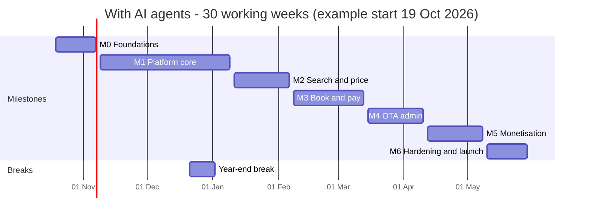
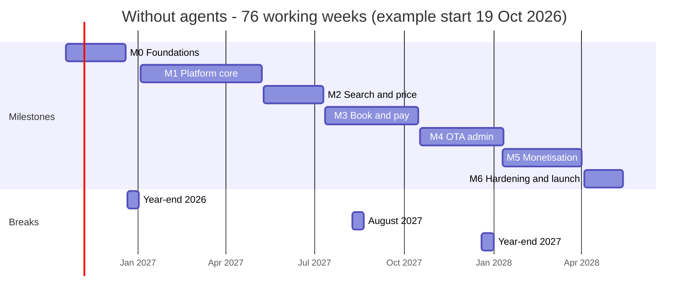

# Velexis MVP roadmap

This is the master plan for the whole Velexis MVP: the shared foundation and both component groups (platform and OTA). It turns the 290 agent tasks of the three task plans into a calendar for one developer, with AI coding agents (30 working weeks) and without them (76 working weeks). For every milestone it gives the ordered batches of tasks that can run in parallel, the human review gates, the demo and the go/no-go criteria. It explains the critical path and the biggest risks, with the earliest task that retires each one. It ends with a first-week checklist, the rules for keeping the plans current, and a summary of tasks and hours per component. It does not redefine any task: ids, dependencies and sizes come from the task plans, scope and exit criteria come from the two implementation plans, and everything follows [`decisions.md`](../decisions.md).

Related: [`README.md`](README.md) (index of all plans), [`foundation-tasks.md`](foundation-tasks.md), the platform [implementation plan](../../../platform/docs/plans/implementation-plan.md), [agent tasks](../../../platform/docs/plans/agent-tasks.md) and [solo plan](../../../platform/docs/plans/solo-developer-plan.md), the OTA [implementation plan](../../../ota/docs/plans/implementation-plan.md), [agent tasks](../../../ota/docs/plans/agent-tasks.md) and [solo plan](../../../ota/docs/plans/solo-developer-plan.md), [`../README.md`](../README.md#1-shared-milestones) (milestone definitions), [`AGENTS.md`](../../../AGENTS.md), [ADR-0020](../adr/0020-ai-agent-development-workflow.md) (agent workflow) and [ADR-0025](../adr/0025-roadmap-scheduling-and-tracking.md) (the scheduling rules decided while writing this roadmap).

**Baseline (2026-10-12).** `node tools/plan-lint/plan-lint.mjs --graph` prints `tasks: 290  estimated hours: 1350`, `ERRORS: 0`, and a critical path of 162 h over 29 tasks.

## Contents

1. [Milestone calendars](#1-milestone-calendars)
2. [Milestones in detail](#2-milestones-in-detail)
3. [Critical path and risks](#3-critical-path-and-risks)
4. [First week and keeping the plans current](#4-first-week-and-keeping-the-plans-current)
5. [Summary](#5-summary)

## 1. Milestone calendars

### 1.1 Assumptions

| Assumption | With AI agents | Without agents |
|---|---|---|
| People | One developer driving AI coding agents. Agents never merge or deploy ([ADR-0020](../adr/0020-ai-agent-development-workflow.md)). | One developer |
| Hours per week | 40 h: **30 h** on agent tasks (hand-off, review, fix-up requests, merge) and **10 h** on everything else (human steps, outside parties, deploys, demos, plan upkeep) | 40 h (5 days of 8 h) on tasks, demos and buffer |
| Developer time per task | **S 0.75 h, M 1.5 h, L 3 h**: about 10 minutes of hand-off, review of the PR against the acceptance criteria and the [security checklist](../conventions.md#12-security-checklist-every-pr), one fix-up round, merge. **Plus 25 %** for re-runs and second rounds. | S ½ day, M 1 day, L 2 days, as in both solo plans |
| Agent time per task | S about 1 h, M about 2 h, L about 4 h of wall-clock including CI. It is not on the developer's clock. | — |
| Agents in parallel | **3**. Review is the bottleneck, so a fourth agent adds a review queue, not speed. | — |
| Work to do | 506 h of review plus 127 h of rework = **633 developer-hours**, or 21.1 weeks at 30 h | 337.5 task days, or 67.5 weeks |
| Buffer | About 20 % per milestone, rounded up to whole weeks, plus account set-up in M0 and the launch in M6: **8.9 weeks** in all | The solo plans' buffers (11.5 platform days, 17 OTA days) plus foundation and launch buffers: **42.5 days** (11 %) |
| Milestone order | Strictly M0 → M6: a milestone's batches start after the previous go/no-go, with one exception ([§2.0](#20-how-to-read-and-run-the-batches)) | The weeks of both solo plans, mapped to calendar weeks in [§1.3](#13-calendar-without-agents-76-working-weeks) |
| Example dates | Start on Monday 19 October 2026, with a two-week break at the year end | Start on Monday 19 October 2026, with two-week breaks at the 2026 and 2027 year ends and in August 2027 |

The plan-lint sizes (S 2 h, M 4 h, L 8 h of agent and review time) are kept below as **agent-hours**, so that the figures match the group plans. They are not the developer's time.

A small simulation of this model (3 agents, 6 review hours a day, critical-path tasks first, strict milestone order) finishes the 290 tasks in 17 to 17.5 working weeks of pure review throughput with anything from 2 to 6 agents. The calendar below adds rework, buffer and the non-task work.

### 1.2 Calendar with AI agents: 30 working weeks

| Milestone | Weeks | Length | Example dates | Tasks | Agent-hours | Developer hours (review + 25 %) | Buffer (weeks × 30 h − developer hours) |
|---|---|---|---|---|---|---|---|
| M0 Foundations | W1–W3 | 3 | 19 Oct – 6 Nov 2026 | 30 | 120 | 56 | 34 h, which includes account set-up and the VM |
| M1 Platform core | W4–W10 | 7 | 9 Nov 2026 – 8 Jan 2027 | 65 | 338 | 158 | 52 h |
| M2 Search & price | W11–W14 | 4 | 11 Jan – 5 Feb 2027 | 38 | 174 | 82 | 38 h |
| M3 Book & pay | W15–W19 | 5 | 8 Feb – 12 Mar 2027 | 47 | 232 | 109 | 41 h |
| M4 OTA admin | W20–W23 | 4 | 15 Mar – 9 Apr 2027 | 44 | 192 | 90 | 30 h |
| M5 Monetisation & self-service | W24–W27 | 4 | 12 Apr – 7 May 2027 | 44 | 206 | 97 | 23 h |
| M6 Hardening & launch | W28–W30 | 3 | 10 – 28 May 2027 | 22 | 88 | 41 | 49 h: three green nightly runs, human steps, launch |
| **Total** | | **30** | | **290** | **1,350** | **633** | **267 h** |

Why these lengths:

- **M1** is the largest milestone (65 tasks, 15 batches). Its four checkpoint demos keep it reviewable.
- **M2** is short in hours but 13 batches deep: one chain runs from the M2 contract to the storefront journey. It gets a fourth week so the chain can move one task a day.
- **M3** holds the money and card code. Those PRs get the slowest, most careful reviews.
- **M6** has little code but needs three consecutive green nightly runs, a restore drill and the launch itself.

### 1.3 Calendar without agents: 76 working weeks

| Milestone | Calendar weeks | Length | Example dates | Plan weeks inside |
|---|---|---|---|---|
| M0 Foundations | C1–C9 | 9 | 19 Oct – 18 Dec 2026 | Foundation block, platform W1, OTA W1 |
| M1 Platform core | C10–C27 | 18 | 4 Jan – 7 May 2027 | Platform W2–W17, OTA W2–W3 |
| M2 Search & price | C28–C36 | 9 | 10 May – 9 Jul 2027 | OTA W4–W12, platform W18 |
| M3 Book & pay | C37–C48 | 12 | 12 Jul – 15 Oct 2027 | OTA W13–W24, platform W19 |
| M4 OTA admin | C49 – Monday of C59 | 10 | 18 Oct 2027 – 10 Jan 2028 | OTA W25–W34 and the first day of W35, platform W20 |
| M5 Monetisation & self-service | C59–C70 | 12 | 10 Jan – 31 Mar 2028 | OTA W35–W37, platform W21–W29 |
| M6 Hardening & launch | C71–C76 | 6 | 3 Apr – 12 May 2028 | Platform W30–W31, OTA W38–W40, foundation X-029 … X-032 |
| **Total** | | **76** | | |

Both solo plans ask the roadmap to map their week numbers to calendar weeks. This is that map, in order. A calendar week is five working days.

| Calendar weeks | Plan weeks | Content |
|---|---|---|
| C1–C7 | Foundation block | X-001 … X-023 (24 days), then X-024 … X-028 (5 days), plus 2 days of account set-up and 4 days of buffer and M0 preparation |
| C8 | Platform W1 | Platform scaffolds (M0), job messages and migration `0002` (M1) |
| C9 | OTA W1 | The four OTA scaffolds. **M0 exit.** |
| C10–C17 | Platform W2–W9 | M1 contracts, pipeline, identity, create OTA, office pool |
| C18 | OTA W2 | OF-11: queues, seeds, `tenant.provision` |
| C19–C20 | Platform W10–W11 | Portal wizard, setup page, team, reads |
| C21 | OTA W3, then 3.5 days of buffer | OBE-006. OF-11 is merged before PBE-035 needs it. |
| C22 | Platform W12 | Real provisioning (PBE-035), end-to-end harness |
| C23–C27 | Platform W13–W17 | Portal journeys, platform admin. **M1 exit.** |
| C28–C35 | OTA W4–W11 | M2 tenancy, Amadeus client, shopping, SDK core, storefront pages |
| C36 | OTA W12 + platform W18 | Storefront journey, cross-backend proof. **M2 exit.** |
| C37–C47 | OTA W13–W23 | M3 identity, checkout, Stripe, orders, airline card, documents, pages |
| C48 | OTA W24 + platform W19 | Account journeys, statement descriptor. **M3 exit.** |
| C49–C57 | OTA W25–W33 | M4 console API, settings, SDK console, OTA admin screens |
| C58 | OTA W34 + platform W20 | Console SSO from the portal |
| C59–C60 | OTA W35–W36 | **M4 exit** on Monday of C59 (OAD-017), then OTA M5 |
| C61–C68 | Platform W21–W28 | Billing, custom domains, own Amadeus, Connect, settlements, go-live |
| C69 | OTA W37, then 2.5 days of buffer | OF-12 cross-backend proof and the live journey |
| C70 | Platform W29 | M5 journeys and switch rehearsal. **M5 exit.** |
| C71 | Platform W30 | Platform security review, performance, runbooks |
| C72–C73 | OTA W38–W39 | OTA security review, PCI pack, performance, runbooks |
| C74–C76 | Platform W31 + OTA W40 + X-029 … X-032 | 7.5 task days, 1 launch day, 6.5 days of buffer. **M6 exit and launch.** |

Three changes to the solo plans' order make this calendar work. [ADR-0025](../adr/0025-roadmap-scheduling-and-tracking.md) records them:

- **X-024 … X-028 move into the foundation block.** The solo plans do not schedule them, but PBE-011 needs X-025, OBE-018 needs X-027 and OBE-039 needs X-028. Their milestone tags do not change.
- **The two OTA half-weeks get their own calendar week.** OTA W3 (1.5 days) and W37 (2.5 days) have no free platform days beside them, so the rest of each week is buffer.
- **The launch weeks merge into one block.** Platform W31, OTA W40 and the foundation M6 tasks form a three-week launch block.

### 1.4 How the two calendars compare

- Agents shorten the calendar from 76 to 30 working weeks, about 2.5 times. The gain is largest where many tasks are independent (M1, M4 and M6 have batches of 9 to 16 tasks). It is smallest where one chain is long (M2).
- In both calendars the limit is the developer's own hours: review hours with agents, build days without. Above three agents the calendar does not get shorter.
- Outside lead times (Amadeus, Stripe, the penetration test) are the same in both calendars, so they matter more in the shorter one ([§3.3](#33-biggest-risks)).
- The calendar without agents carries less buffer (11 % against about 30 %), because it keeps the solo plans' own buffers. If M0 and M1 overrun by more than 10 %, plan for about 85 weeks.

## 2. Milestones in detail

### 2.0 How to read and run the batches

- A **batch** holds tasks of one milestone whose dependencies inside that milestone are all in earlier batches. Every task of earlier milestones is already merged. Tasks in one batch can run in parallel; check that their **Files** lists do not overlap before starting two together ([ADR-0020](../adr/0020-ai-agent-development-workflow.md)).
- **Gated tasks** (PBE-035, PBE-036, PAD-011, PFE-019, PBE-064) come after the tasks that their **Gate** step names, not only after their **Depends on**.
- Run **three agents** at a time. Within a batch, start the **bold** tasks first (the plan-lint critical path), then tasks on the milestone's longest chain ([§3.2](#32-longest-chain-inside-each-milestone)), then L before M before S.
- A batch does not have to finish before the next one starts. Start each task as soon as its own dependencies are merged. The batch number is the earliest a task can start; the target week is where the review budget puts it.
- **One exception to strict milestone order.** When fewer than three tasks of the current milestone are ready (usually in its last two batches), the developer may give an agent a batch-1 task of the next milestone **by id**, if all its dependencies are merged ([AGENTS.md](../../../AGENTS.md) §3: "If you were given a task id, do that task"). Agents never pick ahead on their own.
- `*` marks a task with a **Human step**. `^` marks a task with a **Gate**.

**Go criteria for every milestone.** Each milestone below adds its own.

1. Every task of the milestone is done (heading ends with ` ✅`), or a plan edit has moved it to a later milestone with the reason in the PR. plan-lint shows `ERRORS: 0`.
2. `main` is green: lint, typecheck, unit, integration, contract and route-parity checks, plus the milestone's end-to-end journeys.
3. The developer deploys the release with the **Deploy** workflow, and the demo runs on the VM's real hosts (the placeholder hosts of [`decisions.md`](../decisions.md) §4 in these documents).
4. From M1 on: last night's backup reached the off-site bucket (X-024).
5. No review has left a high-severity finding open, and every deep-review PR of the milestone has its security checklist ticked.
6. The milestone status table ([§4.4](#44-milestone-status)) and the risk table ([§3.3](#33-biggest-risks)) are up to date.

A **no-go** means: start no new batch; fix the problem and repeat the check inside the milestone's buffer. When the buffer is used up, re-baseline ([§4.3](#43-keeping-the-plans-current)).

### M0 — Foundations (W1–W3)

**Goal.** The monorepo, shared packages, contract pipeline, database baselines and migration runner exist; CI is green; the VM is provisioned and runs the hello-world release; the seven apps are scaffolded.

| Batch | Target week | Tasks |
|---|---|---|
| B1 | W1 | **X-001** |
| B2 | W1 | **X-002**, X-003, X-004, X-006, X-016, X-017, X-019\*, X-021 |
| B3 | W1–W2 | **X-010**, X-005, X-007, X-022, PFE-001, PAD-001, OFE-001, OAD-001 |
| B4 | W2 | **X-011**, X-008, X-020\* |
| B5 | W2 | **X-012**, X-009, SDK-001 |
| B6 | W2–W3 | **X-013**, X-018, X-023\*, PBE-001, OBE-001 |
| B7 | W3 | **X-015**, X-014 |

**Human review gates.**

- Human steps: X-019, protect `main` (CI required, one approval, squash merge, linear history). X-020, run `provision-vm.sh` on the VM and paste the `check-vm.sh` output into the PR. X-023, create the GitHub `production` environment with the deploy secrets, then run **Deploy**.
- Deep review: X-003 (redaction list), X-004 and X-005 (envelope encryption, token hashing, signed URLs), X-010 to X-013 (tenant routing, migration runner, grants). Every later task trusts them.

**Demo.** `pnpm install && pnpm build && pnpm test` is green in CI. `pnpm db:migrate` creates the platform and reference baselines, and `migrate.js tenant --create` creates a 42-table schema. The reference data is loaded. The seven packages build, and the backends and Next.js apps answer `/health/live`. The Deploy workflow puts the hello world on the VM: `https://platform.example.com/` answers over TLS, and `velexis-deploy --status` shows the release.

**Go/no-go.**

- Go: the M0 outcome of [`foundation-tasks.md`](foundation-tasks.md#milestone-outcomes) and the M0 exit criteria of both implementation plans. `/health/ready` answers 503 without Redis. No `process.env` outside `@velexis/config`, no `NEXT_PUBLIC_` variable, no SDK runtime dependency. The OTA API refuses the migrator DSN.
- Also before M1: Amadeus Enterprise test access is requested, the Stripe test account exists, and the legal question about collecting payments in `velexis` mode has been sent ([§4.1](#41-start-today)).
- No-go: the VM or the deploy pipeline does not work. Fix it before M1, because every later milestone is shown on the VM.

### M1 — Platform core (W4–W10)

**Goal.** A person signs up, verifies the e-mail, turns on MFA and creates an OTA, which the **real** OTA worker provisions. Owners manage keys and the team. Velexis staff run the platform admin.

| Batch | Target week | Tasks |
|---|---|---|
| B1 | W4 | **PBE-002**, PBE-004, PBE-005, OBE-004, X-024\*, X-025 |
| B2 | W4–W5 | **OBE-003**, PBE-003, PBE-006, PFE-002, PFE-014, OBE-002 |
| B3 | W5 | PBE-007, PFE-003, OBE-005 |
| B4 | W5 | PBE-008, OBE-006 |
| B5 | W5–W6 | PBE-009, PBE-010, PBE-012 |
| B6 | W6 | PBE-011, PBE-017 |
| B7 | W6 | PBE-013, PBE-020, PBE-021, PBE-025, PFE-004 |
| B8 | W6–W7 | PBE-014, PBE-018, PBE-026, PFE-005 |
| B9 | W7 | PBE-015, PBE-016, PBE-019 |
| B10 | W7 | PBE-022, PBE-028, PFE-006 |
| B11 | W7–W8 | PBE-023, PBE-024, PBE-027, PBE-029, PBE-032, PBE-033, PFE-007, PFE-008, PAD-002 |
| B12 | W8–W9 | PBE-030, PBE-031, PBE-034, PFE-009, PFE-010, PAD-003 |
| B13 | W9–W10 | PBE-035^, OBE-007, PFE-011, PFE-012, PFE-013, PAD-004, PAD-006, PAD-007, PAD-008, PAD-009 |
| B14 | W10 | PFE-015, PAD-005 |
| B15 | W10 | PAD-010 |

The OTA provisioning worker (OBE-002 … OBE-006) lands in B1–B4, long before PBE-035 needs it in B13. With agents, the cross-group wait that shapes both solo plans disappears. The milestone's longest chain is the platform path from contract to pipeline, identity and admin (PBE-005 … PAD-010, [§3.2](#32-longest-chain-inside-each-milestone)). With the example dates, the year-end break falls between W9 and W10.

**Human review gates.**

- Checkpoint demos from the platform plan: **M1a** identity API with Mailpit e-mails (end of W7), **M1b** create OTA to active through the real OTA worker (end of W9), **M1c** portal and **M1d** admin journeys in a browser (W10, with the exit demo).
- Human steps: X-024 (create the age keys offline, set up the rclone remote, run the first backup). On the VM, grant the first platform admin with `node dist/cli.js admin:grant`. Deploy.
- Deep review: PBE-003 (privilege matrix), PBE-010 (audit, redaction), PBE-012 (token signing, guards, switches), PBE-014 (lockout, refresh rotation), PBE-015 (MFA, step-up), PBE-021 (API key generator and hashing), PBE-028 (admin sign-in), OBE-005 (provisioning in one migrator transaction).
- Gate: PBE-035 needs OF-11 (OBE-005, OBE-006 and the OTA worker build).

**Demo.** Sign up on `https://platform.example.com`, open the verification e-mail, enable MFA, sign in again with TOTP. Create OTA "Acme" with key `acme`. It is active within a minute through the real OTA worker, and `psql` shows `tenant_acme` with its ledger row; re-sending the message changes nothing. Reveal the test keys once. Create and revoke a secret key. Invite a teammate, who accepts. In `https://admin.platform.example.com`, sign in with TOTP, find Acme, see its job, office, connections and audit, then suspend it with a reason and resume it.

**Go/no-go.**

- Go: the platform M1 exit criteria (PFE-015 and PAD-010 green in the `e2e` workflow, the listed PF features proven, PBE-035 green in CI with the real OTA worker, first admin granted, nightly backups) and the OTA M1 exit criteria (OF-11 AC1–AC2 by OBE-005, failure classes by OBE-006, `tenants:report-migrations` publishing results).
- Check: Amadeus Enterprise test credentials have arrived, because OBE-027 needs them in W13. If not, escalate with Amadeus now. M2 can still start on the stub.
- No-go: any authentication test failing or skipped; provisioning that is not idempotent; backups not running.

### M2 — Search & price (W11–W14)

**Goal.** A traveller on the hosted storefront searches flights, filters and sorts results, opens an offer, picks a branded fare and prices it at the OTA's selling prices. Third parties do the same with keys and the SDK.

| Batch | Target week | Tasks |
|---|---|---|
| B1 | W11 | X-026, OBE-008, OBE-009, OBE-020 |
| B2 | W11 | X-027, OBE-010, OBE-019, SDK-002 |
| B3 | W11 | **OBE-011**, SDK-003 |
| B4 | W11–W12 | **OBE-012**, SDK-004 |
| B5 | W12 | **OBE-017**, OBE-013, OBE-014, OBE-015, SDK-005, OFE-002 |
| B6 | W12–W13 | **OBE-018**, OBE-016, SDK-006, SDK-007, PBE-036^ |
| B7 | W13 | **OBE-021**, OBE-027\*, OFE-003 |
| B8 | W13 | **OBE-022**, OFE-004 |
| B9 | W13 | **OBE-023**, OFE-005 |
| B10 | W13–W14 | OBE-024, OBE-026, OFE-006 |
| B11 | W14 | OBE-025, OBE-028, OFE-007 |
| B12 | W14 | OFE-008 |
| B13 | W14 | PAD-011^ |

M2 is the deepest milestone for its size. Keep the OBE chain moving every day, and let the SDK and storefront tasks fill the other agent slots.

**Human review gates.**

- Human step: OBE-027. Record scrubbed fixtures with your Amadeus test credentials (`pnpm --filter @velexis/amadeus-stub record <operation>`, never in CI), and ask Amadeus support whether `automatedProcess` with `IMMEDIATE` puts new orders on queue 50 of the shared offices.
- Deep review: OBE-011 (edge secret and key verification), OBE-012 (tenant resolution, caches, invalidation), OBE-013 (scope and CSRF guards, rate limits), OBE-018 (Amadeus timeouts, retries, error mapping), OBE-026 (two-tenant isolation).
- Gates: PBE-036 after OBE-011 … OBE-013 (OF-01). PAD-011 after OFE-003 and OFE-008.

**Demo.** On the VM's demo storefront: branding from `storefront.get`, the test banner, and nothing but the CSRF cookie in `document.cookie`. Search Paris to New York, filter non-stop, sort by price, load more. Open an offer, choose a fare family and price it: fee labels, the `priceChanged` stub scenario, the expiry countdown. Repeat the flow with `curl` and the `sk_test` key; tenant B gets 404 for tenant A's ids. A key created in the portal works on `https://api.ota.example.com` and is refused after revocation. Suspend Acme in the admin, and `https://acme.ota.example.com` shows "temporarily unavailable".

**Go/no-go.**

- Go: the OTA M2 exit criteria (OF-01 AC1–AC3, OF-02 AC1–AC2, the `storefront` journey green, every `x-milestone: M2` operation handled, the SDK M2 contract test passing, the ESM bundle within 25 KB, tenant `0002` applied by provisioning and the fan-out, first figures in `ota/docs/performance.md`) and the platform M2 exit criteria (PBE-036 and PAD-011 done with their gates met, the coverage test listing every cached row type).
- Conditional go: if Amadeus test access is still missing, OBE-027 stays open with a dated note in its PR. M3 continues on the stub, but the M5 go-live is a no-go until OBE-027 is done.
- No-go: any cross-tenant read; net prices or supplier details visible to a customer.

### M3 — Book & pay (W15–W19)

**Goal.** Travellers book and pay as guests or signed-in customers (httpOnly cookies): by Stripe with 3-D Secure on the Velexis account, or by card passed to the airline through Amadeus (test only). Orders are created once, paid, ticketed, confirmed by e-mail with PDFs, visible in my bookings or through guest lookup, and can be changed or cancelled.

| Batch | Target week | Tasks |
|---|---|---|
| B1 | W15 | X-028, PBE-037, OBE-029, OBE-030, OBE-031, OBE-041, SDK-010 |
| B2 | W15–W16 | **OBE-036**, PBE-038, OBE-032, OBE-033, SDK-009 |
| B3 | W16 | **OBE-038**, PFE-016, OBE-034, OBE-035, OBE-037, SDK-008 |
| B4 | W16–W17 | **OBE-042**, OBE-039, OBE-050, OFE-009, OFE-011 |
| B5 | W17 | **OBE-046**, OBE-040, OBE-044, OBE-045, OBE-053, OFE-010, OFE-012 |
| B6 | W17–W18 | **OBE-047**, OBE-043, OBE-055, OFE-013 |
| B7 | W18 | **OBE-048**, OBE-051, OBE-054, OBE-056, OFE-017 |
| B8 | W18 | **OBE-049**, OFE-014 |
| B9 | W18–W19 | OBE-052, OBE-057, OFE-015, OFE-018 |
| B10 | W19 | OFE-016 |
| B11 | W19 | OFE-019 |

**Human review gates.**

- Human steps: `stripe login` in test mode and Stripe CLI forwarding for manual checks (X-028). Check the PaymentIntents in the Stripe test dashboard.
- Deep review. This is the money and card milestone; run the automated second-agent review pass that ADR-0020 names as a follow-up on these PRs before your own review:
  - OBE-031 and OBE-033 (customer tokens, cookies, refresh rotation), OBE-036 (encrypted traveller documents);
  - OBE-038, OBE-039 and OBE-040 (Stripe gateway, webhooks, voids and refunds);
  - OBE-042, OBE-043 and OBE-044 (orchestrator, timeout recovery, ticketing retries), OBE-049 (cancellation with the money step);
  - OBE-050, OBE-051, OBE-052 and OFE-014 (airline card), OBE-054 (signed URLs), OBE-057 (cookie and CSRF proof).

**Demo.** A guest pays with Stripe's 3-D Secure test card and gets a confirmation with tickets, the itinerary e-mail in Mailpit and PDFs through signed URLs. The same with the airline card in test: the airline's price, a decline, the attempt limit and the PAN-absence test output. The stub `timeout` scenario shows "we are confirming your booking", then the reconciled booking; `timeout-lost` shows "not booked, not charged". A customer signs up, sees upcoming bookings, changes contacts and cancels with the refund preview; guest lookup fails with a wrong name and works with the right one. The statement descriptor edited in the portal appears on the test PaymentIntent.

**Go/no-go.**

- Go: the OTA M3 exit criteria (OF-03 … OF-08 acceptance criteria, journeys OFE-017 nightly, OFE-018 and OFE-019 green, the PAN-absence test in every CI build, the parity pending list holding only `console`) and the platform M3 exit criteria (PF-60 tests with the Stripe descriptor rules).
- Production rule: `AIRLINE_CARD_ENABLED=false` on the VM, and the tenant live switch is refused.
- No-go: any card number found by OBE-052's scan; a duplicate order or double charge in any timeout scenario; a token readable by storefront JavaScript.

### M4 — OTA admin (W20–W23)

**Goal.** Staff open the OTA admin from the portal without a second password and run their day: bookings, issue, cancel with refunds, PNR import, queues, payments, customers, and the settings that shape the storefront.

| Batch | Target week | Tasks |
|---|---|---|
| B1 | W20 | PBE-039, PBE-040, OBE-058 |
| B2 | W20 | PFE-017, PFE-018, OBE-059, SDK-011 |
| B3 | W20 | OBE-060, OBE-074, SDK-012, OAD-002 |
| B4 | W20–W21 | OBE-061, OBE-065, OBE-066, OBE-067, OBE-068, OBE-069, OBE-070, OBE-073, SDK-013, OAD-003 |
| B5 | W21 | OBE-062, OBE-064, OBE-071, OAD-004 |
| B6 | W21–W22 | **OBE-063**, OBE-072, OAD-005, OAD-006, OAD-009, OAD-010, OAD-011, OAD-012, OAD-013 |
| B7 | W22 | OBE-075, OAD-007, OAD-014, OFE-020 |
| B8 | W22–W23 | **OAD-008**, SDK-014, OAD-015 |
| B9 | W23 | **OAD-016** |
| B10 | W23 | **OAD-017**, PFE-019^ |

**Human review gates.**

- Deep review: PBE-039 (one-time console token), OBE-059 (staff SSO, sessions, deny checks), OBE-060 (service key, environments, permissions), OBE-063 (issue and cancel with payments), OBE-064 (PNR import and office isolation), OBE-068 (capture and refund), OBE-071 and OBE-072 (uploads, Markdown parser), OBE-075 (permission matrix).
- Gate: PFE-019 after OAD-016 (OF-09: `/sso`, the `portal_token` grant and the `ota-admin` Playwright project).

**Demo.** In the portal, "Open console" for Acme lands on `https://admin.ota.example.com/bookings`; reposting the captured form fails. Issue a manual-review booking, cancel another with a partial refund, import a PNR of Acme's office (and fail for another tenant's office), read a queue with an orphan PNR. Change a markup rule and see the next storefront search priced with it. Upload a logo, change the primary colour, add a "Terms" page and see them on the storefront; a broken template is refused. A viewer is read-only. Remove a member and their console session ends within a minute. Change the queuing office on the portal's Amadeus page.

**Go/no-go.**

- Go: the OTA M4 exit criteria (OF-09 and OF-10, `ota-admin` journeys green, `pending-operations.ts` holding only the 19 deferred operations and the two M5 webhooks, SDK parity list empty, `tenant.suspend` and `tenant.resume` consumed) and the platform M4 exit criteria (PF-22 and PF-53, `console-sso` journey green, the console token never in a URL, log, audit row or idempotency store).
- No-go: any console path that accepts a card number; staff of one tenant reaching another tenant's office.

### M5 — Monetisation & self-service (W24–W27)

**Goal.** OTAs pay Velexis through Stripe Billing. They can bring their own Stripe (Connect Standard or API keys) or stay on Velexis's account and receive monthly settlements, bring their own Amadeus credentials or ask for a live office, use their own domain with automatic TLS, and go live. The OTA backend follows that data with no per-tenant code path.

| Batch | Target week | Tasks |
|---|---|---|
| B1 | W24 | PBE-041, OBE-076, OBE-079, OBE-080 |
| B2 | W24 | PBE-042, PBE-049, PBE-052, OBE-077, OBE-082 |
| B3 | W24–W25 | PBE-043, PBE-050, PBE-053, PBE-054, PBE-058, OBE-078, OBE-081 |
| B4 | W25 | PBE-044, PBE-051, PBE-055, PBE-059, PFE-023, OAD-018, OFE-021 |
| B5 | W25–W26 | PBE-045, PBE-056, PBE-057, PBE-060, PFE-020, PFE-022, PAD-014 |
| B6 | W26 | PBE-046, PBE-047, PBE-061, PFE-024, PFE-025, PAD-013 |
| B7 | W26–W27 | PBE-048, PFE-021, PFE-026, OBE-083 |
| B8 | W27 | PFE-027, PAD-012, OFE-022 |
| B9 | W27 | PAD-015 |

Within each batch, follow the platform plan's order (billing, custom domains, Amadeus, payments and settlements, go-live), so that each part can be shown on its own. All platform M5 code merges behind the `FEATURE_*` switches of [PADR-0015](../../../platform/docs/adr/0015-milestone-feature-switches.md).

**Human review gates.**

- Human steps: set up the Stripe test-mode Connect settings that PBE-055 needs. Point a real test domain at the VM and obtain a Let's Encrypt **staging** certificate (the PBE-051 exit check). Rehearse turning the switches on one at a time.
- Outside steps to track (they are not tasks): legal review and Stripe's written confirmation of `velexis` mode ([ADR-0011](../adr/0011-payments-stripe-and-airline-card.md), [PADR-0003](../../../platform/docs/adr/0003-settlement-of-velexis-collected-payments.md)); Stripe Connect platform approval; the Amadeus live contract, certification and IATA/ARC terms ([ADR-0012](../adr/0012-amadeus-account-model.md)). Book the penetration test and the ASV scan now, for OBE-086 in M6.
- Deep review: PBE-043 and PBE-045 (Stripe inbox, signatures, status rules), PBE-052 and PBE-053 (credential submissions, re-encryption), PBE-055 … PBE-057 (Connect, API-key connections), PBE-058 (payout accounts), PBE-059 and PBE-060 (settlement amounts, immutable statements, step-up), PBE-061 (go-live), OBE-077 … OBE-079 (gateway modes, Connect webhooks, own credentials and the releasing-office rule).

**Demo.** With the switches on and Stripe in test mode: create an OTA on a paid plan, pay on Checkout, see it provision on the webhook, open the Customer Portal and see the invoice. Add and verify `travel.acme.com` and see TLS issued. Submit own Amadeus test credentials: the next search uses them, while an old booking still syncs through the Velexis account. Request a live office and have an admin assign it. Connect a Stripe test account through OAuth: the next PaymentIntent carries `Stripe-Account`. Switch back to Velexis payments, set a payout account, then generate, approve and mark paid a settlement. Go live: the page lists what is missing, then the switch succeeds and the storefront drops the test banner. A `past_due` subscription shows the billing banner in the OTA admin.

**Go/no-go.**

- Go: the platform M5 exit criteria (every M5 task done, `pending-operations.ts` empty, a `403 FEATURE_DISABLED` test for every M5 endpoint with its switch off, the nightly `portal-stripe` run green, the staging certificate on a real test domain) and the OTA M5 exit criteria (OF-12, the `live-and-domains` and `live-environment` journeys green, only deferred operations pending, no OTA code branching on a tenant id).
- Production rule: each `FEATURE_*` switch stays **off** in production until its outside step is done. M6 starts anyway.
- No-go: a mode or credential switch that moves an existing payment or order; settlement totals that do not reconcile with Stripe's balance transactions.

### M6 — Hardening & launch (W28–W30)

**Goal.** Both groups are reviewed for security, the airline-card path has its PCI evidence and a live gate, performance is measured against the VM budget, operations have runbooks, monitoring alerts, the restore drill is done, the nightly suites are stable, the SDK is on npm as 1.0.0, and the MVP launches.

| Batch | Target week | Tasks |
|---|---|---|
| B1 | W28–W29 | **OAD-019**, PBE-062, OBE-084, PBE-063, OBE-088, PFE-028, PAD-016, OBE-087, OFE-023, OFE-024, OFE-025, X-029\*, X-030\*, X-031\*, X-032 |
| B2 | W29–W30 | **OFE-026**, OBE-085, PBE-065, OBE-089, SDK-015\* |
| B3 | W30, or after launch | OBE-086\* |
| After launch | First release after the switches have been on for one release | PBE-064^ |

**Human review gates.**

- Human steps: X-029 (uptime monitors), X-030 (stop a worker on the VM and receive the alert), X-031 (restore drill with a measured RTO), OBE-086 (penetration test and ASV scan, with results in `ota/docs/pci/README.md`), SDK-015 (npm organisation, automation token, tag). Walk through both launch checklists (PBE-065, OBE-089) on the VM.
- Deep review: PBE-062 and OBE-084 (security reviews), OBE-085 (PCI evidence pack).
- Gate: PBE-064 runs only when all six switches have been on in production for one release. The developer confirms it in the PR.

**Demo.** Walk through `platform/docs/security-review.md`, `ota/docs/security-review.md`, the PCI pack and both performance documents. Show three consecutive green nightly runs of the `portal`, `platform-admin`, `storefront`, `storefront-stripe` and `ota-admin` projects. Install `@velexis/ota-sdk@1.0.0` in an empty project and run the guide's sample. Walk through the launch checklists.

**Go/no-go (launch).**

- Go: the platform and OTA M6 exit criteria (no open high finding, `pnpm audit --prod` clean of high and critical issues, latency and memory budgets met or turned into tasks, launch checklists checked) and the foundation M6 outcome (the uptime monitor and on-VM checks alert, the restore drill is documented with its RTO, the move to managed services is proven to be configuration only).
- Launch does not wait for outside approvals. A feature whose outside step is missing stays off: the airline card until OBE-086 is fully checked, each `FEATURE_*` switch until its approval, and live tenants until Amadeus live access exists ([ADR-0025](../adr/0025-roadmap-scheduling-and-tracking.md)).
- No-go: an open high finding; a failed restore drill; fewer than three consecutive green nightly runs; failing backups.

## 3. Critical path and risks

### 3.1 The critical path

plan-lint finds the longest chain of dependencies in agent-hours: **162 h over 29 tasks**. It is the life of one booking, built from the bottom up.

| Stage | Tasks | Agent-hours | What it builds |
|---|---|---|---|
| Foundation spine (M0) | X-001 → X-002 → X-010 → X-011 → X-012 → X-013 → X-015 | 38 | Monorepo, typed config, `@velexis/db`, migration runner, baselines, tenant fan-out, test harness. Every database test waits for it. |
| Cross-group data contract (M1) | PBE-002 → OBE-003 | 6 | The platform `0002` deltas and the OTA backend's read-only view of them. These are the only platform tasks on the path. |
| Tenancy and Amadeus (M2) | OBE-011 → OBE-012 → OBE-017 → OBE-018 | 24 | Caller classification, tenant resolution with caches, the connection resolver and tokens, the hardened Amadeus client |
| Shopping (M2) | OBE-021 → OBE-022 → OBE-023 | 20 | Search, offer and upsell, price |
| Checkout and payment (M3) | OBE-036 → OBE-038 → OBE-042 | 24 | Checkout aggregate, Stripe gateway, booking orchestrator |
| After-sales (M3) | OBE-046 → OBE-047 → OBE-048 → OBE-049 | 20 | My bookings, guest access, change, cancel with the money step |
| Console (M4) | OBE-063 → OAD-008 | 16 | Console issue and cancel, then the OTA admin's booking actions |
| Journeys (M4–M6) | OAD-016 → OAD-017 → OAD-019 → OFE-026 | 14 | SSO and bookings journeys, the full OTA admin suite, stable nightly suites |

```mermaid
flowchart LR
  subgraph M0
    X001[X-001] --> X002[X-002] --> X010[X-010] --> X011[X-011] --> X012[X-012] --> X013[X-013] --> X015[X-015]
  end
  subgraph M1
    PBE002[PBE-002] --> OBE003[OBE-003]
  end
  subgraph M2
    OBE011[OBE-011] --> OBE012[OBE-012] --> OBE017[OBE-017] --> OBE018[OBE-018] --> OBE021[OBE-021] --> OBE022[OBE-022] --> OBE023[OBE-023]
  end
  subgraph M3
    OBE036[OBE-036] --> OBE038[OBE-038] --> OBE042[OBE-042] --> OBE046[OBE-046] --> OBE047[OBE-047] --> OBE048[OBE-048] --> OBE049[OBE-049]
  end
  subgraph M4
    OBE063[OBE-063] --> OAD008[OAD-008] --> OAD016[OAD-016] --> OAD017[OAD-017]
  end
  subgraph M6
    OAD019[OAD-019] --> OFE026[OFE-026]
  end
  X015 --> PBE002
  OBE003 --> OBE011
  OBE023 --> OBE036
  OBE049 --> OBE063
  OAD017 --> OAD019
```

What it means in practice:

1. **It is an OTA-backend spine.** 16 of the 29 tasks are OTA backend tasks. The platform feeds it only through PBE-002, the platform `0002` migration.
2. **It sets the order, not the length, of the agent calendar.** 162 agent-hours are about 29 review cycles, roughly 6 working weeks if nothing else ran. The 633 review hours set the 30 weeks. In every batch, start critical tasks first and review them the same day.
3. **Milestone gates make the per-milestone chains matter.** Because each milestone waits for the previous go/no-go, the chain that counts is the sum of each milestone's longest chain ([§3.2](#32-longest-chain-inside-each-milestone)): 386 agent-hours over 66 tasks. That is still well inside the calendar, but M1 and M2 hold the deepest chains.
4. **The L tasks on the path need fast reviews.** OBE-012, OBE-018, OBE-021, OBE-023, OBE-036, OBE-038, OBE-042, OBE-049, OBE-063 and OAD-008 are L tasks with heavy reviews. Review them first thing in the day, so that their successors start the same day.
5. **Without agents** the path is 40.5 developer-days, done in sequence anyway. The total of 337.5 days sets that calendar.

### 3.2 Longest chain inside each milestone

| Milestone | Chain | Agent-hours | Batches |
|---|---|---|---|
| M0 | X-001 → X-002 → X-010 → X-011 → X-012 → X-013 → X-015 | 38 | 7 |
| M1 | PBE-005 → PBE-006 → PBE-007 → PBE-008 → PBE-009 → PBE-011 → PBE-013 → PBE-014 → PBE-015 → PBE-028 → PAD-002 → PAD-003 → PAD-004 → PAD-005 → PAD-010 | 100 | 15 |
| M2 | OBE-009 → OBE-010 → OBE-011 → OBE-012 → OBE-017 → OBE-018 → OBE-021 → OBE-022 → OBE-023 → OFE-006 → OFE-007 → OFE-008 → PAD-011 | 70 | 13 |
| M3 | OBE-031 → OBE-036 → OBE-038 → OBE-042 → OBE-046 → OBE-047 → OBE-048 → OBE-049 → OFE-015 → OFE-016 → OFE-019 | 62 | 11 |
| M4 | OBE-058 → OBE-059 → OBE-060 → OBE-061 → OBE-062 → OBE-063 → OAD-008 → OAD-016 → PFE-019 | 52 | 10 |
| M5 | PBE-041 → PBE-042 → PBE-043 → PBE-044 → PBE-045 → PBE-046 → PBE-048 → PAD-012 → PAD-015 | 52 | 9 |
| M6 | OBE-084 → OBE-089 (and OBE-084 → OBE-086) | 12 | 3 |
| **Sum** | | **386** | |

The chains count the gates of §2.0 as dependencies (PAD-011 and PFE-019 end their chains for that reason).

### 3.3 Biggest risks

| Risk | Why it matters | Mitigations | Earliest task that retires it |
|---|---|---|---|
| **Amadeus Enterprise access and certification** | All shopping and booking use the Amadeus Enterprise APIs on `test.travel.api.amadeus.com` ([specs](../../amadeus-api/)). Test credentials come through an enterprise relationship, not a self-service sign-up. Live access needs Amadeus's approval of the integration, a contract for the shared account, and IATA/ARC ticketing terms with Velexis as the accredited party ([ADR-0012](../adr/0012-amadeus-account-model.md)). Lead times are weeks to months. | Request access in week 1 and follow up weekly. Build on the stub, which checks requests against the specifications (X-026, X-027, OBE-019, OBE-041). Record real fixtures and confirm the error table as soon as access exists (OBE-027). The shared account needs no Amadeus paperwork per OTA. Live offices (PBE-054) and go-live (PBE-061) work only when the live preconditions are met. If certification is late, launch without live tenants ([ADR-0025](../adr/0025-roadmap-scheduling-and-tracking.md)). | **OBE-027** (M2 B7, W13) for the test environment. Live access is retired only by the outside step, which is a precondition of PBE-061 in production. |
| **PCI scope of the airline-card flow** | Card numbers pass through the OTA backend to Amadeus. That makes Velexis a PCI DSS v4.0.1 service provider (SAQ D), with the VM as the cardholder data environment, quarterly ASV scans and a penetration test before live airline-card payments ([ADR-0011](../adr/0011-payments-stripe-and-airline-card.md)). | Card data in memory only (`SensitiveCard`), its own route and parser, redaction and a database CHECK ([OADR-0004](../../../ota/docs/adr/0004-airline-card-data-handling.md)). An isolated payment page with its own CSP (OFE-014, [OADR-0017](../../../ota/docs/adr/0017-airline-card-form-isolation.md)). The PAN-absence scan in every CI build (OBE-052). The payment-page inventory and daily integrity check (OFE-023, X-030). The PCI evidence pack (OBE-085). `AIRLINE_CARD_ENABLED=false` in production until OBE-086 is fully checked; Stripe stays available, so the card never blocks the launch. A vault or Stripe card forwarding would later take Velexis out of scope (ADR-0011 follow-up). | **OBE-052** (M3 B9, W18–W19) for card data in code. **OBE-086** (M6) for live use, after the penetration test and ASV scan, which you book during M5. |
| **Stripe merchant-of-record and settlement compliance** | In `velexis` mode, Velexis's Stripe account collects travellers' payments for the OTAs and settles to them monthly ([PADR-0003](../../../platform/docs/adr/0003-settlement-of-velexis-collected-payments.md)). Stripe's terms and payment-services rules may forbid this, or ask for a licence, a reserve or another funds flow. ADR-0011 requires legal review and Stripe's written confirmation before live payments; if refused, the default becomes Stripe Connect with destination charges. | Ask Stripe and a lawyer in week 1. Build and test everything in test mode. M5 code sits behind the `FEATURE_*` switches (PBE-012), and each is turned on in production only after its outside step. Connect Standard (PBE-055) and API-key connections (PBE-057) let an OTA be the merchant itself. Settlements use exact decimal maths, one line per balance transaction and immutable approved statements (PBE-059, PBE-060). | **PBE-012** (M1 B5, W5–W6) takes the risk off the schedule. The risk itself is retired only by the written confirmation, needed before the first live `velexis`-mode payment (M5 exit criterion). A refusal changes [`decisions.md`](../decisions.md) §2 and triggers a re-plan. |
| **Custom-domain TLS** | Storefront hosts (`<key>.ota.example.com` and verified custom domains) get certificates through Caddy's on-demand TLS, gated by the platform's `ask` endpoint ([ADR-0018](../adr/0018-hosted-storefront-custom-domains.md)). What can go wrong: wrong `ask` answers, DNS verification errors, Let's Encrypt rate limits (about 50 new certificates per registered domain per week), and hosts that point elsewhere after verification. | The `ask` endpoint answers `200` only for known tenant hosts (PBE-027). The Caddyfile smoke test (X-022). DNS checks through public resolvers, with fake-resolver tests for every error (PBE-050). A TLS probe and a three-strike daily re-check (PBE-051). Existing certificates keep working when `ask` fails. Above about 30 sign-ups a week, switch to a DNS-01 wildcard for `*.ota.example.com` ([deployment §6](../deployment-single-vm.md#6-caddy-and-tls)). | **PBE-027** (M1 B11, W7–W8); at the M1 exit, check on the VM that `acme.ota.example.com` gets a real certificate. Fully retired by **PBE-051** with the staging certificate on a real test domain (M5). |
| **Single-VM capacity** | One 4 vCPU / 8 GB VM runs seven Node processes, PostgreSQL, Redis and Caddy inside the memory budget of [`architecture.md`](../architecture.md#3-hosts-ports-and-the-vm) §3. Searches write large rows, one OTA can drain the shared Amadeus quota, and an OOM kill stops everything. | `MemoryMax` per unit. Token buckets and single-flight searches (OBE-018), the 15-minute purge (OBE-024), the early load test (OBE-028), measurement against the budget (PBE-063, OBE-088). A prepared worker split ([OADR-0014](../../../ota/docs/adr/0014-per-tenant-workers-and-schedulers.md)). Resize thresholds in [deployment §1 and §14](../deployment-single-vm.md#14-capacity-limits-of-one-vm). The move to managed PostgreSQL and Redis is proven to be configuration only (X-032). | **OBE-028** (M2 B11, W14) gives the first figures. Retired by **PBE-063** and **OBE-088** (M6), with X-032 as the way out. |

### 3.4 Other risks

| Risk | Mitigation |
|---|---|
| Review becomes the bottleneck and quality drops | Keep three agents. Run the second-agent review pass that ADR-0020 names as a follow-up on deep-review PRs. Recalibrate review hours after M1 ([§4.3](#43-keeping-the-plans-current)). |
| M1 (65 tasks) hides slippage | Four checkpoint demos (M1a–M1d) and a weekly check of the longest chain |
| The plans drift from the code | Status changes inside each task's PR, plan-lint in CI, the weekly review |
| A cross-group gate is not met (OF-11, OF-01, OF-09, OF-12) | The batches put the gate's tasks first; never fake the other side ([AGENTS.md](../../../AGENTS.md) §3) |
| Smaller outside lead times: SMTP provider, backup bucket, uptime service, npm organisation | Open the accounts in week 1 ([§4.1](#41-start-today)) |
| The developer is away for a week | The buffers absorb it. Tasks are self-contained, so agents can keep producing PRs that wait for review. |

## 4. First week and keeping the plans current

### 4.1 Start today

Requests with outside lead times come first, because nothing in the repository can speed them up.

| Item | What to do | Needed by |
|---|---|---|
| Amadeus Enterprise test access | Ask your Amadeus contact for test credentials on `test.travel.api.amadeus.com` (client id and secret) and test office ids. Ask what live access needs: contract, certification steps, IATA/ARC terms, lead time. Send OBE-027's booking-queue question now. Keep the credentials in your password manager and local environment only ([local development §5](../local-development.md#5-amadeus-stub)). A self-service account on developers.amadeus.com is not a substitute: its hosts and headers differ ([OADR-0001](../../../ota/docs/adr/0001-amadeus-client-design.md)). | OBE-027 (W13). The stub covers everything before it. |
| Stripe | Create Velexis's Stripe account and stay in test mode. Install the Stripe CLI and run `stripe login` (test mode only). Start the business profile. Ask Stripe in writing whether `velexis` mode (collect for OTAs, settle monthly) is allowed, and what Connect platform approval needs. Book the legal review. | X-028 (M3); approvals before the M5 switches |
| VM | Pick a provider and create an Ubuntu 24.04 LTS VM with 4 vCPU, 8 GB RAM and your SSH key. Note its addresses. Do not configure it by hand; X-020 runs the provisioning script ([deployment §3](../deployment-single-vm.md#3-provisioning-a-new-vm)). | X-020 (W2) |
| Domain and DNS | Choose the real domains behind the placeholders `platform.example.com` and `ota.example.com`; the repository keeps the placeholders. When the VM exists, create A and AAAA records for the five named hosts and the wildcard `*.ota.example.com` with a short TTL. If you use CAA records, allow both certificate authorities Caddy uses (Let's Encrypt and ZeroSSL). | X-022, X-023 (W2–W3) |
| GitHub | Protect `main` (CI required, one approval, squash merge, linear history). Turn on secret scanning with push protection and Dependabot alerts. Keep the default `GITHUB_TOKEN` read-only. Create the `production` environment with yourself as required reviewer; X-023 adds its secrets. Agents get no production secrets ([ADR-0020](../adr/0020-ai-agent-development-workflow.md)). | X-019, X-023 (M0) |
| Off-site backups | Create an S3-compatible bucket and credentials for rclone. Generate the two age key pairs offline ([deployment §10](../deployment-single-vm.md#10-backups)). | X-024 (W4) |
| Transactional e-mail | Open an SMTP provider account and set SPF and DKIM for the sending domain. Mailpit covers local work. | First M1 deploy |
| Password manager | One vault for every credential above and for the offline copy of `/etc/velexis`. | Now |
| Workstation | Node.js from `.nvmrc`, pnpm, PostgreSQL 16, Redis, Mailpit ([local development §1](../local-development.md#1-prerequisites)). An agent runner with repository access and no production secrets. | Day 1 |
| Cheap to reserve now | The npm organisation for `@velexis` (SDK-015), an uptime-monitoring account (X-029), a penetration-test and ASV provider (OBE-086, book during M5) | M6 |

### 4.2 Week 1, day by day

| Day | Developer | Agents (three at a time) |
|---|---|---|
| 1 (today) | Send the requests of §4.1. Set up the workstation. Read [`decisions.md`](../decisions.md), [`AGENTS.md`](../../../AGENTS.md) and this roadmap. | X-001 (B1) |
| 2 | Review and merge X-001. Apply the GitHub settings. Create the VM. | B2, critical task first: X-002, then X-003 and X-004 |
| 3 | Review B2 PRs. Create the DNS records. | X-006, X-016, X-017, X-019, X-021 |
| 4 | Review. Do X-019's human step (protect `main`). | B3, critical task first: X-010, then X-005, X-007, X-022 |
| 5 (Friday) | Review. Weekly review ([§4.3](#43-keeping-the-plans-current)). Write the demo note. | The scaffolds PFE-001, PAD-001, OFE-001, OAD-001 |

Without agents: day 1 is the same, then work through the foundation block in batch order, one task at a time, critical tasks first.

### 4.3 Keeping the plans current

- **Status markers, one rule for all three task files.** When a task starts, its PR adds `- **Status:** in progress (PR #n)` under the heading (foundation tasks already carry a `todo` line). When the PR is merged, the heading ends with ` ✅` and the status says `done (PR #n)`. Moving a task to another milestone changes its **Milestone** field in a PR that gives the reason.
- **plan-lint.** CI runs `node tools/plan-lint/plan-lint.mjs` on every PR that touches a plan; run it locally before pushing. It does not read status lines, so its critical path is for the whole plan. To see what is left, look for path tasks without ` ✅`.
- **Progress count.** `grep -c '^### .* ✅$' docs/mvp/plans/foundation-tasks.md platform/docs/plans/agent-tasks.md ota/docs/plans/agent-tasks.md` gives the done tasks per file; compare them with the totals of [§5](#5-summary).
- **Weekly review (Friday, 30 minutes).** Compare done tasks with the target weeks of §2. Check the critical path and the milestone's longest chain. Note the review hours spent. Update §3.3 and the outside-step table of §4.4. Write a two-line note in the PR of the week's last task.
- **New work** becomes a new task in the right plan (next free id, all fields, plan-lint passing). It joins a batch by the rule of §2.0: one more than the highest batch of its dependencies in the same milestone. Update the batch table in the same PR.
- **Decisions.** A new or changed decision gets an ADR (`Proposed` in the PR; the developer sets `Accepted`). Changing a product-owner decision edits [`decisions.md`](../decisions.md) first, then the ADR, then the plans, then this roadmap.
- **Re-baselining.** If a milestone overruns its planned weeks by more than one week, update §1 and §4.4 and add a dated line with the cause to §4.5. Never shorten a later milestone to absorb a slip.
- **Calibration after M1.** Compare the review hours actually spent per size with S 0.75 h, M 1.5 h, L 3 h. If they differ by more than 25 %, recompute §1.2.

### 4.4 Milestone status

| Milestone | Planned exit with agents | Planned exit without agents | Actual exit | Go/no-go | Notes |
|---|---|---|---|---|---|
| M0 | W3, 6 Nov 2026 | C9, 18 Dec 2026 | — | — | |
| M1 | W10, 8 Jan 2027 | C27, 7 May 2027 | — | — | |
| M2 | W14, 5 Feb 2027 | C36, 9 Jul 2027 | — | — | |
| M3 | W19, 12 Mar 2027 | C48, 15 Oct 2027 | — | — | |
| M4 | W23, 9 Apr 2027 | C59, 10 Jan 2028 | — | — | |
| M5 | W27, 7 May 2027 | C70, 31 Mar 2028 | — | — | |
| M6 | W30, 28 May 2027 | C76, 12 May 2028 | — | — | |

| Outside step | Needed for | Latest useful point (with agents) | Status |
|---|---|---|---|
| Amadeus Enterprise test credentials | OBE-027 | W13 | not requested |
| Amadeus live contract, certification, IATA/ARC terms | Live tenants (PBE-061 in production) | W30, to sell live at launch | not started |
| Legal review and Stripe's written confirmation of `velexis` mode | Live `velexis`-mode payments and settlements | W27 (M5 exit) | not started |
| Stripe Connect platform approval | Live Connect (PBE-055) | W27 | not started |
| Penetration test and ASV scan | OBE-086, live airline card | W30 or later; not a launch blocker | not booked |
| npm organisation | SDK-015 | W29 | not created |

### 4.5 Change log

| Date | Change |
|---|---|
| 2026-10-12 | Baseline: 290 tasks, 1,350 agent-hours; 30 working weeks with agents, 76 without ([ADR-0025](../adr/0025-roadmap-scheduling-and-tracking.md)). |

## 5. Summary

### 5.1 Tasks and agent-hours per component and milestone

Each cell reads tasks / agent-hours (plan-lint sizes). Developer hours are the agent calendar's review time with the 25 % rework allowance; solo days are the calendar without agents.

| Component | M0 | M1 | M2 | M3 | M4 | M5 | M6 | Tasks | Agent-hours | Developer hours | Solo days |
|---|---|---|---|---|---|---|---|---|---|---|---|
| Foundation (`X-`) | 23 / 96 | 2 / 6 | 2 / 10 | 1 / 4 | — | — | 4 / 12 | 32 | 128 | 60 | 32 |
| Platform backend (`PBE-`) | 1 / 4 | 34 / 196 | 1 / 4 | 2 / 4 | 2 / 6 | 21 / 112 | 4 / 18 | 65 | 344 | 161 | 86 |
| Portal (`PFE-`) | 1 / 4 | 14 / 66 | — | 1 / 2 | 3 / 10 | 8 / 36 | 1 / 8 | 28 | 126 | 59 | 31.5 |
| Platform admin (`PAD-`) | 1 / 2 | 9 / 44 | 1 / 2 | — | — | 4 / 20 | 1 / 4 | 16 | 72 | 34 | 18 |
| OTA backend (`OBE-`) | 1 / 4 | 6 / 26 | 21 / 98 | 29 / 160 | 18 / 88 | 8 / 28 | 6 / 26 | 89 | 430 | 202 | 107.5 |
| Storefront (`OFE-`) | 1 / 4 | — | 7 / 32 | 11 / 50 | 1 / 4 | 2 / 6 | 4 / 12 | 26 | 108 | 51 | 27 |
| OTA admin (`OAD-`) | 1 / 4 | — | — | — | 16 / 70 | 1 / 4 | 1 / 4 | 19 | 82 | 38 | 20.5 |
| JS SDK (`SDK-`) | 1 / 2 | — | 6 / 28 | 3 / 12 | 4 / 14 | — | 1 / 4 | 15 | 60 | 28 | 15 |
| **Total** | **30 / 120** | **65 / 338** | **38 / 174** | **47 / 232** | **44 / 192** | **44 / 206** | **22 / 88** | **290** | **1,350** | **633** | **337.5** |
| Calendar with agents | W1–W3 | W4–W10 | W11–W14 | W15–W19 | W20–W23 | W24–W27 | W28–W30 | 30 weeks | | | |
| Calendar without agents | C1–C9 | C10–C27 | C28–C36 | C37–C48 | C49–C59 | C59–C70 | C71–C76 | 76 weeks | | | |

### 5.2 Plan files per group

| Group | Tasks | Agent-hours | Implementation plan | Agent tasks | Solo developer plan |
|---|---|---|---|---|---|
| Foundation | 32 | 128 | Milestone outcomes in [`foundation-tasks.md`](foundation-tasks.md#milestone-outcomes) | [`foundation-tasks.md`](foundation-tasks.md) | The foundation block of [§1.3](#13-calendar-without-agents-76-working-weeks) |
| Platform | 109 | 542 | [`implementation-plan.md`](../../../platform/docs/plans/implementation-plan.md) | [`agent-tasks.md`](../../../platform/docs/plans/agent-tasks.md) | [`solo-developer-plan.md`](../../../platform/docs/plans/solo-developer-plan.md) |
| OTA | 149 | 680 | [`implementation-plan.md`](../../../ota/docs/plans/implementation-plan.md) | [`agent-tasks.md`](../../../ota/docs/plans/agent-tasks.md) | [`solo-developer-plan.md`](../../../ota/docs/plans/solo-developer-plan.md) |

The validation tool is [`tools/plan-lint/plan-lint.mjs`](../../../tools/plan-lint/plan-lint.mjs). The index of all plan files and how they relate is [`README.md`](README.md).
