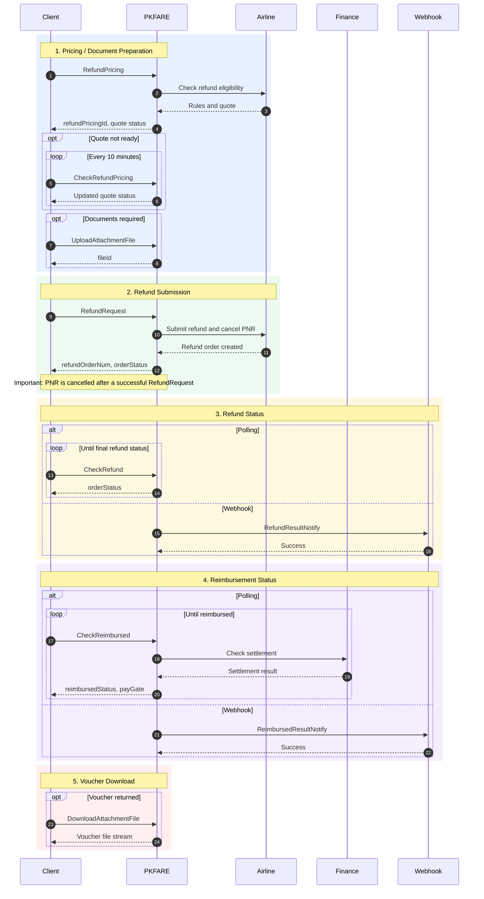

# Raise refund requests

# Refund Flow Overview

## API Calling Sequence Map




## Overview

### A. Voluntary Refund

A passenger wants to raise a voluntary refund request due to personal reasons.

**Process:**
1. Raise **RefundPricing** to check the validity and refundable amount
2. Upload attachment files, if required
3. Raise **RefundRequest** to create the refund order
4. Check reimbursement status
5. Download attachment files

### B. Involuntary Refund

A passenger wants to raise an involuntary refund request due to a flight schedule change or cancellation.

**Process:**
1. Upload attachment files
2. Raise **RefundRequest** to create the refund order
3. Check reimbursement status
4. Download attachment files

---

# Voluntary Refund Procedure

When there is a need to submit a voluntary refund request from your customer, you should first call the **RefundPricing API** to check whether the ticket is refundable and what the refundable amount is.

## RefundPricing Request

```plain
{
    "authentication": {
        "partnerId": "sIxxcsRCtssslnHt+BiT4bwONbMw=",
        "sign": "234f554590789459af1e610e872896a3c6"
    },
    "data": {
        "allPaxOfOrder": 0,
        "refundReason": "2",
        "refundType": "1",
        "uploadedFileIds": [
            "d0asisuddfjasld",
            "asdfasdasdas158"
        ],
        "orderNum": "916783592892089401",
        "pnrList": [
            {
                "arrival": "SEA",
                "bookingCode": "string",
                "cabinClass": "string",
                "departure": "LAX",
                "flightNum": "DL1473",
                "segmentNo": 1,
                "ticketNums": [
                    {
                        "birthday": "2003-05-11",
                        "cardNum": "string",
                        "cardType": "string",
                        "firstName": "Joshua",
                        "pnr": "AB8SED",
                        "airPnr": "AB8SED",
                        "lastName": "Perez",
                        "sex": "M",
                        "ticketNum": "123456"
                    }
                ]
            }
        ]
    }
}
```

## RefundPricing Response

```plain
{
    "errorCode": "0",
    "errorMsg": "ok",
    "data": {
        "needUploadFileId": 0,
        "orderNum": "916777559161841201",
        "refundPriceId": "16786066309484323",
        "refundPricingStatus": "refund pricing",
        "refundReason": 0,
        "refundType": 0,
        "lastComfirmTime": "2022-02-03 13:00:00",
        "passengerPriceList": [
            {
                "birthday": "2003-06-05",
                "cardNum": "G47350571",
                "cardType": "P",
                "firstName": "Justin",
                "lastName": "Lopez",
                "sex": "M",
                "ticketNum": "123456",
                "solutions": {
                    "currency": "USD",
                    "paidAmount": 1.00,
                    "usedAmount": 1.00,
                    "nonRefundableAmount": 1.00,
                    "refundServiceFee": 1.00,
                    "refundAmount": 1.00,
                    "FormOfPayment": "PrePay"
                },
                "segmentList": [
                    {
                        "arrival": "SIN",
                        "bookingCode": "Z",
                        "cabinClass": "ECONOMY",
                        "departure": "KUL",
                        "flightNum": "AK703",
                        "pnr": "YMERBD",
                        "airPnr": "YMERBD",
                        "segmentNo": 1,
                        "ticketNum": "1677755872384"
                    }
                ]
            }
        ]
    }
}
```

In addition, if the **RefundPricing** response returns `"needUploadFileId": 1`, you need to upload supporting documents, such as passenger passport details, using **UploadAttachmentFile**. Then retrieve the `fileId` from the response and include it under `uploadedFileIds` in the **RefundRequest** API request.

> **Note**
>
> Rules vary by airline. If it is not explicitly required, you do not need to upload passport details.

## UploadAttachmentFile Request

```plain
{
    "authentication": {
        "partnerId": "RksVSX7PfZmWYsCD7M4=",
        "sign": "17e707b5d9dae8459065dbb139e5f1bd"
    }
}
```

Attach the file to be uploaded and send the request.

## UploadAttachmentFile Response

```plain
{
    "errorCode": "0",
    "errorMsg": "ok",
    "data": {
        "fileId": "1ee71d50b4d59ef3e1555729c11745eb",
        "fileName": "Pkfarer.jpg"
    }
}
```

Response sample in case of failure:

```plain
{
    "errorCode": "B139",
    "errorMsg": "File is oversize. It should be less than 5MB."
}
```

Sometimes it may take a few minutes to get the exact refundable amount for the order. In that case, you can use **CheckRefundPricing API** to periodically poll the refund pricing status and retrieve the price quote. The recommended polling frequency is once every 10 minutes.

## CheckRefundPricing Request

```plain
{
    "authentication": {
        "sign": "de3c162dfab2cfb05fe07d73308a80",
        "partnerId": "Rw6HvWEDYaF6BPcICoQGJSXhw="
    },
    "data": {
        "refundPricingId": "16786982431662414"
    }
}
```

## CheckRefundPricing Response

```plain
{
    "errorCode": "0",
    "errorMsg": "ok",
    "data": {
        "needUploadFileId": 0,
        "orderNum": "916777559161841201",
        "refundPriceId": "16786982431662414",
        "refundPricingStatus": "refund pricing",
        "refundReason": 0,
        "refundType": 0,
        "lastComfirmTime": "2022-02-03 13:00:00",
        "passengerPriceList": [
            {
                "birthday": "2003-06-05",
                "cardNum": "G47350571",
                "cardType": "P",
                "firstName": "Justin",
                "lastName": "Lopez",
                "sex": "M",
                "ticketNum": "123456",
                "solutions": {
                    "currency": "USD",
                    "paidAmount": 1.00,
                    "usedAmount": 1.00,
                    "nonRefundableAmount": 1.00,
                    "refundServiceFee": 1.00,
                    "refundAmount": 1.00,
                    "FormOfPayment": "PrePay"
                },
                "segmentList": [
                    {
                        "arrival": "SIN",
                        "bookingCode": "Z",
                        "cabinClass": "ECONOMY",
                        "departure": "KUL",
                        "flightNum": "AK703",
                        "pnr": "YMERBD",
                        "airPnr": "YMERBD",
                        "segmentNo": 1,
                        "ticketNum": "1677755872384"
                    }
                ]
            }
        ]
    }
}
```

If the status changes to **"refund, priced"**, it means the price quote has been confirmed and you can proceed to submit the refund request.

> **Note**
>
> In some cases, values may be missing in the `nonRefundableAmount` and `refundAmount` fields in the refund pricing response. In those cases, please refer to the refund request response for the full refund details.

---

## RefundRequest

When you receive a `refundPricingId` from the **RefundPricing** API, you can submit a refund request using that ID.

You may also submit a refund request directly without a `refundPricingId` if you do not want to check the refundable amount in advance. In that case, the system will automatically generate an ID for the request.

## RefundRequest Request

```plain
{
    "authentication": {
        "partnerId": "GuLC2tDO2iox9iu45DKYSr9mQ=",
        "sign": "994209932dd37a81c951f004c70be7"
    },
    "data": {
        "refundPricingId": "16783330658156729",
        "allPaxOfOrder": 1,
        "orderNum": "916783298501993901",
        "pnrList": [
            {
                "airPnr": "EDTCZP",
                "arrival": "SIN",
                "bookingCode": "E",
                "cabinClass": "ECONOMY",
                "departure": "HKG",
                "flightNum": "CX635",
                "pnr": "EDTCZP",
                "segmentNo": "1",
                "ticketNums": [
                    {
                        "birthday": "2003-01-09",
                        "cardNum": "P1234567",
                        "cardType": "P",
                        "firstName": "CHUN",
                        "lastName": "XIN",
                        "sex": "M",
                        "ticketNum": "EDTCAA"
                    }
                ]
            }
        ],
        "refundReason": 0,
        "refundType": 0,
        "uploadFilesIds": [
            "7a570c0877099e1faaaa"
        ]
    }
}
```

## RefundRequest Response

```plain
{
    "errorCode": "0",
    "errorMsg": "ok",
    "data": {
        "orderNum": "916777559161841202",
        "parentOrderNum": "916777559161841201",
        "refOrderNum": "9167775591618412",
        "createTime": "2023-03-12 17:45:28",
        "passengerPriceList": [
            {
                "segmentList": [
                    {
                        "segmentNo": 1,
                        "departure": "KUL",
                        "arrival": "SIN",
                        "flightNum": "AK703",
                        "cabinClass": "Economy",
                        "bookingCode": "Z",
                        "pnr": "YMERBD",
                        "ticketNum": "1677755872385"
                    }
                ],
                "lastName": "King",
                "firstName": "Vickie",
                "cardType": "PP",
                "cardNum": "G47321571",
                "cardExpiredDate": "2025-05-05",
                "nationality": "CN",
                "psgType": "CHD",
                "sex": "M",
                "birthday": "2015-05-08"
            }
        ],
        "refundType": "0",
        "refundReason": "0",
        "orderStatus": "Refund request",
        "pnr": "YMERBD",
        "platingCarrier": "AK",
        "journeys": [
            {
                "journeyTime": 75,
                "departureDate": "2023-11-20",
                "arrivalDate": "2023-11-20",
                "departureTime": "07:05",
                "arrivalTime": "08:20",
                "segments": [
                    {
                        "airline": "AK",
                        "flightNum": "703",
                        "equipment": "320",
                        "cabinClass": "Economy",
                        "bookingCode": "Z",
                        "departure": "KUL",
                        "arrival": "SIN",
                        "departureDate": "2023-11-20",
                        "arrivalDate": "2023-11-20",
                        "departureTime": "07:05",
                        "arrivalTime": "08:20",
                        "flightTime": 75,
                        "codeShare": "0",
                        "opFltNo": "",
                        "opFltAirline": ""
                    }
                ]
            }
        ]
    }
}
```

> **Note**
>
> If the **RefundRequest** API is successfully invoked, the PNR for the order will be cancelled. Regardless of whether the refund is eventually approved, the tickets for that journey can no longer be used and will be treated as invalid.

---

## Refund Status

If you want to check the refund status, you can repeatedly call **CheckRefund API** and poll the refund order until the order status reaches one of the final states: **"Refund, to be reimbursed"** or **"Refund, reimbursed"**. The recommended polling frequency is 1–2 times per day.

## CheckRefund Request

```plain
{
    "authentication": {
        "partnerId": "GuLC2tDO2iox9iu45DKYSr9mQ=",
        "sign": "994209932dd37a81c951f004c70be7"
    },
    "data": {
        "orderNum": "916783298501993902"
    }
}
```

## CheckRefund Response

```plain
{
    "errorCode": "0",
    "errorMsg": "ok",
    "data": {
        "orderNum": "916783298501993902",
        "parentOrderNum": "916783298501993901",
        "refOrderNum": "9167832985019939",
        "createTime": "2023-03-10 10:04:02",
        "passengerPriceList": [
            {
                "segmentList": [
                    {
                        "segmentNo": 2,
                        "departure": "YVR",
                        "arrival": "MEX",
                        "flightNum": "AC996",
                        "cabinClass": "ECONOMY",
                        "bookingCode": "P"
                    }
                ],
                "lastName": "YANG",
                "firstName": "TIFFANYBVC",
                "cardType": "P",
                "cardNum": "E07700466",
                "sex": "F",
                "birthday": "1990-08-23"
            }
        ],
        "refundType": "0",
        "refundReason": "0",
        "orderStatus": "Under review",
        "pnr": "NGLVYT",
        "platingCarrier": "AC",
        "journeys": [
            {
                "journeyTime": 815,
                "segments": [
                    {
                        "airline": "AC",
                        "flightNum": "996",
                        "equipment": "7M8",
                        "cabinClass": "ECONOMY",
                        "bookingCode": "P",
                        "departure": "YVR",
                        "arrival": "MEX",
                        "departureTerminal": "",
                        "arrivalTerminal": "",
                        "departureDate": "2023-02-17",
                        "arrivalDate": "2023-02-17",
                        "departureTime": "16:30",
                        "arrivalTime": "23:50",
                        "flightTime": 440,
                        "codeShare": "N"
                    }
                ],
                "departureTime": "10:15",
                "arrivalTime": "23:50",
                "departureDate": "2023-02-17",
                "arrivalDate": "2023-02-17"
            }
        ]
    }
}
```

If you do not prefer polling, you may provide a URL endpoint to PKFARE so that PKFARE can push the refund order status to you once the final state is reached. In that case, you only need to return the specified response message.

## RefundResultNotify Request

```plain
{
    "orderNum": "916749866867277805",
    "parentOrderNum": "916749866867277803",
    "refOrderNum": "9167498668672778",
    "createTime": "2023-03-10 10:04:02",
    "passengerPriceList": [
        {
            "segmentList": [
                {
                    "segmentNo": 2,
                    "departure": "YVR",
                    "arrival": "MEX",
                    "flightNum": "AC996",
                    "cabinClass": "ECONOMY",
                    "bookingCode": "P"
                }
            ],
            "lastName": "YANG",
            "firstName": "TIFFANYBVC",
            "cardType": "P",
            "cardNum": "E07700466",
            "sex": "F",
            "birthday": "1990-08-23"
        }
    ],
    "refundType": "0",
    "refundReason": "0",
    "orderStatus": "Refund, to be reimbursed",
    "pnr": "NGLVYT",
    "platingCarrier": "AC",
    "journeys": [
        {
            "journeyTime": 815,
            "segments": [
                {
                    "airline": "AC",
                    "flightNum": "996",
                    "equipment": "7M8",
                    "cabinClass": "ECONOMY",
                    "bookingCode": "P",
                    "departure": "YVR",
                    "arrival": "MEX",
                    "departureTerminal": "",
                    "arrivalTerminal": "",
                    "departureDate": "2023-02-17",
                    "arrivalDate": "2023-02-17",
                    "departureTime": "16:30",
                    "arrivalTime": "23:50",
                    "flightTime": 440,
                    "codeShare": "N"
                }
            ],
            "departureTime": "10:15",
            "arrivalTime": "23:50",
            "departureDate": "2023-02-17",
            "arrivalDate": "2023-02-17"
        }
    ]
}
```

## RefundResultNotify Response

```plain
{
    "errorCode": "0",
    "errorMsg": "ok"
}
```

---

Now the refund order has been processed and is waiting for reimbursement to your account. Similarly, if you would like to check the reimbursement status, you can repeatedly call **CheckReimbursed API** and poll until the order status reaches the final state: **"Refund, Reimbursed"**. The recommended polling frequency is 1–2 times per day.

> **Note**
>
> The reimbursement section is more related to finance settlement handling. If your system is not integrated with your finance system, the **Reimbursement API** is optional.

## CheckReimbursed Request

```plain
{
    "authentication": {
        "partnerId": "xxcsRCtssslnHt+BiT4bwONbMw=",
        "sign": "4f554590789459af1e610e872896a3c6"
    },
    "data": {
        "orderNum": "916783592892089401"
    }
}
```

## CheckReimbursed Response

```plain
{
    "errorCode": "0",
    "errorMsg": "ok",
    "data": {
        "reimbursedOrderNum": "916787120452531002",
        "reimbursedOrderStatus": "Reimbursed",
        "payGate": "Voucher",
        "currency": "USD",
        "voucherList": [
            {
                "lastName": "YANGABC",
                "firstName": "TIFFANY",
                "birthday": "1990-08-23",
                "sex": "F",
                "psgType": "ADT",
                "voucherNumber": "1234567890123",
                "voucherCurrency": "THB",
                "voucherAmount": 222.22,
                "voucherValidFrom": "2023-03-20",
                "voucherValidEnd": "2023-03-22",
                "useFor": [
                    1
                ],
                "usageLimitation": 0
            }
        ],
        "voucherFileId": [
            "cc20fde65a836ad3e1555729c11745eb"
        ]
    }
}
```

If you do not prefer polling, you may provide a URL endpoint to PKFARE so that PKFARE can push the reimbursement status to you once the final state is confirmed. In that case, you only need to return the specified response message.

## ReimbursedResultNotify Request

```plain
{
    "currency": "USD",
    "payGate": "Prepay",
    "paySerialNum": "",
    "reimbursedAmount": 136.23,
    "reimbursedOrderNum": "916715517771831303",
    "reimbursedOrderStatus": "Reimbursed"
}
```

## ReimbursedResultNotify Response

```plain
{
    "errorCode": "0",
    "errorMsg": "ok"
}
```

Please note that there are several refund methods, including voucher, credit/cash in a prepay account, and Alipay. If the response specifies **Voucher** as the reimbursement method, a `voucherFileId` will be returned. You can then use that ID in the **DownloadAttachmentFile** request to retrieve the voucher file.

## DownloadAttachmentFile Request

```plain
{
    "authentication": {
        "partnerId": "sVSX7PfZmWYsCD7M4=",
        "sign": "e707b5d9dae8459065dbb139e5f1bd"
    },
    "data": {
        "fileId": "31d6ff3fe24d73a8e1555729c11745eb"
    }
}
```

## DownloadAttachmentFile Response

The file data is returned in binary stream format. In some cases, the refund may be reimbursed in the form of an airline voucher. PKFARE will provide the voucher image for reference, and you can use the **DownloadAttachmentFile** API to retrieve it.

---

# Involuntary Refund Procedure

The procedure for submitting an involuntary refund request is largely the same as that for a voluntary refund request. Under normal circumstances, however, an involuntary refund request usually requires mandatory supporting documents, such as passport information, medical certificates, and other related files. These are not always required for voluntary refund requests.

Therefore, you may refer to the voluntary refund procedure when integrating involuntary refund handling, while paying special attention to the **UploadAttachmentFile** API.
