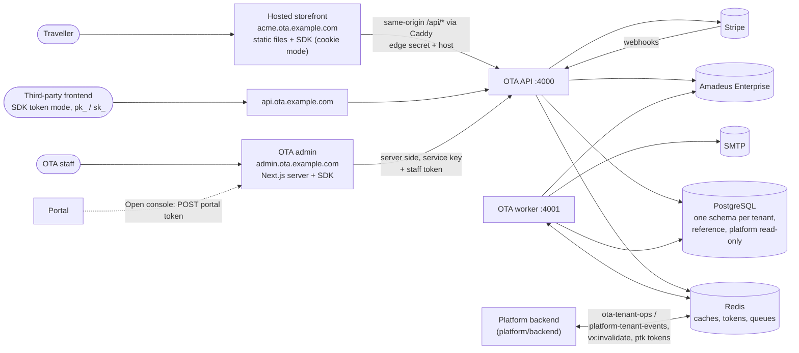

# Velexis OTA group

This directory holds the **data plane** of Velexis: the four parts that every OTA (tenant) uses to sell Amadeus flights and run its operations. The OTA backend serves the OTA booking API and runs the workers. The hosted storefront is what travellers use. The OTA admin is what the OTA's staff use. The JS SDK is how both of them, and third-party frontends, call the API. This page explains what each part does, how they fit together and with the platform group, and where the detailed documents are. It follows [`docs/mvp/decisions.md`](../docs/mvp/decisions.md), which always wins.

Related: [MVP index](../docs/mvp/README.md), [MVP architecture](../docs/mvp/architecture.md), [OTA docs index](docs/README.md), [platform group](../platform/README.md) (control plane).

## 1. The four parts

| Part | Directory | Package | Host (placeholder) | Port | Who uses it | Technology |
|---|---|---|---|---|---|---|
| OTA backend (API + worker) | [`backend/`](backend/README.md) | `@velexis/ota-backend` | `api.ota.example.com`, plus `/api/*` on every storefront host | 4000 API, 4001 worker health | The storefront (through Caddy), the OTA admin (server side), third-party frontends with `pk_`/`sk_` keys, Stripe webhooks | NestJS 11, TypeScript |
| OTA frontend (hosted storefront) | [`frontend/`](frontend/README.md) | `@velexis/ota-frontend` | `<key>.ota.example.com` and verified custom domains | none (Caddy serves static files); 5173 in development | Travellers | Vanilla HTML + Tailwind CSS + vanilla JS, all booking calls through the SDK in cookie mode |
| OTA admin | [`admin/`](admin/README.md) | `@velexis/ota-admin` | `admin.ota.example.com` | 3002 | OTA staff (portal accounts with a membership), signed in through SSO from the portal | Next.js 15 App Router, TypeScript, Tailwind; console calls through the SDK on the server |
| JS SDK | [`sdk/`](sdk/README.md) | `@velexis/ota-sdk` | none (library) | none | The storefront, the OTA admin, third-party frontends | Vanilla JS ES modules with JSDoc types, no dependencies |

## 2. How they fit

- **The OTA backend owns every tenant schema** (`tenant_<key>`) and its migrations. It reads the platform rows it needs (tenants, domains, API keys, memberships, connections, Amadeus accounts) with a read-only role and caches them in Redis for 60 seconds ([ADR-0004](../docs/mvp/adr/0004-postgresql-schema-per-tenant.md)). It never writes platform tables.
- **Provisioning** of a tenant schema is done by the OTA worker when the platform asks for it on the `ota-tenant-ops` queue. The result goes back on `platform-tenant-events` ([ADR-0009](../docs/mvp/adr/0009-background-jobs-bullmq.md), [OADR-0007](docs/adr/0007-tenant-migration-runner-and-provisioning-worker.md)).
- **The storefront** is one static build for all OTAs. It calls the API **same-origin** on `/api/*`. Caddy adds the edge credential and the host, and customer sessions live in httpOnly cookies with a CSRF header ([ADR-0018](../docs/mvp/adr/0018-hosted-storefront-custom-domains.md), [OADR-0006](docs/adr/0006-storefront-cookie-sessions-and-csrf.md)).
- **The OTA admin** is a backend-for-frontend. Its server holds the staff tokens in cookies and calls the API with the first-party service key ([ADR-0008](../docs/mvp/adr/0008-identity-accounts-customers-sessions.md), [OADR-0011](docs/adr/0011-console-access-staff-sessions-and-environments.md)).
- **The SDK** has one method per OpenAPI operation, named by `x-sdk-method`, and two session modes: token mode (the contract) and cookie mode (the storefront) ([ADR-0019](../docs/mvp/adr/0019-vanilla-js-sdk-jsdoc.md)).
- **Amadeus and Stripe** are called only by the OTA backend: Amadeus through one client module ([OADR-0001](docs/adr/0001-amadeus-client-design.md)), Stripe through a payment gateway ([OADR-0010](docs/adr/0010-stripe-gateway-and-payment-webhooks.md)). The airline-card method sends the card to Amadeus in memory only ([OADR-0004](docs/adr/0004-airline-card-data-handling.md)).

## 3. What the OTA group delivers, by milestone

The milestone ids and meanings are shared by every plan ([MVP index §1](../docs/mvp/README.md#1-shared-milestones)).

| Milestone | OTA scope |
|---|---|
| **M0** Foundations | Tenant baseline migration `0001_baseline.sql`, the OpenAPI document copied to `backend/openapi/`, empty backend with health endpoints, deploy units |
| **M1** Platform core | The `tenant.provision` / `tenant.migrate` consumer in the OTA worker, so the platform's provisioning job creates the tenant schema |
| **M2** Search & price | Backend tenancy (edge, keys, cache), Amadeus client, shopping endpoints; SDK core, `flights`, `reference`, `storefront`; storefront search, results, offer details, upsell, pricing, ancillaries on `<key>.ota.example.com` |
| **M3** Book & pay | Checkout, customer auth in cookies, Stripe on the Velexis account, airline card through Amadeus, create order, issue, e-mails and documents, my bookings, guest lookup, change contacts, cancel |
| **M4** OTA admin | OTA admin with SSO, bookings console, PNR lookup and import, queues, Stripe capture and refund, customers, markups and fees, storefront settings and branding, templates |
| **M5** Monetisation & self-service | The OTA's own Stripe (Connect Standard or API keys) and own Amadeus credentials in the gateways, live environment on the storefront, custom domains served |
| **M6** Hardening & launch | PCI controls and review of the airline-card path, end-to-end suite, performance sanity, SDK publication, launch checklist |

The feature-level scope, with the 96 contract operations marked MVP or deferred, is in [`docs/scope.md`](docs/scope.md).

## 4. Where to read next

| You want to… | Read |
|---|---|
| Know what is in and out of the MVP | [`docs/scope.md`](docs/scope.md) |
| Understand the backend modules, workers and caches | [`docs/architecture.md`](docs/architecture.md), [`docs/architecture-booking.md`](docs/architecture-booking.md) |
| Change the API | [`docs/api-changes.md`](docs/api-changes.md), [`docs/api-changes-console-and-internal.md`](docs/api-changes-console-and-internal.md), then `backend/openapi/` |
| Write a tenant migration | [`docs/data-model.md`](docs/data-model.md), [`docs/data-model-migration-0002.md`](docs/data-model-migration-0002.md) |
| Follow one flow end to end | [`docs/flows/`](docs/README.md#flows) |
| Know why something is the way it is | [`docs/adr/`](docs/adr/README.md) (OTA ADRs, `OADR-NNNN`) |
| Run or build the backend | [`backend/README.md`](backend/README.md) |
| Pick a task | `docs/plans/agent-tasks.md` (task ids `OBE-`, `OFE-`, `OAD-`, `SDK-`) |

## 5. Rules that matter most here

- **Contract first.** Every OTA endpoint is in `backend/openapi/velexis-ota-booking-api.openapi.yaml` before it is implemented, and every operation has its SDK method ([ADR-0006](../docs/mvp/adr/0006-contract-first-openapi.md)).
- **Tenant data only through `tenantTx`.** No schema-qualified tenant SQL, no session-level `search_path`, an isolation test for every tenant repository.
- **No token in browser JavaScript** on the hosted storefront or in the OTA admin.
- **Card data never stored, queued, cached or logged.** The airline-card route is the only place a card number exists, and only in memory ([ADR-0011](../docs/mvp/adr/0011-payments-stripe-and-airline-card.md)).
- **Order creation is never retried blindly.** A timeout is reconciled before anything else happens ([OADR-0003](docs/adr/0003-booking-orchestration-and-supplier-timeout-recovery.md)).
- **Net prices never reach customer scope.** Markups and fees are applied by one engine ([OADR-0005](docs/adr/0005-markup-and-fee-engine.md)).
