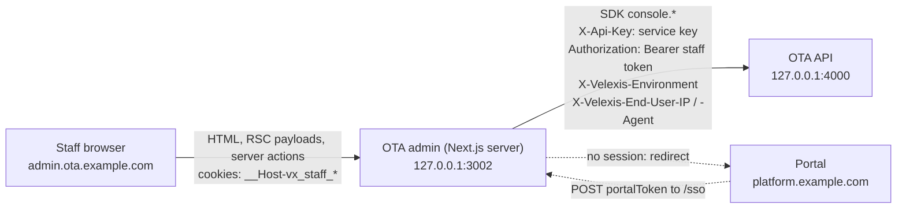

# OTA admin (`@velexis/ota-admin`)

This is the component specification of the OTA admin: the Next.js 15 (App Router, TypeScript) back office on `admin.ota.example.com` where an OTA's staff work their bookings, run Amadeus console tasks, capture and refund payments, look up customers and change markups, fees, storefront settings and e-mail templates. Staff arrive by single sign-on from the portal. The admin is a backend-for-frontend: **every booking and console function goes through the JS SDK's `console` namespace on the server**, with the first-party service key and the staff token from httpOnly cookies, so no token ever reaches browser JavaScript. This page covers sign-in and sessions, the route map, folder layout, data fetching, roles and permissions, components, security, configuration and tests. It follows [`decisions.md`](../../docs/mvp/decisions.md), [ADR-0008](../../docs/mvp/adr/0008-identity-accounts-customers-sessions.md) and [ADR-0014](../../docs/mvp/adr/0014-frontend-stack-nextjs-tailwind.md).

Related: [`docs/routes.md`](docs/routes.md) (every route: SDK calls, permissions, states), [`.env.example`](.env.example), [OADR-0018](../docs/adr/0018-ota-admin-consumes-the-sdk-server-side.md) (how the admin uses the SDK), [OADR-0011](../docs/adr/0011-console-access-staff-sessions-and-environments.md) (staff sessions, environments, permissions), [PADR-0007](../../platform/docs/adr/0007-portal-to-ota-admin-sso-token.md) (SSO token), [flow: console operations](../docs/flows/console-operations.md), [`../docs/api-changes-console-and-internal.md`](../docs/api-changes-console-and-internal.md) (settings and payments endpoints), [SDK](../sdk/README.md), [SDK guide B4](../../docs/velexis-sdk/sdk/docs/B4.md), [scope §2.3](../docs/scope.md#23-ota-admin-otaadmin), [conventions §3](../../docs/mvp/conventions.md#3-nextjs-apps-portal-platform-admin-ota-admin).

## 1. At a glance

| Item | Value |
|---|---|
| Package | `@velexis/ota-admin` (private) |
| Runtime | Node.js 22, Next.js 15 App Router, React 19, TypeScript strict, `output: "standalone"` |
| UI | Tailwind CSS 4, shadcn/ui (Radix), `lucide-react`, `@tanstack/react-table`; Zod for server-action input |
| API access | `@velexis/ota-sdk` on the server only (`import "server-only"`), server mode: `secretKey` = `OTA_ADMIN_SERVICE_KEY`, staff `accessToken`, `sessionKind: "staff"`, `environment` |
| Host and port | `admin.ota.example.com` → Caddy → `127.0.0.1:3002`; `http://localhost:3002` in development |
| Tenancy | Multi-tenant; a staff session is bound to one OTA, chosen in the portal before SSO |
| Sign-in | SSO only: portal token → `console.auth.signIn({ grantType: "portal_token" })`; no sign-in page of its own |
| Milestone | M4 (all routes below unless marked later); M5 live environment for live tenants |

## 2. How it works



- Pages are **React Server Components** that call the SDK during rendering. Mutations are **Server Actions**. Client components are leaves for interactivity (filters, dialogs, form state) and never import the SDK or session code ([conventions §3](../../docs/mvp/conventions.md#3-nextjs-apps-portal-platform-admin-ota-admin)).
- The OTA backend accepts the service key only on a direct loopback connection that did not come through Caddy (no `X-Forwarded-For` or `X-Forwarded-Host`; Caddy sets both on every proxied request), only on console operations, and only with a staff token of the same tenant ([OADR-0009](../docs/adr/0009-caller-and-tenant-resolution.md) rule 1.2, [OADR-0011](../docs/adr/0011-console-access-staff-sessions-and-environments.md)). The same key sent to `api.ota.example.com` or a storefront's `/api/*` is refused.
- Because every call comes from this server, the admin forwards the staff member's address on every SDK call: `X-Velexis-End-User-IP` is the right-most `X-Forwarded-For` entry of the incoming request (set by Caddy; `127.0.0.1` in local development) and `X-Velexis-End-User-Agent` is the browser's `User-Agent` cut to 512 characters. The backend honours them only for the service caller and uses them for the sign-in throttle, the lockout and `staff_actions`, so one staff member cannot exhaust a bucket shared by every OTA. So the admin can never call customer-scope operations such as `flights.search`; staff shopping uses the read-only `console.amadeus.*` calls.
- The backend enforces every permission and writes a `staff_actions` row for every change and every refusal ([OADR-0011](../docs/adr/0011-console-access-staff-sessions-and-environments.md) point 8); the admin hides what a role cannot do, for clarity only.

## 3. Sign-in: SSO from the portal

```mermaid
sequenceDiagram
  autonumber
  actor S as Staff
  participant P as Portal
  participant A as OTA admin server
  participant O as OTA API
  S->>P: Open console (POST /otas/{tenantId}/console/launch)
  P-->>S: auto-submitting form, portalToken (60 s, single use)
  S->>A: POST /sso (form body: portalToken)
  A->>A: Origin must be PUBLIC_PORTAL_URL
  A->>O: console.auth.signIn({ grantType: "portal_token", portalToken })
  O-->>A: staff session: tokens, staff, tenant, permissions, environments
  A-->>S: Set-Cookie __Host-vx_staff_at, __Host-vx_staff_rt, __Host-vx_env, __Host-vx_tenant; 303 to /bookings
```

- **`POST /sso`** (`src/app/sso/route.ts`) is a route handler. It accepts only `application/x-www-form-urlencoded` (at most 1 KiB, read in chunks and cut off at the limit) with exactly one `portalToken` matching `^ptk_[A-Za-z0-9]{24,64}$`, checks `Origin` against `PUBLIC_PORTAL_URL` (login-CSRF defence; a missing `Origin` and the opaque `null` are refused too), calls `console.auth.signIn({ grantType: "portal_token", portalToken })` with the service key only and `X-Velexis-Environment: test`, sets the four cookies and answers `303 See Other` to `/bookings` (as architecture flow (c) and platform task PFE-019 expect), with `Cache-Control: no-store` and no token in the URL or the body. A new session starts in the test environment; live is the switch's deliberate choice. **Reconciled (lead decision of 2026-10-23):** a browser sends `Origin: null` with a form post from a page whose `Referrer-Policy` is `no-referrer` (Fetch standard; checked with Chrome 147), which this check refuses, while `strict-origin` sends the portal's origin; [PADR-0007](../../platform/docs/adr/0007-portal-to-ota-admin-sso-token.md) §4 therefore gives the portal's hand-off page `strict-origin` (its dated revision, PBE-039), and the launch handler (PFE-017) sends it.
- **SSO errors** render a short HTML page (`lib/auth-routes.ts`: no script, no form, every text escaped, the message from `lib/errors.ts` by code and the request id) with "Back to the portal" (the tenant's console page when the tenant cookie names it): `403` for a foreign `Origin`, `415` for another body type, `400` for a missing or malformed token, the API's status for its refusals (`401 PORTAL_TOKEN_INVALID` for an unknown, expired or already used token, `403 STAFF_MEMBERSHIP_INACTIVE`, `403 TENANT_SUSPENDED`, `429 RATE_LIMITED`, and `403 MFA_REQUIRED` when the OTA is live and the portal account has no MFA, where the page asks the staff member to turn on two-factor authentication in the portal first and links to the portal's `/account/security`), and `503` when the OTA API is unavailable.
- **No session** (no cookies, nothing left to refresh with, or refresh refused): middleware redirects (`303`) to `${PUBLIC_PORTAL_URL}/console?tenant=<tenantId>` when the tenant is known from the tenant cookie, else `${PUBLIC_PORTAL_URL}/console` ([PADR-0007](../../platform/docs/adr/0007-portal-to-ota-admin-sso-token.md) §5). Deny by default: every path needs a session except the four session routes `/sso`, `/auth/refresh`, `/auth/sign-out` and `/signed-out` (exact paths), so a new page is never public by accident.
- **Switch OTA**: the header's tenant menu links to the portal's console page; a new SSO replaces the session.
- **Sign out**: `POST /auth/sign-out` (route handler) serves only a request whose `Origin` is `PUBLIC_OTA_ADMIN_URL` (`403` otherwise, no call, no cookie change), calls `console.auth.signOut({ scope: "current" })` with the refresh token in the body (it names the session even after the access token expired) and the access token while it is still valid, clears the access, refresh and environment cookies whatever the API answers, and answers `303` to `/signed-out`, a page with a link back to the portal (the tenant cookie stays for it). "Sign out everywhere" belongs to the portal, which revokes staff sessions through `staffdeny:acct:*`.

## 4. Sessions, cookies and the environment

| Cookie | Content | Attributes | Lifetime |
|---|---|---|---|
| `__Host-vx_staff_at` | Staff access token (JWT) | `HttpOnly; Secure; SameSite=Lax; Path=/` | 15 min (token expiry) |
| `__Host-vx_staff_rt` | Staff refresh token (opaque, rotating) | same | Remaining family lifetime, at most 12 h ([OADR-0011](../docs/adr/0011-console-access-staff-sessions-and-environments.md)) |
| `__Host-vx_env` | `test` or `live` | same | 12 h |
| `__Host-vx_tenant` | Tenant id, for the "back to the portal" redirect only | same | 12 h |

`SameSite=Lax`, not `Strict`: the session starts from a cross-site POST, and the redirected first page load must carry the cookies. Server actions get Next.js's built-in Origin check; the two state-changing route handlers check `Origin` themselves.

**Refresh** ([OADR-0018](../docs/adr/0018-ota-admin-consumes-the-sdk-server-side.md)):

1. `src/middleware.ts` (Node.js runtime) runs on every request but Next.js's own files (`/_next/…`), the favicon and the health routes. When the access token is missing or expires within 60 s and a refresh cookie exists, it calls `console.auth.refresh` through the de-duplication, writes the four cookies on the response and replaces the old tokens in the request's own `Cookie` header, so the page or the server action of that request already uses the new ones. A refusal ends the session (point 4). A failure that may pass keeps the cookies: a still valid access token goes on, an expired one is left out of the request, so a server component goes to `/auth/refresh` and a server action's `requireStaff()` tries again. The four session routes are never refreshed or redirected by the middleware; they handle sessions themselves.
2. Refreshes are **de-duplicated per refresh token** inside the admin process (`lib/refresh-dedup.ts`: an in-memory map of promises keyed by the token's SHA-256, kept 30 s), because parallel requests from one browser would otherwise present the same rotating token twice and the backend would revoke the family. The map sits on `globalThis` under a registered symbol, so the middleware's bundle and the app's bundles of the one process share it. A success and a final refusal are reused for 30 s; a failure that may pass (rate limit, API unavailable, network) is forgotten as soon as it settles, so the next request tries again. Every refresh goes through `refreshStaffSession` (`lib/velexis.ts`), with the service key only and `X-Velexis-Environment: test` (every session allows it, while `live` would be refused for a role or OTA that does not allow it); the environment cookie keeps the staff member's choice when the new session still allows it.
3. Server components never refresh: their SDK client gets the access token only. If a call still fails with `TOKEN_EXPIRED`, the page redirects to `/auth/refresh?next=<path>`, a route handler that refreshes (de-duplicated) and redirects (`303`) back (`getStaff()` does this for `console.auth.me`). `next` is kept only when `safeNextPath` of `lib/session.ts` accepts it (a relative path on the admin), else the handler goes to the dashboard `/`. It refreshes whenever there is a refresh token, even when the access token looks fresh, because the API refused that token and going back without a new one would loop; a failure that may pass answers a short page (`429` or `503`) with "Try again" and "Back to the portal" instead of a redirect. Server actions start with `requireStaff(permission)`, which refreshes through the same de-duplication when the access token is missing or expires within 60 s and writes the new cookies before any call.
4. A refused refresh (`REFRESH_TOKEN_INVALID`, `REFRESH_TOKEN_REUSED`, `STAFF_MEMBERSHIP_INACTIVE`, `TENANT_SUSPENDED`, `UNAUTHENTICATED`, `VALIDATION_FAILED`) clears the access, refresh and environment cookies and sends the user to the portal; the tenant cookie stays for that redirect.

**Environment switch.** The header shows a TEST / LIVE switch when `session.environments` contains `live` (a live tenant and a role other than `viewer`; `canOpenEnvironment` of `lib/permissions.ts` checks both), else the environment badge. A server action (`switchEnvironment` of `(console)/env-actions.ts`) validates the choice against the session and sets `__Host-vx_env`: `test` always, `live` only after `console.auth.me` (`requireStaffSession`) lists it for a role that may open it; a refused `live` answers "Live is not available for this OTA or role" and leaves the cookie at `test`. After a switch the staff member lands on the dashboard of the new environment. Every SDK client is built with the environment of the request. The whole shell turns a warning colour in live mode with a "LIVE environment" strip, and confirmation dialogs repeat "LIVE".

**A refused live environment** (routes.md §1, OAD-004). The cookie can still say `live` after the OTA went back to test or the role became `viewer`. `getConsoleRequest` (`lib/velexis.ts`, React `cache`: once per request) calls `console.auth.me` in the cookie's environment first; when the API refuses `live` (`403 ENVIRONMENT_NOT_ALLOWED`) or the profile no longer allows it, it asks again in `test`, and every call of that request (`getConsole()`, `getStaff()`) goes to `test`. A server component cannot write cookies, and Next.js would hide the refusal from `error.tsx` in production, so the shell shows the banner "Live is not available for this OTA or role" and resets the cookie through the `resetEnvironment` server action. Server actions can write cookies: `requireStaffSession` (and so `requireStaff`) resets the cookie to `test` itself when `console.auth.me` is refused for `live`, and throws the refusal, so the action answers the same message and is never re-run in another environment than the page's; the re-render after the action shows the shell in test. The middleware's next refresh would reset it as well (`staffSessionCookies` keeps an environment only when the new session allows it). A client-side navigation renders only the new page, not the layout (Next.js keeps layouts), so after a refusal seen there the page already works in `test` while the shell keeps its last environment until the next full render: a reload, the switch, or any server action.

## 5. Route map

All routes are in the `(console)` route group with the signed-in shell, except the auth handlers. Per-route SDK calls, filters, actions and states are in [`docs/routes.md`](docs/routes.md).

| Route | Purpose | Main SDK calls | Permission |
|---|---|---|---|
| `POST /sso` · `/auth/refresh` · `POST /auth/sign-out` · `/signed-out` | SSO, refresh fallback, sign-out | `console.auth.signIn`, `.refresh`, `.signOut` | — |
| `/` | Dashboard: needs-attention counts (ticketing failed or manual review, deadlines within 24 h, pending reconciliation), authorised uncaptured payments, last queue snapshot, recent bookings | `console.auth.me`, `console.bookings.list` (`totalCount`), `console.payments.list`, `console.queues.listSnapshots` | `bookings:read` (+ `payments:read`, `queues:read` per tile) |
| `/bookings` | Bookings list: filters, sort, saved needs-attention views, cursor paging | `console.bookings.list` | `bookings:read` |
| `/bookings/[bookingId]` | Booking detail: overview, travellers and contacts, Amadeus order view, tickets and documents, payments, timeline and notes, recent staff actions | `console.bookings.get`, `.retrieve`, `console.payments.get` | `bookings:read` |
| ↳ actions | Patch travellers, contacts, remarks, ticketing agreement; issue; cancel with refund; resync; add note; capture; refund; airline-card bookings in manual review | `console.bookings.patch`, `.issue`, `.cancel`, `.resync`, `.addNote`; `console.payments.capture`, `.refund` | `bookings:write`, `bookings:issue`, `bookings:cancel`, `payments:capture`, `payments:refund` |
| `/pnr` | PNR lookup by record locator and import | `console.bookings.findByRecordLocator`, `.import` | `bookings:read`, `bookings:write` |
| `/queues`, `/queues/[queueId]` | Office queues and stored snapshots | `console.queues.list`, `.listSnapshots` | `queues:read` |
| `/shopping` | Flight search, availability, branded fares and price on behalf of a caller (net prices, read-only quote) | `console.amadeus.searchFlightOffers`, `.searchFlightAvailabilities`, `.upsellAirOffers`, `.quoteAirOffers` | `amadeus:read` |
| ↳ book on behalf | **Later**: `console.bookings.create` is deferred ([scope §3.4](../docs/scope.md#34-b4-console-32-27-mvp-5-deferred)) | — | — |
| `/payments`, `/payments/[paymentId]` | Payments list and detail, capture, refund | `console.payments.list`, `.get`, `.capture`, `.refund` | `payments:read`, `payments:capture`, `payments:refund` |
| `/customers`, `/customers/[customerId]` | Customers (search by e-mail or name), detail with statistics and bookings | `console.customers.list`, `.get`, `console.bookings.list({ customerId })` | `customers:read` |
| `/settings/markups`, `/settings/fees` (+ `/new`, `/[id]`) | Markup and fee rules | `console.settings.markupRules.*`, `.feeRules.*` | `settings:read`, `settings:write` |
| `/settings/storefront` | Branding and theme, features, policies (ticketing policy, 3-D Secure, card brands, TTLs, e-mail verification), airline card per environment, legal and support, SEO and consent, operations | `console.settings.storefront.get`, `.update`, `console.settings.assets.list` | `settings:read`, `settings:write` |
| `/settings/assets` | Logos, favicon, social image, page images | `console.settings.assets.list`, `.upload`, `.delete` | `settings:read`, `settings:write` |
| `/settings/pages`, `/settings/pages/[pageId]` | Content pages (Markdown subset) | `console.settings.pages.*` | `settings:read`, `settings:write` |
| `/settings/templates`, `/settings/templates/[key]/[channel]/[locale]` | Notification templates: edit, preview, reset | `console.settings.templates.*` | `settings:read`, `settings:write` |
| `/supplier-log` | Redacted Amadeus call log with filters | `console.supplierRequests.list` | `supplier_requests:read` |
| `/audit` | Tenant-wide staff actions | **Later** (needs a new `console.staffActions.list`); M4 shows each booking's `recentStaffActions` | — |
| `/portal` | Links back to the portal: API keys, domains, Amadeus, payments and Stripe, team, billing, go-live | none (links to `${PUBLIC_PORTAL_URL}/otas/<tenantId>/…`) | any |
| `/health/live` · `/health/ready` | Liveness (`200 {status: "ok"}`) and readiness (`200` when `OTA_API_URL/health/live` answers 2xx within 2 s, else `503` with `checks.otaApi` = `timeout` or `down`), polled by `deploy.sh` on `127.0.0.1:3002` ([ADR-0016](../../docs/mvp/adr/0016-observability.md)) | none: the probe is the only request to the OTA API outside the SDK, an operational endpoint outside the contract that carries no key, token or cookie | — |

## 6. Folder tree

```
ota/admin/
  next.config.ts                 standalone output traced from the repository root, static security headers()
                                 (CSP fallback frame-ancestors 'none'), serverActions.bodySizeLimit "2mb"
  .env.example
  components.json                shadcn/ui settings (new-york, neutral, CSS variables, lucide)
  postcss.config.mjs             Tailwind CSS 4 (@tailwindcss/postcss)
  vitest.config.ts               Node by default; component tests opt into happy-dom; src/**/*.test.ts(x) only
  src/
    middleware.ts                Node runtime: session refresh, redirect to the portal, CSP nonce. Inside src/,
                                 next to app/: Next.js ignores a middleware.ts at the app root when src/app exists
    config.ts                    server-only: @velexis/config schema, getConfig() validated on first use
    app/
      layout.tsx                 root layout (html, skip link, force-dynamic for the nonce); globals.css: tokens
      health/live/route.ts       GET liveness
      health/ready/route.ts      GET readiness: OTA_API_URL/health/live within 2 s
      sso/route.ts               POST portal token → cookies
      auth/refresh/route.ts      GET refresh fallback
      auth/sign-out/route.ts     POST sign-out
      signed-out/page.tsx
      (console)/layout.tsx       shell: tenant, environment switch, navigation by permission, live colour, the
                                 states of TENANT_SUSPENDED and of an API that failed (rendered, not thrown)
      (console)/env-actions.ts   server actions: switchEnvironment (only to an allowed value), resetEnvironment
      (console)/page.tsx         dashboard
      (console)/bookings/…       page.tsx (the list), views.ts (its URL model, saved views and rows), filters.tsx,
                                 bookings-table.tsx; [bookingId]/page.tsx (the detail's SDK calls per tab),
                                 [bookingId]/sections.tsx (its tabs and what needs staff), [bookingId]/actions.ts
                                 (its server actions), [bookingId]/action-rules.ts (their field names and rules, shared
                                 with the dialogs), [bookingId]/*-form.tsx, *-dialog.tsx, payment-dialogs.tsx
      (console)/payments/…       page.tsx (the list: filters as a GET form, cursor paging); [paymentId]/page.tsx (one
                                 payment: the booking page's PaymentCard, "Refresh from Stripe", capture and refund
                                 with the booking page's payment-dialogs.tsx), [paymentId]/actions.ts (its server
                                 actions, which run the booking page's capture and refund and revalidate the payments
                                 pages)
      (console)/pnr/…  queues/…  shopping/…  customers/…  supplier-log/…  portal/…
      (console)/settings/        markups/ fees/ storefront/ assets/ pages/ templates/
      (console)/error.tsx        per-area error boundaries using lib/errors.ts (the fallback: see §10)
    components/ui/               shadcn/ui copies: button, input, textarea, label, select, checkbox, switch, tabs,
                                 table, dialog, alert-dialog, badge, card, tooltip, dropdown-menu
    components/                  data-table, status-badge, money, json-view, confirm-dialog, env-banner, permission-gate,
                                 console-nav (the shell's navigation), error-state (an API error in the admin's words)
    lib/velexis.ts               server-only: console client per request (service key, token, environment, end-user
                                 headers, response log), getConsole(), getStaff(), refreshStaffSession()
    lib/session.ts               server-only: the four cookies, readSession(), redirects, requireStaff()
    lib/auth-routes.ts           server-only: paths, Origin check, capped form reader and error page of the
                                 session route handlers (a route.ts may export only its handlers)
    lib/refresh-dedup.ts         server-only: one refresh per refresh token in the process (SHA-256 key, 30 s)
    lib/permissions.ts           permission constants, the role matrix, can(profile, permission)
    lib/errors.ts                VelexisError code → message, fieldErrors → form state
    lib/action-state.ts          ActionState type and helpers for useActionState
    lib/utils.ts                 the shadcn/ui cn() helper (components.json "utils")
    lib/portal-links.ts          portal URLs for the tenant
    test/fake-ota-api.ts         tests only: fake fetch for the real SDK, staff session builders, cookie jar
```

## 7. Data fetching and mutations

```ts
// src/lib/velexis.ts (server only)
import "server-only";
import { createVelexisClient } from "@velexis/ota-sdk";
import { headers } from "next/headers";
import { cache } from "react";

export const getConsoleRequest = cache(async () => {
  const s = await readSession();                          // cookies; throws a redirect to the portal when absent
  if (s.accessToken === undefined) redirectToRefresh();   // a server component cannot write rotated tokens (§4)
  const client = createConsoleClient({                    // createVelexisClient({ ... }).console:
    accessToken: s.accessToken,                           //   secretKey OTA_ADMIN_SERVICE_KEY, baseUrl OTA_API_URL,
    environment: s.environment,                           //   sessionKind "staff", no refreshToken (§4), onResponse
    incoming: await headers(),                            //   log line, X-Velexis-End-User-IP / -Agent (§2)
  });
  const staff = await client.auth.me();                   // TOKEN_EXPIRED → /auth/refresh, ended → the portal;
  return { console: client, staff, environment: s.environment, liveRefused: false };
});                                                       // a refused live → the same in test, liveRefused (§4)

export const getConsole = cache(async () => (await getConsoleRequest()).console);
// console.auth.me once per request
export const getStaff = cache(async () => (await getConsoleRequest()).staff);
```

- **Reads** happen in server components with `await getConsole()`. Every console call is personal and priced, so nothing is cached across requests (`cache: "no-store"` is the SDK default for console calls). List pages keep filters, sort and the cursor in `searchParams`, so views are shareable links.
- **Errors in server components.** In production Next.js replaces an error thrown in a server component with a generic one before it reaches `error.tsx` (only its `digest` is left), so a page handles the API codes it knows on the server: `redirectOnSessionError` (`lib/session.ts`) for `TOKEN_EXPIRED` and an ended session, `notFound()` for `NOT_FOUND` (or, where the record may belong to the other environment, a "not found" state of the page's own inside the shell, so the environment switch is at hand: the booking detail page, OAD-007), and a state of its own for the rest (`ErrorState` of `components/error-state.tsx` with the message of `lib/errors.ts` and the request id, routes.md §1). `error.tsx` is the fallback for what nobody expected; it shows the digest as the reference that matches the server log. The shell does the same for `console.auth.me`: `403 TENANT_SUSPENDED` renders the full page "This OTA is suspended" with a link to the portal, any other API error the console's message with the request id and "Try again".
- **Mutations** are server actions:

```ts
// src/app/(console)/bookings/[bookingId]/actions.ts
"use server";
export async function issueTickets(_: ActionState, form: FormData): Promise<ActionState> {
  const { console: con } = await requireStaff("bookings:issue");   // local check for a clear message; the API decides
  const input = IssueSchema.safeParse(Object.fromEntries(form));    // bookingId, version, reason, actionKey
  if (!input.success) return fromZod(input.error);
  try {
    await con.bookings.issue(
      { bookingId: input.data.bookingId, ifMatch: input.data.version, reason: input.data.reason },
      { idempotencyKey: input.data.actionKey },                     // rendered once per dialog: a double click replays
    );
  } catch (e) {
    return fromVelexisError(e);                                     // PRECONDITION_FAILED → "reload", fieldErrors → fields
  }
  revalidatePath(`/bookings/${input.data.bookingId}`);
  return { ok: true, message: "Tickets issued" };
}
```

- Updates send `ifMatch` = the `version` the page displayed; `412 PRECONDITION_FAILED` asks the user to reload.
- State-changing calls carry an idempotency key generated when the dialog or form is rendered (a hidden input), so a double submit or a retry replays the same action. The page's server component renders it once (`crypto.randomUUID()`) and hands it to `ConfirmDialog` as `idempotencyKey`; the dialog posts it as `actionKey`, the same for every submission of that render; the action's `revalidatePath` after a success renders a new one.
- **A new key after a final refusal** (2026-10-27, lead decision (1), FIX-W31-OTA; [OADR-0018](../docs/adr/0018-ota-admin-consumes-the-sdk-server-side.md) point 5 revised). The OTA API keeps a final `4xx` under its key for 24 hours, so a corrected form sent with that key would only get `409 IDEMPOTENCY_KEY_REUSED`. After a failed call that carried the key, a keyed action answers `withNextActionKey(state, error)` (`lib/action-state.ts`): after a final `4xx` that the API stores under the key (every stored `4xx` but `412`; the API stores neither `429` nor `409 CONFLICT` with `details.reason = idempotency_key_in_use`), its state carries `nextActionKey` (`crypto.randomUUID()` on the server); after `412`, `429`, `503`, `504`, any other `5xx`, a timeout or a network error it carries none (`keepsActionKey`), so the retry sends the same key and the API replays the first request's answer or waits for it.
- **No new key after `409 IDEMPOTENCY_KEY_REUSED`** (2026-10-28, lead decision (1d), FIX-W32-OTA; OADR-0018 point 5 revised again). The key was sent before with other values, by a request whose answer the dialog never saw (a timeout, a `5xx`, another tab of the same render), which may still be running or may have refunded or captured already: a new key could do it a second time. So the action's state carries no `nextActionKey`, the dialog keeps its key, and the message (`IDEMPOTENCY_KEY_REUSED` of `lib/errors.ts`) tells staff that an earlier request under that key may still be running and to reload the page, whose new render shows what it did and brings a new key. The new key after the other stored `4xx` stays as above. `ConfirmDialog` (and the booking page's note form) take the key of the next submission from `useActionKey(idempotencyKey, state)`: the rendered key until a state brings a new one, then that one until the next one or the page's next render. Every dialog built on `ConfirmDialog` gets this; a server action of a new dialog calls `withNextActionKey` on the failure of its keyed call (a refusal before the call, its schema or a permission, used no key). A patch sends no key (the contract has none), so its answers bring none.
- Long operations (issue, cancel, import, retrieve) use the SDK's 60 s timeout; the button shows progress with `useFormStatus`.
- Server actions run where cookies can be written, so `requireStaff()` refreshes before the action's first call when the access token is missing or expires within 60 s (through the same de-duplication, writing the new cookies) and hands back a client with the fresh token. That client never gets the refresh token: the SDK's own automatic refresh (`onStaffSessionRefreshed`) would go around the de-duplication. A `TOKEN_EXPIRED` in the middle of an action therefore becomes the action's error ("Your session expired. Reload the page to continue."), and the reload refreshes in the middleware.

## 8. Roles and permissions

The roles and permission matrix are those of [scope §1.3](../docs/scope.md#13-staff-roles-and-permissions); permissions come from `console.auth.me` once per request.

| Role | What the admin shows |
|---|---|
| owner, admin | Everything, including settings writes and `allowUnpaid` issuance |
| agent | Bookings, PNR, queues, shopping, customers, supplier log, payments capture; settings read-only; no refunds |
| finance | Read access, payments capture and refund, supplier log; no booking changes |
| viewer | Read-only; test environment only (no LIVE switch) |

- Navigation items and action buttons are hidden or disabled (with a tooltip naming the permission) when `can(profile, permission)` is false.
- Every server action starts with `requireStaff(permission)`, so a forged POST fails before the API call; the API still decides (`403 FORBIDDEN` with `details.requiredPermission` is shown as "You do not have permission").
- Role changes apply at the next refresh (within 15 minutes; immediately for removed members through the backend's deny checks).

## 9. Components and UI

- **shadcn/ui** copies in `src/components/ui/` (OAD-004, copied from the portal where it has them, the new-york style otherwise): button, input, textarea, label, select, checkbox, switch, tabs, table, dialog, alert-dialog, badge, card, tooltip, dropdown-menu; sheet and form helpers come with the first page that needs them. Their Radix packages, `class-variance-authority`, `clsx`, `tailwind-merge` and `@tanstack/react-table` 8 are pinned to exact versions. No toast library: results are shown inline from the action state. `table.tsx` differs from the registry as the portal's does since PFE-015 (FIX-W31-PLATFORM): its scroll container takes the keyboard focus (`tabIndex={0}` with a focus ring), so a table wider than its column scrolls with the keyboard (axe `scrollable-region-focusable`, WCAG 2.1.1); `components.test.tsx` fails if it is reverted. `dropdown-menu.tsx` and `tabs.tsx` differ as the portal's do since FIX-W32-PLATFORM, with the theme's tokens and the same look: a focused destructive `DropdownMenuItem` labels itself `text-foreground` on its `bg-destructive/10` tint (16.63:1, as axe measures it in Chromium, where the registry's `text-destructive` was 4.0:1; the red label at rest, the tint and the red icon stay), and `TabsList` sets `text-foreground` on `bg-muted` (18.15:1 where `text-muted-foreground` was 4.34:1; each `TabsTrigger` sets it already); `components.test.tsx` fails if either is reverted.
- **Shell** (`(console)/layout.tsx`): the OTA's name, the navigation of `components/console-nav.tsx` (each area with the permission of its main read, filtered by `can()`), the environment switch or badge, the staff member and role, "Back to the portal", "Sign out", the live strip and the refused-live banner of `components/env-banner.tsx`.
- **Data tables** (`components/data-table.tsx`) on TanStack Table with server-side filtering and cursor paging: "Next page" uses `page.nextCursor`, "First page" drops the cursor, the other `searchParams` stay (`listHref`, which filter components use too); a list whose request depends on more than its URL pins it on the next page's link (`page.pinned`: `/bookings` pins `asOf`, the time its `deadlineWithin` window counts from, because the API binds a cursor to the filters that wrote it); `totalCount` is shown when the API gives it, `10,000+` when it answers `null`.
- **Status badges** (`components/status-badge.tsx`) for booking, ticketing, derived payment, payment record and sync states, always with text; an unknown status shows its raw value.
- **Money** (`components/money.tsx`): the decimal string formatted with `Intl` exactly, never through a JS number.
- **Confirmation dialogs** (`components/confirm-dialog.tsx`) for issue, cancel, capture, refund, import and settings deletes: a summary of the effect (amount, refund mode), the environment badge, a required reason (3 to 500 characters after trimming; the action validates it again), the live-mode warning with "… in LIVE" on the button, the hidden idempotency key of §7 (a new one after a final refusal the API stored under the key, `useActionKey`) and the action's message, request id and field errors.
- **Permission gate** (`components/permission-gate.tsx`): the content when `can(profile, permission)`, else nothing (`mode="hide"`) or a disabled button with a tooltip "Needs the permission <permission>".
- **JSON view** (`components/json-view.tsx`) for the Amadeus order and supplier requests: collapsible `<details>` (closed by default) with a `<pre>` of the already-redacted payload; no third-party viewer. The booking page's Amadeus order tab (OAD-007) is the only place that calls `console.bookings.retrieve`, when it is opened, and shows the order open in it (routes.md §3.2); event and payment payloads stay collapsed.
- **Error state** (`components/error-state.tsx`): a heading, the message of `lib/errors.ts` for the code, the request id (or the digest of a hidden server error), and the ways on.
- **Template preview** in an `<iframe sandbox srcdoc>` without `allow-scripts` ([api-changes part 2 §2.6](../docs/api-changes-console-and-internal.md#26-notification-templates-notification_templates)).
- **Theme editor** shows a live swatch preview and warns when a colour pair fails WCAG contrast (the storefront then falls back, see [storefront theming](../frontend/README.md#6-theming)).
- Forms follow [conventions §3](../../docs/mvp/conventions.md#3-nextjs-apps-portal-platform-admin-ota-admin): visible labels, errors linked with `aria-describedby`, Zod on the server and the same schema on the client for instant feedback.

## 10. Security

- **No tokens in the browser.** Tokens live only in `__Host-` httpOnly cookies set by the admin's server; `lib/velexis.ts` and `lib/session.ts` import `server-only`; no `NEXT_PUBLIC_` variable exists in this app.
- **No card numbers in the admin.** The admin never offers a credit-card form of payment: an airline-card booking left without tickets is issued with an `other` form of payment (the OTA's own arrangement) or cancelled ([OADR-0018](../docs/adr/0018-ota-admin-consumes-the-sdk-server-side.md), [OADR-0004](../docs/adr/0004-airline-card-data-handling.md)). Airline-card payments cannot be refunded here (`refund_via_airline`).
- **Headers** from `next.config` and middleware: CSP with per-request nonces, `frame-ancestors 'none'`, `Referrer-Policy: strict-origin-when-cross-origin` ([ADR-0014](../../docs/mvp/adr/0014-frontend-stack-nextjs-tailwind.md)); Caddy adds HSTS and `X-Frame-Options`. The middleware sets, on every answer it sees, `default-src 'self'; script-src 'self' 'nonce-<128 random bits>'; style-src 'self' 'unsafe-inline'; img-src 'self' data:; font-src 'self'; connect-src 'self'; form-action 'self'; frame-ancestors 'none'; base-uri 'self'; object-src 'none'` (`'unsafe-eval'` is added for `next dev` only), and passes the policy and `x-nonce` on in the request headers, where Next.js reads the nonce for the scripts it renders. Every page therefore renders per request (`dynamic = "force-dynamic"` in the root layout): a prerendered page would keep scripts without the nonce. The static `frame-ancestors 'none'` policy of `next.config.ts` stays for the answers the middleware does not see (static files, health routes). A later page that shows images from another host (storefront assets) adds that host to `img-src` here.
- **Uploads**: asset uploads go through a server action (2 MB body limit; the API refuses files over 1 MB, SVG and CSS); the admin warns that image metadata is kept ([OADR-0012](../docs/adr/0012-storefront-settings-assets-and-pages.md)).
- **Errors** show messages from `lib/errors.ts` keyed by code, plus the `requestId`; never stack traces or the API's own message. Server components render the codes they know on the server (§7), because Next.js hides a server component's error from `error.tsx` in production. Supplier details (console scope) are shown to staff as the API returns them, already redacted.
- **Logging**: the server logs one line per SDK response through `onResponse` (method, path without query, status, request id, duration) with `@velexis/logger`; never bodies, cookies or tokens.

## 11. Configuration

The variables match [`deploy/env/ota-admin.env.example`](../../deploy/env/ota-admin.env.example) and the [configuration matrix](../../docs/mvp/architecture.md#6-configuration-matrix); local values are in [`.env.example`](.env.example). They are read through `@velexis/config` in `src/config.ts`.

| Variable | Example | Use |
|---|---|---|
| `APP_ENV`, `LOG_LEVEL`, `PORT` | `production`, `info`, `3002` | Runtime |
| `PUBLIC_OTA_ADMIN_URL` | `https://admin.ota.example.com` | Absolute links, Origin checks |
| `PUBLIC_PORTAL_URL` | `https://platform.example.com` | SSO Origin check, redirects and portal links |
| `OTA_API_URL` | `http://127.0.0.1:4000` | SDK `baseUrl`: a direct loopback connection, never a Caddy host, so the service key is accepted |
| `OTA_ADMIN_SERVICE_KEY` | file-provided secret | SDK `secretKey` |
| `SENTRY_DSN` | empty | Optional error tracking ([ADR-0016](../../docs/mvp/adr/0016-observability.md)) |

- **Validation** (`src/config.ts`, OAD-001): `APP_ENV` is `development`, `test` or `production`; `LOG_LEVEL` defaults to `info` and `PORT` to `3002`; the two public URLs are absolute `http(s)` URLs; `OTA_API_URL` must be an `http:` URL on the loopback interface (`127.0.0.1`, `[::1]` or `localhost`), because the backend refuses the service key on any other connection; `OTA_ADMIN_SERVICE_KEY` must match `^sk_[A-Za-z0-9_]{16,}$` (`sk_svc_…` on the VM, `sk_dev_…` locally), which also refuses the unsubstituted `@@OTA_ADMIN_SERVICE_KEY@@` placeholder; `SENTRY_DSN` is off when empty. A `ConfigError` names every bad variable, never a value.
- **When it is read.** `getConfig()` validates on first use and caches the result; nothing reads the environment at module load, so `next build` needs no runtime variable and one build runs everywhere. `/health/ready` is the first caller after a restart: an invalid configuration answers `500` (the `ConfigError` is in the journal), so `deploy.sh` rolls the release back. In development and tests `getConfig()` first fills unset variables from `ota/admin/.env.local`, then the root `.env.local` (`loadDevEnvFiles`); with `APP_ENV` or `NODE_ENV` `production` only the environment counts.
- **No `NEXT_PUBLIC_` variable.** `src/config.ts` imports `server-only`, and a test fails on any `NEXT_PUBLIC_*` name in the app's files or an `env` block in `next.config.ts` (OAD-001).

## 12. Local development and tests

```bash
pnpm --filter @velexis/ota-backend dev        # OTA API on 4000 (with the platform and OTA dev:seed done)
pnpm --filter @velexis/platform-frontend dev  # portal on 3000: sign in, pick the demo OTA, "Open console"
pnpm --filter @velexis/ota-admin dev          # http://localhost:3002
```

`__Host-` cookies work on `http://localhost` in Chromium and Firefox. The portal's hand-off form posts to `PUBLIC_OTA_ADMIN_URL/sso`, so both apps must use the local URLs of the root `.env.example`.

| Level | Where | What |
|---|---|---|
| Unit | `src/config.test.ts`, `src/lib/*.test.ts` (Vitest) | Configuration (missing or invalid variables, loopback `OTA_API_URL`, the env templates, `next.config.ts`, no `NEXT_PUBLIC_` variable), session cookies and `requireStaff()`, refresh de-duplication (two parallel refreshes → one SDK call), the end-user headers on every SDK request (with the real SDK and the fake `fetch` of `src/test/fake-ota-api.ts`), `can()` against the table of scope §1.3 (read from `ota/docs/scope.md`), error mapping, portal links. `src/lib/velexis.test.ts` also runs `next build` on a fixture whose client component imports `lib/velexis.ts` and expects the `server-only` build error |
| Route | `src/app/**/*.test.ts` | Route handlers called directly with a fake global `fetch` and fake timers: `/health/live`, `/health/ready` (OTA API up, refused, slower than 2 s, error status); `POST /sso` (foreign, `null` or missing `Origin` → 403, a reused token → the error page, the four `__Host-` cookies and no token in the URL or body, body type, token pattern and size, refusals by code); `/auth/refresh` (safe `next`, one call for parallel redirects, refused → portal, may pass → "Try again"); `POST /auth/sign-out` (Origin, the call, cookies cleared whatever the API answers); the `/signed-out` page |
| Middleware | `src/middleware.test.ts` | The real middleware with `NextRequest` and the fake `fetch`: matcher and runtime (`unstable_doesMiddlewareMatch`), the nonce policy on every answer, refresh before 60 s with the new tokens forwarded to the request, two simultaneous requests with one token → one refresh call, refused → cookies cleared and the portal, may pass → the session kept, deny by default, the session routes left alone |
| Component | `src/**/*.test.tsx` (Vitest + Testing Library) | Filters to `searchParams`, confirmation dialogs (reason required, the same idempotency key on a double submit and a retry, the new key an action's state brings after a final refusal and the next render's key, FIX-W31-OTA; live warning), forms rendering `fieldErrors`, permission gating, the shared components (badges, money, JSON view, data table paging, navigation by role, error state, environment switch and banner) and the error boundary |
| Pages | `src/app/(console)/**/page.test.tsx` | The real page rendered on the server against the fake `fetch`, as the shell is: the SDK request a URL gives (`/bookings`: filters, sort, cursor, page size), what the page shows (columns, paging with `page.nextCursor` and the deadline window's pinned `asOf`, `totalCount`, saved views), a link the API would refuse, and the API's codes handled on the server (redirects and states, never `error.tsx`); `/bookings/[bookingId]`: every tab of a ticketed and of a manual-review airline-card booking (net and markup lines, masked documents, payments from `console.payments.get`, no card holder or expiry), `console.bookings.retrieve` called only by the opened Amadeus order tab, what needs staff (reconciliation, ticketing, airline card, cancellation), "Sync from Amadeus" and its fallback, the refusals per tab, and the actions each role and booking state is offered (OAD-008); `/payments` (OAD-011): the filters, cursor and page size a URL sends, the rows (card brand and last 4 only), paging, a link the API would refuse and the API's codes; `/payments/[paymentId]`: the payment with its booking, what is still refundable, events and refunds, "Refresh from Stripe" and its fallback, the actions each role is offered (an agent no refund, an airline-card payment "Refunded by the airline") and the props the dialogs get (this page's actions, the version, the booking, what is still refundable, a key per render), and the API's codes |
| Shell | `src/app/(console)/layout.test.tsx`, `env-actions.test.ts` | The real layout rendered on the server against the fake `fetch` (a viewer sees no LIVE switch, the navigation by role, live mode, a refused live environment falls back to test with the banner, `TENANT_SUSPENDED` and other API errors rendered, redirects of an expired or ended session); the switch's server action (`env=live` refused for a viewer and for an OTA that is not live, the cookie never set to a refused value, `test` without a call) |
| Server actions | `src/app/**/actions.test.ts` | With the SDK's `fetch` option pointing at a fake: right method and parameters, `ifMatch`, idempotency key reuse, error → action state. `[bookingId]/actions.test.ts` (OAD-008): every booking action's method, path, `If-Match`, `Idempotency-Key` (the same on a double submit, a new one with the next render), `X-Velexis-Environment` and body, `requireStaff` before any call, `allowUnpaid` for owner and admin only, an airline-card issuance with `CASH` or `ACCOUNT` only, a traveller or contact patch that sends back what its dialog does not show, and the API's codes and field errors as the dialog's state; the key after a refusal (FIX-W31-OTA, against a fake that keeps answers by key as the API does): a `422` then a corrected resubmission sends a new key and succeeds, a `503` then a resubmission sends the same key, a `412`, `504`, `429` or a request still running keeps the key, every keyed action gets a new key after a final `4xx` and a patch or a resync none. `src/lib/action-state.test.ts`: which failures use the key up. `payments/[paymentId]/actions.test.ts` (OAD-011): capture and refund from the payment's page (the same requests, keys and states, an agent's refund refused before any call, a refund above what is still refundable answered on the amount with the request id) and the pages they revalidate |
| Booking dialogs | `src/app/(console)/bookings/[bookingId]/dialogs.test.tsx`, `src/app/(console)/payments/[paymentId]/dialogs.test.tsx` | The issue, cancel, capture, refund, edit and note dialogs with their actions mocked: the hidden key and version they post (the note form: the new key of a final refusal, the same key after a transient failure), what they offer per booking (airline card: `CASH` or `ACCOUNT` only, no refund), field errors on their fields, and no input named, labelled or autofilled like a card's; on a payment's page (OAD-011), the API's refusal of a refund above what is still refundable shown in the dialog and on the amount, and the dialogs posting to that page's actions |
| PNR and queues | `src/app/(console)/pnr/actions.test.ts`, `pnr/page.test.tsx`, `pnr/import-dialog.test.tsx`, `src/app/(console)/queues/queues.test.tsx` | OAD-009: the import's request (the chosen pricing mode, an override's selling total in the order's currency, the customer, contact e-mail, confirmation, tags, note and reason, the dialog's `Idempotency-Key`, the same on a double submit), no path revalidated (the lookup and its Amadeus call are not rendered again), `requireStaff("bookings:write")` before any call, `409 ORDER_ALREADY_IMPORTED` answered with the existing booking, the refusals on their fields, the customer search; the lookup a URL sends (the API's spelling, a value the API would refuse never sent), each match's existing booking link or import dialog (its props, a key per render), `403 OFFICE_NOT_ALLOWED` explained, no match; the dialog in a DOM (hidden fields and key, the pricing modes, the customer chosen, the existing booking linked, the new booking opened or linked with warnings, no card input); `/queues` grouped by queue with the poller's marked, the open form; `/queues/[queueId]` stored read, "Read now" and the cursor of a later page, each PNR's booking link and the orphans' "Import" to `/pnr?recordLocator=…`, the API's codes |
| Built pages | `src/app/built-pages.test.ts` | A production build of a copy of the app (in `.next/cache`, without lint and type check: about 40 to 55 s alone, 150 s beside the other packages of `pnpm test`) searched for a card field: no card autofill token, no form control named like a card field, no card label in the browser's chunks (OAD-008 AC2) |
| End to end | `tools/e2e/specs/ota-admin/*.e2e.ts` (Playwright + axe) | Portal → Open console → dashboard; bookings list → detail → issue and cancel with refund on stub bookings; PNR import; capture and refund in Stripe test mode; markup change visible in the next storefront search; viewer role sees no actions and no LIVE switch; SSO token reuse refused |

Build: `pnpm --filter @velexis/ota-admin build` produces `.next/standalone/ota/admin/server.js` (`outputFileTracingRoot` is the repository root, as `deploy/scripts/pack-release.sh` expects), run by the `velexis-ota-admin` systemd unit on `127.0.0.1:3002` ([deployment](../../docs/mvp/deployment-single-vm.md)). The `build` script fails when that file is missing, and `src/config.test.ts` checks the tracing root against the paths in `pack-release.sh` and the unit. The app imports `@velexis/config` from its `dist/`, so build the workspace dependencies first (`pnpm build` does, through Turborepo; for one app: `pnpm turbo run build --filter=@velexis/ota-admin`). Next.js 15 pins `postcss` 8.4.31, which has high-severity advisories (source-map path traversal); the root `package.json` overrides `next>postcss` to a patched version so that `pnpm audit --prod` stays clean for the three Next.js apps. Remove the override once Next.js ships a patched `postcss`.

Tests: `pnpm --filter @velexis/ota-admin test`. Vitest resolves `@/…` to `src/` and replaces `server-only` with its empty module (what Next.js server code gets); component tests start with `// @vitest-environment happy-dom` and use Testing Library.

shadcn/ui is initialised (`components.json`, the CSS variables and `@theme inline` tokens in `src/app/globals.css`, shared by copy with the portal and the platform admin). OAD-004 added the components of §9 to `src/components/ui/` with the `cn()` helper in `src/lib/utils.ts` that `components.json` points to, and pinned their dependencies to exact versions (one Radix release line for all of them); a later component comes from the shadcn CLI 2.x, run in `ota/admin`, or by copy from the portal, with its dependency pinned the same way. A server-mode SDK client refuses to run where a `document` exists, so tests of a server component render it in Node (`react-dom/server`) and query the HTML in a detached happy-dom document (`layout.test.tsx`); client components are tested in happy-dom with their server actions mocked.
