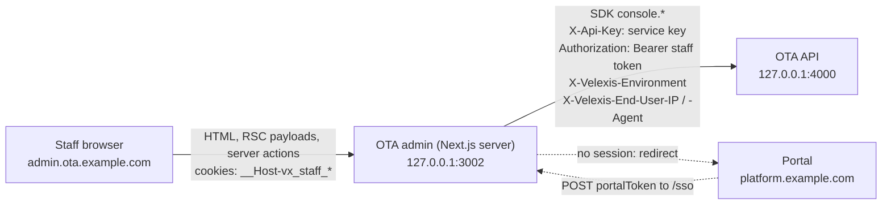

# OTA admin (`@velexis/ota-admin`)

This is the component specification of the OTA admin: the Next.js 15 (App Router, TypeScript) back office on `admin.ota.example.com` where an OTA's staff work their bookings, run Amadeus console tasks, capture and refund payments, look up customers and change markups, fees, storefront settings and e-mail templates. Staff arrive by single sign-on from the portal. The admin is a backend-for-frontend: **every booking and console function goes through the JS SDK's `console` namespace on the server**, with the first-party service key and the staff token from httpOnly cookies, so no token ever reaches browser JavaScript. This page covers sign-in and sessions, the route map, folder layout, data fetching, roles and permissions, components, security, configuration and tests. It follows [`decisions.md`](../../docs/mvp/decisions.md), [ADR-0008](../../docs/mvp/adr/0008-identity-accounts-customers-sessions.md) and [ADR-0014](../../docs/mvp/adr/0014-frontend-stack-nextjs-tailwind.md).

Related: [`docs/routes.md`](docs/routes.md) (every route: SDK calls, permissions, states), [`.env.example`](.env.example), [OADR-0018](../docs/adr/0018-ota-admin-consumes-the-sdk-server-side.md) (how the admin uses the SDK), [OADR-0011](../docs/adr/0011-console-access-staff-sessions-and-environments.md) (staff sessions, environments, permissions), [PADR-0007](../../platform/docs/adr/0007-portal-to-ota-admin-sso-token.md) (SSO token), [flow: console operations](../docs/flows/console-operations.md), [`../docs/api-changes-console-and-internal.md`](../docs/api-changes-console-and-internal.md) (settings and payments endpoints), [SDK](../sdk/README.md), [SDK guide B4](../../docs/velexis-sdk/sdk/docs/B4.md), [scope §2.3](../docs/scope.md#23-ota-admin-otaadmin), [conventions §3](../../docs/mvp/conventions.md#3-nextjs-apps-portal-platform-admin-ota-admin).

## 1. At a glance

| Item | Value |
|---|---|
| Package | `@velexis/ota-admin` (private) |
| Runtime | Node.js 22, Next.js 15 App Router, React 19, TypeScript strict, `output: "standalone"` |
| UI | Tailwind CSS 4, shadcn/ui (Radix), `lucide-react`, `@tanstack/react-table`; Zod for server-action input |
| API access | `@velexis/ota-sdk` on the server only (`import "server-only"`), server mode: `secretKey` = `OTA_ADMIN_SERVICE_KEY`, staff `accessToken`, `sessionKind: "staff"`, `environment` |
| Host and port | `admin.ota.example.com` → Caddy → `127.0.0.1:3002`; `http://localhost:3002` in development |
| Tenancy | Multi-tenant; a staff session is bound to one OTA, chosen in the portal before SSO |
| Sign-in | SSO only: portal token → `console.auth.signIn({ grantType: "portal_token" })`; no sign-in page of its own |
| Milestone | M4 (all routes below unless marked later); M5 live environment for live tenants |

## 2. How it works



- Pages are **React Server Components** that call the SDK during rendering. Mutations are **Server Actions**. Client components are leaves for interactivity (filters, dialogs, form state) and never import the SDK or session code ([conventions §3](../../docs/mvp/conventions.md#3-nextjs-apps-portal-platform-admin-ota-admin)).
- The OTA backend accepts the service key only on a direct loopback connection that did not come through Caddy (no `X-Forwarded-For` or `X-Forwarded-Host`; Caddy sets both on every proxied request), only on console operations, and only with a staff token of the same tenant ([OADR-0009](../docs/adr/0009-caller-and-tenant-resolution.md) rule 1.2, [OADR-0011](../docs/adr/0011-console-access-staff-sessions-and-environments.md)). The same key sent to `api.ota.example.com` or a storefront's `/api/*` is refused.
- Because every call comes from this server, the admin forwards the staff member's address on every SDK call: `X-Velexis-End-User-IP` is the right-most `X-Forwarded-For` entry of the incoming request (set by Caddy; `127.0.0.1` in local development) and `X-Velexis-End-User-Agent` is the browser's `User-Agent` cut to 512 characters. The backend honours them only for the service caller and uses them for the sign-in throttle, the lockout and `staff_actions`, so one staff member cannot exhaust a bucket shared by every OTA. So the admin can never call customer-scope operations such as `flights.search`; staff shopping uses the read-only `console.amadeus.*` calls.
- The backend enforces every permission and writes a `staff_actions` row for every call; the admin hides what a role cannot do, for clarity only.

## 3. Sign-in: SSO from the portal

```mermaid
sequenceDiagram
  autonumber
  actor S as Staff
  participant P as Portal
  participant A as OTA admin server
  participant O as OTA API
  S->>P: Open console (POST /otas/{tenantId}/console/launch)
  P-->>S: auto-submitting form, portalToken (60 s, single use)
  S->>A: POST /sso (form body: portalToken)
  A->>A: Origin must be PUBLIC_PORTAL_URL
  A->>O: console.auth.signIn({ grantType: "portal_token", portalToken })
  O-->>A: staff session: tokens, staff, tenant, permissions, environments
  A-->>S: Set-Cookie __Host-vx_staff_at, __Host-vx_staff_rt, __Host-vx_env; 303 See Other to /bookings
```

- **`POST /sso`** is a route handler. It accepts only `application/x-www-form-urlencoded` with `portalToken` matching `^ptk_[A-Za-z0-9]{24,64}$`, checks `Origin` against `PUBLIC_PORTAL_URL` (login-CSRF defence), calls the SDK, sets the cookies and answers `303 See Other` to `/bookings` (as architecture flow (c) and platform task PFE-019 expect). Errors (`401 PORTAL_TOKEN_INVALID`, `403 STAFF_MEMBERSHIP_INACTIVE`, `403 TENANT_SUSPENDED`) render a short page with "Back to the portal".
- **No session** (no cookies, or refresh refused): middleware redirects to `${PUBLIC_PORTAL_URL}/console?tenant=<tenantId>` when the tenant is known from the expired cookie, else `${PUBLIC_PORTAL_URL}/console` ([PADR-0007](../../platform/docs/adr/0007-portal-to-ota-admin-sso-token.md) §5).
- **Switch OTA**: the header's tenant menu links to the portal's console page; a new SSO replaces the session.
- **Sign out**: `POST /auth/sign-out` (route handler, Origin checked) calls `console.auth.signOut`, clears the cookies and shows `/signed-out` with a link back to the portal. "Sign out everywhere" belongs to the portal, which revokes staff sessions through `staffdeny:acct:*`.

## 4. Sessions, cookies and the environment

| Cookie | Content | Attributes | Lifetime |
|---|---|---|---|
| `__Host-vx_staff_at` | Staff access token (JWT) | `HttpOnly; Secure; SameSite=Lax; Path=/` | 15 min (token expiry) |
| `__Host-vx_staff_rt` | Staff refresh token (opaque, rotating) | same | Remaining family lifetime, at most 12 h ([OADR-0011](../docs/adr/0011-console-access-staff-sessions-and-environments.md)) |
| `__Host-vx_env` | `test` or `live` | same | 12 h |
| `__Host-vx_tenant` | Tenant id, for the "back to the portal" redirect only | same | 12 h |

`SameSite=Lax`, not `Strict`: the session starts from a cross-site POST, and the redirected first page load must carry the cookies. Server actions get Next.js's built-in Origin check; the two state-changing route handlers check `Origin` themselves.

**Refresh** ([OADR-0018](../docs/adr/0018-ota-admin-consumes-the-sdk-server-side.md)):

1. `middleware.ts` (Node.js runtime) runs on every non-static request. When the access token expires within 60 s and a refresh cookie exists, it calls `console.auth.refresh` and writes both cookies on the response.
2. Refreshes are **de-duplicated per refresh token** inside the admin process (an in-memory map of promises keyed by the token's SHA-256, kept 30 s), because parallel requests from one browser would otherwise present the same rotating token twice and the backend would revoke the family.
3. Server components never refresh: their SDK client gets the access token only. If a call still fails with `TOKEN_EXPIRED`, the page redirects to `/auth/refresh?next=<path>`, a route handler that refreshes (de-duplicated) and redirects back.
4. A refused refresh (`REFRESH_TOKEN_INVALID`, `REFRESH_TOKEN_REUSED`, `STAFF_MEMBERSHIP_INACTIVE`) clears the cookies and sends the user to the portal.

**Environment switch.** The header shows a TEST / LIVE switch when `session.environments` contains `live` (a live tenant and a role other than `viewer`). A server action validates the choice against the session and sets `__Host-vx_env`; every SDK client is built with that `environment`. The whole shell turns a warning colour in live mode, and destructive dialogs repeat "LIVE".

## 5. Route map

All routes are in the `(console)` route group with the signed-in shell, except the auth handlers. Per-route SDK calls, filters, actions and states are in [`docs/routes.md`](docs/routes.md).

| Route | Purpose | Main SDK calls | Permission |
|---|---|---|---|
| `POST /sso` · `/auth/refresh` · `POST /auth/sign-out` · `/signed-out` | SSO, refresh fallback, sign-out | `console.auth.signIn`, `.refresh`, `.signOut` | — |
| `/` | Dashboard: needs-attention counts (ticketing failed or manual review, deadlines within 24 h, pending reconciliation), authorised uncaptured payments, last queue snapshot, recent bookings | `console.auth.me`, `console.bookings.list` (`totalCount`), `console.payments.list`, `console.queues.listSnapshots` | `bookings:read` (+ `payments:read`, `queues:read` per tile) |
| `/bookings` | Bookings list: filters, sort, saved needs-attention views, cursor paging | `console.bookings.list` | `bookings:read` |
| `/bookings/[bookingId]` | Booking detail: overview, travellers and contacts, Amadeus order view, tickets and documents, payments, timeline and notes, recent staff actions | `console.bookings.get`, `.retrieve`, `console.payments.get` | `bookings:read` |
| ↳ actions | Patch travellers, contacts, remarks, ticketing agreement; issue; cancel with refund; resync; add note; capture; refund; airline-card bookings in manual review | `console.bookings.patch`, `.issue`, `.cancel`, `.resync`, `.addNote`; `console.payments.capture`, `.refund` | `bookings:write`, `bookings:issue`, `bookings:cancel`, `payments:capture`, `payments:refund` |
| `/pnr` | PNR lookup by record locator and import | `console.bookings.findByRecordLocator`, `.import` | `bookings:read`, `bookings:write` |
| `/queues`, `/queues/[queueId]` | Office queues and stored snapshots | `console.queues.list`, `.listSnapshots` | `queues:read` |
| `/shopping` | Flight search, availability, branded fares and price on behalf of a caller (net prices, read-only quote) | `console.amadeus.searchFlightOffers`, `.searchFlightAvailabilities`, `.upsellAirOffers`, `.quoteAirOffers` | `amadeus:read` |
| ↳ book on behalf | **Later**: `console.bookings.create` is deferred ([scope §3.4](../docs/scope.md#34-b4-console-32-27-mvp-5-deferred)) | — | — |
| `/payments`, `/payments/[paymentId]` | Payments list and detail, capture, refund | `console.payments.list`, `.get`, `.capture`, `.refund` | `payments:read`, `payments:capture`, `payments:refund` |
| `/customers`, `/customers/[customerId]` | Customers (search by e-mail or name), detail with statistics and bookings | `console.customers.list`, `.get`, `console.bookings.list({ customerId })` | `customers:read` |
| `/settings/markups`, `/settings/fees` (+ `/new`, `/[id]`) | Markup and fee rules | `console.settings.markupRules.*`, `.feeRules.*` | `settings:read`, `settings:write` |
| `/settings/storefront` | Branding and theme, features, policies (ticketing policy, 3-D Secure, card brands, TTLs, e-mail verification), airline card per environment, legal and support, SEO and consent, operations | `console.settings.storefront.get`, `.update`, `console.settings.assets.list` | `settings:read`, `settings:write` |
| `/settings/assets` | Logos, favicon, social image, page images | `console.settings.assets.list`, `.upload`, `.delete` | `settings:read`, `settings:write` |
| `/settings/pages`, `/settings/pages/[pageId]` | Content pages (Markdown subset) | `console.settings.pages.*` | `settings:read`, `settings:write` |
| `/settings/templates`, `/settings/templates/[key]/[channel]/[locale]` | Notification templates: edit, preview, reset | `console.settings.templates.*` | `settings:read`, `settings:write` |
| `/supplier-log` | Redacted Amadeus call log with filters | `console.supplierRequests.list` | `supplier_requests:read` |
| `/audit` | Tenant-wide staff actions | **Later** (needs a new `console.staffActions.list`); M4 shows each booking's `recentStaffActions` | — |
| `/portal` | Links back to the portal: API keys, domains, Amadeus, payments and Stripe, team, billing, go-live | none (links to `${PUBLIC_PORTAL_URL}/otas/<tenantId>/…`) | any |

## 6. Folder tree

```
ota/admin/
  next.config.ts                 standalone output, headers() with CSP nonces, serverActions.bodySizeLimit "2mb"
  middleware.ts                  Node runtime: session refresh, redirect to the portal, CSP nonce
  .env.example
  src/
    app/
      sso/route.ts               POST portal token → cookies
      auth/refresh/route.ts      GET refresh fallback
      auth/sign-out/route.ts     POST sign-out
      signed-out/page.tsx
      (console)/layout.tsx       shell: tenant, environment switch, navigation by permission
      (console)/page.tsx         dashboard
      (console)/bookings/…       page.tsx, [bookingId]/page.tsx, [bookingId]/actions.ts, *-form.tsx, *-dialog.tsx
      (console)/pnr/…  queues/…  shopping/…  payments/…  customers/…  supplier-log/…  portal/…
      (console)/settings/        markups/ fees/ storefront/ assets/ pages/ templates/
      (console)/error.tsx        per-area error boundaries using lib/errors.ts
    components/ui/               shadcn/ui copies
    components/                  data-table, status-badge, money, json-view, confirm-dialog, env-banner, permission-gate
    lib/velexis.ts               server-only: console client per request (service key, token, environment)
    lib/session.ts               server-only: cookies, refresh with de-duplication, requireStaff()
    lib/permissions.ts           permission constants, can(profile, permission)
    lib/errors.ts                VelexisError code → message, fieldErrors → form state
    lib/action-state.ts          ActionState type and helpers for useActionState
    lib/portal-links.ts          portal URLs for the tenant
  test/                          Vitest + Testing Library
```

## 7. Data fetching and mutations

```ts
// src/lib/velexis.ts (server only)
import "server-only";
import { cache } from "react";
import { createVelexisClient } from "@velexis/ota-sdk";

export const getConsole = cache(async () => {
  const s = await readSession();                          // cookies; throws a redirect to the portal when absent
  return createVelexisClient({
    secretKey: config.otaAdminServiceKey,                 // OTA_ADMIN_SERVICE_KEY
    baseUrl: config.otaApiUrl,                            // http://127.0.0.1:4000
    accessToken: s.accessToken,                           // no refreshToken here (§4)
    sessionKind: "staff",
    environment: s.environment,                           // "test" | "live"
    headers: await endUserHeaders(),                      // X-Velexis-End-User-IP / -Agent from next/headers (§2)
  }).console;
});

export const getStaff = cache(async () => (await getConsole()).auth.me());   // once per request
```

- **Reads** happen in server components with `await getConsole()`. Every console call is personal and priced, so nothing is cached across requests (`cache: "no-store"` is the SDK default for console calls). List pages keep filters, sort and the cursor in `searchParams`, so views are shareable links.
- **Mutations** are server actions:

```ts
// src/app/(console)/bookings/[bookingId]/actions.ts
"use server";
export async function issueTickets(_: ActionState, form: FormData): Promise<ActionState> {
  const { console: con } = await requireStaff("bookings:issue");   // local check for a clear message; the API decides
  const input = IssueSchema.safeParse(Object.fromEntries(form));    // bookingId, version, reason, actionKey
  if (!input.success) return fromZod(input.error);
  try {
    await con.bookings.issue(
      { bookingId: input.data.bookingId, ifMatch: input.data.version, reason: input.data.reason },
      { idempotencyKey: input.data.actionKey },                     // rendered once per dialog: a double click replays
    );
  } catch (e) {
    return fromVelexisError(e);                                     // PRECONDITION_FAILED → "reload", fieldErrors → fields
  }
  revalidatePath(`/bookings/${input.data.bookingId}`);
  return { ok: true, message: "Tickets issued" };
}
```

- Updates send `ifMatch` = the `version` the page displayed; `412 PRECONDITION_FAILED` asks the user to reload.
- State-changing calls carry an idempotency key generated when the dialog or form is rendered (a hidden input), so a double submit or a retry replays the same action.
- Long operations (issue, cancel, import, retrieve) use the SDK's 60 s timeout; the button shows progress with `useFormStatus`.
- Server actions run where cookies can be written, so they may pass the refresh token to the SDK with `onStaffSessionRefreshed` writing the cookies back (through the same de-duplication).

## 8. Roles and permissions

The roles and permission matrix are those of [scope §1.3](../docs/scope.md#13-staff-roles-and-permissions); permissions come from `console.auth.me` once per request.

| Role | What the admin shows |
|---|---|
| owner, admin | Everything, including settings writes and `allowUnpaid` issuance |
| agent | Bookings, PNR, queues, shopping, customers, supplier log, payments capture; settings read-only; no refunds |
| finance | Read access, payments capture and refund, supplier log; no booking changes |
| viewer | Read-only; test environment only (no LIVE switch) |

- Navigation items and action buttons are hidden or disabled (with a tooltip naming the permission) when `can(profile, permission)` is false.
- Every server action starts with `requireStaff(permission)`, so a forged POST fails before the API call; the API still decides (`403 FORBIDDEN` with `details.requiredPermission` is shown as "You do not have permission").
- Role changes apply at the next refresh (within 15 minutes; immediately for removed members through the backend's deny checks).

## 9. Components and UI

- **shadcn/ui** copies in `src/components/ui/`: button, input, textarea, select, checkbox, switch, tabs, table, dialog, alert-dialog, sheet, badge, card, tooltip, dropdown-menu, form helpers. No toast library: results are shown inline from the action state.
- **Data tables** on TanStack Table with server-side filtering and cursor paging ("Next" uses `page.nextCursor`; `totalCount` shown when the API gives it).
- **Status badges** for booking, ticketing, payment and sync states, always with text.
- **Confirmation dialogs** for issue, cancel, capture, refund, import and settings deletes: a summary of the effect (amount, refund mode, environment), a required reason, and the live-mode warning.
- **JSON view** for the Amadeus order and supplier requests: collapsible `<details>` with a `<pre>` of the already-redacted payload; no third-party viewer.
- **Template preview** in an `<iframe sandbox srcdoc>` without `allow-scripts` ([api-changes part 2 §2.6](../docs/api-changes-console-and-internal.md#26-notification-templates-notification_templates)).
- **Theme editor** shows a live swatch preview and warns when a colour pair fails WCAG contrast (the storefront then falls back, see [storefront theming](../frontend/README.md#6-theming)).
- Forms follow [conventions §3](../../docs/mvp/conventions.md#3-nextjs-apps-portal-platform-admin-ota-admin): visible labels, errors linked with `aria-describedby`, Zod on the server and the same schema on the client for instant feedback.

## 10. Security

- **No tokens in the browser.** Tokens live only in `__Host-` httpOnly cookies set by the admin's server; `lib/velexis.ts` and `lib/session.ts` import `server-only`; no `NEXT_PUBLIC_` variable exists in this app.
- **No card numbers in the admin.** The admin never offers a credit-card form of payment: an airline-card booking left without tickets is issued with an `other` form of payment (the OTA's own arrangement) or cancelled ([OADR-0018](../docs/adr/0018-ota-admin-consumes-the-sdk-server-side.md), [OADR-0004](../docs/adr/0004-airline-card-data-handling.md)). Airline-card payments cannot be refunded here (`refund_via_airline`).
- **Headers** from `next.config` and middleware: CSP with per-request nonces, `frame-ancestors 'none'`, `Referrer-Policy: strict-origin-when-cross-origin` ([ADR-0014](../../docs/mvp/adr/0014-frontend-stack-nextjs-tailwind.md)); Caddy adds HSTS and `X-Frame-Options`.
- **Uploads**: asset uploads go through a server action (2 MB body limit; the API refuses files over 1 MB, SVG and CSS); the admin warns that image metadata is kept ([OADR-0012](../docs/adr/0012-storefront-settings-assets-and-pages.md)).
- **Errors** show messages from `lib/errors.ts` keyed by code, plus the `requestId`; never stack traces. Supplier details (console scope) are shown to staff as the API returns them, already redacted.
- **Logging**: the server logs one line per SDK response through `onResponse` (method, path without query, status, request id, duration) with `@velexis/logger`; never bodies, cookies or tokens.

## 11. Configuration

The variables match [`deploy/env/ota-admin.env.example`](../../deploy/env/ota-admin.env.example) and the [configuration matrix](../../docs/mvp/architecture.md#6-configuration-matrix); local values are in [`.env.example`](.env.example). They are read through `@velexis/config` in `src/config.ts`.

| Variable | Example | Use |
|---|---|---|
| `APP_ENV`, `LOG_LEVEL`, `PORT` | `production`, `info`, `3002` | Runtime |
| `PUBLIC_OTA_ADMIN_URL` | `https://admin.ota.example.com` | Absolute links, Origin checks |
| `PUBLIC_PORTAL_URL` | `https://platform.example.com` | SSO Origin check, redirects and portal links |
| `OTA_API_URL` | `http://127.0.0.1:4000` | SDK `baseUrl`: a direct loopback connection, never a Caddy host, so the service key is accepted |
| `OTA_ADMIN_SERVICE_KEY` | file-provided secret | SDK `secretKey` |
| `SENTRY_DSN` | empty | Optional error tracking ([ADR-0016](../../docs/mvp/adr/0016-observability.md)) |

## 12. Local development and tests

```bash
pnpm --filter @velexis/ota-backend dev        # OTA API on 4000 (with the platform and OTA dev:seed done)
pnpm --filter @velexis/platform-frontend dev  # portal on 3000: sign in, pick the demo OTA, "Open console"
pnpm --filter @velexis/ota-admin dev          # http://localhost:3002
```

`__Host-` cookies work on `http://localhost` in Chromium and Firefox. The portal's hand-off form posts to `PUBLIC_OTA_ADMIN_URL/sso`, so both apps must use the local URLs of the root `.env.example`.

| Level | Where | What |
|---|---|---|
| Unit | `src/lib/*.test.ts` (Vitest) | Session cookie parsing, refresh de-duplication (two parallel refreshes → one SDK call), `can()` against the scope matrix, error mapping, portal links |
| Component | `src/**/*.test.tsx` (Vitest + Testing Library) | Filters to `searchParams`, confirmation dialogs (reason required, live warning), forms rendering `fieldErrors`, permission gating |
| Server actions | `src/app/**/actions.test.ts` | With the SDK's `fetch` option pointing at a fake: right method and parameters, `ifMatch`, idempotency key reuse, error → action state |
| End to end | `tools/e2e/specs/ota-admin/*.e2e.ts` (Playwright + axe) | Portal → Open console → dashboard; bookings list → detail → issue and cancel with refund on stub bookings; PNR import; capture and refund in Stripe test mode; markup change visible in the next storefront search; viewer role sees no actions and no LIVE switch; SSO token reuse refused |

Build: `pnpm --filter @velexis/ota-admin build` produces `.next/standalone/ota/admin/server.js` (`outputFileTracingRoot` is the repository root, as `deploy/scripts/pack-release.sh` expects), run by the `velexis-ota-admin` systemd unit on `127.0.0.1:3002` ([deployment](../../docs/mvp/deployment-single-vm.md)).
