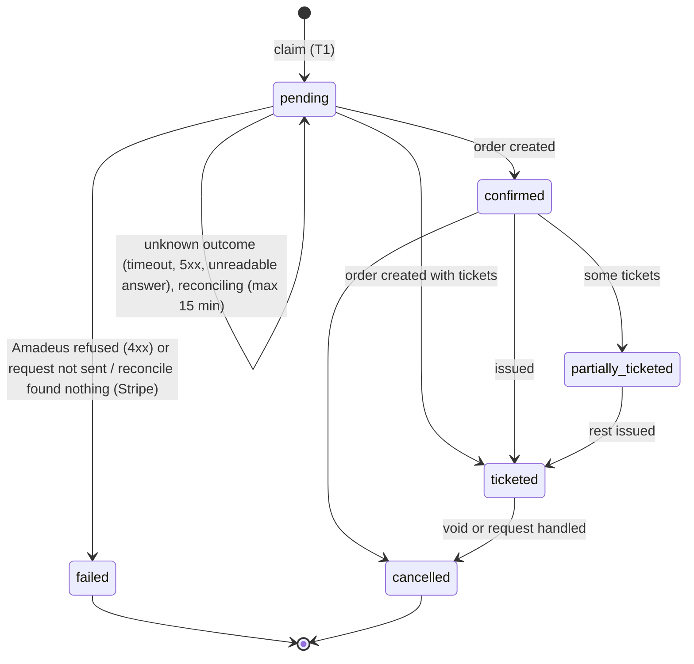
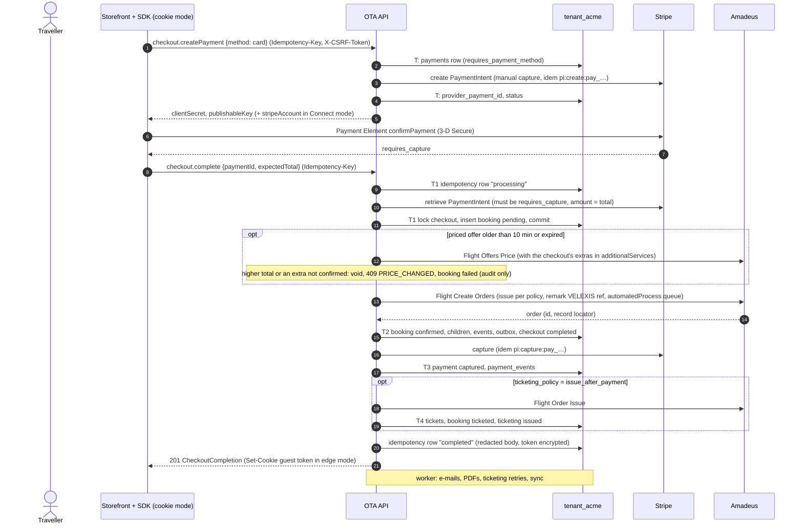
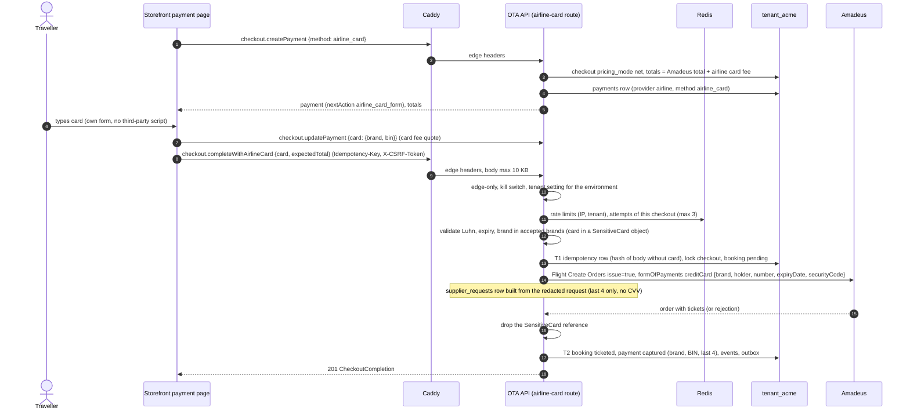
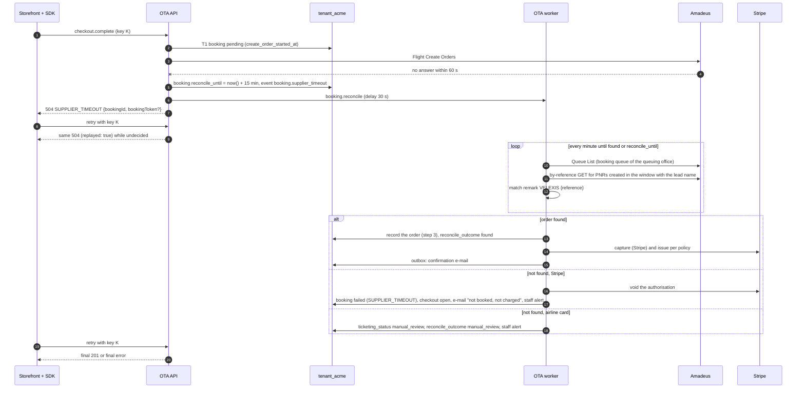

# Booking orchestration

This document describes how the OTA backend turns a paid checkout into an Amadeus order and tickets, for both payment methods: Stripe on the hosted storefront and the card passed to the airline through Amadeus. It shows the two booking sequences, the recovery when Amadeus does not answer in time (`SUPPLIER_TIMEOUT`), and how idempotency makes retries safe from the browser to Amadeus and Stripe. The contract's `checkout.complete` description in the [OpenAPI document](../../docs/velexis-sdk/openapi/velexis-ota-booking-api.openapi.yaml) stays the reference for request and response details; this page fixes how the backend implements it.

Related: [`architecture.md`](architecture.md), [OADR-0003](adr/0003-booking-orchestration-and-supplier-timeout-recovery.md) (orchestration and recovery), [OADR-0004](adr/0004-airline-card-data-handling.md) (airline card), [OADR-0008](adr/0008-ticketing-policy.md) (ticketing), [OADR-0010](adr/0010-stripe-gateway-and-payment-webhooks.md) (Stripe), detailed flows [`flows/checkout-stripe.md`](flows/checkout-stripe.md) and [`flows/checkout-airline-card.md`](flows/checkout-airline-card.md), [MVP architecture flow (b)](../../docs/mvp/architecture.md#b-storefront-search--price--checkout--payment--order-and-issue--confirmation).

## 1. The orchestration in five steps

Every booking, whatever the payment method, goes through the same steps in `bookings/booking-orchestrator.service.ts`. No database transaction stays open across an Amadeus or Stripe call.

| Step | Transaction | Does |
|---|---|---|
| 1. **Claim** | T1 | Lock the checkout (`SELECT … FOR UPDATE`), check status, expiry, completeness and payment state, then insert the `bookings` row with `status = pending`, a new `reference`, `create_order_started_at = now()` and the amounts copied from the checkout. `bookings.checkout_id` is `UNIQUE`, so a second claim for the same checkout fails: Flight Create Orders runs **at most once per checkout**. Commit. |
| 2. **Call** | none | Flight Offers Price when a re-price is needed, then Flight Create Orders. The remark `VELEXIS <reference>` goes into `remarks.general`, and the order is queued to the tenant's booking queue (`automatedProcess`) so it can be found again ([OADR-0003](adr/0003-booking-orchestration-and-supplier-timeout-recovery.md)). |
| 3. **Record** | T2 | Store the order: `bookings` (`confirmed`, or `ticketed` if tickets came back), children, redacted `order_snapshot`, `booking_events`, guest token, checkout `completed`, notification outbox rows. Commit. |
| 4. **Money** | none + T3 | Stripe: capture the authorisation (`issue_at_booking`, `issue_after_payment`). Airline card: nothing to do, the airline charges the card. |
| 5. **Issue** | none + T4 | `issue_after_payment`: Flight Order Issue, then store tickets. A failure leaves the booking `confirmed` with `ticketing_status = failed` and the ticketing job retries ([OADR-0008](adr/0008-ticketing-policy.md)). |

## 2. Stripe booking (`checkout.complete`)

Failure outcomes, as the contract fixes them:

| Situation | Booking | Payment | Checkout | Answer |
|---|---|---|---|---|
| Payment not authorised | none | unchanged | open | `402 PAYMENT_REQUIRED` / `PAYMENT_DECLINED` |
| Re-price is higher, or an extra is no longer confirmed | `failed` (console only) | voided | moved to the new priced offer, extras and totals | `409 PRICE_CHANGED` |
| Amadeus rejects (a `4xx`: sold out, data) | `failed` | voided | open | `409 SOLD_OUT`, `422 TRAVELER_DATA_INVALID`, `502 SUPPLIER_ERROR` |
| The request never reached the order (token, rate limits, a connection never made, an Amadeus `401`, `403` or `429` without a business code) | `failed` | unchanged (authorised) | `payment_pending` | The error, e.g. `503 SUPPLIER_UNAVAILABLE` ([OADR-0003](adr/0003-booking-orchestration-and-supplier-timeout-recovery.md) point 9) |
| Capture fails after the order exists | `confirmed`, `ticketing_status = manual_review` | `authorized`, `payment.capture_retry` queued, staff alerted | completed | `201` with a warning |
| Issue fails | `confirmed`, `ticketing_status = failed` | captured | completed | `201`, ticketing job retries |
| Amadeus timeout, `5xx` or unreadable answer on create | `pending`, reconciling | unchanged | `payment_pending`, locked | `504 SUPPLIER_TIMEOUT` (§4) |
| A checkout step while the booking is `pending` | unchanged | unchanged | unchanged | `409 CHECKOUT_BEING_COMPLETED` |

## 3. Airline-card booking (`checkout.completeWithAirlineCard`)

The card is in the request body, lives only in memory, and is used once: the order is created with `issue = true`, so the card is never needed again ([ADR-0011](../../docs/mvp/adr/0011-payments-stripe-and-airline-card.md), [OADR-0004](adr/0004-airline-card-data-handling.md)).

Differences from the Stripe path:

| Topic | Stripe | Airline card |
|---|---|---|
| Who charges | Velexis or the OTA through Stripe | The validating airline, through Amadeus |
| Amount | Selling total (net + markup + fees + card fee) | Amadeus total + Amadeus card fee; `pricing_mode = net` |
| 3-D Secure | Stripe | None in the MVP |
| Issue flag | Per ticketing policy | Always `issue = true` |
| A decline | Stripe error before completion | Amadeus payment error → `402 PAYMENT_DECLINED`, booking `failed`, attempt counted |
| Timeout, `5xx` or unreadable answer | Reconcile, then void if not found | Reconcile, then **manual review** if not found (the card may have been charged) |
| Refund | Stripe refund by the console | Done by the airline when the ticket is voided or refunded |

## 4. `SUPPLIER_TIMEOUT` recovery

A timeout or network error **after** the create-order request was sent means "the order may exist", and so does every other answer that does not prove a refusal: an Amadeus `5xx` (500, 502, 503, 504) or an answer that cannot be read. Only an Amadeus `4xx` business refusal fails the booking with its authorisation voided; a request that never reached the order fails the booking and keeps the authorisation ([OADR-0003](adr/0003-booking-orchestration-and-supplier-timeout-recovery.md) point 9). The backend never sends Flight Create Orders again for that checkout, and while the booking is `pending` the checkout cannot change: its set steps, `checkout.createPayment` and `checkout.updatePayment` answer `409 CHECKOUT_BEING_COMPLETED` (`details.bookingId`), and the checkout expiry leaves its authorisation to the reconciliation (OADR-0003 point 10).

Rules:

- The window and the cadence: first check after 30 s, then every minute, for 15 minutes. Each check costs one Queue List and at most three by-reference calls.
- A PNR matches only if it carries the remark `VELEXIS <reference>`; a name match alone is never enough.
- If the tenant has no booking queue configured, the order cannot be searched for: Stripe bookings are voided after 15 minutes and staff are told to check the office by hand (they can still import the PNR from the console).
- Other operations that may have happened on a timeout: **issue** (resync with Flight Order Management before any retry), **cancel** (GET the order within 15 minutes, then apply the money step once), **patch** (resync, then let the caller retry with `If-Match`).

## 5. Idempotency end to end

### 5.1 The interceptor

State-changing POSTs that call Amadeus or Stripe require `Idempotency-Key` (contract). The interceptor stores records in `idempotency_keys` of the tenant schema:

1. **Scope** = `<environment>:<principal>:<operationId>`. Principal: `cus_…` for customers, `key_…` for API keys, `stf_…` for staff, and `edge-<first 16 hex of sha256(csrf cookie)>` for anonymous storefront visitors.
2. **Insert** `processing` with `request_hash` and `locked_until` in its own short transaction. A unique violation means the key was seen:
   - different `request_hash` → `409 IDEMPOTENCY_KEY_REUSED`;
   - `completed` (or `failed`, a stored final error) → replay the stored status and body (from `response_ciphertext` when it carries a token);
   - `processing` → wait up to 60 s for completion, then replay or answer `409 CONFLICT`. A record whose lease (`locked_until`, 2 minutes, longer than any handler) ran out belongs to a process that died: the waiting request takes it over and runs.
3. **Store the outcome**: success and final business errors (`4xx`, and `504` linked to a reconciling booking) are kept for 24 hours; transient errors (`503`, `502 PAYMENT_PROVIDER_ERROR` before any provider effect, and also `429` and every other `5xx`) delete the record, so the same key can be retried.
4. **Airline-card route**: `request_hash` is computed on the body with the `card` object replaced by `{brand, last4}`. No hash of a card number is ever stored: on every route, card and identity document data enter the hash only as the shared redactor keeps them (numbers by their last 4), and a request whose hashed input carries a password is refused until its operation has a `hashInput` hook that leaves the password out.
5. **Storage**: `response_body` always holds the copy after the shared redactor. An answer that carries a token, a cookie or unmasked data is also stored verbatim in `response_ciphertext` (ADR-0010, associated data `tenant_<key>.idempotency_keys.response_ciphertext:<idk_…>`), and its replays come from there.

The interceptor runs after the guards and the validation interceptor, so an invalid request writes no record. Per-operation hooks (`hashInput` for point 4, `resourceOf` and `resolveReplay` for §5.2) come from providers marked `@IdempotencyHooksFor` ([`../backend/README.md`](../backend/README.md) §2).

### 5.2 Replay after a reconciliation

For `checkout.complete`, `checkout.completeWithAirlineCard` and `bookings.cancel`, a stored `504` is not final. On replay the interceptor reads the linked booking (`resource_id`): still `pending` with `reconcile_until` in the future → the same `504`; decided → the final `201` built from the booking, or the final error.

### 5.3 Downstream keys

| Call | Idempotency |
|---|---|
| Stripe create PaymentIntent | `Idempotency-Key: pi:create:<pay_id>` |
| Stripe capture, cancel | `pi:capture:<pay_id>:<amount>`, `pi:cancel:<pay_id>` |
| Stripe refund | `refund:<rfd_id>` |
| Amadeus Flight Create Orders | Not idempotent: at most once per checkout (claim), reconciled on an unknown outcome (timeout, `5xx`, unreadable answer) |
| Amadeus Flight Order Issue | Booking state lock + resync before retry; never two issue calls in flight |
| Amadeus PATCH, DELETE | `If-Match` on the booking; Amadeus 2552 → `409 VERSION_CONFLICT` |
| Amadeus reads, token | Retried once on timeout or `5xx` |
