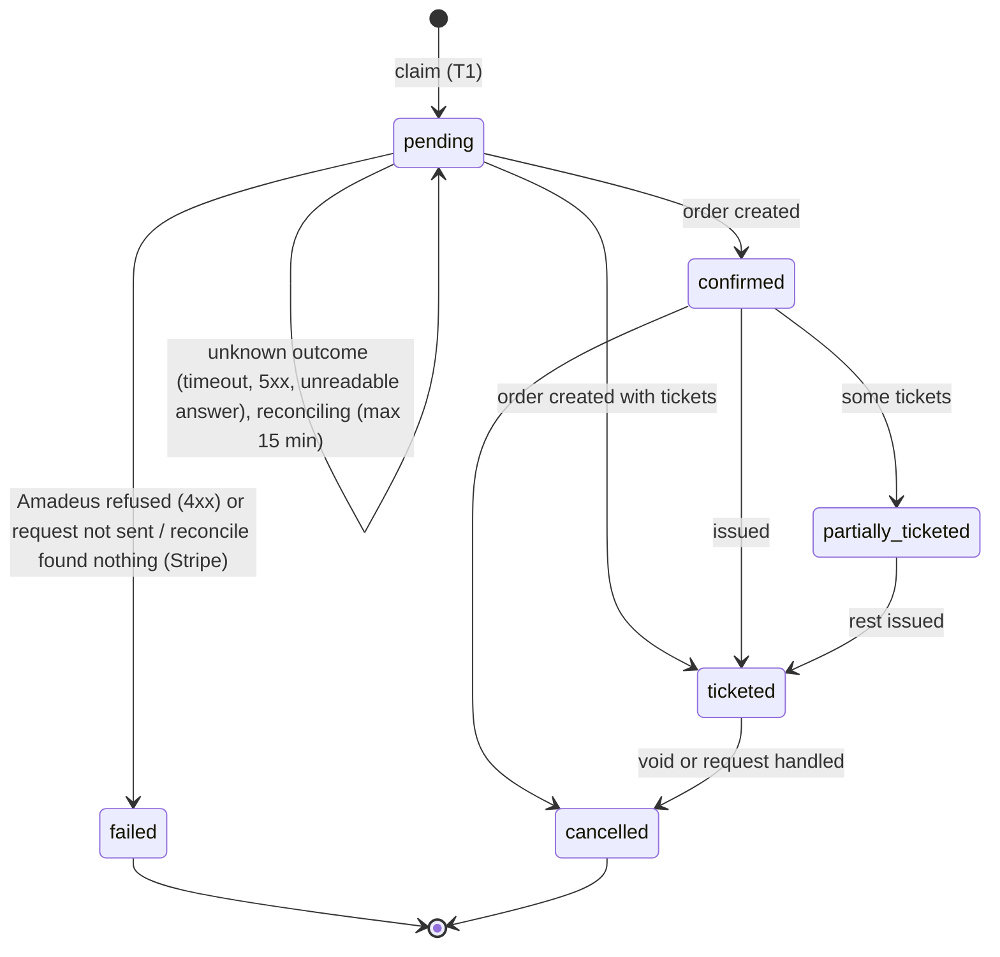
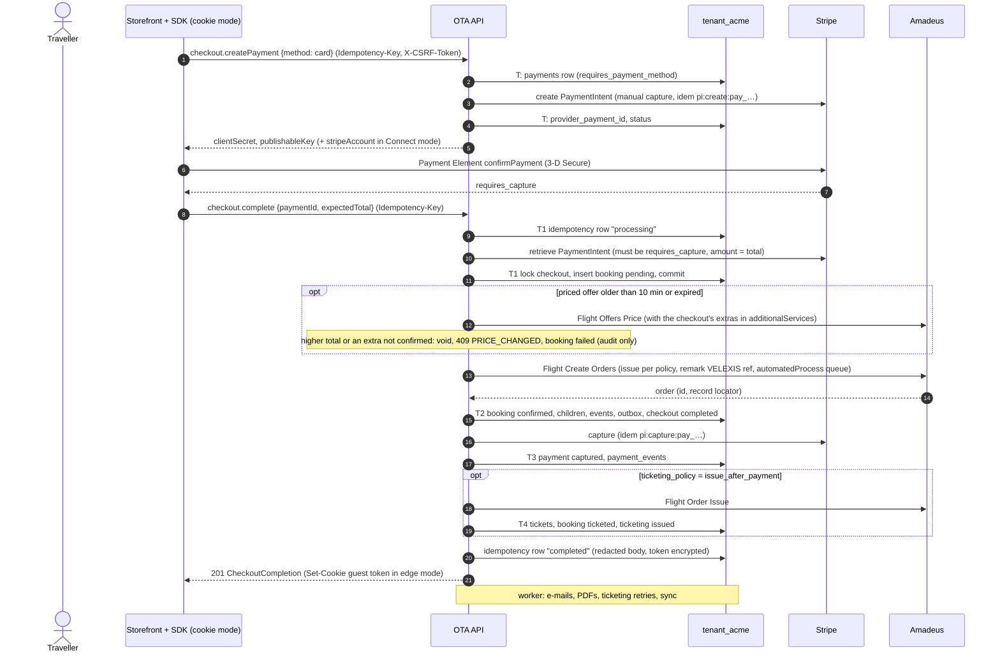
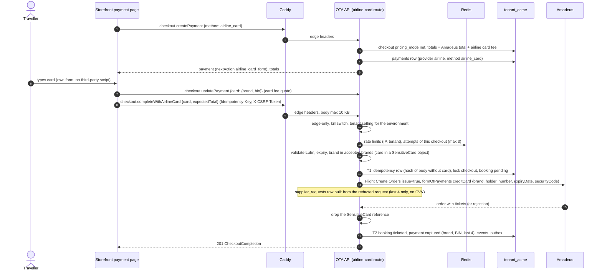
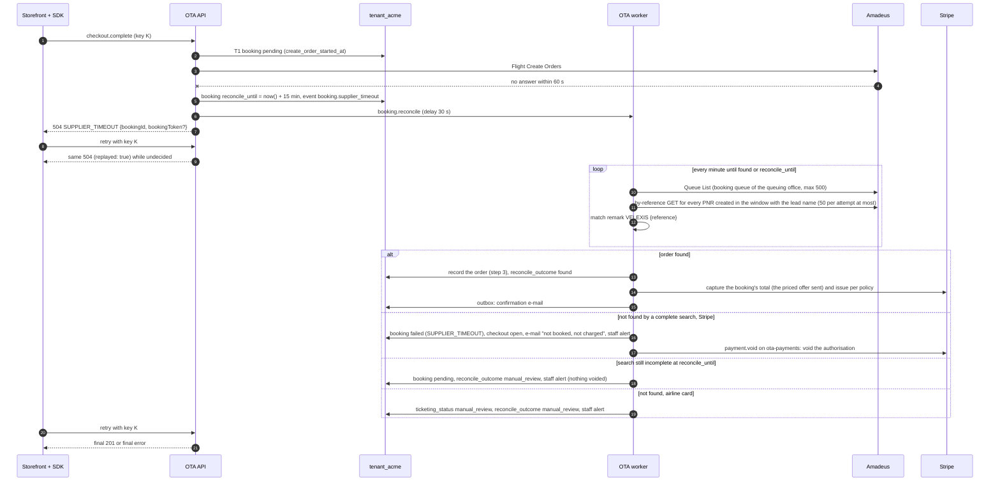

# Booking orchestration

This document describes how the OTA backend turns a paid checkout into an Amadeus order and tickets, for both payment methods: Stripe on the hosted storefront and the card passed to the airline through Amadeus. It shows the two booking sequences, the recovery when Amadeus does not answer in time (`SUPPLIER_TIMEOUT`), and how idempotency makes retries safe from the browser to Amadeus and Stripe. The contract's `checkout.complete` description in the [OpenAPI document](../../docs/velexis-sdk/openapi/velexis-ota-booking-api.openapi.yaml) stays the reference for request and response details; this page fixes how the backend implements it.

Related: [`architecture.md`](architecture.md), [OADR-0003](adr/0003-booking-orchestration-and-supplier-timeout-recovery.md) (orchestration and recovery), [OADR-0004](adr/0004-airline-card-data-handling.md) (airline card), [OADR-0008](adr/0008-ticketing-policy.md) (ticketing), [OADR-0010](adr/0010-stripe-gateway-and-payment-webhooks.md) (Stripe), detailed flows [`flows/checkout-stripe.md`](flows/checkout-stripe.md) and [`flows/checkout-airline-card.md`](flows/checkout-airline-card.md), [MVP architecture flow (b)](../../docs/mvp/architecture.md#b-storefront-search--price--checkout--payment--order-and-issue--confirmation).

## 1. The orchestration in five steps

Every booking, whatever the payment method, goes through the same steps in `bookings/booking-orchestrator.service.ts`. No database transaction stays open across an Amadeus or Stripe call, and a transaction that locks several of a checkout, a booking, a payment and a refund locks them in that order: the **checkout, then the booking, then the payment, then the refund** ([OADR-0003](adr/0003-booking-orchestration-and-supplier-timeout-recovery.md) point 11, lead decisions of 2026-10-21, §1.1). A foreign-key lock counts as a lock of the parent: a transaction that only writes a row referencing a booking or a payment (an outbox alert, a booking or payment event, a refund) takes that parent's `FOR KEY SHARE` in the parent's place in the order, as the row's foreign key takes it anyway.

| Step | Transaction | Does |
|---|---|---|
| 1. **Claim** | T1 | Lock the checkout (`SELECT … FOR UPDATE`), check status, expiry, completeness and payment state, then insert the `bookings` row with `status = pending`, a new `reference`, `create_order_started_at = now()` and the amounts copied from the checkout. `bookings.checkout_id` is `UNIQUE`, so a second claim for the same checkout fails: Flight Create Orders runs **at most once per checkout**. Commit. |
| 2. **Call** | none + T1b | Flight Offers Price when a re-price is needed; then, under the booking's lock (T1b, `recordSending`), the booking must still be `pending` and undecided, and it records what is sent: `issue_requested` and, after an accepted re-price, the priced offer sent with its amounts (lead decision of 2026-10-21, third batch: a process that dies after the send leaves a booking that is captured for the order's total). Then Flight Create Orders. The remark `VELEXIS <reference>` goes into `remarks.general`, and the order is queued to the tenant's booking queue (`automatedProcess`) so it can be found again ([OADR-0003](adr/0003-booking-orchestration-and-supplier-timeout-recovery.md)). |
| 3. **Record** | T2 | Store the order: `bookings` (`confirmed`, or `ticketed` if tickets came back), children, redacted `order_snapshot`, `booking_events`, guest token, checkout `completed`, notification outbox rows. Commit. |
| 4. **Money** | none + T3 | Stripe: capture the authorisation (`issue_at_booking`, `issue_after_payment`). Airline card: nothing to do, the airline charges the card. |
| 5. **Issue** | none + T4 | `issue_after_payment`: Flight Order Issue, then store tickets. A failure leaves the booking `confirmed` with `ticketing_status = failed` and the ticketing job retries ([OADR-0008](adr/0008-ticketing-policy.md)). |

### 1.1 Lock order

The order is the checkout, then the booking, then the payment, then the refund ([OADR-0003](adr/0003-booking-orchestration-and-supplier-timeout-recovery.md) point 11). Two transactions that follow it never wait for each other in a circle, so PostgreSQL never aborts one of them as a deadlock. A foreign-key lock counts as a lock of the parent ("key share": the `FOR KEY SHARE` an insert takes on the row its foreign key references), and a row a transaction inserted itself is its own from the insert (no other transaction can lock it before the commit). The transactions of the money path, each lock in order (FIX-W25-BOOKINGS checked every one, FIX-W26-BOOKINGS added the claims of the ticketing job and the booking documents' write; tables not in the order, such as `priced_offers`, `customers` and the child tables, are left out):

| Transaction | Locks, in order |
|---|---|
| checkout.complete T1, the claim | checkout `FOR UPDATE` → an existing booking of the checkout `FOR UPDATE` → payment `FOR UPDATE` (its event: key share) → the new booking (inserted; the payment's `booking_id` and the claim's event reference it) |
| checkout.complete T1b, what is sent (`recordSending`) | booking `FOR UPDATE` |
| checkout.complete T2, the record step | checkout `FOR UPDATE` → booking `FOR UPDATE` (children, events, the confirmation's outbox row: key share) → the checkout's extras and the checkout updated |
| checkout.complete, the unknown outcome | checkout `FOR UPDATE` → booking `FOR UPDATE` (event: key share) |
| checkout.complete, the failure (`failBooking`) | checkout `FOR UPDATE` (after a void) → booking `FOR UPDATE` → payment `FOR UPDATE` (after a void; its event: key share) |
| checkout.complete, the capture and the failed capture | booking `FOR UPDATE` → payment `FOR UPDATE` (events, the alert: key share) |
| checkout.complete, the issue (two transactions) | booking `FOR UPDATE` |
| checkout.completeWithAirlineCard T1b, what is sent (`recordSending`, OBE-051) | booking `FOR UPDATE` → payment `FOR UPDATE` (`processing` with the card's brand, BIN and last 4; its event: key share) |
| checkout.completeWithAirlineCard T2, the record step and the airline's charge (OBE-051) | checkout `FOR UPDATE` → booking `FOR UPDATE` (children, events, outbox, the staff alert of an order without every ticket: key share) → payment `FOR UPDATE` (`settleAirlineCardOrder`, its event: key share) → the checkout updated |
| checkout.completeWithAirlineCard, a refusal, a decline, a request not sent, a higher re-price (`failBooking`, OBE-051) | checkout `FOR UPDATE` (a re-price only, which moves it) → booking `FOR UPDATE` (event: key share) → payment `FOR UPDATE` (`failed`, or awaiting the card again; its event: key share) |
| checkout.completeWithAirlineCard, the abuse alerts of a decline (OBE-051) | booking key share (the outbox rows) |
| guest token of a booking | booking key share |
| `bookings.reconcile_scan`, the adoption | bookings `FOR NO KEY UPDATE SKIP LOCKED` (events: key share; before FIX-W26-BOOKINGS `FOR UPDATE SKIP LOCKED`) |
| `booking.reconcile`, the claim | booking `FOR NO KEY UPDATE SKIP LOCKED` (before FIX-W26-BOOKINGS `FOR UPDATE SKIP LOCKED`) |
| `booking.reconcile`, found | checkout `FOR UPDATE` → booking `FOR UPDATE` (children, events, outbox: key share) → checkout updated |
| `booking.reconcile`, the capture and the failed capture | booking `FOR UPDATE` → payment `FOR UPDATE` (events, the alert: key share) |
| `booking.reconcile`, not found | checkout `FOR UPDATE` → booking `FOR UPDATE` → payments `FOR UPDATE` (events, outbox: key share) → checkout updated (before FIX-W25-BOOKINGS: booking, payments, then checkout) |
| `booking.reconcile`, found, an airline-card booking (OBE-051) | checkout `FOR UPDATE` → booking `FOR UPDATE` (children, events, outbox: key share) → payment `FOR UPDATE` (`settleAirlineCardOrder`, its event: key share) → checkout updated |
| `booking.reconcile`, not found, an airline-card booking (OBE-051: the staff's review, never a failure) | checkout `FOR UPDATE` → booking `FOR UPDATE` → payments `FOR UPDATE` (event, outbox: key share) |
| `booking.reconcile`, the manual review and the staff alerts | booking `FOR UPDATE` (event, outbox: key share), or booking key share alone |
| `booking.reconcile`, a retry after the deadline (FIX-W26-BOOKINGS) | booking `FOR UPDATE` (event: key share) |
| `ticketing.issue` and the reconciliation's inline issuance, the claim | booking `FOR NO KEY UPDATE SKIP LOCKED` (before FIX-W26-BOOKINGS `FOR UPDATE SKIP LOCKED`) |
| `ticketing.issue`, the result (tickets, a failure, giving up) | booking `FOR UPDATE` (tickets, events, outbox: key share) |
| `booking.sync`, the claim (FIX-W27-SYNC) | booking `FOR NO KEY UPDATE SKIP LOCKED`, then `sync_claimed_at` written (no event, no key column) |
| A refresh (bookings.get, getTicketingStatus, getFareRules, console.bookings.get with `refresh=true`, console.bookings.resync), the claim | booking `FOR UPDATE`, then `sync_claimed_at` written |
| `booking.sync` and the refreshes, the record (`BookingSyncService`, one diff for every path) | booking `FOR NO KEY UPDATE` (tickets, segments, records, events, outbox, the staff alert of an airline cancellation: key share; the payments only read) |
| `booking.reconcile`, the alert of a booking queue that is nearly full (FIX-W27-SYNC) | none (an outbox row without a booking) |
| `document.render`, the write (T2) and the failed row | the booking's documents advisory lock (`pg_advisory_xact_lock(hashtext('velexis.booking_documents'), hashtext(<bkg_…>))`) → booking key share (the version read `FOR KEY SHARE`; the row's foreign keys: the booking's and the ticket's key share) → the document's `booking_documents` rows (inserted, superseded); never `FOR UPDATE` on the booking |
| bookings.cancel, the claim (and the request of `request_only`) (OBE-049) | booking `FOR NO KEY UPDATE SKIP LOCKED` (a booking another claim or writer holds: `503`, nothing written; event, outbox: key share) |
| bookings.cancel and `booking.cancellation_check`, the record step and the money step | booking `FOR NO KEY UPDATE` (children, events, outbox: key share) → payment `FOR UPDATE` (`RefundsRepository.create`, its event: key share) → the new refund; an airline card's payment event: payment key share |
| bookings.cancel, a refusal, an order not found, the flag of an unknown outcome; the check's decisions without money | booking `FOR NO KEY UPDATE` (event, outbox: key share) |
| bookings.cancel and the check, the void of an authorisation | payment `FOR UPDATE` (its event: key share) |
| bookings.cancel and the check, the capture of an authorisation's kept amount (FIX-W28-CANCEL) | booking `FOR UPDATE` (`amount_paid`, events: key share) → payment `FOR UPDATE` (its events: key share) → the release's new refund row; a failed capture: booking key share → payment `FOR UPDATE` (events, the staff alert's outbox row: key share) |
| `booking.cancellation_check`, the claim | booking `FOR NO KEY UPDATE SKIP LOCKED` |
| checkout steps (travellers, contacts, special requests, extras) | checkout `FOR UPDATE` |
| checkout.createPayment, checkout.updatePayment | checkout `FOR UPDATE` → payments `FOR UPDATE` (events: key share) |
| A new PaymentIntent's id, payment reads and refreshes, a replaced payment's void, a provider error | payment `FOR UPDATE` |
| `payment.void` | payment `FOR UPDATE` |
| `payment.capture_retry` | booking `FOR UPDATE` → payment `FOR UPDATE` → for a cancellation's kept amount the release's new refund row; its alerts: booking key share (a cancellation's final failure: booking key share → its payment event's payment key share → the alert) |
| `refund.submit`: the claim, the record, a refusal | booking key share → payment key share (`RefundsRepository.lockParents`) → refund `FOR UPDATE` (before FIX-W25-BOOKINGS: the refund, then the payment's key share with its event) |
| `refund.submit`: the release, the alert of an unknown outcome | refund (updated), or booking key share alone |
| A refund's request (`RefundsRepository.create`) | booking key share → payment `FOR UPDATE` → the new refund |
| `payments.authorisation_watch` | bookings key share → payments `FOR UPDATE SKIP LOCKED` |
| `refunds.sweep` (FIX-W27-FOLLOWUPS) | none (the unclaimed refunds read without a lock; the `refund.submit` job it queues claims each one) |
| Stripe webhook receiver | payment key share (the stored event) |
| `stripe.event`: a PaymentIntent | payment `FOR UPDATE` |
| `stripe.event`: refunds (`applyRefunds`) | payment `FOR UPDATE` → refunds `FOR UPDATE` |
| `stripe.event`: a dispute | booking key share → payment `FOR UPDATE` |

**Claims and key shares** (lead decision (1) of 2026-10-22, [OADR-0014](adr/0014-per-tenant-workers-and-schedulers.md) point 6). Every claim of a booking that skips a booking held elsewhere (the ticketing job's and the reconciliation's inline issuance, the reconciliation's claim, the scan's adoption, and the booking sync of OBE-045) locks it `FOR NO KEY UPDATE SKIP LOCKED`. That mode conflicts with another claim (`FOR NO KEY UPDATE`), `FOR SHARE` and `FOR UPDATE`, so a booking another claim or a writer holds is still skipped, but not with `FOR KEY SHARE`, the lock an insert of a row that references the booking (an event, an outbox row, a document, a ticket, a guest token) takes through its foreign key: such an insert never makes a claim skip. A claim's update leaves the booking's key columns (`id`, `reference`, `checkout_id`) alone, so it takes no `FOR UPDATE` itself; the sync's and the refreshes' claim is the column `bookings.sync_claimed_at` since lead decision (3) of 2026-10-23 (FIX-W27-SYNC), no longer a `booking.sync_requested` event. The booking documents never lock a booking `FOR UPDATE`, `FOR NO KEY UPDATE` or `FOR SHARE`: their writes of one booking wait for each other on a transaction-level advisory lock keyed on the booking id (no other transaction takes it), and they read the booking's `version` `FOR KEY SHARE` and check it against the version they rendered.

## 2. Stripe booking (`checkout.complete`)

Failure outcomes, as the contract fixes them:

| Situation | Booking | Payment | Checkout | Answer |
|---|---|---|---|---|
| Payment not authorised | none | unchanged | open | `402 PAYMENT_REQUIRED` / `PAYMENT_DECLINED` |
| Re-price is higher, or an extra is no longer confirmed | `failed` (console only) | voided | moved to the new priced offer, extras and totals | `409 PRICE_CHANGED` |
| Amadeus rejects (a `4xx`: sold out, data) | `failed` | voided | open | `409 SOLD_OUT`, `422 TRAVELER_DATA_INVALID`, `502 SUPPLIER_ERROR` |
| The request never reached the order (token, rate limits, a connection never made, an Amadeus `401`, `403` or `429` without a business code) | `failed` | unchanged (authorised) | `payment_pending` | The error, e.g. `503 SUPPLIER_UNAVAILABLE` ([OADR-0003](adr/0003-booking-orchestration-and-supplier-timeout-recovery.md) point 9) |
| Capture fails after the order exists | `confirmed`, `ticketing_status = manual_review` | `authorized`, `payment.capture_retry` queued, staff alerted | completed | `201` with a warning |
| Issue fails | `confirmed`, `ticketing_status = failed` | captured | completed | `201`, ticketing job retries |
| Amadeus timeout, `5xx` or unreadable answer on create | `pending`, reconciling | unchanged | `payment_pending`, locked | `504 SUPPLIER_TIMEOUT` (§4) |
| A checkout step while the booking is `pending` | unchanged | unchanged | unchanged | `409 CHECKOUT_BEING_COMPLETED` |

## 3. Airline-card booking (`checkout.completeWithAirlineCard`)

The card is in the request body, lives only in memory, and is used once: the order is created with `issue = true`, so the card is never needed again ([ADR-0011](../../docs/mvp/adr/0011-payments-stripe-and-airline-card.md), [OADR-0004](adr/0004-airline-card-data-handling.md)).

Outcomes (OBE-051; [flow](flows/checkout-airline-card.md) §4): the airline's charge is recorded in the record step's transaction (T2): the payment `captured` for its amount with `payment_events` `airline.charged` when the order came back with every ticket, else `processing` with the booking's ticketing in `manual_review` (the card is gone, so no issue is retried), a staff alert and `201` with the warning `TICKETING_MANUAL_REVIEW`. A refusal fails the booking and the payment (`airline.declined` for a declined card, which counts as one of the checkout's three attempts, counted before the booking fails and frees the checkout); a request that was not sent leaves the payment awaiting the card; a higher re-price moves the checkout and its payment to the new total (`409 PRICE_CHANGED`, nothing sent). The limits are checked again right before the card is sent, after the claim, so a completion running while the checkout's third decline was counted is refused unsent. The payment of a declined card takes the traveller's next card.

Differences from the Stripe path:

| Topic | Stripe | Airline card |
|---|---|---|
| Who charges | Velexis or the OTA through Stripe | The validating airline, through Amadeus |
| Amount | Selling total (net + markup + fees + card fee) | Amadeus total + Amadeus card fee; `pricing_mode = net` |
| 3-D Secure | Stripe | None in the MVP |
| Issue flag | Per ticketing policy | Always `issue = true` |
| A decline | Stripe error before completion | Amadeus payment error → `402 PAYMENT_DECLINED`, booking `failed`, attempt counted |
| Timeout, `5xx` or unreadable answer | Reconcile, then void if not found | Reconcile, then **manual review** if not found (the card may have been charged) |
| Refund | Stripe refund by the console | Done by the airline when the ticket is voided or refunded |

## 4. `SUPPLIER_TIMEOUT` recovery

A timeout or network error **after** the create-order request was sent means "the order may exist", and so does every other answer that does not prove a refusal: an Amadeus `5xx` (500, 502, 503, 504) or an answer that cannot be read. Only an Amadeus `4xx` business refusal fails the booking with its authorisation voided; a request that never reached the order fails the booking and keeps the authorisation ([OADR-0003](adr/0003-booking-orchestration-and-supplier-timeout-recovery.md) point 9). The backend never sends Flight Create Orders again for that checkout, and while the booking is `pending` the checkout cannot change: its set steps, `checkout.createPayment` and `checkout.updatePayment` answer `409 CHECKOUT_BEING_COMPLETED` (`details.bookingId`), and the checkout expiry leaves its authorisation to the reconciliation (OADR-0003 point 10).

Rules:

- **Stale claims** (lead decision of 2026-10-21, OADR-0003 point 4): a booking can be `pending` without `reconcile_until` when the process died between the claim and Flight Create Orders, or when the unknown-outcome write failed (`bookings.reconcile_not_scheduled`). The scan adopts every such booking whose create-order attempt (`create_order_started_at`) started **more than 2 minutes** ago: `reconcile_until = now + 15 min`, event `booking.reconcile_adopted` (staff only), in the scan's transaction with `FOR NO KEY UPDATE SKIP LOCKED` (`FOR UPDATE SKIP LOCKED` before lead decision (1) of 2026-10-22), so two scans adopt it once. It is then reconciled like any unknown outcome: searched for in the queuing office first, voided and its checkout reopened only once it is proven absent. A younger claim is left alone, as its request may still be in flight.
- The window and the cadence: first check after 30 s, then every minute, for 15 minutes. Each check costs one Queue List (`max` 500) and one by-reference call per candidate, at most 50 per attempt. An attempt claims the booking (`FOR NO KEY UPDATE SKIP LOCKED`, `reconcile_attempts + 1`, at most one attempt per 45 s; a transaction that only inserts a row referencing the booking never makes it skip, lead decision (1) of 2026-10-22), so the first job and a scan of the same minute make one search; only the attempt that still holds the claim may decide.
- The candidates: every PNR of the booking queue created from 1 minute before to 5 minutes after `create_order_started_at` (Queue List gives the minute, read in UTC unless it names an offset: an assumption to confirm with Amadeus with the queue convention, OADR-0003 follow-ups) whose travellers include the lead's last name, the closest in time first; a PNR whose creation cannot be read is a candidate too, read last. All of them are read (lead decision of 2026-10-21, third batch: before, only three were, so the order could stay unread behind others of its minute); with more than 50, an attempt reads 50 and the next attempt the next ones.
- A PNR matches only if it carries the general remark `VELEXIS <reference>` with sub-type BACKOFFICE; a name match alone is never enough.
- A search that could not read every candidate is incomplete and decides nothing: the cap was reached, Queue List failed, answered something else than a list or may have left PNRs out (it holds 500, or its `meta.count` says more), an entry that may be the order has no record locator or no readable names, a read failed or timed out (other than a `404`), or an order with the remark cannot be read. The next attempt looks again until `reconcile_until`. Nothing is voided while the order may be in what could not be read.
- Found: the order is recorded as step 3 records it (`reconcile_outcome = found`, the checkout `completed`, which releases its lock), then captured for the booking's total (the priced offer sent, never more than the authorisation) and issued per the policy (step 5 through the ticketing job's attempt, a resync first). Not found (a complete search at or after `reconcile_until`): the booking `failed` with its `checkout_id` cleared, the checkout `open` again (`expired` past its expiry), `payment.void` queued on `ota-payments`, `booking.not_confirmed` to the traveller, a staff alert; checkout.complete then refuses that payment (`402 PAYMENT_REQUIRED`) while its authorisation is voided.
- Undecided (the search of the attempt at or after `reconcile_until` is still incomplete): OADR-0003 point 5's manual review, never a void. The booking stays `pending` with its checkout (still locked) and its authorisation, `reconcile_outcome = manual_review` and `ticketing_status = manual_review` (the console's "needs attention" list, `reconcileOutcome=manual_review`), the staff event `booking.reconcile_manual_review` and a staff alert; the scan stops and the same key's replay keeps answering the `504`. The staff look for the order in the office and settle the booking and its payment from the console.
- Grace after the deadline (lead decision (3) of 2026-10-22, OADR-0003 point 5): when only transient failures (a rate limit, a timeout, a `5xx` or a network error of Queue List or of a by-reference read) left that search incomplete, the attempt is tried again instead, up to 3 more attempts, one per scan (`RECONCILE_DEADLINE_RETRIES`), each with the staff event `booking.reconcile_deadline_retry`; the next attempt decides like any attempt past the deadline (found, not found, or the review above after a fourth transient failure). An incomplete search for any other reason (the read cap, a truncated or unreadable Queue List, entries or an order that cannot be read) goes to the review at the deadline.
- A re-price that was accepted before the order was sent is recorded on the booking before the send (§1 step 2), and the unknown outcome moves the checkout to the new priced offer too, so a found order is captured for the total it was booked at, also when the process died after the send and the scan adopted the claim.
- A booking queue that nears what one Queue List answer carries (lead decision (5) of 2026-10-23, FIX-W27-SYNC): when an attempt's Queue List answer holds 400 entries or more (80 % of the 500), or its `meta.count` says so, staff get an alert (`staff.manual_review`, kind `booking_queue_nearly_full`, with the count and the 500 limit), at most once a UTC day per OTA and environment (test and live separately since FIX-W28-NOTIFY, lead decision (5) of 2026-10-23, second batch), and the search goes on unchanged. Cleaning the queue stays manual in Amadeus ([backend README §4](../backend/README.md#runbook-cleaning-the-booking-queue)); a queue above 500 would leave every search incomplete.
- If the tenant has no booking queue configured, the order cannot be searched for: Stripe bookings are voided after 15 minutes and staff are told to check the office by hand (they can still import the PNR from the console).
- Other operations that may have happened on a timeout: **issue** (resync with Flight Order Management before any retry), **cancel** (GET the order within 15 minutes, then apply the money step once), **patch** (resync, then let the caller retry with `If-Match`).

## 5. Idempotency end to end

### 5.1 The interceptor

State-changing POSTs that call Amadeus or Stripe require `Idempotency-Key` (contract). The interceptor stores records in `idempotency_keys` of the tenant schema:

1. **Scope** = `<environment>:<principal>:<operationId>`. Principal: `cus_…` for customers, `key_…` for API keys, `stf_…` for staff, and `edge-<first 16 hex of sha256(csrf cookie)>` for anonymous storefront visitors.
2. **Insert** `processing` with `request_hash` and `locked_until` in its own short transaction. A unique violation means the key was seen:
   - different `request_hash` → `409 IDEMPOTENCY_KEY_REUSED`;
   - `completed` (or `failed`, a stored final error) → replay the stored status and body (from `response_ciphertext` when it carries a token);
   - `processing` → wait up to 60 s for completion, then replay or answer `409 CONFLICT`. A record whose lease (`locked_until`, 2 minutes, longer than any handler) ran out belongs to a process that died: the waiting request takes it over and runs.
3. **Store the outcome**: success and final business errors (`4xx`, and `504` linked to a reconciling booking) are kept for 24 hours; transient errors (`503`, `502 PAYMENT_PROVIDER_ERROR` before any provider effect, and also `429` and every other `5xx`) delete the record, so the same key can be retried.
4. **Airline-card route**: `request_hash` is computed on the body with the `card` object replaced by `{brand, last4}`. No hash of a card number is ever stored: on every route, card and identity document data enter the hash only as the shared redactor keeps them (numbers by their last 4), and a request whose hashed input carries a password is refused until its operation has a `hashInput` hook that leaves the password out.
5. **Storage**: `response_body` always holds the copy after the shared redactor. An answer that carries a token, a cookie or unmasked data is also stored verbatim in `response_ciphertext` (ADR-0010, associated data `tenant_<key>.idempotency_keys.response_ciphertext:<idk_…>`), and its replays come from there.

The interceptor runs after the guards and the validation interceptor, so an invalid request writes no record. Per-operation hooks (`hashInput` for point 4, `resourceOf` and `resolveReplay` for §5.2) come from providers marked `@IdempotencyHooksFor` ([`../backend/README.md`](../backend/README.md) §2).

### 5.2 Replay after a reconciliation

For `checkout.complete`, `checkout.completeWithAirlineCard` and `bookings.cancel`, a stored `504` is not final. On replay the interceptor reads the linked booking (`resource_id`): still `pending` (undecided, whatever the time) → the same `504` with `details.replayed: true`; decided → the final `201` built from the booking, or the final error. For `checkout.complete` (OBE-043, `CompleteCheckoutIdempotencyHooks`) the final error of a booking whose order was not found is `502 SUPPLIER_ERROR` (`details.bookingId`, `bookingStatus: failed`): nothing was booked and the authorisation is released; the booking's own `failure_code` stays `SUPPLIER_TIMEOUT`.

### 5.3 Downstream keys

| Call | Idempotency |
|---|---|
| Stripe create PaymentIntent | `Idempotency-Key: pi:create:<pay_id>` |
| Stripe capture, cancel | `pi:capture:<pay_id>:<amount>`, `pi:cancel:<pay_id>`; the capture of a cancellation's kept amount `pi:capture:<pay_id>:cancellation:<amount>` (FIX-W28-CANCEL) |
| Stripe refund | `refund:<rfd_id>` |
| Amadeus Flight Create Orders | Not idempotent: at most once per checkout (claim), reconciled on an unknown outcome (timeout, `5xx`, unreadable answer) |
| Amadeus Flight Order Issue | Booking state lock + resync before retry; never two issue calls in flight |
| Amadeus PATCH, DELETE | `If-Match` on the booking; Amadeus 2552 → `409 VERSION_CONFLICT` |
| Amadeus reads, token | Retried once on timeout or `5xx` |
