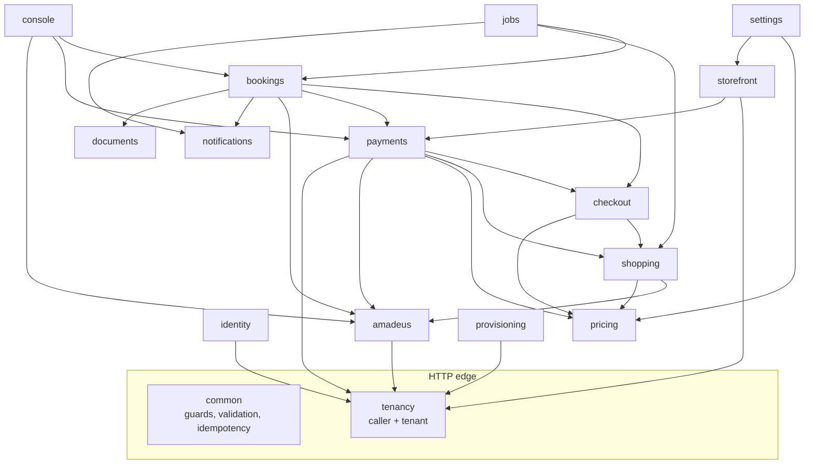

# OTA backend architecture

This document describes how `ota/backend` is built: its processes, its NestJS modules and their responsibilities, the request pipeline that resolves the caller and the tenant, how data is accessed per tenant, how Amadeus and Stripe are integrated, the workers, queues and schedulers, the Redis keys, the rate limits and the failure behaviour. Booking orchestration, with its sequence diagrams, the `SUPPLIER_TIMEOUT` recovery and idempotency, is in [`architecture-booking.md`](architecture-booking.md). Everything here follows the cross-cutting [architecture](../../docs/mvp/architecture.md), [conventions](../../docs/mvp/conventions.md) and [ADRs](../../docs/mvp/adr/README.md).

Related: [`scope.md`](scope.md), [`data-model.md`](data-model.md), [`api-changes.md`](api-changes.md), [`../backend/README.md`](../backend/README.md) (folder tree, variables, commands), [OTA ADRs](adr/README.md), [db README](../../docs/velexis-sdk/db/README.md).

## 1. Processes

| Process | Entry | Port (127.0.0.1) | systemd unit | Does |
|---|---|---|---|---|
| API | `dist/main.js` | 4000 | `velexis-ota-api.service` | The OTA booking API, Stripe webhook receivers, health, signed file and asset downloads |
| Worker | `dist/worker.js` | 4001 (health only) | `velexis-ota-worker.service` | BullMQ processors and schedulers: provisioning, tenant migrations, Stripe events, ticketing, sync, reconciliation, notifications, documents, purges, queue polling |
| CLI | `dist/cli.js` | none | none | Development seeding of a demo tenant, one-off repairs (refused in production unless named safe) |

Only the worker reads `DATABASE_PROVISIONER_URL` (role `velexis_provisioner`, tenant schemas only); the API unit cannot read that file, and no app process holds `DATABASE_MIGRATOR_URL`, which is for deploys and `pnpm db:migrate` ([ADR-0004](../../docs/mvp/adr/0004-postgresql-schema-per-tenant.md), `deploy/env/ota-worker.env.example`). Both processes use `velexis_ota_app` for everything else.

## 2. Modules

### 2.1 Module list

The contexts follow [`conventions.md` §2](../../docs/mvp/conventions.md#2-nestjs-backends), with one addition, `pricing`, so the markup and fee engine has one home shared by shopping, checkout and the console.

| Module | Responsibility | Main tenant tables | External | Process | Milestone |
|---|---|---|---|---|---|
| `common` | Guards, interceptors (OpenAPI validation, idempotency), error filter, cookie writer, Redis client, queue producers, `Clock`, id generator | `idempotency_keys` | — | both | M2 |
| `tenancy` | Resolve caller and tenant (edge, keys, service key), read-only platform repository, Redis caches, `vx:invalidate` subscriber, tenant context, `tenantTx` wrapper ([OADR-0009](adr/0009-caller-and-tenant-resolution.md)) | — | PostgreSQL `platform` (read) | both | M2 |
| `identity` | Customer sign-up, verification, sign-in, sessions (cookie and bearer), password reset; staff sign-in by portal token, staff sessions in Redis ([OADR-0006](adr/0006-storefront-cookie-sessions-and-csrf.md), [OADR-0011](adr/0011-console-access-staff-sessions-and-environments.md)) | `customers`, `customer_identities`, `customer_sessions`, `customer_password_resets`, `customer_consents` | Redis `ptk:*` | API | M3, M4 |
| `account` | Customer profile, deletion | `customers`, `customer_sessions` | — | API | M3 |
| `storefront` | `storefront.get` (settings + platform data), content pages, public assets | `storefront_settings`, `storefront_pages`, `storefront_assets` | storage | API | M2, M4 |
| `reference` | Locations, airports, airlines, countries, currencies | `reference.*` (read) | — | API | M2 |
| `amadeus` | The only Amadeus caller: connection resolver, OAuth tokens, rate limits, timeouts, retries, error mapping, redaction, `supplier_requests` ([OADR-0001](adr/0001-amadeus-client-design.md)) | `supplier_requests` | Amadeus | both | M2 |
| `pricing` | Markup and fee engine, card fees, selling prices ([OADR-0005](adr/0005-markup-and-fee-engine.md)) | `markup_rules`, `fee_rules` | — | both | M2 |
| `shopping` | Search, results, offers, upsell, pricing, ancillaries, fare rules, offer expiry ([OADR-0002](adr/0002-offer-and-priced-offer-caching.md)); availability search is deferred (`501`) | `flight_searches`, `flight_offers`, `offer_upsells`, `priced_offers` | via `amadeus` | API | M2 |
| `checkout` | Checkout aggregate: travellers (documents encrypted), contacts, ancillaries, remarks, totals, expiry | `checkouts`, `checkout_*` | — | both | M3 |
| `payments` | `PaymentGateway` with `StripeGateway` (three account modes) and `AirlineCardGateway`, payment and refund rows, Stripe webhooks, captures and voids ([OADR-0010](adr/0010-stripe-gateway-and-payment-webhooks.md), [OADR-0004](adr/0004-airline-card-data-handling.md)) | `payments`, `payment_events`, `refunds` | Stripe | both | M3, M5 |
| `bookings` | Booking orchestration (create order, capture, issue, sync, reconcile, cancel), customer bookings, guest lookup and tokens ([OADR-0003](adr/0003-booking-orchestration-and-supplier-timeout-recovery.md), [OADR-0008](adr/0008-ticketing-policy.md)) | `bookings`, `booking_*` | via `amadeus`, `payments` | both | M3 |
| `documents` | Itinerary and e-ticket receipt PDFs (pdfmake), signed download URLs ([OADR-0013](adr/0013-notifications-and-booking-documents.md)) | `booking_documents` | storage | both | M3 |
| `notifications` | Outbox, templates (rows or code defaults), rendering, SMTP | `notifications`, `notification_templates` | SMTP | both | M3 |
| `console` | Console controllers: bookings, PNR import, queues, customers, supplier log, read-only raw Amadeus, payments; `staff_actions` writer and the audit interceptor (one row per state-changing or refused console call and per successful read of one person's personal data or a supplier record that its handler opts in with `@AuditedRead`; no row for other reads or a `429`, [OADR-0011](adr/0011-console-access-staff-sessions-and-environments.md) point 8; OBE-060, FIX-W25-AUDIT) | `staff_actions`, `queue_snapshots` + the above | via `amadeus`, `payments` | API | M4 |
| `settings` | Markup and fee rules, storefront settings, pages, asset uploads, templates ([OADR-0012](adr/0012-storefront-settings-assets-and-pages.md)) | `markup_rules`, `fee_rules`, `storefront_settings`, `storefront_pages`, `storefront_assets`, `notification_templates` | storage | API | M4 |
| `provisioning` | `ota-tenant-ops` consumer: provision, migrate, suspend, resume; seeds; `platform-tenant-events` producer ([OADR-0007](adr/0007-tenant-migration-runner-and-provisioning-worker.md)) | whole schema (DDL as provisioner) | — | worker | M1 |
| `jobs` | Schedulers and per-tenant fan-out, retention purges, queue poller ([OADR-0014](adr/0014-per-tenant-workers-and-schedulers.md)) | many | — | worker | M2–M4 |
| `health` | `/health/live`, `/health/ready` | — | PostgreSQL, Redis | both | M0 |

### 2.2 Dependencies between modules



Rules: controllers call one service method; services own transactions; only `amadeus`, `payments` (gateways), `notifications` (mailer) and `documents` (storage) talk to the outside ([`conventions.md` §2](../../docs/mvp/conventions.md#rules)). Arrows never point from `amadeus` or `payments` back to business modules.

## 3. Request pipeline

Every request passes the same chain. The order matters: tenant and caller are known before validation errors are rendered, and idempotency wraps only the controller.

| Step | Component | Does |
|---|---|---|
| 1 | Request context (`nestjs-cls`) | Reads or creates `X-Request-Id`, starts the per-request context |
| 2 | Body parsing | Raw body on `/webhooks/*`; JSON limit 256 KB elsewhere (10 KB on the airline-card route); multipart only on asset upload |
| 3 | `helmet`, `cookie-parser`, `trust proxy loopback` | Security headers, cookies, client IP from Caddy |
| 4 | `CallerGuard` (tenancy) | Classifies the caller (table below), verifies the credential in constant time |
| 5 | `TenantGuard` (tenancy) | Loads the tenant from Redis or the platform tables; only `active` is served (`403 TENANT_SUSPENDED`), except the worker paths of [PADR-0014](../../platform/docs/adr/0014-tenant-suspension-and-resume.md) |
| 6 | OpenAPI validation interceptor | Ajv on path, query, headers, body; `400 VALIDATION_FAILED` with field paths, never values |
| 7 | `ScopeGuard` | Compares the caller with the operation's `x-scope` and the MVP extensions (`x-edge-only`, console permissions) |
| 8 | Session guards | Customer (cookie or bearer), staff (bearer + Redis family + the four deny keys `staffdeny:<familyId>`, `staffdeny:acct:*`, `staffdeny:tenant:*`, `staffdeny:member:*` of [OADR-0011](adr/0011-console-access-staff-sessions-and-environments.md) point 3; a verified token whose membership is inactive is `403 STAFF_MEMBERSHIP_INACTIVE` with a denied `staff_actions` row of the token's staff member), booking token (cookie or header); `tid` must equal the tenant |
| 9 | `CsrfGuard` | Edge callers on `POST`, `PUT`, `PATCH`, `DELETE`: `X-CSRF-Token` equals `__Host-vx_csrf`, and `Origin` matches the verified host |
| 10 | Throttler, then `PermissionGuard` | Redis-backed limits of §8. Then, in console scope (OBE-060): the OTA admin's `live` needs a live tenant and a viewer never acts in `live` (`403 ENVIRONMENT_NOT_ALLOWED`), a key-only call on a `console` operation needs `console:automation` (`403 SCOPE_NOT_ALLOWED`), and the staff member's role ([`scope.md`](scope.md) §1.3, `roles.ts`) or the key's scopes must hold the operation's `x-permission` (`403 FORBIDDEN`, `details.requiredPermission`); each refusal writes a `staff_actions` row with `outcome = denied`, whose target is a path value only when it passes that parameter's schema (the guards run before validation). A `429 RATE_LIMITED` writes no row: the throttler logs `rate_limit.exceeded` with the staff member or key, the operation and the limit ([OADR-0011](adr/0011-console-access-staff-sessions-and-environments.md) point 8) |
| 11 | Idempotency interceptor | Store and replay of state-changing calls ([`architecture-booking.md`](architecture-booking.md) §4) |
| 12 | Controller → service | Use case in `tenantTx`; external calls between transactions |
| 13 | Error filter | One envelope; unknown errors become `500 INTERNAL_ERROR`; supplier details only in console scope |

### 3.1 Callers

| Caller | Recognised by | Tenant from | Environment from | Scope |
|---|---|---|---|---|
| Storefront edge | `X-Velexis-Edge` equals `VELEXIS_EDGE_SECRET` | `X-Velexis-Host` → verified `tenant_domains` row (purpose `storefront`) or `<key>.ota.example.com` | `tenants.storefront_environment` | customer |
| OTA admin server | `X-Api-Key` equals `OTA_ADMIN_SERVICE_KEY` on a direct loopback connection: socket peer on loopback and no `X-Forwarded-For` / `X-Forwarded-Host` (so never through Caddy) | Staff token `tid` (redeemed portal token on sign-in; the refresh token's family on refresh and on a sign-out without an access token) | `X-Velexis-Environment` (live needs a live tenant and a live-capable role) | console |
| Publishable key | `X-Api-Key` `pk_…` (prefix → Redis → HMAC compare) | The key's tenant | The key | customer, origin allow-list |
| Secret key | `X-Api-Key` `sk_…` | The key's tenant | The key | customer, or console per key scopes |
| Stripe | Path `/webhooks/stripe/…` + signature | Event metadata or connection | Path or event | webhook only |
| Public download | Path `/v1/files/…` (signature) or `/v1/assets/{tenantKey}/…` | Signed key or tenant key | — | none |

The edge secret and the service key are checked **before** any platform lookup, so an attacker cannot use them to probe keys. A request with both an edge header and an API key is refused (`400 INVALID_REQUEST`). Caddy proxies `api.ota.example.com` and the storefront `/api/*` to `127.0.0.1:4000`, so the loopback address alone proves nothing; the absent `X-Forwarded-For` (which Caddy always sets) is what marks a direct call, as in the platform's `InternalOnlyGuard` ([OADR-0009](adr/0009-caller-and-tenant-resolution.md) rule 1.2). The service caller must also send `X-Velexis-End-User-IP` (`400 VALIDATION_FAILED` without a valid address) and `X-Velexis-End-User-Agent` (the staff member's, forwarded by the OTA admin), which become the request-context IP and user agent of the rate limits, the staff sessions and `staff_actions`. The service key arriving any other way is logged as a security event without its value and answered as an unknown key; the service caller is refused anything but console operations (`403 SCOPE_NOT_ALLOWED`), and every console operation but the four staff-session ones without a staff token (`401 UNAUTHENTICATED`). Its sign-in reads the portal token's tenant with `GET` and takes the token with `GETDEL` in the handler, after the rate limit; a credential that names no tenant is answered as an unknown one (OBE-060).

### 3.2 Tokens

| Token | Format | Lifetime | Stored |
|---|---|---|---|
| Customer access | EdDSA JWT, `typ: customer`, `sub: cus_…`, `tid`, `sid` | 15 min | Cookie `__Host-vx_at` (edge) or bearer |
| Customer refresh | 256-bit opaque, rotating | 12 h family, 30 days with `rememberMe` | `customer_sessions` (hash); cookie `__Host-vx_rt` (edge) |
| Staff access | EdDSA JWT, `typ: staff`, `sub: stf_…`, `tid`, `roles`, `sid` | 15 min | OTA admin server cookies |
| Staff refresh | 256-bit opaque, rotating | 12 h family | Redis `staffsess:<familyId>` |
| Guest booking token | 256-bit opaque | As the contract (24 h after lookup; trip end after booking) | `booking_access_tokens` (hash); cookie `__Host-vx_bt` (edge) |

The OTA backend signs with its own Ed25519 key (`JWT_PRIVATE_KEY_FILE`) and `kid` headers ([ADR-0008](../../docs/mvp/adr/0008-identity-accounts-customers-sessions.md)).

## 4. Data access

- **Tenant data** only through `tenantTx(fn)` from `@velexis/db`: one transaction that first runs `SELECT set_config('search_path', '<schema>, reference', true)` and `set_config('statement_timeout', '15s', true)`. The schema name comes from the cached tenant row and is checked against `^tenant_[a-z][a-z0-9_]{1,39}$` ([ADR-0004](../../docs/mvp/adr/0004-postgresql-schema-per-tenant.md), [db README §5](../../docs/velexis-sdk/db/README.md)).
- **One transaction per use-case step.** A request that only touches the database runs in one transaction. A request that calls Amadeus or Stripe commits before the call and opens a new transaction after it; no transaction stays open across an external call, including order creation ([OADR-0003](adr/0003-booking-orchestration-and-supplier-timeout-recovery.md)).
- **Platform data** through `platformDb` with schema-qualified `SELECT`s, in short separate transactions, cached in Redis for 60 s. The OTA role cannot write platform tables.
- **Aggregates** use `version` for optimistic locking; `If-Match` maps to it (`412 PRECONDITION_FAILED`).
- **Encryption.** Traveller documents, discount eligibility, idempotent replay bodies and notification secrets use the envelope of [ADR-0010](../../docs/mvp/adr/0010-secrets-envelope-encryption.md) with associated data `"tenant_<key>.<table>.<column>:<row id>"`. Amadeus and Stripe secrets from platform rows are decrypted only inside `amadeus` and `payments`.
- **Redaction.** Every persisted payload copy passes the shared redactor of `@velexis/logger` (db README §8): `supplier_requests`, `order_snapshot`, `booking_events.data`, `staff_actions`, `idempotency_keys.response_body`, `payment_events.payload`, `notifications.payload`, `priced_offers.amadeus_request`. Besides the fields db README §8 lists, it cuts the numbers of an Amadeus order's forms of identification (`formOfIdentifications[].number`: passport, identity card and driving licence numbers) to their last 4 characters like `documents[].number`, so every stored copy of an order (the record step, the ticketing job, the customer and console refreshes, console.bookings.retrieve and patch) keeps no full number (FIX-W26-SECURITY; the log redaction paths censor them at the depths of `documents[*].number`).

## 5. External integrations

| System | Module | Summary | Details |
|---|---|---|---|
| Amadeus Enterprise | `amadeus` | 12 operations over `fetch`; credentials per connection (Velexis shared account office or OTA-owned); encrypted token cache; token buckets per credential set and per tenant; per-operation timeouts; retries only for reads and token requests | [OADR-0001](adr/0001-amadeus-client-design.md), [`flows/amadeus-connection-and-tokens.md`](flows/amadeus-connection-and-tokens.md) |
| Stripe | `payments` | PaymentIntents with manual capture; account modes `velexis` (M3), `connect_standard`, `api_keys` (M5); webhooks verified on the raw body, stored as `payment_events`, processed in `ota-stripe-events` | [OADR-0010](adr/0010-stripe-gateway-and-payment-webhooks.md), [ADR-0011](../../docs/mvp/adr/0011-payments-stripe-and-airline-card.md) |
| SMTP | `notifications` | Nodemailer from the worker only; Mailpit in development | [ADR-0017](../../docs/mvp/adr/0017-email-documents-storage.md) |
| Storage | `documents`, `settings` | `StorageAdapter` (local disk), keys `tenant_<key>/…`, HMAC-signed URLs for documents, immutable public URLs for storefront assets | [OADR-0012](adr/0012-storefront-settings-assets-and-pages.md), [OADR-0013](adr/0013-notifications-and-booking-documents.md) |
| Platform backend | `tenancy`, `provisioning`, `identity` | No HTTP. Read-only tables, `vx:invalidate`, `ota-tenant-ops` / `platform-tenant-events`, `ptk:*`, `staffdeny:acct:*`, `apikey:used:*` | [platform architecture §6](../../platform/docs/architecture.md#6-integration-with-the-ota-backend) |

### 5.1 The payment gateway

```ts
interface PaymentGateway {
  createSession(ctx, payment, checkout): Promise<GatewaySession>;   // Stripe: PaymentIntent (manual capture)
  refresh(ctx, payment): Promise<GatewayState>;                       // re-read provider state
  capture(ctx, payment, amount): Promise<GatewayState>;
  void(ctx, payment): Promise<GatewayState>;
  refund(ctx, refund): Promise<GatewayState>;
}
```

`StripeGateway` implements it for all three account modes; the mode only changes the API key and the `Stripe-Account` header. `AirlineCardGateway` implements only `createSession` (no provider call) and is otherwise inert: the card goes to Amadeus inside the booking orchestration, and refunds of airline-card payments are done by the airline ([OADR-0004](adr/0004-airline-card-data-handling.md)).

## 6. Workers, queues and schedulers

BullMQ prefix `vx`, defaults of [ADR-0009](../../docs/mvp/adr/0009-background-jobs-bullmq.md) (`attempts: 5`, exponential backoff from 30 s, failed jobs kept 30 days). Payloads carry ids only. Per-tenant work is one small job per tenant ([OADR-0014](adr/0014-per-tenant-workers-and-schedulers.md)).

| Queue | Producer → consumer | Jobs (payload) | Concurrency |
|---|---|---|---|
| `ota-tenant-ops` | platform → OTA worker | `tenant.provision`, `tenant.migrate`, `tenant.suspend`, `tenant.resume` | 2 |
| `platform-tenant-events` | OTA worker → platform | `tenant.provisioned`, `tenant.provision_failed`, `tenant.migrated`, `tenant.migration_failed`, `tenant.suspended`, `tenant.resumed` | (platform) |
| `ota-stripe-events` | webhook receiver → worker | `stripe.event {tenantId, paymentEventId}` | 4 |
| `ota-payments` | API, schedulers → worker | `payment.void`, `payment.capture_retry`, `refund.submit` `{tenantId, id}` | 4 |
| `ota-bookings` | API, schedulers → worker | `booking.reconcile`, `booking.sync` `{tenantId, bookingId}` | 4 |
| `ota-ticketing` | API, schedulers → worker | `ticketing.issue {tenantId, bookingId}` | 2 |
| `ota-notifications` | API (after commit), sweep → worker | `notify {tenantId}` drains that tenant's outbox | 4 |
| `ota-documents` | bookings → worker | `document.render {tenantId, bookingId, kind, bookingVersion[, ticketId]}` | 2 |
| `ota-maintenance` | schedulers → worker | Fan-out and purge jobs below | 2 |

| Scheduler | Every (UTC) | Fans out to | Milestone |
|---|---|---|---|
| `checkouts.expire` | 1 min | Per tenant: expire `open`/`payment_pending` checkouts past `expires_at`, enqueue `payment.void`; a checkout whose booking is `pending` is skipped, its authorisation left to the reconciliation ([OADR-0003](adr/0003-booking-orchestration-and-supplier-timeout-recovery.md) point 10) | M3 |
| `bookings.reconcile_scan` | 1 min | Adopts `pending` bookings without `reconcile_until` claimed more than 2 minutes ago (`reconcile_until = now + 15 min`), then `booking.reconcile` for `pending` bookings with `reconcile_until` set | M3 |
| `ticketing.scan` | 5 min | `ticketing.issue` for bookings with `ticketing_next_attempt_at` due; deadline alerts | M3 |
| `bookings.sync_scan` | 10 min | `booking.sync` for the oldest synced active bookings (20 per tenant per run): an order, the trip not over, not synced for 6 h (1 h in the 24 h before the ticketing deadline of one that waits for tickets) nor claimed for 30 min, paid ones only for a suspended tenant; BullMQ priority 10, after the queue's `booking.reconcile` jobs (OBE-045, `bookings/booking-sync.service.ts`) | M3 |
| `notifications.sweep` | 1 min | `notify` for tenants with due outbox rows | M3 |
| `refunds.sweep` | 5 min | `refund.submit` for the refunds still `pending` and never claimed 5 minutes after their request, an enqueue lost after the commit (100 per job, a full batch continuing with the next), with the producers' job id `refund-submit-<rfd_id>`, so a refund whose job BullMQ holds gets no second one; never one being sent, sent or released after an unknown outcome (FIX-W27-FOLLOWUPS, `payments/refunds-sweep.processor.ts`) | M3 |
| `offers.purge` | 15 min | Delete expired searches, offers, upsells, priced offers not referenced by a checkout | M2 |
| `queues.poll` | 15 min | Queue List for each monitored queue of active tenants (paused while suspended) | M4 |
| `payments.authorisation_watch` | 06:15 daily | Alert staff about authorised, uncaptured payments older than 5 days | M3 |
| `retention.daily` | 03:35 daily | `supplier_requests` > 90 d, `queue_snapshots` > 30 d, `idempotency_keys` expired, sessions, reset and booking tokens expired | M3 |

## 7. Redis keys

Shared keys follow the [cross-cutting table](../../docs/mvp/architecture.md#redis-keys-shared-between-the-backends) and [platform §6.4](../../platform/docs/architecture.md#64-redis-keys-shared-with-the-ota-backend). Every key has a TTL, because Redis runs with `noeviction`. Every key that holds tenant data starts with `t:<tenantId>:<env>:` ([db README §5](../../docs/velexis-sdk/db/README.md)); the only tenant-related keys without it are the shared ones of those two tables. All keys are built in `redis.keys.ts`, and its test fails on a tenant-data builder without the prefix (OBE-002).

| Key | TTL | Purpose |
|---|---|---|
| `tenant:<id>`, `tenantkey:<key>`, `host:<hostname>`, `apikey:<prefix>`, `member:<accountId>:<tenantId>` | 60 s | Platform row caches, deleted on `vx:invalidate` |
| `conn:amadeus:<tenantId>:<env>`, `conn:payment:<tenantId>:<env>`, `amadeus:acct:<id>` | 60 s | Connection caches; ciphertext stays encrypted |
| `amadeus:token:<credId>:<env>` | `expires_in` − 60 s | Encrypted OAuth access token ([ADR-0012](../../docs/mvp/adr/0012-amadeus-account-model.md)) |
| `amadeus:tokenlock:<credId>:<env>` | 10 s | Single flight for token refresh |
| `amadeus:badcred:<credId>` | 5 min | Credentials refused by Amadeus: calls answer `424` without retrying the token request |
| `rl:amadeus:cred:<credId>:<env>`, `rl:amadeus:ten:<tenantId>:<env>` | 2 s | Token buckets |
| `t:<tenantId>:<env>:sf:<locale>` | 5 min | Caller-independent part of `storefront.get` (asset ids, airline-card flag); asset URLs and `airline_card` are added per request for the caller ([OADR-0012](adr/0012-storefront-settings-assets-and-pages.md) point 7). One entry per supported locale; the default locale's entry is `sf:und` and carries the supported locales that `Accept-Language` is matched against (OBE-016) |
| `t:<tenantId>:<env>:search:<sha256>` | 30 s | Single flight for identical concurrent searches |
| `t:<tenantId>:<env>:cxq:<bookingId>` | 10 min | Cancellation quote (the contract text calls it `cxq:{bookingId}`; the OTA keeps it under the tenant prefix) |
| `t:<tenantId>:<env>:ac:chk:<checkoutId>` | 2 h | Airline-card attempts of one checkout (max 3) |
| `staffsess:<familyId>`, `staffdeny:<familyId>` | family lifetime | Staff refresh families (`asn_…`, JSON with the SHA-256 of the current refresh token and of the rotated ones) and revocations |
| `staffdeny:member:<staffId>` | family lifetime | Epoch-ms cut-off of `console.auth.signOut` with `scope: all`: the membership's families created before it are refused (OBE-059) |
| `staffdeny:acct:<accountId>` (read) | 30 days | Platform's cross-boundary revocation ([PADR-0007](../../platform/docs/adr/0007-portal-to-ota-admin-sso-token.md)) |
| `staffdeny:tenant:<tenantId>` | 30 days | Written on `tenant.suspend`: staff families of the tenant created before it are refused |
| `ptk:<sha256>` (GETDEL) | 60 s | Portal token for staff SSO |
| `apikey:used:<keyId>` (write) | 1 day | Last use, flushed by the platform worker |
| `t:<tenantId>:<env>:authfail:<sha256(email)>` | 15 min | Customer sign-in lockout counter |
| `rl:*` | window | Throttler storage |

## 8. Rate limits

| Route | Limit | Reason |
|---|---|---|
| `auth.signIn`, `console.auth.signIn` | 10 per minute per end-user IP; lockout after 5 failures per identity for 15 min | [ADR-0008](../../docs/mvp/adr/0008-identity-accounts-customers-sessions.md) |
| `auth.signUp`, `auth.requestPasswordReset`, `auth.resendVerification` | 5 per hour per IP, 3 per hour per e-mail | Abuse and e-mail cost |
| `flights.search`, `flights.upsell`, `flights.price` | 30 per minute per IP (edge, `pk_`), plus the Amadeus buckets | Shared Amadeus quota |
| `bookings.lookup` | 5 failures per 15 min per IP and per reference | Contract |
| `checkout.createPayment`, `checkout.complete` | 10 per minute per IP | Card testing |
| `checkout.completeWithAirlineCard` | 5 per minute per IP, 3 attempts per checkout, 60 per hour per tenant | [ADR-0011](../../docs/mvp/adr/0011-payments-stripe-and-airline-card.md) |
| Console operations | 600 per minute per staff session or key | Runaway scripts |
| `/v1/assets/*`, `/v1/files/*` | 120 per minute per IP | Scraping |

"IP" is the request-context IP: Caddy's client address for the edge and public calls; `X-Velexis-End-User-IP` for secret-key servers, as the contract says, and for the OTA admin's service caller, which must send it ([OADR-0011](adr/0011-console-access-staff-sessions-and-environments.md) points 8–9). Without that header every OTA's staff sign-ins would share the admin server's `127.0.0.1` bucket.

## 9. Security notes specific to the OTA backend

- **Redaction list additions** (`@velexis/logger`, with tests): `holderName`, `expiryMonth`, `expiryYear`, the whole `card` object of the airline-card body, `x-velexis-edge`, `x-csrf-token`, `x-booking-token`, `stripe-signature`. `number`, `securityCode`, `cookie`, `authorization`, `clientSecret`, `bookingToken` are already listed ([ADR-0016](../../docs/mvp/adr/0016-observability.md)).
- **Request body logging is off everywhere**, and the airline-card route is excluded from `pino-http` body serialisers and from Sentry breadcrumbs.
- **Customer scope never sees net amounts** or raw supplier errors; console scope does.
- **Office isolation**: every Amadeus call carries the tenant's own offices; imports and raw calls for other offices answer `403 OFFICE_NOT_ALLOWED`.
- **Two-tenant tests**: every tenant repository has an isolation test, and the pool-of-one test of db README §5 runs in CI.

## 10. Failure behaviour

| Failure | OTA backend behaviour |
|---|---|
| Amadeus slow or down | `504 SUPPLIER_TIMEOUT` / `503 SUPPLIER_UNAVAILABLE`; reads retried once; order creation reconciled, never retried blindly; stored bookings and documents stay readable |
| Stripe down | `502 PAYMENT_PROVIDER_ERROR` on payment creation; captures and voids retried by `ota-payments`; webhooks arrive later and are re-fetched |
| Redis down | `/health/ready` fails; cached platform reads fall back to PostgreSQL; rate-limited routes (sign-in, airline card) refuse with `503`; staff sessions lost; queues pause and resume |
| PostgreSQL down | `503 SERVICE_UNAVAILABLE`; workers pause |
| Platform worker down | Provisioning events wait in `platform-tenant-events`; OTA traffic unaffected |
| OTA worker down | No e-mails, documents, ticketing retries, sync or reconciliation; API keeps booking; jobs resume from Redis |
| Tenant suspended | All requests `403 TENANT_SUSPENDED`; workers keep ticketing, sync, refunds and transactional e-mails for paid bookings ([PADR-0014](../../platform/docs/adr/0014-tenant-suspension-and-resume.md)) |
| Bad tenant migration | The fan-out records the failed schema and continues; code works with schema N-1 and N ([OADR-0007](adr/0007-tenant-migration-runner-and-provisioning-worker.md)) |
