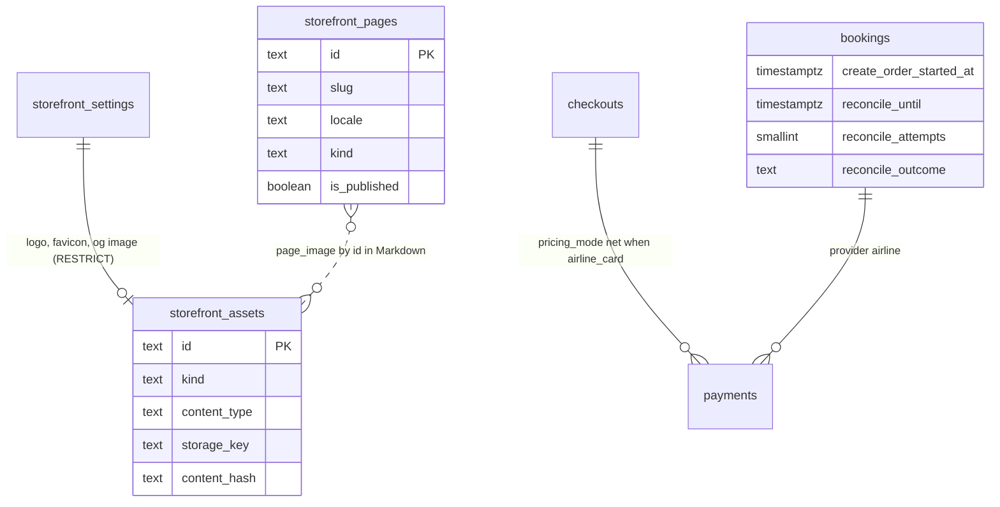

# OTA data model

This document describes how the OTA backend uses its data: the tenant schema (one `tenant_<key>` per OTA, owned by the OTA backend), the `reference` schema it reads, and the platform tables it reads through its read-only role. It links the validated baseline DDL and ER diagrams instead of repeating them, lists which module owns which tenant table, and explains every change of tenant migration `0002` and why the MVP needs it. The exact SQL of `0002` is in [`data-model-migration-0002.md`](data-model-migration-0002.md).

Related: [db README](../../docs/velexis-sdk/db/README.md) (tenancy design), [ADR-0004](../../docs/mvp/adr/0004-postgresql-schema-per-tenant.md), [ADR-0005](../../docs/mvp/adr/0005-data-access-kysely-sql-migrations.md), [ADR-0021](../../docs/mvp/adr/0021-migration-cli-and-repeatable-grants.md), [platform data model](../../platform/docs/data-model.md), [`architecture.md`](architecture.md) §4, [`api-changes.md`](api-changes.md).

## 1. Sources and migrations

| What | Where |
|---|---|
| Baseline DDL (42 tables), validated on PostgreSQL 16 | [`docs/velexis-sdk/db/tenant.sql`](../../docs/velexis-sdk/db/tenant.sql) |
| Column meanings | [`dictionary.json`](../../docs/velexis-sdk/db/dictionary.json) (generated from the DDL comments) |
| ER diagram | [`er/er-tenant.mmd`](../../docs/velexis-sdk/db/er/er-tenant.mmd), [`er/er-tenant.svg`](../../docs/velexis-sdk/db/er/er-tenant.svg); overview [`er/er-overview.svg`](../../docs/velexis-sdk/db/er/er-overview.svg) |
| Status machines, money and id conventions | [db README §2.1](../../docs/velexis-sdk/db/README.md) |
| Which API area uses which table | [db README §10](../../docs/velexis-sdk/db/README.md) and each operation's `x-tenant-tables` |
| Tenant migrations | `ota/backend/migrations/tenant/` |

| File | Content | Lands in |
|---|---|---|
| `0001_baseline.sql` | Byte-for-byte copy of `tenant.sql` (a unit test compares checksums) | M0 (X-012) |
| `0002_add_mvp_tenant_deltas.sql` | All MVP deltas below, phase `expand` | M2, one task, before the first shopping endpoint |
| `0003_add_booking_sync_claim.sql` | `bookings.sync_claimed_at` and `bookings.sync_changes` (§3.7), phase `expand` | M3 (FIX-W27-SYNC, lead decision (3) of 2026-10-23) |
| `0004_add_payment_card_fee_lines.sql` | `payments.card_fee_lines` (§3.8), phase `expand` | M3 (FIX-W28-CANCEL, lead decision (2) of 2026-10-23, second batch) |
| `0005_…` and later | Changes found during M3–M6 | When needed |

One file for all MVP deltas avoids number clashes between agents working in parallel; the columns used only in M3 or M4 are nullable or have safe defaults, so they cost nothing earlier. The cross-cutting [schema delta table](../../docs/mvp/architecture.md#schema-deltas-named-by-the-cross-cutting-adrs) lists `payments.provider` adding `airline` under M3; shipping it in `0002` during M2 meets that milestone early, as the platform plan does with its own `0002`. Rules for every tenant migration ([`conventions.md` §9](../../docs/mvp/conventions.md#9-database-migrations)): unqualified names, no `search_path`, no other schema except `reference` by value, `text` + `CHECK` statuses, `COMMENT ON` for every new table and column, CHECK lists extended with `NOT VALID` then `VALIDATE`, and the code works with schema versions N-1 and N. New tables need no `GRANT`: provisioning sets default privileges for `velexis_ota_app` in each schema ([OADR-0007](adr/0007-tenant-migration-runner-and-provisioning-worker.md)).

## 2. Tenant tables by owning module

Every table belongs to exactly one module, which owns its repository. Other modules call that module's service.

| Module | Tables |
|---|---|
| `provisioning` | `schema_migrations` (through the runner) |
| `identity` | `customers`, `customer_identities`, `customer_sessions`, `customer_password_resets`, `customer_consents` |
| `account` | `customer_preferences`, `customer_data_exports`, `saved_travelers`, `saved_traveler_documents` (deferred operations; tables stay empty in the MVP) |
| `storefront` + `settings` | `storefront_settings`, `storefront_pages` (new), `storefront_assets` (new) |
| `pricing` + `settings` | `markup_rules`, `fee_rules` |
| `shopping` | `flight_searches`, `flight_offers`, `offer_upsells`, `priced_offers` |
| `checkout` | `checkouts`, `checkout_travelers`, `checkout_contacts`, `checkout_ancillaries`, `checkout_remarks` |
| `payments` | `payments`, `payment_events`, `refunds` |
| `bookings` | `bookings`, `booking_associated_records`, `booking_travelers`, `booking_contacts`, `booking_segments`, `booking_tickets`, `booking_ancillaries`, `booking_remarks`, `booking_events`, `booking_access_tokens` |
| `documents` | `booking_documents` |
| `notifications` + `settings` | `notifications`, `notification_templates` |
| `amadeus` | `supplier_requests` |
| `console` | `staff_actions`, `queue_snapshots` |
| `common` | `idempotency_keys` |

### 2.1 Platform and reference data read

- **Platform** (read-only, cached 60 s, invalidated by `vx:invalidate`): `tenants`, `tenant_domains`, `api_keys`, `tenant_memberships`, `accounts` (identity and MFA columns), `plans`, `supplier_connections`, `payment_provider_connections`, `amadeus_accounts`, `amadeus_offices`. The columns the OTA relies on are listed in [platform architecture §6.2](../../platform/docs/architecture.md#62-platform-tables-the-ota-backend-reads).
- **Reference** (read through the `search_path`): `airports`, `cities`, `airlines`, `countries`, `currencies`, `time_zones`, `aircraft`. Time zones convert Amadeus local times to UTC for `first_departure_at`, `last_arrival_at` and `ticketing_deadline_at`.

## 3. Every delta of `0002` and why

### 3.1 Payments: the airline-card method

| Change | Why |
|---|---|
| `payments.provider` CHECK adds `airline` | [ADR-0011](../../docs/mvp/adr/0011-payments-stripe-and-airline-card.md) names this delta: an airline-card payment has no PSP; the airline charges the card. |
| `payments.method` CHECK adds `airline_card` | The API exposes the method as `airline_card` ([`api-changes.md`](api-changes.md) §3) so the console and reports can tell it from a Stripe `card`. |
| CHECK `payments_airline_card_ck`: `provider = 'airline'` exactly when `method = 'airline_card'`, and then no `provider_payment_id`, no `provider_customer_id`, no expiry month or year, no `three_ds`, no `next_action`, `capture_method = 'automatic'` | ADR-0011 keeps only brand, BIN, last 4 and the outcome. The database refuses any other card attribute on these rows, so a coding mistake cannot store more. The PAN and security code have no column anywhere. |

### 3.2 Checkouts: pricing mode

| Change | Why |
|---|---|
| `checkouts.pricing_mode` (`markup_rules` default, `net`) | The airline charges its own price (Amadeus total plus its card fee), so OTA markup and fees cannot be collected on that path. Choosing `airline_card` switches the checkout to `net` and its totals to the Amadeus amounts; choosing Stripe switches back. The existing CHECK `total = offer + ancillaries + fees` still holds. `bookings.pricing_mode` already allows `net` ([OADR-0004](adr/0004-airline-card-data-handling.md)). |

### 3.3 Bookings: reconciliation after a timeout

| Change | Why |
|---|---|
| `bookings.create_order_started_at` | Set at the claim, just before Flight Create Orders. The reconciler looks for PNRs created around this instant, and adopts a `pending` booking without `reconcile_until` once this instant is more than 2 minutes old (a stale claim: `reconcile_until = now + 15 min`; [OADR-0003](adr/0003-booking-orchestration-and-supplier-timeout-recovery.md) point 4). |
| `bookings.reconcile_until`, `reconcile_attempts`, `reconcile_outcome` (`found`, `not_found`, `manual_review`) | The contract promises a decision within 15 minutes after `504 SUPPLIER_TIMEOUT`. These columns hold the deadline, the progress and the result, so the idempotent replay and the console can show them ([OADR-0003](adr/0003-booking-orchestration-and-supplier-timeout-recovery.md)). `manual_review` means the staff decide: an airline-card order that was not found, or, since FIX-W25-BOOKINGS, a search still incomplete at `reconcile_until` (the booking stays `pending` with its authorisation; OADR-0003 points 4 and 5). |
| Partial index `bookings_reconcile_idx` on `reconcile_until` where `status = 'pending'` | The scan runs every minute and must touch only pending rows. The table is small when `0002` runs (M2), so a plain `CREATE INDEX` in the transaction is fine. |

### 3.4 Storefront settings

| Change | Why |
|---|---|
| `legal_name`, `time_zone` | `StorefrontConfig.legalName` and `timeZone` are in the contract but have no column. The time zone also drives support hours and e-mail dates. |
| `default_market`, `markets` (jsonb) | `StorefrontConfig.defaultMarket` and `markets[]` have no column. |
| `support_details` (jsonb: hours, help centre URL, emergency phone) | `StorefrontSupport` has more than the existing `support_email` and `support_phone`. |
| `seo`, `consent` (jsonb) | `StorefrontSeo` and `StorefrontConsent` have no column. Kept as validated jsonb because the storefront only reads them as a whole. |
| `terms_version`, `privacy_version` | Sign-up records the accepted versions in `customer_consents`, and `StorefrontLegalLinks` returns them. |
| `airline_card_enabled_test`, `airline_card_enabled_live` (default `false`) | ADR-0011: the airline card is off by default and enabled **per OTA and environment**. The settings row is shared by both environments, hence two columns. Live stays refused while the global `AIRLINE_CARD_ENABLED` switch is off. |
| `booking_queue_number`, `booking_queue_category` | Every create-order request queues the PNR to this queue of the queuing office (`automatedProcess`), so a timed-out order can be found ([OADR-0003](adr/0003-booking-orchestration-and-supplier-timeout-recovery.md)). Provisioning seeds the default of [OADR-0007](adr/0007-tenant-migration-runner-and-provisioning-worker.md). |
| `ops_alert_email` | Recipient of staff alerts (ticketing failed, manual review, airline-card abuse). Falls back to the owners' e-mails from the platform when empty. |
| `logo_asset_id`, `logo_dark_asset_id`, `logo_square_asset_id`, `favicon_asset_id`, `og_image_asset_id` → `storefront_assets` (RESTRICT) | The hosted storefront's CSP allows images from its own origin only ([ADR-0018](../../docs/mvp/adr/0018-hosted-storefront-custom-domains.md)), so brand images are uploaded and served by the backend. Foreign keys stop deleting an image in use. The baseline `logo_url` and `favicon_url` stay for compatibility but are not used by the MVP (contract phase later). |

Branding colours keep using `primary_color`, `secondary_color` and `theme` (fonts, radius, extra colours), as the baseline intended.

### 3.5 New tables

| Table | Why |
|---|---|
| `storefront_assets` (`ast_`) | Uploaded logos, favicon, Open Graph image and page images: type, size, dimensions, storage key, SHA-256. Immutable rows; a new upload is a new row. No SVG, no CSS ([OADR-0012](adr/0012-storefront-settings-assets-and-pages.md)). |
| `storefront_pages` (`stp_`) | OTAs without their own website need hosted terms, privacy, FAQ and "about" pages on the one static storefront. One row per slug and locale, Markdown subset, published flag, version for `If-Match`. |

### 3.6 Considered and not added

| Idea | Why not |
|---|---|
| A column for the CSRF value or cookie sessions | The CSRF token is double-submit and stateless; cookie sessions reuse `customer_sessions` ([OADR-0006](adr/0006-storefront-cookie-sessions-and-csrf.md)). |
| A Stripe webhook inbox table | ADR-0011 de-duplicates on `payment_events.provider_event_id` (unique); the receiver stores the event as a `payment_events` row before acknowledging. |
| Card expiry or holder name on airline payments | ADR-0011 keeps brand, BIN and last 4 only; the new CHECK enforces it. |
| A table for staff sessions | Staff sessions live in Redis ([ADR-0008](../../docs/mvp/adr/0008-identity-accounts-customers-sessions.md)). |
| Default template rows for keys added later | The notification service falls back to code defaults when a tenant has no row, so new keys need no data backfill ([OADR-0013](adr/0013-notifications-and-booking-documents.md)). |
| Per-tenant roles or data keys | Not in the MVP ([ADR-0004](../../docs/mvp/adr/0004-postgresql-schema-per-tenant.md), [ADR-0010](../../docs/mvp/adr/0010-secrets-envelope-encryption.md)). |

### 3.7 The deltas of `0003`: the booking sync's claim and last changes

`ota/backend/migrations/tenant/0003_add_booking_sync_claim.sql` (FIX-W27-SYNC, lead decision (3) of 2026-10-23; [OADR-0003](adr/0003-booking-orchestration-and-supplier-timeout-recovery.md) follow-ups, [OADR-0014](adr/0014-per-tenant-workers-and-schedulers.md) point 6):

| Change | Why |
|---|---|
| `bookings.sync_claimed_at timestamptz` (nullable) | The claim of a synchronisation with Flight Order Management (the background sync's and the refreshes'): the sync skips a booking claimed in the last 30 minutes, a refresh is throttled by it. It replaces the staff-only `booking.sync_requested` events, about four a day per upcoming booking and one an hour near the ticketing deadline, which filled the console's timeline of 100 events. The events written before stay; no backfill (conventions §9: backfills are jobs), so a claim recorded as an event in the half hour before the upgrade is not seen and the booking may be synchronised once more. |
| `bookings.sync_changes jsonb NOT NULL DEFAULT '[]'` with `bookings_sync_changes_ck` (an array) | What the last recorded synchronisation changed, whichever path read the order (`[{path, label, before, after}]`, JSON pointers into the booking): the console's `ConsoleSupplierSync.differences`. Empty when it changed nothing. |

### 3.8 The delta of `0004`: the card fee's lines

`ota/backend/migrations/tenant/0004_add_payment_card_fee_lines.sql` (FIX-W28-CANCEL, lead decision (2) of 2026-10-23, second batch; [OADR-0005](adr/0005-markup-and-fee-engine.md) point 7, [OADR-0010](adr/0010-stripe-gateway-and-payment-webhooks.md) point 6):

| Change | Why |
|---|---|
| `payments.card_fee_lines jsonb NOT NULL DEFAULT '[]'` with `payments_card_fee_lines_ck` (an array) | The lines of `card_fee_amount` when the fee was quoted (checkout.createPayment, checkout.updatePayment): `[{source, ruleId, amount, refundable}]`, the Amadeus credit-card fee (`source: amadeus`, never refundable) and each OTA `payment_card` fee rule (`source: fee_rule`, its rule's `refundable` flag at that moment). A cancellation keeps the card fee unless its line is refundable; the rule can change or be deleted after the payment, so the flag travels with the payment. Payments written before the column keep an empty list, which counts as nothing refundable (no backfill: conventions §9). |

## 4. Encrypted columns

Envelope encryption of [ADR-0010](../../docs/mvp/adr/0010-secrets-envelope-encryption.md), associated data `"tenant_<key>.<table>.<column>:<row id>"`, so a ciphertext copied to another row or tenant does not decrypt.

| Column | Holds | Written by | Decrypted by |
|---|---|---|---|
| `checkout_travelers.documents_ciphertext`, `discount_eligibility_ciphertext` | Identity documents, discount cards | `checkout` | `bookings` (create order) |
| `booking_travelers.documents_ciphertext`, `discount_eligibility_ciphertext` | Same, after booking | `bookings` | `bookings` (patch), `console` (retrieve) |
| `idempotency_keys.response_ciphertext` | Replays carrying tokens or full documents | `common` | `common` |
| `notifications.secret_payload_ciphertext` | Links with tokens, guest booking tokens | `identity`, `bookings` | `notifications` (then purged) |

No card data is encrypted anywhere, because none is stored.

## 5. Status values and MVP restrictions

The status machines are those of [db README §2.1](../../docs/velexis-sdk/db/README.md). The MVP restricts some values in the application (the CHECK lists stay as they are):

| Column | MVP values | Refused in the MVP |
|---|---|---|
| `storefront_settings.payment_timing` | `authorize_before_booking` | `capture_before_booking`, `pay_later` ([OADR-0008](adr/0008-ticketing-policy.md)) |
| `storefront_settings.ticketing_policy` | `issue_after_payment` (default), `issue_at_booking`, `manual_review` | — |
| `payments.provider` | `stripe`, `airline` | `manual` (no operation records manual payments in the MVP), `adyen`, `checkout_com`, `paypal` |
| `payments.method` | `card`, `airline_card` | Wallets as separate methods, `paypal`, offline methods in the storefront |
| `bookings.channel` | `storefront`, `import` | `console` (console bookings deferred) |
| `notification_templates.channel` | `email` | `sms` |
| `booking_documents.kind` | `itinerary`, `e_ticket_receipt` | `invoice`, `credit_note`, `emd_receipt` ([OADR-0013](adr/0013-notifications-and-booking-documents.md)) |

## 6. Retention

| Data | Kept | Purged by |
|---|---|---|
| Searches, offers, upsells, priced offers | Until `expires_at`, unless a checkout references them | `offers.purge` every 15 min |
| `supplier_requests` | 90 days | `retention.daily` |
| `queue_snapshots` | 30 days | `retention.daily` |
| `idempotency_keys` | 24 hours | `retention.daily` |
| Expired customer sessions, reset tokens, booking access tokens | Until expiry + 7 days | `retention.daily` |
| Bookings, payments, refunds, events, documents, staff actions | Kept (financial and audit records) | Tenant deletion (post-MVP) |
| Deleted customers | Soft-deleted at once; hard erasure within 30 days (M6 job) | db README §7 |
