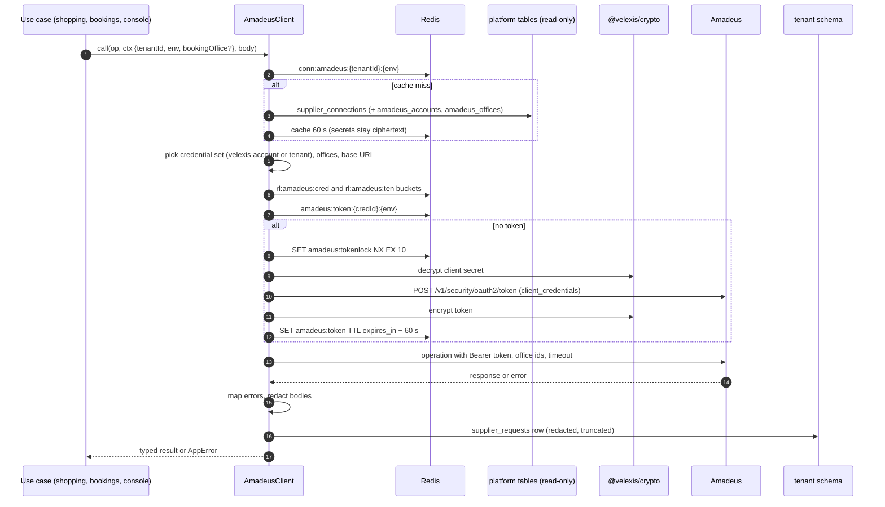

# Flow: Amadeus connection and tokens

This flow covers how every Amadeus call of the OTA backend is prepared and made: resolving which credentials and offices serve the tenant (the Velexis shared account with the tenant's office by default, or the OTA's own credentials from M5), obtaining and caching the OAuth access token, applying the rate limits, timeouts and retries, mapping Amadeus errors to API codes, and logging the call in `supplier_requests`. It is milestone **M2** for the shared account and **M5** for OTA-owned credentials and the releasing-office rule.

Related: [ADR-0012](../../../docs/mvp/adr/0012-amadeus-account-model.md), [OADR-0001](../adr/0001-amadeus-client-design.md), [PADR-0012](../../../platform/docs/adr/0012-amadeus-office-pool.md), [platform flow: Amadeus connection](../../../platform/docs/flows/amadeus-connection.md), [`docs/amadeus-api/`](../../../docs/amadeus-api/), [local development §5](../../../docs/mvp/local-development.md#5-amadeus-stub) (stub).

## 1. Sequence

## 2. Resolution rules

1. **Connection.** One `platform.supplier_connections` row per tenant and environment. No active row → `424 SUPPLIER_NOT_CONFIGURED`.
2. **Credentials.** `credential_source = velexis` → the referenced `amadeus_accounts` row (client id, encrypted secret, base URL) of that environment. `credential_source = tenant` → the connection's own client id and encrypted secret (M5). The composite foreign key on the platform side makes a test connection point at the live account impossible.
3. **Existing orders after a switch (M5).** For calls on an existing booking (sync, issue, cancel, patch, queue reads), the client checks the booking's `owner_office_id` / `queuing_office_id`: if that office is an `amadeus_offices` row of the Velexis account in status `assigned` **or** `releasing` for this tenant, the Velexis account serves the call; otherwise the tenant's current credentials do ([PADR-0012](../../../platform/docs/adr/0012-amadeus-office-pool.md) point 4).
4. **Offices.** Every request carries the tenant's own `queuingOfficeId` and `ownerOfficeId` (create order), queue office (Queue List) and retrieval office (by-reference). Raw console calls and imports for any other office answer `403 OFFICE_NOT_ALLOWED`.
5. **Base URL.** `AMADEUS_BASE_URL_TEST` / `_LIVE` when set (the stub in development and CI), else the account's or connection's `base_url`, else the official host for the environment.
6. **Cache.** Rows are cached for 60 s and dropped on `vx:invalidate` `{type: "connection", tenantId}` or `{type: "amadeus_account", id}`. Tokens are keyed by credential id, so a credential switch never reuses the old token.

## 3. Tokens

- `client_credentials` grant; the token is encrypted with the master key before it is written to Redis, TTL `expires_in − 60 s` ([ADR-0012](../../../docs/mvp/adr/0012-amadeus-account-model.md)).
- Single flight: one process fetches, others wait up to 2 s for the key to appear, then fetch themselves.
- A `401` from an operation drops the cached token and retries the call once with a new token.
- A token request refused with `401`/`400 invalid_client` marks the connection unusable for 5 minutes in Redis (`amadeus:badcred:<credId>`), answers `424 SUPPLIER_NOT_CONFIGURED`, and sends one ops alert; the platform's verification job owns fixing credentials.

## 4. Limits, timeouts and retries

| Operation | Timeout | Automatic retry |
|---|---|---|
| OAuth token | 10 s | 1 (network, `5xx`) |
| Flight Offers Search (GET, POST) | 30 s | 1 |
| Flight Availabilities Search, Branded Fares Upsell | 20 s | 1 |
| Flight Offers Price | 20 s | 1 |
| Flight Create Orders | 60 s | **never** (reconcile, [OADR-0003](../adr/0003-booking-orchestration-and-supplier-timeout-recovery.md)) |
| Flight Order Issue | 60 s | **never** (resync before the job retries) |
| Flight Order Management GET, by-reference GET, Queue List | 15 s | 1 |
| Flight Order Management PATCH, DELETE | 30 s | **never** (resync / reconcile) |

Retries wait 300–800 ms with jitter. Token buckets start at **20 requests per second per credential set** (shared by all OTAs on the Velexis account) and **5 per second, burst 10, per tenant**; both are configuration constants revisited after the M2 load test (ADR-0012 follow-up). An empty bucket answers `429 RATE_LIMITED` with `Retry-After` and makes no call.

## 5. Error mapping (initial table, confirmed against recorded fixtures in M2)

| Amadeus | API code | Notes |
|---|---|---|
| Timeout, connection reset | `504 SUPPLIER_TIMEOUT` | "May have happened" for writes |
| HTTP `5xx`, `141` system error | `503 SUPPLIER_UNAVAILABLE` / `502 SUPPLIER_ERROR` | |
| HTTP `429` from Amadeus | `503 SUPPLIER_UNAVAILABLE` | Bucket sizes too large: ops alert |
| `34651` segment sell failure, no availability | `409 SOLD_OUT` | |
| `37200` price discrepancy | `409 PRICE_CHANGED` | New price from a re-price |
| `4926` invalid data, `32171` mandatory data missing | `422 TRAVELER_DATA_INVALID` (traveller pointers) or `422 SUPPLIER_REJECTED` | `fieldErrors` from `source.pointer` |
| `2552` simultaneous update | `409 VERSION_CONFLICT` | |
| `9112` ticketing | `502 TICKETING_FAILED` | |
| Credit card refused (form of payment errors) | `402 PAYMENT_DECLINED` | Airline card only |
| Other `4xx` | `422 SUPPLIER_REJECTED` | `error.supplier` in console scope only |

## 6. Logging

- One `supplier_requests` row per call: operation (SDK method), Amadeus API and operation id, method, path without secrets, office, status, outcome, error codes, duration, `ama-request-id` correlation, request id, booking or search id, staff id. Bodies pass the shared redactor (documents and card numbers masked, CVV and tokens dropped, e-mails and phones masked) and are truncated to 64 KB (`truncated = true`).
- One log line per call without bodies (`amadeus.call` with operation, status, duration, codes).
- The OAuth token request is logged as `amadeus_api = 'Authorization'` without its body.

## 7. Failure handling

| Situation | Behaviour |
|---|---|
| No connection for the environment | `424 SUPPLIER_NOT_CONFIGURED`; storefront maintenance message |
| Connection `pending_verification` (no free office at provisioning) | Same as above until the platform assigns an office |
| Redis down | No token cache and no buckets: calls refused with `503 SERVICE_UNAVAILABLE` (protects the shared quota) |
| Amadeus down | Mapped errors; booking writes reconciled; reads retried once |

## 8. Tests

- Stub (`tools/amadeus-stub`, `X-Stub-Scenario`): every operation's success fixture validates against `docs/amadeus-api/*.json`; scenarios `timeout`, `server-error`, `sold-out`, `price-changed`, `version-conflict`, `ticketing-failed`.
- Token cache: one token request for 50 concurrent calls; `401` refresh path.
- Resolver: velexis vs tenant credentials; releasing office rule; office isolation `403`.
- Redaction: a request with a document number and a card is stored masked.
