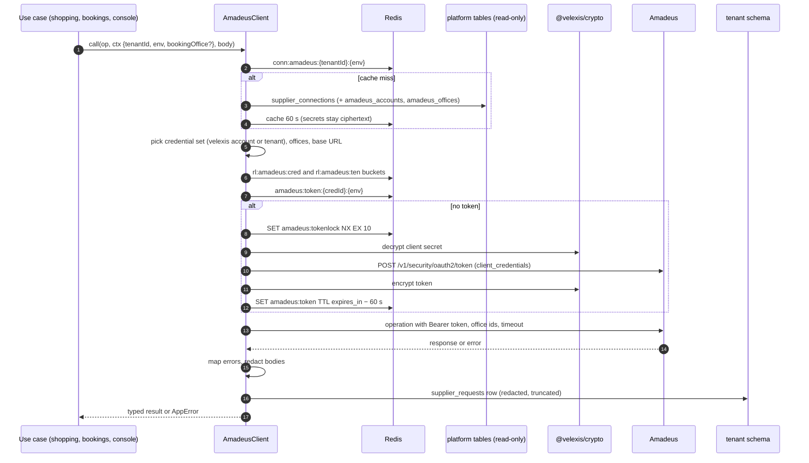

# Flow: Amadeus connection and tokens

This flow covers how every Amadeus call of the OTA backend is prepared and made: resolving which credentials and offices serve the tenant (the Velexis shared account with the tenant's office by default, or the OTA's own credentials from M5), obtaining and caching the OAuth access token, applying the rate limits, timeouts and retries, mapping Amadeus errors to API codes, and logging the call in `supplier_requests`. It is milestone **M2** for the shared account and **M5** for OTA-owned credentials and the releasing-office rule.

Related: [ADR-0012](../../../docs/mvp/adr/0012-amadeus-account-model.md), [OADR-0001](../adr/0001-amadeus-client-design.md), [PADR-0012](../../../platform/docs/adr/0012-amadeus-office-pool.md), [platform flow: Amadeus connection](../../../platform/docs/flows/amadeus-connection.md), [`docs/amadeus-api/`](../../../docs/amadeus-api/), [local development §5](../../../docs/mvp/local-development.md#5-amadeus-stub) (stub).

## 1. Sequence

## 2. Resolution rules

1. **Connection.** One `platform.supplier_connections` row per tenant and environment. No active row → `424 SUPPLIER_NOT_CONFIGURED`.
2. **Credentials.** `credential_source = velexis` → the referenced `amadeus_accounts` row (client id, encrypted secret, base URL) of that environment. `credential_source = tenant` → the connection's own client id and encrypted secret (M5). The composite foreign key on the platform side makes a test connection point at the live account impossible.
3. **Existing orders after a switch (M5).** For calls on an existing booking (sync, issue, cancel, patch, queue reads), the client checks the booking's `owner_office_id` / `queuing_office_id`: if that office is an `amadeus_offices` row of the Velexis account in status `assigned` **or** `releasing` for this tenant, the Velexis account serves the call; otherwise the tenant's current credentials do ([PADR-0012](../../../platform/docs/adr/0012-amadeus-office-pool.md) point 4).
4. **Offices.** Every request carries the tenant's own `queuingOfficeId` and `ownerOfficeId` (create order), queue office (Queue List) and retrieval office (by-reference). Raw console calls and imports for any other office answer `403 OFFICE_NOT_ALLOWED`.
5. **Base URL.** `AMADEUS_BASE_URL_TEST` / `_LIVE` when set (the stub in development and CI), else the account's or connection's `base_url`, else the official host for the environment.
6. **Cache.** Rows are cached for 60 s and dropped on `vx:invalidate` `{type: "connection", tenantId}` or `{type: "amadeus_account", id}`. Tokens are keyed by credential id, so a credential switch never reuses the old token.

Since OBE-079 (`src/amadeus/connection-resolver.ts`, `existingOrderOffice` in `src/amadeus/amadeus.client.ts`, `test/integration/amadeus/own-credentials.int.test.ts`); the details below are the task's reading of rules 1, 3 and 6, proposed to the lead:

- **Own credentials (rule 2).** A `tenant` connection serves with its client id, its client secret's ciphertext and the associated data of the connection's row (`platform.supplier_connections.client_secret_ciphertext:<sc_id>`, as the platform re-encrypts a verified submission, PBE-053), its `base_url` and its offices. Its credential id is the connection's `sc_…`, the shared account's is `ama_…`: tokens, token locks, refused-credentials flags (§3) and per-credential buckets (§4) of the two sets never mix, so a switch never reuses the Velexis token and credentials Amadeus refuses block one set only. A later submission applied to the same connection keeps its `sc_…`: as after a rotation of the shared account's secret ([platform flow](../../../platform/docs/flows/amadeus-connection.md) §B item 3), the cached token runs out on its own, and an operation that Amadeus answers `401` replaces it at once (§3).
- **Which office decides (rule 3).** A call on an order (Flight Order Management GET, PATCH and DELETE, Flight Order Issue) names the booking's office (`orderOffice` of the call context); Queue List names the office whose queue it reads (its `officeId`, else `orderOffice`), so the queues of a `releasing` office stay readable for the old orders (the queue poller, the console's queue views). A by-reference read names the booking's office when its caller has one: the timeout reconciliation of a booking still `pending` ([OADR-0003](../adr/0003-booking-orchestration-and-supplier-timeout-recovery.md)) lists the booking queue of its queuing office and reads the PNRs it finds by record locator with that office (`reconcileCallContext` in `src/bookings/reconcile.service.ts`), so an order sent just before the switch is never read with credentials that cannot see it, whose `404` would count as "not ours" and fail the booking. Searches, pricing, Flight Create Orders, PNR lookups and imports name none: everything new uses the current credentials.
- **What serves such an order.** When the office is an office of the Velexis account of the environment `assigned` or `releasing` for this tenant, the Velexis account serves the call with that office alone (`officeIds = [office]`), whatever the connection's credential source, and must be `active` (else 424). Otherwise the current credentials serve it, and the client refuses an office outside their `officeIds` with `403 OFFICE_NOT_ALLOWED` before any call: an office released to the pool, or another tenant's, never reaches Amadeus. A `velexis` connection's own office needs no look-up.
- **Rule 1 first.** A connection that is not `active` answers 424 for every call, an existing order's included: a connection the platform disabled serves nothing.
- **The cached rows (rule 6).** `conn:amadeus:<tenantId>:<env>` carries the id of the environment's Velexis account (`velexisAccountId`, `amadeus_accounts_environment_uq`), and `amadeus:acct:<id>` the account's `assigned` and `releasing` offices with their tenant, read with the account in one read-only transaction (`PlatformReadRepository.amadeusConnection`, `amadeusAccountById`). The platform publishes `amadeus_account` after every change of the account's offices (an assignment, the start of a release by PBE-053, a release by PBE-054, a retirement), so a released office stops routing to the Velexis account as soon as that invalidation arrives, and within the 60 s of the entry otherwise. An entry written before OBE-079 (without these fields) is a miss and is read again.
- **Not covered yet** (OBE-079). The console's raw order and queue reads (`src/console/raw-amadeus.service.ts`) and the PNR import (`src/console/pnr-import.service.ts`) withhold the orders of every office outside the connection's own `officeIds` after the call: once a tenant uses its own credentials, a raw read of an order of a `releasing` office reaches it through the Velexis account but answers `403 OFFICE_NOT_ALLOWED`. The booking flows (sync, issue, cancel, patch, queue polling, the timeout reconciliation) are not affected.

  **2026-11-02 (lead decision (2n), FIX-W39-OTA): covered.** The raw order and queue reads and the PNR import check orders against the tenant's own offices (`ConnectionResolver.tenantOffices`): the connection's `officeIds`, then the offices of the environment's Velexis account `assigned` or `releasing` for the tenant (PADR-0012 point 4; after a switch, its releasing ones), read from the same cached `amadeus:acct:<id>` entry as rule 3. An order or queue entry of such an office is answered and kept in the supplier log as it is; Queue List of such an office (`officeId`) is served through the Velexis account by rule 3; another tenant's office is still `403 OFFICE_NOT_ALLOWED` before any call, and an office released to the pool is no longer the tenant's. Reads that cannot know the office before Amadeus answers still name none and are served by the current credentials: the by-reference read of a PNR lookup or import (the import's Flight Order Management GET then names the order's office) and a raw `getFlightOrder` or `getFlightOrderByReference` of an order no booking holds; with own credentials they find only what those credentials can read. **Which office decides, for a booking without an owner office:** every caller that names a booking's order (the booking sync and console resync, the ticketing job, the cancellations, the contact and traveller changes, the console's issue, retrieve and patch, the checkout's issuance, the raw `getFlightOrder` of an attached order) takes it from one helper, `bookingOrderOffice` in `src/amadeus/call-context.ts`: the booking's `owner_office_id`, else its `queuing_office_id` ([OADR-0001](../adr/0001-amadeus-client-design.md) point 3); before, all but the raw read named the owner office only, so a booking without one was served by the current credentials, which cannot read an order of a releasing Velexis office. The timeout reconciliation keeps naming the queuing office (its Queue List reads the queue the order was placed on).

## 3. Tokens

- `client_credentials` grant; the token is encrypted with the master key before it is written to Redis, TTL `expires_in − 60 s` ([ADR-0012](../../../docs/mvp/adr/0012-amadeus-account-model.md)).
- Single flight: one process fetches, others wait up to 2 s for the key to appear, then fetch themselves.
- A `401` from an operation drops the cached token and retries the call once with a new token.
- A token request refused with `401`/`400 invalid_client` marks the connection unusable for 5 minutes in Redis (`amadeus:badcred:<credId>`), answers `424 SUPPLIER_NOT_CONFIGURED`, and sends one ops alert; the platform's verification job owns fixing credentials.

## 4. Limits, timeouts and retries

| Operation | Timeout | Automatic retry |
|---|---|---|
| OAuth token | 10 s | 1 (network, `5xx`) |
| Flight Offers Search (GET, POST) | 30 s | 1 |
| Flight Availabilities Search, Branded Fares Upsell | 20 s | 1 |
| Flight Offers Price | 20 s | 1 |
| Flight Create Orders | 60 s | **never** (reconcile, [OADR-0003](../adr/0003-booking-orchestration-and-supplier-timeout-recovery.md)) |
| Flight Order Issue | 60 s | **never** (resync before the job retries) |
| Flight Order Management GET, by-reference GET, Queue List | 15 s | 1 |
| Flight Order Management PATCH, DELETE | 30 s | **never** (resync / reconcile) |

Retries wait 300–800 ms with jitter. A `401` of any operation (writes included: Amadeus refused the request before doing anything) drops the token and sends the request once more with a new one. Every request sent, a retry included, takes a token from both buckets. Token buckets start at **20 requests per second per credential set** (shared by all OTAs on the Velexis account) and **5 per second, burst 10, per tenant**; both are configuration constants revisited after the M2 load test (ADR-0012 follow-up). An empty bucket answers `429 RATE_LIMITED` with `Retry-After` and makes no call.

## 5. Error mapping (initial table, confirmed against recorded fixtures in M2)

| Amadeus | API code | Notes |
|---|---|---|
| Timeout, connection reset | `504 SUPPLIER_TIMEOUT` | "May have happened" for writes |
| Other network errors (connection refused, DNS) | `503 SUPPLIER_UNAVAILABLE` | The request never reached Amadeus |
| HTTP `502`, `503` / HTTP `504` | `503 SUPPLIER_UNAVAILABLE` / `504 SUPPLIER_TIMEOUT` | A gateway timeout "may have happened" too |
| HTTP `500` (`141` system error), other `5xx` | `502 SUPPLIER_ERROR` | |
| HTTP `429` from Amadeus | `503 SUPPLIER_UNAVAILABLE` | Bucket sizes too large: ops alert |
| `34651` segment sell failure, no availability | `409 SOLD_OUT` | |
| `37200` price discrepancy | `409 PRICE_CHANGED` | New price from a re-price |
| `4926` invalid data, `32171` mandatory data missing | `422 TRAVELER_DATA_INVALID` (traveller pointers) or `422 SUPPLIER_REJECTED` | `fieldErrors` from `source.pointer` |
| `2552` simultaneous update | `409 VERSION_CONFLICT` | |
| `9112` ticketing | `502 TICKETING_FAILED` | |
| Credit card refused (form of payment errors, `1304` credit card not accepted) | `402 PAYMENT_DECLINED` | Airline card only |
| HTTP `403` (an office Amadeus refuses, e.g. Queue List) | `403 OFFICE_NOT_ALLOWED` | |
| HTTP `401` after the retry with a new token | `502 SUPPLIER_ERROR` | |
| Other `4xx` | `422 SUPPLIER_REJECTED` | `error.supplier` in console scope only |

The codes decide for `4xx` answers, the first issue with a code of the table first; the table is the constant of `src/amadeus/error-mapper.ts` (OBE-018), which keeps every issue on the error's cause for the console's raw calls (`details.errors`).

For **Flight Create Orders** the mapped code is not the answer to the caller. Once the request may have reached Amadeus, every answer that does not prove a refusal (a timeout, a reset or otherwise cut connection, any HTTP `5xx` including `500`, `502` and `503`, an answer that cannot be read) is an unknown outcome: the booking stays `pending` for the reconciliation and the answer is `504 SUPPLIER_TIMEOUT`. Only a `4xx` business refusal voids the payment; a connection that was never made and a `401`, `403` or `429` without a business code of the table count as not sent: the booking fails and the payment is kept ([OADR-0003](../adr/0003-booking-orchestration-and-supplier-timeout-recovery.md) point 9).

## 6. Logging

- One `supplier_requests` row per call: operation (SDK method), Amadeus API and operation id, method, path without secrets, office, status, outcome, error codes, duration, `ama-request-id` correlation, request id, booking or search id, staff id. Bodies pass the shared redactor (documents and card numbers masked, CVV and tokens dropped, e-mails and phones masked) and are truncated to 64 KB (`truncated = true`).
- One log line per call without bodies (`amadeus.call` with operation, status, duration, codes).
- The OAuth token request is logged as `amadeus_api = 'Authorization'` without its body.

## 7. Failure handling

| Situation | Behaviour |
|---|---|
| No connection for the environment | `424 SUPPLIER_NOT_CONFIGURED`; storefront maintenance message |
| Connection `pending_verification` (no free office at provisioning) | Same as above until the platform assigns an office |
| Redis down | No token cache and no buckets: calls refused with `503 SERVICE_UNAVAILABLE` (protects the shared quota) |
| Amadeus down | Mapped errors; booking writes reconciled; reads retried once |

## 8. Tests

- Stub (`tools/amadeus-stub`, `X-Stub-Scenario`): every operation's success fixture validates against `docs/amadeus-api/*.json`; scenarios `timeout`, `server-error`, `sold-out`, `price-changed`, `version-conflict`, `ticketing-failed`.
- Token cache: one token request for 50 concurrent calls; `401` refresh path.
- Resolver: velexis vs tenant credentials; releasing office rule; office isolation `403`.
- Redaction: a request with a document number and a card is stored masked.
