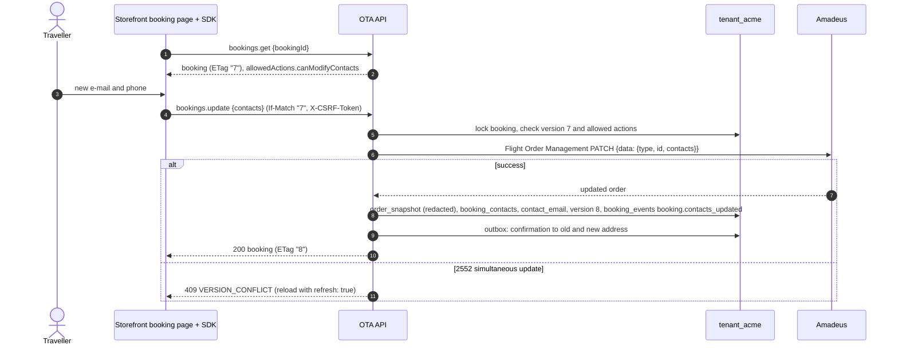
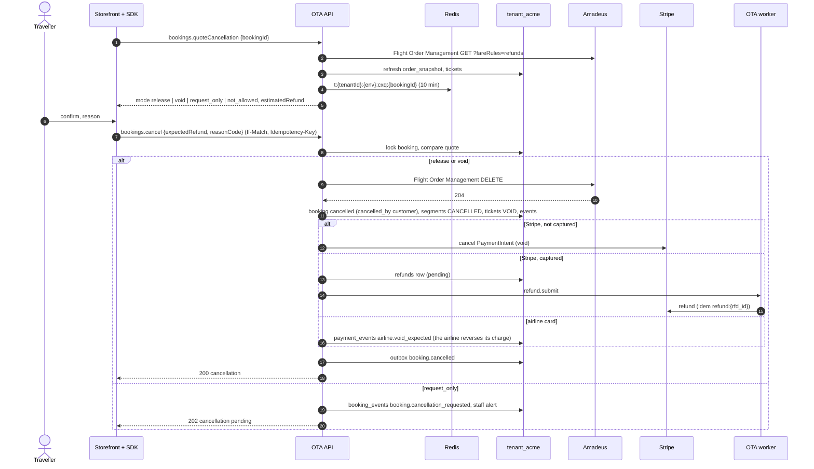

# Flow: change and cancel

This flow covers what a traveller can change or cancel on their own after booking, on the hosted storefront: changing the booking contacts (and adding a special-request remark), getting a cancellation quote, and cancelling. It also covers what happens to the money for each payment method. It is milestone **M3**. Changing traveller documents, buying extras after booking and automatic airline refunds after the void window are later ([`../scope.md`](../scope.md) §3.3); cancellations the airline will not accept automatically become requests that staff finish in the console.

Related: contract operations `bookings.update`, `bookings.quoteCancellation`, `bookings.cancel` in the [OpenAPI document](../../../docs/velexis-sdk/openapi/velexis-ota-booking-api.openapi.yaml), [`my-bookings-and-guest-lookup.md`](my-bookings-and-guest-lookup.md) (access), [`console-operations.md`](console-operations.md) (staff side), [OADR-0003](../adr/0003-booking-orchestration-and-supplier-timeout-recovery.md) (timeouts), [OADR-0010](../adr/0010-stripe-gateway-and-payment-webhooks.md) (refunds).

## 1. Sequence: change contacts

## 2. Sequence: cancel

## 3. Steps

1. **Who may act.** The owning customer (cookie session) or the guest holding the booking token; booking of the storefront's environment only. `allowedActions` from the booking decides what the page offers.
2. **Change contacts.** `bookings.update` accepts `contacts` and `remarks` in the MVP; `travelers[…]` changes answer `403 FEATURE_DISABLED` (`details.feature = "travelerChanges"`). The PATCH sends the full contacts list, as Amadeus replaces it. The new primary e-mail becomes `bookings.contact_email` (used by lookup and notifications); both addresses get a confirmation.
3. **Quote.** `bookings.quoteCancellation` reads the order with refund fare rules and computes the mode:
   - `release`: nothing ticketed → the order is cancelled, the payment voided or refunded in full minus non-refundable OTA fees (`fee_rules.refundable = false`);
   - `void`: every ticket was issued today in the OTA's time zone → tickets voided, full refund;
   - `request_only`: ticketed outside the void window (the MVP has no automatic airline refund) → a request for staff;
   - `not_allowed`: flown, already cancelled, pending, within 3 hours of departure, or self-service cancellation disabled.
   The quote is cached for 10 minutes and `bookings.cancel` refuses a different `expectedRefund` (`409 REFUND_AMOUNT_CHANGED`).
4. **Cancel.** For `release` and `void`, Flight Order Management DELETE, then the booking and its children are updated in one transaction with `booking_events` and the outbox row. The money step runs once (idempotent by `refunds` row and Stripe idempotency key).
5. **Money by method.**

   | Payment | Not captured | Captured |
   |---|---|---|
   | Stripe | Void (`refundStatus: authorization_voided`) | `refunds` row → Stripe refund → webhook `charge.refunded` → `succeeded` |
   | Airline card | — (the airline charged the card) | No PSP action: a void reverses the airline's charge; refunds after the void window are made by the airline when staff process the request. `payment_events` records the expectation; no `refunds` row is created |

6. **Requests.** `request_only` leaves the booking as it is, notifies staff (`booking.cancellation_requested` to the traveller, staff alert to `ops_alert_email`), and staff finish it from the console: cancel at the airline (terminal or `console.bookings.cancel`), then refund the selling amount minus penalties with `console.bookings.cancel` (`refund.mode = amount`) or `console.payments.refund`.
7. **Documents.** A new itinerary marked "cancelled" is generated; credit notes are later (no invoices in the MVP).

## 4. Failure handling

| Situation | Answer and effect |
|---|---|
| Stale ETag | `412 PRECONDITION_FAILED` |
| Amadeus 2552 | `409 VERSION_CONFLICT` |
| Contact data invalid | `422 CONTACT_DATA_INVALID` with `fieldErrors` |
| Quote changed | `409 REFUND_AMOUNT_CHANGED` with `details.newRefund` |
| Amadeus refuses DELETE (outside void window) | Converted to `request_only`, `202` |
| Timeout on DELETE | `504 SUPPLIER_TIMEOUT`; booking flagged; the worker GETs the order within 15 minutes; a same-key retry replays the `504` until decided, then the final `200` (money step runs once) or error |
| Stripe refund fails | Cancellation stands; refund `failed`, staff alerted (`manual_review`), never undone |
| Booking already cancelled | `409 BOOKING_ALREADY_CANCELLED` |

## 5. Tables

`bookings`, `booking_contacts`, `booking_remarks`, `booking_segments`, `booking_tickets`, `booking_events`, `booking_documents`, `payments`, `payment_events`, `refunds`, `fee_rules`, `notifications`, `supplier_requests`, `idempotency_keys`, `staff_actions` (when staff finish a request).

## 6. SDK methods

`bookings.get`, `bookings.update`, `bookings.getFareRules`, `bookings.quoteCancellation`, `bookings.cancel`, `bookings.listEvents`; staff side `console.bookings.cancel`, `console.payments.refund`.

## 7. Tests

- Stub scenarios: PATCH success and `version-conflict`; DELETE success, refusal, timeout.
- Money step exactly once: two `cancel` calls with the same key and a retried `refund.submit` job produce one Stripe refund.
- Mode computation: unit tests over fixture orders (unticketed, ticketed today, ticketed yesterday, flown).
- Airline-card booking cancel: no Stripe call, `payment_events` row written.
