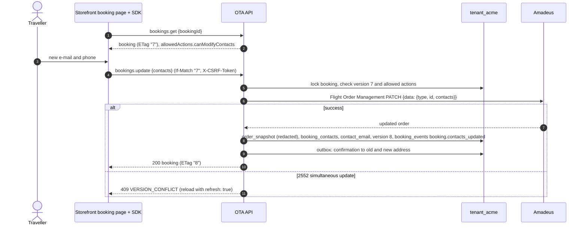
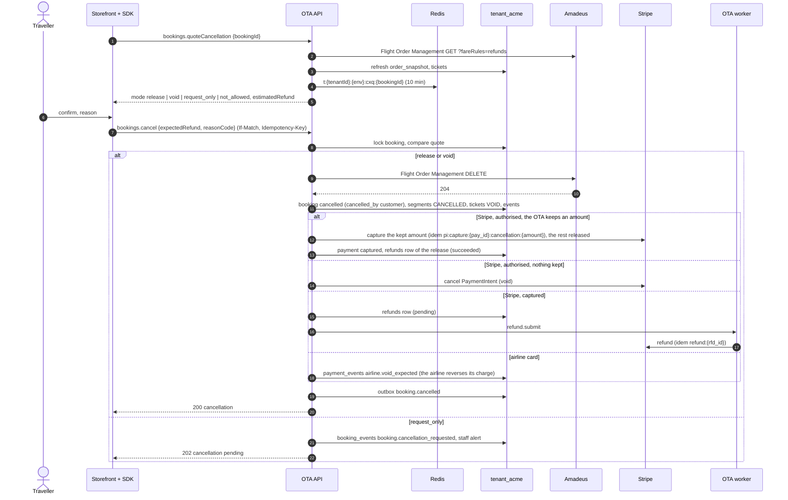

# Flow: change and cancel

This flow covers what a traveller can change or cancel on their own after booking, on the hosted storefront: changing the booking contacts (and adding a special-request remark), getting a cancellation quote, and cancelling. It also covers what happens to the money for each payment method. It is milestone **M3**. Changing traveller documents, buying extras after booking and automatic airline refunds after the void window are later ([`../scope.md`](../scope.md) §3.3); cancellations the airline will not accept automatically become requests that staff finish in the console.

Related: contract operations `bookings.update`, `bookings.quoteCancellation`, `bookings.cancel` in the [OpenAPI document](../../../docs/velexis-sdk/openapi/velexis-ota-booking-api.openapi.yaml), [`my-bookings-and-guest-lookup.md`](my-bookings-and-guest-lookup.md) (access), [`console-operations.md`](console-operations.md) (staff side), [OADR-0003](../adr/0003-booking-orchestration-and-supplier-timeout-recovery.md) (timeouts), [OADR-0010](../adr/0010-stripe-gateway-and-payment-webhooks.md) (refunds).

## 1. Sequence: change contacts

## 2. Sequence: cancel

## 3. Steps

1. **Who may act.** The owning customer (cookie session) or the guest holding the booking token; booking of the storefront's environment only. `allowedActions` from the booking decides what the page offers.
2. **Change contacts.** `bookings.update` accepts `contacts` and `remarks` in the MVP; `travelers[…]` changes answer `403 FEATURE_DISABLED` (`details.feature = "travelerChanges"`). The PATCH sends the full contacts list, as Amadeus replaces it. The new primary e-mail becomes `bookings.contact_email` (used by lookup and notifications). The new address gets the `booking.updated` e-mail of the booking as it is now, with the itinerary attached when one is ready, and, when the address changed, the previous one a short notice of the same key that names the booking reference only (no other booking data, no attachment), in the previous contact's language ([OADR-0013](../adr/0013-notifications-and-booking-documents.md) point 4 as revised on 2026-10-23, lead decision (3) of 2026-10-23, FIX-W28-NOTIFY; before, both got `booking.confirmed`). A staff patch with `notifyCustomer` sends the same e-mails ([console-operations.md](console-operations.md)). A special request the order already holds is not added twice.
3. **Quote.** `bookings.quoteCancellation` reads the order with refund fare rules and computes the mode:
   - `release`: nothing ticketed → the order is cancelled and the customer gets the payment back less what the OTA keeps: its non-refundable fees (`fee_rules.refundable = false`), the cancellation fee, and the card fee unless its stored line is refundable (the Amadeus credit-card fee never is); refunded from a captured payment, released from an authorisation whose kept amount is captured (lead decisions (1) and (2) of 2026-10-23, second batch);
   - `void`: every ticket was issued today in the OTA's time zone → tickets voided, the fare back with the same split;
   - `request_only`: ticketed outside the void window (the MVP has no automatic airline refund) → a request for staff;
   - `not_allowed`: flown, already cancelled, pending, within 3 hours of departure, or self-service cancellation disabled.
   The quote is cached for 10 minutes and `bookings.cancel` refuses a different or missing `expectedRefund` (`409 REFUND_AMOUNT_CHANGED`, `details.expectedRefund` `null` when it was left out).
4. **Cancel.** For `release` and `void`, Flight Order Management DELETE, then the booking and its children are updated in one transaction with `booking_events` and the outbox row. The money step runs once (idempotent by `refunds` row and Stripe idempotency key).
5. **Money by method.**

   | Payment | Not captured | Captured |
   |---|---|---|
   | Stripe | The kept amount captured (`pi:capture:<pay_id>:cancellation:<amount>`) and the rest of the authorisation released, recorded as a `refunds` row `succeeded` (the release, no Stripe refund): `refundStatus` `pending` while the capture is queued, then `succeeded` with the release as `refund`; void (`authorization_voided`) only when nothing is kept | `refunds` row → Stripe refund → webhook `charge.refunded` → `succeeded` |
   | Airline card | — (the airline charged the card) | No PSP action: a void reverses the airline's charge; refunds after the void window are made by the airline when staff process the request. `payment_events` records the expectation; no `refunds` row is created |

6. **Requests.** `request_only` leaves the booking as it is, notifies staff (`booking.cancellation_requested` to the traveller, a staff alert to the recipients StaffRecipients chooses: `ops_alert_email`, else the owners), and staff finish it from the console: cancel at the airline (terminal or `console.bookings.cancel`), then refund the selling amount minus penalties with `console.bookings.cancel` (`refund.mode = amount`) or `console.payments.refund`.
7. **Documents.** A new itinerary marked "cancelled" is generated; credit notes are later (no invoices in the MVP).

## 4. Failure handling

| Situation | Answer and effect |
|---|---|
| Stale ETag | `412 PRECONDITION_FAILED` |
| Amadeus 2552 | `409 VERSION_CONFLICT`; nothing changes locally |
| Traveller changes (`travelers[…]`) | `403 FEATURE_DISABLED` (`details.feature = "travelerChanges"`); nothing is read or sent |
| Contact data invalid | `422 CONTACT_DATA_INVALID` with `fieldErrors` |
| Timeout on PATCH | `504 SUPPLIER_TIMEOUT`; the order is read back first and what Amadeus applied is recorded (new `ETag`, events, confirmations), so a retry with the old `If-Match` answers `412` |
| Amadeus `5xx` or a cut connection on PATCH (outcome unknown, [OADR-0003](../adr/0003-booking-orchestration-and-supplier-timeout-recovery.md) point 9) | `502 SUPPLIER_ERROR` or `503 SUPPLIER_UNAVAILABLE`; the order is read back and recorded as after a timeout |
| Quote changed | `409 REFUND_AMOUNT_CHANGED` with `details.expectedRefund` and `details.newRefund` (also for a request without `expectedRefund`, with `details.expectedRefund: null`: money moves only for an amount the customer saw; lead decision (8) of 2026-10-23, second batch) |
| Amadeus refuses DELETE (outside void window) | Converted to `request_only`, `202` |
| Amadeus has no such order on DELETE (`404`: cancelled or purged outside Velexis) | Converted to a request for the staff, `202`; nothing is refunded until staff check the office |
| Timeout on DELETE | `504 SUPPLIER_TIMEOUT`; booking flagged; the worker GETs the order within 15 minutes; a same-key retry replays the `504` until decided, then the final `200` (money step runs once) or error (`502 SUPPLIER_ERROR` when the order was not cancelled) |
| Another claim or writer holds the booking when bookings.cancel claims it | `503 SERVICE_UNAVAILABLE` with `Retry-After` (lead decision (8) of 2026-10-23, second batch); nothing is sent or kept, the same key can be sent again |
| The record step fails after DELETE `204` | As a timeout on DELETE (`504`, booking flagged, the worker finds the order gone and runs the money step once) |
| Not decided 15 minutes after a timeout (the order cannot be read) | Staff event `booking.cancellation_manual_review` and a staff alert; the same key keeps replaying the `504` |
| Stripe refund fails | Cancellation stands; refund `failed`, staff alerted (`manual_review`), never undone |
| The capture of an authorisation's kept amount fails or its answer is lost | Cancellation stands (`200`, `refundStatus: pending`); `payment.capture_failed` recorded, staff alerted, and `payment.capture_retry` (job id `capture-retry-cancellation-<pay_id>`) captures it 10 minutes later with the same key; when it cannot, the staff settle it (`refundStatus: manual_review`: capture from the console or release the authorisation) ([OADR-0010](../adr/0010-stripe-gateway-and-payment-webhooks.md) point 6, 2026-10-23) |
| The process stops between the record step's commit and the capture or void (a deploy, a crash) | Cancellation recorded; the record step queued its safety net before the commit (lead decision (4) of 2026-10-24, FIX-W29-OTA): `payment.capture_retry` (`capture-retry-cancellation-<pay_id>`, the retry above) or `payment.void` (`payment-void-cancellation-<pay_id>`), 10 minutes later, which captures the kept amount with the same key, or voids, once; on the normal path it finds the payment captured or voided and changes nothing ([OADR-0010](../adr/0010-stripe-gateway-and-payment-webhooks.md) point 6, 2026-10-24) |
| The `refund.submit` job is lost after the money step's commit (Redis down, or the after-commit task failed) | Cancellation stands; the refund stays `pending` until `refunds.sweep` queues `refund.submit` again, 5 minutes or more after the request, with the same job id (FIX-W27-FOLLOWUPS, [OADR-0010](../adr/0010-stripe-gateway-and-payment-webhooks.md) point 6); `refund:<rfd_id>` keeps Stripe from refunding twice |
| The `booking.cancellation_check` enqueue is lost after a `504` (Redis down at the commit) | The 1-minute `bookings.reconcile_scan` queues the flag's first check again under its own job id, a minute or more after the flag, so it runs once ([OADR-0003](../adr/0003-booking-orchestration-and-supplier-timeout-recovery.md) point 7, 2026-10-23) |
| A later check of the chain is lost (its enqueue failed, or its job failed for good) | The flag is still undecided 5 minutes after its deadline, which no healthy chain leaves it: the same scan queues the chain's last check (`…:<deadline>-30`) once, which decides it (the order cancelled, still active, or the staff's review) |
| The `refund.submit` job fails for good before its claim (the database down through all 5 attempts, say) or completes without one | Cancellation stands; the refund stays `pending` and unclaimed, and `refunds.sweep` removes the finished job, which BullMQ would keep for 30 days (a day once completed) and ignore every add for, and queues it again under the same id, so the refund goes out within minutes, once (`refund:<rfd_id>`; FIX-W28-FOLLOWUPS, lead decision (7) of 2026-10-23, second batch) |
| The last attempt of `refund.submit` fails after its claim without a refusal from Stripe (no answer, or any other error, one that is not Stripe's included) | The claim is released (`pending`; the webhook still finds a refund Stripe made by its `refund_id`) and the staff are alerted once to check the payment before refunding again; the sweep never sends a claimed refund again (FIX-W28-FOLLOWUPS) |
| Booking already cancelled | `409 BOOKING_ALREADY_CANCELLED` |

## 5. Tables

`bookings`, `booking_contacts`, `booking_remarks`, `booking_segments`, `booking_tickets`, `booking_events`, `booking_documents`, `payments`, `payment_events`, `refunds`, `fee_rules`, `notifications`, `supplier_requests`, `idempotency_keys`, `staff_actions` (when staff finish a request).

## 6. SDK methods

`bookings.get`, `bookings.update`, `bookings.getFareRules`, `bookings.quoteCancellation`, `bookings.cancel`, `bookings.listEvents`; staff side `console.bookings.cancel`, `console.payments.refund`.

## 7. Tests

- Stub scenarios: PATCH success and `version-conflict`; DELETE success, refusal, timeout.
- Money step exactly once: two `cancel` calls with the same key and a retried `refund.submit` job produce one Stripe refund.
- Mode computation: unit tests over fixture orders (unticketed, ticketed today, ticketed yesterday, flown).
- Airline-card booking cancel: no Stripe call, `payment_events` row written.
- FIX-W29-OTA: the record step's safety net: on the normal path it captures or voids nothing more, and after a stop between the commit and the Stripe call (simulated) it captures the kept amount, or voids, exactly once (`cancel.int.test.ts`, `payments.processor.test.ts`).
- FIX-W28-CANCEL: an authorisation's kept amount captured once and the rest released (also by the worker after a `504`), a kept amount of zero voided, a capture that fails retried by the payments queue or handed to the staff, a refundable and a non-refundable card fee line, the `cancellation` block and `canCancel` of bookings.get and console.bookings.get, a lost `booking.cancellation_check` checked again exactly once, the first of a flag or a later one of its chain (`cancel.int.test.ts`, `bookings-read.int.test.ts`, `create-payment.int.test.ts`).

## 8. Implementation (OBE-049)

[`cancellation.service.ts`](../../backend/src/bookings/cancellation.service.ts) and the pure [`cancellation-mode.ts`](../../backend/src/bookings/cancellation-mode.ts) hold the rules; the stub's scenarios of §7 are `cancel-refused` and `version-conflict` at Management DELETE, and `timeout` / `timeout-lost` ([stub README](../../../tools/amadeus-stub/README.md#scenarios)).

- **Quote.** The order is read again with `fareRules=refunds` (the customer refresh: one GET per booking and minute, shared with `bookings.get` and `bookings.getFareRules`; a throttled call uses the stored order). Mode: `release` (no ticket that still holds a seat), `void` (every such ticket issued today in `storefront_settings.time_zone`; `voidDeadlineAt` is the next midnight there), `request_only` (a ticket issued before today, or of unknown issue time), `not_allowed` (the booking's `allowedActions.canCancel` reason, or `pending` while an earlier cancellation is undecided or waits for the staff). Estimate in release and void (`amountPaid` is what the payment captured, else authorised, else what the airline charged): a Stripe payment gives back what can still be refunded of a capture, or the authorisation, less the booking's non-refundable fees (its priced offer's fee lines with `refundable = false`; every OTA fee of the booking when the snapshot cannot be read), the `cancellation` fee lines of the engine on the booking total and the payment's card fee unless its stored line is refundable (`keptCardFeeOf`, `payments.card_fee_lines`: the Amadeus fee never is; a payment of before tenant migration `0004` has no line and keeps all of it), never below 0; an airline card gives back what the airline charged; `request_only` and `not_allowed` estimate 0 (the staff decide). Lead decisions (1) and (2) of 2026-10-23, second batch (FIX-W28-CANCEL): before them an authorisation was voided whole and the card fee refunded with the rest. Cached 10 minutes in `t:<tenantId>:<env>:cxq:<bookingId>` with the booking's `version`; a void window that closed invalidates it.
- **Cancel.** Checks first without a lock (no Amadeus call for a stale request), then the claim: the booking `FOR NO KEY UPDATE SKIP LOCKED` ([OADR-0014](../adr/0014-per-tenant-workers-and-schedulers.md) point 6; a booking another claim or writer holds answers `503 SERVICE_UNAVAILABLE` with `Retry-After: 1`, which the idempotency layer does not keep, so the same key can be sent again), the checks again, `version + 1`, so a second request with the same ETag answers `503` or `412` and DELETE goes out once per version. A cached quote is used for the booking's `version` only, and never a `not_allowed` one. `request_only` is recorded in the claim's transaction. After DELETE `204`, one transaction records the cancellation (`cancelled`, `cancelled_by = customer`, `cancel_reason` = the reason code, segments `CANCELLED`, tickets `VOID`, services `cancelled`, event `booking.cancelled` through OrderRecorder.event, the `booking.cancelled` e-mail) and the money step; the settlement of an authorisation follows outside the transaction (`settleAuthorisation`): the capture of the kept amount (`captureKept`, `pi:capture:<pay_id>:cancellation:<amount>`, the release recorded with it; a failure recorded, alerted and retried by `payment.capture_retry` 10 minutes later), or the void of an authorisation of which nothing is kept (`pi:cancel:<pay_id>`, `payment.void` queued when it fails). Before its commit the record step queues the safety net of that call (FIX-W29-OTA, lead decision (4) of 2026-10-24: the delayed `payment.capture_retry` under the capture's retry id, or `payment.void` under `payment-void-cancellation-<pay_id>`, removed once it completed), so a process that stops before the Stripe call leaves no authorisation behind. A record step that fails after the `204` (the order is gone, nothing was recorded) is handled as a DELETE without an answer (below, flag reason `record_failed`): `504`, and the worker records the cancellation and its money step once.
- **Events.** Customer-visible: `booking.cancelled`, `refund.requested`, `booking.cancellation_requested`, and for the capture of an authorisation's kept amount `payment.captured` and `refund.succeeded` (the release). Staff-only: `booking.cancellation_timeout` (the flag: what was asked, the deadline), `booking.cancellation_not_applied`, `booking.cancellation_manual_review`. A request also queues the traveller's `booking.cancellation_requested` e-mail and a `staff.manual_review` alert.
- **After a timeout.** `booking.cancellation_check {tenantId, bookingId}` on `ota-bookings` (job id `booking.cancellation_check:<bkg_…>:<deadline>-<run>`, the flag's deadline in epoch milliseconds, the first 30 s after the DELETE, then a minute apart): the claim `FOR NO KEY UPDATE SKIP LOCKED`, Flight Order Management GET, then under the lock again: a `404` or an order whose every segment is `CANCELLED` is recorded as after a `204` (with the money step), an active order as `booking.cancellation_not_applied`. Same-key replays never call Amadeus; the final `200` of a voided authorisation reads the payment for its `refundStatus`. A lost enqueue (Redis down at that moment) is swept since FIX-W28-CANCEL: the 1-minute `bookings.reconcile_scan` lists the live bookings whose newest cancellation event is a flag a minute old or more (`undecidedFlags`, of the bookings changed in the last day) and adds the flag's first check again at once with its own job id, which BullMQ keeps single; a flag still undecided 5 minutes after its deadline lost a later check of its chain, and the scan adds the chain's last check (run `CANCELLATION_CHECK_MAX_RUNS`, which never reschedules) instead.
- **Staff cancellations** (OBE-063, `cancelByStaff`). console.bookings.cancel runs the same claim, DELETE, record step, money step, flag and worker's check with the staff's ask (refused with `details.reason = "ticketing_in_progress"` while a staff issuance or the ticketing job holds a fresh ticketing claim, whose capture would race the money step): `refund.mode` sets the estimate's `estimatedRefund` (what goes back), the record writes `cancelled_by = staff` and `cancel_reason` `<reasonCode>: <reason>`, refunds take the console's reason mapping, the staff text as `reason_note` and the staff member as requester; the flag of a DELETE without an answer holds the staff's part (`cancelledBy: staff`, `staff`), which the worker's check reads back. No request for the staff: an airline refusal answers `422 SUPPLIER_REJECTED`; an order Amadeus no longer has is recorded as cancelled.
- **bookings.get and console.bookings.get** (FIX-W28-CANCEL). Their `cancellation` block (`cancellationOf` in [`bookings.mapper.ts`](../../backend/src/bookings/bookings.mapper.ts), from `cancellation-state.ts`'s facts) is the one bookings.cancel answers: a cancelled booking's typed reason (`bookings.cancel_reason` when it is a code of the document, else `airline_request` for the airline and `other`), the request's time, the customer's comment (a staff member's reason in console scope only) and estimate from the `booking.cancelled` event, and the money of the event's refund, void or capture; a live booking whose cancellation waits for the staff or is undecided shows a `pending` block. `allowedActions.canCancel` follows the quote's rules: an Amadeus order, and no cancellation undecided or waiting for the staff (`pending`).
