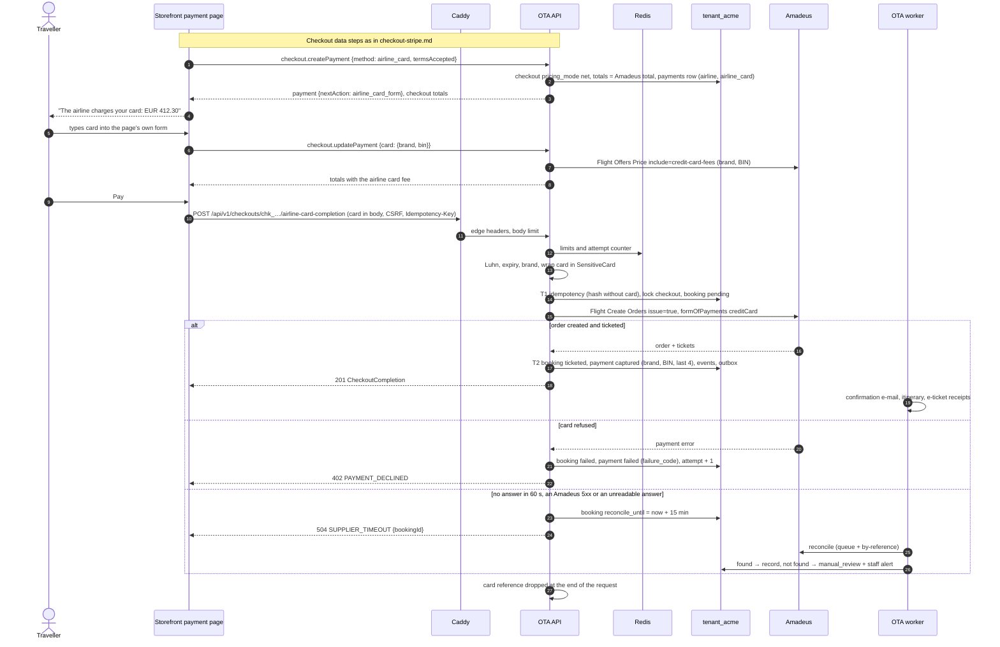

# Flow: checkout with the airline card

This flow covers the second payment method of [`decisions.md`](../../../docs/mvp/decisions.md) §2: the traveller's card is passed to the airline through Amadeus (`formOfPayments` CREDIT_CARD on Flight Create Orders) and the airline charges it. The card passes through the OTA backend in memory only, in one request, on one dedicated route that only the hosted storefront may call. It is built in **M3** for the test environment and enabled for live payments only after the **M6** security review and PCI controls. The price on this path is the airline's price, because the airline, not the OTA, charges the card.

Related: [ADR-0011](../../../docs/mvp/adr/0011-payments-stripe-and-airline-card.md) (method and PCI controls), [OADR-0004](../adr/0004-airline-card-data-handling.md) (backend handling), [`../api-changes.md`](../api-changes.md) §3 (contract), [`../architecture-booking.md`](../architecture-booking.md) §3, [`checkout-stripe.md`](checkout-stripe.md) (shared checkout steps).

## 1. Preconditions

| Check | Where | Failure |
|---|---|---|
| `AIRLINE_CARD_ENABLED=true` (global kill switch) | Config | `403 FEATURE_DISABLED` |
| `storefront_settings.airline_card_enabled_test` / `_live` for the tenant's storefront environment | Settings | `403 FEATURE_DISABLED` |
| Caller is the storefront edge (not `pk_`, `sk_` or the service key) | `ScopeGuard` (`x-edge-only`) | `403 SCOPE_NOT_ALLOWED` |
| Brand in `accepted_card_brands` | Service | `422 UNPROCESSABLE` |
| Fewer than 3 attempts on the checkout; IP and tenant limits | Redis | `403 PAYMENT_ATTEMPTS_EXCEEDED`, `429 RATE_LIMITED` |
| The method not suspended for the tenant and environment (20 declines within an hour) | Redis (`t:<tenantId>:<env>:ac:suspended`) | `403 FEATURE_DISABLED` (`details.reason = "suspended"`); storefront.get leaves `airline_card` out and `checkout.createPayment` refuses it meanwhile, and when the flag cannot be read (lead decision (2) of 2026-10-24, FIX-W29-OTA) |
| Redis available | Throttler | `503 SERVICE_UNAVAILABLE` (the route never runs without its limits) |

## 2. Sequence

## 3. Steps

1. **Choose the method.** `checkout.createPayment {method: "airline_card"}` switches the checkout to `pricing_mode = net`: totals become the Amadeus total of the priced offer and its Amadeus-priced extras, with no OTA markup and no OTA fees. `checkout.setAncillaries` on such a checkout prices the extras the same way (their Amadeus price, no `ancillary_service` fee), so the totals stay the amount the airline charges. The storefront shows this amount and the notice from `storefront.get` (`payment.airlineCard.notice`). Switching back to `card` restores the selling price.
2. **Card fee.** The page's own card form (no third-party script, no iframe) reports brand and BIN as soon as six digits are typed; `checkout.updatePayment` quotes the Amadeus credit-card fee for them. BIN and last 4 may be stored ([ADR-0011](../../../docs/mvp/adr/0011-payments-stripe-and-airline-card.md) §B.5). After a declined card the payment is `failed` and keeps its `paymentId`: the hint of the next card is sent the same way, and a card of another brand gets its fee quoted on that payment (lead decision (2) of 2026-10-24, [OADR-0004](../adr/0004-airline-card-data-handling.md) point 5).
3. **Submit.** The form posts with `checkout.completeWithAirlineCard`; the SDK never retries this method automatically (no `maxRetries` on it) and never logs its arguments.
4. **Validate.** Schema (Ajv errors carry paths only), Luhn, expiry not in the past, brand accepted. The card object is wrapped in a `SensitiveCard` instance whose `toJSON`, `toString` and inspect hooks return `"[redacted card]"` ([OADR-0004](../adr/0004-airline-card-data-handling.md)).
5. **Claim and call.** Same claim as the Stripe path. Flight Create Orders is sent with `issue = true`, `formOfPayments: [{creditCard: {brand, holder, number, expiryDate, securityCode, flightOfferIds}}]` and `paymentOperationContext.interactionCondition = ECOMMERCE`. The redacted copy for `supplier_requests` (brand and the number's last 4; holder, expiry and security code dropped, FIX-W29-SECURITY) is built **before** the call, and the row is inserted after it; the raw request object is never handed to persistence or logging code.
6. **Record.** `payments` row: `status = captured` (charged by the airline), `amount_captured = amount`, `card_brand`, `card_bin`, `card_last4`, no expiry (the database CHECK refuses it). `bookings.pricing_mode = 'net'`, `markup_amount = 0`, tickets from the response.
7. **Forget.** The `SensitiveCard` reference is cleared in a `finally` block; the request body object is not kept anywhere. Nothing is enqueued with card data; the worker only sees ids.

## 4. Failure handling

| Situation | Booking | Payment | Answer |
|---|---|---|---|
| Card invalid (Luhn, expired) | none | unchanged | `400 VALIDATION_FAILED` (`fieldErrors[].code`), not counted as an attempt |
| Airline or Amadeus refuses the card | `failed` | `failed` with the public failure code (`airline.declined`); it takes the traveller's next card, and `checkout.updatePayment` quotes the card fee of the next card's brand on the same `paymentId` (FIX-W29-OTA) | `402 PAYMENT_DECLINED`; third refusal → `403 PAYMENT_ATTEMPTS_EXCEEDED` and staff alert |
| Price changed at re-price | `failed` (console only) | awaiting the card again, for the new total (the checkout moves to it) | `409 PRICE_CHANGED`; the card is discarded, the traveller confirms and types it again |
| A card of another brand than the one the card fee was quoted for (`checkout.updatePayment`), or any card before a card fee was quoted | none | unchanged | `409 PAYMENT_AMOUNT_MISMATCH` (`details.reason = "card_changed"`), not counted as an attempt |
| Sold out, data invalid | `failed` | `failed` | `409 SOLD_OUT`, `422 TRAVELER_DATA_INVALID` |
| Order created but no tickets in the answer | `confirmed`, ticketing `manual_review` | `processing` | `201` with a warning; staff check the order (the card cannot be used again) |
| Timeout, Amadeus `5xx` or an unreadable answer | `pending`, reconciling | `processing` | `504`; found → `201` on replay; not found → `manual_review`, never `failed` automatically |
| Another completion's booking is `pending` | that booking | unchanged | `504 SUPPLIER_TIMEOUT` with its `bookingId` (OADR-0003 point 2); the card is never sent. The other checkout steps answer `409 CHECKOUT_BEING_COMPLETED` |
| Repeated declines from one IP or tenant | — | — | Rate limits, staff alert `staff.airline_card_alert`, Velexis ops alert; 20 declines of the tenant within an hour suspend the method for an hour (`403 FEATURE_DISABLED`, `details.reason = "suspended"`): storefront.get no longer offers it and `checkout.createPayment` refuses it meanwhile |
| The checkout's third decline (or a suspension) counted while another completion of it is under way | `failed` (console only) | unchanged, awaiting the card | The limits are checked again right before the card is sent: `403 PAYMENT_ATTEMPTS_EXCEEDED` (or `FEATURE_DISABLED`), the card is never sent |

## 5. Tables

`checkouts` (`pricing_mode`), `payments` (`provider = airline`, `method = airline_card`), `payment_events` (`airline.charged`, `airline.declined`, without card data), `bookings` and children, `booking_events`, `notifications`, `supplier_requests` (redacted), `idempotency_keys` (hash without card), `storefront_settings`.

## 6. SDK methods

`checkout.createPayment`, `checkout.updatePayment`, `checkout.completeWithAirlineCard` (new), then `bookings.get`, `bookings.getTicketingStatus`.

## 7. Tests and controls (M3, verified again in M6)

- **PAN never persisted:** an integration test submits test PAN `4111111111111111` and CVV `123` through success, decline, timeout and validation-error paths, then scans every tenant table, Redis keys, BullMQ job data and the captured log output for the PAN, its last 12 digits and the CVV; none may appear.
- **Edge only:** `pk_`, `sk_` and service-key calls get `403 SCOPE_NOT_ALLOWED`.
- **Kill switch:** with `AIRLINE_CARD_ENABLED=false` the method is absent from `storefront.get` and every call is refused; while the method is suspended for the tenant and environment (or the suspension cannot be read) it is absent too and `checkout.createPayment` refuses it (FIX-W29-OTA).
- **Limits:** the fourth attempt on one checkout is refused.
- **M6:** payment-page script inventory and the daily integrity check ([ADR-0011](../../../docs/mvp/adr/0011-payments-stripe-and-airline-card.md) §C), penetration test, then `airline_card_enabled_live` may be set.
