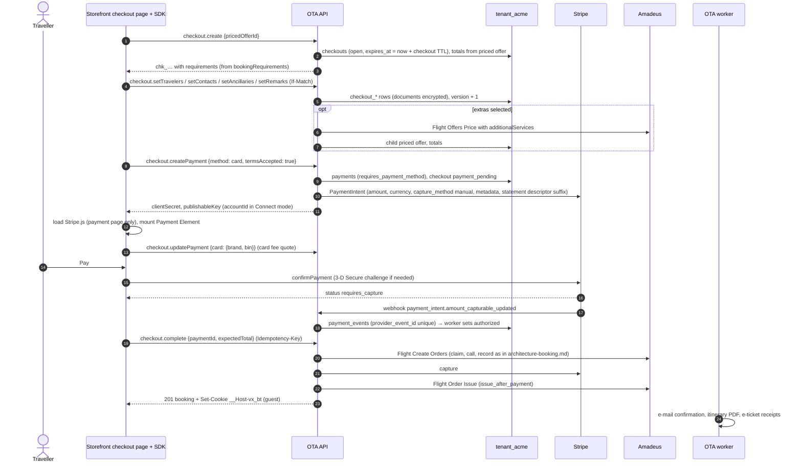

# Flow: checkout with Stripe

This flow covers the checkout on the hosted storefront when the traveller pays by card through Stripe: opening a checkout from a priced offer, entering travellers, contacts, extras and special requests, authorising the card with 3-D Secure in Stripe's Payment Element, and completing the checkout into an Amadeus order that is paid and ticketed. It is milestone **M3** with the Velexis Stripe account; the OTA's own Stripe account (Connect Standard or API keys) uses the same flow from M5. The orchestration and its failure cases are explained in [`../architecture-booking.md`](../architecture-booking.md); this page lists the concrete steps, tables and SDK calls.

Related: [ADR-0011](../../../docs/mvp/adr/0011-payments-stripe-and-airline-card.md), [OADR-0010](../adr/0010-stripe-gateway-and-payment-webhooks.md), [OADR-0003](../adr/0003-booking-orchestration-and-supplier-timeout-recovery.md), [OADR-0008](../adr/0008-ticketing-policy.md), [SDK guide B3](../../../docs/velexis-sdk/sdk/docs/B3.md), [`ticketing-and-documents.md`](ticketing-and-documents.md).

## 1. Sequence

## 2. Steps

1. **Open.** `checkout.create` takes a `prc_…` that is not expired (`410 OFFER_EXPIRED` otherwise) and creates the checkout for the signed-in customer (`customer_id`) or a guest (`is_guest`). Requirements (documents, birth dates, contact fields) come from the priced offer's `booking_requirements`.
2. **Data.** Each `set*` call replaces its part and bumps `checkouts.version` (`If-Match`). Travellers' documents and discount cards are encrypted in `*_ciphertext` columns; only last 4, expiry and countries stay readable. Extras re-price through Flight Offers Price into a child priced offer (`parent_priced_offer_id`), so `checkouts.priced_offer_id` always points at what will be booked.
3. **Payment session.** `checkout.createPayment {method: "card"}` requires complete data and `termsAccepted`. The `StripeGateway` creates a PaymentIntent on the account of the tenant's connection mode ([OADR-0010](../adr/0010-stripe-gateway-and-payment-webhooks.md)) with `capture_method = manual`, 3-D Secure `automatic` (or `any` when `require_3ds`), metadata `velexis_tenant_id`, `velexis_environment`, `checkout_id`, `payment_id`, and the idempotency key `pi:create:<pay_id>`. The payment row records that account (OBE-077, [`../data-model.md`](../data-model.md) §2.2), and every later Stripe call for the payment is made on it, also after the OTA switches mode ([PADR-0011](../../../platform/docs/adr/0011-stripe-connect-standard-and-api-key-connections.md) point 7).
4. **Card fee.** When the Payment Element reports the brand and BIN, the storefront calls `checkout.updatePayment`; the backend quotes the Amadeus credit-card fee (Flight Offers Price `include=credit-card-fees`) plus `payment_card` fee rules, updates the totals and the PaymentIntent amount, and stores the fee's lines with the payment, each with whether a cancellation refunds it (`payments.card_fee_lines`: the Amadeus fee never, an OTA fee when its rule is refundable; FIX-W28-CANCEL).
5. **Confirm.** Stripe.js confirms the payment in the browser; card data goes from the browser to Stripe only. The page then calls `checkout.complete`; it does not wait for the webhook, because `complete` re-reads the PaymentIntent.
6. **Complete.** Claim, re-price if needed, Flight Create Orders with `formOfPayments` from the storefront settings (OTA-merchant model: `other.method`), record, capture (`pi:capture:<pay_id>:<amount>`), then issue per the ticketing policy ([`../architecture-booking.md`](../architecture-booking.md) §2).
7. **After.** The outbox holds `booking.confirmed`; the worker sends it with the itinerary. When tickets exist, `booking.ticketed` follows with e-ticket receipts ([`ticketing-and-documents.md`](ticketing-and-documents.md)).
8. **Expiry.** An unfinished checkout expires after `checkout_ttl_minutes` (extended by 15 minutes when a payment is created); the `checkouts.expire` job voids its authorisation, except while the checkout's booking is `pending`: the order may exist, so only the reconciliation decides about that authorisation ([OADR-0003](../adr/0003-booking-orchestration-and-supplier-timeout-recovery.md)). 2026-10-27 (lead decision (3), accepted as built): after each run's commit the job queues `payment.void` for the Stripe payments, unconfirmed or `authorized`, of the checkouts expired in the last 24 hours that pay for no order, re-reading those checkouts on every run, so a void lost after a commit is queued again ([`../../backend/README.md`](../../backend/README.md), `checkouts.expire`).

## 3. Failure handling

| Situation | Backend | Traveller sees |
|---|---|---|
| Data invalid against requirements | `422 TRAVELER_DATA_INVALID` / `CONTACT_DATA_INVALID` with `fieldErrors` | Field errors, focus on the error summary |
| Stripe unreachable at payment creation | `502 PAYMENT_PROVIDER_ERROR`, nothing charged | Retry |
| 3-D Secure failed or card declined | Stripe.js error; payment stays `requires_payment_method` | Try another card |
| `complete` before authorisation | `402 PAYMENT_REQUIRED` | Payment step again |
| Total changed at re-price (the extras are priced again with the fare), or an extra no longer confirmed | `409 PRICE_CHANGED`, authorisation voided, checkout on the new price (an extra that is gone removed, `details.reason = extras_unavailable`) | New price, pay again |
| Sold out at order creation | `409 SOLD_OUT`, authorisation voided, booking `failed` (console only) | Back to results |
| Amadeus timeout, `5xx` or unreadable answer at order creation | `504 SUPPLIER_TIMEOUT` with `bookingId`; booking `pending` with `reconcile_until`, nothing voided; reconciliation ([OADR-0003](../adr/0003-booking-orchestration-and-supplier-timeout-recovery.md)) | "We are confirming your booking" page that polls `bookings.getTicketingStatus` |
| A checkout step while its booking is `pending` | `409 CHECKOUT_BEING_COMPLETED` with `bookingId`; nothing changes | The same confirmation page |
| Capture fails after the order exists | Booking `confirmed`, ticketing `manual_review`, capture retried, staff alerted | Confirmation with "tickets are being issued" |
| The process stops between the record step's commit and the capture | Booking `confirmed`, payment authorised; the safety net the record step queued before its commit (`payment.capture_retry`, `capture-retry-<pay_id>`, 10 minutes later) captures the booking's total with the request's key, once, and makes the issuance of `issue_after_payment` due for the ticketing scan (lead decision (4) of 2026-10-24, FIX-W29-OTA; [OADR-0010](../adr/0010-stripe-gateway-and-payment-webhooks.md) point 6) | The request fails; the booking is confirmed and paid within minutes, then ticketed |
| Issue fails | Booking `confirmed`, ticketing `failed`, retries until the deadline | Same |
| Webhook before the payment row has the PaymentIntent id | Lookup by `metadata.payment_id` | — |

## 4. Tables

`checkouts`, `checkout_travelers`, `checkout_contacts`, `checkout_ancillaries`, `checkout_remarks`, `priced_offers`, `payments`, `payment_events`, `refunds` (on a void after capture), `bookings` and children, `booking_access_tokens` (guests), `booking_events`, `notifications`, `supplier_requests`, `idempotency_keys`; platform `payment_provider_connections`, `supplier_connections` (read-only).

## 5. SDK methods

`checkout.create`, `checkout.get`, `checkout.setTravelers`, `checkout.setContacts`, `checkout.setAncillaries`, `checkout.setRemarks`, `checkout.createPayment`, `checkout.updatePayment`, `checkout.getPayment`, `checkout.complete`, then `bookings.get` and `bookings.getTicketingStatus` on the confirmation page.

## 6. Tests

- Integration with Stripe test mode mocked at the HTTP layer and signed fixture webhooks (`@velexis/testing/stripe`): happy path for each ticketing policy, price changed, sold out, timeout with reconcile found and not found, capture failure, duplicate webhook.
- Idempotency: two `complete` calls with the same key create one order; another key returns `409 CHECKOUT_ALREADY_COMPLETED`.
- End to end (Playwright, M3): search → checkout as guest → Stripe test card with 3-D Secure (`4000 0027 6000 3184`) → confirmation → e-mail in Mailpit.
