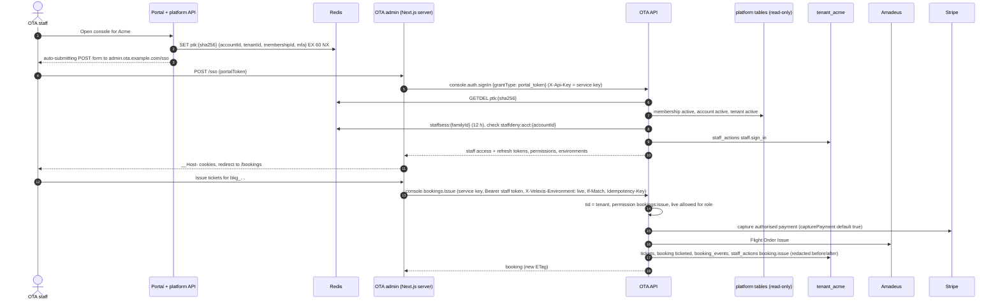

# Flow: console operations

This flow covers what OTA staff do in the OTA admin and how the OTA backend serves it: signing in through SSO from the portal, working the bookings list, retrieving, patching, issuing, cancelling and annotating bookings, looking up and importing PNRs by record locator, reading queues, capturing and refunding Stripe payments, reading customers and the supplier log, and changing settings. It is milestone **M4**. Every console call carries a staff token (or a `console:automation` key) and checks a permission; it writes one `staff_actions` row when it changes something, when it is refused, and when it is a read that returns personal data of one person or a supplier record (§3 step 7).

Related: [ADR-0008](../../../docs/mvp/adr/0008-identity-accounts-customers-sessions.md), [PADR-0007](../../../platform/docs/adr/0007-portal-to-ota-admin-sso-token.md), [OADR-0011](../adr/0011-console-access-staff-sessions-and-environments.md), [`../api-changes-console-and-internal.md`](../api-changes-console-and-internal.md), [SDK guide B4](../../../docs/velexis-sdk/sdk/docs/B4.md), [MVP architecture flow (c)](../../../docs/mvp/architecture.md#c-ota-admin-sso-from-the-portal-and-console-booking-actions).

## 1. Sequence: SSO and an issue action

## 2. Operations by area

| Area | SDK methods | Permission | Amadeus | Notes |
|---|---|---|---|---|
| Session | `console.auth.signIn` (portal token), `.refresh`, `.signOut`, `.me` | — | — | Staff families in Redis; the four `staffdeny` keys honoured ([OADR-0011](../adr/0011-console-access-staff-sessions-and-environments.md) point 3); password grant later |
| Bookings list and detail | `console.bookings.list`, `.get` | `bookings:read` | — (`refresh=true`: GET) | Indexes lead with `environment`; filters of db README §10 |
| Amadeus order view | `console.bookings.retrieve` | `bookings:read` | Flight Order Management GET | Net prices, full documents (decrypted for display, never logged) |
| Patch | `console.bookings.patch` | `bookings:write` | PATCH | `If-Match`; 2552 → `409 VERSION_CONFLICT`; `notifyCustomer` e-mails `booking.updated` (and a notice to a previous contact address) after a change Amadeus answered, a `tags`/`metadata` patch only warns (FIX-W28-NOTIFY) |
| Issue | `console.bookings.issue` | `bookings:issue` | Flight Order Issue | Captures first; `allowUnpaid` owner/admin only |
| Cancel | `console.bookings.cancel` | `bookings:cancel` | DELETE | Refund modes `none`, `full`, `amount` |
| Resync, notes | `console.bookings.resync`, `.addNote` | `bookings:write` | GET (resync) | Notes are `booking_events` visible to staff only |
| PNR lookup and import | `console.bookings.findByRecordLocator`, `.import` | `bookings:read`, `bookings:write` | Get Flight Order By Record Locator | Only orders owned by the tenant's offices (`403 OFFICE_NOT_ALLOWED`); `409 ORDER_ALREADY_IMPORTED` |
| Queues | `console.queues.list`, `.listSnapshots` | `queues:read` | Queue List | Office of the tenant only; poller stores snapshots every 15 min |
| Customers | `console.customers.list`, `.get` | `customers:read` | — | Search by e-mail and name prefixes |
| Supplier log | `console.supplierRequests.list` | `supplier_requests:read` | — | Redacted bodies |
| Raw Amadeus (read) | `console.amadeus.searchFlightOffers`, `.getFlightOffers`, `.searchFlightAvailabilities`, `.upsellAirOffers`, `.quoteAirOffers`, `.getFlightOrder`, `.getFlightOrderByReference`, `.getQueue` | `amadeus:read` | As named | Net prices; office isolation; raw writes deferred |
| Payments | `console.payments.list`, `.get`, `.capture`, `.refund` | `payments:*` | — | Stripe only for capture and refund |
| Settings | `console.settings.*` | `settings:read` / `settings:write` | — | Markups, fees, storefront, pages, assets, templates |

## 3. Steps for the main tasks

1. **Sign in.** The OTA admin has no sign-in page: without a session it redirects to `https://platform.example.com/console?tenant=<id>`. The portal token is single use and expires in 60 seconds. Live tenants require MFA on the portal account; the platform checks it before it issues the token ([PADR-0007](../../../platform/docs/adr/0007-portal-to-ota-admin-sso-token.md), [PADR-0008](../../../platform/docs/adr/0008-email-verification-and-mfa-policy.md)), and `console.auth.signIn` checks the token's `mfa` flag again for a live tenant (`403 MFA_REQUIRED`).
2. **Environment.** The admin's switch sends `X-Velexis-Environment`. `live` needs a live tenant and a role other than `viewer` ([OADR-0011](../adr/0011-console-access-staff-sessions-and-environments.md)).
3. **Work list.** Default filters: `ticketingStatus in (failed, manual_review)`, `reconcile_outcome = manual_review`, deadlines within 24 hours, cancellation requests, schedule changes. These are the "needs attention" views.
4. **PNR import.** Staff enter a record locator. The backend checks the local unique index first, then calls Get Flight Order By Record Locator **with the tenant's office**, verifies the owner or queuing office is one of the tenant's, and creates a booking with `channel = import`, `pricing_mode` chosen by staff (`markup_rules`, `net`, `override`), no payment (`paymentStatus = not_applicable`).
5. **Payments.** Capture is for authorised Stripe payments that were not captured automatically (`manual_review` policy, capture failures). Refunds are partial or full, with a reason; the payments queue sends them and the webhook completes them. The customer sees a refund as requested (booking event `refund.requested`) until Stripe's answer makes it refunded (`refund.succeeded`, lead decision 6 of 2026-10-22). Airline-card payments cannot be refunded here (`422`, `details.reason = "refund_via_airline"`).
6. **Settings.** Changes bump the row version, invalidate the storefront caches, and are audited with redacted before/after. A markup change applies to the next search.
7. **Audit.** A `staff_actions` row for every state-changing call, every refused one, and the successful reads that return personal data of one person or a supplier record ([OADR-0011](../adr/0011-console-access-staff-sessions-and-environments.md) point 8, final rule of 2026-10-21):
   - changes: `outcome = succeeded`, or `failed` when they fail; an idempotent replay keeps its row;
   - refusals: denied attempts (`denied`: the permission guard's `403`s, the staff guard's `403 STAFF_MEMBERSHIP_INACTIVE` of a verified token, and the sign-in's `403`s of the staff member its portal token names, `STAFF_MEMBERSHIP_INACTIVE`, `TENANT_SUSPENDED`, `MFA_REQUIRED` and `ENVIRONMENT_NOT_ALLOWED`) and requests refused by validation (`400 VALIDATION_FAILED`, `failed`, with the action and the target only). A refusal before validation takes a path value as its target only when the value passes that parameter's schema;
   - audited reads: viewing a customer (`customer.view`), the PNR lookup (`pnr.lookup`), the order retrieve (`order.retrieve`) and the raw Amadeus reads (`amadeus.<operationId>`); each handler opts in with `@AuditedRead` ([`../../backend/README.md`](../../backend/README.md)).

   Other successful reads (the bookings list and detail, queues, the customer search, the supplier log, settings) and the session calls `console.auth.refresh`, `signOut` and `me` write none. A `429 RATE_LIMITED` writes none either: the rate-limit guard logs the staff member or key, the operation and the limit.

## 4. Failure handling

| Situation | Answer |
|---|---|
| Portal token unknown, used or expired | `401 PORTAL_TOKEN_INVALID` → back to the portal |
| Live tenant, portal token without MFA (`mfa` not true) | `403 MFA_REQUIRED`; the token stays used → set up MFA in the portal, then open the console again |
| Membership removed or suspended | `403 STAFF_MEMBERSHIP_INACTIVE`; sessions refused within 60 s (`membership` invalidation) |
| "Sign out everywhere" on the portal | `staffdeny:acct:<id>` makes the guard and refresh refuse older families |
| "Sign out of every session" in the console (`console.auth.signOut`, `scope: all`) | `staffdeny:member:<staffId>` (epoch ms, 12 h) makes the guard and refresh refuse the staff member's older families in this OTA |
| Missing permission | `403 FORBIDDEN` (`details.requiredPermission`), `staff_actions` outcome `denied` |
| Over the console rate limit (600 per minute per staff session or key) | `429 RATE_LIMITED` with `Retry-After`; a `rate_limit.exceeded` log line, no `staff_actions` row |
| Office of another OTA | `403 OFFICE_NOT_ALLOWED` |
| Capture after authorisation expiry | `402 PAYMENT_DECLINED`; staff contact the traveller |
| Amadeus timeout on issue or cancel | `504`; resync before retrying ([`../architecture-booking.md`](../architecture-booking.md) §4) |
| Tenant suspended | Console sign-in refused, existing sessions get `403 TENANT_SUSPENDED` |

## 5. Tables

All booking and payment tables, `queue_snapshots`, `customers` (read), `supplier_requests` (read), `staff_actions`, settings tables, `idempotency_keys`; platform `tenant_memberships`, `accounts`, `supplier_connections` (read-only); Redis `ptk:*`, `staffsess:*`, `staffdeny:*`.

## 6. Tests

- SSO: valid token once, second use `401`, token for another tenant `401`, MFA rule for live tenants.
- Permission matrix of [`../scope.md`](../scope.md) §1.3 as a table-driven integration test over every console operation.
- `staff_actions` row per state-changing or refused call (validation refusals included) and per audited read, none for other reads or a `429`, with redacted before/after (no full document numbers, no tokens, no value of a refused request, no target that fails its parameter's schema).
- Office isolation for import and raw calls with two tenants on the shared account.
- Service key accepted only on a direct loopback connection without `X-Forwarded-For` (never through Caddy) and only with a staff token; the forwarded `X-Velexis-End-User-IP` and `-Agent` feed the sign-in throttle and `staff_actions` ([OADR-0009](../adr/0009-caller-and-tenant-resolution.md) rule 1.2 and point 8).
