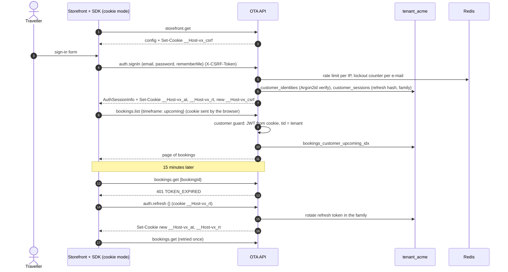
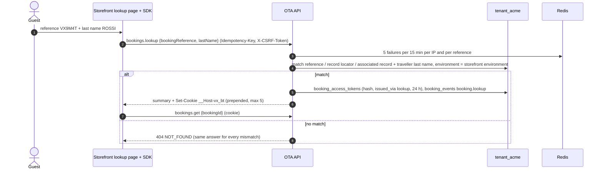

# Flow: my bookings and guest lookup

This flow covers how travellers get back to their bookings on the hosted storefront: customers sign up and sign in with httpOnly cookie sessions and see their upcoming, past and cancelled bookings; guests (no account) reach one booking through the cookie set at booking time or by looking it up with the booking reference and their last name. It is milestone **M3**. The cookie and CSRF design is in [OADR-0006](../adr/0006-storefront-cookie-sessions-and-csrf.md); third-party frontends keep the contract's bearer tokens and `X-Booking-Token`.

Related: [ADR-0008](../../../docs/mvp/adr/0008-identity-accounts-customers-sessions.md), [`../api-changes.md`](../api-changes.md) §2, [SDK guides B1 and B3](../../../docs/velexis-sdk/sdk/docs/), [db README §10](../../../docs/velexis-sdk/db/README.md) (my-trips queries), [`change-and-cancel.md`](change-and-cancel.md).

## 1. Sequence: sign-in and my bookings

## 2. Sequence: guest lookup

## 3. Steps

1. **Sign-up.** `auth.signUp` creates the customer and identity, records terms and privacy consent (`customer_consents` with `terms_version`, `privacy_version`) and queues `auth.verify_email` (token only in `secret_payload_ciphertext`). When `require_email_verification` is off, the response opens a session (cookies) at once.
2. **Verify.** The e-mail link opens `/account/verify.html?token=…`; the page calls `auth.verifyEmail`. Guest bookings whose `contact_email` equals the verified address and that have no customer are attached to the customer (`claimedGuestBookings`), as the contract describes.
3. **Sign-in.** Argon2id verification; 5 failures lock the identity for 15 minutes (`423 ACCOUNT_LOCKED`). The session family lasts 12 hours, or 30 days with `rememberMe`. The CSRF cookie is rotated, so a value planted before sign-in is useless.
4. **Lists.** `bookings.list` with `timeframe` `upcoming`, `past` or `cancelled` uses the three customer indexes of db README §10, newest departure first for past and cancelled. Only bookings of the storefront's environment are listed.
5. **Detail.** `bookings.get` reads the stored booking; `refresh=true` triggers a Flight Order Management GET (rate limited, at most once a minute per booking). `allowedActions` drives the buttons (change contacts, cancel, documents).
6. **Refresh.** On `401 TOKEN_EXPIRED` the SDK calls `auth.refresh` once with cookies and retries the original call; reuse of an old refresh token revokes the whole family (`401 REFRESH_TOKEN_REUSED`, cookies cleared).
7. **Sign-out.** `auth.signOut` revokes the session (or all sessions with `scope: all`) and clears the cookies.
8. **Guest access.** After a guest booking, `checkout.complete` adds `bkg_<id>.<token>` to `__Host-vx_bt` (at most 5 bookings, newest first). The booking page reads `bookingId` from the URL; the backend finds the matching token in the cookie. Lost cookie → lookup.
9. **Account deletion.** `account.delete` soft-deletes the customer at once (db README §7), revokes sessions, clears cookies; bookings stay with `customer_id` kept until the M6 erasure job anonymises them. A booking that still waits for payment, tickets or a refund holds the deletion back (`409 ACCOUNT_DELETION_BLOCKED`): live bookings always, test bookings from the test environment, and a `pending` booking whatever its environment (its checkout stays open for the reconciliation, OADR-0003 point 10; lead decision (3) of 2026-10-24, FIX-W29-OTA). The same transaction queues the confirmation `account.deleted` to the address before it was replaced ([OADR-0013](../adr/0013-notifications-and-booking-documents.md) point 4 as revised on 2026-10-24).
10. **Address change.** `account.update` with a new `email` (and the current password) keeps it as `pendingEmail` and sends a verification link to it (`auth.verify_email`); sign-in keeps the current address until `auth.verifyEmail` confirms the new one. The same transaction queues the security notice `account.email_changed` to the current address: when the change was asked for, never the new address, no link that acts on the account (OADR-0013 point 4 as revised on 2026-10-24, FIX-W29-OTA).

## 4. Failure handling

| Situation | Answer |
|---|---|
| Wrong password | `401 INVALID_CREDENTIALS`; after 5, `423 ACCOUNT_LOCKED` |
| Unverified e-mail when verification is required before booking | `403 EMAIL_NOT_VERIFIED` on checkout |
| Missing or stale CSRF header | `403 CSRF_TOKEN_INVALID` |
| Expired access token | `401 TOKEN_EXPIRED` → automatic refresh |
| Refresh token reused | `401 REFRESH_TOKEN_REUSED`, family revoked, cookies cleared |
| Booking of another customer or tenant | `404 NOT_FOUND` |
| Lookup brute force | `429 RATE_LIMITED` with `Retry-After` |
| Guest cookie has no token for the booking | `401 UNAUTHENTICATED` → the page offers the lookup |

## 5. Tables

`customers`, `customer_identities`, `customer_sessions`, `customer_password_resets`, `customer_consents`, `bookings` and children (read), `booking_access_tokens`, `booking_events`, `notifications`, `idempotency_keys`, `storefront_settings`.

## 6. SDK methods

`auth.signUp`, `auth.verifyEmail`, `auth.resendVerification`, `auth.signIn`, `auth.refresh`, `auth.signOut`, `auth.requestPasswordReset`, `auth.resetPassword`, `auth.changePassword`, `auth.getSession`, `account.get`, `account.update`, `account.delete`, `bookings.list`, `bookings.get`, `bookings.lookup`, `bookings.listEvents`, `bookings.listDocuments`, `bookings.getDocumentDownloadUrl`.

## 7. Tests

- No token in any response body or JS-readable cookie in edge mode; tokens present in bearer mode (same operations, both modes).
- CSRF: header missing, header different from the cookie, wrong `Origin` → `403`; GETs need no header.
- Cookie attributes: `__Host-` prefix, `Secure`, `HttpOnly` (except CSRF), `SameSite=Lax`, `Path=/`, no `Domain`.
- A customer token of tenant A on tenant B's host → `401`/`404`; a test booking is never found from a live storefront.
- Lookup: wrong reference and wrong name give byte-identical `404` bodies (apart from `requestId`).
