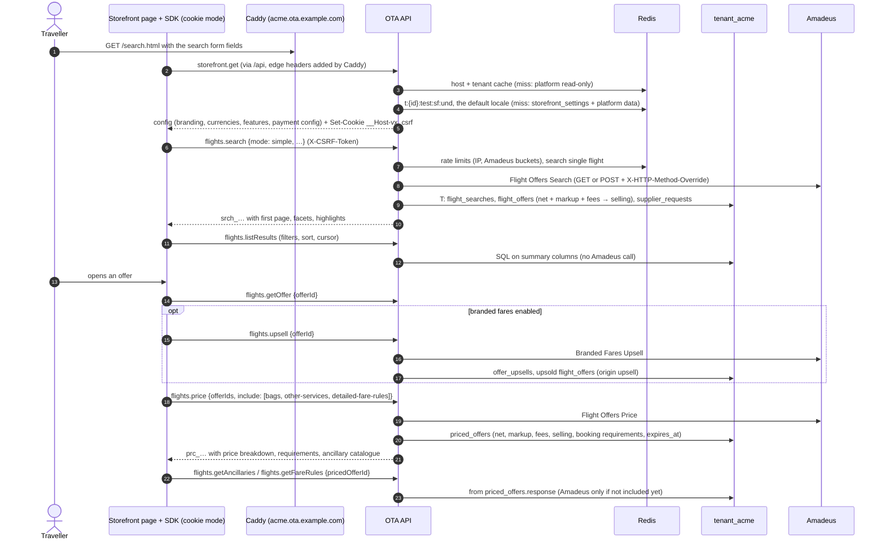

# Flow: search and price

This flow covers what a traveller does on the hosted storefront before checkout: the storefront loads its configuration, the traveller searches, filters and sorts results, opens an offer, optionally picks a branded fare, and prices the chosen offer with its bags and services and fare rules. It is milestone **M2**. The backend stores every search and offer with selling prices from the markup and fee engine, and hands out short-lived capability ids (`srch_`, `off_`, `prc_`) that the next steps use.

Related: [`../architecture.md`](../architecture.md), [OADR-0002](../adr/0002-offer-and-priced-offer-caching.md) (caching and expiry), [OADR-0005](../adr/0005-markup-and-fee-engine.md) (markups and fees), [OADR-0001](../adr/0001-amadeus-client-design.md) (Amadeus client), [SDK guide B2](../../../docs/velexis-sdk/sdk/docs/B2.md), contract operations `flights.*` in the [OpenAPI document](../../../docs/velexis-sdk/openapi/velexis-ota-booking-api.openapi.yaml).

## 1. Sequence

## 2. Steps

1. **Bootstrap.** Every page calls `storefront.get` once and caches it in `sessionStorage` for 5 minutes. In edge mode the response also sets the CSRF cookie that the SDK copies into `X-CSRF-Token` on POSTs ([OADR-0006](../adr/0006-storefront-cookie-sessions-and-csrf.md)). The test environment shows a permanent "Test mode" banner.
2. **Search.** The search form is a real `GET` form; the page script turns it into `flights.search` with `mode: simple` (one-way and return) or `advanced` (multi-city). Defaults come from `storefront_settings.search_defaults` and the connection's sources. Currency: body → `X-Currency` → default currency.
3. **Amadeus call.** The client resolves the tenant's connection and offices, takes tokens from both buckets, calls Flight Offers Search with a 30 s timeout and writes one `supplier_requests` row ([`amadeus-connection-and-tokens.md`](amadeus-connection-and-tokens.md)).
4. **Pricing and storage.** For each offer the engine picks the markup rule and fee rules, computes the selling amounts with `decimal.js`, and the backend inserts `flight_offers` rows with summary columns for filters (stops, carriers, times, duration, cabin, bags, refundability, branded fares). Customer scope sees selling prices only ([OADR-0005](../adr/0005-markup-and-fee-engine.md)).
5. **Results.** `flights.listResults` filters and sorts in SQL within the search (max 250 offers). Nothing is sent to Amadeus.
6. **Offer and upsell.** `flights.getOffer` reads the stored offer. `flights.upsell` calls Branded Fares Upsell and stores the brand alternatives as new offers (`origin = 'upsell'`).
7. **Price.** `flights.price` calls Flight Offers Price with the chosen offers (up to 6) and the `include` flags. A price different from the offer sets `price_changed` and returns the new price; the storefront shows it before checkout. The priced offer expires at `min(now + offer_ttl_minutes, lastTicketingDate)` ([OADR-0002](../adr/0002-offer-and-priced-offer-caching.md)).
8. **Extras and rules.** Bags and other services come from the priced offer's `included` data; detailed fare rules likewise. They are shown in the price summary; selection happens in checkout (`checkout.setAncillaries`, M3).

## 3. Failure handling

| Situation | Answer | Storefront shows |
|---|---|---|
| No offers | `201` with zero offers | "No flights found" with suggestions |
| Amadeus timeout (30 s) or `5xx` | `504 SUPPLIER_TIMEOUT` / `503 SUPPLIER_UNAVAILABLE`; the search row is `failed` | Retry button |
| Shared-quota bucket empty | `429 RATE_LIMITED` with `Retry-After` | "Busy, try again in a few seconds" |
| No active Amadeus connection | `424 SUPPLIER_NOT_CONFIGURED` | Maintenance message |
| Results older than their TTL | `410 SEARCH_EXPIRED` / `OFFER_EXPIRED` | Search again (the form is pre-filled) |
| Price changed at pricing | `200` with `priceChanged: true` and old and new totals | Price change notice |
| Offers from different searches priced together | `422 OFFER_COMBINATION_INVALID` | Not reachable from the storefront UI |
| `resultOptions.async: true` | `403 FEATURE_DISABLED` (MVP is synchronous) | — |
| Missing or wrong CSRF header | `403 CSRF_TOKEN_INVALID` | The SDK reloads `storefront.get` once and retries |

## 4. Tables and data

| Table | Written | Read |
|---|---|---|
| `storefront_settings` | — | bootstrap, defaults, TTLs |
| `markup_rules`, `fee_rules` | — | pricing engine |
| `flight_searches`, `flight_offers`, `offer_upsells`, `priced_offers` | search, upsell, price | results, offer, ancillaries, fare rules |
| `supplier_requests` | every Amadeus call | console diagnostics |
| `reference.*` | — | dictionaries, autocomplete (`reference.locations.search`) |
| Platform: `tenants`, `tenant_domains`, `supplier_connections`, `amadeus_accounts`, `payment_provider_connections` | — | tenant, connection, payment config (cached) |

## 5. SDK methods

`storefront.get`, `reference.locations.search`, `reference.airports.get`, `reference.airlines.list`, `reference.airlines.get`, `reference.countries.list`, `reference.currencies.list`, `flights.search`, `flights.getSearch`, `flights.listResults`, `flights.getOffer`, `flights.upsell`, `flights.price`, `flights.getPricedOffer`, `flights.getAncillaries`, `flights.getFareRules`.

## 6. Tests

- Integration against the Amadeus stub: search simple and advanced, results filters, upsell, price with each `include`, price changed (`X-Stub-Scenario: price-changed`), timeout, `5xx`.
- Selling prices: no net amount in any customer-scope response (JSON walk asserting no `net*` field and `amadeus.price` rewritten).
- Expiry: a search past `expires_at` answers `410`; the purge job removes it unless a checkout references one of its priced offers.
- Tenant isolation: tenant B cannot read tenant A's `srch_`, `off_` or `prc_` ids (`404`).
