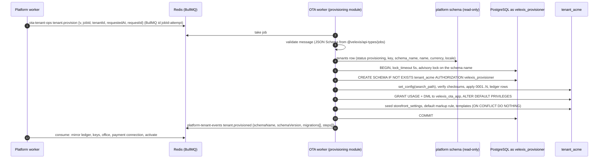

# Flow: tenant provisioning worker

This flow covers the OTA side of the tenant lifecycle: the OTA worker consumes the platform's `ota-tenant-ops` queue, creates and migrates tenant schemas, seeds their defaults, grants the application role, handles suspension and resumption, and reports every result on `platform-tenant-events`. It also covers the tenant migration fan-out at deploy time. The consumer is milestone **M1** (the platform's provisioning job needs it); `tenant.suspend` and `tenant.resume` handling land in M4–M5. The platform side (dispatch, retries, post-steps, reconciler) is in [`platform/docs/flows/provisioning.md`](../../../platform/docs/flows/provisioning.md).

Related: [OADR-0007](../adr/0007-tenant-migration-runner-and-provisioning-worker.md), [PADR-0001](../../../platform/docs/adr/0001-tenant-provisioning-orchestration.md), [PADR-0014](../../../platform/docs/adr/0014-tenant-suspension-and-resume.md), [ADR-0009](../../../docs/mvp/adr/0009-background-jobs-bullmq.md), [ADR-0021](../../../docs/mvp/adr/0021-migration-cli-and-repeatable-grants.md), [db README §3–§4](../../../docs/velexis-sdk/db/README.md), [platform architecture §6.1](../../../platform/docs/architecture.md#61-queue-messages) (message contracts).

## 1. Sequence: `tenant.provision`



## 2. Steps of `tenant.provision`

1. **Validate.** The message must match its JSON Schema (`v = 1`); otherwise the job fails with an `UnrecoverableError` and `tenant.provision_failed {retryable: false}` is sent.
2. **Read the tenant** through the read-only role. Only `status = provisioning` is provisioned; any other status answers `tenant.provision_failed {retryable: false, error.code: TENANT_NOT_PROVISIONING}`, except a schema that is already complete at the latest version, which answers `tenant.provisioned` again (idempotent).
3. **Schema name** is taken from `tenants.schema_name` and checked against `^tenant_[a-z][a-z0-9_]{1,39}$`. An existing schema that has tables but no `schema_migrations` ledger is "foreign content": non-retryable failure, never dropped ([db README §3](../../../docs/velexis-sdk/db/README.md)).
4. **One transaction** as `velexis_provisioner` (`DATABASE_PROVISIONER_URL`, worker only; no app process holds the migrator DSN, [ADR-0004](../../../docs/mvp/adr/0004-postgresql-schema-per-tenant.md)): create the schema, apply every pending file of `ota/backend/migrations/tenant/` with `migrateTenantSchema` from `@velexis/db` (checksums verified, ledger rows written), then the grants:

   ```sql
   GRANT USAGE ON SCHEMA tenant_acme TO velexis_ota_app;
   GRANT SELECT, INSERT, UPDATE, DELETE ON ALL TABLES IN SCHEMA tenant_acme TO velexis_ota_app;
   ALTER DEFAULT PRIVILEGES FOR ROLE velexis_provisioner IN SCHEMA tenant_acme
     GRANT SELECT, INSERT, UPDATE, DELETE ON TABLES TO velexis_ota_app;
   ```

   The schema name in these statements is quoted with the identifier quoting of `@velexis/db` after the regex check; it is the only identifier ever built into SQL.
5. **Seed defaults** (`provisioning/seeds/`, all `ON CONFLICT DO NOTHING`):
   - `storefront_settings`: brand name = tenant name, default currency and locale from the tenant, `time_zone = 'UTC'`, `ticketing_policy = issue_after_payment`, `payment_timing = authorize_before_booking`, `booking_queue_number = 50`, `booking_queue_category = 0` (the Velexis shared offices reserve queue 50 for new orders; an OTA with its own credentials changes it), airline card off;
   - `markup_rules`: one default catch-all rule, `percentage 0`, `is_default`, priority 1000 (OTAs set real markups in the OTA admin);
   - `notification_templates`: the English code defaults of every MVP key ([OADR-0013](../adr/0013-notifications-and-booking-documents.md)).
6. **Commit, then report** `tenant.provisioned` with the ledger rows (`version`, `checksum`, `phase`, `appliedAt`, `durationMs`) and the steps. The platform mirrors them into `platform.tenant_schema_migrations` and runs its post-steps.

## 3. Other messages

| Message | OTA worker does | Answers |
|---|---|---|
| `tenant.migrate {targetVersion?}` | Same transaction as step 4 without creating the schema or seeding; applies pending files up to `targetVersion` | `tenant.migrated` / `tenant.migration_failed` |
| `tenant.suspend {reason}` | Re-reads `tenants.status`; if still `suspended`: expires `open`/`payment_pending` checkouts and enqueues `payment.void` for their authorisations (except a checkout whose booking is `pending`: the order may exist, so its authorisation is left to the reconciliation, [OADR-0003](../adr/0003-booking-orchestration-and-supplier-timeout-recovery.md) point 10 and [OADR-0007](../adr/0007-tenant-migration-runner-and-provisioning-worker.md) point 8; the booking is checked again after the checkout row is locked, so a claim that commits meanwhile is never expired), writes `staffdeny:tenant:<tenantId>` (epoch ms, 30 days) so existing staff refreshes fail, and skips the tenant in the queue poller. Ticketing, sync, refunds and transactional e-mails continue ([PADR-0014](../../../platform/docs/adr/0014-tenant-suspension-and-resume.md)). No-op if the tenant is active again. | `tenant.suspended` |
| `tenant.resume` | Re-reads the status; if `active`: deletes `staffdeny:tenant:<tenantId>` (the value it read, by a compare-and-delete, so a cut-off a newer suspension writes meanwhile stays; the suspension's own clean-up after a resume deletes the same way, FIX-W33-OTA); schedulers pick the tenant up on their next run | `tenant.resumed` |

## 4. Deploy fan-out

On every deploy, `velexis-deploy` ([`deploy/scripts/deploy.sh`](../../../deploy/scripts/deploy.sh), section 2) runs, after the platform and reference migrations and before the `current` switch ([ADR-0021](../../../docs/mvp/adr/0021-migration-cli-and-repeatable-grants.md)). `$REL` is the new release folder `/srv/velexis/releases/<sha>`:

1. `node dist/cli/migrate.js tenants --dir "$REL/migrations/tenant" --concurrency 4 --max-failure-ratio 0.1 --report /var/lib/velexis/migrate-<sha>.json` (from `$REL/db`, with the migrator DSN): every schema of a tenant in `provisioning`, `active` or `suspended`, each in its own transaction with its advisory lock; failures are recorded and the run continues; exit code `3` halts the deploy above 10 % failures. The report is also copied to `/var/log/velexis/migrate-<sha>.json`.
2. `velexis-run ota node "$REL/ota-backend/dist/cli.js" tenants:report-migrations --report /var/lib/velexis/migrate-<sha>.json`: as the OTA zone user with `/etc/velexis/ota-backend.env` and `ota-worker.env` (`REDIS_URL`), publishes one `tenant.migrated` (with the schema's full ledger) or `tenant.migration_failed` event per schema with `jobId = null`, so the platform ledger mirror and `tenants.schema_version` stay right. A failure stops the deploy like a failed migration; re-running the deploy repeats both steps (nothing is applied twice). OBE-007 adds this step to `deploy.sh`.
3. Then `current` is switched and the apps restart (workers first). The new code works with schema versions N-1 and N, because some schemas may still be on N-1 after a failure.

## 5. Failure handling

| Failure | Retryable | Effect |
|---|---|---|
| Lock timeout, connection lost, deadlock | yes | BullMQ retries 3 times within the attempt, then `tenant.provision_failed {retryable: true}`; the platform re-dispatches with backoff |
| Checksum mismatch of an applied file | no | `retryable: false`; ops alerted; the file must be fixed forward |
| Foreign content in an existing schema | no | `retryable: false`; never dropped automatically |
| Worker crash mid-transaction | — | PostgreSQL rolls back; the platform reconciler re-dispatches after the lease |
| Duplicate message (same attempt) | — | BullMQ id `<jobId>-<attempt>` makes the add a no-op; a second run finds the schema complete and answers `tenant.provisioned` |
| Platform worker down | — | Events wait in `platform-tenant-events` |

## 6. Tables and keys

Tenant: the whole schema (DDL), `schema_migrations`, `storefront_settings`, `markup_rules`, `notification_templates`, `checkouts` and `payments` (suspend). Platform (read-only): `tenants`. Redis: `ota-tenant-ops`, `platform-tenant-events`, `staffdeny:tenant:*`.

## 7. Tests

- Integration (`@velexis/testing`): provision a fresh tenant, check ledger, grants (`has_table_privilege` for `velexis_ota_app` on a table created by a later migration), seeds; run the same message twice.
- Two schemas provisioned from scratch are identical (catalog hash), as `check_db.py` asserts for the reference design.
- Failure classification: forced lock timeout → retryable; edited migration file → non-retryable.
- Suspend: open checkout expired and its authorisation void enqueued; a checkout whose booking is `pending` keeps its status and its authorisation, with no void; ticketing job still runs for a paid booking.
