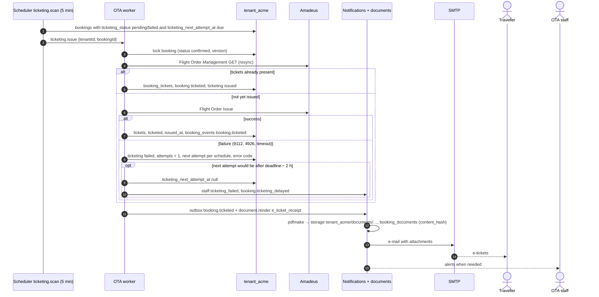

# Flow: ticketing and documents

This flow covers what happens after an order exists: issuing tickets according to the OTA's ticketing policy, retrying a failed issuance until the ticketing deadline, keeping the booking in step with Amadeus, and producing the e-mails and PDF documents the traveller receives and downloads. It is milestone **M3**. The policy choices are recorded in [OADR-0008](../adr/0008-ticketing-policy.md), and e-mails and documents in [OADR-0013](../adr/0013-notifications-and-booking-documents.md).

Related: [`../architecture-booking.md`](../architecture-booking.md), [`checkout-stripe.md`](checkout-stripe.md), [`checkout-airline-card.md`](checkout-airline-card.md), [`console-operations.md`](console-operations.md) (manual issue), [ADR-0017](../../../docs/mvp/adr/0017-email-documents-storage.md), [db README §6](../../../docs/velexis-sdk/db/README.md) (jobs).

## 1. Ticketing policies

| `storefront_settings.ticketing_policy` | Stripe booking | Airline-card booking |
|---|---|---|
| `issue_after_payment` (default) | Create order with `issue=false`, capture, then Flight Order Issue in the same request | Create order with `issue=true` |
| `issue_at_booking` | Create order with `issue=true`, then capture | Create order with `issue=true` |
| `manual_review` | Create order with `issue=false`; authorisation kept; staff issue from the console (which captures first) | Create order with `issue=true` (the card cannot wait) |

An offer with `instantTicketingRequired` is always created with `issue=true`. `payment_timing` is always `authorize_before_booking` in the MVP.

## 2. Sequence: issuance retry and documents

## 3. Steps

1. **Deadline.** At record time the backend reads `lastTicketingDate` and the `ticketingAgreement` of the created order and stores `ticketing_deadline_at`. The queuing office's time zone is not stored in the MVP, so the deadline is midnight at the start of `lastTicketingDate` in the OTA's `storefront_settings.time_zone`, an early and therefore safe reading ([OADR-0008](../adr/0008-ticketing-policy.md)).
2. **First attempt.** Made inside the completion request (§1). A failure sets `ticketing_status = failed`, `ticketing_attempts = 1`, `ticketing_error_code`, `ticketing_next_attempt_at = now + 5 min`.
3. **Retries.** Schedule after the first failure: +5 min, +15 min, +1 h, then every 2 h, at most 8 attempts, never later than `ticketing_deadline_at − 2 h`. Each retry first re-reads the order (GET), so a ticket issued by a timed-out earlier call is recorded instead of issued twice.
4. **Give up.** When no retry is possible, staff get `staff.ticketing_failed` and the traveller `booking.ticketing_delayed`. Staff issue from the console or cancel. If nobody acts, the airline's own time limit cancels the PNR; booking sync then records the cancellation, and the Stripe authorisation is voided or the capture refunded by staff.
5. **Booking sync.** `bookings.sync_scan` (every 10 minutes, 20 oldest per tenant) re-reads active bookings with Flight Order Management GET (`include=bags`): new tickets, schedule changes (segment times or status changes → `booking_events` `booking.schedule_changed`, flagged in the console), cancellation by the airline (`cancelled_by = airline`). Customer e-mails for schedule changes are later; staff see them in the console.
6. **Authorisation watch.** Stripe authorisations last about 7 days. A daily job alerts staff about authorised, uncaptured payments older than 5 days (mostly `manual_review` bookings).
7. **Documents.** Rendered by the worker on events, idempotent per booking version:

   | Event | Document (`booking_documents.kind`) | E-mail (template key) |
   |---|---|---|
   | Order recorded (`confirmed`) | `itinerary` | `booking.confirmed` with the itinerary |
   | Tickets stored | `e_ticket_receipt` per ticket, new `itinerary` (old one `superseded`) | `booking.ticketed` with receipts |
   | Cancelled | new `itinerary` marked cancelled | `booking.cancelled` |
   | Ticketing given up | — | `booking.ticketing_delayed` (traveller), `staff.ticketing_failed` (staff) |
   | Timeout not found (Stripe) | — | `booking.not_confirmed` |

8. **Downloads.** `bookings.listDocuments` lists ready documents; `bookings.getDocumentDownloadUrl` returns a same-origin signed URL (`/api/v1/files/<key>?exp=…&sig=…`, 5 minutes) on the hosted storefront, or an `api.ota.example.com` URL for key callers. The file handler re-checks the tenant and streams the PDF.

## 4. Failure handling

| Situation | Behaviour |
|---|---|
| Flight Order Issue timeout | Treated as "may have issued": no immediate retry; the next attempt starts with a resync |
| Issue refused for payment reasons (form of payment) | `ticketing_error_code = PAYMENT_DECLINED`, no automatic retry, staff alerted |
| Tenant suspended | Ticketing, sync and transactional e-mails continue for paid bookings ([PADR-0014](../../../platform/docs/adr/0014-tenant-suspension-and-resume.md)) |
| SMTP down | Outbox rows stay `pending`, retried with backoff; no booking state changes |
| PDF rendering fails | `booking_documents.status = failed`; `bookings.getDocumentDownloadUrl` answers `409 DOCUMENT_NOT_READY`; retried by the job |
| Worker down | Retries resume from `ticketing_next_attempt_at` when it restarts; nothing is lost |

## 5. Tables

`bookings` (ticketing columns, `ticketing_deadline_at`, `last_synced_at`), `booking_tickets`, `booking_segments`, `booking_events`, `booking_documents`, `notifications`, `notification_templates`, `payments`, `payment_events`, `supplier_requests`, `storefront_settings`.

## 6. SDK methods

Traveller: `bookings.getTicketingStatus`, `bookings.get`, `bookings.listDocuments`, `bookings.getDocumentDownloadUrl`, `bookings.listEvents`. Staff: `console.bookings.issue`, `console.bookings.resync` ([`console-operations.md`](console-operations.md)).

## 7. Tests

- Stub scenario `ticketing-failed`: retries follow the schedule (fake `Clock`), stop at deadline − 2 h, alerts are written once.
- Timeout on issue followed by a GET that shows tickets: no second issue call.
- Document rendering is deterministic for a fixed booking version (hash stable), and a second render of the same version is a no-op.
- Signed URL: expired or tampered signatures answer `403`; another tenant's key answers `404`.
