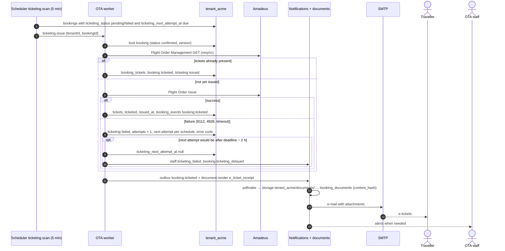

# Flow: ticketing and documents

This flow covers what happens after an order exists: issuing tickets according to the OTA's ticketing policy, retrying a failed issuance until the ticketing deadline, keeping the booking in step with Amadeus, and producing the e-mails and PDF documents the traveller receives and downloads. It is milestone **M3**. The policy choices are recorded in [OADR-0008](../adr/0008-ticketing-policy.md), and e-mails and documents in [OADR-0013](../adr/0013-notifications-and-booking-documents.md).

Related: [`../architecture-booking.md`](../architecture-booking.md), [`checkout-stripe.md`](checkout-stripe.md), [`checkout-airline-card.md`](checkout-airline-card.md), [`console-operations.md`](console-operations.md) (manual issue), [ADR-0017](../../../docs/mvp/adr/0017-email-documents-storage.md), [db README §6](../../../docs/velexis-sdk/db/README.md) (jobs).

## 1. Ticketing policies

| `storefront_settings.ticketing_policy` | Stripe booking | Airline-card booking |
|---|---|---|
| `issue_after_payment` (default) | Create order with `issue=false`, capture, then Flight Order Issue in the same request | Create order with `issue=true` |
| `issue_at_booking` | Create order with `issue=true`, then capture | Create order with `issue=true` |
| `manual_review` | Create order with `issue=false`; authorisation kept; staff issue from the console (which captures first) | Create order with `issue=true` (the card cannot wait) |

An offer with `instantTicketingRequired` is always created with `issue=true`. `payment_timing` is always `authorize_before_booking` in the MVP.

## 2. Sequence: issuance retry and documents

## 3. Steps

1. **Deadline.** At record time the backend reads `lastTicketingDate` and the `ticketingAgreement` of the created order and stores `ticketing_deadline_at`. The queuing office's time zone is not stored in the MVP, so the deadline is midnight at the start of `lastTicketingDate` in the OTA's `storefront_settings.time_zone`, an early and therefore safe reading ([OADR-0008](../adr/0008-ticketing-policy.md)).
2. **First attempt.** Made inside the completion request (§1). A failure sets `ticketing_status = failed`, `ticketing_attempts = 1`, `ticketing_error_code`, `ticketing_next_attempt_at = now + 5 min`.
3. **Retries.** Schedule after the first failure: +5 min, +15 min, +1 h, then every 2 h, at most 8 attempts, never later than `ticketing_deadline_at − 2 h`. Each retry first re-reads the order (GET), so a ticket issued by a timed-out earlier call is recorded instead of issued twice.

   **2026-10-27 (lead decision (1), FIX-W31-OTA): a cancellation holds the issuance.** From the commit of a cancellation's claim (T1 of bookings.cancel or console.bookings.cancel, which writes `bookings.cancellation_claimed_at`) until its outcome is recorded (the booking cancelled, a request for the staff, a DELETE that applied nothing, or the flag of a DELETE without an answer), and while a DELETE without an answer is `undecided` (until the worker's check finds the order cancelled or still active; one handed to the staff's review stays `undecided`), the ticketing job skips the booking (skip reason `cancellation_pending`; it stays due and a later scan claims it) and console.bookings.issue answers `409 BOOKING_NOT_MODIFIABLE` with `details.reason = cancellation_pending`, so no Flight Order Issue goes to an order being deleted ([OADR-0014](../adr/0014-per-tenant-workers-and-schedulers.md) point 6, `cancellationHoldOf` in [`cancellation-state.ts`](../../backend/src/bookings/cancellation-state.ts)). A cancellation's claim older than 5 minutes (a request that stopped mid-DELETE) holds nothing back: the next attempt starts with its resync GET, which finds an order the DELETE removed and fails without issuing. A cancellation that ends as a request for the staff or as not applied leaves the order live, and the retries go on as before. The other way round, a fresh ticketing claim holds the cancellations back (`ticketing_in_progress`, FIX-W30-OTA).

   **2026-10-28 (lead decision (1a), FIX-W32-OTA): the completion's own issuance too.** The issuance that checkout.complete makes itself after the capture (`issue_after_payment`, §1; booking-orchestrator.service.ts `issue`) is the third claim that respects the hold: a customer's or a staff cancellation whose claim committed between the booking's confirmation and that issuance (or a DELETE without an answer still undecided) makes it send no Flight Order Issue; under the same row lock (`FOR UPDATE`) it makes the issuance due now instead (`ticketing_requested_at`, `ticketing_next_attempt_at`, as the payments queue's safety net does) and answers the `201` of the confirmed booking, and the ticketing job skips the booking while the hold lasts and issues it once nothing holds it (a cancellation handed to the staff, or not applied). A cancellation's claim that comes after the issuance's skips the booking the issuance holds and then meets its fresh ticketing claim (`ticketing_in_progress`).
4. **Give up.** When no retry is possible, staff get `staff.ticketing_failed` and the traveller `booking.ticketing_delayed`. Staff issue from the console or cancel. If nobody acts, the airline's own time limit cancels the PNR; booking sync then records the cancellation, and the Stripe authorisation is voided or the capture refunded by staff.
5. **Booking sync.** `bookings.sync_scan` (every 10 minutes, 20 oldest per tenant) re-reads active bookings with Flight Order Management GET (`include=bags`): new tickets, schedule changes (segment times or status changes → `booking_events` `booking.schedule_changed`, flagged in the console), cancellation by the airline (`cancelled_by = airline`). Customer e-mails for schedule changes are later; staff see them in the console. Since OBE-045 (`bookings/order-diff.ts`, `booking-sync.service.ts`): a booking is due when it has an order, its trip is not over, it was last synchronised 6 hours ago or more (the document's "every 6 h for upcoming trips"; 1 hour for a booking that waits for tickets in the 24 hours before its ticketing deadline, "hourly in the 24 h before the ticketing deadline") and no synchronisation was claimed in the last 30 minutes (a failed read is tried again then), for a suspended tenant only when paid; the claim locks the booking `FOR NO KEY UPDATE SKIP LOCKED` and records `bookings.sync_claimed_at` (lead decision (3) of 2026-10-23, FIX-W27-SYNC: before, a staff-only `booking.sync_requested` event, about four a day per upcoming booking, which filled the console's timeline; the refreshes claim the same column, so a refresh within its throttle of a sync's claim stands back and a refresh's claim keeps the sync away for 30 minutes); the result is written with the claim's `version`, and a booking another writer changed meanwhile is read again instead of overwritten (at most 3 reads). A cancellation by the airline is every segment of the order `CANCELLED`: the booking becomes `cancelled` (event `booking.cancelled`, the cancelled itinerary, the traveller's `booking.cancelled` e-mail; the money stays with staff, step 4, who get a staff alert when a payment still holds the traveller's money, an authorisation or a capture, once per booking). A schedule change asks for a new itinerary. An order Amadeus no longer returns (404) is not a cancellation: `sync_error = ORDER_NOT_FOUND` for staff to check. The record projects the order's forms of identification, numbers cut to their last 4, on the booking, and keeps what it changed as the console's `supplierSync.differences`. **Every path that reads an order** (the sync, the customer refresh of bookings.get, console.bookings.get with `refresh=true`, console.bookings.resync) records it through the same diff (`booking-sync.service.ts`) and writes the same events, so a schedule change is reported whichever path sees it first. The sync does not clean the booking queue: cleaning stays manual in Amadeus, and the reconciliation alerts staff when a Queue List answer holds 400 entries or more, at most once a UTC day per OTA and environment (lead decision (5) of 2026-10-23; test and live separately since FIX-W28-NOTIFY; [backend README §4](../../backend/README.md#runbook-cleaning-the-booking-queue)). The staff alert of an airline cancellation names each payment that holds the traveller's money: a Stripe payment is released or refunded from the console, an airline-card payment is refunded through the airline, which the console cannot do (its own wording, lead decision (6) of 2026-10-23, FIX-W28-NOTIFY).
6. **Authorisation watch.** Stripe authorisations last about 7 days. A daily job alerts staff about authorised, uncaptured payments older than 5 days (mostly `manual_review` bookings).
7. **Documents.** Rendered by the worker on events, idempotent per booking version:

   | Event | Document (`booking_documents.kind`) | E-mail (template key) |
   |---|---|---|
   | Order recorded (`confirmed`) | `itinerary` | `booking.confirmed` with the itinerary |
   | Tickets stored | `e_ticket_receipt` per ticket, new `itinerary` (old one `superseded`) | `booking.ticketed` with receipts |
   | Schedule changed by the airline (`booking.schedule_changed`, since FIX-W27-SYNC) | new `itinerary` (old one `superseded`) | — (later) |
   | Contacts changed (bookings.update), or a staff patch with `notifyCustomer` (since FIX-W28-NOTIFY) | — | `booking.updated` with the ready itinerary; a notice without attachment to the previous contact address |
   | Cancelled | new `itinerary` marked cancelled | `booking.cancelled` |
   | Ticketing given up | — | `booking.ticketing_delayed` (traveller), `staff.ticketing_failed` (staff) |
   | Timeout not found (Stripe) | — | `booking.not_confirmed` |

   Since OBE-055 (`notifications/attachments.ts`, `templates/`): `booking.ticketed` is queued by the `booking.ticketed` event whichever path stored the tickets (dedupe key `booking.ticketed:<bkg_…>:v<version>`); the worker attaches the itinerary to `booking.confirmed` (and to `booking.updated`, but never to its notice to a previous contact address, since FIX-W28-NOTIFY) and every e-ticket's receipt to `booking.ticketed` once they are `ready` (all or nothing). While they are not, the e-mail is released without an attempt and claimed again 5 seconds later, for at most 2 minutes after the booking event that asked for them (OADR-0013 item 8; the record step and the ticketing job write that event in the transaction that queues the e-mail); then, or at once when nothing asked for them (a contacts change of a booking without an itinerary), it is sent without attachments and points to `/booking.html?id=bkg_…`. Staff alerts go to `ops_alert_email`, else to the owners read from the platform, else to Velexis ops (`OPS_ALERT_EMAIL`, which both processes read since FIX-W28-NOTIFY; `notifications/staff-recipients.ts`, OADR-0013 item 5).

8. **Downloads.** `bookings.listDocuments` lists ready documents; `bookings.getDocumentDownloadUrl` returns a same-origin signed URL (`/api/v1/files/<key>?exp=…&sig=…`, 5 minutes) on the hosted storefront, or an `api.ota.example.com` URL for key callers. The file handler re-checks the tenant and streams the PDF. Since OBE-054 (`src/documents/`, the operation `downloadFile`): the list holds the `ready` rows only (a superseded version and a failed rendering are not listed), newest first; a URL is issued for a `ready` or `superseded` document (a link to an older version stays valid for its 5 minutes), `failed` answers `409 DOCUMENT_NOT_READY`, a failed rendering that a newer version superseded has no file and answers `404`, and every URL issued appends the staff-only booking event `document.downloaded`. Only the path and `exp` are signed (HMAC-SHA-256 with `document-url.key`), so one link works through Caddy's `/api` and on the API host. The file endpoint answers `403` to an expired, tampered or malformed link before it looks anything up; then, with the storefront edge or an API key, the storage key must be the resolved OTA's and the booking of the request's environment, and without a credential (a browser following a key caller's URL) the key's OTA must be active; anything else is `404`. The file is checked against `content_hash` before it is sent with `Content-Disposition: attachment`, 120 downloads per minute per IP.

## 4. Failure handling

| Situation | Behaviour |
|---|---|
| Flight Order Issue timeout | Treated as "may have issued": no immediate retry; the next attempt starts with a resync |
| A cancellation's DELETE is in flight (its claim committed less than 5 minutes ago) or got no answer and is undecided | The job skips the booking (`cancellation_pending`), which stays due; console.bookings.issue answers `409 BOOKING_NOT_MODIFIABLE`, `details.reason = cancellation_pending`; checkout.complete's own issuance makes the booking due for the job instead of issuing (FIX-W32-OTA); nothing is sent to Amadeus (FIX-W31-OTA, §3 step 3) |
| Issue refused for payment reasons (form of payment) | `ticketing_error_code = PAYMENT_DECLINED`, no automatic retry, staff alerted |
| Tenant suspended | Ticketing, sync and transactional e-mails continue for paid bookings ([PADR-0014](../../../platform/docs/adr/0014-tenant-suspension-and-resume.md)) |
| SMTP down | Outbox rows stay `pending`, retried with backoff; no booking state changes |
| PDF rendering fails | `booking_documents.status = failed`; `bookings.getDocumentDownloadUrl` answers `409 DOCUMENT_NOT_READY`; retried by the job |
| Worker down | Retries resume from `ticketing_next_attempt_at` when it restarts; nothing is lost |

## 5. Tables

`bookings` (ticketing columns, `ticketing_deadline_at`, `last_synced_at`), `booking_tickets`, `booking_segments`, `booking_events`, `booking_documents`, `notifications`, `notification_templates`, `payments`, `payment_events`, `supplier_requests`, `storefront_settings`.

## 6. SDK methods

Traveller: `bookings.getTicketingStatus`, `bookings.get`, `bookings.listDocuments`, `bookings.getDocumentDownloadUrl`, `bookings.listEvents`. Staff: `console.bookings.issue`, `console.bookings.resync` ([`console-operations.md`](console-operations.md)).

## 7. Tests

- Stub scenario `ticketing-failed`: retries follow the schedule (fake `Clock`), stop at deadline − 2 h, alerts are written once.
- Timeout on issue followed by a GET that shows tickets: no second issue call.
- Document rendering is deterministic for a fixed booking version (hash stable), and a second render of the same version is a no-op.
- Signed URL: expired or tampered signatures answer `403`; another tenant's key answers `404` (`src/documents/signed-url.test.ts`, `test/integration/documents/download.int.test.ts`, OBE-054).
- FIX-W31-OTA: with a customer's or a staff cancellation's DELETE held in flight by a barrier, the ticketing job skips the booking (`cancellation_pending`) and a staff issuance is refused (`cancellation_pending`) without an Amadeus call; after the outcome (cancelled, a request for the staff, an airline refusal, Amadeus's 2552 or a DELETE Amadeus refused unread, the worker's decision of a DELETE without an answer) the claims behave as before, and a cancellation's claim older than 5 minutes no longer holds them (`ticketing.service.test.ts`, `cancel.int.test.ts`, `issue-cancel.int.test.ts`).
- FIX-W32-OTA: a barrier at checkout.complete's capture commits a cancellation's claim (or the flag of a DELETE without an answer) before the completion's own issuance, which then sends no Flight Order Issue and leaves the booking due for the ticketing job, which skips it while the claim holds and claims it once the claim is released (`complete-stripe.int.test.ts`).
