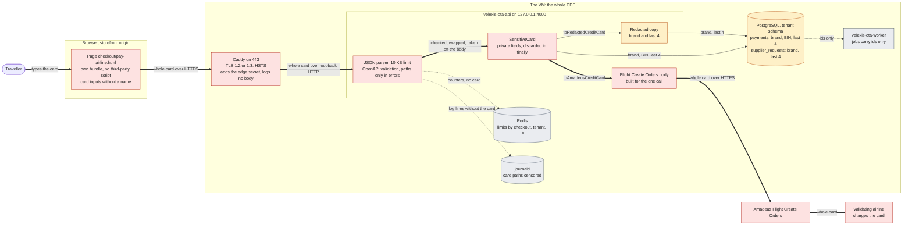

# PCI evidence: the airline card's data flow

This document follows the traveller's card on the airline-card path (method (b) of [ADR-0011](../../../docs/mvp/adr/0011-payments-stripe-and-airline-card.md)) from the storefront page through Caddy, the OTA API process and the Amadeus client to the airline, says what of the card exists where, and maps every control of ADR-0011 §C to the code, the tests and the VM settings and checks that implement it. It is part of the [PCI evidence pack](README.md) (task OBE-085).

The Stripe path (method (a)) is not drawn here: the card goes from Stripe's own iframes on the card page to Stripe and never reaches a Velexis process. Velexis's part there is the integrity of the page that loads Stripe.js, which [`script-inventory.md`](script-inventory.md) covers.

How to read the references: a link named `file:line` opens that line on GitHub, and the text in code style after it is a piece of that line. The [README](README.md#5-checking-the-references) has the command that checks every reference; the named piece finds the place again after the lines move.

## 1. Diagram

Thick arrows carry the whole card (number, security code, holder, expiry), thin arrows carry what PCI DSS lets Velexis keep (brand, BIN, last 4), dotted arrows carry no card data at all.

The sequence of the same request, with the decline and timeout branches, is in [`../flows/checkout-airline-card.md`](../flows/checkout-airline-card.md) §2.

## 2. What exists where

| Place | What of the card | How long | Controls |
|---|---|---|---|
| The card inputs of `/checkout/pay-airline.html` | The whole card as the traveller types it | Until the page empties the inputs: after every answer of the completion and on `pagehide` | Inputs without `name`, a form without `action`; values read only at submit into one local object; never written to storage, cookies, the URL, `history.state`, events or the console ([OADR-0017](../adr/0017-airline-card-form-isolation.md) points 4 and 5; §4 below) |
| The browser's request (`checkout.completeWithAirlineCard`) | The whole card in the JSON body | One request; the SDK never retries it | TLS to the storefront host; `retry: "never"` in the SDK's route table |
| Caddy (storefront host, `/api/*`) | The whole card in the request it proxies, in memory | The proxied request | TLS termination, HSTS, a 256 KB body limit, the edge secret set by Caddy alone, access logs without bodies |
| Between Caddy and the OTA API | The whole card | In transit on the VM's loopback interface (not a public network, PCI DSS 4.2.1) | The API binds `127.0.0.1` only; `ufw` allows only 22, 80 and 443 |
| The OTA API's parsed body | The whole card | From parsing until the controller takes `card` off the body, before the handler's work | 10 KB limit on this route; validation errors carry paths and rules, never values |
| `SensitiveCard` | The whole card in private fields | Until `discard()` in the controller's `finally`, whatever the outcome | `toJSON`, `toString`, `Symbol.toPrimitive` and `util.inspect.custom` answer `[redacted card]` |
| The Flight Create Orders request | The whole card in `formOfPayments[0].creditCard` | The one HTTPS call to Amadeus; writes are never retried | HTTPS only (an `http:` base URL is refused unless it is the loopback stub) |
| Amadeus and the airline | The whole card | Their own systems | Third-party service providers ([`responsibility-matrix.md`](responsibility-matrix.md) §3) |
| `payments` (tenant schema) | Brand, BIN (first 6), last 4 | The booking's retention | The database CHECK `payments_airline_card_ck` refuses an expiry, a PSP reference, 3-D Secure data and a next action on these rows |
| `supplier_requests`, `bookings.form_of_payments`, `bookings.order_snapshot` | Brand and the number's last 4 (the request copy built from `SensitiveCard`); what Amadeus echoes, through the shared redactor (number to its last 4, no security code, holder or expiry) | The rows' retention | `redactPayload` of `@velexis/logger` before every write; the one-off scrub `tenants:scrub-card-copies` rewrote the copies made before 2026-10-24 |
| `idempotency_keys` | The request hash over the body with `card` replaced by its brand and last 4; the answer through the redactor | The key's lifetime | No hash of a card number is stored ([OADR-0004](../adr/0004-airline-card-data-handling.md) point 3) |
| Redis | Nothing of the card: counters keyed by checkout, tenant and hashed IP | Their windows (1 minute to 2 hours) | Proven by the PAN scan of every key and value |
| BullMQ jobs, the OTA worker, e-mails, documents | Nothing of the card: ids only | — | Proven by the PAN scan of every job |
| Log lines (journald) | Nothing of the card | 30 days on the VM today (12 months off the VM with X-038) | The central redaction list, the `err`, `req` and `res` serializers, no request or response bodies |
| The WAF's log lines (journald, Caddy's logger `http.handlers.waf`, X-039) | Nothing of the card: the card is in a JSON body, and the line names the variable that matched, never its value. Its `[uri "…"]` holds the request's query, so a matched request's signed-URL `sig`, link `token` or Stripe client secret (the residual of [README §8](README.md#8-open-questions) item 7, recorded 2026-11-11) | 30 days in the VM's journald; X-038 ships the line with its query values blanked (lead decision (17i) of 2026-11-11) | The generated `logdata.conf` (variable names, no values), Coraza's audit log off; X-038 blanks the query values before any log leaves the VM |
| Swap, core dumps | Nothing: there is neither | — | Swap off, `kernel.core_pattern` to `/bin/false`, `fs.suid_dumpable = 0`, `LimitCORE=0` on every unit, `apport` masked |
| Backups | Nothing of the card beyond the tables above | — | The tables hold no card number, security code, holder or expiry |

The only operation that takes a card is `checkout.completeWithAirlineCard`: a console issuance with a `creditCard` form of payment (or a B2B wallet's virtual card) is refused `403 FEATURE_DISABLED` before anything is read ([`console-booking-actions.service.ts:416`](../../backend/src/console/console-booking-actions.service.ts#L416) `carries card data`; [`bookings-actions.int.test.ts:888`](../../backend/test/integration/console/bookings-actions.int.test.ts#L888) `answers 403 FEATURE_DISABLED for a creditCard form of payment`), and the six `x-sensitive` properties of the OTA document are the airline card's ([`redaction-coverage.contract.test.ts:326`](../../backend/test/contract/redaction-coverage.contract.test.ts#L326) `finds the airline card's x-sensitive fields`).

## 3. The controls of ADR-0011 §C

One row per control of the table in ADR-0011 §C, in its order. **Status** says whether the control is in place in the repository, and what is still missing before live airline-card payments ([ADR-0027](../../../docs/mvp/adr/0027-pci-scope-and-vm-controls.md) item 2: `AIRLINE_CARD_ENABLED` stays `false` until every row is done and OBE-086 is checked).

| Control (ADR-0011 §C) | Code and settings | Tests | VM settings and checks | Status |
|---|---|---|---|---|
| **Card data only in memory** | The card is checked and wrapped before anything else touches it, then taken off the request body: [`airline-card-completion.controller.ts:58`](../../backend/src/payments/airline-card/airline-card-completion.controller.ts#L58) `checkAirlineCard(body.card` and [`:61`](../../backend/src/payments/airline-card/airline-card-completion.controller.ts#L61) `forgetCard(body)`; discarded in `finally`: [`:78`](../../backend/src/payments/airline-card/airline-card-completion.controller.ts#L78) `checked.card.discard()`. Private fields: [`sensitive-card.ts:73`](../../backend/src/payments/airline-card/sensitive-card.ts#L73) `export class SensitiveCard`; the only full reader: [`sensitive-card.ts:139`](../../backend/src/payments/airline-card/sensitive-card.ts#L139) `toAmadeusCreditCard(): AmadeusCreditCard`, used once: [`booking-orchestrator.service.ts:677`](../../backend/src/bookings/booking-orchestrator.service.ts#L677) `creditCardFormOfPayment(card.toAmadeusCreditCard()`. No retry through a queue: [`amadeus.client.ts:410`](../../backend/src/amadeus/amadeus.client.ts#L410) `writes are never retried`; the SDK sends it once: [`operations.js:687`](../../sdk/src/internal/operations.js#L687) `retry: "never"`. | [`sensitive-card.test.ts:37`](../../backend/src/payments/airline-card/sensitive-card.test.ts#L37) `answers [redacted card] to JSON.stringify`, [`:93`](../../backend/src/payments/airline-card/sensitive-card.test.ts#L93) `keeps the values out of keys, spreads, structuredClone`, [`:163`](../../backend/src/payments/airline-card/sensitive-card.test.ts#L163) `refuse a discarded card`; the PAN scan of every table, Redis key and value, BullMQ job and log line after every path: [`pan-absence.int.test.ts:982`](../../backend/test/integration/payments/pan-absence.int.test.ts#L982) `none of the values appears anywhere after any path`; [`http.test.js:503`](../../sdk/test/unit/http.test.js#L503) `never retries checkout.completeWithAirlineCard` | `LimitCORE=0`: [`velexis-ota-api.service:40`](../../../deploy/systemd/velexis-ota-api.service#L40) `LimitCORE=0` (the same line in every unit of [`deploy/systemd/`](../../../deploy/systemd/)). Swap off: [`provision-vm.sh:268`](../../../deploy/scripts/provision-vm.sh#L268) `swapoff -a`, [`:269`](../../../deploy/scripts/provision-vm.sh#L269) `/etc/fstab`. No core dumps: [`provision-vm.sh:275`](../../../deploy/scripts/provision-vm.sh#L275) `systemctl mask apport.service`, [`:283`](../../../deploy/scripts/provision-vm.sh#L283) `fs.suid_dumpable = 0`, [`:284`](../../../deploy/scripts/provision-vm.sh#L284) `kernel.core_pattern = \|/bin/false`. VM check: [`check-vm.sh:175`](../../../deploy/scripts/check-vm.sh#L175) `pass "swapon --show is empty`, [`:180`](../../../deploy/scripts/check-vm.sh#L180) `/etc/fstab activates no swap`, [`:183`](../../../deploy/scripts/check-vm.sh#L183) `kernel.core_pattern is \|/bin/false`, [`:185`](../../../deploy/scripts/check-vm.sh#L185) `fs.suid_dumpable is 0`, [`:188`](../../../deploy/scripts/check-vm.sh#L188) `apport.service is masked`; tested by [`check-vm.test.sh:944`](../../../deploy/scripts/test/check-vm.test.sh#L944) `swap in use`, [`:950`](../../../deploy/scripts/test/check-vm.test.sh#L950) `core dumps through apport` | In place. `check-vm.sh` on the production VM: X-020's human step |
| **Never stored or logged** | Central redaction list: [`redact-paths.ts:58`](../../../packages/logger/src/redact-paths.ts#L58) `REDACT_PATHS`, the whole card objects [`:94`](../../../packages/logger/src/redact-paths.ts#L94) `"card"`, [`:95`](../../../packages/logger/src/redact-paths.ts#L95) `"creditCard"`, [`:96`](../../../packages/logger/src/redact-paths.ts#L96) `"formOfPayments"`, [`:72`](../../../packages/logger/src/redact-paths.ts#L72) `"securityCode"`, [`:73`](../../../packages/logger/src/redact-paths.ts#L73) `"cvc"`, applied by [`create-logger.ts:181`](../../../packages/logger/src/create-logger.ts#L181) `redact: { paths: [...REDACT_PATHS]`. The `err` serializer drops bodies along the `cause` chain: [`create-logger.ts:95`](../../../packages/logger/src/create-logger.ts#L95) `export function serializeError(value`; requests and responses as id, method, route and status only: [`create-logger.ts:140`](../../../packages/logger/src/create-logger.ts#L140) `export function serializeRequest`, [`:149`](../../../packages/logger/src/create-logger.ts#L149) `export function serializeResponse`, installed for pino-http by [`http.ts:76`](../../../packages/logger/src/http.ts#L76) `serializers: { ...LOG_SERIALIZERS }`. The error filter never echoes input: [`error.filter.ts:8`](../../backend/src/common/http/error.filter.ts#L8) `Nest's messages may quote the request`. Validation errors carry paths: [`openapi-validation.interceptor.ts:7`](../../backend/src/common/http/openapi-validation.interceptor.ts#L7) `never the rejected values`. | [`redaction.test.ts:151`](../../../packages/logger/src/redaction.test.ts#L151) `whose headers and body carry a PAN`, [`:226`](../../../packages/logger/src/redaction.test.ts#L226) `an error whose cause carries an Amadeus Create Orders body`, [`:918`](../../../packages/logger/src/redaction.test.ts#L918) `logs an airline-card completion body nested at depth`; [`openapi-validation.interceptor.test.ts:161`](../../backend/src/common/http/openapi-validation.interceptor.test.ts#L161) `never echoes a rejected value in any field error`; [`error.filter.test.ts:194`](../../backend/src/common/http/error.filter.test.ts#L194) `never their message`; [`pan-absence.int.test.ts:861`](../../backend/test/integration/payments/pan-absence.int.test.ts#L861) `echoes none of the card's values` and the scanner's own proof [`:1062`](../../backend/test/integration/payments/pan-absence.int.test.ts#L1062) `finds the request body logged as text`; CI fails without the scan's report: [`ci.yml:649`](../../../.github/workflows/ci.yml#L649) `PAN-absence proof ran in full` | — (application controls; the logs stay on the VM, see the monitoring row) | In place |
| **Redaction in `supplier_requests`** | The copy is built from `SensitiveCard` before the call: [`booking-orchestrator.service.ts:686`](../../backend/src/bookings/booking-orchestrator.service.ts#L686) `export function redactedAirlineCardOrderBody` with [`sensitive-card.ts:151`](../../backend/src/payments/airline-card/sensitive-card.ts#L151) `toRedactedCreditCard(): RedactedCreditCard`. The shared redactor: [`redact-payload.ts:217`](../../../packages/logger/src/redact-payload.ts#L217) `export function redactPayload`, which drops the security code [`:51`](../../../packages/logger/src/redact-payload.ts#L51) `const DROPPED_KEYS`, masks a card number to its last 4 [`:138`](../../../packages/logger/src/redact-payload.ts#L138) `normalised === "number" && kind === "card"` and drops a card's holder and expiry [`:36`](../../../packages/logger/src/redact-payload.ts#L36) `const CARD_HOLDER_AND_EXPIRY_KEYS`. Its writers: [`supplier-requests.repository.ts:413`](../../backend/src/amadeus/supplier-requests.repository.ts#L413) `export function supplierRequestBody`, [`order-recorder.ts:696`](../../backend/src/bookings/order-recorder.ts#L696) `form_of_payments: JSON.stringify(redactPayload(`, [`order-recorder.ts:699`](../../backend/src/bookings/order-recorder.ts#L699) `order_snapshot: JSON.stringify(redactPayload(`, [`idempotency.service.ts:433`](../../backend/src/common/http/idempotency.service.ts#L433) `redactPayload(json)`, [`staff-actions.writer.ts:172`](../../backend/src/console/staff-actions.writer.ts#L172) `JSON.stringify(redactPayload(value))`; the request hash without the card: [`airline-card-completion.service.ts:304`](../../backend/src/payments/airline-card/airline-card-completion.service.ts#L304) `export function hashableBody`. The payment keeps brand, BIN and last 4: [`booking-orchestrator.service.ts:1872`](../../backend/src/bookings/booking-orchestrator.service.ts#L1872) `card_bin: card.bin()`; the database refuses more: [`0002_add_mvp_tenant_deltas.sql:17`](../../backend/migrations/tenant/0002_add_mvp_tenant_deltas.sql#L17) `ADD CONSTRAINT payments_airline_card_ck`. Copies of before 2026-10-24: [`card-copies-scrub.ts:278`](../../backend/src/payments/airline-card/card-copies-scrub.ts#L278) `export async function scrubCardCopies`. | [`redact-payload.test.ts:67`](../../../packages/logger/src/redact-payload.test.ts#L67) `keeps 1111 of an Amadeus formOfPayments[0].creditCard number, removes securityCode`, [`:91`](../../../packages/logger/src/redact-payload.test.ts#L91) `drops a card's holder and expiry in every spelling`; [`supplier-requests.repository.test.ts:68`](../../backend/src/amadeus/supplier-requests.repository.test.ts#L68) `drops the security code`; [`sensitive-card.test.ts:154`](../../backend/src/payments/airline-card/sensitive-card.test.ts#L154) `give a redacted copy for a persisted supplier request`; every sensitive property of the document through every persisted copy, and no unreviewed writer: [`redaction-coverage.contract.test.ts:378`](../../backend/test/contract/redaction-coverage.contract.test.ts#L378) `keeps each one out of supplier_requests`, [`:486`](../../backend/test/contract/redaction-coverage.contract.test.ts#L486) `has no writer of supplier_requests`; the CHECK: [`tenant-0002.int.test.ts:630`](../../backend/test/integration/migrations/tenant-0002.int.test.ts#L630) `refuses an airline-card payment with an expiry`; the scan of every column (ciphertext decrypted): [`pan-absence.int.test.ts:730`](../../backend/test/integration/payments/pan-absence.int.test.ts#L730) `finds none of the card's values anywhere, while the card is sent and after` | — | In place. The scrub ran on no production data yet (no live tenant); run it once after the first deploy that carries it ([OADR-0004](../adr/0004-airline-card-data-handling.md) point 2) |
| **TLS** | HSTS on every host: [`Caddyfile:110`](../../../deploy/caddy/Caddyfile#L110) `Strict-Transport-Security "max-age=31536000"` and on the storefronts [`Caddyfile:243`](../../../deploy/caddy/Caddyfile#L243) `Strict-Transport-Security`; Caddy's default TLS versions (1.2 and 1.3): the Caddyfile's `tls` blocks set `on_demand` only, never `protocols`. Caddy reaches the API over loopback only: [`Caddyfile:309`](../../../deploy/caddy/Caddyfile#L309) `reverse_proxy 127.0.0.1:4000 {`, and the API listens there only: [`main.ts:25`](../../backend/src/main.ts#L25) `export const API_HOST = "127.0.0.1"`. Amadeus over HTTPS: [`connection-resolver.ts:79`](../../backend/src/amadeus/connection-resolver.ts#L79) `live: "https://travel.api.amadeus.com"`; a configured base URL must be `https:` unless it is the loopback stub: [`config.ts:237`](../../backend/src/config.ts#L237) `parsed.protocol === "http:"`; the platform's Amadeus accounts too: [`0002_add_mvp_platform_deltas.sql:129`](../../../platform/backend/migrations/platform/0002_add_mvp_platform_deltas.sql#L129) `CHECK (base_url ~ '^https://'` | [`caddy-smoke.sh:1228`](../../../deploy/caddy/test/caddy-smoke.sh#L1228) `TLS $v is accepted`, [`:1231`](../../../deploy/caddy/test/caddy-smoke.sh#L1231) `TLS 1.1 is refused by the server`, [`:504`](../../../deploy/caddy/test/caddy-smoke.sh#L504) `/ has HSTS`; [`config.test.ts:581`](../../backend/src/config.test.ts#L581) `refuse a base URL that would send the client secret in clear text` | Certificate expiry of the named hosts every 5 minutes: [`healthcheck.sh:384`](../../../deploy/scripts/healthcheck.sh#L384) `check_tls()`; only 22, 80 and 443 open: [`check-vm.sh:228`](../../../deploy/scripts/check-vm.sh#L228) `ufw is active` and the following rules | In place. The cipher-suite inventory of 4.2.1.1 and 12.3.3 is the yearly item of the [calendar](README.md#3-calendar) |
| **CSP on the storefront** | The storefront CSP (`script-src 'self' https://js.stripe.com`, `frame-ancestors 'none'`, `worker-src 'none'`, no inline scripts): [`Caddyfile:244`](../../../deploy/caddy/Caddyfile#L244) `Content-Security-Policy "default-src 'self'; script-src 'self' https://js.stripe.com`; the airline-card page's own CSP without any Stripe host, COOP and `no-store`: [`Caddyfile:274`](../../../deploy/caddy/Caddyfile#L274) `@pay_airline path`, [`:276`](../../../deploy/caddy/Caddyfile#L276) `script-src 'self'; connect-src 'self'; frame-src 'none'`, [`:277`](../../../deploy/caddy/Caddyfile#L277) `Cross-Origin-Opener-Policy "same-origin"`, [`:278`](../../../deploy/caddy/Caddyfile#L278) `Cache-Control "no-store"`. No third-party script on a payment page but Stripe.js on the card page, enforced by the build: [`payment-page-inventory.mjs:84`](../../frontend/scripts/payment-page-inventory.mjs#L84) `export const THIRD_PARTY_SCRIPTS` | [`caddy-smoke.sh:540`](../../../deploy/caddy/test/caddy-smoke.sh#L540) `sends Cross-Origin-Opener-Policy same-origin, once`, [`:572`](../../../deploy/caddy/test/caddy-smoke.sh#L572) `($STATUS): the storefront CSP with worker-src 'none'`; the headers of every page equal the Caddyfile's: [`payment-page-inventory.test.js:241`](../../frontend/test/payment-page-inventory.test.js#L241) `the headers of every path are the Caddyfile's`; [`payment-page-inventory.test.js:209`](../../frontend/test/payment-page-inventory.test.js#L209) `no page but the card page has a third-party script`; COOP in a browser: [`checkout-airline-card.e2e.ts:405`](../../../tools/e2e/specs/storefront/checkout-airline-card.e2e.ts#L405) `gets a closed handle and no access to it` | The daily payment page check compares every header of both payment pages with the inventory (next row) | In place |
| **Payment page integrity (6.4.3, 11.6.1)** | The inventory of every built page, its scripts in order with their purpose, the SHA-256 of each first-party script and the expected headers: [`payment-page-inventory.mjs:54`](../../frontend/scripts/payment-page-inventory.mjs#L54) `export const PAGE_PURPOSES`, written into the release by [`pack-release.sh:97`](../../../deploy/scripts/pack-release.sh#L97) `cp -a ota/frontend/dist`. The daily check of the live pages against it: [`healthcheck.sh:557`](../../../deploy/scripts/healthcheck.sh#L557) `check_payment_pages()`, [`healthcheck.sh:523`](../../../deploy/scripts/healthcheck.sh#L523) `check_page()`, run every 5 minutes with the payment pages once per UTC day: [`velexis-healthcheck.timer:7`](../../../deploy/systemd/velexis-healthcheck.timer#L7) `OnCalendar=*:0/5`. Details: [`script-inventory.md`](script-inventory.md) | [`payment-page-inventory.test.js:162`](../../frontend/test/payment-page-inventory.test.js#L162) `the card page has exactly two scripts`, [`:186`](../../frontend/test/payment-page-inventory.test.js#L186) `the airline-card page has exactly one script`, [`:349`](../../frontend/test/payment-page-inventory.test.js#L349) `a third-party script on any page but the card page`; [`healthcheck.test.sh:593`](../../../deploy/scripts/test/healthcheck.test.sh#L593) `and both payment pages`, [`:601`](../../../deploy/scripts/test/healthcheck.test.sh#L601) `every first-party script and stylesheet are fetched` | The timer and the alert path on the VM: X-030's VM check | In place; X-030's VM check pending (human step). By default the daily check covers the two payment pages; `HEALTHCHECK_PAGES=all` covers every page of the inventory ([`script-inventory.md`](script-inventory.md) §4) |
| **Dedicated, rate-limited endpoint** | One route, edge only: [`airline-card-completion.controller.ts:43`](../../backend/src/payments/airline-card/airline-card-completion.controller.ts#L43) `@Post(":checkoutId/airline-card-completion")`, [`scope.guard.ts:127`](../../backend/src/common/auth/scope.guard.ts#L127) `operation.edgeOnly && caller.type !== "edge"`; the edge secret is set by Caddy, never by the client: [`Caddyfile:311`](../../../deploy/caddy/Caddyfile#L311) `header_up X-Velexis-Edge`. Its body limit: [`main.ts:28`](../../backend/src/main.ts#L28) `AIRLINE_CARD_BODY_LIMIT_BYTES = 10 * 1024`. 5 per minute per IP and 60 per hour per tenant: [`rate-limits.ts:171`](../../backend/src/common/http/rate-limits.ts#L171) `airlineCardPerIp: {`, [`:180`](../../backend/src/common/http/rate-limits.ts#L180) `airlineCardPerTenant: {`, [`:225`](../../backend/src/common/http/rate-limits.ts#L225) `completeCheckoutWithAirlineCard`; 3 declines per checkout and 20 per tenant and hour: [`abuse-limits.ts:39`](../../backend/src/payments/airline-card/abuse-limits.ts#L39) `AIRLINE_CARD_MAX_ATTEMPTS = 3`, [`:42`](../../backend/src/payments/airline-card/abuse-limits.ts#L42) `AIRLINE_CARD_TENANT_DECLINES = 20`, [`:144`](../../backend/src/payments/airline-card/abuse-limits.ts#L144) `async assertAvailable`, [`:216`](../../backend/src/payments/airline-card/abuse-limits.ts#L216) `async assertNotSuspended`; the staff alert: [`airline-card-completion.service.ts:72`](../../backend/src/payments/airline-card/airline-card-completion.service.ts#L72) `AIRLINE_CARD_ALERT_TEMPLATE = "staff.airline_card_alert"` | [`rate-limits.int.test.ts:762`](../../backend/test/integration/m6/rate-limits.int.test.ts#L762) `answers the sixth airline-card completion in a minute`, [`:805`](../../backend/test/integration/m6/rate-limits.int.test.ts#L805) `three declined attempts`, [`:816`](../../backend/test/integration/m6/rate-limits.int.test.ts#L816) `while the method is suspended`, [`:842`](../../backend/test/integration/m6/rate-limits.int.test.ts#L842) `61st airline-card completion`; keys refused on the edge-only route: [`auth-matrix.int.test.ts:428`](../../backend/test/integration/m6/auth-matrix.int.test.ts#L428) `x-edge-only: keys are refused`; [`pan-absence.int.test.ts:748`](../../backend/test/integration/payments/pan-absence.int.test.ts#L748) `then 403 PAYMENT_ATTEMPTS_EXCEEDED with the staff alert` | — | In place |
| **Vulnerability management** | Security updates daily, no automatic reboot: [`provision-vm.sh:326`](../../../deploy/scripts/provision-vm.sh#L326) `APT::Periodic::Unattended-Upgrade "1";`. Weekly dependency updates: [`dependabot.yml`](../../../.github/dependabot.yml). Dependency audit and secret scan of the OTA backend's review: [`../security-review.md`](../security-review.md) §5 and §6. The calendar of scans and tests: [README §3](README.md#3-calendar) | — | [`check-vm.sh:194`](../../../deploy/scripts/check-vm.sh#L194) `pass "unattended-upgrades runs daily"` | Calendar recorded. No ASV scan, internal scan or penetration test has run yet: the first ones are OBE-086's human step 1, before live payments |
| **Web attacks (6.4.2)** | **No web application firewall yet**: Coraza with the OWASP Core Rule Set in Caddy is task X-039 ([`foundation-tasks.md:1070`](../../../docs/mvp/plans/foundation-tasks.md#L1070) `### X-039`). What exists meanwhile, which is not a 6.4.2 control: the body limits ([`Caddyfile:306`](../../../deploy/caddy/Caddyfile#L306) `max_size 256KB`, the route's 10 KB above), schema validation of every bound route, the rate limits above and the response headers of [`../security-review.md`](../security-review.md) §3.3 | — | — | **Open (X-039).** Blocks live airline-card payments |
| **Access** | SSH keys only, no root, two users: [`provision-vm.sh:382`](../../../deploy/scripts/provision-vm.sh#L382) `PasswordAuthentication no`, [`:384`](../../../deploy/scripts/provision-vm.sh#L384) `PermitRootLogin no`, [`:386`](../../../deploy/scripts/provision-vm.sh#L386) `AllowUsers ${ADMIN_USER} ${DEPLOY_USER}`; `fail2ban`: [`:314`](../../../deploy/scripts/provision-vm.sh#L314) `enabled = true`. The `deploy` key is restricted and has one sudo command: [`provision-vm.sh:916`](../../../deploy/scripts/provision-vm.sh#L916) `want="restrict $key"`, [`:959`](../../../deploy/scripts/provision-vm.sh#L959) `NOPASSWD: $SBIN/velexis-deploy`. One system user per trust zone: [`velexis-ota-api.service:16`](../../../deploy/systemd/velexis-ota-api.service#L16) `User=velexis-ota`, [`:57`](../../../deploy/systemd/velexis-ota-api.service#L57) `ProtectProc=invisible`. Caddy's admin API on a unix socket only: [`Caddyfile:29`](../../../deploy/caddy/Caddyfile#L29) `admin unix//run/caddy/admin.sock` | [`check-vm.test.sh:907`](../../../deploy/scripts/test/check-vm.test.sh#L907) `SSH password logins`, [`:910`](../../../deploy/scripts/test/check-vm.test.sh#L910) `SSH root logins`, [`:983`](../../../deploy/scripts/test/check-vm.test.sh#L983) `Caddy's admin API on TCP`, [`:1041`](../../../deploy/scripts/test/check-vm.test.sh#L1041) `a deploy key without restrict`; the zone boundary under systemd: [`units-smoke.sh:710`](../../../deploy/systemd/test/units-smoke.sh#L710) `boundary_checks "$OTA_PID"`; [`caddy-smoke.sh:451`](../../../deploy/caddy/test/caddy-smoke.sh#L451) `check "nothing listens on TCP 2019` | [`check-vm.sh:353`](../../../deploy/scripts/check-vm.sh#L353) `passwordauthentication:no`, [`:511`](../../../deploy/scripts/check-vm.sh#L511) `Caddy's admin API is not on TCP`, [`:516`](../../../deploy/scripts/check-vm.sh#L516) `admin.sock is a unix socket` | Partly open: the second factor for administrative SSH (8.4.2) is X-037; MFA on GitHub, the cloud console, DNS, the backup bucket and the SMTP account is a human step ([roadmap §4.1](../../../docs/mvp/plans/roadmap.md)) |
| **Monitoring and log retention (10)** | `auditd` rules on the configuration, keys, units, scripts, sudoers and sshd: [`provision-vm.sh:331`](../../../deploy/scripts/provision-vm.sh#L331) `cat > /etc/audit/rules.d/velexis.rules`; AIDE with its exclusions: [`provision-vm.sh:346`](../../../deploy/scripts/provision-vm.sh#L346) `cat > /etc/aide/aide.conf.d/90_velexis`, run daily by the Ubuntu package's own `dailyaidecheck.timer` (which `aide-common` enables when it is installed); the on-VM health check and its alerts: [`healthcheck.sh`](../../../deploy/scripts/healthcheck.sh); journald keeps 30 days: [`velexis.conf:9`](../../../deploy/journald/velexis.conf#L9) `MaxRetentionSec=30day` | [`healthcheck.test.sh:593`](../../../deploy/scripts/test/healthcheck.test.sh#L593) `every check passes` | [`check-vm.sh:198`](../../../deploy/scripts/check-vm.sh#L198) `the AIDE database exists`, [`:212`](../../../deploy/scripts/check-vm.sh#L212) `fail2ban auditd chrony`; `check-vm.sh` checks that the AIDE database exists and, since 2026-11-10, that `dailyaidecheck.timer` is active and enabled: [`check-vm.sh:200`](../../../deploy/scripts/check-vm.sh#L200) `unit_state dailyaidecheck.timer` ([README §8](README.md#8-open-questions)) | **Partly open (X-038):** 3 months of security logs on the VM, 12 months off the VM and the daily automated review (10.4.1, 10.5.1) do not exist yet; journald keeps 30 days, and AIDE and `auditd` findings alert nobody until the review exists |
| **Change control of the CDE** | The build job has no secrets and refuses other refs: [`deploy.yml:38`](../../../.github/workflows/deploy.yml#L38) `Build and pack (no secrets)`, [`:50`](../../../.github/workflows/deploy.yml#L50) `refs/heads/main \| refs/tags/v*`; the deploy job runs behind the `production` environment: [`deploy.yml:124`](../../../.github/workflows/deploy.yml#L124) `name: production`; actions pinned by commit SHA, checked in CI: [`check-package-json.mjs:261`](../../../tools/ci/check-package-json.mjs#L261) `FULL_SHA.test(`; no dependency install scripts: [`package.json:35`](../../../package.json#L35) `"onlyBuiltDependencies": []`; rollback restores the release's own units and Caddyfile: [`deploy.sh:426`](../../../deploy/scripts/deploy.sh#L426) `rollback_to()` | [`check-package-json.test.mjs:224`](../../../tools/ci/check-package-json.test.mjs#L224) `a uses: pinned to a tag, a branch or a short SHA fails`; [`deploy.test.sh`](../../../deploy/scripts/test/deploy.test.sh) | — | In place; the `production` environment with the developer as required reviewer is X-023's human step 5 |
| **Documentation** | This pack: the data flow (this file), [`script-inventory.md`](script-inventory.md), [`incident-response.md`](incident-response.md), the calendar in the [README](README.md#3-calendar) and [`responsibility-matrix.md`](responsibility-matrix.md) | The command of [README §5](README.md#5-checking-the-references) checks every reference of the pack | — | Written. The developer's review, the second acceptance criterion of OBE-085 (a human step), is still to be recorded in the [README](README.md#6-review-record) |

## 4. The page (OADR-0017)

| OADR-0017 | Code | Tests |
|---|---|---|
| 1, 2: a page of its own, no third-party code, 30 KB of JavaScript | [`pay-airline.html:11`](../../frontend/checkout/pay-airline.html#L11) `src="/src/pages/checkout-pay-airline.js"`; [`payment-page-inventory.mjs:42`](../../frontend/scripts/payment-page-inventory.mjs#L42) `export const AIRLINE_CARD_PAGE` | [`pay-airline.test.js:1116`](../../frontend/test/pay-airline.test.js#L1116) `the built page references only its own bundle`, [`:1141`](../../frontend/test/pay-airline.test.js#L1141) `the page's JavaScript is within 30 KB gzip` |
| 3: its own CSP, COOP `same-origin`, `no-store`; `worker-src 'none'` everywhere | [`Caddyfile:276`](../../../deploy/caddy/Caddyfile#L276) `frame-ancestors 'none'; base-uri 'self'; object-src 'none'; worker-src 'none'` | [`pay-airline.test.js:1155`](../../frontend/test/pay-airline.test.js#L1155) `vite preview sends the Caddyfile's airline-card headers`; [`caddy-smoke.sh:547`](../../../deploy/caddy/test/caddy-smoke.sh#L547) `/checkout/pay-airline.html /checkout/pay-airline` |
| 4: inputs without `name`, a form that posts nowhere, `cc-*` autocomplete, `<noscript>` | [`pay-airline.html:61`](../../frontend/checkout/pay-airline.html#L61) `<form method="post" novalidate`, [`:108`](../../frontend/checkout/pay-airline.html#L108) `autocomplete="cc-number"`, [`:14`](../../frontend/checkout/pay-airline.html#L14) `<noscript>` | [`pay-airline.test.js:339`](../../frontend/test/pay-airline.test.js#L339) `inputs without names` |
| 5: values read only at submit, only brand and BIN before, nothing stored, inputs emptied | [`checkout-pay-airline.js:959`](../../frontend/src/pages/checkout-pay-airline.js#L959) `const readCard = () => {`, [`:1027`](../../frontend/src/pages/checkout-pay-airline.js#L1027) `client.checkout.completeWithAirlineCard(`, [`:414`](../../frontend/src/pages/checkout-pay-airline.js#L414) `const clearCard = () => {`, [`:1219`](../../frontend/src/pages/checkout-pay-airline.js#L1219) `listen("pagehide", clearCard, view);` | [`pay-airline.test.js:516`](../../frontend/test/pay-airline.test.js#L516) `only brand and BIN go to updatePayment`, [`:642`](../../frontend/test/pay-airline.test.js#L642) `pagehide empties the card inputs`, [`:658`](../../frontend/test/pay-airline.test.js#L658) `no storage API is called`; in a browser: [`checkout-airline-card.e2e.ts:439`](../../../tools/e2e/specs/storefront/checkout-airline-card.e2e.ts#L439) `gone from the inputs and from everywhere the browser keeps state` |
| 6: one attempt per submit, no retry, `504` never re-sends | [`operations.js:687`](../../sdk/src/internal/operations.js#L687) `retry: "never"` | [`pay-airline.test.js:768`](../../frontend/test/pay-airline.test.js#L768) `never sends the card again`; [`checkout-airline-card.e2e.ts:598`](../../../tools/e2e/specs/storefront/checkout-airline-card.e2e.ts#L598) `never sends the card again` |
| 7: offered only to the edge, only with both switches on | [`airline-card.gateway.ts:110`](../../backend/src/payments/airline-card/airline-card.gateway.ts#L110) `assertEnabled(environment`; [`config.ts:360`](../../backend/src/config.ts#L360) `AIRLINE_CARD_ENABLED: env.bool({ default: false })` | [`checkout-airline-card.e2e.ts:392`](../../../tools/e2e/specs/storefront/checkout-airline-card.e2e.ts#L392) `the completion is the storefront edge's alone` |
| 8: the inventory of every page and the daily check | [`script-inventory.md`](script-inventory.md) | [`payment-page-inventory.test.js:129`](../../frontend/test/payment-page-inventory.test.js#L129) `lists every built page` |

## 5. Open items before live airline-card payments

These rows of §3 are not done; each blocks `AIRLINE_CARD_ENABLED=true` in production ([ADR-0027](../../../docs/mvp/adr/0027-pci-scope-and-vm-controls.md) item 2, OBE-086):

1. **Web application firewall** (6.4.2): X-039.
2. **Second factor for administrative SSH** (8.4.2): X-037; MFA on the GitHub, cloud, DNS, backup bucket and SMTP accounts (human step).
3. **Security logs off the VM, 12 months, daily automated review** (10.4.1, 10.5.1): X-038, which since 2026-11-11 also blanks the query values of the WAF's log lines before they leave the VM (README §8 item 7).
4. **Scans and the penetration test** (11.3, 11.4): OBE-086 human step 1, then the [calendar](README.md#3-calendar).
5. **VM checks on the production VM**: `check-vm.sh` (X-020) and the health check's alerts (X-030), human steps.
6. **The residual risk of the shared storefront origin** ([`script-inventory.md`](script-inventory.md) §5): accepted or a dedicated card-entry origin, decided at the M6 review (OBE-086).
