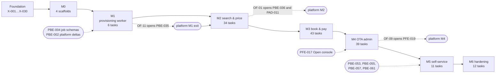

# OTA implementation plan

This plan explains how the OTA group (OTA backend, hosted storefront, OTA admin and JS SDK) delivers its MVP scope across the shared milestones M0–M6. For each milestone it gives the goal, the epics in scope, the demo at the end, the exit criteria, what is needed from and given to the platform group, and the risks with their mitigations. It ends with a traceability table from every scope item to its epic and tasks, an operation-coverage table showing that every MVP operation has a backend task, an SDK task and (where people use it) a storefront or OTA admin task, and the alignments made while planning. The tasks themselves, small enough for an AI coding agent, are in [`agent-tasks.md`](agent-tasks.md); the week-by-week order for one developer is in [`solo-developer-plan.md`](solo-developer-plan.md). Everything here follows [`decisions.md`](../../../docs/mvp/decisions.md), the [cross-cutting ADRs](../../../docs/mvp/adr/README.md) and the [OTA ADRs](../adr/README.md).

Related: [`../scope.md`](../scope.md) (features OF-01 … OF-12, the 96 operations), [`../architecture.md`](../architecture.md), [`../architecture-booking.md`](../architecture-booking.md), [`../api-changes.md`](../api-changes.md) and [part 2](../api-changes-console-and-internal.md), [`../data-model.md`](../data-model.md), [flows](../README.md#flows), [`../../../docs/mvp/README.md`](../../../docs/mvp/README.md#1-shared-milestones) (milestone definitions), [`../../../docs/mvp/plans/foundation-tasks.md`](../../../docs/mvp/plans/foundation-tasks.md) (`X-` tasks), [`../../../platform/docs/plans/implementation-plan.md`](../../../platform/docs/plans/implementation-plan.md) (the platform group's plan).

## 1. How the plan is built

| Item | Value |
|---|---|
| Agent tasks | 151: 91 backend (`OBE-`), 26 storefront (`OFE-`), 19 OTA admin (`OAD-`), 15 SDK (`SDK-`) |
| Estimate | 684 agent-hours by the plan-lint sizes (S 2 h, M 4 h, L 8 h, review included); 171 developer-days without agents (S ½ day, M 1 day, L 2 days) |
| Foundation dependencies | `X-001` … `X-030` ([`foundation-tasks.md`](../../../docs/mvp/plans/foundation-tasks.md)); the OTA plan never re-does them and adds the 11 Amadeus stub operations X-026 leaves to it |
| Platform dependencies | PBE-002, PBE-004, PBE-034, PFE-014, PFE-017, PBE-053, PBE-055, PBE-057, PBE-061 (named in **Depends on**); the platform gates PBE-035, PBE-036, PAD-011 and PFE-019 on OTA features |
| Validation | `node tools/plan-lint/plan-lint.mjs docs/mvp/plans/foundation-tasks.md platform/docs/plans/agent-tasks.md ota/docs/plans/agent-tasks.md` (0 errors) |
| Reference material reused | Tenant baseline [`tenant.sql`](../../../docs/velexis-sdk/db/tenant.sql) as `0001` (X-012) and the exact `0002` SQL of [`../data-model-migration-0002.md`](../data-model-migration-0002.md); the [OpenAPI contract](../../../docs/velexis-sdk/openapi/velexis-ota-booking-api.openapi.yaml) (96 operations with `x-sdk-method`, `x-amadeus`, `x-tenant-tables`, `x-scope`); the [SDK contract](../../../docs/velexis-sdk/sdk/src/) and guides B1–B4; the [Next.js example](../../../docs/velexis-sdk/examples/next-storefront/) as reference flows; the [Amadeus specifications](../../../docs/amadeus-api/) for the client, its generated types and the stub |

Rules that shape the order of the tasks:

- **Contract first, per milestone.** Each milestone that changes the OTA contract starts with a spec task: OBE-009 (M2: edge and cookie mode, `x-milestone`), OBE-029 (M3: airline card, payment account modes), OBE-058, OBE-090 and OBE-091 (M4: console permissions and settings; console payments, health and the M5 webhooks; with the public endpoints), OBE-076 (M5: billing notice). Operations without a handler are listed in `pending-operations.ts` and answer `501`; the list holds only `deferred` operations and the two M5 webhooks after M4, and only `deferred` ones after M5 ([ADR-0006](../../../docs/mvp/adr/0006-contract-first-openapi.md)).
- **One tenant migration for all deltas.** `0002_add_mvp_tenant_deltas.sql` lands once, in M2 before the first shopping endpoint (OBE-008), copied verbatim from the data-model document with a test that keeps the two identical ([`../data-model.md`](../data-model.md) §1).
- **Backend, then SDK, then pages.** Every storefront or OTA admin task depends on the backend task of its operations and on the SDK namespace that exposes them. The SDK is the only way to the API for both UIs ([`decisions.md`](../../../docs/mvp/decisions.md) §1).
- **Proof tasks close each milestone.** OBE-026 (M2), OBE-057 (M3), OBE-075 (M4) and OBE-083 (M5) prove the OTA features of [`../scope.md`](../scope.md) §4 with integration tests; OFE-008, OFE-017 … OFE-019, OFE-022, OAD-016, OAD-017 prove them in a browser.
- **Cross-group work is a dependency or a gate, never a fake.** OTA tasks name the platform tasks they need. Tests may stand in for the platform only with real rows written by the test as migrator, never with a fake platform service.

## 2. Epics

| Epic | Name | What it delivers | Tasks |
|---|---|---|---|
| OE1 | Scaffolds and contracts | The four OTA packages, the OpenAPI extensions per milestone, generated types and error codes, route parity with the `501` list | OBE-001, OFE-001, OAD-001, SDK-001, OBE-009, OBE-010, OBE-029, OBE-058, OBE-090, OBE-091, OBE-076 |
| OE2 | Tenant lifecycle | Provisioning worker, tenant migrations and the deploy report, seeds, `dev:seed`, migration `0002`, suspend and resume | OBE-002 … OBE-008, OBE-074 |
| OE3 | Tenancy and request pipeline | Caller and tenant resolution, platform caches and invalidation, scope and CSRF guards, rate limits, idempotency, isolation proof | OBE-011 … OBE-014, OBE-026 |
| OE4 | Amadeus integration | Connection resolver, tokens, buckets, timeouts, error mapping, `supplier_requests`, the 11 stub operations, fixtures, own credentials | OBE-017 … OBE-019, OBE-027, OBE-041, OBE-079 |
| OE5 | Shopping and pricing | Reference data, `storefront.get`, markup and fee engine, search, offers, upsell, pricing, purge, schedulers, load test | OBE-015, OBE-016, OBE-020 … OBE-025, OBE-028 |
| OE6 | Customer identity | Tokens, cookie sessions, sign-up, verification, sign-in, lockout, refresh, password reset, account, cookie-mode proof, erasure | OBE-031 … OBE-035, OBE-057, OBE-087 |
| OE7 | Checkout and payments | Checkout aggregate, extras, Stripe gateway and webhooks, voids, captures, refunds, airline card, account modes, Connect webhooks | OBE-036 … OBE-040, OBE-050 … OBE-052, OBE-077, OBE-078 |
| OE8 | Booking orchestration and after-sales | Create order, reconciliation, ticketing, sync, my bookings, guest access, change contacts, cancellation, expiry and retention | OBE-042 … OBE-049, OBE-056 |
| OE9 | Notifications and documents | Outbox, templates, mailer, PDFs, signed downloads, e-mail links to the primary host | OBE-030, OBE-053 … OBE-055, OBE-080 |
| OE10 | Console API | Staff SSO and sessions, service key and environments, permissions, `staff_actions`, bookings, PNR import, queues, customers, supplier log, raw reads, payments, billing notice | OBE-059 … OBE-068, OBE-075, OBE-082 |
| OE11 | Settings and content | Markup and fee rules, storefront settings, assets, content pages, templates | OBE-069 … OBE-073 |
| OE12 | JS SDK | Route table, core, session modes, all namespaces, contract and parity tests, bundles, smoke tests, npm release | SDK-002 … SDK-015 |
| OE13 | Hosted storefront | Shared modules, theming, search-to-price pages, checkout and payment pages, accounts, bookings, lookup, content pages, live mode | OFE-002 … OFE-016, OFE-020, OFE-021, OFE-023 |
| OE14 | OTA admin | Server-side SDK client and sessions, SSO, shell, dashboard, bookings, PNR, queues, shopping, payments, customers, settings, live and billing banner | OAD-002 … OAD-015, OAD-018 |
| OE15 | Self-service and live | Account modes, Connect webhooks, own Amadeus, custom domains, live environment, cross-backend proof | OBE-076 … OBE-083, OAD-018, OFE-021, OFE-022 |
| OE16 | Quality, security and launch | Journeys, security review, PCI evidence and the airline-card live gate, performance, runbooks, accessibility, guide, stable nightly suites | OFE-008, OFE-017 … OFE-019, OFE-022, OFE-024 … OFE-026, OAD-016, OAD-017, OAD-019, OBE-084 … OBE-086, OBE-088, OBE-089, SDK-015 |

Some tasks belong to two epics (for example OBE-079 in OE4 and OE15); the table lists them where they matter most.

## 3. Milestones at a glance

| Milestone | OTA goal | Tasks | Agent-hours | Solo days | What the platform group does in the same milestone |
|---|---|---|---|---|---|
| M0 Foundations | Four OTA packages scaffolded and in the release | 4 | 14 | 3.5 | Platform scaffolds; foundation work is shared (`X-` tasks) |
| M1 Platform core | Provisioning worker (OF-11) | 6 | 26 | 6.5 | Sign-up to active OTA, keys, team, admin basics; PBE-035 gated on OF-11 |
| M2 Search & price | Tenancy, Amadeus, shopping, SDK core, storefront search to price (OF-01, OF-02) | 34 | 158 | 39.5 | Cross-backend proof of keys and invalidation (PBE-036, PAD-011), gated on OF-01 |
| M3 Book & pay | Checkout, cookie accounts, Stripe, airline card (test), orders, tickets, e-mails, bookings, cancel (OF-03 … OF-08) | 43 | 222 | 55.5 | Statement descriptor (PBE-037, PBE-038, PFE-016) |
| M4 OTA admin | Console API, `console` SDK, OTA admin, settings, content pages (OF-09, OF-10) | 41 | 180 | 45 | Console token and Open console (PBE-039, PFE-017 … PFE-019), gated on OF-09 |
| M5 Monetisation & self-service | Gateways and resolver that follow the platform's data, custom domains, live (OF-12) | 11 | 38 | 9.5 | Billing, own Stripe, settlements, own Amadeus, domains, go-live |
| M6 Hardening & launch | Security review, PCI evidence, airline-card live gate, erasure, performance, runbooks, SDK 1.0.0 | 12 | 46 | 11.5 | Platform security review, performance, suites, switch removal; foundation monitoring and restore drill |
| **Total** | | **151** | **684** | **171** | |

The critical path printed by plan-lint runs through the foundation database tasks, PBE-002, the tenancy and Amadeus tasks (OBE-011 → OBE-018), shopping and checkout (OBE-021 → OBE-038), the orchestrator and after-sales (OBE-042 → OBE-049), console issue and cancel (OBE-063) and the OTA admin journeys (OAD-008 → OAD-019, OFE-026).

## 4. Milestones in detail

### M0 — Foundations

**Goal.** The OTA backend, storefront, OTA admin and SDK exist as workspace packages that build, answer health checks (backend, admin), respect their budgets (storefront) and type-check (SDK), and are packed into the release by the foundation pipeline.

**Scope.** OE1 (scaffolds only): OBE-001, OFE-001, OAD-001, SDK-001. The OpenAPI copy (X-006), generated types (X-008, X-009), database baselines including the tenant `0001` (X-012), the tenant runner (X-013), Caddy, systemd and deploy (X-020 … X-023) are foundation work.

**Demo.** `pnpm build` builds the four packages; the backend answers `/health/live` on 4000 and 4001 and `/health/ready` reports PostgreSQL and Redis; the OTA admin answers `/health/live` on 3002; `vite build` writes the storefront `dist/` with no inline script and within budget; the SDK type-checks with `checkJs`; `pack-release.sh` puts `ota-backend/`, the admin standalone output and `storefront/` in the release.

**Exit criteria.**
- OBE-001, OFE-001, OAD-001 and SDK-001 are merged with CI green.
- The backend `/health/ready` answers 503 when Redis is down; the API refuses the migrator DSN.
- No `process.env` outside `@velexis/config`, no `NEXT_PUBLIC_` variable, no SDK runtime dependency.

**Dependencies on the platform group.** None. Both groups depend on the same foundation tasks.

**Risks and mitigations.**

| Risk | Mitigation |
|---|---|
| Entry points or output folders differ from what the units and the release expect | OBE-001 builds `dist/main.js`, `dist/worker.js`, `dist/cli.js`; OFE-001 builds `dist/`; OAD-001 builds `.next/standalone/ota/admin/server.js` (`outputFileTracingRoot` = repository root, the path `pack-release.sh` checks), as [ADR-0023](../../../docs/mvp/adr/0023-release-artefact-and-deploy-user.md) and the units name them |
| The storefront build injects inline code that the CSP blocks only in production | OFE-001 disables the module-preload polyfill and asset inlining, greps `dist/` and compares the preview CSP with the Caddyfile |

### M1 — Platform core

**Goal.** A tenant created in the portal is provisioned by the real OTA worker: the schema, all migrations, the grants for the application role and the seeds in one transaction, reported back on `platform-tenant-events`, so platform task PBE-035 can prove the whole flow.

**Scope.** OE2: OBE-002 (Redis, queue names, job validation), OBE-003 (read-only platform repository), OBE-004 (seeds), OBE-005 (`tenant.provision`), OBE-006 (`tenant.migrate`, failure classes), OBE-007 (deploy report and `dev:seed`).

**Demo.** With the platform backend running, create OTA "Acme" in the portal; the OTA worker logs `tenant.provision`, `tenant_acme` appears with the `0001` ledger row, `velexis_ota_app` can write its tables, the settings row and the default markup rule exist, and the platform shows the tenant active. Re-sending the message changes nothing. `dev:seed` creates the demo tenant used by every later demo.

**Exit criteria.**
- OF-11 AC1 and AC2 are proven by OBE-005's integration tests; failure classification is proven by OBE-006.
- The platform's cross-backend test PBE-035 passes with the real OTA worker.
- `tenants:report-migrations` publishes deploy fan-out results with `jobId = null`, and `velexis-deploy` runs it after the fan-out (OBE-007, `deploy.test.sh`).

**Dependencies on the platform group.**

| Needs from the platform group | For | Task |
|---|---|---|
| `tenant.*` message schemas and fixtures, `OTA_QUEUES` list to extend | OBE-002, OBE-005 | PBE-004 |
| Platform `0002` columns and read grants | OBE-003 | PBE-002 |
| Velexis test Amadeus account and offices in development | OBE-007 | PBE-034 |

| Gives to the platform group | Task |
|---|---|
| The `tenant.provision` and `tenant.migrate` consumer and the events (gate of PBE-035) | OBE-005, OBE-006 |
| The OTA worker build used by the cross-backend stack | OBE-001 |

**Risks and mitigations.**

| Risk | Mitigation |
|---|---|
| A half-created schema after a crash or a retry | One migrator transaction with an advisory lock; "foreign content" is never dropped; tests inject a crash before commit ([OADR-0007](../adr/0007-tenant-migration-runner-and-provisioning-worker.md)) |
| Tables of later migrations without grants | Default privileges for `velexis_migrator`; OBE-008 proves a `0002` table is writable without a `GRANT` |
| OF-11 arrives after platform checkpoint M1b | The solo plan places OBE-002 … OBE-006 in the calendar window of platform Weeks 10–11; the platform keeps working with its fake worker until then |

### M2 — Search & price

**Goal.** A traveller on the hosted storefront (`demo.ota.example.com` in development, `<key>.ota.example.com` on the VM) searches flights from the Amadeus stub, filters and sorts results, opens an offer, picks a branded fare and prices it with bags, services and fare rules, at the OTA's selling prices. Third parties can do the same with keys and the SDK.

**Scope.**

| Epic | Tasks |
|---|---|
| OE1 contracts and pipeline | OBE-009 (edge and cookie mode, `x-milestone`), OBE-010 (pipeline, route parity) |
| OE2 data | OBE-008 (migration `0002`), OBE-007 used for the demo tenant |
| OE3 tenancy | OBE-011 … OBE-014, OBE-026 |
| OE4 Amadeus | OBE-017, OBE-018, OBE-019, OBE-027 |
| OE5 shopping | OBE-015, OBE-016, OBE-020 … OBE-025, OBE-028 |
| OE12 SDK | SDK-002 … SDK-007 |
| OE13 storefront | OFE-002 … OFE-007 |
| OE16 journey | OFE-008 |

**Demo.**
1. Open `http://localhost:5173` (or the VM's demo host): branding from `storefront.get`, the test-mode banner, the CSRF cookie and nothing else in `document.cookie`.
2. Search Paris → New York, filter non-stop, sort by price, load more; reload the page and see no new search.
3. Open an offer, choose a fare family, price it: the breakdown shows fee labels, `priceChanged` with the stub scenario, an expiry countdown.
4. `curl` the same flow with the `sk_test` key from `dev:seed`; tenant B gets 404 for tenant A's ids.
5. Suspend the tenant in the platform admin: the storefront shows "temporarily unavailable" within a second.

**Exit criteria.**
- Tests prove OF-01 AC1–AC3 (OBE-012, OBE-026; OBE-031 repeats AC2 for customer tokens in M3) and OF-02 AC1–AC2 (OBE-021, OBE-023, OBE-026); the `storefront` journey of OFE-008 is green.
- Every operation with `x-milestone: M2` has a handler; the SDK's M2 namespaces pass the contract test; the ESM bundle is within 25 KB.
- `0002` is applied by provisioning and by the tenant fan-out; generated types are committed.
- `ota/docs/performance.md` holds the first search figures; the Amadeus error table is confirmed (or corrected) against the test environment.

**Dependencies on the platform group.**

| Needs from the platform group | For | Task |
|---|---|---|
| Rows the OTA reads (tenants, sub-domains, keys, connections) and `vx:invalidate` events | OBE-011, OBE-012, OBE-017 | PBE-002, PBE-009, PBE-018, PBE-021, PBE-022 (M1) |
| The `tools/e2e` harness | OFE-008 | PFE-014 |

| Gives to the platform group | Task |
|---|---|
| Key verification, tenant resolution, the invalidation subscriber, `apikey:used:<keyId>` counters (gate of PBE-036) | OBE-011, OBE-012, OBE-013 |
| The hosted storefront and its `storefront` Playwright project (gate of PAD-011) | OFE-003, OFE-008 |

**Risks and mitigations.**

| Risk | Mitigation |
|---|---|
| Amadeus behaviour differs from the stub (errors, offices, queue) | OBE-027 records scrubbed fixtures with the developer's test credentials and confirms the error table and the booking-queue convention; the stub validates requests against the specifications |
| Eight Amadeus specifications are Swagger 2.0, which `openapi-typescript` 7 cannot read | OBE-017 converts them in memory in the generator (`swagger2openapi`, devDependency justified in the PR) and commits deterministic output |
| The shared Amadeus quota is exhausted by one OTA or a scan | Two token buckets per call, single flight for identical searches, IP rate limits, negative caching of unknown hosts and keys; OBE-028 measures them |
| Search writes large rows and bloats tables | Multi-row inserts capped at 250, 15-minute purge, figures recorded in `performance.md` ([OADR-0002](../adr/0002-offer-and-priced-offer-caching.md)) |
| Net prices or supplier details leak to customer scope | Mapper rewrites prices, error filter hides `supplier`, OBE-026 walks every customer response |
| The storefront drifts from production headers | E2E runs against `vite preview` with the Caddyfile CSP; guards fail on CSP violations and third-party requests |

### M3 — Book & pay

**Goal.** Travellers book and pay: as a guest or a customer signed in with httpOnly cookies, by Stripe with 3-D Secure on the Velexis account, or by card passed to the airline through Amadeus (test environment only). The order is created once, paid, ticketed (with retries), confirmed by e-mail with PDFs, visible in my bookings or through guest lookup, and can be changed (contacts) or cancelled with the money handled once.

**Scope.**

| Epic | Tasks |
|---|---|
| OE1 contract | OBE-029 |
| OE6 identity | OBE-031 … OBE-035, OBE-057 |
| OE7 checkout and payments | OBE-036 … OBE-040, OBE-050 … OBE-052 |
| OE8 orchestration and after-sales | OBE-041 (stub orders), OBE-042 … OBE-049, OBE-056 |
| OE9 notifications and documents | OBE-030, OBE-053 … OBE-055 |
| OE12 SDK | SDK-008 … SDK-010 |
| OE13 storefront | OFE-009 … OFE-016 |
| OE16 journeys | OFE-017 … OFE-019 |

**Demo.**
1. Guest checkout with Stripe's 3-D Secure test card: confirmation with tickets, the e-mail with the itinerary in Mailpit, the booking page opened through the guest cookie, PDFs downloaded through signed URLs.
2. The same with the airline card (test): the airline's price and notice, a decline, the attempt limit; the PAN-absence test output.
3. Stub `timeout` at order creation: "we are confirming your booking", then confirmed after reconciliation; `timeout-lost`: "not booked, not charged".
4. Sign up, verify, sign in, see upcoming bookings, change contacts, cancel with the refund preview, see the cancelled tab; guest lookup with a wrong and a right name.

**Exit criteria.**
- Tests prove OF-03 AC1–AC2, OF-04 AC1–AC3, OF-05 AC1–AC3 (test environment), OF-06 AC1–AC2, OF-07 AC1–AC2, OF-08 AC1–AC2.
- The journeys of OFE-017 (nightly `storefront-stripe`), OFE-018 and OFE-019 are green; the PAN-absence test runs in every CI build.
- `AIRLINE_CARD_ENABLED` stays `false` in production; the tenant live switch is refused.
- Every operation with `x-milestone: M3` has a handler and an SDK method; the parity pending list holds only `console`.

**Dependencies on the platform group.**

| Needs from the platform group | For | Task |
|---|---|---|
| A `velexis` test payment connection per tenant with its statement descriptor suffix | OBE-038 | PBE-022 (M1), PBE-038 (M3) |
| Owners' e-mails (read-only) for staff alerts when `ops_alert_email` is empty | OBE-055 | PBE-025 (M1) |

| Gives to the platform group | Task |
|---|---|
| Payments on the Velexis account with `metadata.velexis_tenant_id`, the input of the platform's settlements in M5 | OBE-038, OBE-039 |

**Risks and mitigations.**

| Risk | Mitigation |
|---|---|
| A lost Amadeus answer creates a duplicate order or charges twice | Claim row with a unique `checkout_id`, no retry of order creation, `VELEXIS <reference>` remark and booking queue, 15-minute reconciliation, idempotent replay of the `504` ([OADR-0003](../adr/0003-booking-orchestration-and-supplier-timeout-recovery.md)) |
| Card data reaches a log, a table, Redis or a queue | `SensitiveCard`, a dedicated route with its own parser, redaction paths, the database CHECK on airline payments, and OBE-052 scanning every store after every path ([OADR-0004](../adr/0004-airline-card-data-handling.md)) |
| Stripe events arrive out of order or twice | Payment row before the PaymentIntent, unique `provider_event_id`, re-fetch on processing, idempotency keys on every Stripe write ([OADR-0010](../adr/0010-stripe-gateway-and-payment-webhooks.md)) |
| Tickets issued twice after a timeout | Resync before every retry, booking claims, bounded schedule ([OADR-0008](../adr/0008-ticketing-policy.md)) |
| Tokens readable by storefront JavaScript | Cookie mode only in the storefront; SDK refuses tokens; OBE-057 checks every operation in both modes |
| M3 is the largest OTA milestone (55.5 developer-days) | The solo plan splits it into weekly demos (identity, checkout, payments, orders, after-sales, airline card, documents, pages); proof tasks close each part |

### M4 — OTA admin

**Goal.** Staff open the OTA admin from the portal without a second password and run their day: needs-attention bookings, retrieve, patch, issue, cancel with refunds, resync, notes, PNR lookup and import, queues, shopping on behalf (read-only), payments capture and refund, customers, supplier log, and the settings that shape the storefront (markups, fees, branding, assets, content pages, templates).

**Scope.**

| Epic | Tasks |
|---|---|
| OE1 contract | OBE-058, OBE-090, OBE-091 |
| OE10 console API | OBE-059 … OBE-068, OBE-075 |
| OE11 settings | OBE-069 … OBE-073 |
| OE2 suspend and resume | OBE-074 |
| OE12 SDK | SDK-011 … SDK-014 |
| OE14 OTA admin | OAD-002 … OAD-015 |
| OE13 storefront content | OFE-020 |
| OE16 journeys | OAD-016, OAD-017 |

**Demo.**
1. In the portal, "Open console" for Acme: land on `https://admin.ota.example.com/bookings`; reposting the captured form fails.
2. Issue a manual-review booking (capture then issue), cancel another with a partial refund, import a PNR of the tenant's office (and fail for another tenant's office), read a queue with an orphan PNR.
3. Change a markup rule and see the next storefront search priced with it; upload a logo, change the primary colour and add a "Terms" page; see them on the storefront; refuse a broken template.
4. Switch a viewer in: read-only, no LIVE switch.

**Exit criteria.**
- Tests prove OF-09 AC1–AC3 and OF-10 AC1–AC3 (OBE-075, OBE-069, OBE-070, OBE-073, OAD-017).
- The `ota-admin` journeys of OAD-016 and OAD-017 are green; the platform's PFE-019 passes against them.
- `pending-operations.ts` holds only the 19 deferred operations and the two M5 webhooks; the SDK parity pending list is empty and the bundle size is recorded.
- `tenant.suspend` and `tenant.resume` are consumed; platform suspend jobs end `succeeded`.

**Dependencies on the platform group.**

| Needs from the platform group | For | Task |
|---|---|---|
| One-time console tokens in `ptk:<sha256>`, `staffdeny:acct:<id>`, membership invalidations | OBE-059 (format), OAD-016 (real flow) | PBE-039, PBE-014, PBE-016, PBE-032 |
| The portal's "Open console" launch handler | OAD-016 | PFE-017 |
| Monitored queues and office settings on `supplier_connections` | OBE-065 | PBE-040 |

| Gives to the platform group | Task |
|---|---|
| `/sso`, the `portal_token` grant, the staff guard with deny checks, and the `ota-admin` Playwright project (gate of PFE-019) | OBE-059, OAD-003, OAD-016 |
| The `tenant.suspend` / `tenant.resume` consumer (PADR-0014 follow-up) | OBE-074 |

**Risks and mitigations.**

| Risk | Mitigation |
|---|---|
| Parallel Next.js requests reuse a rotated staff refresh token and revoke the family | Refresh only where cookies can be written, de-duplicated per token in the single admin process ([OADR-0018](../adr/0018-ota-admin-consumes-the-sdk-server-side.md)) |
| A console path routes card numbers outside the storefront route | `creditCard` refused in console form-of-payment; no card field in the admin (test greps the build) |
| Staff permissions drift from the matrix | One `roles.ts` constant, permission guard from `x-permission`, table-driven test over every console operation and role |
| Settings break the storefront CSP or rendering | No SVG or CSS uploads, same-origin immutable assets, Markdown subset parsed to blocks on the server, fuzz test of the parser |
| Office isolation broken on the shared Amadeus account | Offices injected by the client, caller offices checked, two-tenant tests for import, queues and raw reads |

### M5 — Monetisation & self-service

**Goal.** Without any per-tenant code path, the OTA backend follows what the platform configures: an OTA's own Stripe account (Connect Standard or API keys) with its webhooks, the OTA's own Amadeus credentials with old orders still served by a releasing Velexis office, verified custom domains, and the live environment after go-live. The OTA admin shows the live switch and the platform's billing notice.

**Scope.** OE15 and OE1: OBE-076 (contract), OBE-077, OBE-078 (Stripe modes and webhooks), OBE-079 (own Amadeus), OBE-080 (custom domains, primary host), OBE-081 (live environment), OBE-082 (billing notice), OBE-083 (cross-backend proof), OAD-018 (admin), OFE-021, OFE-022 (storefront and journey).

**Demo.**
1. Submit own Amadeus test credentials in the portal: the next search uses them; an old booking still syncs through the Velexis account.
2. Connect a Stripe test account: the next PaymentIntent carries `Stripe-Account`; a webhook from that account is processed.
3. Add and verify `travel.acme.com` (staging certificate on the VM); the storefront answers on it and e-mails link to it.
4. Go live in the portal: the storefront drops the test banner within a second; staff switch the OTA admin to LIVE; a `past_due` subscription shows the billing banner.

**Exit criteria.**
- Tests prove OF-12 AC1–AC2 (OBE-077, OBE-079, OBE-083); the `live-and-domains` and `live-environment` journeys are green.
- `pending-operations.ts` holds only the 19 deferred operations.
- No OTA code branches on a tenant id or key (review checklist item in OBE-083's PR).

**Dependencies on the platform group.**

| Needs from the platform group | For | Task |
|---|---|---|
| Payment connections in `connect_standard` and `api_keys` modes with secrets, the Connect webhook secret | OBE-077, OBE-078 | PBE-055, PBE-057 |
| `credential_source = tenant` connections and `releasing` offices | OBE-079 | PBE-053, PBE-054 |
| Verified custom domains and `storefront_environment = live` with invalidations | OBE-080, OBE-081 | PBE-050, PBE-061 |
| `tenants.billing_notice` | OBE-082 | PBE-045, PBE-047 |

| Gives to the platform group | Task |
|---|---|
| Gateways and resolver that follow the data, Connect and per-connection webhooks, the live storefront and the billing banner (needed before the platform switches go on) | OBE-077 … OBE-082, OAD-018 |

**Risks and mitigations.**

| Risk | Mitigation |
|---|---|
| A mode or credential switch moves an existing payment or order to the wrong account | Payments keep their creation mode; orders of `assigned` or `releasing` Velexis offices use the Velexis account ([PADR-0012](../../../platform/docs/adr/0012-amadeus-office-pool.md)); cross-backend test |
| Decrypted OTA secrets leak | Decryption only inside the gateway and resolver, associated data per row, redaction and secret-scan in OBE-084 |
| Sessions do not follow a new primary domain | Auth pages redirect to the primary host before a session exists (OFE-021, OADR-0006 follow-up) |

### M6 — Hardening & launch

**Goal.** The OTA group is reviewed for security, the airline-card path has its PCI evidence and a documented gate for live payments, deleted customers are erased after 30 days, performance and memory are measured against the VM budget, operations have runbooks, the storefront and OTA admin suites are complete and stable, and the SDK is published as 1.0.0.

**Scope.** OE16 and OE6: OBE-084 (security review), OFE-023 (payment-page inventory), OBE-085 (PCI pack), OBE-086 (airline-card live gate), OBE-087 (erasure), OBE-088 (performance), OBE-089 (runbooks, launch checklist), OFE-024 (accessibility and Lighthouse), OFE-025 (build-your-own guide), OAD-019 (admin suite), SDK-015 (npm), OFE-026 (stable nightly suites). Foundation X-029 … X-032 run in the same milestone; X-030 reads OFE-023's inventory.

**Demo.** Walk through `ota/docs/security-review.md`, the PCI pack and `ota/docs/performance.md`; show three consecutive green nightly runs of `storefront`, `storefront-stripe` and `ota-admin`; install `@velexis/ota-sdk@1.0.0` in an empty project and run the guide's sample; walk through the OTA launch checklist.

**Exit criteria.**
- The security review lists no open high finding; `pnpm audit --prod` is clean of high and critical issues.
- The PCI pack maps every ADR-0011 §C control to evidence; the airline-card go-live runbook exists. Live airline-card payments are enabled only when it is fully checked (it may stay off at launch).
- Memory and latency budgets are met or have tasks; the launch checklist is checked by the developer.

**Dependencies on the platform group.** Shared: the restore drill, monitoring and on-VM checks (foundation), the `tools/e2e` workflow. The platform's own review (PBE-062) and switch removal (PBE-064) are independent.

**Risks and mitigations.**

| Risk | Mitigation |
|---|---|
| The penetration test or ASV scan finds issues late | The airline card stays off in production until OBE-086 is fully checked; Stripe remains available |
| The 8 GB VM is too small under load | OBE-088 measures RSS and queue latency; a worker split is a prepared follow-up ([OADR-0014](../adr/0014-per-tenant-workers-and-schedulers.md)) |
| Flaky journeys block the launch | Stripe journeys in their own nightly project; three consecutive green runs required; flaky tests are fixed, never skipped |

## 5. Interface with the platform group

| What | Direction | Milestone | OTA task | Platform task |
|---|---|---|---|---|
| `tenant.provision`, `tenant.migrate` and their answers | both | M1 | OBE-002, OBE-005, OBE-006 | PBE-004, PBE-019, PBE-022, PBE-035 (gate OF-11) |
| Deploy fan-out results with `jobId = null` | OTA → platform | M1 | OBE-007 | PBE-030 |
| `tenant.suspend`, `tenant.resume` | both | M4 | OBE-074 | PBE-030 |
| Read-only platform tables and columns ([platform architecture §6.2](../../../platform/docs/architecture.md#62-platform-tables-the-ota-backend-reads)) | platform → OTA | M1 → M2 | OBE-003, OBE-011, OBE-012, OBE-017 | PBE-002, PBE-018, PBE-021, PBE-022 |
| `vx:invalidate` handlers for all eight types | platform → OTA | M2 | OBE-012 | PBE-009, PBE-036 (gate OF-01) |
| `apikey:used:<keyId>` counters | OTA → platform | M2 | OBE-013 | PBE-021 |
| Hosted storefront and its Playwright project | OTA → platform | M2 | OFE-003, OFE-008 | PAD-011 (gate OF-01) |
| `ptk:<sha256>`, `staffdeny:acct:<id>`, membership state | platform → OTA | M4 | OBE-059, OBE-060 | PBE-039, PBE-014, PBE-016, PBE-032 |
| OTA admin `/sso` and the `ota-admin` project | OTA → platform | M4 | OAD-003, OAD-016 | PFE-017, PFE-019 (gate OF-09) |
| Payment connection modes and secrets, Amadeus credential source, releasing offices | platform → OTA | M5 | OBE-077 … OBE-079 | PBE-053 … PBE-057 |
| Verified custom domains, `storefront_environment`, `billing_notice` | platform → OTA | M5 | OBE-080 … OBE-082, OAD-018 | PBE-045, PBE-050, PBE-061 |
| `tools/e2e` harness | shared | M1 → M6 | OFE-008, OFE-017, OAD-016, OFE-026 add the OTA projects | PFE-014 |
| `OTA_QUEUES` in `@velexis/api-types/jobs` (platform admin queue view) | OTA → platform | M1 | OBE-002 | PBE-004, PBE-031 |

## 6. Traceability

Every feature of [`../scope.md`](../scope.md) §4, every part of §2, the contract and data-model deltas and the ADR follow-ups, with the epic and the tasks that deliver and prove them. Backend tasks implement and integration-test; SDK tasks expose and contract-test; storefront and OTA admin tasks build the pages with unit or component tests; the journeys prove them in a browser.

| Scope item | Milestone | Epic | Tasks |
|---|---|---|---|
| OF-01 Tenant resolution | M2 | OE3 | OBE-011, OBE-012, OBE-013, OBE-026, OBE-031 (customer tokens), OFE-003 (suspended and unknown-host states), OFE-008 |
| OF-02 Search and price | M2 | OE4, OE5 | OBE-015 … OBE-024, OBE-026, OBE-028, SDK-005, OFE-004 … OFE-008 |
| OF-03 Customer auth in cookies | M3 | OE6 | OBE-013 (CSRF), OBE-031 … OBE-034, OBE-057, SDK-004, SDK-008, OFE-009, OFE-019 |
| OF-04 Stripe checkout | M3 | OE7, OE8 | OBE-036 … OBE-043, SDK-009, OFE-011 … OFE-013, OFE-017 |
| OF-05 Airline-card checkout | M3, M6 | OE7, OE16 | OBE-050 … OBE-052, SDK-009, OFE-014, OFE-018; live gate: OFE-023, OBE-085, OBE-086 |
| OF-06 Ticketing | M3 | OE8 | OBE-042, OBE-044, OBE-045, OBE-055 |
| OF-07 My bookings and guest access | M3 | OE8 | OBE-046, OBE-047, SDK-010, OFE-013, OFE-015, OFE-016, OFE-019 |
| OF-08 Change and cancel | M3 | OE8 | OBE-048, OBE-049, OBE-040 (refunds), SDK-010, OFE-015, OFE-019 |
| OF-09 Console | M4 | OE10 | OBE-059 … OBE-068, OBE-075, SDK-011, OAD-002 … OAD-012, OAD-016, OAD-017 |
| OF-10 Settings | M4 | OE11 | OBE-069 … OBE-073, SDK-012, OAD-013 … OAD-015, OFE-020, OAD-017 |
| OF-11 Provisioning worker | M1 | OE2 | OBE-002 … OBE-007; suspend and resume: OBE-074 |
| OF-12 Own Stripe and own Amadeus | M5 | OE15 | OBE-076 … OBE-083, OAD-018, OFE-021, OFE-022 |
| §2.1 Backend: tenancy, auth, shopping, checkout, orchestration, documents, console, provisioning | M1 – M4 | OE2 … OE11 | as the rows above; documents and e-mails: OBE-030, OBE-053 … OBE-055 |
| §2.2 Storefront: pages M2–M4, English UI, currencies, branding, test banner | M2 – M5 | OE13 | OFE-001 … OFE-021; accessibility and budgets: OFE-024 |
| §2.3 OTA admin: SSO, test/live, every listed area | M4, M5 | OE14 | OAD-001 … OAD-018 |
| §2.4 SDK: core, cookie and token mode, namespaces, bundles, contract check, npm (M6) | M2 – M6 | OE12 | SDK-001 … SDK-015 |
| §3 Deferred operations answer `501` and keep their SDK method | M2 → M4 | OE1, OE12 | OBE-009 (`x-milestone`), OBE-010 (`pending-operations.ts`), OBE-075 (only `deferred` and the two M5 webhooks left at M4), OBE-078 (only `deferred` at M5), SDK-005, SDK-008, SDK-010, SDK-011 |
| §3 Parts switched off answer `403 FEATURE_DISABLED` | M2 – M4 | — | async search OBE-021; traveller changes OBE-048; airline card OBE-050, OBE-051; password grant OBE-059; console card payment OBE-062, OBE-063; `pay_later` OBE-070 |
| §1.3 Roles and permissions | M4 | OE10 | OBE-058 (`StaffPermission`, `x-permission`), OBE-060 (`roles.ts`), OBE-075, OAD-002 (`can()`), OAD-017 |
| Account deletion and 30-day erasure | M3, M6 | OE6 | OBE-035, OBE-087 |
| Tenant migration `0002` ([`../data-model.md`](../data-model.md) §3, [exact SQL](../data-model-migration-0002.md)) | M2 | OE2 | OBE-008 (file, parity test, all §3 tests, codegen); used by OBE-016, OBE-042, OBE-050, OBE-070 … OBE-072 |
| API changes part 1 ([`../api-changes.md`](../api-changes.md)) §2, §5, §6 | M2 | OE1 | OBE-009 |
| API changes part 1 §3, §4 | M3 | OE1 | OBE-029 |
| API changes part 2 ([`../api-changes-console-and-internal.md`](../api-changes-console-and-internal.md)) §1–§4, §5 (health; the M5 webhooks documented early) | M4 | OE1 | OBE-058, OBE-090, OBE-091 |
| API changes part 2 §5 (Velexis webhooks, file download) | M3 | OE7, OE9 | OBE-039, OBE-054 |
| API changes part 2 §5 (Connect and connection webhooks: implemented), billing notice | M5 | OE15 | OBE-078 (webhooks), OBE-076, OBE-082 (billing notice) |
| Workers and schedulers ([`../architecture.md`](../architecture.md) §6) | M2 – M4 | OE5, OE8 | OBE-024 (framework, `offers.purge`), OBE-040, OBE-043, OBE-044, OBE-045, OBE-030 (`notifications.sweep`), OBE-056 (`checkouts.expire`, `retention.daily`), OBE-065 (`queues.poll`), OBE-025 (queue ages) |
| Amadeus stub operations left by X-026 | M2, M3 | OE4 | OBE-019 (price, upsell, availability), OBE-041 (orders, issue, management, by-reference, queue) |
| OADR-0001 / OADR-0003 follow-ups (fixtures, error table, booking queue, load test) | M2 | OE4 | OBE-027, OBE-028 |
| OADR-0003 follow-up (booking-queue view for orphan PNRs) | M4 | OE10 | OBE-065, OAD-009 |
| OADR-0015 follow-ups (Caddy `/p/*` rewrite, font enum, e-mail link paths) | M3, M4 | OE13, OE9 | OFE-020, OBE-058, OBE-030, OBE-055 |
| OADR-0017 follow-ups (path CSP for the airline-card page, integrity check, review) | M3, M6 | OE13, OE16 | OFE-014, OFE-023, OBE-085, OBE-086 |
| OADR-0018 follow-up (refuse `creditCard` in console form of payment) | M4 | OE10 | OBE-058, OBE-062, OBE-063 |
| ADR-0011 §C PCI controls and documentation | M3, M6 | OE7, OE16 | OBE-050 … OBE-052, OBE-084, OBE-085, OBE-086 |
| Security checklist, performance, operations | M6 | OE16 | OBE-084, OBE-088, OBE-089, OFE-024, OAD-019, OFE-026 |

## 7. Operation coverage

Every MVP operation of [`../scope.md`](../scope.md) §3 (77 contract operations plus the 32 MVP additions with an SDK method) with the task that implements it, the SDK task that exposes it and the page task that uses it. "API only" marks operations that no Velexis page calls (they serve third-party frontends and custom consoles) and that are proven by integration and SDK tests.

| Operations (`x-sdk-method`) | Backend | SDK | Storefront / OTA admin |
|---|---|---|---|
| `storefront.get` | OBE-016 (payment config OBE-038, OBE-050, OBE-077; assets OBE-071) | SDK-005 | OFE-003 |
| `storefront.listPages`, `storefront.getPage` | OBE-072 | SDK-012 | OFE-020 (footer in OFE-003) |
| `reference.locations.search`, `.airports.get` | OBE-015 | SDK-005 | OFE-004 |
| `reference.airlines.list`, `.airlines.get` | OBE-015 | SDK-005 | OFE-005 (carrier filter names) |
| `reference.countries.list` | OBE-015 | SDK-005 | OFE-011 |
| `reference.currencies.list` | OBE-015 | SDK-005 | OFE-003 (currency selector) |
| `auth.signUp`, `.verifyEmail`, `.resendVerification` | OBE-032 | SDK-008 | OFE-009 (resend also OFE-011) |
| `auth.signIn`, `.refresh`, `.signOut`, `.getSession` | OBE-033 | SDK-004, SDK-008 | OFE-009, OFE-003 (session menu) |
| `auth.requestPasswordReset`, `.resetPassword` | OBE-034 | SDK-008 | OFE-009 |
| `auth.changePassword` | OBE-034 | SDK-008 | OFE-010 |
| `account.get`, `.update`, `.delete` | OBE-035 | SDK-008 | OFE-010 |
| `flights.search`, `.getSearch`, `.listResults` | OBE-021 | SDK-005 | OFE-005 |
| `flights.getOffer`, `.upsell` | OBE-022 | SDK-005 | OFE-006 |
| `flights.price` | OBE-023 | SDK-005 | OFE-006 |
| `flights.getPricedOffer`, `.getAncillaries`, `.getFareRules` | OBE-023 | SDK-005 | OFE-007, OFE-011 |
| `checkout.create` | OBE-036 | SDK-009 | OFE-011 (from the price page) |
| `checkout.get`, `.setTravelers`, `.setContacts`, `.setRemarks` | OBE-036 | SDK-009 | OFE-011 |
| `checkout.setAncillaries` | OBE-037 | SDK-009 | OFE-011 |
| `checkout.createPayment`, `.getPayment`, `.updatePayment` | OBE-038 (card), OBE-050 (airline card) | SDK-009 | OFE-011, OFE-012, OFE-013, OFE-014 |
| `checkout.complete` | OBE-042, OBE-043 | SDK-009 | OFE-013 |
| `checkout.completeWithAirlineCard` | OBE-051 | SDK-009 | OFE-014 |
| `bookings.list` | OBE-046 | SDK-010 | OFE-015 |
| `bookings.get`, `.getTicketingStatus` | OBE-046 | SDK-010 | OFE-013, OFE-015 |
| `bookings.listEvents`, `.getFareRules` | OBE-046 | SDK-010 | OFE-015 |
| `bookings.lookup` | OBE-047 | SDK-010 | OFE-016 |
| `bookings.update` | OBE-048 | SDK-010 | OFE-015 |
| `bookings.quoteCancellation`, `.cancel` | OBE-049 | SDK-010 | OFE-015 |
| `bookings.listDocuments`, `.getDocumentDownloadUrl` | OBE-054 | SDK-010 | OFE-015 |
| `console.auth.signIn`, `.refresh`, `.signOut` | OBE-059 | SDK-011 | OAD-003 |
| `console.auth.me` | OBE-059, OBE-082 | SDK-011 | OAD-002, OAD-004, OAD-018 |
| `console.bookings.list`, `.get` | OBE-061 | SDK-011 | OAD-005, OAD-006, OAD-007, OAD-012 |
| `console.bookings.retrieve` | OBE-062 | SDK-011 | OAD-007 |
| `console.bookings.patch`, `.resync`, `.addNote` | OBE-062 | SDK-011 | OAD-008 |
| `console.bookings.issue`, `.cancel` | OBE-063 | SDK-011 | OAD-008 |
| `console.bookings.findByRecordLocator`, `.import` | OBE-064 | SDK-011 | OAD-009 |
| `console.queues.list`, `.listSnapshots` | OBE-065 | SDK-011 | OAD-009, OAD-005 |
| `console.customers.list`, `.get` | OBE-066 | SDK-011 | OAD-012 |
| `console.supplierRequests.list` | OBE-066 | SDK-011 | OAD-012 |
| `console.amadeus.searchFlightOffers`, `.searchFlightAvailabilities`, `.upsellAirOffers`, `.quoteAirOffers` | OBE-067 | SDK-011 | OAD-010 |
| `console.amadeus.getFlightOrder`, `.getFlightOrderByReference` | OBE-067 | SDK-011, SDK-014 (smoke) | OAD-010 (the `/pnr` Advanced panel's raw order reads; 2026-10-31, lead decision (2g), FIX-W37-OTA: until then listed as API only) |
| `console.amadeus.getFlightOffers`, `.getQueue` | OBE-067 | SDK-011, SDK-014 (smoke) | API only (custom consoles) |
| `console.payments.list`, `.get` | OBE-068 | SDK-012 | OAD-011, OAD-005, OAD-007 |
| `console.payments.capture`, `.refund` | OBE-068 | SDK-012 | OAD-011, OAD-008 |
| `console.settings.markupRules.*` (5), `.feeRules.*` (5) | OBE-069 | SDK-012 | OAD-013 |
| `console.settings.storefront.get`, `.update` | OBE-070 | SDK-012 | OAD-014 |
| `console.settings.assets.list`, `.upload`, `.delete` | OBE-071 | SDK-012 | OAD-014 |
| `console.settings.pages.*` (5) | OBE-072 | SDK-012 | OAD-015 |
| `console.settings.templates.*` (5) | OBE-073 | SDK-012 | OAD-015 |
| Internal: `healthLive`, `healthReady` | OBE-001, OBE-025 (documented OBE-090) | — | — |
| Internal: `receiveStripeVelexisWebhook` | OBE-039 | — | — |
| Internal: `receiveStripeConnectWebhook`, `receiveStripeConnectionWebhook` | OBE-078 (documented OBE-090) | — | — |
| `downloadFile`, `getPublicAsset` (`x-sdk-exclude`) | OBE-054, OBE-071 | — | OFE-015 (downloads), OFE-003 and OFE-020 (images) |
| The 19 deferred operations | `501` through OBE-010 | SDK-005, SDK-008, SDK-010, SDK-011 | — |

The check is mechanical: the runtime route-parity test (OBE-010, final state asserted by OBE-075) fails for any MVP operation without a handler, and the SDK parity test (SDK-006, strict from SDK-013) fails for any `x-sdk-method` without an SDK method.

## 8. Decisions and alignments made while planning

None of these changes a decision of [`decisions.md`](../../../docs/mvp/decisions.md) or an ADR; they fix how the plan applies them.

| Topic | Alignment | Where |
|---|---|---|
| Contract rollout | The OTA document grows in four milestone slices (M2 OBE-009; M3 OBE-029; M4 OBE-058, OBE-090, OBE-091, which complete it at 135 operations; M5 OBE-076, one field); spec tasks regenerate the SDK route table and list new methods of an implemented namespace as pending SDK methods; unimplemented operations are listed with their task id in `pending-operations.ts` and answer `501`, as ADR-0006 asks; the SDK's parity test uses a parallel `pending-namespaces.js` until M4 | OBE-010, SDK-006, SDK-013 |
| Amadeus types | Eight of the nine Amadeus files are Swagger 2.0; the generator converts them in memory with `swagger2openapi` (a generation-time devDependency, justified in the PR as tech-stack.md asks; not a new kind of dependency) before `openapi-typescript` | OBE-017 |
| Amadeus stub | The OTA plan adds the 11 operations that X-026 leaves unstubbed, shopping in M2 and orders in M3, with the scenarios the flows name and in-memory orders for reconciliation tests | OBE-019, OBE-041 |
| Template seeds | Seeds write template rows only for code defaults that exist; tenants provisioned before M3 use the code fallback of OADR-0013, so no backfill is ever needed | OBE-004, OBE-030, OBE-055 |
| `dev:seed` | The OTA `dev:seed` of the backend README writes the demo tenant's platform rows through the migrator DSN in development only (refused when `APP_ENV=production`) and then calls the real provisioning function; the runtime rule "the OTA backend never writes platform tables" is unchanged | OBE-007 |
| Service key | The `X-Velexis-Environment` parameter lands in the M2 contract slice (api-changes §1 order), but the service-key branch of the caller guard is built in M4 with the first console operations | OBE-009, OBE-060 |
| SSO landing page | `/sso` answers `303 See Other` to `/bookings`, as architecture flow (c), platform task PFE-019 and the OTA admin README §3 say | OAD-003 |
| Billing notice in the OTA admin | The platform's `tenants.billing_notice` reaches the OTA admin as the additive, nullable `ConsoleStaffSession.tenant.billingNotice`, because the admin reads only through the SDK (OADR-0018) | OBE-076, OBE-082, OAD-018 |
| Suspend and resume | The OTA consumer of `tenant.suspend` and `tenant.resume` lands in M4, inside the "M4/M5" window the platform plan expects | OBE-074 |
| Stripe in end-to-end tests | Journeys that need Stripe test mode run in a nightly-only `storefront-stripe` project, mirroring the platform's `portal-stripe` (PADR-0017); other journeys use the airline-card path in test or seeded bookings | OFE-017, OAD-017 |
| Caddy follow-ups | The path-specific CSP of the airline-card page and the `/p/*` rewrite are added to `deploy/caddy/Caddyfile` by the storefront tasks that need them, each with a `caddy-smoke.sh` assertion | OFE-014, OFE-020 |
| Payment-page integrity | The storefront build emits `dist/payment-page-inventory.json` for every page of the origin (any script there could imitate the card form, OADR-0017 point 8), the file X-030's daily check compares with the live pages | OFE-023 |
| Service caller | The service key counts only on a direct loopback connection without `X-Forwarded-For` (Caddy reaches the API from `127.0.0.1` too), and the OTA admin forwards the staff member's IP and user agent for throttling and audit (OADR-0009, OADR-0011) | OBE-060, OAD-002, OBE-084 |
| Stripe webhook tenants | Each webhook endpoint resolves the tenant by its own rule; metadata and `livemode` are cross-checked (OADR-0010 point 4) | OBE-039, OBE-078 |
| `storefront.get` cache | Only the caller-independent part is cached; asset URLs and the edge-only airline-card fields are added per request (OADR-0012 point 7) | OBE-016, OBE-050 |
| Deploy fan-out report | `velexis-deploy` runs `tenants:report-migrations` through `velexis-run ota` right after the fan-out, with the release paths of `deploy.sh` (OADR-0007 item 7) | OBE-007 |
| No OTA milestone switches | M5 behaviour follows platform data (`account_mode`, `credential_source`, verified domains, `storefront_environment`), so the OTA backend needs no `FEATURE_*` switches; the platform's switches gate the data | OBE-077 … OBE-081 |
| Airline card at launch | Built and tested in M3 for the test environment; production keeps `AIRLINE_CARD_ENABLED=false` until the go-live runbook of OBE-086 is fully checked, which may be after launch | OBE-050, OBE-086 |
