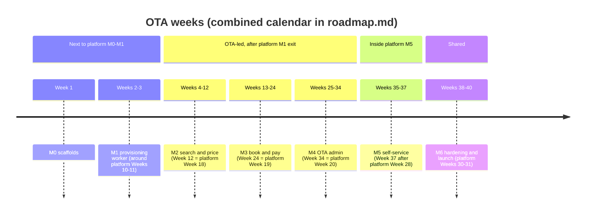

# OTA solo developer plan

This plan lays out the OTA group's MVP work (OTA backend, hosted storefront, OTA admin and JS SDK) for one developer working without AI agents, week by week: what to build each week, in which order, what is delivered and demonstrated on Friday, and where the buffer sits. It uses exactly the tasks of [`agent-tasks.md`](agent-tasks.md) (it references their ids, it does not redefine them) and the milestones and exit criteria of [`implementation-plan.md`](implementation-plan.md). It covers only the OTA group's share; the combined schedule with the platform group is in `docs/mvp/plans/roadmap.md` (written after this plan), and every week below states which platform weeks share its calendar window, using the week numbers of the [platform solo plan](../../../platform/docs/plans/solo-developer-plan.md).

Related: [`implementation-plan.md`](implementation-plan.md), [`agent-tasks.md`](agent-tasks.md), [`../../../platform/docs/plans/solo-developer-plan.md`](../../../platform/docs/plans/solo-developer-plan.md), [`../../../docs/mvp/plans/foundation-tasks.md`](../../../docs/mvp/plans/foundation-tasks.md), [`../../../docs/mvp/README.md`](../../../docs/mvp/README.md#1-shared-milestones), [`../../../docs/mvp/local-development.md`](../../../docs/mvp/local-development.md), [`../../../AGENTS.md`](../../../AGENTS.md) (the definition of done applies to the developer too).

## 1. Assumptions

| Assumption | Value |
|---|---|
| People | One developer, no agents, five working days a week |
| Effort per task size | S = ½ day, M = 1 day, L = 2 days, including tests, docs and self-review against the definition of done (the same rule as the platform plan) |
| OTA work | 149 tasks = 170 days (M0 3.5, M1 6.5, M2 39.5, M3 55.5, M4 44, M5 9.5, M6 11.5) |
| Buffer and demos | 17 days inside OTA weeks (mostly at milestone exits: Weeks 1, 12, 24, 33, 36, 40) |
| Length | **40 OTA weeks** holding 187 OTA days: 35 full weeks and 5 split weeks (Weeks 3, 12, 24, 34, 37) that share a calendar week with platform work |
| Start | Week 1 starts when the foundation tasks `X-001` to `X-016` are merged, like platform Week 1 |
| Week numbers | OTA-plan weeks. The roadmap maps them to calendar weeks. The **Overlap** column names the platform weeks (platform-plan numbering) that sit in the same calendar window, and the gates between the groups |

**How a day works.** Morning: pick the next task from this plan, read its **Read first**, write the contract change or the failing test first. Afternoon: implement until **Acceptance** and **Verify** pass, open the PR, run the checklist of [`conventions.md` §12](../../../docs/mvp/conventions.md#12-security-checklist-every-pr), merge, append ` ✅` to the task heading in `agent-tasks.md`. **Friday afternoon** is the weekly demo (a short note in the PR of the last task) and a re-plan if the week slipped. The local stack for demos is the one of [`local-development.md`](../../../docs/mvp/local-development.md): PostgreSQL, Redis, Mailpit, `pnpm stub:amadeus`, both `dev:seed` commands.

## 2. Overview

| Week | Milestone | Goal | Tasks | OTA days | Overlap with the platform group |
|---|---|---|---|---|---|
| 1 | M0 | Four OTA scaffolds in the release | OBE-001, OFE-001, OAD-001, SDK-001 | 5 | Calendar window of platform Week 1; both start after foundation M0 |
| 2 | M1 | Queues, seeds, `tenant.provision` | OBE-002, OBE-003, OBE-004, OBE-005 | 5 | Placed between platform Weeks 9 and 12 (the roadmap puts it around platform Weeks 10–11) |
| 3 | M1 | `tenant.migrate`, OF-11 merged | OBE-006 | 1.5 (split) | **Split week** next to platform Week 11; gate of PBE-035 (platform Week 12) |
| 4 | M2 | `dev:seed`, `0002`, contract slice, pipeline | OBE-007, OBE-008, OBE-009, OBE-010 | 5 | OTA-only week after platform Week 17 (needs PBE-034 from platform Week 12) |
| 5 | M2 | Callers, tenants, guards, idempotency | OBE-011, OBE-012, OBE-013, OBE-014 | 5 | OTA-only |
| 6 | M2 | Reference, `storefront.get`, Amadeus client | OBE-015, OBE-016, OBE-017, OBE-018 | 5 | OTA-only |
| 7 | M2 | Stub shopping, pricing engine, search, offers | OBE-019, OBE-020, OBE-021, OBE-022 | 5 | OTA-only |
| 8 | M2 | Price, purge, readiness, isolation proof | OBE-023, OBE-024, OBE-025, OBE-026, OBE-027 | 5 | OTA-only |
| 9 | M2 | SDK route table, core, sessions, M2 namespaces | SDK-002, SDK-003, SDK-004, SDK-005 | 5 | OTA-only |
| 10 | M2 | SDK contract and bundles, storefront base and home | SDK-006, SDK-007, OFE-002, OFE-003, OFE-004 | 5 | OTA-only |
| 11 | M2 | Results, offer, price pages, load test | OFE-005, OFE-006, OFE-007, OBE-028 | 5 | OTA-only |
| 12 | M2 exit | Storefront journey, deploy, M2 demo | OFE-008 | 3.5 (split) | **= platform Week 18** (1.5 platform days: PBE-036, PAD-011, gated on OF-01) |
| 13 | M3 | Airline-card contract, outbox, tokens, sign-up | OBE-029, OBE-030, OBE-031, OBE-032 | 5 | OTA-only week between platform Weeks 18 and 19 |
| 14 | M3 | Sign-in, password, account, SDK auth | OBE-033, OBE-034, OBE-035, SDK-008 | 5 | OTA-only |
| 15 | M3 | Auth and account pages, checkout data | OFE-009, OFE-010, OBE-036, OBE-037 | 5 | OTA-only |
| 16 | M3 | Stripe gateway, webhooks, SDK checkout | OBE-038, OBE-039, SDK-009 | 5 | OTA-only |
| 17 | M3 | Payments queue, stub orders, orchestrator | OBE-040, OBE-041, OBE-042 | 5 | OTA-only |
| 18 | M3 | Reconciliation, ticketing, sync, my bookings | OBE-043, OBE-044, OBE-045, OBE-046 | 5 | OTA-only |
| 19 | M3 | Guest access, change, cancel, SDK bookings | OBE-047, OBE-048, OBE-049, SDK-010 | 5 | OTA-only |
| 20 | M3 | Checkout pages, Stripe page, confirmation, expiry | OFE-011, OFE-012, OFE-013, OBE-056 | 5 | OTA-only |
| 21 | M3 | Airline card end to end | OBE-050, OBE-051, OBE-052, OFE-014 | 5 | OTA-only |
| 22 | M3 | Documents, e-mails, cookie-mode proof | OBE-053, OBE-054, OBE-055, OBE-057 | 5 | OTA-only |
| 23 | M3 | Bookings pages, lookup, Stripe and airline journeys | OFE-015, OFE-016, OFE-017, OFE-018 | 5 | OTA-only |
| 24 | M3 exit | Account journeys, deploy, M3 demo | OFE-019 | 3.5 (split) | **= platform Week 19** (1.5 platform days: PBE-037, PBE-038, PFE-016) |
| 25 | M4 | Console contract, staff SSO, access rules | OBE-058, OBE-059, OBE-060 | 5 | OTA-only week between platform Weeks 19 and 20 |
| 26 | M4 | Console bookings, issue, cancel, PNR import | OBE-061, OBE-062, OBE-063, OBE-064 | 5 | OTA-only |
| 27 | M4 | Queues, customers, raw reads, payments, suspend | OBE-065, OBE-066, OBE-067, OBE-068, OBE-074 | 5 | OTA-only |
| 28 | M4 | Settings API: rules, storefront, assets, pages | OBE-069, OBE-070, OBE-071, OBE-072 | 5 | OTA-only |
| 29 | M4 | Templates, console proof, SDK console | OBE-073, OBE-075, SDK-011, SDK-012, SDK-013 | 5 | OTA-only |
| 30 | M4 | SDK smoke, admin foundations, dashboard | SDK-014, OAD-002, OAD-003, OAD-004, OAD-005 | 5 | OTA-only |
| 31 | M4 | Bookings in the admin, actions, PNR and queues | OAD-006, OAD-007, OAD-008, OAD-009 | 5 | OTA-only |
| 32 | M4 | Shopping, payments, customers, markups, content pages | OAD-010, OAD-011, OAD-012, OAD-013, OFE-020 | 5 | OTA-only |
| 33 | M4 | Storefront settings, assets, pages, templates; buffer | OAD-014, OAD-015 | 5 | OTA-only |
| 34 | M4 | Admin journey with portal SSO | OAD-016 | 1 (split) | **= platform Week 20** (4 platform days: PBE-039, PBE-040, PFE-017, PFE-018, PFE-019); OAD-016 runs after PFE-017 and before PFE-019 |
| 35 | M4 exit → M5 | Admin journeys, M4 demo; M5 contract and Stripe modes | OAD-017, OBE-076, OBE-077, OBE-078, OBE-079 | 5 | Overlaps platform M5 (calendar of platform Weeks 21–22); no gate |
| 36 | M5 | Domains, live, billing notice, admin and storefront | OBE-080, OBE-081, OBE-082, OAD-018, OFE-021 | 5 | Overlaps platform M5 (platform Weeks 22–24); no gate |
| 37 | M5 exit | Cross-backend proof and live journey | OBE-083, OFE-022 | 2.5 (split) | **Split week** after platform Week 28 (needs PBE-053, PBE-055, PBE-057, PBE-061) and before platform Week 29 |
| 38 | M6 | Security review, inventory, PCI pack, erasure | OBE-084, OFE-023, OBE-085, OBE-087 | 5 | Shared hardening with platform Week 30 and foundation X-029 … X-032 |
| 39 | M6 | Performance, runbooks, accessibility, guide, admin suite | OBE-088, OBE-089, OFE-024, OFE-025, OAD-019 | 5 | Shared with platform Weeks 30–31 |
| 40 | M6 exit | SDK 1.0.0, airline-card gate, stable suites, launch | SDK-015, OBE-086, OFE-026 | 5 | Shared launch week with platform Week 31 |

## 3. Weeks 1 and 2, day by day

### Week 1 — M0: the four OTA scaffolds

**Before Monday:** foundation tasks `X-001` to `X-016` are merged (config, logger, crypto, OpenAPI copy, api-types, errors, db, migration runner, baselines, tenant runner, codegen, `@velexis/testing`, local setup) and X-019 makes CI green. `pnpm db:migrate` works and `migrate.js tenant --schema tenant_demo --create` creates a 42-table schema locally.

| Day | Work | Done when |
|---|---|---|
| Monday | **OBE-001** (M): `@velexis/ota-backend` package, `main.ts`, `worker.ts`, `cli.ts`, `config.ts` with its tests, `Clock` and `newId`, the health module, the integration test | `pnpm --filter @velexis/ota-backend build` and `test:int` pass; `/health/ready` answers 503 with Redis stopped |
| Tuesday | **OFE-001** (M): Vite MPA, Tailwind 4 tokens, the partials plugin, dev and preview proxy with edge headers, the budget script, the CSP test | `vite build` writes `dist/` with no inline script; the CSP test passes against the Caddyfile |
| Wednesday | **OAD-001** (M): Next.js 15 app, `config.ts` without `NEXT_PUBLIC_`, shadcn/ui initialised, health routes | `.next/standalone` builds; health tests pass |
| Thursday | Morning **SDK-001** (S): package without dependencies, `checkJs` project, `VERSION`, fake fetch helper. Afternoon: **M0 check**, run `deploy/scripts/pack-release.sh` locally and confirm `ota-backend/`, the admin standalone output and `storefront/` are in the release | `pnpm --filter @velexis/ota-sdk typecheck` passes; the release lists the three OTA outputs |
| Friday | Morning: buffer (scaffold fixes found by the M0 check; read OADR-0007 and the provisioning flow for Week 2). Afternoon: **demo** | All four packages green in CI |

**Deliverables:** four scaffolded OTA packages (M0 done for the OTA group).
**Demo:** start the backend API and worker and the OTA admin and call their health endpoints; open the built storefront through `vite preview` and show the CSP header; show that the SDK package has no dependencies.

### Week 2 — M1: queues, seeds and the provisioning consumer

**Before Monday:** platform tasks PBE-002 (platform `0002`) and PBE-004 (job schemas) are merged; in the calendar this week sits around platform Weeks 10–11, so PBE-019 (dispatch) and PBE-022 (post-steps) exist on the platform side.

| Day | Work | Done when |
|---|---|---|
| Monday | **OBE-002** (M): Redis module, key builders with TTLs, `OTA_QUEUES` appended in `@velexis/api-types/jobs`, BullMQ defaults, job validation | The TTL test lists every builder; an invalid `tenant.provision` payload is unrecoverable |
| Tuesday | Morning **OBE-003** (S): read-only platform repository for tenants. Afternoon: start **OBE-004** (M): the settings seed and the default markup rule | The OTA role reads `platform.tenants` and cannot update it (42501) |
| Wednesday | Morning: finish **OBE-004** (template registry, idempotent seeds, tests). Afternoon: start **OBE-005** (L, day 1): processor in the worker, migrator pool, `provisionTenant` skeleton with the status checks | Seeds run twice without change; the worker consumes a fixture message |
| Thursday | **OBE-005** (L, day 2): the one-transaction provisioning with `migrateTenantSchema({ create: true })`, seeds, `tenant.provisioned` event | A fresh tenant row becomes a complete schema with ledger, grants and seeds |
| Friday | Morning: finish **OBE-005** (duplicate message, catalog hash of two schemas, crash before commit). Afternoon: **demo** and half a day of buffer | OF-11 AC1 and AC2 tests pass |

**Deliverables:** the OTA worker provisions tenants from the platform's queue.
**Demo:** create an OTA through the platform API (or the portal wizard if PFE-008 is merged), watch the OTA worker log `tenant.provision`, list `tenant_<key>` tables and the ledger in `psql`, and see the platform mark the tenant active from `tenant.provisioned`.

## 4. Weeks 3 to 40

Each week lists its goal, the tasks in order with their days, the deliverables, the Friday demo and the overlap with platform work.

### Week 3 — M1 exit: tenant.migrate and OF-11 merged (split week, 1.5 OTA days)

- **Tasks:** OBE-006 (1 day: `tenant.migrate`, failure classes); ½ day: run the platform's cross-backend test PBE-035 locally if it exists, otherwise prepare the OTA worker build it will use.
- **Deliverables:** OF-11 complete; the worker build used by the platform's `stack.ts`.
- **Demo:** a forced lock timeout reported as retryable; an edited migration reported as non-retryable.
- **Overlap:** the remaining 3.5 days of this calendar week are platform days (platform Week 11). OF-11 must be merged before platform Week 12 (PBE-035). OBE-007 waits for PBE-034 and is done in Week 4.

### Week 4 — M2: demo tenant, migration 0002, contract slice and pipeline

- **Tasks:** OBE-007 (1, the M1 task left over: deploy report and `dev:seed`), OBE-008 (1), OBE-009 (1), OBE-010 (2).
- **Deliverables:** `tenant_demo` on `demo.ota.example.com` with test keys; `0002` applied by provisioning and the fan-out; the M2 contract slice; the HTTP pipeline with route parity.
- **Demo:** every not-yet-built operation answers `501 NOT_IMPLEMENTED` with its milestone; a body with an unknown field answers 400 without echoing the value.
- **Overlap:** first OTA-only week after the platform M1 exit (platform Week 17); needs PBE-034 (platform Week 12).

### Week 5 — M2: callers, tenants, guards and idempotency

- **Tasks:** OBE-011 (1), OBE-012 (2), OBE-013 (1), OBE-014 (1).
- **Deliverables:** OF-01 in the backend: edge and key callers, tenant resolution with caches and `vx:invalidate`, scope and CSRF guards, rate limits, idempotency.
- **Demo:** suspend the demo tenant in the platform admin and see `403 TENANT_SUSPENDED` within a second; a POST without the CSRF header answers 403.
- **Overlap:** OTA-only.

### Week 6 — M2: reference data, storefront.get and the Amadeus client

- **Tasks:** OBE-015 (1), OBE-016 (1), OBE-017 (1), OBE-018 (2).
- **Deliverables:** reference endpoints, `storefront.get` with the CSRF cookie, the Amadeus resolver, tokens, buckets, timeouts, error mapping and `supplier_requests`.
- **Demo:** `curl` `GET /v1/storefront` in edge mode shows the CSRF cookie; `amadeus:ping` is not ready yet, so show 50 concurrent client calls producing one token request in the integration test.
- **Overlap:** OTA-only.

### Week 7 — M2: stub shopping, pricing engine, search and offers

- **Tasks:** OBE-019 (1), OBE-020 (1), OBE-021 (2), OBE-022 (1).
- **Deliverables:** stubbed price, upsell and availability; the markup and fee engine; search, results, offer and upsell endpoints.
- **Demo:** add a 5 % markup rule as migrator and see selling prices change on the next search; tenant B gets 404 for tenant A's offer.
- **Overlap:** OTA-only.

### Week 8 — M2: pricing, purge, readiness and the isolation proof

- **Tasks:** OBE-023 (2), OBE-024 (1), OBE-025 (½), OBE-026 (1), OBE-027 (½, with the human step of recording fixtures and asking Amadeus about the booking queue).
- **Deliverables:** the backend side of M2 complete and proven in both caller modes.
- **Demo:** the full search-to-price flow by `curl` with the `sk_test` key; the `price-changed` scenario; worker readiness with queue ages.
- **Overlap:** OTA-only.

### Week 9 — M2: SDK route table, core, sessions and M2 namespaces

- **Tasks:** SDK-002 (1), SDK-003 (2), SDK-004 (1), SDK-005 (1).
- **Deliverables:** the SDK's generated route table, request core, three session modes and the `storefront`, `reference` and `flights` namespaces.
- **Demo:** a Node script with `createVelexisClient({ secretKey })` runs search to price against the local API; a cookie-mode client in happy-dom copies the CSRF cookie.
- **Overlap:** OTA-only.

### Week 10 — M2: SDK contract and bundles, storefront base and home

- **Tasks:** SDK-006 (1), SDK-007 (1), OFE-002 (1), OFE-003 (1), OFE-004 (1).
- **Deliverables:** contract and parity tests with the pending list, ESM and IIFE bundles within 25 KB, the storefront's shared modules, boot and theme, the home page.
- **Demo:** the demo storefront with OTA colours and the test banner; the location combobox with the keyboard.
- **Overlap:** OTA-only.

### Week 11 — M2: results, offer and price pages, load test

- **Tasks:** OFE-005 (2), OFE-006 (1), OFE-007 (1), OBE-028 (½); ½ day buffer.
- **Deliverables:** the storefront from search to price; the first `ota/docs/performance.md`.
- **Demo:** search, filter, sort, load more, fare families, price with fee labels and the countdown, all in the browser.
- **Overlap:** OTA-only.

### Week 12 — M2 exit: storefront journey, deploy and demo (split week, 3.5 OTA days)

- **Tasks:** OFE-008 (1); 1½ days buffer; 1 day deploy to the VM and the M2 demo.
- **Deliverables:** the `storefront` Playwright project and the M2 journey green; M2 on the VM.
- **Demo:** the M2 demo of [`implementation-plan.md`](implementation-plan.md) on `https://demo.ota.example.com` (placeholder host) with the stub or the Amadeus test environment.
- **Overlap:** **this is platform Week 18**: its 1.5 platform days run PBE-036 and PAD-011, whose OF-01 gate this week meets. Check the M2 exit criteria.

### Week 13 — M3: airline-card contract, outbox, tokens and sign-up

- **Tasks:** OBE-029 (1), OBE-030 (2), OBE-031 (1), OBE-032 (1).
- **Deliverables:** the M3 contract slice, the notification outbox with Mailpit delivery, customer tokens and cookie sessions, sign-up and verification.
- **Demo:** sign up by `curl` in edge mode (no token in the body, cookies set) and open the verification link from Mailpit.
- **Overlap:** OTA-only week between platform Weeks 18 and 19.

### Week 14 — M3: sign-in, password, account and SDK auth

- **Tasks:** OBE-033 (2), OBE-034 (1), OBE-035 (1), SDK-008 (1).
- **Deliverables:** the customer identity API complete in both modes; `auth` and `account` in the SDK.
- **Demo:** lockout after five failures; refresh-token reuse revokes the family; account deletion signs the customer out.
- **Overlap:** OTA-only.

### Week 15 — M3: authentication and account pages, checkout data

- **Tasks:** OFE-009 (1), OFE-010 (1), OBE-036 (2), OBE-037 (1).
- **Deliverables:** storefront sign-up, sign-in, verification, reset and account pages; checkout create, travellers (encrypted documents), contacts, remarks and extras.
- **Demo:** sign up and sign in on the storefront; fill a checkout by `curl` and show that no document number is stored in clear.
- **Overlap:** OTA-only.

### Week 16 — M3: Stripe gateway, webhooks and SDK checkout

- **Tasks:** OBE-038 (2), OBE-039 (2), SDK-009 (1).
- **Deliverables:** PaymentIntents in Velexis mode, card-fee quotes, the webhook receiver and processor, the `checkout` SDK namespace.
- **Demo:** `stripe listen` forwards a test event; the duplicate is ignored; the payment state comes from the re-fetch.
- **Overlap:** OTA-only.

### Week 17 — M3: payments queue, stub orders and the orchestrator

- **Tasks:** OBE-040 (1), OBE-041 (2), OBE-042 (2).
- **Deliverables:** voids, capture retries, refunds; stubbed order operations; `checkout.complete` creating, paying and ticketing orders.
- **Demo:** a full booking by `curl` with a Stripe test PaymentIntent confirmed in the Stripe dashboard; the `sold-out` scenario voids the authorisation.
- **Overlap:** OTA-only.

### Week 18 — M3: reconciliation, ticketing, sync and my bookings

- **Tasks:** OBE-043 (2), OBE-044 (1), OBE-045 (1), OBE-046 (1).
- **Deliverables:** the `SUPPLIER_TIMEOUT` recovery with replay, ticketing retries, booking sync, customer bookings.
- **Demo:** stub `timeout`: the replay answers 504 until the reconciler finds the order, then 201; `ticketing-failed` retries on the schedule with a fake clock.
- **Overlap:** OTA-only.

### Week 19 — M3: guest access, change, cancel and SDK bookings

- **Tasks:** OBE-047 (1), OBE-048 (1), OBE-049 (2), SDK-010 (1).
- **Deliverables:** guest tokens and lookup, contact changes, cancellation quotes and cancellation with the money step; the `bookings` SDK namespace.
- **Demo:** lookup with a wrong name and the right one (identical 404s); cancel a booking twice with the same key and see one refund.
- **Overlap:** OTA-only.

### Week 20 — M3: checkout pages, Stripe page, confirmation and expiry

- **Tasks:** OFE-011 (2), OFE-012 (1), OFE-013 (1), OBE-056 (1).
- **Deliverables:** the storefront checkout with the Stripe Payment Element, the complete and confirmation pages; checkout expiry and retention schedulers.
- **Demo:** a guest books and pays with the 3-D Secure test card in the browser.
- **Overlap:** OTA-only.

### Week 21 — M3: the airline card end to end

- **Tasks:** OBE-050 (1), OBE-051 (2), OBE-052 (1), OFE-014 (1).
- **Deliverables:** the airline-card method in the test environment: net pricing, the dedicated route, abuse limits, the PAN-absence test, the isolated payment page with its own CSP.
- **Demo:** book with test PAN `4111 1111 1111 1111`; three declines lock the checkout; the PAN-absence test output; the stricter CSP header on the page.
- **Overlap:** OTA-only.

### Week 22 — M3: documents, e-mails and the cookie-mode proof

- **Tasks:** OBE-053 (2), OBE-054 (1), OBE-055 (1), OBE-057 (1).
- **Deliverables:** itinerary and e-ticket PDFs, signed downloads, the booking and staff e-mail templates, the cookie and CSRF proof over every customer operation.
- **Demo:** the confirmation e-mail with the itinerary attached, then the e-ticket e-mail; an expired download link answers 403.
- **Overlap:** OTA-only.

### Week 23 — M3: bookings pages, lookup, Stripe and airline-card journeys

- **Tasks:** OFE-015 (2), OFE-016 (½), OFE-017 (1), OFE-018 (1); ½ day buffer.
- **Deliverables:** my bookings, booking detail with change and cancel, guest lookup; the `storefront-stripe` and airline-card journeys.
- **Demo:** change contacts and cancel with the refund preview in the browser; the two journeys running.
- **Overlap:** OTA-only.

### Week 24 — M3 exit: account journeys, deploy and demo (split week, 3.5 OTA days)

- **Tasks:** OFE-019 (1); 1½ days buffer; 1 day deploy and the M3 demo.
- **Deliverables:** every M3 journey green; M3 on the VM with `AIRLINE_CARD_ENABLED=false` in production (airline card shown in development and CI only).
- **Demo:** the M3 demo of the implementation plan.
- **Overlap:** **this is platform Week 19**: its 1.5 platform days run PBE-037, PBE-038 and PFE-016 (the statement descriptor that OBE-038 already sends).

### Week 25 — M4: console contract, staff SSO and access rules

- **Tasks:** OBE-058 (2), OBE-059 (2), OBE-060 (1).
- **Deliverables:** the M4 contract slice; staff sign-in by portal token, staff sessions with deny checks; service key, environments, permissions and `staff_actions`.
- **Demo:** redeem a portal token (written to Redis by the test, as PBE-039 will) once; a viewer asking for live gets `ENVIRONMENT_NOT_ALLOWED`.
- **Overlap:** OTA-only week between platform Weeks 19 and 20.

### Week 26 — M4: console bookings, issue, cancel and PNR import

- **Tasks:** OBE-061 (1), OBE-062 (1), OBE-063 (2), OBE-064 (1).
- **Deliverables:** console bookings list, detail, retrieve, patch, resync, notes, issue with capture, cancel with refunds, PNR lookup and import.
- **Demo:** issue a manual-review booking by `curl` with a staff token; import a PNR of the tenant's office and fail for another office.
- **Overlap:** OTA-only.

### Week 27 — M4: queues, customers, raw reads, payments and suspend

- **Tasks:** OBE-065 (1), OBE-066 (1), OBE-067 (1), OBE-068 (1), OBE-074 (1).
- **Deliverables:** queues with the poller and orphan detection, customers and the supplier log, raw Amadeus reads, console payments, the suspend and resume consumer.
- **Demo:** a queue snapshot with an orphan PNR; a partial refund; suspending the tenant expires an open checkout.
- **Overlap:** OTA-only.

### Week 28 — M4: settings API

- **Tasks:** OBE-069 (1), OBE-070 (1), OBE-071 (1), OBE-072 (2).
- **Deliverables:** markup and fee rules, storefront settings, assets with the public download, content pages with the Markdown-subset parser.
- **Demo:** upload a logo and see it served with the immutable headers; a page with `<script>` refused at its line.
- **Overlap:** OTA-only.

### Week 29 — M4: templates, console proof and the SDK console namespace

- **Tasks:** OBE-073 (1), OBE-075 (1), SDK-011 (1), SDK-012 (1), SDK-013 (½); ½ day buffer.
- **Deliverables:** template settings; the permission matrix, audit and office isolation proven; the full `console` namespace; the SDK parity list empty.
- **Demo:** the permission matrix test output; `pending-operations.ts` holding only deferred operations and the two M5 webhooks.
- **Overlap:** OTA-only.

### Week 30 — M4: SDK smoke tests, admin foundations and dashboard

- **Tasks:** SDK-014 (1), OAD-002 (1), OAD-003 (1), OAD-004 (1), OAD-005 (½); ½ day buffer.
- **Deliverables:** nightly SDK smoke tests; the OTA admin's server-side SDK client, sessions with refresh de-duplication, SSO handlers, middleware, shell and dashboard.
- **Demo:** post a portal token to `/sso` (minted by a test helper) and land on the dashboard with permission-based navigation.
- **Overlap:** OTA-only.

### Week 31 — M4: bookings in the admin, actions, PNR and queues

- **Tasks:** OAD-006 (1), OAD-007 (1), OAD-008 (2), OAD-009 (1).
- **Deliverables:** bookings list and detail, every booking action, PNR import and queue pages.
- **Demo:** issue, cancel with refund and add a note from the admin; a double click on Issue replays instead of issuing twice.
- **Overlap:** OTA-only.

### Week 32 — M4: shopping, payments, customers, markups and content pages

- **Tasks:** OAD-010 (1), OAD-011 (1), OAD-012 (1), OAD-013 (1), OFE-020 (1).
- **Deliverables:** shopping on behalf, payments, customers, supplier log, portal links, markup and fee rules; storefront content pages with the Caddy rewrite.
- **Demo:** change a markup rule in the admin and search on the storefront; open `/p/terms`.
- **Overlap:** OTA-only.

### Week 33 — M4: storefront settings, assets, pages and templates; buffer

- **Tasks:** OAD-014 (2), OAD-015 (1); 1 day buffer; 1 day deploy and the pre-SSO M4 demo.
- **Deliverables:** every OTA admin screen; M4 on the VM except the portal hand-off journey.
- **Demo:** branding, assets, pages and a template preview from the admin, visible on the storefront.
- **Overlap:** OTA-only. Before platform Week 20 starts, OBE-059 and OAD-003 must be merged (OF-09).

### Week 34 — M4: the admin journey with portal SSO (split week, 1 OTA day)

- **Tasks:** OAD-016 (1), after PFE-017 is merged in the same calendar week.
- **Deliverables:** the `ota-admin` Playwright project; the SSO and bookings journeys.
- **Demo:** "Open console" in the portal lands on `/bookings` in the OTA admin.
- **Overlap:** **this is platform Week 20**: PBE-039, PBE-040 and PFE-017 come first, then OAD-016, then PFE-019 (gated on OF-09), PFE-018.

### Week 35 — M4 exit, then M5: admin journeys, M5 contract and Stripe modes

- **Tasks:** OAD-017 (1); ½ day M4 demo and exit check; OBE-076 (½), OBE-077 (1), OBE-078 (1), OBE-079 (1).
- **Deliverables:** M4 closed; the M5 contract slice, Connect and API-key modes with their webhooks, own Amadeus credentials with the releasing-office rule.
- **Demo:** the M4 demo of the implementation plan; a PaymentIntent with `Stripe-Account` in a test.
- **Overlap:** sits in the calendar of platform Weeks 21–22 (platform M5 start); uses only rows created by PBE-002, so no gate.

### Week 36 — M5: domains, live environment, billing notice

- **Tasks:** OBE-080 (1), OBE-081 (1), OBE-082 (½), OAD-018 (1), OFE-021 (½); 1 day buffer.
- **Deliverables:** custom-domain resolution and primary-host links, the live environment, the billing banner in the OTA admin, live mode on the storefront.
- **Demo:** flip `storefront_environment` (as migrator in development) and see the storefront and the admin switch within a second.
- **Overlap:** inside platform M5 (platform Weeks 22–24); no gate.

### Week 37 — M5 exit: cross-backend proof and live journey (split week, 2.5 OTA days)

- **Tasks:** OBE-083 (1), OFE-022 (1); ½ day M5 demo.
- **Deliverables:** OF-12 proven with the real platform features; the live and custom-domain journey.
- **Demo:** the M5 demo of the implementation plan.
- **Overlap:** after platform Week 28 (PBE-053, PBE-055, PBE-057, PBE-061 merged) and before platform Week 29, whose journeys and switch decisions need OF-12.

### Week 38 — M6: security review, payment-page inventory, PCI pack, erasure

- **Tasks:** OBE-084 (2), OFE-023 (½), OBE-085 (1), OBE-087 (1); ½ day buffer.
- **Deliverables:** `ota/docs/security-review.md` with no open high finding, the payment-page inventory for X-030, the PCI evidence pack, the erasure job.
- **Demo:** the auth matrix test output; the PCI data-flow diagram.
- **Overlap:** shared hardening with platform Week 30 and foundation X-029 … X-032.

### Week 39 — M6: performance, runbooks, accessibility, guide and admin suite

- **Tasks:** OBE-088 (1), OBE-089 (1), OFE-024 (1), OFE-025 (1), OAD-019 (1).
- **Deliverables:** performance figures within the VM budget (or tasks), runbooks and the launch checklist, the accessibility and Lighthouse pass, the build-your-own guide, the complete admin suite.
- **Demo:** the 30-minute mixed load run; a screen-reader pass through checkout.
- **Overlap:** shared with platform Weeks 30–31.

### Week 40 — M6 exit: SDK 1.0.0, airline-card gate, stable suites, launch

- **Tasks:** SDK-015 (1), OBE-086 (½), OFE-026 (½); 2 days buffer; 1 day launch with the platform.
- **Deliverables:** `@velexis/ota-sdk@1.0.0` on npm; the airline-card go-live runbook (the card stays off until it is fully checked); three green nightly runs; the OTA launch checklist checked.
- **Demo:** install the SDK in an empty project and run the guide's sample; walk through the launch checklist.
- **Overlap:** shared launch week with platform Week 31.

## 5. Buffer and re-planning rules

| Rule | Why |
|---|---|
| Buffer is 17 days: 1½ in Week 1, ½ in Weeks 2, 3, 11, 23, 29, 30, 35 (demo), 37 and 38, 2½ in Weeks 12 and 24, 2 in Week 33, 1 in Week 36, 3 in Week 40 | Placed at milestone exits and before cross-group gates, where integration surprises appear |
| A week that slips moves its unfinished tasks to the next week of the same milestone and uses that milestone's buffer; when the buffer is gone, the developer re-plans the rest of the milestone in the Friday note | Keeps the plan honest without silent drift |
| Gated weeks (3, 12, 24, 34, 37) are never skipped: if the other side is late, do the next OTA task without the gate and come back; never fake the platform side | The gates protect the platform's PBE-035, PBE-036, PAD-011, PFE-019 and the M5 switches |
| Human steps (OBE-027 recordings and the Amadeus question, OBE-086 penetration test and ASV scan, SDK-015 npm organisation) are started early: ask Amadeus in Week 6, book the penetration test during M5 | External lead times are the most likely cause of delay |
| The airline card is not a launch blocker: if OBE-086 is not fully checked by Week 40, launch with Stripe only and keep `AIRLINE_CARD_ENABLED=false` | Live card data must never depend on schedule pressure ([ADR-0011](../../../docs/mvp/adr/0011-payments-stripe-and-airline-card.md)) |
| With agents, the same order applies: hand tasks to agents in the order of this plan and review them on the same days | One plan for both ways of working ([ADR-0020](../../../docs/mvp/adr/0020-ai-agent-development-workflow.md)) |

## 6. Calendar overlap with the platform group

| OTA weeks | OTA days | Platform weeks in the same calendar window | Gate or hand-over |
|---|---|---|---|
| 1 | 5 | Platform Week 1 (both after foundation M0) | none |
| 2–3 | 6.5 | Between platform Weeks 9 and 12 (around Weeks 10–11) | OF-11 merged before platform Week 12 (PBE-035) |
| 4–11 | 40 | OTA-only weeks after platform Week 17 | needs PBE-034, PFE-014 (platform Week 12) |
| 12 | 3.5 | **Platform Week 18** (split) | OF-01 for PBE-036 and PAD-011 |
| 13–23 | 55 | OTA-only weeks between platform Weeks 18 and 19 | none |
| 24 | 3.5 | **Platform Week 19** (split) | none (statement descriptor already read by OBE-038) |
| 25–33 | 45 | OTA-only weeks between platform Weeks 19 and 20 | OF-09 back end and `/sso` merged before platform Week 20 |
| 34 | 1 | **Platform Week 20** (split) | after PFE-017, before PFE-019 (OF-09 journey) |
| 35–36 | 10 | Platform Weeks 21–24 (platform M5) | none |
| 37 | 2.5 | Between platform Weeks 28 and 29 | needs PBE-053, PBE-055, PBE-057, PBE-061; gives OF-12 for platform Week 29 |
| 38–40 | 15 | Platform Weeks 30–31 (shared M6) | shared launch |

In a strictly sequential calendar for one person, the OTA-only blocks (Weeks 4–11, 13–23, 25–33) are the "several OTA-only weeks" that the platform plan expects between its Weeks 17 and 21; the split weeks are where both groups' days meet. The roadmap turns this table into calendar dates.
