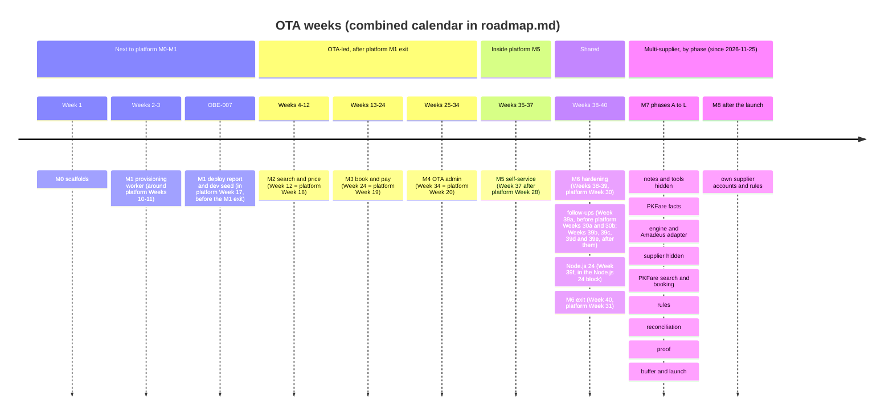

# OTA solo developer plan

This plan lays out the OTA group's MVP work (OTA backend, hosted storefront, OTA admin and JS SDK) for one developer working without AI agents, week by week: what to build each week, in which order, what is delivered and demonstrated on Friday, and where the buffer sits. It uses exactly the tasks of [`agent-tasks.md`](agent-tasks.md) (it references their ids, it does not redefine them) and the milestones and exit criteria of [`implementation-plan.md`](implementation-plan.md). It covers only the OTA group's share; the combined schedule with the platform group is in `docs/mvp/plans/roadmap.md` (written after this plan), and every week below states which platform weeks share its calendar window, using the week numbers of the [platform solo plan](../../../platform/docs/plans/solo-developer-plan.md).

Related: [`implementation-plan.md`](implementation-plan.md), [`agent-tasks.md`](agent-tasks.md), [`../../../platform/docs/plans/solo-developer-plan.md`](../../../platform/docs/plans/solo-developer-plan.md), [`../../../docs/mvp/plans/foundation-tasks.md`](../../../docs/mvp/plans/foundation-tasks.md), [`../../../docs/mvp/README.md`](../../../docs/mvp/README.md#1-shared-milestones), [`../../../docs/mvp/local-development.md`](../../../docs/mvp/local-development.md), [`../../../AGENTS.md`](../../../AGENTS.md) (the definition of done applies to the developer too).

## 1. Assumptions

| Assumption | Value |
|---|---|
| People | One developer, no agents, five working days a week |
| Effort per task size | S = ½ day, M = 1 day, L = 2 days, including tests, docs and self-review against the definition of done (the same rule as the platform plan) |
| OTA work | 299 tasks = 339.5 days since 2026-11-25: M0 3.5, M1 6.5, M2 39.5, M3 55.5, M4 45, M5 9.5, M6 36.5, M7 128.5 and M8 15 (§7). OAD-023's ½ day, OBE-105's 2 days and M8's 15 days fall after the launch. Until 2026-11-25: 179 tasks = 196 days (M0 3.5, M1 6.5, M2 39.5, M3 55.5, M4 45, M5 9.5, M6 36.5; M6's 36.5 days are the first plan's 11.5, the follow-ups of its reviews, 7 days, in Weeks 39a, 39c and 40 since 2026-11-06 and 2026-11-10, the tasks of 2026-11-11, 7 days, in Weeks 39b, 39c and 40, those of the lead's second set of that day, 4 days, in Week 39d, those of 2026-11-13, 2 days: SDK-017 and OFE-032 in Week 39e, and OAD-023 after the launch; SDK-018 of 2026-11-15, ½ day, in Week 39e; OBE-103 and SDK-019 of 2026-11-16, 1½ days, in Week 39f; OBE-104 of 2026-11-18, 1 day, in Week 39f; and OBE-105 of 2026-11-19, 2 days, after the launch, §4). OBE-007 (1 day, M1) runs in the calendar week of platform Week 17, and OAD-023 (½ day, M6) and OBE-105 (2 days, M6, since 2026-11-19) after the launch, so the OTA weeks hold 192.5 task days (191.5 until 2026-11-18, 190 until 2026-11-16) |
| Buffer and demos | 15.5 days inside OTA weeks (mostly at milestone exits: Weeks 1, 4, 12, 24, 33, 36, and Week 39e since 2026-11-13; 16 days until SDK-018 of 2026-11-15 took ½ day of Week 39e's). Since 2026-11-25 M7's 128.5 OTA days have no buffer of their own here: the roadmap gives M7 as a whole 41 days of buffer, shared by the three groups, by the lead's choice of that day (§7) |
| Length | **46 OTA weeks**: Weeks 1–40, the follow-up Week 39a (added 2026-11-06), the follow-up Weeks 39b, 39c and 39d (added 2026-11-11), the follow-up Week 39e (added 2026-11-13) and the follow-up Week 39f (added 2026-11-16, §4), holding 208 OTA days (207 until 2026-11-18): 37 full weeks and 9 split weeks (Weeks 3, 12, 24, 34, 37, 39c, 39d, 39e, 39f) that share a calendar week with platform or foundation work. Since 2026-11-25 M7 adds 128.5 OTA days (25.7 weeks of five days) after these 46 weeks, and M8 15 days after the launch. They have no week numbers: §7 lists them by phase, and the roadmap places the phases in its calendar weeks (M7 in C87–C133, its task days in C87–C125; M8 in C134–C139) |
| Start | Week 1 starts when the foundation tasks `X-001` to `X-016` are merged, like platform Week 1 |
| Week numbers | OTA-plan weeks. The roadmap maps them to calendar weeks. The **Overlap** column names the platform weeks (platform-plan numbering) that sit in the same calendar window, and the gates between the groups. M7 and M8 have no OTA-plan weeks (since 2026-11-25): §7 maps their phases to calendar weeks |

**How a day works.** Morning: pick the next task from this plan, read its **Read first**, write the contract change or the failing test first. Afternoon: implement until **Acceptance** and **Verify** pass, open the PR, run the checklist of [`conventions.md` §12](../../../docs/mvp/conventions.md#12-security-checklist-every-pr), merge, append ` ✅` to the task heading in `agent-tasks.md`. **Friday afternoon** is the weekly demo (a short note in the PR of the last task) and a re-plan if the week slipped. The local stack for demos is the one of [`local-development.md`](../../../docs/mvp/local-development.md): PostgreSQL, Redis, Mailpit, `pnpm stub:amadeus`, both `dev:seed` commands.

## 2. Overview

| Week | Milestone | Goal | Tasks | OTA days | Overlap with the platform group |
|---|---|---|---|---|---|
| 1 | M0 | Four OTA scaffolds in the release | OBE-001, OFE-001, OAD-001, SDK-001 | 5 | Calendar window of platform Week 1; both start after foundation M0 |
| 2 | M1 | Queues, seeds, `tenant.provision` | OBE-002, OBE-003, OBE-004, OBE-005 | 5 | Placed between platform Weeks 9 and 12 (the roadmap puts it around platform Weeks 10–11) |
| 3 | M1 | `tenant.migrate`, OF-11 merged | OBE-006 | 1.5 (split) | **Split week** next to platform Week 11; gate of PBE-035 (platform Week 12) |
| — | M1 | Deploy report and `dev:seed` | OBE-007 | 1 (inside platform Week 17) | Done in the calendar week of platform Week 17, the platform M1 buffer week, after PBE-034 (platform Week 12) and **before the M1 exit**, as the roadmap and ADR-0025 schedule it |
| 4 | M2 | `0002`, contract slice, pipeline | OBE-008, OBE-009, OBE-010 | 4 + 1 buffer | OTA-only week after platform Week 17; the roadmap uses the free day for X-034 |
| 5 | M2 | Callers, tenants, guards, idempotency | OBE-011, OBE-012, OBE-013, OBE-014 | 5 | OTA-only |
| 6 | M2 | Reference, `storefront.get`, Amadeus client | OBE-015, OBE-016, OBE-017, OBE-018 | 5 | OTA-only |
| 7 | M2 | Stub shopping, pricing engine, search, offers | OBE-019, OBE-020, OBE-021, OBE-022 | 5 | OTA-only |
| 8 | M2 | Price, purge, readiness, isolation proof | OBE-023, OBE-024, OBE-025, OBE-026, OBE-027 | 5 | OTA-only |
| 9 | M2 | SDK route table, core, sessions, M2 namespaces | SDK-002, SDK-003, SDK-004, SDK-005 | 5 | OTA-only |
| 10 | M2 | SDK contract and bundles, storefront base and home | SDK-006, SDK-007, OFE-002, OFE-003, OFE-004 | 5 | OTA-only |
| 11 | M2 | Results, offer, price pages, load test | OFE-005, OFE-006, OFE-007, OBE-028 | 5 | OTA-only |
| 12 | M2 exit | Storefront journey, deploy, M2 demo | OFE-008 | 3.5 (split) | **= platform Week 18** (1.5 platform days: PBE-036, PAD-011, gated on OF-01) |
| 13 | M3 | Airline-card contract, outbox, tokens, sign-up | OBE-029, OBE-030, OBE-031, OBE-032 | 5 | OTA-only week between platform Weeks 18 and 19 |
| 14 | M3 | Sign-in, password, account, SDK auth | OBE-033, OBE-034, OBE-035, SDK-008 | 5 | OTA-only |
| 15 | M3 | Auth and account pages, checkout data | OFE-009, OFE-010, OBE-036, OBE-037 | 5 | OTA-only |
| 16 | M3 | Stripe gateway, webhooks, SDK checkout | OBE-038, OBE-039, SDK-009 | 5 | OTA-only |
| 17 | M3 | Payments queue, stub orders, orchestrator | OBE-040, OBE-041, OBE-042 | 5 | OTA-only |
| 18 | M3 | Reconciliation, ticketing, sync, my bookings | OBE-043, OBE-044, OBE-045, OBE-046 | 5 | OTA-only |
| 19 | M3 | Guest access, change, cancel, SDK bookings | OBE-047, OBE-048, OBE-049, SDK-010 | 5 | OTA-only |
| 20 | M3 | Checkout pages, Stripe page, confirmation, expiry | OFE-011, OFE-012, OFE-013, OBE-056 | 5 | OTA-only |
| 21 | M3 | Airline card end to end | OBE-050, OBE-051, OBE-052, OFE-014 | 5 | OTA-only |
| 22 | M3 | Documents, e-mails, cookie-mode proof | OBE-053, OBE-054, OBE-055, OBE-057 | 5 | OTA-only |
| 23 | M3 | Bookings pages, lookup, Stripe and airline journeys | OFE-015, OFE-016, OFE-017, OFE-018 | 5 | OTA-only |
| 24 | M3 exit | Account journeys, deploy, M3 demo | OFE-019 | 3.5 (split) | **= platform Week 19** (1.5 platform days: PBE-037, PBE-038, PFE-016) |
| 25 | M4 | Console contract slices, staff SSO | OBE-058, OBE-090, OBE-091, OBE-059 | 5 | OTA-only week between platform Weeks 19 and 20 |
| 26 | M4 | Access rules, console bookings, issue, cancel | OBE-060, OBE-061, OBE-062, OBE-063 | 5 | OTA-only |
| 27 | M4 | PNR import, queues, customers, raw reads, payments | OBE-064, OBE-065, OBE-066, OBE-067, OBE-068 | 5 | OTA-only |
| 28 | M4 | Suspend; settings API: rules, storefront, assets, templates | OBE-074, OBE-069, OBE-070, OBE-071, OBE-073 | 5 | OTA-only |
| 29 | M4 | Content pages, console proof, SDK console | OBE-072, OBE-075, SDK-011, SDK-012 | 5 | OTA-only |
| 30 | M4 | SDK parity and smoke, admin foundations, dashboard | SDK-013, SDK-014, OAD-002, OAD-003, OAD-004, OAD-005 | 5 | OTA-only |
| 31 | M4 | Bookings in the admin, actions, PNR and queues | OAD-006, OAD-007, OAD-008, OAD-009 | 5 | OTA-only |
| 32 | M4 | Shopping, payments, customers, markups, content pages | OAD-010, OAD-011, OAD-012, OAD-013, OFE-020 | 5 | OTA-only |
| 33 | M4 | Storefront settings, assets, pages, templates; buffer | OAD-014, OAD-015 | 5 | OTA-only |
| 34 | M4 | Admin journey with portal SSO | OAD-016 | 1 (split) | **= platform Week 20** (4 platform days: PBE-039, PBE-040, PFE-017, PFE-018, PFE-019); OAD-016 runs after PFE-017 and before PFE-019 |
| 35 | M4 exit → M5 | Admin journeys, M4 demo; M5 contract and Stripe modes | OAD-017, OBE-076, OBE-077, OBE-078, OBE-079 | 5 | Overlaps platform M5 (calendar of platform Weeks 21–22); no gate |
| 36 | M5 | Domains, live, billing notice, admin and storefront | OBE-080, OBE-081, OBE-082, OAD-018, OFE-021 | 5 | Overlaps platform M5 (platform Weeks 22–24); no gate |
| 37 | M5 exit | Cross-backend proof and live journey | OBE-083, OFE-022 | 2.5 (split) | **Split week** after platform Week 28 (needs PBE-053, PBE-055, PBE-057, PBE-061) and before platform Week 29 |
| 38 | M6 | Security review, inventory, PCI pack, erasure | OBE-084, OFE-023, OBE-085, OBE-087 | 5 | Shared hardening with platform Week 30 and foundation X-029 … X-032 |
| 39 | M6 | Performance, runbooks, accessibility, guide, admin suite | OBE-088, OBE-089, OFE-024, OFE-025, OAD-019 | 5 | Shared with platform Week 30 |
| 39a | M6 | Follow-ups: search CPU, dependencies, generic refusals, layout shifts | OBE-092, OBE-093, OBE-094, OBE-095, OAD-020, OFE-027, OFE-028, OFE-029 | 5 (OFE-029 took the ½ day of buffer on 2026-11-10) | Calendar week of its own before platform Weeks 30a and 30b (added 2026-11-06); OBE-094 is merged before PBE-069 (platform Week 30a) |
| 39b | M6 | Follow-ups of 2026-11-11: CORS, offers per search, closing a Reconciliation review | OBE-097, OBE-098, OAD-021, OBE-099, OAD-022 | 5 | Calendar week of its own after platform Weeks 30a and 30b (added 2026-11-11; roadmap C77) |
| 39c | M6 | `secrets:rewrap`, layout shifts on phones | OBE-100, OFE-030 | 2 (split; its ½ day of buffer went to platform Week 30c on 2026-11-11) | **Split week** with platform Week 30c (PBE-072, PBE-073) and X-041 (added 2026-11-11; roadmap C78) |
| 39d | M6 | Follow-ups of the lead's second set of 2026-11-11: the SDK's shared refresh, the Amadeus buckets kept for shopping, a signed-in customer's phone page | SDK-016, OBE-102, OFE-031 | 4 (split) | **Split week** with platform Week 30d (PBE-074) (added 2026-11-11, second set; roadmap C79) |
| 39e | M6 | Follow-ups of 2026-11-13: one refresh per refresh token in the SDK, the compact account menu up to the large breakpoint; since 2026-11-15 the family's newest tokens of the session in what the SDK's session hooks get whenever the result's refresh token has been rotated, and an empty refresh token counted as none | SDK-017, OFE-032, SDK-018 | 2.5 (split; ½ day of buffer, 1 day until SDK-018 of 2026-11-15) | **Split week** with platform Week 30e (PBE-075 and, since 2026-11-15, PFE-031) (added 2026-11-13; roadmap C80); SDK-017 before SDK-015 (Week 40) publishes 1.0.0. *Note (2026-11-20, lead decision (32e), approved by the owner; FIX-W63-DOCS):* 1.0.0 is published in this calendar in Week 40; in the project in December 2026, (31f) and (32a) ([roadmap](../../../docs/mvp/plans/roadmap.md) §3.4) |
| 39f | M6 | Node.js 24 (2026-11-16): the OTA API and worker measured on Node.js 24 against Node 22, the Node.js versions the SDK supports; since 2026-11-18 three hours of the OTA API and worker on Node.js 24 | OBE-103, SDK-019, OBE-104 | 2.5 (split; 1.5 until 2026-11-18) | **Split week** in the roadmap's Node.js 24 block (C83), after X-048 (C82), with platform Week 30f's PBE-076 and X-029 and X-032 (added 2026-11-16); SDK-019 before SDK-015 (Week 40) publishes 1.0.0. *Note (2026-11-20, lead decision (32e), approved by the owner; FIX-W63-DOCS):* 1.0.0 is published in this calendar in Week 40; in the project in December 2026, (31f) and (32a) ([roadmap](../../../docs/mvp/plans/roadmap.md) §3.4) |
| 40 | M6 exit | SDK 1.0.0, airline-card gate, search budget, Redis's completed jobs, stable suites, launch (since 2026-11-25 M6's exit only: the launch follows M7, §7) | SDK-015, OBE-086, OBE-096, OBE-101, OFE-026 | 5 | Shared launch week with platform Week 31. *Note (2026-11-20, lead decision (32e), approved by the owner; FIX-W63-DOCS):* SDK-015 publishes 1.0.0 in this calendar in this week; in the project in December 2026, (31f) and (32a) ([roadmap](../../../docs/mvp/plans/roadmap.md) §3.4) |
| M7 (§7) | M7 | Since 2026-11-25, by phase A to L: the SDK notes, the Amadeus tools hidden, PKFare's facts, the engine with the Amadeus adapter, the supply registry read, the supplier hidden, PKFare's search and booking with extras and low-cost content, the rules at the hooks, reconciliation, proof; then M7's buffer and the launch | 109 tasks (§7) | 128.5 | The phases' weeks hold the foundation's and the platform's M7 days too (roadmap C87–C133) |
| M8 (§7) | M8 | Since 2026-11-25, after the launch: an OTA's own supplier accounts and rules, and the plan's "Later" work | 11 tasks (§7) | 15 | Beside the platform's M8 tasks (roadmap C134–C139) |

## 3. Weeks 1 and 2, day by day

### Week 1 — M0: the four OTA scaffolds

**Before Monday:** foundation tasks `X-001` to `X-016` are merged (config, logger, crypto, OpenAPI copy, api-types, errors, db, migration runner, baselines, tenant runner, codegen, `@velexis/testing`, local setup) and X-019 makes CI green. `pnpm db:migrate` works and `migrate.js tenant --schema tenant_demo --create` creates a 42-table schema locally.

| Day | Work | Done when |
|---|---|---|
| Monday | **OBE-001** (M): `@velexis/ota-backend` package, `main.ts`, `worker.ts`, `cli.ts`, `config.ts` with its tests, `Clock` and `newId`, the health module, the integration test | `pnpm --filter @velexis/ota-backend build` and `test:int` pass; `/health/ready` answers 503 with Redis stopped |
| Tuesday | **OFE-001** (M): Vite MPA, Tailwind 4 tokens, the partials plugin, dev and preview proxy with edge headers, the budget script, the CSP test | `vite build` writes `dist/` with no inline script; the CSP test passes against the Caddyfile |
| Wednesday | **OAD-001** (M): Next.js 15 app, `config.ts` without `NEXT_PUBLIC_`, shadcn/ui initialised, health routes | `.next/standalone` builds; health tests pass |
| Thursday | Morning **SDK-001** (S): package without dependencies, `checkJs` project, `VERSION`, fake fetch helper. Afternoon: **M0 check**, run `deploy/scripts/pack-release.sh` locally and confirm `ota-backend/`, the admin standalone output and `storefront/` are in the release | `pnpm --filter @velexis/ota-sdk typecheck` passes; the release lists the three OTA outputs |
| Friday | Morning: buffer (scaffold fixes found by the M0 check; read OADR-0007 and the provisioning flow for Week 2). Afternoon: **demo** | All four packages green in CI |

**Deliverables:** four scaffolded OTA packages (M0 done for the OTA group).
**Demo:** start the backend API and worker and the OTA admin and call their health endpoints; open the built storefront through `vite preview` and show the CSP header; show that the SDK package has no dependencies.

### Week 2 — M1: queues, seeds and the provisioning consumer

**Before Monday:** platform tasks PBE-002 (platform `0002`) and PBE-004 (job schemas) are merged; in the calendar this week sits around platform Weeks 10–11, so PBE-019 (dispatch) and PBE-022 (post-steps) exist on the platform side.

| Day | Work | Done when |
|---|---|---|
| Monday | **OBE-002** (M): Redis module, key builders with TTLs, `OTA_QUEUES` appended in `@velexis/api-types/jobs`, BullMQ defaults, job validation | The TTL test lists every builder; an invalid `tenant.provision` payload is unrecoverable |
| Tuesday | Morning **OBE-003** (S): read-only platform repository for tenants. Afternoon: start **OBE-004** (M): the settings seed and the default markup rule | The OTA role reads `platform.tenants` and cannot update it (42501) |
| Wednesday | Morning: finish **OBE-004** (template registry, idempotent seeds, tests). Afternoon: start **OBE-005** (L, day 1): processor in the worker, migrator pool, `provisionTenant` skeleton with the status checks | Seeds run twice without change; the worker consumes a fixture message |
| Thursday | **OBE-005** (L, day 2): the one-transaction provisioning with `migrateTenantSchema({ create: true })`, seeds, `tenant.provisioned` event | A fresh tenant row becomes a complete schema with ledger, grants and seeds |
| Friday | Morning: finish **OBE-005** (duplicate message, catalog hash of two schemas, crash before commit). Afternoon: **demo** and half a day of buffer | OF-11 AC1 and AC2 tests pass |

**Deliverables:** the OTA worker provisions tenants from the platform's queue.
**Demo:** create an OTA through the platform API (or the portal wizard if PFE-008 is merged), watch the OTA worker log `tenant.provision`, list `tenant_<key>` tables and the ledger in `psql`, and see the platform mark the tenant active from `tenant.provisioned`.

## 4. Weeks 3 to 40 (and Weeks 39a, 39b, 39c, 39d, 39e and 39f)

Each week lists its goal, the tasks in order with their days, the deliverables, the Friday demo and the overlap with platform work.

### Week 3 — M1 exit: tenant.migrate and OF-11 merged (split week, 1.5 OTA days)

- **Tasks:** OBE-006 (1 day: `tenant.migrate`, failure classes); ½ day: run the platform's cross-backend test PBE-035 locally if it exists, otherwise prepare the OTA worker build it will use.
- **Deliverables:** OF-11 complete; the worker build used by the platform's `stack.ts`.
- **Demo:** a forced lock timeout reported as retryable; an edited migration reported as non-retryable.
- **Overlap:** the remaining 3.5 days of this calendar week are platform days (platform Week 11). OF-11 must be merged before platform Week 12 (PBE-035). OBE-007 cannot be done here: it needs PBE-034, which lands in platform Week 12.

### Between Weeks 3 and 4 — M1: OBE-007 inside platform Week 17 (1 OTA day)

- **Tasks:** OBE-007 (1): `tenants:report-migrations`, its `velexis-deploy` step after the tenant fan-out, and `dev:seed`.
- **Why here:** it is an M1 task and the M1 exit checks `tenants:report-migrations`; it needs PBE-034 (platform Week 12). Platform Week 17 is the platform M1 buffer week, so the day comes from that buffer ([roadmap](../../../docs/mvp/plans/roadmap.md) C27, [ADR-0025](../../../docs/mvp/adr/0025-roadmap-scheduling-and-tracking.md)). Doing it in Week 4 would put an M1 task after the M1 exit.
- **Deliverables:** the deploy fan-out reported on `platform-tenant-events`; `tenant_demo` on `demo.ota.example.com` with test keys.
- **Demo:** run `velexis-deploy` in its test harness and see the report step after the fan-out; `dev:seed` twice leaves one demo tenant.

### Week 4 — M2: migration 0002, contract slice and pipeline

- **Tasks:** OBE-008 (1), OBE-009 (1), OBE-010 (2); 1 day buffer (the roadmap schedules the foundation task X-034 on it).
- **Deliverables:** `0002` applied by provisioning and the fan-out (and reported by the OBE-007 step); the M2 contract slice; the HTTP pipeline with route parity.
- **Demo:** every not-yet-built operation answers `501 NOT_IMPLEMENTED` with its milestone; a body with an unknown field answers 400 without echoing the value.
- **Overlap:** first OTA-only week after the platform M1 exit (platform Week 17); OBE-007 is already merged.

### Week 5 — M2: callers, tenants, guards and idempotency

- **Tasks:** OBE-011 (1), OBE-012 (2), OBE-013 (1), OBE-014 (1).
- **Deliverables:** OF-01 in the backend: edge and key callers, tenant resolution with caches and `vx:invalidate`, scope and CSRF guards, rate limits, idempotency.
- **Demo:** suspend the demo tenant in the platform admin and see `403 TENANT_SUSPENDED` within a second; a POST without the CSRF header answers 403.
- **Overlap:** OTA-only.

### Week 6 — M2: reference data, storefront.get and the Amadeus client

- **Tasks:** OBE-015 (1), OBE-016 (1), OBE-017 (1), OBE-018 (2).
- **Deliverables:** reference endpoints, `storefront.get` with the CSRF cookie, the Amadeus resolver, tokens, buckets, timeouts, error mapping and `supplier_requests`.
- **Demo:** `curl` `GET /v1/storefront` in edge mode shows the CSRF cookie; `amadeus:ping` is not ready yet, so show 50 concurrent client calls producing one token request in the integration test.
- **Overlap:** OTA-only.

### Week 7 — M2: stub shopping, pricing engine, search and offers

- **Tasks:** OBE-019 (1), OBE-020 (1), OBE-021 (2), OBE-022 (1).
- **Deliverables:** stubbed price, upsell and availability; the markup and fee engine; search, results, offer and upsell endpoints.
- **Demo:** add a 5 % markup rule as migrator and see selling prices change on the next search; tenant B gets 404 for tenant A's offer.
- **Overlap:** OTA-only.

### Week 8 — M2: pricing, purge, readiness and the isolation proof

- **Tasks:** OBE-023 (2), OBE-024 (1), OBE-025 (½), OBE-026 (1), OBE-027 (½, with the human step of recording fixtures and asking Amadeus about the booking queue).
- **Deliverables:** the backend side of M2 complete and proven in both caller modes.
- **Demo:** the full search-to-price flow by `curl` with the `sk_test` key; the `price-changed` scenario; worker readiness with queue ages.
- **Overlap:** OTA-only.

### Week 9 — M2: SDK route table, core, sessions and M2 namespaces

- **Tasks:** SDK-002 (1), SDK-003 (2), SDK-004 (1), SDK-005 (1).
- **Deliverables:** the SDK's generated route table, request core, three session modes and the `storefront`, `reference` and `flights` namespaces.
- **Demo:** a Node script with `createVelexisClient({ secretKey })` runs search to price against the local API; a cookie-mode client in happy-dom copies the CSRF cookie.
- **Overlap:** OTA-only.

### Week 10 — M2: SDK contract and bundles, storefront base and home

- **Tasks:** SDK-006 (1), SDK-007 (1), OFE-002 (1), OFE-003 (1), OFE-004 (1).
- **Deliverables:** contract and parity tests with the pending list, ESM and IIFE bundles within 25 KB, the storefront's shared modules, boot and theme, the home page.
- **Demo:** the demo storefront with OTA colours and the test banner; the location combobox with the keyboard.
- **Overlap:** OTA-only.

### Week 11 — M2: results, offer and price pages, load test

- **Tasks:** OFE-005 (2), OFE-006 (1), OFE-007 (1), OBE-028 (½); ½ day buffer.
- **Deliverables:** the storefront from search to price; the first `ota/docs/performance.md`.
- **Demo:** search, filter, sort, load more, fare families, price with fee labels and the countdown, all in the browser.
- **Overlap:** OTA-only.

### Week 12 — M2 exit: storefront journey, deploy and demo (split week, 3.5 OTA days)

- **Tasks:** OFE-008 (1); 1½ days buffer; 1 day deploy to the VM and the M2 demo.
- **Deliverables:** the `storefront` Playwright project and the M2 journey green; M2 on the VM.
- **Demo:** the M2 demo of [`implementation-plan.md`](implementation-plan.md) on `https://demo.ota.example.com` (placeholder host) with the stub or the Amadeus test environment.
- **Overlap:** **this is platform Week 18**: its 1.5 platform days run PBE-036 and PAD-011, whose OF-01 gate this week meets. Check the M2 exit criteria.

### Week 13 — M3: airline-card contract, outbox, tokens and sign-up

- **Tasks:** OBE-029 (1), OBE-030 (2), OBE-031 (1), OBE-032 (1).
- **Deliverables:** the M3 contract slice, the notification outbox with Mailpit delivery, customer tokens and cookie sessions, sign-up and verification.
- **Demo:** sign up by `curl` in edge mode (no token in the body, cookies set) and open the verification link from Mailpit.
- **Overlap:** OTA-only week between platform Weeks 18 and 19.

### Week 14 — M3: sign-in, password, account and SDK auth

- **Tasks:** OBE-033 (2), OBE-034 (1), OBE-035 (1), SDK-008 (1).
- **Deliverables:** the customer identity API complete in both modes; `auth` and `account` in the SDK.
- **Demo:** lockout after five failures; refresh-token reuse revokes the family; account deletion signs the customer out.
- **Overlap:** OTA-only.

### Week 15 — M3: authentication and account pages, checkout data

- **Tasks:** OFE-009 (1), OFE-010 (1), OBE-036 (2), OBE-037 (1).
- **Deliverables:** storefront sign-up, sign-in, verification, reset and account pages; checkout create, travellers (encrypted documents), contacts, remarks and extras.
- **Demo:** sign up and sign in on the storefront; fill a checkout by `curl` and show that no document number is stored in clear.
- **Overlap:** OTA-only.

### Week 16 — M3: Stripe gateway, webhooks and SDK checkout

- **Tasks:** OBE-038 (2), OBE-039 (2), SDK-009 (1).
- **Deliverables:** PaymentIntents in Velexis mode, card-fee quotes, the webhook receiver and processor, the `checkout` SDK namespace.
- **Demo:** `stripe listen` forwards a test event; the duplicate is ignored; the payment state comes from the re-fetch.
- **Overlap:** OTA-only.

### Week 17 — M3: payments queue, stub orders and the orchestrator

- **Tasks:** OBE-040 (1), OBE-041 (2), OBE-042 (2).
- **Deliverables:** voids, capture retries, refunds; stubbed order operations; `checkout.complete` creating, paying and ticketing orders.
- **Demo:** a full booking by `curl` with a Stripe test PaymentIntent confirmed in the Stripe dashboard; the `sold-out` scenario voids the authorisation.
- **Overlap:** OTA-only.

### Week 18 — M3: reconciliation, ticketing, sync and my bookings

- **Tasks:** OBE-043 (2), OBE-044 (1), OBE-045 (1), OBE-046 (1).
- **Deliverables:** the `SUPPLIER_TIMEOUT` recovery with replay, ticketing retries, booking sync, customer bookings.
- **Demo:** stub `timeout`: the replay answers 504 until the reconciler finds the order, then 201; `ticketing-failed` retries on the schedule with a fake clock.
- **Overlap:** OTA-only.

### Week 19 — M3: guest access, change, cancel and SDK bookings

- **Tasks:** OBE-047 (1), OBE-048 (1), OBE-049 (2), SDK-010 (1).
- **Deliverables:** guest tokens and lookup, contact changes, cancellation quotes and cancellation with the money step; the `bookings` SDK namespace.
- **Demo:** lookup with a wrong name and the right one (identical 404s); cancel a booking twice with the same key and see one refund.
- **Overlap:** OTA-only.

### Week 20 — M3: checkout pages, Stripe page, confirmation and expiry

- **Tasks:** OFE-011 (2), OFE-012 (1), OFE-013 (1), OBE-056 (1).
- **Deliverables:** the storefront checkout with the Stripe Payment Element, the complete and confirmation pages; checkout expiry and retention schedulers.
- **Demo:** a guest books and pays with the 3-D Secure test card in the browser.
- **Overlap:** OTA-only.

### Week 21 — M3: the airline card end to end

- **Tasks:** OBE-050 (1), OBE-051 (2), OBE-052 (1), OFE-014 (1).
- **Deliverables:** the airline-card method in the test environment: net pricing, the dedicated route, abuse limits, the PAN-absence test, the isolated payment page with its own CSP.
- **Demo:** book with test PAN `4111 1111 1111 1111`; three declines lock the checkout; the PAN-absence test output; the stricter CSP header on the page.
- **Overlap:** OTA-only.

### Week 22 — M3: documents, e-mails and the cookie-mode proof

- **Tasks:** OBE-053 (2), OBE-054 (1), OBE-055 (1), OBE-057 (1).
- **Deliverables:** itinerary and e-ticket PDFs, signed downloads, the booking and staff e-mail templates, the cookie and CSRF proof over every customer operation.
- **Demo:** the confirmation e-mail with the itinerary attached, then the e-ticket e-mail; an expired download link answers 403.
- **Overlap:** OTA-only.

### Week 23 — M3: bookings pages, lookup, Stripe and airline-card journeys

- **Tasks:** OFE-015 (2), OFE-016 (½), OFE-017 (1), OFE-018 (1); ½ day buffer.
- **Deliverables:** my bookings, booking detail with change and cancel, guest lookup; the `storefront-stripe` and airline-card journeys.
- **Demo:** change contacts and cancel with the refund preview in the browser; the two journeys running.
- **Overlap:** OTA-only.

### Week 24 — M3 exit: account journeys, deploy and demo (split week, 3.5 OTA days)

- **Tasks:** OFE-019 (1); 1½ days buffer; 1 day deploy and the M3 demo.
- **Deliverables:** every M3 journey green; M3 on the VM with `AIRLINE_CARD_ENABLED=false` in production (airline card shown in development and CI only).
- **Demo:** the M3 demo of the implementation plan.
- **Overlap:** **this is platform Week 19**: its 1.5 platform days run PBE-037, PBE-038 and PFE-016 (the statement descriptor that OBE-038 already sends).

### Week 25 — M4: console contract slices and staff SSO

- **Tasks:** OBE-058 (2), OBE-090 (½), OBE-091 (½), OBE-059 (2).
- **Deliverables:** the M4 contract in three slices (permissions and settings; payments, health and the M5 webhooks; pages and assets), 135 operations in the document; staff sign-in by portal token, staff sessions with deny checks.
- **Demo:** redeem a portal token (written to Redis by the test, as PBE-039 will) once; a second redemption fails.
- **Overlap:** OTA-only week between platform Weeks 19 and 20.

### Week 26 — M4: access rules, console bookings, issue and cancel

- **Tasks:** OBE-060 (1), OBE-061 (1), OBE-062 (1), OBE-063 (2).
- **Deliverables:** service key (direct loopback only), forwarded end-user IP, environments, permissions and `staff_actions`; console bookings list, detail, retrieve, patch, resync, notes, issue with capture, cancel with refunds.
- **Demo:** a viewer asking for live gets `ENVIRONMENT_NOT_ALLOWED`; the service key with an `X-Forwarded-For` header is refused; issue a manual-review booking by `curl` with a staff token.
- **Overlap:** OTA-only.

### Week 27 — M4: PNR import, queues, customers, raw reads and payments

- **Tasks:** OBE-064 (1), OBE-065 (1), OBE-066 (1), OBE-067 (1), OBE-068 (1).
- **Deliverables:** PNR lookup and import, queues with the poller and orphan detection, customers and the supplier log, raw Amadeus reads, console payments.
- **Demo:** import a PNR of the tenant's office and fail for another office; a queue snapshot with an orphan PNR; a partial refund.
- **Overlap:** OTA-only.

### Week 28 — M4: suspend and the settings API

- **Tasks:** OBE-074 (1), OBE-069 (1), OBE-070 (1), OBE-071 (1), OBE-073 (1).
- **Deliverables:** the suspend and resume consumer; markup and fee rules, storefront settings, assets with the public download, template settings.
- **Demo:** suspending the tenant expires an open checkout; upload a logo and see it served with the immutable headers.
- **Overlap:** OTA-only.

### Week 29 — M4: content pages, console proof and the SDK console namespace

- **Tasks:** OBE-072 (2), OBE-075 (1), SDK-011 (1), SDK-012 (1).
- **Deliverables:** content pages with the Markdown-subset parser and the public page endpoints; the permission matrix, audit and office isolation proven, with the M4 totals (135 operations, 128 SDK methods); the full `console` namespace and the storefront page methods.
- **Demo:** a page with `<script>` refused at its line; the permission matrix test output; `pending-operations.ts` holding only deferred operations and the two M5 webhooks.
- **Overlap:** OTA-only.

### Week 30 — M4: SDK parity and smoke tests, admin foundations and dashboard

- **Tasks:** SDK-013 (½), SDK-014 (1), OAD-002 (1), OAD-003 (1), OAD-004 (1), OAD-005 (½).
- **Deliverables:** the SDK parity list empty and the bundle size recorded; nightly SDK smoke tests; the OTA admin's server-side SDK client, sessions with refresh de-duplication, SSO handlers, middleware, shell and dashboard.
- **Demo:** post a portal token to `/sso` (minted by a test helper) and land on the dashboard with permission-based navigation.
- **Overlap:** OTA-only.

### Week 31 — M4: bookings in the admin, actions, PNR and queues

- **Tasks:** OAD-006 (1), OAD-007 (1), OAD-008 (2), OAD-009 (1).
- **Deliverables:** bookings list and detail, every booking action, PNR import and queue pages.
- **Demo:** issue, cancel with refund and add a note from the admin; a double click on Issue replays instead of issuing twice.
- **Overlap:** OTA-only.

### Week 32 — M4: shopping, payments, customers, markups and content pages

- **Tasks:** OAD-010 (1), OAD-011 (1), OAD-012 (1), OAD-013 (1), OFE-020 (1).
- **Deliverables:** shopping on behalf, payments, customers, supplier log, portal links, markup and fee rules; storefront content pages with the Caddy rewrite.
- **Demo:** change a markup rule in the admin and search on the storefront; open `/p/terms`.
- **Overlap:** OTA-only.

### Week 33 — M4: storefront settings, assets, pages and templates; buffer

- **Tasks:** OAD-014 (2), OAD-015 (1); 1 day buffer; 1 day deploy and the pre-SSO M4 demo.
- **Deliverables:** every OTA admin screen; M4 on the VM except the portal hand-off journey.
- **Demo:** branding, assets, pages and a template preview from the admin, visible on the storefront.
- **Overlap:** OTA-only. Before platform Week 20 starts, OBE-059 and OAD-003 must be merged (OF-09).

### Week 34 — M4: the admin journey with portal SSO (split week, 1 OTA day)

- **Tasks:** OAD-016 (1), after PFE-017 is merged in the same calendar week.
- **Deliverables:** the `ota-admin` Playwright project; the SSO and bookings journeys.
- **Demo:** "Open console" in the portal lands on `/bookings` in the OTA admin.
- **Overlap:** **this is platform Week 20**: PBE-039, PBE-040 and PFE-017 come first, then OAD-016, then PFE-019 (gated on OF-09), PFE-018.

### Week 35 — M4 exit, then M5: admin journeys, M5 contract and Stripe modes

- **Tasks:** OAD-017 (1); ½ day M4 demo and exit check; OBE-076 (½), OBE-077 (1), OBE-078 (1), OBE-079 (1).
- **Deliverables:** M4 closed; the M5 contract slice, Connect and API-key modes with their webhooks, own Amadeus credentials with the releasing-office rule.
- **Demo:** the M4 demo of the implementation plan; a PaymentIntent with `Stripe-Account` in a test.
- **Overlap:** sits in the calendar of platform Weeks 21–22 (platform M5 start); uses only rows created by PBE-002, so no gate.

### Week 36 — M5: domains, live environment, billing notice

- **Tasks:** OBE-080 (1), OBE-081 (1), OBE-082 (½), OAD-018 (1), OFE-021 (½); 1 day buffer.
- **Deliverables:** custom-domain resolution and primary-host links, the live environment, the billing banner in the OTA admin, live mode on the storefront.
- **Demo:** flip `storefront_environment` (as migrator in development) and see the storefront and the admin switch within a second.
- **Overlap:** inside platform M5 (platform Weeks 22–24); no gate.

### Week 37 — M5 exit: cross-backend proof and live journey (split week, 2.5 OTA days)

- **Tasks:** OBE-083 (1), OFE-022 (1); ½ day M5 demo.
- **Deliverables:** OF-12 proven with the real platform features; the live and custom-domain journey.
- **Demo:** the M5 demo of the implementation plan.
- **Overlap:** after platform Week 28 (PBE-053, PBE-055, PBE-057, PBE-061 merged) and before platform Week 29, whose journeys and switch decisions need OF-12.

### Week 38 — M6: security review, payment-page inventory, PCI pack, erasure

- **Tasks:** OBE-084 (2), OFE-023 (½), OBE-085 (1), OBE-087 (1); ½ day buffer.
- **Deliverables:** `ota/docs/security-review.md` with no open high finding, the payment-page inventory for X-030, the PCI evidence pack, the erasure job.
- **Demo:** the auth matrix test output; the PCI data-flow diagram.
- **Overlap:** shared hardening with platform Week 30 and foundation X-029 … X-032.

### Week 39 — M6: performance, runbooks, accessibility, guide and admin suite

- **Tasks:** OBE-088 (1), OBE-089 (1), OFE-024 (1), OFE-025 (1), OAD-019 (1).
- **Deliverables:** performance figures within the VM budget (or tasks), runbooks and the launch checklist, the accessibility and Lighthouse pass, the build-your-own guide, the complete admin suite.
- **Demo:** the 30-minute mixed load run; a screen-reader pass through checkout.
- **Overlap:** shared with platform Week 30.

*Note (2026-11-06, FIX-W46-SHARED, lead decision (11g)).* The M6 reviews found work that the first plan did not hold: eight OTA tasks of 5.5 days in all ([`implementation-plan.md`](implementation-plan.md#m6--hardening--launch), the M6 note of 2026-11-06). Seven of them, 4.5 days, take one week inserted after Week 39 and numbered 39a, so that Weeks 1–40 keep the numbers the roadmap's calendar maps (Week 40 stays the launch week): OBE-092 from the load test of OBE-028, OBE-093, OBE-094, OBE-095 and OAD-020 from the security review (Week 38), OFE-027 and OFE-028 from the Lighthouse pass (Week 39). OBE-096 (1 day), which FIX-W46-SHARED added when the larger young generation left the search p95 above 500 ms ([`../performance.md`](../performance.md) §4, Step 4), takes one of Week 40's two buffer days. The plan therefore holds 159 tasks of 176.5 days (M6 17) in 41 weeks, with 16.5 days of buffer (§1, §5). The roadmap's calendar places Week 39a in a calendar week of its own before the platform's Weeks 30a and 30b, because PBE-069 needs OBE-094 ([`../../../docs/mvp/plans/roadmap.md`](../../../docs/mvp/plans/roadmap.md) §1.3, the re-baseline of 2026-11-06 under [ADR-0025](../../../docs/mvp/adr/0025-roadmap-scheduling-and-tracking.md) item 6).

*Note (2026-11-10, wave 46).* OFE-029 (S, 2 h, ½ solo day), which OFE-027 added on 2026-11-10 when its measurement found the header's shift, takes Week 39a's ½ day of buffer, after OFE-027 and OFE-028. The plan therefore holds 160 tasks of 177 days (M6 17.5) in 41 weeks, with 16 days of buffer (§1, §5).

*Note (2026-11-10, lead decision (13a), FIX-W47-SHARED).* OFE-029 is done (OFE-028's header change met its figures), and OFE-030 (M, 1 day: the layout shifts left on phones and the first axe pass at phone width, after OFE-028) takes Week 40's day of buffer. The plan therefore holds 161 tasks of 178 days (M6 18.5) in 41 weeks, with 15 days of buffer (§1, §5); Week 40 keeps the launch day.

*Note (2026-11-11, lead decisions (15a), (15h), (15j), (15l) and (15m), FIX-W48-SHARED).* Six OTA tasks of 6 days join M6 ([`implementation-plan.md`](implementation-plan.md#m6--hardening--launch), the M6 note of 2026-11-11): OBE-097 (CORS, 1 day), OBE-098 and OAD-021 (a storefront's offers per search, ½ day each), OBE-099 and OAD-022 (closing a booking in Reconciliation review, 2 days and 1 day) and OBE-100 (`secrets:rewrap`, 1 day). They take two weeks inserted after Week 39a and numbered 39b and 39c, so that Weeks 1–40 keep their numbers (Week 40 stays the launch week): Week 39b holds the first five (5 days), Week 39c holds OBE-100 and OFE-030, which moves there from Week 40's buffer day (2 days and ½ day of buffer), so Week 40 has its day of buffer again. The plan therefore holds 167 tasks of 184 days (M6 24.5) in 43 weeks, with 16.5 days of buffer (§1, §5). The roadmap's re-baseline of 2026-11-11 places Week 39b in C77 and Week 39c in C78, beside the platform's Week 30c (PBE-072) and X-041 ([`../../../docs/mvp/plans/roadmap.md`](../../../docs/mvp/plans/roadmap.md) §1.3).

*Note (2026-11-11, OBE-088).* OBE-101 (M, 1 day: a bound of the completed jobs Redis keeps, which OBE-088 added when its measurement found that they grow with the active tenants, [`../performance.md`](../performance.md) §6) takes Week 40's day of buffer, after OBE-088 (Week 39). The plan therefore holds 168 tasks of 185 days (M6 25.5) in 43 weeks, with 15.5 days of buffer (§1, §5); Week 40 keeps the launch day, and the roadmap's calendar does not change.

*Note (2026-11-11, lead decisions (17d), (17g) and (17l), approved by the owner; FIX-W49-SHARED).* Three OTA tasks of 4 days join M6 ([`implementation-plan.md`](implementation-plan.md#m6--hardening--launch), the M6 note of the same day): SDK-016 (one refresh shared by the SDK clients derived from one cookie-mode client, 1 day), OBE-102 (a share of the Amadeus buckets kept free for shopping during the booking sync, 1 day, after OBE-088 of Week 39) and OFE-031 (a signed-in customer's phone page kept still, the search form's fallback and the OTA's full name in the footer, 2 days, after OFE-030 of Week 39c). They take a split Week 39d inserted after Week 39c, so that Weeks 1–40 keep their numbers, beside the platform's new Week 30d (PBE-074) in C79; Week 39c's ½ day of buffer goes to the platform's PBE-073, which shares C78 with it ([`../../../docs/mvp/plans/roadmap.md`](../../../docs/mvp/plans/roadmap.md) §1.3, the second re-baseline of 2026-11-11). The plan therefore holds 171 tasks of 189 days (M6 29.5) in 44 weeks, with 15 days of buffer (§1, §5).

*Note (2026-11-13, lead decisions (20f), (20h), (20l) and (20r), approved by the owner; FIX-W51-SHARED).* Three OTA tasks of 2 days join M6 ([`implementation-plan.md`](implementation-plan.md#m6--hardening--launch), the M6 note of the same day): SDK-017 (one refresh per refresh token in the SDK's token and server modes, and the shared cookie-mode refresh with the root client's settings, 1 day, after SDK-016 of Week 39d and before SDK-015 of Week 40 publishes 1.0.0), OFE-032 (the compact signed-in account menu up to the large breakpoint, ½ day, after OFE-031 of Week 39d) and OAD-023 (the booking page keeps the last action's message after it re-renders, ½ day), which runs after the launch ([ADR-0025](../../../docs/mvp/adr/0025-roadmap-scheduling-and-tracking.md) item 4). The launch block cannot hold SDK-017 and OFE-032, so they take a split Week 39e inserted after Week 39d, so that Weeks 1–40 keep their numbers, with 1 day of buffer, beside the platform's new Week 30e (PBE-075) in C80 ([`../../../docs/mvp/plans/roadmap.md`](../../../docs/mvp/plans/roadmap.md) §1.3, the re-baseline of 2026-11-13). The plan therefore holds 174 tasks of 191 days (M6 31.5) in 45 weeks, with 16 days of buffer (§1, §5).

*Note (2026-11-15, lead decisions (24l) and (24m), approved by the owner; FIX-W55-DOCS).* SDK-018 (½ day, after SDK-017 and before SDK-015 of Week 40 publishes 1.0.0: when `adopt` keeps newer tokens the client already follows, `onSessionRefreshed` gets a session with those tokens, and an empty refresh token counts as none; [`implementation-plan.md`](implementation-plan.md#m6--hardening--launch), the M6 note of the same day) takes ½ day of Week 39e's 1 day of buffer, in the roadmap's C80 ([`../../../docs/mvp/plans/roadmap.md`](../../../docs/mvp/plans/roadmap.md) §1.3, note of 2026-11-15). The plan therefore holds 175 tasks of 191.5 days (M6 32) in 45 weeks, with 15.5 days of buffer (§1, §5).

*Note (2026-11-16, lead decisions (25a) and (25n), approved by the owner; FIX-W56-PLAN).* Two OTA tasks of the move to Node.js 24 ([ADR-0029](../../../docs/mvp/adr/0029-nodejs-24-runtime.md)) join M6 ([`implementation-plan.md`](implementation-plan.md#m6--hardening--launch), the M6 note of the same day): OBE-103 (the OTA API and worker measured on Node.js 24 against Node 22 and the VM budget, with their share of time in garbage collection, 1 day, after OBE-088 of Week 39 and the switch X-048) and SDK-019 (the Node.js versions the SDK supports stated, declared in `engines` and tested on the oldest, ½ day, after X-048 and before SDK-015 of Week 40 publishes 1.0.0). They take a split Week 39f inserted after Week 39e, so that Weeks 1–40 keep their numbers; it sits in the roadmap's Node.js 24 block (C83), after the foundation's switch X-048 in C82, beside the platform's PBE-076 ([`../../../docs/mvp/plans/roadmap.md`](../../../docs/mvp/plans/roadmap.md) §1.3, re-baseline of 2026-11-16). The plan therefore holds 177 tasks of 193 days (M6 33.5) in 46 weeks, with 15.5 days of buffer (§1, §5).

*Note (2026-11-18, lead decision (29c), approved by the owner).* OBE-104 (1 day, after OBE-103: the OTA API and the worker run for three hours on Node.js 24, and the report shows whether their memory settles) joins M6 ([`implementation-plan.md`](implementation-plan.md#m6--hardening--launch), the M6 note of the same day) and Week 39f, after OBE-103. The roadmap's Node.js 24 block (C83) holds the day in its buffer, so the calendar does not move ([`../../../docs/mvp/plans/roadmap.md`](../../../docs/mvp/plans/roadmap.md) §1.3, note of 2026-11-18). The plan therefore holds 178 tasks of 194 days (M6 34.5) in 46 weeks, with 15.5 days of buffer (§1, §5).

*Note (2026-11-19, lead decision (30d), approved by the owner; FIX-W61-PLAN).* OBE-105 (2 days, after OBE-024 and OBE-104: the offer purge deletes the offers, upsells and priced offers that no checkout or booking needs of the searches they hold, so a checkout no longer keeps its search's whole answer for good, by the dated revision of [OADR-0002](../adr/0002-offer-and-priced-offer-caching.md) point 6) joins M6 ([`implementation-plan.md`](implementation-plan.md#m6--hardening--launch), the M6 note of the same day) and runs after the launch, as OAD-023 does ([ADR-0025](../../../docs/mvp/adr/0025-roadmap-scheduling-and-tracking.md) item 4). No week holds it, so the calendar does not move ([`../../../docs/mvp/plans/roadmap.md`](../../../docs/mvp/plans/roadmap.md) §1.3, the re-baseline of 2026-11-19). The plan therefore holds 179 tasks of 196 days (M6 36.5) in 46 weeks, with 15.5 days of buffer (§1, §5); 2½ of the days come after the launch.

### Week 39a — M6: follow-ups of the reviews (added 2026-11-06)

- **Tasks:** OBE-092 (1), OBE-093 (½), OBE-094 (½), OBE-095 (½), OAD-020 (½), OFE-027 (1), OFE-028 (½), OFE-029 (½; since 2026-11-10, in what was the week's ½ day of buffer).
- **Deliverables:** less API CPU per search of 250 offers, measured against the search budget (OBE-092, [`../performance.md`](../performance.md) §4); nodemailer, multer and the backend's vulnerable transitive packages past their advisories, and zod 4 in the OTA admin (the security review's dependency findings); every operation's generic refusals in its `x-error-codes`; a results page, a test banner and a header that do not shift the layout on phones.
- **Demo:** `pnpm audit --prod` without a high advisory; the load test's report next to OBE-088's figures; the results page in a phone-sized Lighthouse run.
- **Overlap:** a calendar week of its own after Week 39 and before platform Weeks 30a and 30b (roadmap C74); OBE-094's root `multer` override is merged before PBE-069 (platform Week 30a).

### Week 39b — M6: CORS, offers per search, closing a Reconciliation review (added 2026-11-11)

- **Tasks:** OBE-097 (1), OBE-098 (½), OAD-021 (½), OBE-099 (2), OAD-022 (1).
- **Deliverables:** CORS answers for third-party browsers with a publishable key (OBE-097); a storefront's offers per search set in the OTA admin (OBE-098, OAD-021); a booking in Reconciliation review closed in the OTA admin, its order recorded or its authorisation released (OBE-099, OAD-022; OADR-0003's follow-up).
- **Demo:** the guide's browser sample from another origin; 40 offers per search set in the admin and seen on the storefront; a booking in review closed as not booked and its payment `cancelled`.
- **Overlap:** a calendar week of its own after platform Weeks 30a and 30b (roadmap C77).

### Week 39c — M6: secrets:rewrap and the layout shifts on phones (added 2026-11-11, split week)

- **Tasks:** OBE-100 (1), OFE-030 (1, moved from Week 40's day of buffer). The week's ½ day of buffer, new on 2026-11-11, went the same day to the platform's PBE-073, which shares the calendar week.
- **Deliverables:** the OTA backend's `secrets:rewrap`, so a master-key rotation can remove the old key; a storefront that does not shift on phones of 360 and 412 px and passes axe at phone width (OFE-030).
- **Demo:** a master-key rotation on the local stack: `secrets:rewrap` down to no value under the old key; the results page in a 360 px Lighthouse run.
- **Overlap:** shares its calendar week (roadmap C78) with platform Week 30c (PBE-072, the platform's `secrets:rewrap`, and PBE-073) and X-041.

### Week 39d — M6: the SDK's shared refresh, the Amadeus buckets kept for shopping, a signed-in customer's phone page (added 2026-11-11, second set, split week)

- **Tasks:** SDK-016 (1), OBE-102 (1), OFE-031 (2).
- **Deliverables:** one refresh for the SDK clients derived from one cookie-mode client, so the storefront's fare-rules and currency clients never present one refresh cookie twice (SDK-016); a share of the tenant's and the shared account's Amadeus buckets kept free for shopping while the booking sync runs, with a dated revision of OADR-0001 point 6 (OBE-102); a signed-in customer's phone page that does not move when the session answers, the search form's plain form when its module has not mounted, and the OTA's full name in the footer (OFE-031).
- **Demo:** two derived clients answered `401 TOKEN_EXPIRED` at once and one refresh in the network log; the booking load test's storefront `429`s in the sync bursts next to OBE-088's; a signed-in customer's results page in a 360 px Lighthouse run.
- **Overlap:** shares its calendar week (roadmap C79) with platform Week 30d (PBE-074).

### Week 39e — M6: one refresh per refresh token, the compact account menu up to the large breakpoint (added 2026-11-13, split week)

- **Tasks:** SDK-017 (1), OFE-032 (½), SDK-018 (½, since 2026-11-15, after SDK-017); ½ day of buffer (1 day until SDK-018). OAD-023 (½) runs after the launch, and so does OBE-105 (2, since 2026-11-19, after OBE-104 of Week 39f).
- **Deliverables:** in token and server mode, SDK clients that hold the same refresh token share one refresh, and in cookie mode the shared refresh goes out with the root client's settings (SDK-017), before SDK-015 publishes 1.0.0; the compact signed-in account menu below the large breakpoint, so a long first name never wraps the header row (OFE-032); `onSessionRefreshed` (and, after an automatic staff refresh, `onStaffSessionRefreshed`) gets the family's newest tokens of the session whenever the result's refresh token has been rotated by the time the hook is called, and an empty refresh token counts as none (SDK-018; the newest tokens since 2026-11-16, lead decisions (25k) and (26j), FIX-W56-SDK and FIX-W57-SDK), also before 1.0.0.
- **Demo:** two token-mode clients with the same refresh token answered `401 TOKEN_EXPIRED` at once and one refresh in the network log; a signed-in customer with a long first name at 768 to 1023 px, the header on one row and no shift when the session answers.
- **Overlap:** shares its calendar week (roadmap C80) with platform Week 30e (PBE-075 and, since 2026-11-15, PFE-031).

### Week 39f — M6: the OTA backend and the SDK on Node.js 24 (added 2026-11-16, split week)

- **Tasks:** OBE-103 (1, after OBE-088 and X-048), SDK-019 (½, after X-048), OBE-104 (1, since 2026-11-18, after OBE-103).
- **Deliverables:** the OTA API's and worker's figures on Node.js 24 beside Node 22's, from the same build and the units' flags, with the share of time in garbage collection, in [`../performance.md`](../performance.md) (OBE-103), and their memory over three hours on Node.js 24, per 30 minutes and with its slopes, and whether it settles (OBE-104, §11 there); the SDK's supported Node.js versions stated the same way everywhere, declared in `engines` and tested on the oldest by a non-required CI job (SDK-019), before SDK-015 publishes 1.0.0.
- **Demo:** both runtimes' p95 and peak RSS side by side; the three-hour memory table and its slopes (OBE-104); the SDK's tests passing on Node.js 22.12.0.
- **Overlap:** shares its calendar week (roadmap C83, the last week of the Node.js 24 block) with the platform's PBE-076 (platform Week 30f) and X-029 and X-032, after the foundation's switch X-048 (C82).

### Week 40 — M6 exit: SDK 1.0.0, airline-card gate, search budget, stable suites, launch

- **Tasks:** SDK-015 (1), OBE-086 (½), OBE-096 (1, since 2026-11-06), OBE-101 (1, since 2026-11-11, in what was the week's day of buffer), OFE-026 (½); 1 day launch with the platform (OFE-030 used the day of buffer from 2026-11-10 until it moved to Week 39c on 2026-11-11, and OBE-101 took it the same day).
- **Deliverables:** `@velexis/ota-sdk@1.0.0` on npm; the airline-card go-live runbook (the card stays off until it is fully checked); the search budget met with fewer offers per search by default, or the owner's decision for a worker thread or a second API process (OBE-096); the completed jobs Redis keeps bounded (OBE-101); three green nightly runs; the OTA launch checklist checked.
- **Demo:** install the SDK in an empty project and run the guide's sample; walk through the launch checklist.
- **Overlap:** shared launch week with platform Week 31.
- *Note (2026-11-20, lead decision (32e), approved by the owner; FIX-W63-DOCS):* in this calendar SDK-015 publishes `@velexis/ota-sdk@1.0.0` in this launch week; in the project it is published in December 2026, before January 2027, when npm removes direct publishing with granular access tokens (lead decision (31f)): the integration branch reaches `main` about 4 December 2026, the publish follows about 18 December, 31 December is the hard limit, and the lead decides at a checkpoint on Friday 11 December 2026 if the branch is not on `main` by then (lead decision (32a); [roadmap](../../../docs/mvp/plans/roadmap.md) §3.4). Not a re-baseline: SDK-015 keeps its M6 tag and its day here, and the other tasks of the week keep theirs.
- *Note (2026-11-25, the owner's decision (43a) of 2026-11-25, [ADR-0030](../../../docs/mvp/adr/0030-suppliers-supply-sources-and-ingestion-engine.md) item 19; [ADR-0025](../../../docs/mvp/adr/0025-roadmap-scheduling-and-tracking.md) item 3, note of 2026-11-25):* the launch waits for M7, the multi-supplier engine. Week 40 stays M6's exit week, with its tasks and its days, and ends with M6's go/no-go: the day of the launch with the platform becomes the day of that go/no-go, and the launch, with the walk-through of the launch checklist, moves to the end of M7 (§7; in the roadmap's example calendar C133, 13 July 2029). SDK-020's documentation notes run first in M7 and never hold the 1.0.0 publish of the note above.

## 5. Buffer and re-planning rules

| Rule | Why |
|---|---|
| Buffer is 15.5 days: 1½ in Week 1, ½ in Weeks 2, 3, 11, 23, 35 (demo), 37 and 38, 1 in Week 4, 2½ in Weeks 12 and 24, 2 in Week 33, 1 in Week 36, 1 in Week 40 (the launch day; 3 until 2026-11-06, when OBE-096 took one day, and 1 from 2026-11-10, when OFE-030 took the day of buffer, until 2026-11-11, when OFE-030 moved to Week 39c and OBE-101 took that day; Week 39a's ½ day, new on 2026-11-06, went to OFE-029 on 2026-11-10; Week 39c's ½ day, new on 2026-11-11, went the same day to the platform's PBE-073 in the calendar week both weeks share), ½ in Week 39e (1 from 2026-11-13 until SDK-018 took ½ day on 2026-11-15); since 2026-11-25 Week 40's day is the day of M6's go/no-go, and M7's buffer is the roadmap's (§7) | Placed at milestone exits and before cross-group gates, where integration surprises appear |
| A week that slips moves its unfinished tasks to the next week of the same milestone and uses that milestone's buffer; when the buffer is gone, the developer re-plans the rest of the milestone in the Friday note | Keeps the plan honest without silent drift |
| Gated weeks (3, 12, 24, 34, 37) are never skipped: if the other side is late, do the next OTA task without the gate and come back; never fake the platform side | The gates protect the platform's PBE-035, PBE-036, PAD-011, PFE-019 and the M5 switches |
| Human steps (OBE-027 recordings and the Amadeus question, OBE-086 penetration test and ASV scan, SDK-015 npm organisation) are started early: ask Amadeus in Week 6, book the penetration test during M5 | External lead times are the most likely cause of delay |
| The airline card is not a launch blocker: if OBE-086 is not fully checked by Week 40, launch with Stripe only and keep `AIRLINE_CARD_ENABLED=false` (since 2026-11-25: by the launch at the end of M7, §7) | Live card data must never depend on schedule pressure ([ADR-0011](../../../docs/mvp/adr/0011-payments-stripe-and-airline-card.md)) |
| With agents, the same order applies: hand tasks to agents in the order of this plan and review them on the same days | One plan for both ways of working ([ADR-0020](../../../docs/mvp/adr/0020-ai-agent-development-workflow.md)) |

## 6. Calendar overlap with the platform group

| OTA weeks | OTA days | Platform weeks in the same calendar window | Gate or hand-over |
|---|---|---|---|
| 1 | 5 | Platform Week 1 (both after foundation M0) | none |
| 2–3 | 6.5 | Between platform Weeks 9 and 12 (around Weeks 10–11) | OF-11 merged before platform Week 12 (PBE-035) |
| — (OBE-007) | 1 | **Platform Week 17** (platform M1 buffer week) | needs PBE-034 (platform Week 12); merged before the M1 exit |
| 4–11 | 40 | OTA-only weeks after platform Week 17 | needs PFE-014 (platform Week 12) |
| 12 | 3.5 | **Platform Week 18** (split) | OF-01 for PBE-036 and PAD-011 |
| 13–23 | 55 | OTA-only weeks between platform Weeks 18 and 19 | none |
| 24 | 3.5 | **Platform Week 19** (split) | none (statement descriptor already read by OBE-038) |
| 25–33 | 45 | OTA-only weeks between platform Weeks 19 and 20 | OF-09 back end and `/sso` merged before platform Week 20 |
| 34 | 1 | **Platform Week 20** (split) | after PFE-017, before PFE-019 (OF-09 journey) |
| 35–36 | 10 | Platform Weeks 21–24 (platform M5) | none |
| 37 | 2.5 | Between platform Weeks 28 and 29 | needs PBE-053, PBE-055, PBE-057, PBE-061; gives OF-12 for platform Week 29 |
| 38–39 | 10 | Platform Week 30 (shared M6) | none |
| 39a | 5 | A calendar week of its own before platform Weeks 30a and 30b (since 2026-11-06) | OBE-094 merged before PBE-069 (platform Week 30a) |
| 39b | 5 | A calendar week of its own after platform Weeks 30a and 30b (since 2026-11-11) | none |
| 39c | 2 | Platform Week 30c (PBE-072, PBE-073) and X-041 in the same calendar week (since 2026-11-11) | none |
| 39d | 4 | Platform Week 30d (PBE-074) in the same calendar week (since the second re-baseline of 2026-11-11) | none |
| 39e | 2.5 | Platform Week 30e (PBE-075 and, since 2026-11-15, PFE-031) in the same calendar week (since 2026-11-13) | none |
| 39f | 2.5 (1.5 until 2026-11-18) | Platform Week 30f's PBE-076 in the same calendar week, the last of the roadmap's Node.js 24 block (since 2026-11-16) | after X-048 (the switch to Node.js 24) |
| 40 | 5 | Platform Week 31 (shared launch; since 2026-11-25 the shared M6 exit, the launch following M7, §7) | shared launch |
| M7, by phase (§7) | 128.5 | The foundation's and the platform's M7 days of the same phase, in calendar weeks C87–C125 (since 2026-11-25) | OBE-107 (phase C) before the platform's PKFare gateway, accounts and wallet watch (PBE-083, PBE-084, PBE-087); the platform's registry and accounts (PBE-078 … PBE-080) before OBE-146 … OBE-148; OBE-189 before the platform's rules (PBE-088, PBE-089), and PBE-088 before OBE-190, OBE-193 and OBE-194; OBE-196, OBE-197 and OBE-200 before the platform's Reconciliation area (PAD-022); the platform's PBE-101, PAD-018 and PAD-019 before OBE-206 |
| M8 (§7) | 15 | The platform's 6 M8 days, after the launch (C134–C139) | OBE-216 before the platform's PBE-103; PBE-102 and PBE-103 before OBE-207 |

In a strictly sequential calendar for one person, the OTA-only blocks (Weeks 4–11, 13–23, 25–33) are the "several OTA-only weeks" that the platform plan expects between its Weeks 17 and 21; the split weeks are where both groups' days meet. The roadmap turns this table into calendar dates.

## 7. M7 and M8 by phase

*Re-baseline (2026-11-25; [ADR-0025](../../../docs/mvp/adr/0025-roadmap-scheduling-and-tracking.md) item 6; the owner's decisions of 2026-11-25, [ADR-0030](../../../docs/mvp/adr/0030-suppliers-supply-sources-and-ingestion-engine.md) items 19 to 25).* The owner decided that M7, the multi-supplier engine, is built before the launch (item 19). The lead reads the later release for an OTA's own Amadeus account (item 21) as milestone M8, after the launch, and splits M7 into the phases A to L (the lead's re-scope, [multi-supplier plan](../../../docs/mvp/plans/multi-supplier-plan.md#0-re-scope-of-2026-11-25) §0). The OTA group has 109 M7 tasks of 128.5 days, in all twelve phases, and 11 M8 tasks of 15 days ([`implementation-plan.md`](implementation-plan.md#m7--multi-supplier-engine)). The plan therefore holds 299 tasks of 339.5 days: 179 tasks of 196 days (192.5 task days and 15.5 days of buffer in its 46 weeks, OBE-007's day in the calendar week of platform Week 17, and 2½ days after the launch; §1, §5), then M7's 128.5 days by phase, and M8's 15 days after the launch.

These days get no week numbers. Without agents one developer builds M7 phase by phase, from A to L, and the OTA days of a phase share its calendar weeks with the foundation's and the platform's days of the same phase. The roadmap's calendar without agents places M7 in C87–C133: 47 weeks from 24 July 2028 to 13 July 2029, with 194 task days and 41 days of buffer; its weeks skip the breaks of 7 to 19 August 2028 and of 25 December 2028 to 6 January 2029 ([roadmap](../../../docs/mvp/plans/roadmap.md) §1.3). Three choices behind that calendar are the lead's: M7 gets the buffer rule of the calendar with agents (task days times 1.2, rounded up to whole weeks) and the two breaks; M7 follows M6's weeks and the launch moves to the end of M7, while in fact M7's tasks start now; M8's weeks come after the launch and are not counted in the calendar's length.

| Phase | Tasks | Days | Calendar weeks | Example dates | In the same weeks |
|---|---|---|---|---|---|
| A. Notes, packs and tooling | SDK-020 | 0.5 | C87 | 24 Jul 2028 – 28 Jul 2028 | Foundation X-051 … X-054 (2 days) |
| B. Amadeus tools hidden | OBE-106, OAD-024 | 2 | C87–C88 | 24 Jul 2028 – 4 Aug 2028 | Foundation X-055 (1 day) |
| C. PKFare facts, sandbox and fixtures | OBE-107, OBE-108 | 1.5 | C88–C89 | 31 Jul 2028 – 25 Aug 2028 | Foundation X-056 … X-059 (3.5 days) |
| D. Engine and interface, Amadeus search and pricing | OBE-109, OBE-110, OBE-111, OBE-112, OBE-113, OBE-114, OBE-115, OBE-116, OBE-117, OBE-118, OBE-119, OBE-120, OBE-121, OBE-122, OBE-123 | 16.5 | C89–C92 | 21 Aug 2028 – 15 Sep 2028 | Foundation X-060 (0.5 day) |
| E. Amadeus adapter for booking | OBE-124, OBE-125, OBE-126, OBE-127, OBE-128, OBE-129, OBE-130, OBE-131, OBE-132, OBE-133, OBE-134, OBE-135, OBE-136, OBE-137, OBE-138, OBE-139, OBE-140, OBE-141, OBE-142, OBE-143, OBE-144, OBE-145 | 26.5 | C92–C97 | 11 Sep 2028 – 20 Oct 2028 | — |
| F. Platform: registry, switches, Velexis accounts, wallet, Suppliers page | OBE-146, OBE-147 | 3 | C97–C102 | 16 Oct 2028 – 24 Nov 2028 | Foundation X-061, X-062, X-075 (4 days); platform PBE-078 … PBE-087, PBE-105, PFE-032, PFE-033, PAD-018 … PAD-020, PAD-025 (19 days) |
| G. The supplier hidden | OBE-148, OBE-149, OBE-150, OBE-151, OBE-152, OBE-153, OBE-154, OBE-155, OBE-156, OBE-157, OBE-158, OFE-033, OAD-025, OAD-026, SDK-021 | 16 | C103–C106 | 27 Nov 2028 – 22 Dec 2028 | Foundation X-063 (1 day) |
| H. PKFare search and pricing | OBE-159, OBE-160, OBE-161, OBE-162, OBE-163, OBE-164, OBE-165, OBE-166, OBE-167 | 11 | C106–C108 | 18 Dec 2028 – 19 Jan 2029 | — |
| I. PKFare booking, extras and low-cost | OBE-168, OBE-169, OBE-170, OBE-171, OBE-172, OBE-173, OBE-174, OBE-175, OBE-176, OBE-177, OBE-178, OBE-179, OBE-180, OBE-181, OBE-182, OBE-183, OBE-184, OBE-185, OBE-186, OBE-187, OBE-188, OAD-027 | 29.5 | C108–C115 | 15 Jan 2029 – 9 Mar 2029 | Foundation X-064, X-065, X-066 (4 days) |
| J. Rules at the hooks and the platform screen | OBE-189, OBE-190, OBE-191, OBE-192, OBE-193, OBE-194 | 6.5 | C115–C117 | 5 Mar 2029 – 23 Mar 2029 | Platform PBE-088, PBE-089, PAD-021 (5 days) |
| K. Reconciliation | OBE-195, OBE-196, OBE-197, OBE-198, OBE-199, OBE-200, OAD-028 | 11 | C117–C123 | 19 Mar 2029 – 4 May 2029 | Foundation X-067, X-068 (3 days); platform PBE-090 … PBE-100, PAD-022 … PAD-024 (17 days) |
| L. Proof and launch readiness | OBE-201, OBE-202, OBE-203, OBE-204, OBE-205, OBE-206 | 4.5 | C123–C125 | 30 Apr 2029 – 18 May 2029 | Foundation X-069 … X-074 (4.5 days); platform PBE-101 (1 day) |
| **M7** | | **128.5** | C87–C133 | 24 Jul 2028 – 13 Jul 2029 | C125–C133 hold M7's 41 days of buffer and the launch |
| After the launch (M8) | OBE-207, OBE-208, OBE-209, OBE-210, OBE-211, OBE-212, OBE-213, OBE-214, OBE-215, OBE-216, OAD-029 | 15 | C134–C139 | 16 Jul 2029 – 24 Aug 2029 | Platform M8 (6 days) |

Inside a phase the tasks follow their **Depends on**, in the order of the batch table of the roadmap's M7 section:

- **A (½ day).** SDK-020 runs first in M7 and never holds the SDK 1.0.0 publish. *Delivered:* the SDK 1.0.0 notes on open enumerations, `amadeus` members that may be missing and Amadeus console operations that may be refused. *Demo:* the notes in the contract, the SDK README, the guide and the CHANGELOG.
- **B (2 days).** OBE-106, then OAD-024, after the foundation's X-055 (a test OTA with its own Amadeus connection). *Delivered:* the 15 Amadeus tool operations answer `403 FEATURE_DISABLED` without an own active Amadeus connection, and the OTA admin hides their screens. *Demo:* an OTA on Velexis's connection sees no PNR lookup, Queues, Shopping or Supplier log, and its tool calls are refused; the test OTA with its own connection keeps them.
- **C (1½ days).** OBE-107 first: its human step puts the saved pages of PKFare's API reference where the agent can read them. OBE-108 follows the foundation's recorder X-056, with the developer's runs in PKFare's sandbox. *Delivered:* the PKFare facts file, the question list for PKFare and PKFare's sandbox times and limits. *Demo:* the facts file and the measured times.
- **D (16½ days).** OBE-109 (the golden baseline of today's search, pricing and upsell) and OBE-110 (the interface) come first; OBE-123 (the golden comparison and the search load test through the engine) comes last. *Delivered:* the engine with its three hooks, the supply registry, search, the merge and its de-duplication, stored offers, pricing and upsell through the engine, conformance part 1. *Demo:* the golden files byte-equal with their first recording; the search p95 within 500 ms.
- **E (26½ days).** OBE-124 (the golden baseline of today's booking calls) comes before OBE-128 moves order creation into the engine; OBE-141 (the golden comparison and the booking load test) follows conformance part 2 (OBE-140). *Delivered:* the Amadeus adapter for booking: order, completion, extras, card-fee quote, ticketing, sync, find order, cancel, the console actions and the tools class through the engine, Check payable, the held-back confirmation, the ticketing policy by capability and the fence of the Amadeus jobs. *Demo:* equal booking golden files; a booking from checkout to tickets through the engine on the stub.
- **F (3 days).** OBE-146 after the platform's PBE-078 and PBE-079 and the foundation's X-061 and X-075; OBE-147 after the platform's PBE-080. *Delivered:* the OTA backend reads the supply registry and resolves which source sells and which serves; offers, priced offers and bookings carry `supply_id`, and a batched job fills old rows. *Demo:* with the platform's switches of the same phase, a supplier switched off for the OTA stops selling to it while its bookings are still served.
- **G (16 days).** OBE-148 (`supplyId` and `supplyLabel`, after OBE-147) comes before the tasks that read it; the leak walks OBE-157 and OBE-158 and the integrators' notes SDK-021 come after the tasks they walk or describe, and the foundation's X-063 proves the phase end to end. *Delivered:* the supplier hidden from an OTA on Velexis supply: supply ids on the API, neutral shapes, texts and error codes, the tools guard keyed to supply sources, neutral wording on the storefront and in the OTA admin, the SDK's notes for 1.1.0. *Demo:* the leak walks green; a Velexis-supplied booking with its supply label and no supplier name.
- **H (11 days).** OBE-159 (the PKFare client) first, after the platform's PBE-079 and the foundation's recorded fixtures X-057; OBE-166 (conformance part 1 and the merged search with two stubs) and OBE-167 (the merged search's load test and deadline) last. *Delivered:* PKFare's search and pricing through the engine, its fare rules and traveller requirements, the expected debit. *Demo:* a merged search with both sources on the stubs; a PKFare offer priced with its fare rules.
- **I (29½ days).** OBE-168 (the tenant table of supplier orders) first; OBE-169 (the PKFare order) after the foundation's X-064 (the fake's order side); the failure matrix OBE-183 near the end; the foundation's X-065 proves PKFare bookings end to end on the fake. The daily-limit part of OBE-177 waits for the owner's answer to (44a). 2026-11-26: answered (ADR-0030 item 27), so it no longer waits. *Delivered:* PKFare bookings paid from Velexis's wallet: the order, Check payable, the capture deadline, one ticketing request, the follow-up job, tickets, the watchdog, open cases, the completion stops, bags and seats, low-cost bookings, the notification endpoint, the neutral extras and ticketless bookings. *Demo:* a PKFare booking from checkout to tickets with a bag and a seat; a ticketing refusal that opens a case in the OTA admin's open cases.
- **J (6½ days).** OBE-189 (the rule model) first, before the platform's PBE-089 and PBE-088; OBE-190, OBE-193 and OBE-194 after PBE-088; OBE-194, the proof of the rules, last. *Delivered:* rules at the three hooks: supplier selection at pre-action, carrier rules at post-action, Velexis's price rules per supply source, and shares, deadlines and preferences set by stored rules. *Demo:* a rule switched on in the platform's rules screen skips a supplier in the next search.
- **K (11 days).** OBE-196 (the support caller) needs only X-054 and can come first; OBE-198 (cases in the OTA backend) comes before OBE-199, and OBE-195 (the fact outbox) and OBE-199 before OBE-200; OBE-200 and OAD-028 come last. The platform's PAD-022 waits for OBE-196, OBE-197 and OBE-200, and its PBE-098 for OBE-178, OBE-198 and OBE-200; the foundation's X-068 proves the cases end to end through both admins. *Delivered:* the OTA side of reconciliation: facts for the platform's ledger, the support caller and its handoff, the support reads and actions, cases for cancel requests, schedule changes and lost order answers, the console side of a case and the cases in the OTA admin. *Demo:* a role holder works a case from the OTA side to its outcome, and the OTA admin shows the refund proposal.
- **L (4½ days).** OBE-201 … OBE-205 first; OBE-206 (the supplier go-live runbook) last, after the platform's PBE-101, PAD-018 and PAD-019 and the foundation's X-069 … X-072 and X-074; the foundation's X-073, PKFare's live step, follows it once preconditions 1 to 6 are signed. *Delivered:* the final load and soak test with two sources, the PCI pack for supplier sources, the security review of the supply modules, the export for PKFare's certification, the pilot plan and the go-live runbook. *Demo:* the budget table with a verdict for each row; the review section with no open high finding.
- **M8 (15 days, after the launch).** OBE-216 before the platform's PBE-103, and the platform's PBE-102 and PBE-103 before OBE-207; OBE-209 and OBE-210 (PKFare's void and refund requests) before OBE-211 and OBE-212; OBE-215 only after its human step, a record that OBE-147's batched job left no unmapped row in every deployed environment. No M8 task starts before the launch.

Human steps that can hold a task: the saved PKFare reference of OBE-107 and the sandbox runs of OBE-108 (phase C); the Amadeus proof of OBE-128, on Amadeus test credentials or, if the owner accepts it, on the stub only (phase E); the owner's answer to (44a) for the daily-limit part of OBE-177 and the caps of OBE-206; the PCI scope that the developer confirms in OBE-202, the certification scenarios of OBE-204 and the pilot run of OBE-205 (phase L); and the values in `/etc/velexis` that OBE-182 and OBE-196 name before a deploy. 2026-11-26: the owner answered (44a) (ADR-0030 item 27), so that step no longer holds OBE-177 or OBE-206. The owner reports Amadeus test credentials, not yet used; that they are Amadeus Enterprise test credentials for `test.travel.api.amadeus.com` is to be confirmed. Once it is, OBE-128's proof can run on the real test environment. SDK-021's gate, counsel's wording for integrators (43d), still holds SDK-021: counsel's answer of that day, as relayed by the owner, gives no wording (ADR-0030 question 19). By the lead's reading of the owner's answer to (44b) (ADR-0030 item 28), the certification scenarios of OBE-204 may come after the launch, so they hold X-073, not the launch (OBE-204, its note of 2026-11-26, Proposed (lead)). When one holds, take the next task of the phase and come back to it, as §5 says for gated weeks. Weeks 1–40 and their buffer keep their numbers and days; Week 40 stays M6's exit week (its note of 2026-11-25).
