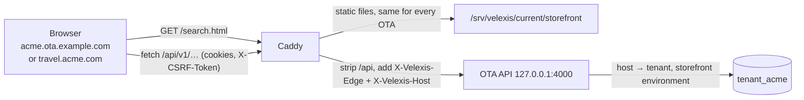

# OTA frontend: hosted storefront (`@velexis/ota-frontend`)

This is the component specification of the hosted storefront: the static website that every OTA's travellers use to search, price, book and manage Amadeus flights, served by Velexis on `<key>.ota.example.com` and verified custom domains. It is plain HTML pages, Tailwind CSS 4 and vanilla ES modules, built by Vite 6 as a multi-page app, with **every booking function going through the JS SDK in cookie mode** against the same-origin `/api`. This page covers the technology, the page inventory, shared UI pieces, theming, formatting, accessibility, performance, security, multi-tenant hosting, local development, testing, and the guide for OTAs that build their own frontend. It follows [`decisions.md`](../../docs/mvp/decisions.md), [ADR-0014](../../docs/mvp/adr/0014-frontend-stack-nextjs-tailwind.md) and [ADR-0018](../../docs/mvp/adr/0018-hosted-storefront-custom-domains.md).

Related: [`docs/pages.md`](docs/pages.md), [`docs/pages-account.md`](docs/pages-account.md) (every page: SDK calls, states), [`docs/build-your-own-frontend.md`](docs/build-your-own-frontend.md), [`.env.example`](.env.example), [OADR-0015](../docs/adr/0015-storefront-build-urls-and-hosting.md), [OADR-0017](../docs/adr/0017-airline-card-form-isolation.md), [OADR-0006](../docs/adr/0006-storefront-cookie-sessions-and-csrf.md), [OADR-0012](../docs/adr/0012-storefront-settings-assets-and-pages.md), [SDK](../sdk/README.md), [scope §2.2](../docs/scope.md#22-hosted-storefront-otafrontend), [conventions §4](../../docs/mvp/conventions.md#4-vanilla-storefront-otafrontend), [flows](../docs/README.md#flows).

## 1. At a glance

| Item | Value |
|---|---|
| Package | `@velexis/ota-frontend` (private workspace package) |
| Runtime | Evergreen browsers (ES2022). **No server process**: Caddy serves `dist/` from `/srv/velexis/current/storefront` |
| Technology | HTML pages + **Tailwind CSS 4** (`@tailwindcss/vite`) + vanilla ES modules + `@velexis/ota-sdk`; **Vite 6** multi-page build and dev server; no framework, no state library, no jQuery |
| API access | `createVelexisClient({ baseUrl: "/api", session: "cookie" })` only. Never `fetch` the API directly. |
| Third-party code | Stripe.js on one page (`/checkout/pay-card.html`); nothing else anywhere |
| Tenancy | One build for every OTA; the tenant is the host; branding and settings come from `storefront.get` at runtime |
| UI language | English in the MVP; money and dates through `Intl` |
| Targets | WCAG 2.2 AA; per-page JS ≤ 60 KB gzip (§9) |
| Tests | Vitest + happy-dom (modules), Playwright + axe (journeys in `tools/e2e/specs/storefront/`) |
| Milestones | M2 search and price; M3 checkout, accounts, bookings; M4 content pages and settings effects; M5 live mode and custom domains; M6 airline card live, hardening |

## 2. How one build serves every OTA



1. **Tenant by host.** The storefront never knows a tenant key at build time. Caddy forwards the host; the OTA API resolves it to the tenant and its storefront environment (test until the OTA goes live) ([OADR-0009](../docs/adr/0009-caller-and-tenant-resolution.md)).
2. **Same origin.** All API calls go to `/api/*` on the page's own host, so there is no CORS, cookies are host-only, and no key or token is ever in JavaScript ([OADR-0006](../docs/adr/0006-storefront-cookie-sessions-and-csrf.md)).
3. **Runtime configuration.** Each page calls `storefront.get` once (cached in `sessionStorage` for 5 minutes, which is per origin, so tenants never mix). It returns branding, locales, currencies, features, legal links, support details, SEO defaults and the payment configuration ([OADR-0012](../docs/adr/0012-storefront-settings-assets-and-pages.md)).
4. **States from the API**, not from build flags: `environment = test` shows a permanent "Test mode" banner and `noindex`; `403 TENANT_SUSPENDED` shows a "temporarily unavailable" page; `403 HOST_NOT_ALLOWED` shows "this storefront does not exist".
5. **Custom domains** need nothing from the storefront ([ADR-0018](../../docs/mvp/adr/0018-hosted-storefront-custom-domains.md)).

## 3. Folder tree

```
ota/frontend/
  package.json                @velexis/ota-frontend; deps: @velexis/ota-sdk (workspace), tailwindcss, @tailwindcss/vite, vite
  vite.config.js              MPA inputs, Tailwind, partials plugin, dev rewrites, dev/preview proxy and headers
  vitest.config.js            happy-dom by default; build, budget and server tests opt into Node
  turbo.json                  `test` also depends on deploy/caddy/Caddyfile, so a CSP change re-runs test/csp.test.js
  .env.example                dev server only (§11)
  index.html  search.html  offer.html  price.html  checkout.html  confirmation.html
  bookings.html  booking.html  lookup.html  p.html  404.html
  checkout/pay-card.html  checkout/pay-airline.html  checkout/complete.html
  account/index.html  account/sign-in.html  account/sign-up.html  account/verify.html
  account/forgot-password.html  account/reset-password.html
  partials/                   header.html, footer.html, test-banner.html, states.html (page states, live region),
                              noscript.html, search-form.html (form, leg and suggestion templates), templates/*.html
  public/fonts/               bundled open-licence fonts (woff2), selectable in settings
  public/favicon.ico          neutral default, replaced at runtime by the OTA favicon
  src/
    pages/<page>.js           one entry module per HTML page
    boot.js                   shared start-up of every page (§5.1); renderState for the shared page states
    lib/client.js             the single SDK client (cookie mode)
    lib/config.js             storefront.get with the 5-minute sessionStorage cache
    lib/dom.js                $, $$, clone(templateId), fill(el, data) via textContent and allowlisted attributes, on()
    lib/format.js             money, dates, durations with Intl
    lib/forms.js              serialisation, fieldErrors → fields, error summary, submit state
    lib/errors.js             VelexisError → page state (PRICE_CHANGED, SOLD_OUT, *_EXPIRED, …)
    lib/i18n.js               UI strings (English, Intl.PluralRules), page-state texts, field-error messages by code
    lib/theme.js              branding → CSS custom properties, contrast checks, fonts, favicon
    lib/session.js            auth.getSession, account menu
    lib/blocks.js             content-page blocks → DOM (createElement only)
    lib/url.js                query helpers (comma lists, replaceState), one-time token parameters, safe links and `next` redirects
    components/               header, footer, test-banner, search-form, location-combobox, passenger-picker, date-range,
                              offer-card, itinerary, filters, sort, load-more, fare-families, price-breakdown,
                              stepper, traveller-form, contact-form, ancillary-picker, error-summary, dialog, live-region
    styles/main.css           @import "tailwindcss"; @theme tokens; a few component classes
    styles/fonts.css          @font-face for the bundled fonts
  test/                       Vitest + happy-dom unit tests; test/helpers/ (scratch builds, HTTP requests)
  scripts/check-budgets.mjs   gzip size budgets for dist/ (§9)
  scripts/vite-plugins.js     page inputs, partials, Caddy-like dev/preview routing, /api proxy, preview headers
  docs/                       page inventory, build-your-own guide
```

The page files and `src/pages/` follow [conventions §4](../../docs/mvp/conventions.md#4-vanilla-storefront-otafrontend); the checkout payment pages live in `checkout/` so each has its own entry bundle and script inventory ([OADR-0017](../docs/adr/0017-airline-card-form-isolation.md)).

## 4. Page inventory

URLs are the HTML file paths; dynamic values travel in the query string. The only rewrite is `/p/<slug>` → `p.html` for content pages ([OADR-0015](../docs/adr/0015-storefront-build-urls-and-hosting.md)). The SDK calls and the states of each page are in [`docs/pages.md`](docs/pages.md) (shopping and checkout) and [`docs/pages-account.md`](docs/pages-account.md) (bookings, account, content).

| URL | Purpose | Milestone |
|---|---|---|
| `/` (`index.html`) | Home: search form (one-way, return, multi-city) with location autocomplete, passengers, cabin | M2 |
| `/search.html?from=…&to=…&depart=…` (`&search=srch_…`) | Results: runs the search, filters, sort, "load more" | M2 |
| `/offer.html?offer=off_…` | Offer details, itinerary, branded-fare upsell, choose a fare | M2 |
| `/price.html?priced=prc_…` | Confirmed price, breakdown, bags and services available, fare rules; start checkout | M2 (checkout start M3) |
| `/checkout.html?id=chk_…&step=…` | Checkout data: travellers, contacts, extras and special requests, payment method and terms | M3 |
| `/checkout/pay-card.html?id=chk_…&payment=pay_…` | Stripe Payment Element, card-fee review, pay (the only page with Stripe.js) | M3 |
| `/checkout/pay-airline.html?id=chk_…&payment=pay_…` | Airline-card form, fee review, pay; no third-party script | M3 (test), live after M6 |
| `/checkout/complete.html?id=chk_…&payment=pay_…` | Completes the checkout after Stripe (also the 3-D Secure return URL) | M3 |
| `/confirmation.html?booking=bkg_…` | Confirmation, ticketing status polling, "we are confirming your booking" | M3 |
| `/bookings.html?tab=upcoming\|past\|cancelled` | My bookings (signed-in customers) | M3 |
| `/booking.html?id=bkg_…` | Booking detail: itinerary, tickets, documents, change contacts, cancel with refund preview, timeline | M3 |
| `/lookup.html` | Guest lookup by reference and last name | M3 |
| `/account/sign-in.html`, `sign-up.html`, `verify.html?token=…`, `forgot-password.html`, `reset-password.html?token=…` | Customer authentication | M3 |
| `/account/` (`account/index.html`) | Profile, change password, sign out everywhere, delete account | M3 |
| `/account/travellers.html` | Saved travellers | **Later** (`features.savedTravelers = false`, [scope §3.1](../docs/scope.md#31-b1-storefront-auth-account-reference-30-20-mvp-10-deferred)) |
| `/p/<slug>` (`p.html`) | Content pages from storefront settings: about, terms, privacy, cookies, refund policy, FAQ | M4 |
| `/404.html` | Not found (Caddy `handle_errors 404`) | M2 |

E-mail links point at these URLs (`/account/verify.html?token=…`, `/account/reset-password.html?token=…`, `/booking.html?id=bkg_…`); the backend's templates must use the same paths.

## 5. Page anatomy and shared UI pieces

### 5.1 Start-up of every page (`src/boot.js`)

1. The HTML is meaningful without JavaScript: header, footer, the search form (a real `<form method="get" action="/search.html">`) and links. A `<noscript>` partial explains that booking needs JavaScript.
2. The page's single module script (`<script type="module" src="/src/pages/search.js">`, bundled by Vite) calls `boot()`. Every page includes `partials/test-banner.html` (at the top of `<body>`, before the header) and `partials/states.html` (last), besides the header, footer and noscript partials; `test/boot.test.js` checks every page.
3. `boot()` loads the configuration (`lib/config.js`; the live region says "Loading" when that takes a moment), then in parallel applies the theme (§6), fills the header (name, uploaded logo, currency selector, account menu) and the footer (legal links of `config.legal`, `storefront.listPages` with `showInFooter` from M4, its failure ignored, support contacts; the API's `.invalid` placeholder address is never shown), shows the test banner and adds `noindex` for `environment = test`, and asks `auth.getSession` for the account menu (a `401` means signed out; only when the SDK has the `auth` namespace, SDK-008, and `features.customerAccounts` is on). A component that fails is reported and skipped; it never stops the page.
4. The page module runs with `{ config, session, client }`. `client` sends the currency chosen in the header (`X-Currency` through `client.withOptions({ currency })`); a new choice is stored and dispatched as `vx:currency-change` on the document with `{ currency, client }` (§7).
5. Errors of `storefront.get` render one of the shared full-page states into `<main>` (`tpl-state-page` of `partials/states.html`): "temporarily unavailable" for `403 TENANT_SUSPENDED` and "this storefront does not exist" for `403 HOST_NOT_ALLOWED` (final: no Retry, `noindex`, the page module never runs), and "service unavailable" (`503`, connection failures), "busy" (`429`, Retry enabled after `Retry-After`) or "something went wrong" (any other error, with the request id) with a Retry that puts the page content back untouched when it succeeds. Pages render the same states for their own calls with `renderState(container, pageStateFor(error), { support, requestId, onRetry })` of `src/boot.js` (`tpl-state-inline`, or the full-page template for the `page` scope).

### 5.2 Components and templates

- **Components are small ES modules** in `src/components/` with one export, `mount(root, props)`, that returns an object with `update(props)` and `destroy()` where needed (the footer also exports `supportEmail`, the rule for showing a support address that boot's states share; the search form's components export their pure helpers, such as `readSearchQuery`, `searchUrl` and the passenger and date checks). No component holds global state; pages pass data down and listen to `CustomEvent`s. The polite live region is `mount()` of `components/live-region.js` (`announce(text)`, `clear()`), on the `[data-live-region]` element of `partials/states.html`.
- **The search form** (`partials/search-form.html`, `components/search-form.js` with `location-combobox`, `passenger-picker` and `date-range`) enhances a plain GET form to `/search.html`; `readSearchQuery(params)` reads the query it sends back, so the results page can run the search and show the same form pre-filled ([`docs/pages.md`](docs/pages.md) §3).
- **Markup lives in HTML.** Repeated items (offer card, segment, traveller form, document row) are `<template>` elements in `partials/templates/*.html`, included at build time by a 20-line Vite plugin (`<!-- @include partials/templates/offer-card.html -->`, `transformIndexHtml`). Shared header and footer are partials too, so they are in the static HTML.
- **Rendering**: `clone("tpl-offer-card")` then `fill(el, data)`, which sets `textContent` and safe attributes by `data-field` names. `innerHTML` with data is forbidden (ESLint `no-unsanitized`).
  - `data-field="carrier.name"` sets the element's `textContent` from that path of `data` (own properties only); `data-field-<attribute>="path"` sets one attribute from an allowlist: text attributes (`alt`, `title`, `aria-label`, `datetime`, `value`, …), boolean ones (`hidden`, `disabled`, `checked`, `selected`, `open`), `data-*`, and `href` (on `<a>` and `<area>`) / `src` (on ``) checked by `safeUrl` (same-origin paths, `?…`, `#…`; `href` also `https:`, `mailto:`, `tel:`). Any other attribute (`on*`, `style`, `srcdoc`, `class`, …), and a URL attribute of any other element (a script, frame or stylesheet), throws.
  - A path missing from `data` keeps the template's own text or attribute, `null` empties it, and an object throws: money, dates and durations are formatted with `lib/format.js` first.
- **Forms**: native elements and validation attributes first; `lib/forms.js` maps API `fieldErrors` onto fields (`aria-invalid`, `aria-describedby`) and builds the error summary that receives focus.
  - A field error's JSON pointer finds its control through `data-error-path` (one or more pointers separated by spaces, for example `data-error-path="/originLocationCode"` on the visible combobox), else by `name`: the pointer's segments joined with dots (`/travelers/0/firstName` → `travelers.0.firstName`), or the parameter name for `/query/…` and the other parameter locations. Errors without a visible control are listed in the summary only.
  - A field's message follows the field, or the label that wraps it, or ends the fieldset of a radio or checkbox group. The summary is the form's `[data-error-summary]` element, or one created at the top of the form; its links focus the fields. Messages come from `lib/i18n.js` by code and never repeat the rejected value. `clearFieldErrors` removes exactly what `showFieldErrors` added, and leaves any `aria-invalid` the page set itself.
  - `withSubmitState(form, task)` marks the form `aria-busy`, its submit buttons `aria-disabled` (they keep focus) with their `data-busy-label` text, and ignores a second submit while the first runs.
- **Errors** are shown from `VelexisError.code` through `lib/i18n.js`; `PRICE_CHANGED`, `SOLD_OUT`, `SEARCH_EXPIRED`, `OFFER_EXPIRED`, `CHECKOUT_EXPIRED` and `SUPPLIER_TIMEOUT` have dedicated UI states ([conventions §4](../../docs/mvp/conventions.md#4-vanilla-storefront-otafrontend)). `pageStateFor(error)` of `lib/errors.js` names the state (`suspended` and `unknown-host` replace the page; the others are inline), with its text, `retry`, `retryAfterSeconds`, `fieldErrors` and `details`; `ABORTED` (a call the page cancelled) is the `aborted` state, which pages ignore.
- **Dialogs** use the native `<dialog>` element (focus trap and Escape for free).

## 6. Theming

Branding comes from `storefront.get` (`branding.colors`, fonts, corner radius, logos, favicon) and is applied by `lib/theme.js` as CSS custom properties on `document.documentElement` with `style.setProperty`, never by injecting CSS text. CSSOM changes are allowed by the strict `style-src 'self'` CSP; custom CSS is not offered ([OADR-0012](../docs/adr/0012-storefront-settings-assets-and-pages.md)).

```css
/* src/styles/main.css */
@import "tailwindcss";
@import "./fonts.css";

:root {                                   /* neutral defaults until storefront.get answers */
  --vx-primary: #1d4ed8; --vx-on-primary: #ffffff; --vx-bg: #ffffff; --vx-text: #0f172a;
  --vx-radius: 0.5rem; --vx-font-body: "Inter", system-ui, sans-serif; --vx-font-heading: var(--vx-font-body);
}

@theme inline {                           /* Tailwind utilities read the runtime variables */
  --color-primary: var(--vx-primary);
  --color-on-primary: var(--vx-on-primary);
  /* secondary and accent follow the same pattern */
  --color-surface: var(--vx-bg);
  --color-ink: var(--vx-text);
  --radius-ui: var(--vx-radius);
  --font-body: var(--vx-font-body);
  --font-heading: var(--vx-font-heading);
}
```

- Every colour of `StorefrontBranding.colors` has a `--vx-*` property and a utility; the full mapping (for example `surface` → `--vx-panel` → `bg-panel`, `mutedText` → `--vx-muted` → `text-muted`, plus `--vx-on-secondary` for header and footer text) is the header comment of [`src/styles/main.css`](src/styles/main.css).
- Pages use `bg-primary text-on-primary rounded-ui font-heading` and so on. Class names are always complete strings, so Tailwind's scanner finds them. The scanner reads only the pages, `partials/` and `src/` (`@source` in `main.css`), not the docs or tests.
- `lib/theme.js` computes `--vx-on-primary` and `--vx-on-secondary` (black or white, whichever contrasts more, which always reaches 4.5:1) and falls back to the neutral palette for any colour pair below WCAG contrast; the OTA admin warns when an OTA picks such colours. The pairs are `CONTRAST_RULES`: every text colour (text, muted text, primary for links, accent, success, warning, error) on the page background and on panels at 4.5:1, and the computed text on primary and secondary. One invalid colour (not `#RRGGBB`) or one failing pair switches the whole palette to the neutral one, so neutral and brand colours never mix into new low-contrast pairs; corner radius and fonts still apply.
- Fonts are chosen from the bundled list (open licences, `public/fonts/`, `font-display: swap`; `FONT_STACKS` of `lib/theme.js` equals the API's `StorefrontFontFamily` enum, checked by `test/theme.test.js`); a browser downloads only the families in use. `StorefrontFont.cssUrl` (a Google Fonts stylesheet for other frontends) is never loaded.
- Logos and the favicon are same-origin asset URLs (`/api/v1/assets/<key>/ast_….png`), so `img-src 'self'` holds. The favicon is the page's `<link rel="icon">` and may also be the API's `data:` placeholder badge (`img-src` allows `data:`); the header shows only an uploaded logo (the dark variant on a dark header). Airline logos are not shown in the MVP (no external images under the CSP); results show the airline name and IATA code ([OADR-0015](../docs/adr/0015-storefront-build-urls-and-hosting.md)).

## 7. Language, currency and dates

- **UI strings** are English and live in `lib/i18n.js` (`t("results.count", { count })` with `Intl.PluralRules`), so translation can come later without touching pages.
- **Locale** for formatting is `config.defaultLocale` (content pages and e-mails may be localised by the OTA).
- **Currency**: a header selector offers `config.currencies` (when there are two or more); the choice is remembered in `localStorage` under `vx.currency` (wrapped in `try/catch`; the page works without it) and sent as `X-Currency` through `client.withOptions({ currency })`. A new search is needed for prices in the new currency: changing it reloads nothing (WCAG 3.2.2), announces the change in the live region and dispatches `vx:currency-change` with the new client for the pages that show prices.
- **Money** is `{ amount: "412.30", currency: "EUR" }` from the API and formatted with `Intl.NumberFormat(locale, { style: "currency", currency })`. The storefront never adds or multiplies prices; totals always come from the API.
- **Flight times** are airport-local wall-clock strings; they are formatted from their parts without time-zone conversion. Durations (`PT7H35M`) become "7 h 35 min". Booking timestamps use the OTA's time zone from the configuration.

## 8. Accessibility (WCAG 2.2 AA)

| Area | Rule |
|---|---|
| Structure | Landmarks (`header`, `nav`, `main`, `footer`), one `h1` per page, skip link to `main`, page `<title>` per step |
| Forms | Visible labels, `autocomplete` tokens (names, e-mail, phone, `cc-*` on the airline-card page), errors linked by `aria-describedby`, an error summary that receives focus, no placeholder-only labels |
| Search | Location autocomplete follows the ARIA 1.2 combobox pattern (listbox, `aria-activedescendant`, Escape, typed text kept); native date inputs; the passenger picker is a disclosure with steppers that have text labels; the form's checks use the error summary of `lib/forms.js` ([`docs/pages.md`](docs/pages.md) §3) |
| Dynamic content | A polite live region announces result counts, "loading", price changes and payment progress; focus moves to the new step heading in checkout |
| Keyboard | The whole booking flow works with the keyboard only, including filters, fare choice, extras, the Stripe element and dialogs; visible focus, never obscured by the sticky header (2.4.11) |
| Targets and motion | Targets at least 24 × 24 px (2.5.8); the price filter offers number inputs as well as a slider (2.5.7); no auto-advancing content; `prefers-reduced-motion` respected |
| Authentication | Paste and password managers allowed, no CAPTCHA puzzles (3.3.8); traveller data is offered for the contact step instead of retyping (3.3.7) |
| Help | The support link sits in the same place on every page (3.2.6) |
| Colour | Contrast checked at runtime on OTA colours (§6); status never shown by colour alone |
| Checks | axe in every Playwright journey (no serious or critical violation), a keyboard-only checkout journey, a manual screen-reader pass (NVDA, VoiceOver) before M6 |

## 9. Performance budgets

| Budget | Limit | Checked by |
|---|---|---|
| JavaScript per page, gzip (own code + SDK, Stripe.js excluded): the page's scripts, module preloads and every chunk they import, statically or dynamically | ≤ 60 KB; airline-card page ≤ 30 KB | `scripts/check-budgets.mjs` after every `build` (CI included); it prints a table and exits 1 on a breach |
| CSS, gzip (all pages share one file) | ≤ 20 KB | same |
| HTML per page | ≤ 20 KB | same |
| Fonts per page | ≤ 2 families, woff2, ≤ 120 KB | same |
| API calls before first meaningful paint | 0 on cached pages, 1 (`storefront.get`) otherwise | Review |
| LCP / CLS / INP on home and results (Lighthouse mobile profile) | ≤ 2.5 s / ≤ 0.1 / ≤ 200 ms | Manual Lighthouse run before M6 launch |

Images carry width and height, results render 20 at a time, and search shows a skeleton at once because Amadeus can take seconds.

## 10. Security

- **CSP** comes from Caddy for every storefront host ([`deploy/caddy/Caddyfile`](../../deploy/caddy/Caddyfile)): `default-src 'self'`, scripts from self and Stripe only, `style-src 'self'`, `img-src 'self' data:`, `font-src 'self'`, `connect-src 'self' https://api.stripe.com`, Stripe frames only, `worker-src 'none'` (no service worker can be registered on the origin), `frame-ancestors 'none'`. The build therefore has **no inline scripts or styles**: Vite's module-preload polyfill is off and `build.assetsInlineLimit` is 0, so no font becomes a `data:` URI.
- **No tokens in JavaScript.** Cookie mode only; the SDK throws if a key or token is passed. The only JS-readable cookie is `__Host-vx_csrf`, which is not a credential. `sessionStorage` and `localStorage` hold only the public configuration and the currency choice.
- **No `innerHTML` with data**: ESLint `no-unsanitized` fails every storefront file that writes data through `innerHTML`, `outerHTML`, `insertAdjacentHTML`, `document.write`, `createContextualFragment`, `setHTMLUnsafe`, `Document.parseHTMLUnsafe`, `DOMParser.parseFromString` or an iframe's `srcdoc` (`test/lint.test.js`); content pages arrive as parsed blocks and are built with `createElement`. Links in blocks are re-checked in the browser (`https:`, `mailto:`, `tel:`, relative `/p/…` only); external ones get `rel="noopener noreferrer"`.
- **Redirects**: a `next` parameter must be a relative path starting with a single `/`; anything else goes to `/`.
- **Tokens in URLs**: verification and reset tokens are read once and removed from the address bar with `history.replaceState`; the referrer policy is `strict-origin-when-cross-origin`.
- **Stripe** ([flow](../docs/flows/checkout-stripe.md)): Stripe.js is a static `<script>` tag from `https://js.stripe.com` in `checkout/pay-card.html` only, never bundled or self-hosted; the Payment Element keeps card data inside Stripe's iframes; `stripeAccount` is set in Connect mode; the Appearance API takes the OTA colours.
- **Airline card** ([OADR-0017](../docs/adr/0017-airline-card-form-isolation.md)): its own page and entry bundle, no third-party script, card inputs without `name` attributes (a submit without JavaScript sends nothing), values only in the inputs until the single `checkout.completeWithAirlineCard` call, inputs cleared on success, error and `pagehide`, never stored, logged or put in a URL; the SDK never retries the call. The page alone gets the stricter CSP, `Cross-Origin-Opener-Policy: same-origin` and `Cache-Control: no-store`; no other page sends COOP `same-origin`, so a window opened from any other page (Stripe.js on the card page included) gets no handle on it. It reads nothing from `sessionStorage` or `localStorage`: ids from its URL, the rest from the API. Residual risk: a script on any page of this origin could still draw a look-alike card form, so the whole origin is in the PCI script inventory (OADR-0017 point 8).
- **Script inventory** (ADR-0011 §C, PCI DSS 6.4.3, checked daily from M6). `dist/payment-page-inventory.json` (OFE-023) lists **every** built page with its scripts, hashes and headers, because every script on the origin matters to the card page; the payment pages are:

| Page | Scripts | Purpose |
|---|---|---|
| `/checkout/pay-card.html` | `/assets/checkout-pay-card-<hash>.js` | Page code + SDK |
| | `https://js.stripe.com/…` (Stripe.js) | Payment Element, 3-D Secure |
| `/checkout/pay-airline.html` | `/assets/checkout-pay-airline-<hash>.js` | Page code + SDK; nothing else |
| Every other page | its own `/assets/<entry>-<hash>.js` | First-party page code + SDK; no third-party script (a test fails on one) |

## 11. Local development

```bash
pnpm stub:amadeus &                                  # Amadeus stub on 4900
pnpm --filter @velexis/ota-backend dev               # OTA API on 4000 (after both dev:seed commands)
pnpm --filter @velexis/ota-frontend dev              # Vite on http://localhost:5173
pnpm --filter @velexis/ota-frontend preview          # production build on 4173, same proxy, production CSP
```

The dev server behaves like Caddy for one tenant, the demo OTA that the backend's `dev:seed` creates on `demo.ota.example.com` ([`../backend/README.md`](../backend/README.md)):

```js
// scripts/vite-plugins.js (excerpt): env = root .env.local, then ota/frontend/.env.local, then the environment (loadEnv)
const host = env.STOREFRONT_DEV_HOST || `demo.${env.STOREFRONT_BASE_DOMAIN}`;
const apiProxy = {                                          // server.proxy and preview.proxy: { "^/api/": apiProxy }
  target: env.OTA_API_URL,                                  // http://127.0.0.1:4000
  rewrite: (p) => p.replace(/^\/api(?=\/)/, ""),
  headers: { "x-velexis-edge": env.VELEXIS_EDGE_SECRET,      // dev secret only; replaces any browser copy
             "x-velexis-host": host,
             origin: `https://${host}` },                    // the CSRF guard compares Origin with the host
};
```

| Caddyfile storefront block | Dev server (5173) and `vite preview` (4173), `scripts/vite-plugins.js` |
|---|---|
| `handle /api/*`: strip `/api`, `header_up X-Velexis-Edge`, `X-Velexis-Host` | The proxy above (also `Origin`); it refuses to start without `OTA_API_URL`, `VELEXIS_EDGE_SECRET` and a host |
| `@api_private` (`/api/internal/*`, `/api/health/*` except `/api/health/live`) → 404 | Same, without calling the API; paths are compared like Caddy's `path` matcher (decoded, lower case, cleaned, repeated slashes merged), and a malformed escape gets 400 |
| `api_unavailable`: 503 `SERVICE_UNAVAILABLE` envelope while the API is down | Same envelope, `Retry-After: 30` |
| `try_files {path} {path}.html {path}/index.html`, and `rewrite /p/* /p.html` (added to the Caddyfile by OFE-020) | Same rules (dev: page navigations only) |
| `handle_errors 404` → `/404.html` | `404.html` with status 404 |
| Storefront `header` block (CSP and the other headers) | `vite preview` only: `STOREFRONT_HEADERS`, a copy that `test/csp.test.js` compares with the Caddyfile. No HSTS (plain HTTP); the dev server sends no CSP (it injects HMR code). |

The variables are listed in [`.env.example`](.env.example) (`STOREFRONT_DEV_PORT` and `STOREFRONT_PREVIEW_PORT` move the ports). `vite build` needs none of them.

- No variable reaches the browser bundle (nothing is prefixed `VITE_`); the storefront has no runtime environment ([architecture §6](../../docs/mvp/architecture.md#6-configuration-matrix)).
- `__Host-` cookies work on `http://localhost` in Chromium and Firefox (localhost is a secure context); Safari does not accept them there, so use Chromium or Firefox ([OADR-0006](../docs/adr/0006-storefront-cookie-sessions-and-csrf.md) point 8).
- Another seeded tenant: set `STOREFRONT_DEV_HOST` in `ota/frontend/.env.local`.
- Stripe test mode: the publishable key arrives through `storefront.get`; run `stripe listen` as in [local development §6](../../docs/mvp/local-development.md#6-stripe-with-the-stripe-cli-from-m3) and use Stripe's test cards only.
- Airline card locally: `AIRLINE_CARD_ENABLED=true` in `ota/backend/.env.local`, the test switch on in the OTA admin, test PAN `4111 1111 1111 1111` against the stub only.

## 12. Build and deploy

- `pnpm --filter @velexis/ota-frontend build` writes `dist/`: the HTML files at their paths, hashed JS and CSS in `dist/assets/`, fonts, `404.html`. Markdown notes in `public/` (such as `public/fonts/README.md`) are left out. Then `scripts/check-budgets.mjs` runs.
- Every `*.html` file of the package is a page and a build input (`partials/`, `public/`, `src/`, `test/` and `docs/` excepted); its entry bundle is named after its path (`checkout/pay-card.html` → `assets/checkout-pay-card-<hash>.js`).
- The same `dist/` serves every OTA. There are no build-time variables and no per-tenant builds ([OADR-0015](../docs/adr/0015-storefront-build-urls-and-hosting.md)).
- The release artefact carries `dist/` to `/srv/velexis/current/storefront` ([ADR-0023](../../docs/mvp/adr/0023-release-artefact-and-deploy-user.md)); Caddy caches `/assets/*` for a year and revalidates HTML. Source maps are kept as CI artefacts, not deployed.

## 13. Testing

| Level | Where | What |
|---|---|---|
| Unit | `ota/frontend/test/*.test.js` (Vitest + happy-dom) | `lib/format` (money, local times, durations), `lib/forms` (field errors, summary focus), `lib/config` (5-minute cache, throwing `sessionStorage`), `lib/dom` (attribute allowlist), `lib/errors` (code → page state), `lib/i18n` (plural forms), `lib/theme` (contrast fallback, `style.setProperty` only, no CSS text in any module), `lib/blocks` (unknown link schemes dropped), `lib/url` (`next` validation), components (combobox keyboard, debounce and abort; search form → query string, checks, passenger steppers; filters → query string, stepper) |
| Boot | `test/boot.test.js` (happy-dom browser page) | The real pages with their partials expanded by the build's include plugin, against a fake SDK: the full-page states of `storefront.get` (`TENANT_SUSPENDED`, `HOST_NOT_ALLOWED`, `503` and Retry, `429` with `Retry-After`), theme, header, footer, test banner, currency and session; every page includes the partials boot needs |
| Lint | `test/lint.test.js` | `el.innerHTML = data` and the other HTML sinks fail lint in every storefront file, tests included |
| Configuration | `test/csp.test.js` | The preview CSP equals the CSP in `deploy/caddy/Caddyfile`, so E2E runs see production headers; the build (made with the real `vite.config.js` in a scratch folder) has no inline script or style and no development value |
| Build tools | `test/budgets.test.js`, `test/vite-plugins.test.js` | The budget script on fixture folders (a breach exits 1 and names the file); page inputs, partials, and the dev and preview servers against a fake OTA API (proxy headers, 400, 404 and 503 answers) |
| End to end | `tools/e2e/specs/storefront/*.e2e.ts` (Playwright + `@axe-core/playwright`) | Against `vite preview` (production build) proxied to the local OTA backend, the Amadeus stub, Mailpit, Stripe test mode |

Journeys (one per main flow, [ADR-0015](../../docs/mvp/adr/0015-testing-strategy.md)):

1. **M2** search → filter and sort → offer → branded fare → price; no-offers and expired-search states (stub magic values such as destination `ZZZ`).
2. **M3** guest checkout with Stripe and a 3-D Secure test card → confirmation → e-mail in Mailpit → booking page through the guest cookie.
3. **M3** airline-card checkout in the test environment → confirmation; decline and attempt-limit states.
4. **M3** sign-up → verify through the Mailpit link → sign-in → my bookings tabs → change contacts → cancel with refund preview; guest lookup; session refresh after access-token expiry.
5. **M3** keyboard-only checkout.

Assertions in every journey: no CSP violation (a `securitypolicyviolation` listener fails the test), `document.cookie` contains only `__Host-vx_csrf`, no request to a third-party host except Stripe on the card page and none at all on the airline-card page, and axe reports no serious or critical violation.

## 14. Build your own frontend

OTAs may build and host their own storefront in any framework (Next.js, React, Angular, Vue or plain HTML) with the SDK in token mode, on their own domain, against `api.ota.example.com` ([`decisions.md`](../../docs/mvp/decisions.md) §2). The outline of that guide, including what differs from the hosted storefront (no airline card, keys, token storage, CORS origins), is in [`docs/build-your-own-frontend.md`](docs/build-your-own-frontend.md). The hosted storefront's source is the reference implementation.
