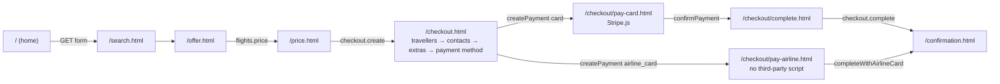

# Storefront pages, part 1: shopping and checkout

This page specifies the shopping and checkout pages of the hosted storefront: for each page its URL, purpose, the SDK calls it makes in order, and the states it must render (loading, empty, success and every error code it handles). It is the checklist for the storefront tasks of M2 and M3 and for the Playwright journeys. Part 2, [`pages-account.md`](pages-account.md), covers my bookings, booking detail, guest lookup, authentication, the account page, content pages and the error pages. The shared start-up, components and rules are in the [storefront README](../README.md).

Related: flows [search and price](../../docs/flows/search-and-price.md), [checkout with Stripe](../../docs/flows/checkout-stripe.md), [checkout with the airline card](../../docs/flows/checkout-airline-card.md); SDK guides [B1](../../../docs/velexis-sdk/sdk/docs/B1.md), [B2](../../../docs/velexis-sdk/sdk/docs/B2.md), [B3](../../../docs/velexis-sdk/sdk/docs/B3.md); reference pages of the [Next.js example](../../../docs/velexis-sdk/examples/next-storefront/app/) (`flights/`, `checkout/`); [OADR-0017](../../docs/adr/0017-airline-card-form-isolation.md).

## 1. Journey

## 2. States every page shares

Rendered by `boot()` and `lib/errors.js` before or instead of the page content: `boot()` replaces `<main>` with the state when `storefront.get` fails, and pages render the same states for their own calls with `renderState` of `src/boot.js` (templates in `partials/states.html`, texts in `lib/i18n.js`).

| Condition | Shows |
|---|---|
| Loading | Skeletons for the main content; the live region says "Loading" |
| `403 TENANT_SUSPENDED` | Full page "This travel site is temporarily unavailable", support e-mail if known |
| `403 HOST_NOT_ALLOWED` | Full page "This storefront does not exist" |
| `503 SERVICE_UNAVAILABLE`, `ConnectionError` | Inline message with a Retry button; nothing is lost on retry |
| `429 RATE_LIMITED` | "Busy, try again in a few seconds", Retry enabled after `retryAfterSeconds` |
| `424 SUPPLIER_NOT_CONFIGURED` | "Flight search is not available yet" (OTA not connected to Amadeus) |
| `environment = test` | Permanent "Test mode: no real bookings or payments" banner |

## 3. Home: `/` (`index.html`, M2)

**Purpose.** Brand, search form, links to lookup and sign-in.

**SDK calls**

1. `boot()`: `storefront.get`, `auth.getSession`, `storefront.listPages` (M4).
2. Location fields: `reference.locations.search({ keyword, subType: ["AIRPORT", "CITY"], limit: 8 })`, debounced 250 ms, from 2 characters, each new keystroke aborting the previous call with `options.signal`.

**Form.** A real `<form method="get" action="/search.html">` with `from`, `to` (IATA codes in hidden inputs, the visible text in the combobox), `depart`, `return`, `trip` (`oneway`, `return`, `multi`), `adults`, `children`, `infants`, `cabin`. Multi-city adds leg rows (`legs=PAR-NYC-2026-11-20,NYC-MIA-2026-11-25`). Defaults (passengers, cabin) come from the configuration. Client checks: return after departure, infants ≤ adults, at most 9 seats.

| State | Shows |
|---|---|
| Autocomplete empty | "No airport or city found" in the listbox |
| Autocomplete error | The field still accepts a typed IATA code |

## 4. Results: `/search.html` (M2)

**Purpose.** Run the search, show offers, filter, sort and load more.

**SDK calls**

1. If the URL has no `search=srch_…`: `flights.search({ mode: "simple", originLocationCode, destinationLocationCode, departureDate, returnDate, adults, children, infants, travelClass })` (multi-city: `mode: "advanced"` with the Amadeus body), 60 s timeout. Then `history.replaceState` adds `search=srch_…`, so reload and back never search again.
2. `flights.listResults({ searchId, sort, ...filters, limit: 20 })` for the first page and after every filter or sort change (cursor dropped); `page.next()` for "Load more".
3. `flights.getSearch({ searchId })` only to rebuild the summary bar when the page is opened from a bookmark.

**Filters** come from the facets of the search: stops, carriers, departure and arrival time bands per itinerary, price range (slider plus number inputs), maximum duration, cabin, included checked bags, refundable, changeable, branded fares. They are mirrored in the query string (`stops=0,1&carriers=AF,KL&sort=price`) so a filtered view survives reload within the search's lifetime. Sort: best, price, duration, departure, arrival.

| State | Shows |
|---|---|
| Searching | Search summary, skeleton cards, "Searching airlines…" in the live region |
| No offers | "No flights found", the form pre-filled, nearby dates and nearby airports as suggestions |
| Filters exclude everything | "No flights match these filters" with "Clear filters" |
| `410 SEARCH_EXPIRED` | "Prices have expired"; Refresh runs the same search again |
| `504 SUPPLIER_TIMEOUT`, `503 SUPPLIER_UNAVAILABLE` | "Airlines are not answering right now" with Retry |
| `400 VALIDATION_FAILED` | Back to the form with field errors |

## 5. Offer: `/offer.html?offer=off_…` (M2)

**Purpose.** Show one offer in full and let the traveller pick a branded fare.

**SDK calls**

1. `flights.getOffer({ offerId, view: "full" })`: itinerary, segments, layovers, baggage, fare conditions summary.
2. If `features.brandedFareUpsell`: `flights.upsell({ offerId })`, shown as fare-family cards (price difference, bags, changes, refunds, seat and meal inclusions as returned).
3. On "Continue with this fare": `flights.price({ offerIds: [chosenOfferId], include: ["bags", "other-services", "detailed-fare-rules"] })` (60 s), then go to `/price.html?priced=prc_…`.

| State | Shows |
|---|---|
| Upsell unavailable or failed | The original fare only, no error banner (upsell is optional) |
| `410 OFFER_EXPIRED` | "This fare is no longer available" with a link back to refreshed results |
| `409 SOLD_OUT` at pricing | "This flight just sold out", back to results |
| `504` / `503` at pricing | Retry button; the chosen fare stays selected |

## 6. Price: `/price.html?priced=prc_…` (M2; checkout start M3)

**Purpose.** The confirmed price before checkout.

**SDK calls**

1. `flights.getPricedOffer({ pricedOfferId })`: totals per traveller type, taxes, fees, `priceChanged`, booking requirements, expiry.
2. If `features.ancillaries`: `flights.getAncillaries({ pricedOfferId })`, shown as "Available in checkout: extra bags from EUR 35" (no selection here).
3. `flights.getFareRules({ pricedOfferId })` in a disclosure ("Changes and refunds").
4. "Continue": `checkout.create({ pricedOfferId })` (M3), then `/checkout.html?id=chk_…&step=travellers`. If `features.guestCheckout` is off and there is no session, go to `/account/sign-in.html?next=…` first.

| State | Shows |
|---|---|
| `priceChanged: true` | Old and new totals side by side, "The airline changed the price", explicit Continue |
| Expiry near | Countdown from `expiresAt`; after it, "Price expired" with Re-price (back to the offer) |
| `410 OFFER_EXPIRED` | As on the offer page |
| `403 EMAIL_NOT_VERIFIED` on `checkout.create` | "Verify your e-mail to book", Resend link (`auth.resendVerification`) |

Seats: there is no seat map in the MVP ([scope §2.2](../../docs/scope.md#22-hosted-storefront-otafrontend)) and `features.seatSelection` stays off; seat-related services that the airline returns among other services are shown like any other service.

## 7. Checkout data: `/checkout.html?id=chk_…&step=…` (M3)

**Purpose.** Collect what the booking needs, one step at a time, on one page without third-party scripts. `step` is `travellers`, `contacts`, `extras` or `payment`; each step pushes a history entry so Back works, and the stepper shows progress from `checkout.progress`.

**SDK calls**

1. `checkout.get({ checkoutId })` on load: requirements, travellers, contacts, totals, `version`, `expiresAt`, progress.
2. **Travellers**: `checkout.setTravelers({ checkoutId, ifMatch: version, travelers })`. Fields follow `requirements` (names as in passport, date of birth, gender, document number, expiry and nationality when required). `reference.countries.list` fills nationality and issuing-country selects.
3. **Contacts**: `checkout.setContacts({ checkoutId, ifMatch, contacts })`, pre-filled from the first adult traveller and, for customers, the account (redundant entry avoided).
4. **Extras**: `flights.getAncillaries({ pricedOfferId })` for options, then `checkout.setAncillaries({ checkoutId, ifMatch, selections, expectedTotal })`; special requests through `checkout.setRemarks({ checkoutId, ifMatch, remarks })`. Skipped when `features.ancillaries` is off.
5. **Payment method and terms**: shows the methods of `config.payment.supportedMethods` (`card`, and `airline_card` when enabled, with `payment.airlineCard.notice`), the total, links to terms, privacy and fare rules, and an "I accept" checkbox. Then `checkout.createPayment({ checkoutId, method, termsAccepted: true, returnUrl })` and navigation to the card or airline-card page with `payment=pay_…`.

| State | Shows |
|---|---|
| `422 TRAVELER_DATA_INVALID` / `CONTACT_DATA_INVALID` | Field errors from `fieldErrors`, error summary focused |
| `412 PRECONDITION_FAILED` | Reload the checkout and re-apply the step ("updated in another tab") |
| `409 PRICE_CHANGED` on extras | New total shown; the selection is kept for the traveller to confirm again |
| `409 ANCILLARY_NOT_AVAILABLE` | The option is removed, message next to the extras list |
| `410 CHECKOUT_EXPIRED` | "Your session expired", back to the price page to re-price |
| `422 CHECKOUT_INCOMPLETE` on `createPayment` | Jump to the first incomplete step |
| `424 PAYMENT_PROVIDER_NOT_CONFIGURED` | "Payments are not available yet" |
| `403 FEATURE_DISABLED` (`airlineCard`) | Airline-card option hidden; card stays |

## 8. Pay by card: `/checkout/pay-card.html?id=chk_…&payment=pay_…` (M3)

**Purpose.** Card entry with Stripe's Payment Element, review of the final total, payment. This is the only page that loads Stripe.js (a static tag in this HTML file).

**SDK and Stripe calls**

1. `checkout.getPayment({ paymentId })` and `checkout.get({ checkoutId })`: `clientSecret`, `providerPublicKey`, `accountId` (Connect mode), amount, totals.
2. `Stripe(providerPublicKey, { stripeAccount: accountId ?? undefined })`, `elements({ clientSecret, appearance })` with the OTA colours, mount the Payment Element.
3. **Review**: "Review total" calls `stripe.createConfirmationToken({ elements })`, then `checkout.updatePayment({ paymentId, card: { brand } })` with the brand from `payment_method_preview.card`, then `elements.fetchUpdates()`. The page shows the final total including `cardFee` and the merchant name (`payment.merchantName`, statement descriptor).
4. **Pay**: `stripe.confirmPayment({ clientSecret, confirmParams: { confirmation_token, return_url: "/checkout/complete.html?id=…&payment=…" }, redirect: "if_required" })`. Without a redirect, go to the complete page directly; with 3-D Secure Stripe shows its challenge and returns to the same URL.

| State | Shows |
|---|---|
| Card declined or 3-D Secure failed (Stripe error) | Stripe's message in the element; the payment stays `requires_payment_method`; try another card |
| `409 PAYMENT_NOT_UPDATABLE` | Create a new payment (`checkout.createPayment`) and remount |
| `409 PRICE_CHANGED` on `updatePayment` | New total, "Pay" asks for confirmation again with a new payment |
| `502 PAYMENT_PROVIDER_ERROR` | Retry |
| Stripe.js failed to load | "Card payment is unavailable", airline card offered if enabled |

## 9. Pay by airline card: `/checkout/pay-airline.html?id=chk_…&payment=pay_…` (M3 test, live after M6)

**Purpose.** The traveller types the card into the page's own form; the airline charges it through Amadeus. Rules in [OADR-0017](../../docs/adr/0017-airline-card-form-isolation.md); flow in [checkout-airline-card.md](../../docs/flows/checkout-airline-card.md).

**SDK calls**

1. `checkout.get({ checkoutId })` and `checkout.getPayment({ paymentId })`: the airline's price (net pricing), accepted brands, the notice "The airline charges your card. The price is the airline's price."
2. When six digits are typed: brand detected locally from the BIN, `checkout.updatePayment({ paymentId, card: { brand, bin } })` for the Amadeus card fee; the total updates.
3. **Review** panel with the final amount the airline will charge and the notice; then **Pay**: `checkout.completeWithAirlineCard({ checkoutId, paymentId, expectedTotal, card: { brand, holderName, number, expiryMonth, expiryYear, securityCode } }, { idempotencyKey: <new UUID per submit>, timeoutMs: 90000 })`. The SDK never retries it.
4. Success: inputs cleared, `location.replace("/confirmation.html?booking=bkg_…")`.

| State | Shows |
|---|---|
| Submitting | Button disabled, "Do not close this page", live-region progress |
| `400 VALIDATION_FAILED` (`luhn`, `expired`) | Field errors without echoing the value; not counted as an attempt |
| `402 PAYMENT_DECLINED` | "The airline declined the card", remaining attempts; card fields cleared |
| `403 PAYMENT_ATTEMPTS_EXCEEDED` | "Too many attempts"; start a new booking or pay by card |
| `409 PRICE_CHANGED` | New price; the traveller confirms and types the card again |
| `409 SOLD_OUT` | "This flight sold out", back to results |
| `504 SUPPLIER_TIMEOUT` (`details.bookingId`) | Go to `/confirmation.html?booking=…&pending=1`; never resubmit the card |
| `403 FEATURE_DISABLED` | "This payment method is not available", back to the payment step |

## 10. Complete: `/checkout/complete.html?id=chk_…&payment=pay_…` (M3)

**Purpose.** Turn an authorised Stripe payment into a booking. Also Stripe's `return_url`. No Stripe.js on this page.

**SDK calls**

1. `checkout.getPayment({ paymentId })`, polled every 2 s while `processing` or `requires_action` (at most 60 s).
2. `authorized` or `captured`: `checkout.complete({ checkoutId, paymentId, expectedTotal: payment.amount }, { idempotencyKey: "complete-<checkoutId>-<paymentId>", timeoutMs: 90000 })`. The key is derived from the ids, so a reload replays the outcome instead of booking twice ([B3 §2.7](../../../docs/velexis-sdk/sdk/docs/B3.md)).
3. Success: `location.replace("/confirmation.html?booking=bkg_…")`.

| State | Shows |
|---|---|
| Payment `failed` / `cancelled` | "Payment did not go through", back to the card page |
| `402 PAYMENT_REQUIRED` | Back to the card page |
| `409 PRICE_CHANGED` | Authorisation voided; new total; back to the payment step for a new payment |
| `409 SOLD_OUT` | "This flight sold out, you have not been charged", back to results |
| `409 CHECKOUT_ALREADY_COMPLETED` | Straight to the confirmation of `details.bookingId` |
| `504 SUPPLIER_TIMEOUT` | Confirmation page in pending mode with `details.bookingId`; never call `complete` with a new key |
| `410 CHECKOUT_EXPIRED` | "Your session expired; the authorisation is released", back to search |

## 11. Confirmation: `/confirmation.html?booking=bkg_…` (M3)

**Purpose.** Tell the traveller what happened and what comes next.

**SDK calls**

1. `bookings.get({ bookingId })`: reference, itinerary, travellers, totals, contact e-mail. Access comes from the customer session or the guest cookie `__Host-vx_bt`.
2. `bookings.getTicketingStatus({ bookingId, refresh: true })`, repeated after `pollAfterSeconds` while not final.

| State | Shows |
|---|---|
| `ticketed` | "Your tickets are issued", ticket numbers, link to the booking page and documents |
| `confirmed`, ticketing pending, failed or manual review | "Booking confirmed; tickets are being issued, we will e-mail you" |
| `bookingStatus = pending` (after a timeout) | "We are confirming your booking with the airline", polling every 10 s |
| `failed` | "Your booking did not go through. You have not been charged." |
| Guests | "Save your reference" with the lookup link; "Create an account" when `features.customerAccounts` |
| `401 UNAUTHENTICATED` (no guest token) | Link to `/lookup.html` |
