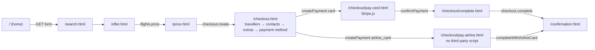

# Storefront pages, part 1: shopping and checkout

This page specifies the shopping and checkout pages of the hosted storefront: for each page its URL, purpose, the SDK calls it makes in order, and the states it must render (loading, empty, success and every error code it handles). It is the checklist for the storefront tasks of M2 and M3 and for the Playwright journeys. Part 2, [`pages-account.md`](pages-account.md), covers my bookings, booking detail, guest lookup, authentication, the account page, content pages and the error pages. The shared start-up, components and rules are in the [storefront README](../README.md).

Related: flows [search and price](../../docs/flows/search-and-price.md), [checkout with Stripe](../../docs/flows/checkout-stripe.md), [checkout with the airline card](../../docs/flows/checkout-airline-card.md); SDK guides [B1](../../../docs/velexis-sdk/sdk/docs/B1.md), [B2](../../../docs/velexis-sdk/sdk/docs/B2.md), [B3](../../../docs/velexis-sdk/sdk/docs/B3.md); reference pages of the [Next.js example](../../../docs/velexis-sdk/examples/next-storefront/app/) (`flights/`, `checkout/`); [OADR-0017](../../docs/adr/0017-airline-card-form-isolation.md).

## 1. Journey

## 2. States every page shares

Rendered by `boot()` and `lib/errors.js` before or instead of the page content: `boot()` replaces `<main>` with the state when `storefront.get` fails, and pages render the same states for their own calls with `renderState` of `src/boot.js` (templates in `partials/states.html`, texts in `lib/i18n.js`).

| Condition | Shows |
|---|---|
| Loading | Skeletons for the main content; the live region says "Loading" |
| `403 TENANT_SUSPENDED` | Full page "This travel site is temporarily unavailable", support e-mail if known |
| `403 HOST_NOT_ALLOWED` | Full page "This storefront does not exist" |
| `503 SERVICE_UNAVAILABLE`, `ConnectionError` | Inline message with a Retry button; nothing is lost on retry |
| `429 RATE_LIMITED` | "Busy, try again in a few seconds", Retry enabled after `retryAfterSeconds` |
| `424 SUPPLIER_NOT_CONFIGURED` | "Flight search is not available yet" (OTA not connected to Amadeus) |
| `environment = test` | Permanent "Test mode: no real bookings or payments" banner |

## 3. Home: `/` (`index.html`, M2)

**Purpose.** Brand, search form, links to lookup and sign-in.

**SDK calls**

1. `boot()`: `storefront.get`, `auth.getSession`, `storefront.listPages` (M4).
2. Location fields: `reference.locations.search({ keyword, subType: ["AIRPORT", "CITY"], limit: 8 })`, debounced 250 ms, from 2 characters, each new keystroke aborting the previous call with `options.signal`.
3. Codes pre-filled from the address (`/?from=LHR&to=PAR&depart=…`, or `legs=`): `reference.airports.get({ iataCode })` for the label ("London Heathrow Airport (LHR)"); a city code, which is no airport (`404`), takes the exact match of `reference.locations.search` ("Paris (PAR)"); without an answer the code itself stays. One request per code.

**Form.** A real `<form method="get" action="/search.html">` with `from`, `to` (IATA codes in hidden inputs, the visible text in the combobox), `depart`, `return`, `trip` (`oneway`, `return`, `multi`), `adults`, `children`, `infants`, `cabin` (`ECONOMY`, `PREMIUM_ECONOMY`, `BUSINESS`, `FIRST`). Multi-city adds leg rows (`legs=PAR-NYC-2026-11-20,NYC-MIA-2026-11-25`, 2 to 6 legs; the first two start from the route and date already typed). Client checks: return after departure, infants ≤ adults, at most 9 seats.

- **Query string.** The script sends what the form itself would send, in document order, with literal commas: `/search.html?trip=return&from=PAR&to=NYC&depart=2026-11-20&return=2026-11-27&adults=2&children=0&infants=0&cabin=ECONOMY`; a one-way trip has no `return`, a multi-city trip has `legs` instead of `from`, `to` and `depart` (hidden sections are disabled). `readSearchQuery` of `src/components/search-form.js` reads it back.
- **Without JavaScript** the form is a plain GET: the place fields take typed 3-letter codes (`pattern`), the passengers are number fields, and multi-city is not offered (its legs are composed by the script).
- **Defaults**: return trip, 1 adult, economy (`SEARCH_DEFAULTS`). `StorefrontConfig` publishes no search defaults, so these are the storefront's own; the OTA's default cabin (`storefront_settings.search_defaults`) applies on the server only to searches sent without a cabin, which this form never sends.
- **Location combobox** (ARIA 1.2, list autocomplete): Down and Up move `aria-activedescendant` (wrapping), Enter selects without submitting, Escape closes and keeps the typed text (a search still waiting is dropped, so the list stays closed), typing gives the visual focus back to the text. A typed 3-letter code counts when the search failed or has not answered yet; after an answer, only a suggested code counts.
- **Checks before leaving the page**: a place chosen (or an accepted code) for every field, origin and destination different, dates from today on, a return on or after the departure (a same-day return is allowed), each multi-city flight on or after the one above it, 1–9 adults, at most 9 seats (adults and children), at most one infant per adult. Problems appear as field errors with the focused error summary of `lib/forms.js`; the passenger panel opens for its own and stays open when a summary link moves the focus into it.

| State | Shows |
|---|---|
| Autocomplete empty | "No airport or city found" in the listbox |
| Autocomplete error | The field still accepts a typed IATA code |
| Text that is no suggestion | "Choose an airport or city from the list, or type its 3-letter code" at the field |

## 4. Results: `/search.html` (M2)

**Purpose.** Run the search, show offers, filter, sort and load more.

**SDK calls**

1. If the URL has no `search=srch_…`: `flights.search({ mode: "simple", originLocationCode, destinationLocationCode, departureDate, returnDate, adults, children, infants, travelClass })` (multi-city: `mode: "advanced"` with the Amadeus body), 60 s timeout. Then `history.replaceState` adds `search=srch_…`, so reload and back never search again.
2. `flights.listResults({ searchId, sort, ...filters, limit: 20 })` for the first page and after every filter or sort change (cursor dropped); `page.next()` for "Load more".
3. `flights.getSearch({ searchId })` only to rebuild the summary bar when the page is opened from a bookmark.

**Filters** come from the facets of the search: stops, carriers, departure and arrival time bands per itinerary, price range (slider plus number inputs), maximum duration, cabin, included checked bags, refundable, changeable, branded fares. They are mirrored in the query string (`stops=0,1&carriers=AF,KL&sort=price`) so a filtered view survives reload within the search's lifetime. Sort: best, price, duration, departure, arrival.

- **Query string.** The filters use the API's own parameter names and comma lists (`stops`, `carriers`, `minPrice`, `maxPrice`, `departureWindow`, `arrivalWindow`, `maxDurationMinutes`, `cabins`, `minIncludedCheckedBags`, `refundable`, `changeable`, `brandedFares`), written after the search form's parameters and `search=srch_…`; `sort` is left out for `best`. `readFilters` of `src/components/filters.js` drops unknown or malformed values and reads only `refundable=true` and `changeable=true` (there is no "non-refundable only" filter). A filter the API still refuses (an old or edited address) is dropped once and the page loads again without filters.
- **Search call.** `flights.search` runs with `resultOptions.limit: 0`, so the first page always comes from `flights.listResults` with the filters and sort of the address. Multi-city sends the ADVANCED body: one traveller entry per person (each infant `HELD_INFANT` on an adult), `sources: ["GDS"]`, and the cabin as a `MOST_SEGMENTS` restriction on every flight. A filter or sort change while the search still runs only updates the address; the first page then uses it.
- **Sidebar.** Facet values show their count and "from" price as the API returns them; airline names come from one `reference.airlines.list` call for the codes of the facets (until it answers, the names of the response dictionaries, else the codes). A value the facets do not list but the address does keeps its own checkbox, so every active filter can be seen and removed. The price slider spans the whole currency units of the price range and sets the maximum; the number inputs take any amount with up to two decimals. Counts update in place, so the focus stays on the control just used.
- **Offer cards** show the API's totals only (`price.total`, `price.perAdult` when there are several travellers), one row per bound (local times, airports, duration, stops with their airports, "+1 day", airline name and IATA code), fare facts (fare family or cabin, included bags, refundable, changes, seats left) and the flight details in a disclosure; "Select" opens `/offer.html?offer=off_…`. "Show more flights" focuses the first new card.
- **From a bookmark** (`search=` without the search form's parameters) the summary and Refresh come from `flights.getSearch` (`summary`, `criteria.request`): `status: "expired"` shows "Prices have expired", `failed` the supplier state of its `error.code` with Retry (a new search), and a search that is gone (`404`) "Prices have expired" with Refresh when the address still holds the search.
- **No offers or no match.** An empty page is "No flights found" when the search stored no offer (`resultCount` 0 of `flights.search` or `flights.getSearch`), even with filters in the address, and "No flights match these filters" otherwise. Filters of the address that no longer fit the facets (no price range or durations when the other filters match nothing) keep their values and stay active.
- **Suggestions** when nothing is found: the same trip one day earlier and one day later (never before today), and for an airport that belongs to a city with more airports (`reference.locations.search`, exact match with another `cityCode`), the same search from or to the whole city. All are plain links to `/search.html` with the search form's parameters.

| State | Shows |
|---|---|
| Searching | Search summary, skeleton cards, "Searching airlines…" in the live region |
| No offers | "No flights found", the form pre-filled, nearby dates and nearby airports as suggestions |
| Filters exclude everything | "No flights match these filters" with "Clear filters" |
| `410 SEARCH_EXPIRED` | "Prices have expired"; Refresh runs the same search again |
| `504 SUPPLIER_TIMEOUT`, `503 SUPPLIER_UNAVAILABLE` | "Airlines are not answering right now" with Retry |
| `400 VALIDATION_FAILED` | Back to the form with field errors |

## 5. Offer: `/offer.html?offer=off_…` (M2)

**Purpose.** Show one offer in full and let the traveller pick a branded fare.

**SDK calls**

1. `flights.getOffer({ offerId })`: itinerary, segments, layovers, baggage, fare conditions summary. The operation has no `view` parameter: `GET /v1/flight-offers/{offerId}` always answers the full view.
2. If `features.brandedFareUpsell`: `flights.upsell({ offerId })`, shown as fare-family cards (price difference, bags, changes, refunds, seat and meal inclusions as returned).
3. On "Continue with this fare": `flights.price({ offerIds: [chosenOfferId], include: ["bags", "other-services", "detailed-fare-rules"] })` (60 s), then go to `/price.html?priced=prc_…`.

- **Offer.** The heading names the route, the trip line gives the date of each bound and the travellers (from `travelerPricings`). Bounds and flights use the result card's rows and flight details (`components/itinerary.js`). Baggage has one row per traveller type, with checked and cabin bags from the fare of each flight: one text when every flight allows the same, else one per flight. Without fare details it falls back to the summary's adult allowance. The price box shows the API's search total, the travellers it is for, the price per adult and "3 seats left". Booking fees are added at pricing (OADR-0005 point 7), and the page says so.
- **Fares** (`components/fare-families.js`, `partials/templates/fare-family.html`). Until the upsell answers, and without one, the original fare is one card without a radio button: its name (fare family, else cabin), total, bags, refund and change from the summary, and the lead traveller's amenities. Fare families come from the upsell's `comparison`, one card per column (base first). Each card is a radio button with the column's total and `priceDifference`; the sign is read from the text, never computed. One line per row says its status in words ("Included", "For a fee", "Not included", "Not known") and gives its detail. An upsell with fewer than two columns keeps the original fare alone. The chosen family is kept in the address (`fare=off_…`, left out for the original fare), so a reload or Retry keeps it.
- **Links to the results.** If the page was opened from the results (a same-origin referrer at `/search.html`), "Back to results" returns to that address. The refreshed results are the same address without `search=`, so the search runs again with the same trip, filters and sort. Otherwise both links go to `/search.html?search=<the offer's searchId>`, whose page offers Refresh for an expired search. Without either, they go to the home page ("Search flights").
- **Offer gone.** A `404` from `getOffer` reads as an expired fare: the purge removes offers after they expire, as `search.html` treats a vanished search. An address without a valid `off_…` id shows "We could not find this flight" without a call.

| State | Shows |
|---|---|
| Upsell unavailable or failed | The original fare only, no error banner (upsell is optional) |
| `410 OFFER_EXPIRED` (also `404`, and at pricing) | "This fare is no longer available" with a link back to refreshed results |
| `409 SOLD_OUT` at pricing | "This flight just sold out", back to results |
| `504` / `503` at pricing | Retry button; the chosen fare stays selected |
| `503`, connection failure, `429` on `getOffer` | The shared state with Retry, which loads the offer again |

## 6. Price: `/price.html?priced=prc_…` (M2; checkout start M3)

**Purpose.** The confirmed price before checkout.

**SDK calls**

1. `flights.getPricedOffer({ pricedOfferId })`: totals per traveller type, taxes, fees, `priceChange`, booking requirements, expiry.
2. If `features.ancillaries`: `flights.getAncillaries({ pricedOfferId })`, shown as "Available in checkout: extra bags from EUR 35" (no selection here).
3. `flights.getFareRules({ pricedOfferId })` in a disclosure ("Changes and refunds").
4. "Continue": `checkout.create({ pricedOfferId })` (M3), then `/checkout.html?id=chk_…&step=travellers`. If `features.guestCheckout` is off and there is no session, go to `/account/sign-in.html?next=…` first (also after a `401 UNAUTHENTICATED` of `checkout.create`). The button is enabled while the price holds and disabled again at "Price expired".

- **Price** (`components/price-breakdown.js`, `partials/templates/price-line.html`). "Price per traveller" has one line per traveller type from `price.breakdown.travelers` ("2 adults", "€441.20 each", with fare, taxes and fees); travellers of a type who pay different amounts get one line each ("Adult 1", "Adult 2"). Grouping compares the API's amounts as text; nothing is multiplied. "What the total includes" lists fares, taxes and charges, every fee line with its label (the OTA's fee rule label from `description`, else the fee type: "Ticketing fee", "Payment fee", "Airline fee", "Service fee"; [OADR-0005](../../docs/adr/0005-markup-and-fee-engine.md) point 7), extras already priced in, and the API's `price.total`, which the page never computes. The total box repeats the total, the travellers it is for and the conditions at a glance; a card fee may follow at payment, and the page says so.
- **Trip and requirements.** The trip line, the bounds (`components/itinerary.js`) and the fare's name come from `offers`. "What you need to book" lists the travellers' names and what `bookingRequirements` asks for (e-mail, mobile phone, dates of birth, passport or ID card details, addresses).
- **Extras** come from the catalogue: one line per kind (checked bags, cabin bags, each other service) with the lowest option price, compared as decimal text ("from €9.50"). Seats appear only with `features.seatSelection`. Without `features.ancillaries` no call is made; a failed call leaves the list out, without a banner.
- **Fare rules.** The disclosure shows refund and change at a glance (allowed, free or up to a fee per traveller, not allowed, not known), one line per rule category of the airline with its circumstances, and the fare notes in a nested disclosure ("The airline's full fare rules"). Until `getFareRules` answers it shows the priced offer's embedded rules or `conditions`; if it fails, the embedded rules stay, else "The fare rules could not be loaded right now" with a Retry for the rules alone (none once the priced offer has expired or vanished).
- **Countdown.** `role="timer"` text "Price held for 19:59", updated every second from `expiresAt` (not announced each second; the live region says it once with the price, or at five minutes left). At zero: "Price expired" with Re-price, a link to the offer page the flight was priced on (the same-origin referrer at `/offer.html`), else to `/offer.html?offer=<the first priced offer>`.
- **Links.** "Back to flight details" is the same offer page link. A `404` from `getPricedOffer` reads as an expired fare (the purge removes priced offers after they expire); an address without a valid `prc_…` id shows "We could not find this price" without a call.

| State | Shows |
|---|---|
| `priceChange.changed: true` | Old and new totals side by side ("Expected price": the API's `oldPrice`, the results total plus the fees added at pricing, so a fee never reads as a change; "Confirmed price"), "The airline changed the price", the API's difference in words, explicit Continue ("Continue at the new price, €…") |
| Expiry near | Countdown from `expiresAt`; after it, "Price expired" with Re-price (back to the offer) |
| `410 OFFER_EXPIRED` (also `404`) | As on the offer page: "This fare is no longer available", with "Price this flight again" (the offer page), else "Search flights" |
| `503`, connection failure, `429` on `getPricedOffer` | The shared state with Retry, which loads the price again |
| Extras or fare rules unavailable | Extras: left out, no banner; fare rules: the embedded rules, else a message with Retry |
| `403 EMAIL_NOT_VERIFIED` on `checkout.create` | "Verify your e-mail address to book", "Send the link again" (`auth.resendVerification` with the price page as `returnPath`) |
| `410 OFFER_EXPIRED` / `404` on `checkout.create` | As at load: "This fare is no longer available", with "Price this flight again" |
| `503`, connection failure, `429` on `checkout.create` | The shared state next to Continue, with Retry |

Seats: there is no seat map in the MVP ([scope §2.2](../../docs/scope.md#22-hosted-storefront-otafrontend)) and `features.seatSelection` stays off; seat-related services that the airline returns among other services are shown like any other service.

## 7. Checkout data: `/checkout.html?id=chk_…&step=…` (M3)

**Purpose.** Collect what the booking needs, one step at a time, on one page without third-party scripts. `step` is `travellers`, `contacts`, `extras` or `payment`; each step pushes a history entry so Back works, and the stepper shows progress from `checkout.progress`.

**SDK calls**

1. `checkout.get({ checkoutId })` on load: requirements, travellers, contacts, totals, `version`, `expiresAt`, progress.
2. **Travellers**: `checkout.setTravelers({ checkoutId, ifMatch: version, travelers })`. Fields follow `requirements` (names as in passport, date of birth, gender, document number, expiry and nationality when required). `reference.countries.list` fills nationality and issuing-country selects.
3. **Contacts**: `checkout.setContacts({ checkoutId, ifMatch, contacts })`, pre-filled from the first adult traveller and, for customers, the account (redundant entry avoided).
4. **Extras**: `flights.getAncillaries({ pricedOfferId })` for options, then `checkout.setAncillaries({ checkoutId, ifMatch, selections, expectedTotal })`; special requests through `checkout.setRemarks({ checkoutId, ifMatch, remarks })`. Skipped when `features.ancillaries` is off.
5. **Payment method and terms**: shows the methods of `config.payment.supportedMethods` (`card`, and `airline_card` when enabled, with `payment.airlineCard.notice`), the total, the fare's conditions at a glance (`checkout.conditions`: the fare-rules link opens the base priced offer's price page, which a checkout may outlive), links to terms, privacy and fare rules, and an "I accept" checkbox. Then `checkout.createPayment({ checkoutId, method, termsAccepted: true, returnUrl })`, sent only with the box ticked, and navigation to the card or airline-card page with `payment=pay_…`.

- **Steps.** A step opens once every step before it is complete (`progress.travelersComplete` for contacts; travellers and contacts for extras and payment); an address with a step that cannot open yet shows the first incomplete step instead (`history.replaceState`). The stepper (`components/stepper.js`) links the steps that can open, marks the current one with `aria-current="step"` and says each status in words; moving to a step focuses its heading and sets the title ("Contact details – Checkout"). A completed checkout goes to `/confirmation.html?booking=…`; an expired or abandoned one shows "Your session expired". The step forms are `method="post"` without an action, so a submit that never reaches the script puts no traveller data into an address.
- **Travellers** (`components/traveller-form.js`, `partials/templates/traveller-form.html`): one fieldset per `requirements.travelers` entry, with the name always and the other fields only when `requiredFields` lists them: date of birth limited to `dateOfBirthMin`/`dateOfBirthMax`, gender, the passport or ID card of `documentTypes` (number, expiry, issuing country, nationality, place of issue), country of residence, redress number, discount cards. Controls are named after the request's pointers (`travelers.0.name.firstName`), so `fieldErrors` and `progress.missing` mark them. A stored document shows its `numberMasked`; an empty number keeps it while the type and issuing country stay (the API matches by both). Without the country list the country fields take two-letter codes.
- **Contacts** (`components/contact-form.js`): the checkout's primary contact, else the first adult's name and, for customers, the account's name, e-mail and phone; a postal address only with `mailingAddressRequired`, an invoice contact with `invoiceAddressRequired` (then it cannot be switched off) or on request. Phones are sent as digits, the calling code without "+".
- **Extras** (`components/ancillary-picker.js`): per traveller a radio group per kind of bag and flights ("No extra bag" first), checkboxes for other services, seats only with `features.seatSelection`; the API's labels and prices. Continue calls `setAncillaries` only when the choice changed, with `expectedTotal` = the total on the screen: the page never adds prices, so the airline's total with the extras comes back as `409 PRICE_CHANGED`, is shown, and "Confirm the new total" sends the same selections with that total. Special requests (up to five, the Amadeus remark characters) are sent with `setRemarks` when they changed; only filled fields are sent, and each answers for its own place in the request (`/remarks/<i>`). A catalogue that cannot be loaded leaves the special requests and Continue.
- **Versions.** Every `set*` call sends `ifMatch` with the version of the checkout on the screen. After `412 PRECONDITION_FAILED` the page reloads the checkout, sends the step once more on that version and says so on the next step; a second `412` in a row offers Reload.

| State | Shows |
|---|---|
| `422 TRAVELER_DATA_INVALID` / `CONTACT_DATA_INVALID` | Field errors from `fieldErrors`, error summary focused |
| `412 PRECONDITION_FAILED` | Reload the checkout and re-apply the step ("updated in another tab") |
| `409 PRICE_CHANGED` on extras | New total shown; the selection is kept for the traveller to confirm again |
| `422 ANCILLARY_NOT_AVAILABLE` (`details.selectionIndex`) | The option is removed, message next to the extras list |
| `409 PRICE_CHANGED` on `createPayment` | The checkout again, its new total shown next to the old one; Continue again |
| `409 SOLD_OUT` on extras | "This flight just sold out", with "Search flights" |
| `409 CHECKOUT_BEING_COMPLETED` / `CHECKOUT_ALREADY_COMPLETED` | The confirmation of `details.bookingId` (`pending=1` while it is being completed); `CHECKOUT_ALREADY_COMPLETED` without it loads the checkout, whose `bookingId` opens the confirmation |
| `502 PAYMENT_PROVIDER_ERROR` | "The payment service is not answering. Nothing was charged." with Retry |
| `410 CHECKOUT_EXPIRED` | "Your session expired", back to the price page to re-price |
| `422 CHECKOUT_INCOMPLETE` on `createPayment` | Jump to the first incomplete step, its fields marked from `fieldErrors` (else from the reloaded `progress.missing`) |
| `424 PAYMENT_PROVIDER_NOT_CONFIGURED` | "Payments are not available yet" |
| `403 FEATURE_DISABLED` (`airlineCard`) | Airline-card option hidden; card stays |

## 8. Pay by card: `/checkout/pay-card.html?id=chk_…&payment=pay_…` (M3)

**Purpose.** Card entry with Stripe's Payment Element, review of the final total, payment. This is the only page that loads Stripe.js (a static tag in this HTML file).

**SDK and Stripe calls**

1. `checkout.getPayment({ paymentId })` and `checkout.get({ checkoutId })`: `clientSecret`, `providerPublicKey`, amount, the trip and its totals. The Stripe account (`accountId`, Connect mode), the merchant name, the statement descriptor and the accepted brands (`pspCardBrands`) come from `config.payment` (`storefront.get`); `Payment` has no account of its own.
2. `Stripe(providerPublicKey, { stripeAccount: accountId })` (the option only when `accountId` is set), `elements({ clientSecret, appearance })` with the OTA colours (the palette `lib/theme.js` applies, so the neutral one when the OTA's colours fail contrast) and its corner radius, mount the Payment Element.
3. **Review**: "Review total" calls `elements.submit()` (Stripe checks the form, which it requires before a confirmation token), `stripe.createConfirmationToken({ elements })`, then `checkout.updatePayment({ paymentId, card: { brand } })` with the Amadeus brand that `config.payment.pspCardBrands` gives for `payment_method_preview.card.brand`, then `elements.fetchUpdates()`. The page shows the final total including `cardFee`, the merchant name (`config.payment.merchantName`) and the statement descriptor (`config.payment.statementDescriptor`, when there is one). A change in the card form drops the review, so Pay always confirms the card that was reviewed.
4. **Pay**: `stripe.confirmPayment({ clientSecret, confirmParams: { confirmation_token, return_url: "/checkout/complete.html?id=…&payment=…" }, redirect: "if_required" })` (the return URL absolute, on the page's origin). Without a redirect, go to the complete page directly; with 3-D Secure Stripe shows its challenge and returns to the same URL. A confirmed payment is never confirmed again from this page.

- **No card data on the page.** The card is typed into Stripe's iframes: the page has no form control of its own (no `<input>`, `<select>` or `<form>`; the header's currency selector is left out here, as the payment's currency is fixed), and its code never reads a value. The buttons are plain `type="button"` buttons.
- **Where a payment belongs.** At load, a payment that is `processing`, `authorized` or `captured` opens the complete page, an `airline_card` payment the airline-card page, a payment that `failed` or was `cancelled` is replaced by a new one (`checkout.createPayment`, the terms were accepted on the payment step), a completed checkout opens its confirmation, and an expired one says "Your session expired" with a link to price the flight again. An address without valid `chk_…` and `pay_…` ids, or a payment of another checkout, shows "We could not find this payment".

| State | Shows |
|---|---|
| Card declined or 3-D Secure failed (Stripe error) | Stripe's message under the element; the payment stays `requires_payment_method`; try another card and review again |
| A brand outside `pspCardBrands`, or `422 UNPROCESSABLE` on `updatePayment` | "We cannot take this card", with the accepted brands; no fee is quoted |
| `409 PAYMENT_NOT_UPDATABLE` | Create a new payment (`checkout.createPayment`) and remount; the address takes the new `payment=` |
| `409 PRICE_CHANGED` on `updatePayment` | New total next to the old one; a new payment is created, so "Pay" needs a new review |
| `502 PAYMENT_PROVIDER_ERROR` | "The payment service is not answering. Nothing was charged." with Retry (the review again) |
| A new payment cannot be created | "We could not start the payment again", Retry when the call may succeed later, and the way back to the payment step |
| `409 CHECKOUT_ALREADY_COMPLETED` / `CHECKOUT_BEING_COMPLETED` | The confirmation of `details.bookingId` (`pending=1` while it is being completed; without it the checkout is loaded again, which opens it) |
| `410 CHECKOUT_EXPIRED` | "Your session expired", with a link to price the flight again |
| `400 VALIDATION_FAILED` / `INVALID_REQUEST` on `updatePayment` | "Something went wrong" with the request id (the page has no field to mark) |
| Stripe.js failed to load, or its element cannot (`loaderror`) | "Card payment is unavailable" ("Nothing was charged"), Retry loads the page again, and "Pay with the airline card instead" (the payment step) when the OTA offers the airline card; without Stripe.js the page makes no checkout or payment call |

## 9. Pay by airline card: `/checkout/pay-airline.html?id=chk_…&payment=pay_…` (M3 test, live after M6)

**Purpose.** The traveller types the card into the page's own form; the airline charges it through Amadeus. Rules in [OADR-0017](../../docs/adr/0017-airline-card-form-isolation.md); flow in [checkout-airline-card.md](../../docs/flows/checkout-airline-card.md).

**SDK calls**

1. `checkout.get({ checkoutId })` and `checkout.getPayment({ paymentId })`: the airline's price (net pricing), accepted brands, the notice "The airline charges your card. The price is the airline's price."
2. When six digits are typed: brand detected locally from the BIN, `checkout.updatePayment({ paymentId, card: { brand, bin } })` for the Amadeus card fee; the total updates.
3. **Review** panel with the final amount the airline will charge and the notice; then **Pay**: `checkout.completeWithAirlineCard({ checkoutId, paymentId, expectedTotal, card: { brand, holderName, number, expiryMonth, expiryYear, securityCode } }, { idempotencyKey: <new UUID per submit>, timeoutMs: 90000 })`. The SDK never retries it.
4. Success: inputs cleared, `location.replace("/confirmation.html?booking=bkg_…")`.

| State | Shows |
|---|---|
| Submitting | Button disabled, "Do not close this page", live-region progress |
| `400 VALIDATION_FAILED` (`luhn`, `expired`) | Field errors without echoing the value; not counted as an attempt |
| `402 PAYMENT_DECLINED` | "The airline declined the card", remaining attempts; card fields cleared |
| `403 PAYMENT_ATTEMPTS_EXCEEDED` | "Too many attempts"; start a new booking or pay by card |
| `409 PRICE_CHANGED` | New price; the traveller confirms and types the card again |
| `409 SOLD_OUT` | "This flight sold out", back to results |
| `504 SUPPLIER_TIMEOUT` (`details.bookingId`) | Go to `/confirmation.html?booking=…&pending=1`; never resubmit the card |
| `403 FEATURE_DISABLED` | "This payment method is not available", back to the payment step |

## 10. Complete: `/checkout/complete.html?id=chk_…&payment=pay_…` (M3)

**Purpose.** Turn an authorised Stripe payment into a booking. Also Stripe's `return_url`. No Stripe.js on this page.

**SDK calls**

1. `checkout.getPayment({ paymentId })`, polled every 2 s while `processing` or `requires_action` (at most 60 s).
2. `authorized` or `captured`: `checkout.complete({ checkoutId, paymentId, expectedTotal: payment.amount }, { idempotencyKey: "complete-<checkoutId>-<paymentId>", timeoutMs: 90000 })`. The key is derived from the ids, so a reload replays the outcome instead of booking twice ([B3 §2.7](../../../docs/velexis-sdk/sdk/docs/B3.md)).
3. Success: `location.replace("/confirmation.html?booking=bkg_…")`.

| State | Shows |
|---|---|
| Payment `failed` / `cancelled` | "Payment did not go through", back to the card page |
| `402 PAYMENT_REQUIRED` | Back to the card page |
| `409 PRICE_CHANGED` | Authorisation voided; new total; back to the payment step for a new payment |
| `409 SOLD_OUT` | "This flight sold out, you have not been charged", back to results |
| `409 CHECKOUT_ALREADY_COMPLETED` | Straight to the confirmation of `details.bookingId` |
| `504 SUPPLIER_TIMEOUT` | Confirmation page in pending mode with `details.bookingId`; never call `complete` with a new key |
| `410 CHECKOUT_EXPIRED` | "Your session expired; the authorisation is released", back to search |

## 11. Confirmation: `/confirmation.html?booking=bkg_…` (M3)

**Purpose.** Tell the traveller what happened and what comes next.

**SDK calls**

1. `bookings.get({ bookingId })`: reference, itinerary, travellers, totals, contact e-mail. Access comes from the customer session or the guest cookie `__Host-vx_bt`.
2. `bookings.getTicketingStatus({ bookingId, refresh: true })`, repeated after `pollAfterSeconds` while not final.

| State | Shows |
|---|---|
| `ticketed` | "Your tickets are issued", ticket numbers, link to the booking page and documents |
| `confirmed`, ticketing pending, failed or manual review | "Booking confirmed; tickets are being issued, we will e-mail you" |
| `bookingStatus = pending` (after a timeout) | "We are confirming your booking with the airline", polling every 10 s |
| `failed` | "Your booking did not go through. You have not been charged." |
| Guests | "Save your reference" with the lookup link; "Create an account" when `features.customerAccounts` |
| `401 UNAUTHENTICATED` (no guest token) | Link to `/lookup.html` |
