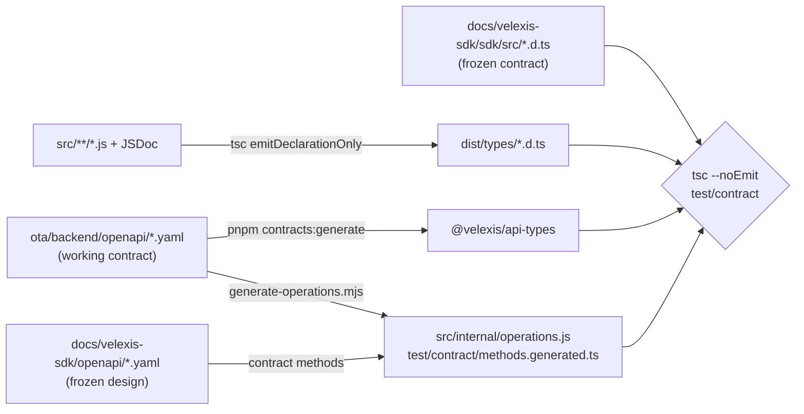

# SDK types, contract test and builds

This page is part of the SDK specification. It explains in detail how the SDK's JSDoc types are written and checked with `tsc --checkJs`, how declaration files are emitted, how the contract test compares them with the TypeScript contract in [`docs/velexis-sdk/sdk/src/`](../../../docs/velexis-sdk/sdk/src/), and how the ESM and IIFE bundles are built and kept within the size budget. The summary is in the [SDK README](../README.md) §6–§7; the decisions are in [ADR-0019](../../../docs/mvp/adr/0019-vanilla-js-sdk-jsdoc.md) and [OADR-0016](../../docs/adr/0016-sdk-packaging-and-type-contract.md).

Related: [`extensions.md`](extensions.md), [ADR-0006](../../../docs/mvp/adr/0006-contract-first-openapi.md) (generated types), [ADR-0015](../../../docs/mvp/adr/0015-testing-strategy.md) (contract tests), [`packages/README.md`](../../../packages/README.md) (`@velexis/api-types`).

## 1. Where types come from

Schema types come only from the generated OTA types, the `@velexis/api-types` module that the contract itself imports ([ADR-0006](../../../docs/mvp/adr/0006-contract-first-openapi.md)). No schema is written by hand in the SDK.

```js
// src/types.js — base aliases only
/** @typedef {import("@velexis/api-types").components["schemas"]} Schemas */
/** @typedef {import("@velexis/api-types").paths} Paths */
export {};
```

Each public module declares the same aliases as its `.d.ts` counterpart, in the same order, so a reviewer can diff them side by side:

```js
// src/flights.js (mirrors flights.d.ts)
/** @typedef {import("./types.js").Schemas["FlightOffer"]} FlightOffer */
/** @typedef {import("./types.js").Schemas["PricedOffer"]} PricedOffer */
/** @typedef {"best" | "price" | "-price" | "duration" | "departure" | "-departure" | "arrival" | "-arrival"} FlightOfferSort */
/** @typedef {ReturnType<typeof import("./namespaces/flights.js").createFlightsApi>} FlightsApi */
export { createFlightsApi } from "./namespaces/flights.js";
```

- **Namespace types are inferred from the factories** (`ReturnType<typeof createFlightsApi>`), so each method's JSDoc (`@param`, `@returns`, `@throws`, one-line summary) is written once, in `src/namespaces/*.js`.
- **Overloads** use JSDoc `@overload` (TypeScript 5.0+).
- **`Page<T>`** is a small class with `@template T`, a `next()` method and `[Symbol.asyncIterator]()`.
- A helper that JSDoc cannot express cleanly may carry a hand-written `.d.ts` next to its `.js` file; the contract test still checks it ([ADR-0019](../../../docs/mvp/adr/0019-vanilla-js-sdk-jsdoc.md)).

## 2. Checking with `tsc --checkJs`

`pnpm --filter @velexis/ota-sdk typecheck` runs `tsc -p tsconfig.json`. A type error fails CI like in TypeScript code.

```jsonc
// ota/sdk/tsconfig.json
{
  "extends": "../../tsconfig.base.json",
  "compilerOptions": {
    "allowJs": true,
    "checkJs": true,
    "strict": true,
    "noUncheckedIndexedAccess": true,
    "exactOptionalPropertyTypes": true,
    "noEmit": true,
    "target": "ES2022",
    "module": "NodeNext",
    "moduleResolution": "NodeNext",
    "lib": ["ES2022", "DOM", "DOM.Iterable"],
    "types": []
  },
  "include": ["src/**/*.js"]
}
```

- `types: []` keeps Node globals out, so code that only works in Node (for example `Buffer`) fails the check.
- ESLint (`n/no-unsupported-features`, `no-console`) runs on the same files; there is no `process.env` in the SDK.

## 3. Emitting declarations

`tsc -p tsconfig.build.json` (same options plus `declaration`, `emitDeclarationOnly`, `declarationMap`, `outDir: "dist/types"`, `noEmit: false`) writes one `.d.ts` per source module. `dist/types/index.d.ts` is the `types` entry of the package.

For **npm publication** (M6) the build copies the OTA part of `@velexis/api-types` into `dist/types/api-types.d.ts` and rewrites `"@velexis/api-types"` to `"./api-types.js"` in the emitted files, so the published package has no dependencies, not even for types. Inside the monorepo the workspace package is used directly.

## 4. The contract test

`test/contract/` runs in `pnpm --filter @velexis/ota-sdk test`, so in CI on every PR: `contract.test.js` compiles the project below the way `tsc` does, against declarations it emits from `src/` into a scratch folder (no earlier build, no stale `dist/`), and `parity.test.js` checks the runtime parity. `pnpm --filter @velexis/ota-sdk test:contract` runs the same project with the `tsc` command line after a declaration build (`tsc -p tsconfig.build.json && tsc -p test/contract/tsconfig.json`), for a readable error list.



1. **Project** (`test/contract/tsconfig.json`, extending the SDK's strict options with `skipLibCheck: false`, so a contract type that no longer resolves against the working document fails instead of becoming `any`). It maps three module names with `paths`:
   - `velexis-contract` → [`docs/velexis-sdk/sdk/src/index.d.ts`](../../../docs/velexis-sdk/sdk/src/index.d.ts);
   - `@velexis/ota-sdk` → `dist/types/index.d.ts`;
   - `@velexis/api-types` → the generated package, for **both** sides, so they share the same schemas.
2. **Per-method assertions** (`methods.generated.ts`, written by `generate-operations.mjs` with the route table, one type per `x-sdk-method`; stale output fails `contract.test.js`). A method of the frozen contract (an `x-sdk-method` of [`docs/velexis-sdk/openapi/`](../../../docs/velexis-sdk/openapi/velexis-ota-booking-api.openapi.yaml)) gets `Conforms`:
   - the contract's `Parameters` must be assignable to the SDK method's (the SDK accepts everything the contract accepts);
   - the SDK's awaited result must be assignable to the contract's (callers get at least what the contract promises), and may be neither `any` nor `never`.
   Explicit checks are needed because TypeScript compares method parameters bivariantly, so plain interface assignability would miss a narrowed parameter (the test proves it: a narrowed `flights.search` fails only its own assertion). Any other method is an addition ([`extensions.md`](extensions.md)) and gets `Addition`: the client has it as a method and the contract does not. A last assertion fails when a method of the contract is no longer in the working document.
3. **Hand-written assertions** (`client.contract.ts`, which also holds the helpers) cover `createVelexisClient`, `VelexisClient` (including `withOptions` and `request`), `VelexisClientOptions` with the `identity.d.ts` and `console.d.ts` augmentations, `RequestOptions`, `Page<T>`, `ListParams`, the shared types, every error class (constructor, fields such as `PriceChangedError.newPrice`, `RateLimitError.retryAfterSeconds`) and `isVelexisError`.
4. **Approved deviations** are listed in `test/contract/deviations.ts`, each with the ADR that approves it; the assertions compare the SDK with the contract with `Omit` for exactly those members plus the approved signature, a separate assertion pins the deviating type, and another proves that no other member differs from the contract. Today there is one entry: `auth.signIn`, `auth.refresh` and `auth.changePassword` return `AuthSessionResult | AuthSessionInfo`, because cookie mode returns no tokens ([OADR-0006](../../docs/adr/0006-storefront-cookie-sessions-and-csrf.md)). Anything else that fails is an SDK bug, not a reason to add an entry.
5. **Runtime parity** (`parity.test.js`, Vitest): loads the working OpenAPI document and asserts that the set of `x-sdk-method` values (without `x-internal` and `x-sdk-exclude` operations) equals the set of method paths on a client instance: 128 methods since the M4 exit. `withOptions` and `request` are the only extra members. Until SDK-013 the comparison skipped what `test/contract/pending-namespaces.js` listed: a pending entry was a whole namespace or one method of an implemented namespace, with the SDK task that adds it, and the test refused an entry that covered no method of the document and one whose methods the client already had all of, so the SDK task removed it. Since SDK-013 the check is **strict**: the list must be empty, every entry is refused however well-formed, and the comparison ignores the list, so no entry can excuse a missing method (a client without `flights.getFareRules` fails with or without an entry for it); the change that adds an `x-sdk-method` to the document writes its SDK method too ([`../../docs/api-changes.md`](../../docs/api-changes.md) §1). The type assertions read the same list: a pending method the client does not have yet is skipped, one it already has is checked, and a method of the contract is skipped only while the client has no namespace of that name (SDK-011 wrote the contract's `console` methods while the namespace stayed pending for `console.settings` and `console.payments`, and every one of them was checked; `contract.test.js` proves it with an empty `console` namespace while `console` is listed, and with one `console` result widened). SDK-012 wrote the last pending methods and emptied the list, so an empty `console` namespace now fails at every console assertion, of the contract and added (`contract.test.js`). The contract project still reads the list (`contract.test.js` proves its rules on a scratch copy with an entry), but the strict parity test fails on any entry in the real one.
6. **Version**: `VERSION` from `src/version.js` equals `package.json` `version` (`test/unit/version.test.js`).

The contract files are never edited. A new operation is added to the OpenAPI document first ([`../../docs/api-changes.md`](../../docs/api-changes.md) §1), then the SDK method and its line in [`extensions.md`](extensions.md).

## 5. The generated route table

`scripts/generate-operations.mjs` (`pnpm --filter @velexis/ota-sdk generate`, also part of `pnpm contracts:generate`) reads the working OpenAPI document and writes `src/internal/operations.js`, a frozen object keyed by `x-sdk-method` (dots replaced by underscores), sorted by key, with one entry per operation that has an `x-sdk-method` and is neither `x-internal` nor `x-sdk-exclude`:

```js
export const op = /* @__PURE__ */ freeze({
  /** `checkout.complete` */
  checkout_complete: {
    method: "POST",
    path: "/v1/checkouts/{checkoutId}/complete",
    pathParams: ["checkoutId"],
    queryParams: [],
    headerParams: {},
    idempotency: "required",
    retry: "idempotent",
    timeoutMs: 90000,
    environment: false,
    body: "json",
  },
  /** `console.bookings.issue` */
  console_bookings_issue: {
    method: "POST",
    path: "/v1/console/bookings/{bookingId}/issuance",
    pathParams: ["bookingId"],
    queryParams: [],
    headerParams: { ifMatch: "If-Match" },
    idempotency: "required",
    retry: "idempotent",
    timeoutMs: 60000,
    environment: true,
    body: "json",
  },
  // …
});
```

| Field | From the document | Meaning for `core.call` |
|---|---|---|
| `method`, `path` | The operation and its path template | `{name}` placeholders are filled from `pathParams` |
| `pathParams` | `in: path` parameters, path-item ones included, in template order | Filled into the template, URI-encoded |
| `queryParams` | `in: query` parameters | Query string; arrays comma-separated (the generator refuses an array without `explode: false`, an object or a style other than `form`); `undefined` dropped |
| `headerParams` | `If-Match` | `params.ifMatch` is sent as `If-Match`. Every other header the document declares is set by the client: `Accept-Language` and `X-Currency` from `locale` and `currency`, `X-CSRF-Token` in cookie mode, `X-Velexis-Host` and `X-Velexis-End-User-*` from `host` and `endUser`, `X-Velexis-Scope` and `If-None-Match` from `RequestOptions.headers`. An unknown header parameter fails the generator. |
| `idempotency` | The `Idempotency-Key` parameter: `none`, `optional` or `required` | One key per call, reused across its retries; `RequestOptions.idempotencyKey` overrides it |
| `retry` | `safe` for GET; `idempotent` for PUT, DELETE, an `Idempotency-Key` or `x-idempotent-by-design`; else `never` | Only `safe` and `idempotent` are retried (README §5.3) |
| `timeoutMs` | `null` (the client's `timeoutMs`), or the reviewed value | 60 s and 90 s for the long operations below |
| `environment` | Whether the operation declares `X-Velexis-Environment` (every console operation and `flights.availability`) | The client's `environment` option is sent there only |
| `body` | The request body's media type: `json`, `multipart` (`multipart/form-data`) or `null` | How the remaining params are sent |

Values the document does not carry come from `scripts/operation-overrides.json`, reviewed like code: 60 s for `flights.search`, `flights.upsell`, `flights.price`, `console.bookings.issue`, `.cancel`, `.import` and `.retrieve`; 90 s for `checkout.complete`; 90 s and `retry: "never"` for `checkout.completeWithAirlineCard`. Every override gives its `reason`; `retry` can only be made stricter (a `POST` that is safe to repeat says so in the document with `x-idempotent-by-design`); an override for an operation that is not in the document yet names the `specTask` that adds it (`OBE-029` for `checkout.completeWithAirlineCard`) and applies by itself once that task regenerates the table, and any other unknown name fails as a typo.

The generator exits 1 and writes nothing on a duplicated `x-sdk-method`, an operation without one that is neither `x-internal` nor `x-sdk-exclude`, a path template that does not match its path parameters (including a repeated placeholder), a request body that does not have exactly one media type, `application/json` or `multipart/form-data`, and a **name collision**: one name used twice among the path, query and header params, or by one of them and a top-level property of the request body (found through `$ref`, `allOf`, `oneOf` and `anyOf`). Such an operation is renamed in the document instead of leaving `core.call` to guess. The output is deterministic, committed, and CI regenerates it and fails when it differs from the committed file (the "SDK route table is up to date" step), as for the other generated contract types; `test/unit/operations.test.js` checks the table against the document and a fresh run. The same run writes the contract assertions `test/contract/methods.generated.ts` (§4 point 2); a run with `--out` (the tests of the table) writes them only to an explicit `--methods-out`, so it never touches the committed file.

A namespace method is then one line, and its JSDoc carries the types:

```js
// src/namespaces/flights.js
import { op } from "../internal/operations.js";

/** @param {import("../internal/client.js").Core} core */
export function createFlightsApi(core) {
  return {
    /**
     * Search flight offers (Amadeus Flight Offers Search) and store them with selling prices.
     * @param {import("../flights.js").FlightSearchParams} params
     * @param {import("../shared.js").RequestOptions} [options]
     * @returns {Promise<import("../flights.js").FlightSearch>}
     * @throws {import("../shared.js").ValidationError} VALIDATION_FAILED, UNPROCESSABLE
     * @throws {import("../shared.js").SupplierError} SUPPLIER_TIMEOUT, SUPPLIER_UNAVAILABLE
     */
    search: (params, options) => core.call(op.flights_search, params, options),
    // …
  };
}
```

`core.call` splits `params` by the table: names in `pathParams` fill the path template (URI-encoded), names in `queryParams` become query parameters, `ifMatch` becomes `If-Match`, and everything else is the body (`body`). Because the generator refuses name collisions, this split never has to guess.

## 6. Builds

`pnpm --filter @velexis/ota-sdk build` runs `scripts/build.mjs`, then `scripts/check-size.mjs` (§7):

| Output | How | Used by |
|---|---|---|
| `dist/velexis-sdk.mjs` + `.map` | esbuild 0.25, `format: "esm"`, `target: "es2022"`, `platform: "neutral"`, minified, external source map | The storefront (through Vite), the OTA admin, npm consumers |
| `dist/velexis-sdk.iife.js` + `.map` | esbuild, the same options with `format: "iife"`, `globalName: "Velexis"` | Plain HTML pages: `<script src="/vendor/velexis-sdk.iife.js"></script>` then `Velexis.createVelexisClient(…)` |
| `dist/types/*.d.ts` + `.d.ts.map` | `tsc -p tsconfig.build.json` (§3) | Consumers' type checking |

- **Source maps** are separate `.map` files with `sourcesContent`, linked from the bundle's last line (esbuild `sourcemap: "linked"`, so devtools find them; esbuild's `"external"` mode would leave the link out).
- **Self-contained:** the bundles hold only `src/` modules (the SDK has no runtime dependencies, `@velexis/api-types` is used in JSDoc only), with no `import` or `require` left.
- **Names:** minifying renames classes; every error class sets its `name` field, so `error.name` and `toJSON().name` stay `"ValidationError"` and so on. Compare errors with `instanceof`, not `constructor.name`.
- **Strict:** an esbuild warning fails the build like an error, and a bundle is written only when esbuild reported neither. The previous outputs (the bundles, their maps and `types/`) are removed first, so a deleted module leaves no stale declaration. `--outdir <dir>` writes the same files elsewhere (the bundle tests).
- **The IIFE** starts with `"use strict"`, as esbuild turns ES modules into a script; its top-level `var Velexis` is a property of `window`, as for every classic script.

```json
{
  "name": "@velexis/ota-sdk",
  "type": "module",
  "sideEffects": false,
  "exports": {
    ".": {
      "types": "./dist/types/index.d.ts",
      "development": "./src/index.js",
      "import": "./dist/velexis-sdk.mjs",
      "default": "./dist/velexis-sdk.mjs"
    },
    "./iife": "./dist/velexis-sdk.iife.js"
  },
  "files": ["dist", "src", "README.md", "CHANGELOG.md"]
}
```

- The `development` condition lets Vite's dev server use `src/` directly (Vite 6 resolves it in dev, and Vitest in tests); production builds use the bundle, and so does Node without `--conditions=development`. Both are the same ES2022 code, so behaviour does not change between them.
- **ESM only.** Node 22 can `require()` an ES module where needed; there is no CommonJS build. Node's `require()` does not match the `import` condition, so the `default` condition, last, gives it the same bundle (without it, `require("@velexis/ota-sdk")` fails with `ERR_PACKAGE_PATH_NOT_EXPORTED`).
- `"./iife"` is the address of the classic script, for copying it next to a page or for a CDN path (`import.meta.resolve("@velexis/ota-sdk/iife")`); it is loaded with a `<script>` tag, not imported.
- Turborepo builds the SDK before the storefront and the OTA admin (`dependsOn: ["^build"]`). A single-package run that builds a consumer for production (the storefront's `vite build`) needs `pnpm --filter @velexis/ota-sdk build` first.
- **No top-level side effects** (`"sideEffects": false` is true of the bundle too): importing it performs no `fetch`, schedules no timer and changes no global or built-in prototype; the IIFE only adds `window.Velexis`.

`test/unit/bundle.test.js` (part of `test`) proves this section and the next on a fresh build: it runs `build.mjs --outdir` and `check-size.mjs --dir` into a scratch copy of the package, so it needs no earlier build and never reads a stale `dist/` (CI runs `pnpm test` before `pnpm build`). It checks the outputs, source maps and declarations, that the stale outputs of an earlier build are removed, and that an esbuild warning or error fails the build without writing a bundle; resolves `@velexis/ota-sdk` the way Node does, for `import` and `require()` (the bundle, and `src/` with `--conditions=development`); imports the bundle natively in a child process and compares `globalThis` and the built-in prototypes before and after, with `fetch` and the timer functions counting calls; and runs the IIFE as a classic script in a happy-dom page (with `vm.Script` on the page's window, because happy-dom runs a `<script>` element through an indirect `eval`, where the top-level `var` of a strict script stays local), comparing the window and the document before and after, then makes a cookie-mode call through the page's `fetch`. Since SDK-013 it also proves that the measured ESM bundle (and `src/` through the development condition) has one method per entry of the route table, `console.*` included, within the budget. Each check also runs on a module made to fetch, schedule and write globals, so a check that reports nothing proves something.

## 7. Size budget

`scripts/check-size.mjs` gzips `dist/velexis-sdk.mjs` at level 9 and exits 1 above **25 KB** (25 × 1024 bytes); it prints the size of both bundles, minified and min+gzip (the IIFE is printed, not budgeted), and also exits 1 when a bundle is missing. `build` runs it, so the CI Build step checks the budget. The route table keeps each method to one line, so all 128 methods fit with room to spare: with the M2 namespaces the ESM bundle was 11.3 KB min+gzip (SDK-007); with all 128 methods at the M4 exit (SDK-013) the build prints `check-size: ESM dist/velexis-sdk.mjs: 66.9 KB minified, 14.7 KB (15009 B) min+gzip, budget 25.0 KB (25600 B): ok`, about 59 % of the budget, so the console namespace stays in the one entry. If the console namespace ever pushes the bundle past the budget, it moves to a separate entry point, `@velexis/ota-sdk/console`, which the storefront never imports (the [ADR-0019](../../../docs/mvp/adr/0019-vanilla-js-sdk-jsdoc.md) follow-up); the budget is not raised.
