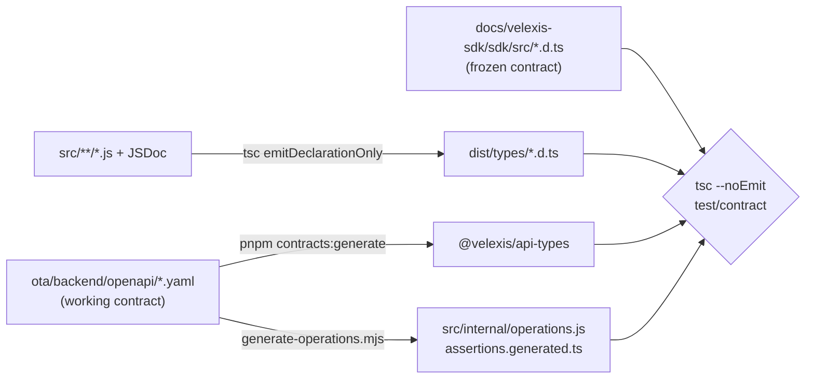

# SDK types, contract test and builds

This page is part of the SDK specification. It explains in detail how the SDK's JSDoc types are written and checked with `tsc --checkJs`, how declaration files are emitted, how the contract test compares them with the TypeScript contract in [`docs/velexis-sdk/sdk/src/`](../../../docs/velexis-sdk/sdk/src/), and how the ESM and IIFE bundles are built and kept within the size budget. The summary is in the [SDK README](../README.md) §6–§7; the decisions are in [ADR-0019](../../../docs/mvp/adr/0019-vanilla-js-sdk-jsdoc.md) and [OADR-0016](../../docs/adr/0016-sdk-packaging-and-type-contract.md).

Related: [`extensions.md`](extensions.md), [ADR-0006](../../../docs/mvp/adr/0006-contract-first-openapi.md) (generated types), [ADR-0015](../../../docs/mvp/adr/0015-testing-strategy.md) (contract tests), [`packages/README.md`](../../../packages/README.md) (`@velexis/api-types`).

## 1. Where types come from

Schema types come only from the generated OTA types, the `@velexis/api-types` module that the contract itself imports ([ADR-0006](../../../docs/mvp/adr/0006-contract-first-openapi.md)). No schema is written by hand in the SDK.

```js
// src/types.js — base aliases only
/** @typedef {import("@velexis/api-types").components["schemas"]} Schemas */
/** @typedef {import("@velexis/api-types").paths} Paths */
export {};
```

Each public module declares the same aliases as its `.d.ts` counterpart, in the same order, so a reviewer can diff them side by side:

```js
// src/flights.js (mirrors flights.d.ts)
/** @typedef {import("./types.js").Schemas["FlightOffer"]} FlightOffer */
/** @typedef {import("./types.js").Schemas["PricedOffer"]} PricedOffer */
/** @typedef {"best" | "price" | "-price" | "duration" | "departure" | "-departure" | "arrival" | "-arrival"} FlightOfferSort */
/** @typedef {ReturnType<typeof import("./namespaces/flights.js").createFlightsApi>} FlightsApi */
export { createFlightsApi } from "./namespaces/flights.js";
```

- **Namespace types are inferred from the factories** (`ReturnType<typeof createFlightsApi>`), so each method's JSDoc (`@param`, `@returns`, `@throws`, one-line summary) is written once, in `src/namespaces/*.js`.
- **Overloads** use JSDoc `@overload` (TypeScript 5.0+).
- **`Page<T>`** is a small class with `@template T`, a `next()` method and `[Symbol.asyncIterator]()`.
- A helper that JSDoc cannot express cleanly may carry a hand-written `.d.ts` next to its `.js` file; the contract test still checks it ([ADR-0019](../../../docs/mvp/adr/0019-vanilla-js-sdk-jsdoc.md)).

## 2. Checking with `tsc --checkJs`

`pnpm --filter @velexis/ota-sdk typecheck` runs `tsc -p tsconfig.json`. A type error fails CI like in TypeScript code.

```jsonc
// ota/sdk/tsconfig.json
{
  "extends": "../../tsconfig.base.json",
  "compilerOptions": {
    "allowJs": true,
    "checkJs": true,
    "strict": true,
    "noUncheckedIndexedAccess": true,
    "exactOptionalPropertyTypes": true,
    "noEmit": true,
    "target": "ES2022",
    "module": "NodeNext",
    "moduleResolution": "NodeNext",
    "lib": ["ES2022", "DOM", "DOM.Iterable"],
    "types": []
  },
  "include": ["src/**/*.js"]
}
```

- `types: []` keeps Node globals out, so code that only works in Node (for example `Buffer`) fails the check.
- ESLint (`n/no-unsupported-features`, `no-console`) runs on the same files; there is no `process.env` in the SDK.

## 3. Emitting declarations

`tsc -p tsconfig.build.json` (same options plus `declaration`, `emitDeclarationOnly`, `declarationMap`, `outDir: "dist/types"`, `noEmit: false`) writes one `.d.ts` per source module. `dist/types/index.d.ts` is the `types` entry of the package.

For **npm publication** (M6) the build copies the OTA part of `@velexis/api-types` into `dist/types/api-types.d.ts` and rewrites `"@velexis/api-types"` to `"./api-types.js"` in the emitted files, so the published package has no dependencies, not even for types. Inside the monorepo the workspace package is used directly.

## 4. The contract test

`test/contract/` runs with `pnpm --filter @velexis/ota-sdk test:contract` and in CI on every PR.



1. **Project.** A `tsc --noEmit` project maps three module names with `paths`:
   - `velexis-contract` → [`docs/velexis-sdk/sdk/src/index.d.ts`](../../../docs/velexis-sdk/sdk/src/index.d.ts);
   - `@velexis/ota-sdk` → `dist/types/index.d.ts`;
   - `@velexis/api-types` → the generated package, for **both** sides, so they share the same schemas.
2. **Per-method assertions** (`assertions.generated.ts`, written by `generate-operations.mjs` from the `x-sdk-method` list). For every contract method:
   - `Parameters<Contract["flights"]["search"]>` must be assignable to the SDK method's parameters (the SDK accepts everything the contract accepts);
   - the SDK's `Awaited<ReturnType<…>>` must be assignable to the contract's (callers get at least what the contract promises).
   Explicit checks are needed because TypeScript compares method parameters bivariantly, so plain interface assignability would miss a narrowed parameter.
3. **Hand-written assertions** cover `createVelexisClient`, `VelexisClient` (including `withOptions` and `request`), `VelexisClientOptions` with the `console.d.ts` augmentation, `RequestOptions`, `Page<T>`, `ListParams`, every error class (constructor, fields such as `PriceChangedError.newPrice`, `RateLimitError.retryAfterSeconds`) and `isVelexisError`.
4. **Approved deviations** are listed in `test/contract/deviations.ts`, each with the ADR that approves it; the assertions use `Omit` for exactly those members and a separate assertion pins the deviating type. Today there is one entry: `auth.signIn`, `auth.refresh` and `auth.changePassword` return `AuthSessionResult | AuthSessionInfo`, because cookie mode returns no tokens ([OADR-0006](../../docs/adr/0006-storefront-cookie-sessions-and-csrf.md)). Anything else that fails is an SDK bug, not a reason to add an entry.
5. **Runtime parity** (`parity.contract.test.js`, Vitest): loads the working OpenAPI document and asserts that the set of `x-sdk-method` values (without `x-internal` and `x-sdk-exclude` operations) equals the set of method paths on a client instance. `withOptions` and `request` are the only extra members.
6. **Version**: `VERSION` from `src/version.js` equals `package.json` `version`.

The contract files are never edited. A new operation is added to the OpenAPI document first ([`../../docs/api-changes.md`](../../docs/api-changes.md) §1), then the SDK method and its line in [`extensions.md`](extensions.md).

## 5. The generated route table

`scripts/generate-operations.mjs` reads the working OpenAPI document and writes `src/internal/operations.js`, a frozen object keyed by `x-sdk-method` (dots replaced by underscores):

```js
export const op = Object.freeze({
  flights_search: { method: "POST", path: "/v1/flights/searches", path_: [], query: [], headers: {},
                    idempotency: "optional", retry: "key", timeout: 60000, page: false },
  checkout_completeWithAirlineCard: { method: "POST", path: "/v1/checkouts/{checkoutId}/airline-card-completion",
                    path_: ["checkoutId"], query: [], headers: {}, idempotency: "required", retry: "never",
                    timeout: 90000, page: false },
  // …
});
```

Values the document does not carry (timeouts above the default, `retry: "never"`) come from a small override list in the generator, reviewed like code. CI regenerates the file and fails if it differs from the committed one, as for the other generated contract types.

A namespace method is then one line, and its JSDoc carries the types:

```js
// src/namespaces/flights.js
import { op } from "../internal/operations.js";

/** @param {import("../internal/client.js").Core} core */
export function createFlightsApi(core) {
  return {
    /**
     * Search flight offers (Amadeus Flight Offers Search) and store them with selling prices.
     * @param {import("../flights.js").FlightSearchParams} params
     * @param {import("../shared.js").RequestOptions} [options]
     * @returns {Promise<import("../flights.js").FlightSearch>}
     * @throws {import("../shared.js").ValidationError} VALIDATION_FAILED, UNPROCESSABLE
     * @throws {import("../shared.js").SupplierError} SUPPLIER_TIMEOUT, SUPPLIER_UNAVAILABLE
     */
    search: (params, options) => core.call(op.flights_search, params, options),
    // …
  };
}
```

`core.call` splits `params` by the table: names in `path_` fill the path template (URI-encoded), names in `query` become query parameters, `ifMatch` becomes `If-Match`, and everything else is the JSON body. The generator fails on a name collision between a path or query parameter and a body field, so such an operation gets an explicit mapping instead of a silent guess.

## 6. Builds

`pnpm --filter @velexis/ota-sdk build` runs `scripts/build.mjs`:

| Output | How | Used by |
|---|---|---|
| `dist/velexis-sdk.mjs` + `.map` | esbuild 0.25, `format: "esm"`, `target: "es2022"`, `platform: "neutral"`, minified, external source map | The storefront (through Vite), the OTA admin, npm consumers |
| `dist/velexis-sdk.iife.js` + `.map` | esbuild, `format: "iife"`, `globalName: "Velexis"` | Plain HTML pages: `<script src="/vendor/velexis-sdk.iife.js"></script>` then `Velexis.createVelexisClient(…)` |
| `dist/types/*.d.ts` | `tsc -p tsconfig.build.json` (§3) | Consumers' type checking |

```json
{
  "name": "@velexis/ota-sdk",
  "type": "module",
  "sideEffects": false,
  "exports": {
    ".": {
      "types": "./dist/types/index.d.ts",
      "development": "./src/index.js",
      "import": "./dist/velexis-sdk.mjs"
    },
    "./iife": "./dist/velexis-sdk.iife.js"
  },
  "files": ["dist", "src", "README.md", "CHANGELOG.md"]
}
```

- The `development` condition lets Vite's dev server use `src/` directly (Vite 6 resolves it in dev); production builds use the bundle. Both are the same ES2022 code, so behaviour does not change between them.
- **ESM only.** Node 22 can `require()` an ES module where needed; there is no CommonJS build.
- Turborepo builds the SDK before the storefront and the OTA admin (`dependsOn: ["^build"]`).

## 7. Size budget

`scripts/check-size.mjs` gzips `dist/velexis-sdk.mjs` at level 9 and fails above **25 KB**; it prints the IIFE size too. The route table keeps each method to one line, so all 128 methods fit with room to spare. If the console namespace ever pushes the bundle past the budget, it moves to a separate entry point, `@velexis/ota-sdk/console`, which the storefront never imports (the [ADR-0019](../../../docs/mvp/adr/0019-vanilla-js-sdk-jsdoc.md) follow-up).
