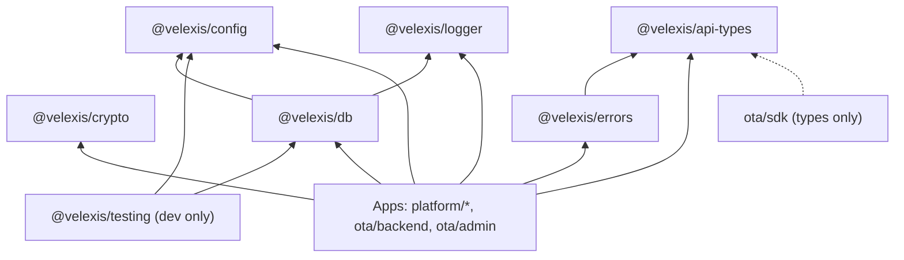

# Shared packages (`packages/*`)

This folder holds the shared TypeScript libraries that every Velexis component builds on: configuration, logging, database access and tenancy, crypto and secrets, errors, the API contract types generated from the OpenAPI documents, and test support. This page says, for each package, what it is for, a sketch of its public API, and who uses it, so the foundation tasks build the same thing the component plans expect. The packages do not exist yet: tasks X-002 to X-015 and X-025 to X-028 in [`docs/mvp/plans/foundation-tasks.md`](../docs/mvp/plans/foundation-tasks.md) create them.

Related: [ADR-0002](../docs/mvp/adr/0002-monorepo-pnpm-turborepo.md) (package names, module format, dependency rules), [`architecture.md`](../docs/mvp/architecture.md) §2, [`tech-stack.md`](../docs/mvp/tech-stack.md), [`conventions.md`](../docs/mvp/conventions.md), [ADR-0022](../docs/mvp/adr/0022-shared-test-support-package.md) (`@velexis/testing`).

## Rules for every package

- **Name** `@velexis/<folder>`, `"private": true`, version `0.0.0`. Apps depend on them with `"workspace:*"`.
- **Build** with `tsc -b` to `dist/` (CommonJS + `.d.ts`), `composite: true`, extending [`tsconfig.base.json`](../tsconfig.base.json). `package.json` has `main`, `types` and an `exports` map; subpaths (`@velexis/db/storage`) are listed in `exports`.
- **Scripts**: `build`, `typecheck` (`tsc --noEmit`), `lint` (`eslint .`), `test` (`vitest run`), plus `test:int` where PostgreSQL or Redis is needed, `generate` for generated code, `clean`.
- **Never depend on an app.** Never read `process.env` (only `@velexis/config` does). Never log with `console`.
- **Exact dependency versions** from [`tech-stack.md`](../docs/mvp/tech-stack.md). A new dependency needs a reason in the PR.
- **Tests next to the code** (`src/**/*.test.ts`); integration tests in `test/integration/**/*.int.test.ts`.



## Overview

| Package | Folder | Purpose | Main consumers | Tasks |
|---|---|---|---|---|
| `@velexis/config` | `packages/config` | Load, validate and type environment variables and key files; fail fast | All Node apps, Next.js server code | X-002 |
| `@velexis/logger` | `packages/logger` | pino setup, standard fields, central redaction list, payload redactor | All Node apps | X-003 |
| `@velexis/crypto` | `packages/crypto` | Envelope encryption, key providers, HMAC, token and API-key hashing, ids | Both backends | X-004, X-005 |
| `@velexis/api-types` | `packages/api-types` | Types generated from the OTA and platform OpenAPI documents; queue message contracts | Everything, incl. the SDK (types only) | X-006 to X-008 |
| `@velexis/errors` | `packages/errors` | Error catalogue generated from `x-error-catalogue`, `AppError`, HTTP mapping | Both backends, Next.js apps | X-009 |
| `@velexis/db` | `packages/db` | Kysely pools, `platformDb`, `tenantTx`, migration runner + CLI, table types, `StorageAdapter` | Both backends, deploy | X-010 to X-014 |
| `@velexis/testing` | `packages/testing` | Test databases with schemas, Redis, clock, builders, Mailpit, Stripe and Amadeus stub helpers | Every package and app (devDependency only) | X-015, X-025, X-027, X-028 |

The contract-types package is named `@velexis/api-types` (not `@velexis/contracts`) because the SDK contract in [`docs/velexis-sdk/sdk/src/shared.d.ts`](../docs/velexis-sdk/sdk/src/shared.d.ts) already imports that module name ([ADR-0006](../docs/mvp/adr/0006-contract-first-openapi.md)).

## `@velexis/config`

Typed configuration from the environment. Each app declares its schema once in `src/config.ts` ([conventions §8](../docs/mvp/conventions.md#8-configuration)).

```ts
import { defineConfig, env, loadDevEnvFiles } from "@velexis/config";

loadDevEnvFiles({ appDir: __dirname });      // development and test only: root .env.local, then <app>/.env.local
export const config = defineConfig({
  APP_ENV: env.enum(["development", "test", "production"] as const),
  LOG_LEVEL: env.enum(["debug", "info", "warn", "error"] as const, { default: "info" }),
  PORT: env.port({ default: 3100 }),
  DATABASE_URL: env.url({ protocols: ["postgres:", "postgresql:"] }),
  REDIS_URL: env.url({ protocols: ["redis:", "rediss:"] }),
  MASTER_KEY_DIR: env.dir(),
  MASTER_KEY_CURRENT: env.string({ pattern: /^local:v\d+$/ }),
  API_KEY_PEPPER_FILE: env.secretFile({ minBytes: 32 }),   // must exist, mode 0400/0600, not world-readable
  AIRLINE_CARD_ENABLED: env.bool({ default: false }),     // switches that widen access default to false only
  SENTRY_DSN: env.url({ optional: true }),
});
export type AppConfig = typeof config;                  // fully inferred, frozen
```

- `defineConfig` reads `process.env` once, validates every entry and throws one `ConfigError` that lists **all** problems by variable name (never the value).
- `env.secretFile` / `readKeyFile(path, { minBytes })` checks existence, permissions and length ([ADR-0010](../docs/mvp/adr/0010-secrets-envelope-encryption.md)).
- `loadDevEnvFiles` refuses to run when `APP_ENV=production`; on the VM systemd provides the environment.
- NestJS apps pass the object to `ConfigModule.forRoot({ isGlobal: true, load: [() => config] })`.

## `@velexis/logger`

One logging setup for every process ([ADR-0016](../docs/mvp/adr/0016-observability.md)).

```ts
import { createLogger, pinoHttpOptions, REDACT_PATHS, redactPayload, maskPan } from "@velexis/logger";

const logger = createLogger({ app: "ota-api", env: config.APP_ENV, level: config.LOG_LEVEL });
LoggerModule.forRoot({ pinoHttp: pinoHttpOptions({ app: "ota-api", logger }) }); // nestjs-pino
redactPayload(supplierRequestBody);   // deep copy for persisted payloads: PAN -> last 4, CVC dropped, tokens removed
maskPan("4111111111111111");          // "411111******1111" (BIN + last 4 only, PCI truncation)
```

- Standard fields: `app`, `env`, `requestId`, `tenantId`, `tenantKey`, `environment`, `actorType`, `actorId`, `route`, `operationId`, `status`, `durationMs`, `err`.
- `REDACT_PATHS` is the single redaction list (passwords, tokens, secrets, card fields, `authorization`, `cookie`, edge and service headers). pino paths are not recursive: the whole `card`, `creditCard` and `formOfPayments` objects are censored at every depth the apps log, and the `err` serializer never carries request or response bodies (X-003). Adding a sensitive field means adding it here **and** to the redaction test.
- `pinoHttpOptions` takes `X-Request-Id` (or generates one), never logs bodies, skips `/health/*`, and logs one line per request.
- `redactPayload` is the shared redactor of [db README §8](../docs/velexis-sdk/db/README.md) used before writing `supplier_requests`, `order_snapshot`, `staff_actions`, `idempotency_keys`, `payment_events`, `notifications`.

## `@velexis/crypto`

Secrets at rest and token helpers, Node `crypto` only ([ADR-0010](../docs/mvp/adr/0010-secrets-envelope-encryption.md)).

```ts
import { LocalFileKeyProvider, encryptValue, decryptValue, rewrapValue, aadFor,
         hashApiKey, verifyApiKey, generateToken, sha256Hex, hmacSha256, timingSafeEqualStr,
         signUrl, verifySignedUrl, newId } from "@velexis/crypto";

const keys = await LocalFileKeyProvider.fromDir(config.MASTER_KEY_DIR, config.MASTER_KEY_CURRENT);
const aad = aadFor("platform", "supplier_connections", "client_secret_ciphertext", row.id);
const { ciphertext, kekId } = await encryptValue("s3cr3t", { aad, keys });  // bytea envelope + encryption_key_id
const plain = await decryptValue(ciphertext, { aad, keys });               // Buffer; never logged
await rewrapValue(ciphertext, { keys });                                  // KEK rotation: re-wrap the DEK only

const { token, hash } = generateToken("rt", 32);   // "rt_<base64url>", sha256 hex for storage
const keyHash = hashApiKey(secret, pepper);        // HMAC-SHA-256 with the pepper file
newId("bkg");                                      // "bkg_01J..." ULID, 80 fresh CSPRNG bits per id (never monotonic)
signUrl("/v1/files/tenant_acme/x.pdf", { expiresAt, key });  // ?exp=&sig= for document downloads
```

- Envelope format: `version | kekId | wrapped DEK (iv, tag, ct) | iv | tag | ciphertext`, AES-256-GCM, associated data binds the value to schema, table, column and row.
- `KeyProvider` (`currentKekId`, `wrap`, `unwrap`) is the seam for a KMS later.

## `@velexis/api-types`

Generated, committed TypeScript types ([ADR-0006](../docs/mvp/adr/0006-contract-first-openapi.md)). `pnpm contracts:generate` rebuilds them; CI fails when they are stale.

```ts
import type { paths, components, operations } from "@velexis/api-types";             // OTA booking API
import type { paths as PlatformPaths, components as PlatformComponents } from "@velexis/api-types/platform";
import type { TenantProvisionJob, TenantProvisionedEvent } from "@velexis/api-types/jobs";
import { tenantProvisionJobSchema } from "@velexis/api-types/jobs";                  // JSON Schema for Ajv
import { otaOperations, platformOperations } from "@velexis/api-types/operations";   // operationId -> method, path, x-sdk-method, x-scope
```

| Subpath | Source | Generator |
|---|---|---|
| `.` (OTA) | `ota/backend/openapi/velexis-ota-booking-api.openapi.yaml` | `openapi-typescript` 7 |
| `./platform` | `platform/backend/openapi/velexis-platform-api.openapi.yaml` | `openapi-typescript` 7 |
| `./operations` | both documents | small script: operation index used by route-parity and SDK-parity tests |
| `./jobs` | hand-written in `src/jobs/` | types + JSON Schemas of `ota-tenant-ops` and `platform-tenant-events` messages ([ADR-0009](../docs/mvp/adr/0009-background-jobs-bullmq.md)) |

The SDK uses it for JSDoc types only; it has no runtime import of this package.

## `@velexis/errors`

One error model for both APIs ([conventions §6](../docs/mvp/conventions.md#6-error-model)).

```ts
import { AppError, isAppError, toErrorEnvelope, httpStatusFor, type ErrorCode } from "@velexis/errors";

throw new AppError("PRICE_CHANGED", { details: { newTotal } });        // only catalogue codes compile
throw new AppError("VALIDATION_FAILED", { fieldErrors: [{ field: "email", code: "format", message: "Invalid e-mail" }] });
const { status, body } = toErrorEnvelope(err, requestId, { exposeSupplier: false }); // unknown -> 500 INTERNAL_ERROR
```

- `src/generated/catalogue.ts` is generated from the `x-error-catalogue` of both documents (code, status, description, source `ota` | `platform`).
- Pure TypeScript, no NestJS dependency. Each backend wraps it in its own exception filter; the Next.js apps map codes to messages.

## `@velexis/db`

Data access and tenancy ([ADR-0004](../docs/mvp/adr/0004-postgresql-schema-per-tenant.md), [ADR-0005](../docs/mvp/adr/0005-data-access-kysely-sql-migrations.md), [db README §4–§5](../docs/velexis-sdk/db/README.md)).

```ts
import { createPool, createPlatformDb, createTenantDb, tenantTx, assertTenantSchema,
         type PlatformDatabase, type TenantDatabase } from "@velexis/db";
import { runMigrations, migrateTenants, migrateTenantSchema } from "@velexis/db/migrate";
import { createStorage, type StorageAdapter } from "@velexis/db/storage";

const pool = createPool(config.DATABASE_URL, { max: 20, applicationName: "ota-api" });
const tenants = createTenantDb(pool);
const booking = await tenantTx(tenants, "tenant_acme", async (trx) =>
  trx.selectFrom("bookings").selectAll().where("id", "=", id).executeTakeFirst(), { statementTimeoutMs: 5000 });
```

- `tenantTx` opens a transaction, runs `SELECT set_config('search_path', $1 || ', reference', true)` with a validated schema name (`^tenant_[a-z][a-z0-9_]{1,39}$`), sets `statement_timeout`, then runs the callback. It is the **only** way to reach tenant tables.
- Type parsers: `numeric` and `int8` stay strings, `timestamptz` becomes `Date`, `jsonb` is parsed.
- Leak guard: in development and test a pool `release` hook asserts that `search_path` is back to `pg_catalog`.
- Migration runner: versioned files `NNNN_name.sql` with SHA-256 checksums in a `schema_migrations` ledger per schema, `-- velexis:phase` and `-- velexis:no-transaction` headers, `lock_timeout` 5 s, tenant fan-out with an advisory lock per schema and bounded concurrency, plus idempotent repeatable files `R__name.sql` for the platform set ([ADR-0021](../docs/mvp/adr/0021-migration-cli-and-repeatable-grants.md)).
- CLI `dist/cli/migrate.js` (used by `pnpm db:migrate`, `pnpm db:migrate:tenants` and `velexis-deploy`):

  | Command | Does |
  |---|---|
  | `migrate.js platform --dir <path>` | Apply platform migrations (`DATABASE_MIGRATOR_URL`) |
  | `migrate.js reference --dir <path>` | Apply reference migrations |
  | `migrate.js tenants --dir <path> [--concurrency 4] [--max-failure-ratio 0.1] [--report file.json]` | Fan out over every tenant schema listed in `platform.tenants` |
  | `migrate.js tenant --schema tenant_<key> --dir <path> [--create]` | One schema (provisioning, tests) |

  Exit codes: `0` ok, `1` error, `2` checksum mismatch, `3` failure ratio exceeded. A `--dir` that does not exist is an empty set (notice, exit 0). The tenant commands create objects with `SET LOCAL ROLE velexis_provisioner`, and the OTA worker calls the same library with `DATABASE_PROVISIONER_URL` ([ADR-0004](../docs/mvp/adr/0004-postgresql-schema-per-tenant.md)).
- `src/generated/{platform,reference,tenant}.ts`: Kysely table types from `kysely-codegen` (`pnpm db:codegen`), committed.
- `@velexis/db/storage`: `StorageAdapter` (`put`, `get`, `delete`, `signedUrl`) with `LocalDiskStorage` (atomic writes, mode 0600) ([ADR-0017](../docs/mvp/adr/0017-email-documents-storage.md)).

## `@velexis/testing`

Test support only; **never** a runtime dependency ([ADR-0022](../docs/mvp/adr/0022-shared-test-support-package.md), [ADR-0015](../docs/mvp/adr/0015-testing-strategy.md)).

```ts
import { createTestDatabase, useRedis, FakeClock, defineBuilder, expectResponseToMatch } from "@velexis/testing";
import { mailpit } from "@velexis/testing/mailpit";
import { signedStripeEvent } from "@velexis/testing/stripe";
import { startAmadeusStub, stubScenario } from "@velexis/testing/amadeus";

const db = await createTestDatabase({ tenants: ["tenant_alpha", "tenant_beta"] }); // clone of a migrated template
afterAll(() => db.drop());
const redis = await useRedis();                       // per-worker DB index, FLUSHDB between files
const msg = await mailpit.waitForMessage({ to: "a@example.com", subject: /Verify/ });
const { payload, header } = signedStripeEvent("payment_intent.succeeded", data, whsec);
const stub = await startAmadeusStub({ port: 0 });     // in-process tools/amadeus-stub; stub.url for AMADEUS_BASE_URL_TEST
await fetch(url, { headers: stubScenario("sold-out") });
expectResponseToMatch("searchFlightOffers", res);     // Ajv against the OpenAPI response schema
```

- `globalSetup` (`@velexis/testing/vitest-global-setup`) migrates one template database per run (platform, reference, `tenant_alpha`, `tenant_beta`) with the real migration runner; each test file clones it with `CREATE DATABASE … TEMPLATE`, so files run in parallel on isolated data.
- Uses `TEST_DATABASE_ADMIN_URL`, `REDIS_URL`, `MAILPIT_API_URL` from the environment (root `.env.example`, CI services).

## Tools that are workspace packages (`tools/*`)

| Package | Folder | Purpose | Task |
|---|---|---|---|
| `@velexis/amadeus-stub` | `tools/amadeus-stub` | Amadeus stub server (OAuth + operations, fixtures, scenarios, request validation), port 4900; fixture recording with scrubbing and a personal-data scan | X-026, X-034 |
| `@velexis/reference-data` | `tools/reference-data` | Vendored airport, airline, country, currency, time zone and aircraft snapshots + loader CLI | X-017, X-018 |
| `@velexis/e2e` | `tools/e2e` | Playwright journeys (created by the component plans) | — |

`tools/plan-lint` stays a plain script without `package.json`.
