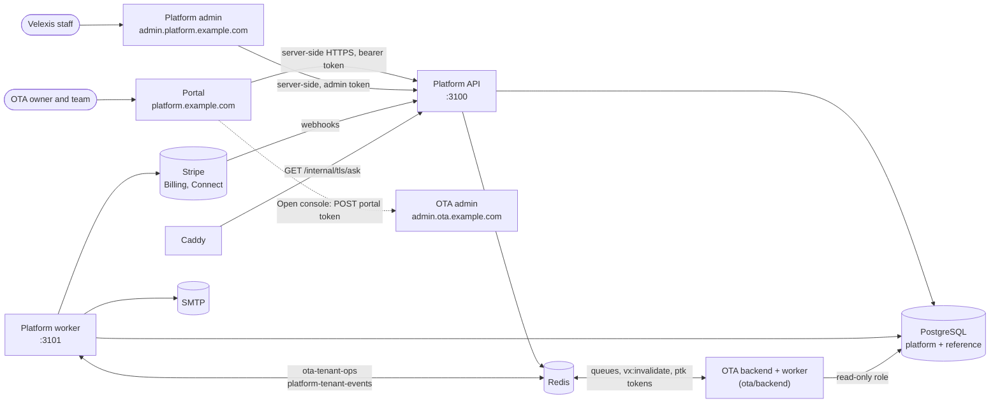

# Velexis platform group

This directory holds the **control plane** of Velexis: the three components that let a person sign up, create and pay for an OTA, connect Amadeus and Stripe, manage keys, domains and team, and that let Velexis staff run the fleet. It explains what each component does, how they fit together and with the OTA group, and where to find the detailed documents. It follows [`docs/mvp/decisions.md`](../docs/mvp/decisions.md), which always wins.

Related: [MVP index](../docs/mvp/README.md), [MVP architecture](../docs/mvp/architecture.md), [platform docs index](docs/README.md), [OTA group](../ota/) (data plane).

## 1. The three components

| Component | Directory | Package | Host (placeholder) | Port | Who uses it |
|---|---|---|---|---|---|
| Platform backend (API + worker) | [`backend/`](backend/README.md) | `@velexis/platform-backend` | `api.platform.example.com` | 3100 API, 3101 worker health | The portal and the platform admin (server side), Stripe webhooks, Caddy's TLS `ask` |
| Platform frontend (portal) | [`frontend/`](frontend/README.md) | `@velexis/platform-frontend` | `platform.example.com` | 3000 | People who sign up and own or run an OTA |
| Platform admin | [`admin/`](admin/README.md) | `@velexis/platform-admin` | `admin.platform.example.com` | 3001 | Velexis staff (`accounts.is_platform_admin`, MFA mandatory) |

The backend is NestJS 11. The portal and the admin are Next.js 15 App Router apps that act as backends-for-frontends: they call the platform API **only from server code** and keep tokens in `__Host-` httpOnly cookies ([ADR-0014](../docs/mvp/adr/0014-frontend-stack-nextjs-tailwind.md)).

## 2. How they fit

- The **platform backend owns** the `platform` and `reference` schemas. It never reads or writes a tenant schema ([ADR-0003](../docs/mvp/adr/0003-six-components-two-nestjs-backends.md)).
- **Provisioning** of a tenant schema is asked of the OTA backend through the BullMQ queue `ota-tenant-ops`. Results come back on `platform-tenant-events` ([ADR-0009](../docs/mvp/adr/0009-background-jobs-bullmq.md), [PADR-0001](docs/adr/0001-tenant-provisioning-orchestration.md)).
- **The OTA backend reads** the platform rows it needs (tenants, domains, API keys, memberships, connections, Amadeus accounts) with a read-only role and caches them. The platform publishes `vx:invalidate` after every change to such a row.
- **OTA admin SSO** starts in the portal: a one-time portal token (`ptk_…`) in Redis, posted to `admin.ota.example.com/sso` ([PADR-0007](docs/adr/0007-portal-to-ota-admin-sso-token.md)).

## 3. What the platform does, by milestone

| Milestone | Platform scope |
|---|---|
| M0 | Baseline migrations of `platform` and `reference`, empty apps with health endpoints, deploy units |
| M1 | Sign-up, e-mail verification, sign-in, MFA; create OTA; provisioning orchestration; API keys; default Velexis Amadeus test office; Velexis Stripe test connection; platform admin basics (tenants, provisioning jobs, audit) |
| M2 | Cross-backend proof, gated on the OTA tenancy and storefront (OF-01): a key created in the portal works on the OTA API and stops after revocation, every cached change is announced on `vx:invalidate`, and a suspension reaches the storefront (PBE-036, PAD-011). The OTA backend starts reading `tenants.storefront_environment` (column from migration `0002`, M1). |
| M3 | Card statement descriptor of the Velexis payment connection: the M3–M4 contract slice, the update endpoint and the portal form (PBE-037, PBE-038, PFE-016). Payments themselves run in the OTA backend. |
| M4 | "Open console" SSO into the OTA admin; Amadeus office settings (PBE-039, PBE-040, PFE-017 … PFE-019) |
| M5 | Stripe Billing subscriptions, the OTA's own Stripe (Connect Standard or API keys), settlements of Velexis-collected payments, the OTA's own Amadeus credentials, live Amadeus offices, custom domains with on-demand TLS, live switch |
| M6 | Security review with the auth matrix and rate-limit tests, performance against the VM budget, complete end-to-end suites for the portal and admin, launch checklist and runbooks; the foundation adds monitoring and the restore drill. The milestone switches are removed after the launch (PBE-064, a named exception of [ADR-0025](../docs/mvp/adr/0025-roadmap-scheduling-and-tracking.md) item 4). |

The full feature list with acceptance-level detail is in [`docs/scope.md`](docs/scope.md).

## 4. Where to read next

| You want to… | Read |
|---|---|
| Know what is in and out of the MVP | [`docs/scope.md`](docs/scope.md) |
| Understand the modules, workers and the OTA integration | [`docs/architecture.md`](docs/architecture.md), [`docs/architecture-flows.md`](docs/architecture-flows.md) |
| Implement an endpoint | [`docs/api-inventory.md`](docs/api-inventory.md) (source of the platform OpenAPI document) |
| Write a migration | [`docs/data-model.md`](docs/data-model.md), [`docs/data-model-migration-0002.md`](docs/data-model-migration-0002.md) |
| Follow one flow end to end | [`docs/flows/`](docs/README.md#flows) |
| Know why something is the way it is | [`docs/adr/`](docs/adr/README.md) (platform ADRs, `PADR-NNNN`) |
| Run or build a component | [`backend/README.md`](backend/README.md), [`frontend/README.md`](frontend/README.md), [`admin/README.md`](admin/README.md) |
| Pick a task | [`docs/plans/agent-tasks.md`](docs/plans/agent-tasks.md) (task ids `PBE-`, `PFE-`, `PAD-`) |

## 5. Rules that matter most here

- **Contract first.** Every platform endpoint is defined in `backend/openapi/velexis-platform-api.openapi.yaml` before it is implemented ([ADR-0006](../docs/mvp/adr/0006-contract-first-openapi.md)).
- **No tenant schema access**, ever. Settlement figures come from Stripe, not from tenant tables.
- **Secrets** (Amadeus and Stripe credentials, MFA secrets, payout bank details) are envelope-encrypted with `@velexis/crypto` ([ADR-0010](../docs/mvp/adr/0010-secrets-envelope-encryption.md)). Never in logs, never in queue messages.
- **Every control-plane change is audited** in `platform.platform_audit_log`, with the actor and the request id.
- **No token in browser JavaScript** in the portal or the admin.
