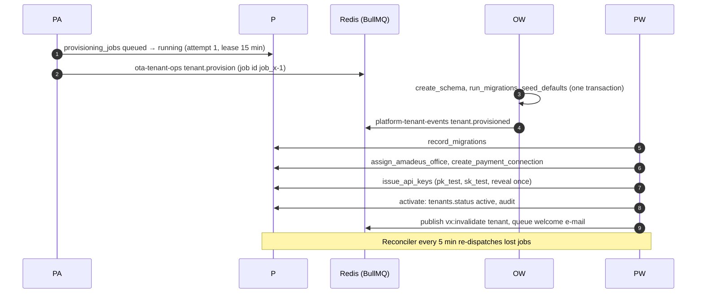
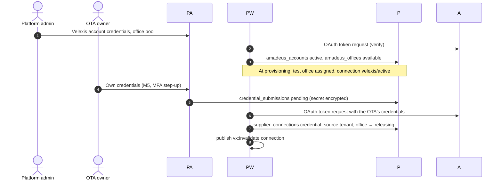
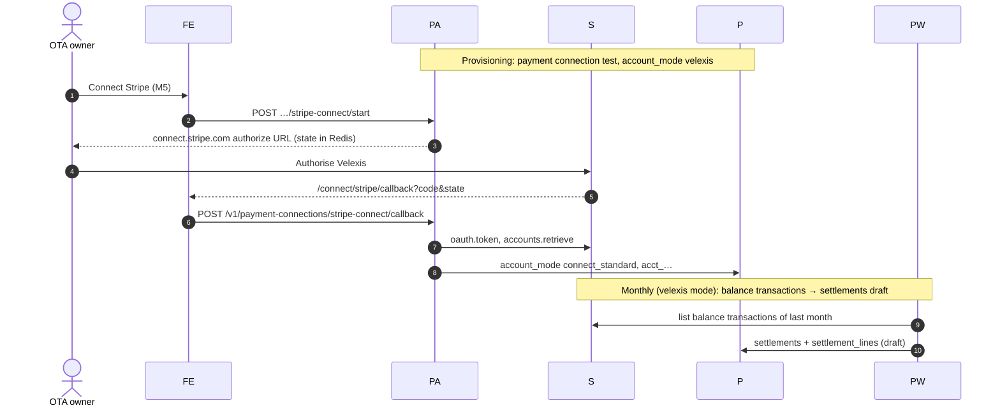
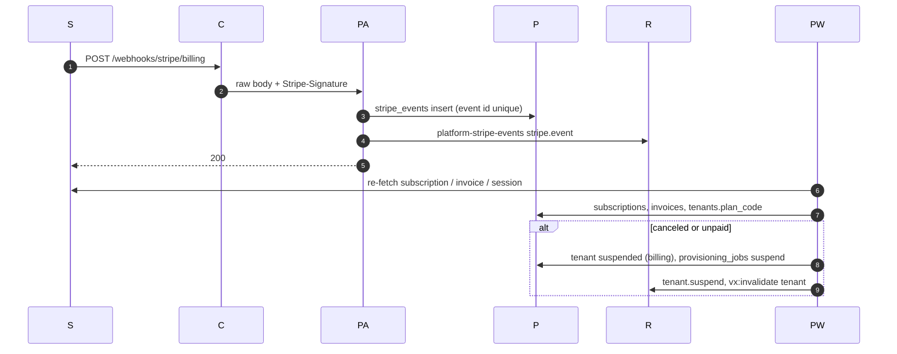
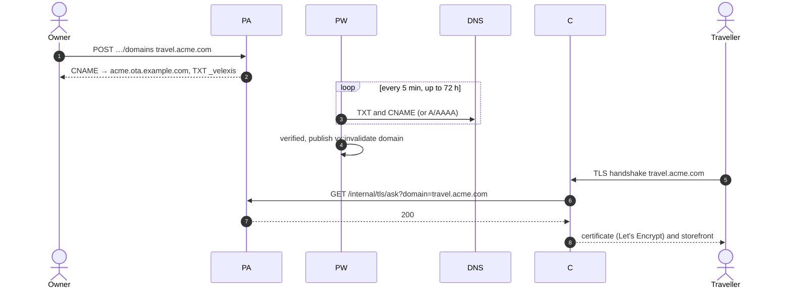
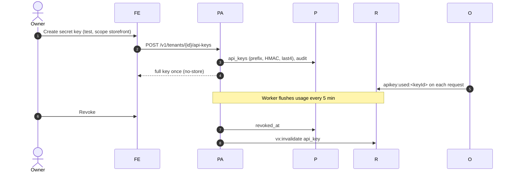
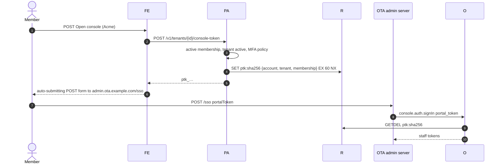
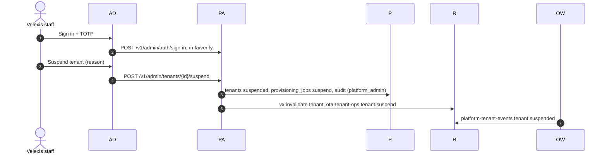

# Platform flows at a glance

This document gives one compact sequence diagram for every platform flow, so the whole control plane can be read on one page. Each section links to the detailed flow document, which has the full steps, failure handling and tables. It complements [`architecture.md`](architecture.md) and the cross-cutting flows (a), (c), (d) and (e) of [`docs/mvp/architecture.md`](../../docs/mvp/architecture.md#5-request-flows), which it follows.

Participants used below: **U** user's browser, **FE** portal server (Next.js), **AD** platform admin server, **PA** platform API, **PW** platform worker, **P** PostgreSQL `platform`, **R** Redis, **OW** OTA worker, **O** OTA API, **S** Stripe, **A** Amadeus, **DNS**, **C** Caddy.

## 1. Sign-up and create OTA

Details: [`flows/signup-and-create-ota.md`](flows/signup-and-create-ota.md).

```mermaid
sequenceDiagram
  autonumber
  actor U
  participant FE
  participant PA
  participant P
  participant PW
  participant S
  U->>FE: Sign up
  FE->>PA: POST /v1/auth/sign-up
  PA->>P: accounts (pending_verification), account_tokens, email_outbox
  PW-->>U: Verification e-mail
  U->>FE: Open link, sign in (TOTP if enabled)
  FE->>PA: POST /v1/auth/verify-email, /v1/auth/sign-in
  U->>FE: Create OTA wizard
  FE->>PA: POST /v1/tenants (Idempotency-Key)
  PA->>P: tenant, owner membership, subscription, sub-domain, provisioning job, audit
  alt Before M5
    PA->>R: dispatch tenant.provision
  else M5
    PA->>S: Checkout Session
    PA-->>FE: checkoutUrl
    U->>S: Pay or start trial
    S->>PA: checkout.session.completed
    PW->>R: dispatch tenant.provision
  end
```

## 2. Provisioning

Details: [`flows/provisioning.md`](flows/provisioning.md), [PADR-0001](adr/0001-tenant-provisioning-orchestration.md).

## 3. Amadeus connection

Details: [`flows/amadeus-connection.md`](flows/amadeus-connection.md), [PADR-0012](adr/0012-amadeus-office-pool.md), [PADR-0010](adr/0010-credential-submission-and-verification.md).

## 4. Stripe payments account and settlements

Details: [`flows/stripe-payments-account.md`](flows/stripe-payments-account.md), [PADR-0011](adr/0011-stripe-connect-standard-and-api-key-connections.md), [PADR-0003](adr/0003-settlement-of-velexis-collected-payments.md).

## 5. Subscription billing

Details: [`flows/subscription-billing.md`](flows/subscription-billing.md), [PADR-0002](adr/0002-stripe-billing-integration.md).

## 6. Custom domains

Details: [`flows/custom-domains.md`](flows/custom-domains.md), [PADR-0004](adr/0004-custom-domain-verification.md).

## 7. API keys

Details: [`flows/api-keys.md`](flows/api-keys.md), [PADR-0005](adr/0005-api-key-format-and-hashing.md).

## 8. Team and OTA admin SSO

Details: [`flows/team-and-ota-admin-sso.md`](flows/team-and-ota-admin-sso.md), [PADR-0007](adr/0007-portal-to-ota-admin-sso-token.md).

## 9. Platform admin operations

Details: [`flows/platform-admin-operations.md`](flows/platform-admin-operations.md), [PADR-0006](adr/0006-platform-admin-access-and-audit.md), [PADR-0014](adr/0014-tenant-suspension-and-resume.md).

