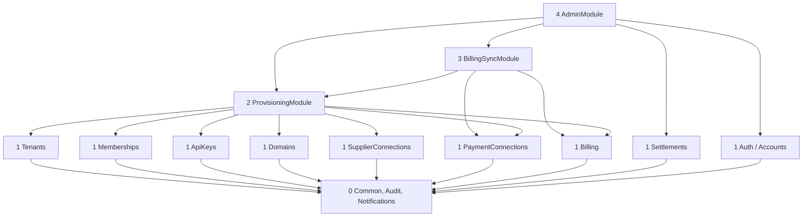

# Platform architecture

This document describes the inside of the platform backend (`platform/backend`) and how it works with the portal, the platform admin and the OTA backend: the NestJS modules and their layering, the request pipeline and guards, tokens, the worker with its queues and schedules, the integration contract with the OTA backend, and the external services. It refines the cross-cutting [`docs/mvp/architecture.md`](../../docs/mvp/architecture.md) for the control plane and never contradicts it.

Related: [`architecture-flows.md`](architecture-flows.md) (one overview sequence diagram per flow), [`api-inventory.md`](api-inventory.md), [`data-model.md`](data-model.md), [`scope.md`](scope.md), [platform ADRs](adr/README.md), [`../backend/README.md`](../backend/README.md).

## 1. Processes

| Process | Entry | systemd unit | Port (127.0.0.1) | Runs |
|---|---|---|---|---|
| Platform API | `dist/main.js` | `velexis-platform-api.service` | 3100 | HTTP API for the portal and the admin, Stripe webhook receivers, `GET /internal/tls/ask`, health |
| Platform worker | `dist/worker.js` | `velexis-platform-worker.service` | 3101 (health only) | BullMQ processors and schedulers of §5 |
| Portal | Next.js standalone | `velexis-portal.service` | 3000 | Pages, server actions, the SSO launch route handler |
| Platform admin | Next.js standalone | `velexis-platform-admin.service` | 3001 | Admin pages and server actions |

The API never runs long jobs. It writes rows, commits, then enqueues. The worker never serves HTTP except health ([ADR-0003](../../docs/mvp/adr/0003-six-components-two-nestjs-backends.md)).

## 2. Modules

### 2.1 Module list

Folder names are fixed here. They refine the suggested contexts of [`conventions.md` §2](../../docs/mvp/conventions.md#2-nestjs-backends).

| Nest module | Folder | Layer | Owns (writes) | Responsibilities | First milestone |
|---|---|---|---|---|---|
| `CommonModule` | `common/` | 0 | `stripe_events`, `credential_submissions` (shared repositories) | Guards, interceptors, error filter, `Clock`, id generator, Redis client, Stripe client factory, invalidation publisher, idempotency store, Stripe event inbox | M0 |
| `AuditModule` | `audit/` | 0 | `platform_audit_log` | `AuditService.record(tx, entry)`, audit queries and CSV export | M1 |
| `NotificationsModule` | `notifications/` | 0 | `email_outbox` | Queue an e-mail in the caller's transaction, render Handlebars templates, send through SMTP ([PADR-0013](adr/0013-platform-email-outbox.md)) | M1 |
| `AuthModule` | `auth/` | 1 | `accounts` (credentials, status), `account_sessions`, `account_tokens`, `account_recovery_codes` | Sign-up, verification, sign-in, MFA challenge, refresh, sign-out, password reset, step-up, token signing | M1 |
| `AccountsModule` | `accounts/` | 1 | `accounts` (profile, MFA settings) | `me`, profile, password change, MFA set-up and recovery codes, session list, sign out everywhere | M1 |
| `TenantsModule` | `tenants/` | 1 | `tenants` | Tenant repository, key rules and availability, profile updates, reads for lists | M1 |
| `MembershipsModule` | `memberships/` | 1 | `tenant_memberships`, `tenant_invitations` | Members, role rules, invitations, the console token for OTA admin SSO ([PADR-0007](adr/0007-portal-to-ota-admin-sso-token.md)) | M1 |
| `ApiKeysModule` | `api-keys/` | 1 | `api_keys` | Create, roll, revoke, list, usage flush ([PADR-0005](adr/0005-api-key-format-and-hashing.md)) | M1 |
| `DomainsModule` | `domains/` | 1 | `tenant_domains` | Sub-domain row, custom domains, DNS verification, TLS probe, the `ask` endpoint ([PADR-0004](adr/0004-custom-domain-verification.md)) | M1 (sub-domain, ask), M5 |
| `SupplierConnectionsModule` | `supplier-connections/` | 1 | `amadeus_accounts`, `amadeus_offices`, `supplier_connections` | Velexis Amadeus accounts, office pool, tenant connections, own-credential verification ([PADR-0012](adr/0012-amadeus-office-pool.md), [PADR-0010](adr/0010-credential-submission-and-verification.md)) | M1 |
| `PaymentConnectionsModule` | `payment-connections/` | 1 | `payment_provider_connections` | Velexis-mode rows, Connect Standard OAuth, API-key mode, Connect account events ([PADR-0011](adr/0011-stripe-connect-standard-and-api-key-connections.md)) | M1, M5 |
| `BillingModule` | `billing/` | 1 | `plans`, `billing_customers`, `subscriptions`, `invoices` | Plans and price links, Stripe Billing gateway (customer, Checkout, Customer Portal, retrieve), subscription and invoice reads ([PADR-0002](adr/0002-stripe-billing-integration.md)) | M1 (plans, manual), M5 |
| `SettlementsModule` | `settlements/` | 1 | `settlements`, `settlement_lines`, `tenant_payout_accounts` | Statement generation from Stripe balance transactions, approval, payout accounts ([PADR-0003](adr/0003-settlement-of-velexis-collected-payments.md)) | M5 |
| `ProvisioningModule` | `provisioning/` | 2 | `provisioning_jobs`, `tenant_schema_migrations` | Tenant lifecycle orchestration: create OTA, dispatch, tenant-event consumer, post-steps, reconciler, retry, migrate, suspend, resume, go-live, onboarding checklist ([PADR-0001](adr/0001-tenant-provisioning-orchestration.md), [PADR-0014](adr/0014-tenant-suspension-and-resume.md)) | M1 |
| `BillingSyncModule` | `billing/sync/` | 3 | (through `BillingModule` repositories) | `/webhooks/stripe/billing` receiver, event processing with re-fetch, dunning, abandoned Checkout and manual-trial schedules | M5 |
| `AdminModule` | `admin/` | 4 | — | Thin admin controllers over the services above, dashboard counts, queue inspection, platform admins | M1 |
| `HealthModule` | `health/` | 0 | — | `/health/live`, `/health/ready` | M0 |

The `reference` schema has no module here. The backend owns its migrations (`migrations/reference/`), but the data and its loader live in `tools/reference-data` and run through `pnpm db:seed:reference` ([ADR-0024](../../docs/mvp/adr/0024-reference-data-sources-and-loader.md)). Modules that need a lookup read the tables directly and never write them: billing and settlements read `reference.currencies` for minor-unit exponents.

### 2.2 Layering

- A module imports only modules of a **lower** layer. Same-layer modules never import each other. ESLint `import/no-cycle` and the Nest module graph enforce it.
- A module reads another module's table only through that module's exported repository or service.
- One exception for the request pipeline: `TenantRoleGuard` (layer 0, §3 step 6) reads the caller's membership through the abstract `TenantMembershipLookup`, which the global `MembershipsModule` provides with its repository. The role matrix `memberships/tenant-roles.ts` is plain data that every tenant controller imports for its `@TenantRoles(...)`; no module imports `MembershipsModule` for it (PBE-017).
- Cross-module use cases (create OTA, activate, suspend) live in `ProvisioningModule`, so resource modules stay simple.

### 2.3 Inside a module

As [`conventions.md` §2](../../docs/mvp/conventions.md#2-nestjs-backends): `*.controller.ts` (HTTP only, bound to an OpenAPI `operationId`), `*.service.ts` (use case and transaction), `*.repository.ts` (Kysely on `platformDb`, schema-qualified `platform.*`), `*.mapper.ts`, `*.processor.ts` (BullMQ), `*.gateway.ts` (Stripe, Amadeus token check, DNS, SMTP). External calls never run inside an open transaction.

## 3. Request pipeline

| Order | Piece | What it does |
|---|---|---|
| 1 | `helmet`, `cookie-parser` | Security headers. The API sets no cookies; the Next.js apps do. |
| 2 | Raw body capture | Only on `/webhooks/*`, for Stripe signature checks. |
| 3 | Request context (`nestjs-cls`) | `requestId` from `X-Request-Id` (Caddy) or new, actor, end-user IP and user agent (§3.2). |
| 4 | Throttler (Redis storage) | Per-IP and per-account limits of [`api-inventory.md` §2](api-inventory.md#2-conventions). The IP is the end-user IP of §3.2, never the address of the portal or admin server. |
| 5 | Auth guard by `x-scope` | `public` (none), `portal` (`PortalAuthGuard`), `platform_admin` (`AdminAuthGuard`), `internal` (`InternalOnlyGuard`: loopback source and no `X-Forwarded-For` from Caddy), `webhook` (`StripeSignatureGuard`). |
| 6 | `TenantRoleGuard` | `@TenantRoles('owner','admin')` on `/v1/tenants/{tenantId}/…`: loads the caller's **active** membership from the database (no cache) and checks the role. Non-members get `404 NOT_FOUND`, so tenant ids cannot be probed. |
| 7 | `RecentMfaGuard` | `@RequireRecentMfa()` on sensitive operations: the access token's `mfa_at` must be within 15 minutes, otherwise `401 REAUTH_REQUIRED`; accounts without MFA get `403 MFA_REQUIRED` ([PADR-0008](adr/0008-email-verification-and-mfa-policy.md)). |
| 8 | `FeatureGuard` | `@Feature('custom_domains')`: the milestone switch of [PADR-0015](adr/0015-milestone-feature-switches.md) and the plan's `limits`/`features`. `403 FEATURE_DISABLED`. |
| 9 | OpenAPI validation interceptor (Ajv) | Path, query, headers and body against the operation ([ADR-0006](../../docs/mvp/adr/0006-contract-first-openapi.md)). |
| 10 | Idempotency interceptor | Required `Idempotency-Key` on the operations marked in the inventory; replays the stored response for 24 h from Redis `vx:idem:<accountId>:<key>`. Never on responses that carry a secret. |
| 11 | Controller → service | One service call. |
| 12 | Error filter | `AppError` → error envelope; anything else → `500 INTERNAL_ERROR` with the `requestId`. |

### 3.1 Tokens

Platform access tokens are EdDSA JWTs signed with `platform-jwt-ed25519.pem`, 15 minutes, with a `kid` header ([ADR-0008](../../docs/mvp/adr/0008-identity-accounts-customers-sessions.md)).

| Claim | Portal token | Admin token |
|---|---|---|
| `iss` | `https://api.platform.example.com` | same |
| `aud` | `portal` | `platform_admin` |
| `sub` | `acc_…` | `acc_…` |
| `typ` | `portal` | `admin` |
| `sid` | Refresh family id | Refresh family id |
| `ev` | E-mail verified (boolean) | always `true` |
| `amr` | `["pwd"]` or `["pwd","otp"]` | always `["pwd","otp"]` |
| `mfa_at` | Last TOTP verification in this family (epoch seconds) or absent | same |

The audiences never mix: the admin guard refuses portal tokens, and the reverse. `AdminAuthGuard` also re-reads `accounts.is_platform_admin` and `status` on every request. Refresh tokens are opaque, hashed in `account_sessions`, rotated on use; families have an absolute lifetime of 30 days (portal) or 12 hours (admin) ([PADR-0009](adr/0009-platform-api-surface-and-authentication.md)).

### 3.2 End-user IP and user agent

The portal and the platform admin call the API from their own servers on `127.0.0.1`, so the socket address says nothing about the person. Without more, every portal user would share one rate-limit bucket and every audit row would show the portal server ([PADR-0019](adr/0019-end-user-ip-forwarding-from-the-portal-and-admin.md)).

| Step | Where | What happens |
|---|---|---|
| 1 | Caddy | Sets `X-Forwarded-For` on the request to the portal or admin. It does not pass on a client-supplied value, because no trusted proxies are configured. |
| 2 | Portal or admin server (`lib/api.ts`) | Takes the right-most `X-Forwarded-For` entry (Caddy's), or `127.0.0.1` when there is none (local development). Sends it on every API call as `X-Velexis-End-User-IP`, with the browser's `User-Agent` (cut to 512 characters) as `X-Velexis-End-User-Agent` and the shared key `PLATFORM_BFF_KEY` as `X-Velexis-Bff-Key`. |
| 3 | Platform API (request context) | Honours the two end-user headers only when the socket peer is loopback, the request has no `X-Forwarded-For` (it did not come through Caddy) and `X-Velexis-Bff-Key` matches in constant time. A request with a valid key but a missing or malformed IP answers `400 VALIDATION_FAILED`. In every other case the headers are ignored and the IP is Express's `req.ip` (`trust proxy` loopback), which is the Caddy client address for public calls such as webhooks. |
| 4 | Throttler, audit, sessions, tokens | Use only the request-context IP and user agent: throttler keys, `platform_audit_log`, `account_sessions`, `account_tokens.ip_address`. |

`X-Velexis-Bff-Key` is on the logger's redaction list. A wrong key is logged as a warning (without the value) and treated like a missing one.

## 4. Data access

- One `pg.Pool` with role `velexis_platform_app` (`DATABASE_URL`). Short platform transactions through `platformDb` ([ADR-0005](../../docs/mvp/adr/0005-data-access-kysely-sql-migrations.md)). No access to tenant schemas: the role has no privileges there.
- Every state change writes its `platform_audit_log` row **in the same transaction**, and publishes `vx:invalidate` and enqueues jobs **after** commit.
- Mutable aggregates use the `version` column; PATCH operations take `If-Match`.
- Secrets are envelope-encrypted with `@velexis/crypto`. The associated data is `"platform.<table>.<column>:<row id>"` ([ADR-0010](../../docs/mvp/adr/0010-secrets-envelope-encryption.md)).

## 5. Worker: queues and schedules

BullMQ prefix `vx` ([ADR-0009](../../docs/mvp/adr/0009-background-jobs-bullmq.md)). Messages carry ids only; never secrets, tokens or card data. Defaults: `attempts: 5`, exponential backoff from 30 s, failed jobs kept 30 days.

| Queue | Producer → consumer | Jobs | Concurrency |
|---|---|---|---|
| `ota-tenant-ops` | Platform API and worker → **OTA worker** | `tenant.provision`, `tenant.migrate`, `tenant.suspend`, `tenant.resume` | (OTA side) |
| `platform-tenant-events` | **OTA worker** → platform worker | `tenant.provisioned`, `tenant.provision_failed`, `tenant.migrated`, `tenant.migration_failed`, `tenant.suspended`, `tenant.resumed` | 4 |
| `platform-emails` | API, worker → worker | `email.send {emailId}`; `email.sweep` (its own scheduler, every minute: re-enqueues `pending` rows older than 2 minutes whose job is missing, [PADR-0013](adr/0013-platform-email-outbox.md) item 2) | 4 |
| `platform-stripe-events` | Webhook receivers → worker | `stripe.event {eventId}` (job id = Stripe event id) | 2 |
| `platform-domains` | API, schedulers → worker | `domain.verify`, `domain.recheck`, `domain.tls_probe` `{domainId}` | 4 |
| `platform-connections` | API, admin → worker | `amadeus_account.verify {amadeusAccountId}`, `credentials.verify {submissionId}` | 2 |
| `platform-settlements` | Scheduler, admin → worker | `settlement.generate {periodStart, tenantId?}` | 1 |
| `platform-maintenance` | Schedulers → worker | The schedules below | 1 |

BullMQ gives any job of a queue to any of its workers, so `platform-maintenance` has exactly one processor (`common/queues/maintenance.processor.ts`): it runs each job with the `@MaintenanceJob("<schedule id>")` handler of the module that owns the schedule, and completes a job whose schedule has no handler yet without doing anything.

| Scheduler (`upsertJobScheduler`) | When (UTC) | Does | Milestone |
|---|---|---|---|
| `provisioning.reconcile` | every 5 min | Dispatch due `queued` jobs whose gate is open; re-dispatch `running` jobs past `locked_until` whose BullMQ job is gone or failed | M1 |
| `api_keys.flush_usage` | every 5 min | Move `apikey:used:<keyId>` counters into `api_keys.last_used_at` / `last_used_ip` | M1 |
| `invitations.expire` | hourly | Pending invitations past `expires_at` → `expired` | M1 |
| `provisioning.purge_reveals` | hourly | Erase reveal-once key ciphertext older than 24 h | M1 |
| `purge.daily` | 02:50 | Consumed or expired `account_tokens` > 7 days, `account_sessions` expired > 30 days, sent `email_outbox` > 30 days, processed `stripe_events` > 90 days, final `credential_submissions` > 90 days | M1 |
| `amadeus.pool_level` | 06:55 | E-mail ops when fewer than 3 `available` offices remain per environment | M1 |
| `domains.verify_pending` | every 5 min | `domain.verify` for each pending custom domain; `failed` past the 72 h deadline | M5 |
| `domains.recheck_verified` | 04:10 | `domain.recheck` for each verified custom domain | M5 |
| `domains.tls_probe` | 04:40 | `domain.tls_probe` for every storefront host | M5 |
| `stripe_events.sweep` | every 5 min | Enqueue `received` or retryable `failed` inbox rows older than 2 minutes whose BullMQ job is missing | M5 |
| `billing.abandoned_checkouts` | 03:20 | Tenants `provisioning` with an `incomplete` subscription older than 48 h → `failed` | M5 |
| `billing.manual_trials` | 08:10 | Trial-ending notices and suspension of manual trials | M5 |
| `settlements.monthly` | 05:00 on day 3 | `settlement.generate` for the previous month | M5 |

## 6. Integration with the OTA backend

There is **no synchronous HTTP** between the backends ([ADR-0003](../../docs/mvp/adr/0003-six-components-two-nestjs-backends.md)). The contract below lives in `@velexis/api-types/jobs` (queue messages and invalidation events) and changes backward-compatibly for one release.

### 6.1 Queue messages

Every message: `v` (contract version, `1`), `jobId` (`job_…`, the `provisioning_jobs.id`; `null` only for deploy fan-out events), `tenantId`, `requestedAt`, `requestId`. The BullMQ job id is `<jobId>-<attempt>`, so a re-dispatch after a failure is a new BullMQ job while a duplicate dispatch of the same attempt is a no-op.

| Message | Direction | Extra fields | OTA worker does / platform does |
|---|---|---|---|
| `tenant.provision` | → OTA | — | Reads the tenant row (read-only), runs `create_schema`, `run_migrations`, `seed_defaults` in one transaction as `velexis_provisioner` (db README §3, [ADR-0004](../../docs/mvp/adr/0004-postgresql-schema-per-tenant.md)), grants `velexis_ota_app`. |
| `tenant.migrate` | → OTA | `targetVersion` (optional) | Applies pending tenant migrations to that schema. |
| `tenant.suspend` | → OTA | `reason` | Housekeeping only (expire open checkouts and void their authorisations, deny staff refresh). Traffic is already blocked by `tenants.status`. No-op if the tenant is no longer suspended. |
| `tenant.resume` | → OTA | — | Re-enables tenant schedulers. No-op if the tenant is not active. |
| `tenant.provisioned` | ← OTA | `schemaName`, `schemaVersion`, `migrations[] {version, checksum, phase, appliedAt, durationMs}`, `steps[]` | Platform mirrors the ledger and runs the post-steps of [PADR-0001](adr/0001-tenant-provisioning-orchestration.md). |
| `tenant.provision_failed` | ← OTA | `error {code, message}`, `retryable`, `steps[]` | Platform re-dispatches with backoff or fails the job and the tenant. |
| `tenant.migrated` / `tenant.migration_failed` | ← OTA | `schemaVersion`, `migrations[]` / `version`, `error` | Platform mirrors `tenant_schema_migrations` and `tenants.schema_version`; a failure alerts ops. Also sent by the deploy fan-out with `jobId = null`. |
| `tenant.suspended` / `tenant.resumed` | ← OTA | — | Platform marks the job `succeeded`. |

Handlers on both sides are idempotent and act on the **current** state, not on message order.

### 6.2 Platform tables the OTA backend reads

`velexis_ota_app` has `SELECT` on: `tenants`, `tenant_domains`, `api_keys`, `api_key_tenant_grants`, `tenant_memberships`, `accounts` (identity and MFA columns), `plans`, `supplier_connections`, `payment_provider_connections`, `amadeus_accounts`, `amadeus_offices` ([ADR-0004](../../docs/mvp/adr/0004-postgresql-schema-per-tenant.md)). It has **no** privilege on the other platform tables (billing, settlements, payout accounts, sessions, tokens, outbox, events, submissions). Migration `0002` grants the two new Amadeus tables ([`data-model.md`](data-model.md)).

What the OTA backend relies on, by column:

| Column | Meaning for the OTA backend |
|---|---|
| `tenants.status`, `storefront_environment`, `key`, `schema_name`, `billing_notice` | Serve only `active`; hosted storefront environment; billing banner in the OTA admin |
| `tenant_domains` (`hostname`, `kind`, `purpose`, `verification_status`) | Host → tenant for edge requests (verified rows only) |
| `api_keys` (`prefix`, `key_hash`, `kind`, `environment`, `scopes`, `allowed_origins`, `revoked_at`, `expires_at`) | Key verification |
| `supplier_connections` (`credential_source`, `amadeus_account_id`, offices, defaults) + `amadeus_accounts` + `amadeus_offices` | Amadeus credential resolution. Orders owned by an office in status `assigned` **or** `releasing` for the tenant use the Velexis account ([PADR-0012](adr/0012-amadeus-office-pool.md)). |
| `payment_provider_connections` (`account_mode`, `account_reference`, `publishable_key`, secrets, `status`, `statement_descriptor_suffix`) | Stripe gateway configuration per environment |
| `tenant_memberships`, `accounts` | Staff sign-in, roles, MFA flags |
| `plans.limits`, `plans.features` | Plan-gated OTA features |

### 6.3 Cache invalidation (`vx:invalidate`)

The platform publishes JSON `{ "v": 1, "type": …, …ids }` on the Redis channel `vx:invalidate` after the commit of every change to a row the OTA caches.

| `type` | Fields | Published when |
|---|---|---|
| `tenant` | `id` | Status, plan, `storefront_environment`, profile change |
| `domain` | `hostname` | Domain verified, failed, removed, primary changed |
| `api_key` | `prefix` | Key revoked, expiry set, origins changed |
| `connection` | `tenantId` | Any change to the tenant's supplier or payment connection |
| `membership` | `accountId`, `tenantId` | Role, status, removal |
| `account` | `accountId` | Account disabled, locked, MFA changed, password changed (new in this document) |
| `amadeus_account` | `id` | Shared credentials rotated or disabled; office status changed (new) |
| `plan` | `code` | Plan limits or features changed (new) |

The three new types extend the list of [`docs/mvp/architecture.md` §4](../../docs/mvp/architecture.md#redis-keys-shared-between-the-backends); the OTA plan adds their handlers. Lost messages are covered by the 60 s TTLs.

### 6.4 Redis keys shared with the OTA backend

| Key | Written by | Read by | TTL | Purpose |
|---|---|---|---|---|
| `ptk:<sha256(token)>` | Platform API | OTA API (`GETDEL`) | 60 s | One-time portal token: `{v, accountId, tenantId, membershipId, role, mfa, issuedAt, requestId}` ([PADR-0007](adr/0007-portal-to-ota-admin-sso-token.md)) |
| `staffdeny:acct:<accountId>` | Platform API | OTA API (staff guard and refresh) | 30 days | Epoch ms cut-off: staff families created before it are revoked. Written on sign out everywhere, password change or reset, MFA reset, account disable (new; refines `staffdeny:<familyId>`). |
| `apikey:used:<keyId>` | OTA API | Platform worker (`GETDEL`) | 1 day | `{at, ip}` of the last use, flushed every 5 minutes |

Platform-only keys: `vx:idem:*` (idempotency, 24 h), `mfach:<sha256>` (MFA challenge, 5 min), `mfasetup:<accountId>` (pending TOTP secret, encrypted, 10 min), `stripe:oauth:<sha256(state)>` (Connect OAuth state, 10 min), `tlsask:<host>` (positive `ask` answer only, 60 s; negative answers stay in a bounded in-process cache, [PADR-0004](adr/0004-custom-domain-verification.md) item 6), `rl:*` (throttler). All have a TTL, as `noeviction` requires.

## 7. External services

| Service | Used for | Rules |
|---|---|---|
| Stripe (Velexis account) | Billing (customers, Checkout, Customer Portal, subscriptions, invoices), Connect OAuth and account retrieval, balance transactions for settlements, verification of OTA API keys | Node SDK with `apiVersion` pinned in code; an idempotency key on every POST (`<purpose>:<row id>`); 10 s timeout; webhooks verified on the raw body and stored in `stripe_events` before processing |
| Amadeus | OAuth token request only, to verify the Velexis shared credentials and OTA-owned credentials | `POST {baseUrl}/v1/security/oauth2/token` with `client_credentials`; the token is discarded; 10 s timeout. Flight APIs are called by the OTA backend only. |
| DNS | Custom domain verification | `node:dns` `Resolver` with `DNS_RESOLVERS` (public resolvers, not the VM's cache) |
| SMTP | Platform e-mails | Nodemailer; Mailpit in development ([ADR-0017](../../docs/mvp/adr/0017-email-documents-storage.md)) |
| Caddy | TLS `ask` | `GET 127.0.0.1:3100/internal/tls/ask?domain=` |

## 8. Security notes specific to the platform

- **Redaction list additions** (in `@velexis/logger`, with tests): `secretKey`, `webhookSecret`, `iban`, `accountNumber`, `recoveryCode`, `recoveryCodes`, `totpSecret`, `otpauthUrl`, `mfaChallengeToken`, `invitationToken`, `secretData` (the secret variables of a platform e-mail, PBE-011) and the links with tokens it holds (`verifyUrl`, `resetUrl`, `acceptUrl`; every secret variable of a template is on the list), and `code` and `state` anywhere under an MFA or OAuth body. `clientSecret`, `token`, `password` and `portalToken` are already on the list.
- **Sensitive actions** need a recent MFA step-up (§3 item 7): entering Amadeus or Stripe credentials, Connect OAuth start, live secret keys, payout account, go-live, granting owner, disabling MFA.
- **Platform admin** host is separate, MFA mandatory, optionally IP-restricted in Caddy; every admin call is audited ([PADR-0006](adr/0006-platform-admin-access-and-audit.md)).
- **Portal CSP** adds `form-action 'self' https://admin.ota.example.com` for the SSO hand-off, and `https://checkout.stripe.com`, `https://billing.stripe.com`, `https://connect.stripe.com` as navigation targets (redirects, not frames).
- **Tenant probing**: tenant-scoped endpoints answer `404` to non-members.

## 9. Failure behaviour

| Failure | Platform behaviour |
|---|---|
| OTA worker down | Provisioning jobs stay `running`; the reconciler re-dispatches after `locked_until` (15 min); the portal keeps showing progress. |
| Redis down | API answers `503` on endpoints that need Redis (sign-in challenges, console tokens, idempotent creates). Webhooks are still stored in `stripe_events` and answered `200`; the `stripe_events.sweep` scheduler enqueues them when Redis is back. Portal tokens and MFA challenges are lost (users retry). Provisioning resumes through the reconciler. |
| Stripe down | Create OTA still commits (M5) and offers "continue to payment" later; webhooks are delayed by Stripe; settlement generation retries. |
| SMTP down | `email_outbox` rows stay `pending` and retry; no request fails. |
| Platform API down | Portal and admin down; Caddy's `ask` fails, so **no new certificates**; OTA traffic is unaffected. |
