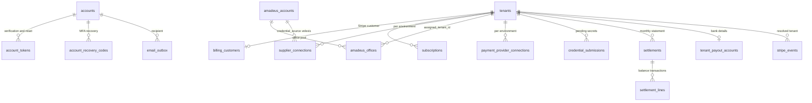

# Platform data model

This document describes the `platform` and `reference` schemas as the platform backend uses them: which module owns which table, what the OTA backend may read, and every change that migration `0002` makes to the baseline, with the reason for each. The baseline is reused unchanged from [`docs/velexis-sdk/db/`](../../docs/velexis-sdk/db/README.md); the exact SQL of `0002` is printed in three parts: [part 1](data-model-migration-0002.md), [part 2](data-model-migration-0002-part2.md), [part 3](data-model-migration-0002-part3.md). It was applied to the baseline on PostgreSQL 16 and its constraints were exercised before publication.

Related: [`architecture.md`](architecture.md), [`api-inventory.md`](api-inventory.md), [ADR-0004](../../docs/mvp/adr/0004-postgresql-schema-per-tenant.md), [ADR-0005](../../docs/mvp/adr/0005-data-access-kysely-sql-migrations.md), [ADR-0010](../../docs/mvp/adr/0010-secrets-envelope-encryption.md).

## 1. Sources and migrations

| Item | Location |
|---|---|
| Baseline DDL (16 platform tables, 7 reference tables) | [`platform.sql`](../../docs/velexis-sdk/db/platform.sql), [`reference.sql`](../../docs/velexis-sdk/db/reference.sql), copied byte for byte as `0001_baseline.sql` |
| Column descriptions | [`dictionary.json`](../../docs/velexis-sdk/db/dictionary.json) |
| Baseline ER diagrams | [`er/er-platform.mmd`](../../docs/velexis-sdk/db/er/er-platform.mmd), [`er/er-reference.mmd`](../../docs/velexis-sdk/db/er/er-reference.mmd), [`er/er-overview.mmd`](../../docs/velexis-sdk/db/er/er-overview.mmd) |
| Design (provisioning, runner, routing, security) | [`db/README.md`](../../docs/velexis-sdk/db/README.md) §3, §4, §5, §8 |
| Platform migrations | `platform/backend/migrations/platform/0001_baseline.sql`, `0002_add_mvp_platform_deltas.sql` |
| Reference migrations | `platform/backend/migrations/reference/0001_baseline.sql` (no delta in the MVP) |
| Reference data files | `platform/backend/reference-data/*.csv`, loaded by `pnpm --filter @velexis/platform-backend ref:load` |

`0002` is **one expand-phase migration** that lands with the first M1 backend task. It contains every delta decided during planning, including tables first used in M5, so later milestones need no schema work for what is planned here. Empty tables cost nothing. Deltas found during implementation become `0003` and later ([`conventions.md` §9](../../docs/mvp/conventions.md#9-database-migrations)).

## 2. Tables by owning module

"OTA reads" means `velexis_ota_app` has `SELECT` ([ADR-0004](../../docs/mvp/adr/0004-postgresql-schema-per-tenant.md)). Nothing else in the OTA backend touches platform tables.

| Table | Origin | Owning module | OTA reads | Milestone first written |
|---|---|---|---|---|
| `plans` | baseline + `0002` | billing | ✓ | M1 (seed `early_access`) |
| `accounts` | baseline + `0002` | auth, accounts | ✓ (identity and MFA columns) | M1 |
| `account_sessions` | baseline + `0002` | auth | | M1 |
| `account_tokens` | **new** | auth | | M1 |
| `account_recovery_codes` | **new** | auth | | M1 |
| `tenants` | baseline + `0002` | tenants, provisioning | ✓ | M1 |
| `tenant_domains` | baseline + `0002` | domains | ✓ | M1 (sub-domain), M5 (custom) |
| `tenant_memberships` | baseline | memberships | ✓ | M1 |
| `tenant_invitations` | baseline | memberships | | M1 |
| `subscriptions` | baseline + `0002` | billing | | M1 (manual), M5 (Stripe) |
| `invoices` | baseline + `0002` | billing | | M5 |
| `billing_customers` | **new** | billing | | M5 |
| `stripe_events` | **new** | common (inbox), billing sync, payment-connections | | M5 |
| `api_keys` | baseline | api-keys | ✓ | M1 |
| `api_key_tenant_grants` | baseline | (unused in the MVP: hosting keys are later) | ✓ | — |
| `amadeus_accounts` | **new** | supplier-connections | ✓ | M1 |
| `amadeus_offices` | **new** | supplier-connections | ✓ | M1 |
| `supplier_connections` | baseline + `0002` | supplier-connections | ✓ | M1 |
| `payment_provider_connections` | baseline + `0002` | payment-connections | ✓ | M1 |
| `credential_submissions` | **new** | supplier-connections, payment-connections | | M5 |
| `settlements` | **new** | settlements | | M5 |
| `settlement_lines` | **new** | settlements | | M5 |
| `tenant_payout_accounts` | **new** | settlements | | M5 |
| `tenant_schema_migrations` | baseline | provisioning | | M1 |
| `provisioning_jobs` | baseline + `0002` | provisioning | | M1 |
| `platform_audit_log` | baseline (privileges in `0002`) | audit | | M1 |
| `email_outbox` | **new** | notifications | | M1 |
| `reference.*` (7 tables) | baseline | reference | ✓ | M0 |

## 3. New tables at a glance

## 4. Every delta of `0002` and why

### 4.1 Identity

| Change | Why |
|---|---|
| `accounts.terms_accepted_at`, `terms_version` | Sign-up records which terms the person accepted (legal evidence). |
| `accounts.mfa_enabled_at`, `password_changed_at` | Shown on the security page; `password_changed_at` drives the staff deny cut-off ([PADR-0007](adr/0007-portal-to-ota-admin-sso-token.md)). |
| `account_sessions.audience` (`portal`, `platform_admin`) | Portal and admin refresh tokens must never refresh each other ([PADR-0009](adr/0009-platform-api-surface-and-authentication.md)). |
| `account_sessions.family_expires_at` | Absolute lifetime of a refresh family (30 days portal, 12 hours admin); the baseline only has per-token expiry. |
| `account_sessions.mfa_verified_at` | Last TOTP verification in the family; copied into the access token as `mfa_at` for step-up checks ([PADR-0008](adr/0008-email-verification-and-mfa-policy.md)). |
| New `account_tokens` | ADR-0008 requires single-use hashed e-mail verification (24 h) and password reset (1 h) tokens; the baseline has no table for them. |
| New `account_recovery_codes` | ADR-0008 requires ten one-time MFA recovery codes stored hashed. |

### 4.2 Tenants and provisioning

| Change | Why |
|---|---|
| `tenants.storefront_environment` (`test`, `live`), `live_enabled_at`, `live_enabled_by_account_id` | ADR-0018 delta: the hosted storefront's environment is a per-tenant switch (M2 column, M5 switch), and the switch is audited by who and when. |
| CHECK `tenants_key_dns_ck`: key matches `^[a-z][a-z0-9]{2,29}$` | The key is also a DNS label of `<key>.ota.example.com`. The baseline allows `_`, which is not valid in a host name and is refused by Let's Encrypt. |
| CHECK `tenants_suspension_reason_ck` | Suspension reasons drive automatic resume (only `billing` resumes on payment) ([PADR-0014](adr/0014-tenant-suspension-and-resume.md)). |
| `provisioning_jobs.reveal_ciphertext`, `reveal_encryption_key_id`, `revealed_at`, `revealed_by_account_id` | db README §3 step 5: the raw test keys created at provisioning are kept encrypted for one reveal within 24 h. A dedicated `bytea` column keeps ciphertext out of the `result` jsonb. |
| Index `provisioning_jobs_running_idx` on `locked_until` | The reconciler scans running jobs past their lease every 5 minutes. |

### 4.3 Domains

| Change | Why |
|---|---|
| `tenant_domains.verification_deadline_at`, `last_checked_at`, `check_failures`, `last_check_error`, `tls_checked_at`, `created_by_account_id` | The 72-hour verification window, the daily re-check with three-strike failure, the portal's "last checked" display and the TLS probe ([PADR-0004](adr/0004-custom-domain-verification.md)). |
| CHECK: custom domains have a `verification_token` | A custom domain cannot be verified without one. |

### 4.4 Amadeus

| Change | Why |
|---|---|
| New `amadeus_accounts` (one row per environment) | ADR-0012: Velexis's shared credentials live encrypted in the database, managed in the platform admin, not in environment files. |
| New `amadeus_offices` (pool, status `available`, `assigned`, `releasing`, `retired`) | ADR-0012: an office is assigned to at most one tenant; `releasing` keeps the assignment visible to the OTA backend while old orders still depend on it ([PADR-0012](adr/0012-amadeus-office-pool.md)). |
| `supplier_connections.credential_source` (`velexis`, `tenant`), `amadeus_account_id`; credentials and `base_url` nullable; CHECK per source; composite FK `(amadeus_account_id, environment)` | ADR-0012 delta. The composite foreign key makes it impossible to point a test connection at the live account. |
| New `credential_submissions` | Own Amadeus credentials and Stripe API keys are verified by a worker job before they replace a working connection. The secret must wait somewhere encrypted (never in a queue message), and is purged when the job ends ([PADR-0010](adr/0010-credential-submission-and-verification.md)). |

### 4.5 Payments and settlements

| Change | Why |
|---|---|
| `payment_provider_connections.account_mode` (`velexis`, `connect_standard`, `api_keys`) with a CHECK per mode | ADR-0011 delta. The planning brief called the first value `velexis_platform`; ADR-0011 fixes the stored value as `velexis`, and ADRs win. |
| `statement_descriptor_suffix` | ADR-0011: in `velexis` mode the card statement carries the OTA's brand. The platform derives it from the OTA name; owners can edit it. |
| `capabilities`, `connected_at`, `disconnected_at`, `last_error`, `created_by_account_id` | Connect account state from `account.updated` (`charges_enabled`, `payouts_enabled`, `details_submitted`) and the deauthorisation time ([PADR-0011](adr/0011-stripe-connect-standard-and-api-key-connections.md)). |
| Unique `(provider, environment, account_reference)` for `connect_standard` | Connect events are routed by `event.account`, so one connected account maps to one tenant. |
| New `settlements`, `settlement_lines` | ADR-0011: monthly statements of Velexis-collected payments built from Stripe balance transactions. A unique `balance_transaction_id` makes double settlement impossible ([PADR-0003](adr/0003-settlement-of-velexis-collected-payments.md)). |
| New `tenant_payout_accounts` | Manual payouts need the OTA's bank details. They are envelope-encrypted and only shown masked, except an audited reveal in the admin. |
| `plans.settlement_fee_bps` | The "Velexis fees" deducted in settlements are a per-plan rate in basis points (0 by default). |

### 4.6 Billing

| Change | Why |
|---|---|
| `plans.stripe_product_id`, `stripe_price_id_month`, `stripe_price_id_year` (unique) | ADR-0013 delta: plans map to Stripe prices; a price maps back to exactly one plan and interval. |
| `plans.trial_days` | Trial length per plan, passed to Checkout and used for manual trials. |
| Seed plan `early_access` | `tenants.plan_code` is `NOT NULL`; M1–M4 tenants need a plan before paid plans exist (ADR-0013 point 4). |
| New `billing_customers` | One Stripe Customer per tenant that outlives a canceled subscription, so re-subscribing and the Customer Portal reuse it instead of creating duplicates. |
| `subscriptions.status` CHECK adds `unpaid`, `incomplete_expired`; `subscriptions_current_uq` counts `unpaid` | These are Stripe statuses that ADR-0013 acts on; an `unpaid` subscription is still the tenant's current one. |
| `subscriptions.provider_price_id`, `checkout_session_id`, `provider_synced_at` | Map the subscribed price to a plan and interval, correlate the Checkout Session, and show when the row was last re-fetched. |
| `invoices.hosted_invoice_url`, `invoice_pdf_url`, `provider_synced_at` | ADR-0017: platform invoices are Stripe-hosted; `pdf_storage_key` stays null. |
| New `stripe_events` | ADR-0013: webhook inbox with the Stripe event id as primary key, for idempotency, replay and admin visibility. Stores ids and types only, no payload. |

### 4.7 E-mail and audit

| Change | Why |
|---|---|
| New `email_outbox` with `secret_payload_ciphertext` and a purge CHECK | Verification, reset and invitation links contain tokens. ADR-0009 forbids tokens in queue messages, so the worker reads them encrypted from the outbox and erases them when the row is final, mirroring the tenant `notifications` design ([PADR-0013](adr/0013-platform-email-outbox.md)). |
| `REVOKE UPDATE, DELETE, TRUNCATE ON platform_audit_log FROM velexis_platform_app`; index on `(target_type, target_id)` | The audit trail is append-only by privilege, not only by convention; the admin filters by target ([PADR-0006](adr/0006-platform-admin-access-and-audit.md)). |

### 4.8 Grants

`GRANT SELECT ON amadeus_accounts, amadeus_offices TO velexis_ota_app`, because the OTA backend resolves shared-account connections ([ADR-0012](../../docs/mvp/adr/0012-amadeus-account-model.md)). DML on every new table to `velexis_platform_app`. No other new table is readable by the OTA role.

### 4.9 Considered and not added

| Idea | Why not |
|---|---|
| `platform.portal_tokens` table for OTA admin SSO | ADR-0008 keeps the one-time token in Redis (`ptk:<sha256>`, 60 s, `GETDEL`). A table could not be marked consumed, because the OTA backend never writes platform tables. Issuance is recorded in `platform_audit_log` (`console.token_issued`). |
| A table for idempotency keys | [`conventions.md` §2](../../docs/mvp/conventions.md#rules) keeps platform idempotency in Redis for 24 h. |
| Columns for staff `last_active_at` updates | The OTA backend cannot write `tenant_memberships`; the portal does not show console activity in the MVP. |
| A `reference` delta | The baseline reference tables are enough for the MVP. |
| Per-tenant data keys | Out of the MVP ([ADR-0010](../../docs/mvp/adr/0010-secrets-envelope-encryption.md) follow-up). |

## 5. Encrypted columns and their associated data

Every ciphertext uses the envelope of ADR-0010 with associated data `"platform.<table>.<column>:<row id>"`.

| Column | Holds | Decrypted by |
|---|---|---|
| `accounts.mfa_secret_ciphertext` | TOTP secret | Platform API (sign-in), OTA API (password grant only) |
| `amadeus_accounts.client_secret_ciphertext` | Velexis Amadeus secret | Platform worker (verify), OTA backend (calls) |
| `supplier_connections.client_secret_ciphertext` | OTA-owned Amadeus secret | Platform worker (re-encrypt on apply), OTA backend |
| `payment_provider_connections.secret_ciphertext`, `webhook_secret_ciphertext` | OTA-owned Stripe keys (`api_keys` mode) | OTA backend |
| `credential_submissions.secret_ciphertext`, `webhook_secret_ciphertext` | Pending secrets, purged at the end | Platform worker |
| `tenant_payout_accounts.bank_details_ciphertext` | IBAN or account and routing numbers | Platform API (admin reveal, audited) |
| `provisioning_jobs.reveal_ciphertext` | Raw test keys for one reveal | Platform API (reveal), then erased |
| `email_outbox.secret_payload_ciphertext` | Links with tokens | Platform worker (render), then erased |

When a secret moves from a submission to a connection, the worker decrypts it and encrypts it again with the connection's associated data, because a ciphertext copied between rows does not decrypt ([ADR-0010](../../docs/mvp/adr/0010-secrets-envelope-encryption.md)).

## 6. Status values used by the platform

| Column | Values and meaning |
|---|---|
| `tenants.status` | `provisioning` (created, schema not ready), `active`, `suspended`, `failed` (setup failed or Checkout abandoned). `deprovisioning` and `deleted` are post-MVP. |
| `provisioning_jobs.status` | `queued` (waiting for dispatch or its gate), `running` (dispatched, lease in `locked_until`), `succeeded`, `failed`, `canceled`. |
| `subscriptions.status` | Stripe's statuses; `billing_provider = 'manual'` rows use `trialing`, `past_due` and `canceled` only. |
| `supplier_connections.status` | `pending_verification` (no office yet, or credentials not verified), `active`, `invalid_credentials`, `disabled`. |
| `payment_provider_connections.status` | `pending` (Connect account cannot charge yet), `active`, `disabled` (deauthorised or switched off by an admin), `error`. |
| `amadeus_offices.status` | `available`, `assigned`, `releasing`, `retired`. |
| `credential_submissions.status` | `pending`, `verifying`, `applied`, `failed`, `superseded`. |
| `settlements.status` | `draft`, `approved` (to be paid), `paid`, `carried_forward` (net ≤ 0, rolled into the next statement), `void` (drafts only). |
| `stripe_events.status` | `received`, `processing`, `processed`, `ignored` (no tenant, or a type we do not handle), `failed`. |
| `email_outbox.status` | `pending`, `sending`, `sent`, `failed`, `canceled`. |
