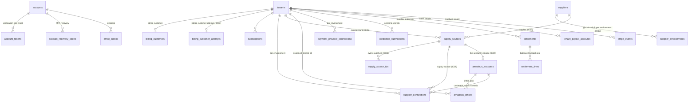

# Platform data model

This document describes the `platform` and `reference` schemas as the platform backend uses them: which module owns which table, what the OTA backend may read, and every change that migration `0002` makes to the baseline, with the reason for each. The baseline is reused unchanged from [`docs/velexis-sdk/db/`](../../docs/velexis-sdk/db/README.md); the exact SQL of `0002` is printed in three parts: [part 1](data-model-migration-0002.md), [part 2](data-model-migration-0002-part2.md), [part 3](data-model-migration-0002-part3.md). It was applied to the baseline on PostgreSQL 16 and its constraints were exercised before publication.

Related: [`architecture.md`](architecture.md), [`api-inventory.md`](api-inventory.md), [ADR-0004](../../docs/mvp/adr/0004-postgresql-schema-per-tenant.md), [ADR-0005](../../docs/mvp/adr/0005-data-access-kysely-sql-migrations.md), [ADR-0010](../../docs/mvp/adr/0010-secrets-envelope-encryption.md).

## 1. Sources and migrations

| Item | Location |
|---|---|
| Baseline DDL (16 platform tables, 7 reference tables) | [`platform.sql`](../../docs/velexis-sdk/db/platform.sql), [`reference.sql`](../../docs/velexis-sdk/db/reference.sql), copied byte for byte as `0001_baseline.sql` |
| Column descriptions | [`dictionary.json`](../../docs/velexis-sdk/db/dictionary.json) |
| Baseline ER diagrams | [`er/er-platform.mmd`](../../docs/velexis-sdk/db/er/er-platform.mmd), [`er/er-reference.mmd`](../../docs/velexis-sdk/db/er/er-reference.mmd), [`er/er-overview.mmd`](../../docs/velexis-sdk/db/er/er-overview.mmd) |
| Design (provisioning, runner, routing, security) | [`db/README.md`](../../docs/velexis-sdk/db/README.md) §3, §4, §5, §8 |
| Platform migrations | `platform/backend/migrations/platform/0001_baseline.sql`, `0002_add_mvp_platform_deltas.sql`, and the deltas found during implementation: `0003_add_billing_customer_attempts.sql`, `0004_add_plan_price_warnings.sql`, `0005_add_supplier_registry.sql` (§4.10, §4.11) |
| Reference migrations | `platform/backend/migrations/reference/0001_baseline.sql` (no delta in the MVP) |
| Reference data files and loader | `tools/reference-data/data/*.csv` (`@velexis/reference-data`), loaded by `pnpm db:seed:reference` with the `velexis_platform_app` role; the backend's `ref:load` script is only a shortcut for it ([ADR-0024](../../docs/mvp/adr/0024-reference-data-sources-and-loader.md)) |

`0002` is **one expand-phase migration** that lands with the first M1 backend task. It contains every delta decided during planning, including tables first used in M5, so later milestones need no schema work for what is planned here. Empty tables cost nothing. Deltas found during implementation become `0003` and later ([`conventions.md` §9](../../docs/mvp/conventions.md#9-database-migrations)).

## 2. Tables by owning module

"OTA reads" means `velexis_ota_app` has `SELECT` ([ADR-0004](../../docs/mvp/adr/0004-postgresql-schema-per-tenant.md)). Nothing else in the OTA backend touches platform tables.

| Table | Origin | Owning module | OTA reads | Milestone first written |
|---|---|---|---|---|
| `plans` | baseline + `0002` + `0004` | billing | ✓ | M1 (seed `early_access`) |
| `accounts` | baseline + `0002` | auth, accounts | ✓ (identity and MFA columns) | M1 |
| `account_sessions` | baseline + `0002` | auth | | M1 |
| `account_tokens` | **new** | auth | | M1 |
| `account_recovery_codes` | **new** | auth | | M1 |
| `tenants` | baseline + `0002` | tenants, provisioning | ✓ | M1 |
| `tenant_domains` | baseline + `0002` | domains | ✓ | M1 (sub-domain), M5 (custom) |
| `tenant_memberships` | baseline | memberships | ✓ | M1 |
| `tenant_invitations` | baseline | memberships | | M1 |
| `subscriptions` | baseline + `0002` | billing | | M1 (manual), M5 (Stripe) |
| `invoices` | baseline + `0002` | billing | | M5 |
| `billing_customers` | **new** | billing | | M5 |
| `billing_customer_attempts` | **new** (`0003`) | billing | | M5 |
| `stripe_events` | **new** | common (inbox), billing sync, payment-connections | | M5 |
| `api_keys` | baseline | api-keys | ✓ | M1 |
| `api_key_tenant_grants` | baseline | (unused in the MVP: hosting keys are later) | ✓ | — |
| `amadeus_accounts` | **new** + `0005` | supplier-connections | ✓ | M1 |
| `amadeus_offices` | **new** | supplier-connections | ✓ | M1 |
| `supplier_connections` | baseline + `0002` + `0005` | supplier-connections | ✓ | M1 |
| `suppliers` | **new** (`0005`) | supplier-connections | | M7 (seeded by `0005`) |
| `supplier_environments` | **new** (`0005`) | supplier-connections | ✓ (listed columns, §4.11) | M7 (seeded by `0005`) |
| `supply_sources` | **new** (`0005`) | supplier-connections | ✓ (listed columns, §4.11) | M7 (`0005` for the rows of its day) |
| `supply_source_ids` | **new** (`0005`) | supplier-connections | ✓ (listed columns, §4.11) | M7 (`0005` for the rows of its day) |
| `payment_provider_connections` | baseline + `0002` | payment-connections | ✓ | M1 |
| `credential_submissions` | **new** | supplier-connections, payment-connections | | M5 |
| `settlements` | **new** | settlements | | M5 |
| `settlement_lines` | **new** | settlements | | M5 |
| `tenant_payout_accounts` | **new** | settlements | | M5 |
| `tenant_schema_migrations` | baseline | provisioning | | M1 |
| `provisioning_jobs` | baseline + `0002` | provisioning | | M1 |
| `platform_audit_log` | baseline (privileges in `0002`) | audit | | M1 |
| `email_outbox` | **new** | notifications | | M1 |
| `reference.*` (7 tables) | baseline | none: written only by the `tools/reference-data` loader (ADR-0024); billing and settlements read `currencies` | ✓ | M0 |

## 3. New tables at a glance

## 4. Every delta of `0002` and why

### 4.1 Identity

| Change | Why |
|---|---|
| `accounts.terms_accepted_at`, `terms_version` | Sign-up records which terms the person accepted (legal evidence). |
| `accounts.mfa_enabled_at`, `password_changed_at` | Shown on the security page; `password_changed_at` drives the staff deny cut-off ([PADR-0007](adr/0007-portal-to-ota-admin-sso-token.md)). |
| `account_sessions.audience` (`portal`, `platform_admin`) | Portal and admin refresh tokens must never refresh each other ([PADR-0009](adr/0009-platform-api-surface-and-authentication.md)). |
| `account_sessions.family_expires_at` | Absolute lifetime of a refresh family (30 days portal, 12 hours admin); the baseline only has per-token expiry. |
| `account_sessions.mfa_verified_at` | Last TOTP verification in the family; copied into the access token as `mfa_at` for step-up checks ([PADR-0008](adr/0008-email-verification-and-mfa-policy.md)). |
| New `account_tokens` | ADR-0008 requires single-use hashed e-mail verification (24 h) and password reset (1 h) tokens; the baseline has no table for them. |
| New `account_recovery_codes` | ADR-0008 requires ten one-time MFA recovery codes stored hashed. |

### 4.2 Tenants and provisioning

| Change | Why |
|---|---|
| `tenants.storefront_environment` (`test`, `live`), `live_enabled_at`, `live_enabled_by_account_id` | ADR-0018 delta: the hosted storefront's environment is a per-tenant switch (M2 column, M5 switch), and the switch is audited by who and when. |
| `tenants.billing_notice` (`past_due`, `trial_ending`) | ADR-0013 shows a billing banner in the portal **and the OTA admin**. The OTA backend cannot read `subscriptions`, so billing sync copies the banner state onto the tenant row it already reads. |
| CHECK `tenants_key_dns_ck`: key matches `^[a-z][a-z0-9]{2,29}$` | The key is also a DNS label of `<key>.ota.example.com`. The baseline allows `_`, which is not valid in a host name and is refused by Let's Encrypt. |
| CHECK `tenants_suspension_reason_ck` | Suspension reasons drive automatic resume (only `billing` resumes on payment) ([PADR-0014](adr/0014-tenant-suspension-and-resume.md)). |
| `provisioning_jobs.reveal_ciphertext`, `reveal_encryption_key_id`, `revealed_at`, `revealed_by_account_id` | db README §3 step 5: the raw test keys created at provisioning are kept encrypted for one reveal within 24 h. A dedicated `bytea` column keeps ciphertext out of the `result` jsonb. |
| Index `provisioning_jobs_running_idx` on `locked_until` | The reconciler scans running jobs past their lease every 5 minutes. |

### 4.3 Domains

| Change | Why |
|---|---|
| `tenant_domains.verification_deadline_at`, `last_checked_at`, `check_failures`, `last_check_error`, `tls_checked_at`, `created_by_account_id` | The 72-hour verification window, the daily re-check with three-strike failure, the portal's "last checked" display and the TLS probe ([PADR-0004](adr/0004-custom-domain-verification.md)). |
| CHECK: custom domains have a `verification_token` | A custom domain cannot be verified without one. |

### 4.4 Amadeus

| Change | Why |
|---|---|
| New `amadeus_accounts` (one row per environment) | ADR-0012: Velexis's shared credentials live encrypted in the database, managed in the platform admin, not in environment files. |
| New `amadeus_offices` (pool, status `available`, `assigned`, `releasing`, `retired`) | ADR-0012: an office is assigned to at most one tenant; `releasing` keeps the assignment visible to the OTA backend while old orders still depend on it ([PADR-0012](adr/0012-amadeus-office-pool.md)). |
| `supplier_connections.credential_source` (`velexis`, `tenant`), `amadeus_account_id`; credentials and `base_url` nullable; CHECK per source; composite FK `(amadeus_account_id, environment)` | ADR-0012 delta. The composite foreign key makes it impossible to point a test connection at the live account. |
| New `credential_submissions` | Own Amadeus credentials and Stripe API keys are verified by a worker job before they replace a working connection. The secret must wait somewhere encrypted (never in a queue message), and is purged when the job ends ([PADR-0010](adr/0010-credential-submission-and-verification.md)). |

### 4.5 Payments and settlements

| Change | Why |
|---|---|
| `payment_provider_connections.account_mode` (`velexis`, `connect_standard`, `api_keys`) with a CHECK per mode | ADR-0011 delta. The planning brief called the first value `velexis_platform`; ADR-0011 fixes the stored value as `velexis`, and ADRs win. |
| `statement_descriptor_suffix` | ADR-0011: in `velexis` mode the card statement carries the OTA's brand. The platform derives it from the OTA name; owners can edit it. |
| `capabilities`, `connected_at`, `disconnected_at`, `last_error`, `created_by_account_id` | Connect account state from `account.updated` (`charges_enabled`, `payouts_enabled`, `details_submitted`) and the deauthorisation time ([PADR-0011](adr/0011-stripe-connect-standard-and-api-key-connections.md)). |
| Unique `(provider, environment, account_reference)` for `connect_standard` | Connect events are routed by `event.account`, so one connected account maps to one tenant. |
| New `settlements`, `settlement_lines` | ADR-0011: monthly statements of Velexis-collected payments built from Stripe balance transactions. A unique `balance_transaction_id` makes double settlement impossible ([PADR-0003](adr/0003-settlement-of-velexis-collected-payments.md)). |
| New `tenant_payout_accounts` | Manual payouts need the OTA's bank details. They are envelope-encrypted and only shown masked, except an audited reveal in the admin. |
| `plans.settlement_fee_bps` | The "Velexis fees" deducted in settlements are a per-plan rate in basis points (0 by default). |

### 4.6 Billing

| Change | Why |
|---|---|
| `plans.stripe_product_id`, `stripe_price_id_month`, `stripe_price_id_year` (unique) | ADR-0013 delta: plans map to Stripe prices; a price maps back to exactly one plan and interval. |
| `plans.trial_days` | Trial length per plan, passed to Checkout and used for manual trials. |
| Seed plan `early_access` | `tenants.plan_code` is `NOT NULL`; M1–M4 tenants need a plan before paid plans exist (ADR-0013 point 4). |
| New `billing_customers` | One Stripe Customer per tenant that outlives a canceled subscription, so re-subscribing and the Customer Portal reuse it instead of creating duplicates. |
| `subscriptions.status` CHECK adds `unpaid`, `incomplete_expired`; `subscriptions_current_uq` counts `unpaid` | These are Stripe statuses that ADR-0013 acts on; an `unpaid` subscription is still the tenant's current one. |
| `subscriptions.provider_price_id`, `checkout_session_id`, `provider_synced_at` | Map the subscribed price to a plan and interval, correlate the Checkout Session, and show when the row was last re-fetched. |
| `invoices.hosted_invoice_url`, `invoice_pdf_url`, `provider_synced_at` | ADR-0017: platform invoices are Stripe-hosted; `pdf_storage_key` stays null. |
| New `stripe_events` | ADR-0013: webhook inbox with the Stripe event id as primary key, for idempotency, replay and admin visibility. Stores ids and types only, no payload. |

### 4.7 E-mail and audit

| Change | Why |
|---|---|
| New `email_outbox` with `secret_payload_ciphertext` and a purge CHECK | Verification, reset and invitation links contain tokens. ADR-0009 forbids tokens in queue messages, so the worker reads them encrypted from the outbox and erases them when the row is final, mirroring the tenant `notifications` design ([PADR-0013](adr/0013-platform-email-outbox.md)). |
| `REVOKE UPDATE, DELETE, TRUNCATE ON platform_audit_log FROM velexis_platform_app`; index on `(target_type, target_id)` | The audit trail is append-only by privilege, not only by convention; the admin filters by target ([PADR-0006](adr/0006-platform-admin-access-and-audit.md)). |

### 4.8 Grants

`GRANT SELECT ON amadeus_accounts, amadeus_offices TO velexis_ota_app`, because the OTA backend resolves shared-account connections ([ADR-0012](../../docs/mvp/adr/0012-amadeus-account-model.md)). DML on every new table to `velexis_platform_app`. No other new table is readable by the OTA role.

### 4.9 Considered and not added

| Idea | Why not |
|---|---|
| `platform.portal_tokens` table for OTA admin SSO | ADR-0008 keeps the one-time token in Redis (`ptk:<sha256>`, 60 s, `GETDEL`). A table could not be marked consumed, because the OTA backend never writes platform tables. Issuance is recorded in `platform_audit_log` (`console.token_issued`). |
| A table for idempotency keys | [`conventions.md` §2](../../docs/mvp/conventions.md#rules) keeps platform idempotency in Redis for 24 h. |
| Columns for staff `last_active_at` updates | The OTA backend cannot write `tenant_memberships`; the portal does not show console activity in the MVP. |
| A `reference` delta | The baseline reference tables are enough for the MVP. |
| Per-tenant data keys | Out of the MVP ([ADR-0010](../../docs/mvp/adr/0010-secrets-envelope-encryption.md) follow-up). |

### 4.10 After `0002`

Deltas found during implementation, one numbered migration each ([`conventions.md` §9](../../docs/mvp/conventions.md#9-database-migrations)).

| Migration | Change | Why |
|---|---|---|
| `0003_add_billing_customer_attempts` (FIX-W29-PLATFORM) | New `billing_customer_attempts` (`tenant_id` primary key and foreign key, `attempt` from 1, `updated_at`), DML for `velexis_platform_app`, nothing for the OTA role | Stripe replays a stored 5xx for the same idempotency key for 24 hours, so the Customer creation of a tenant's Checkout moves to the key `customer:<tenantId>:<attempt>` after a failure that spent `customer:<tenantId>` (no row is attempt 0), and the next attempt first looks for a Customer the failed one made. It cannot live in `billing_customers`, whose rows exist only once a Customer does ([PADR-0002](adr/0002-stripe-billing-integration.md) item 3, revision of 2026-10-24). |
| `0004_add_plan_price_warnings` (FIX-W42-PLATFORM) | New column `plans.price_warnings` (`jsonb NOT NULL DEFAULT '[]'`, CHECK `plans_price_warnings_ck`: a JSON array) with its comment; no grant (the table-level privileges on `plans` cover it: the platform role writes it, the OTA role may read it with the rest of `plans`), no backfill | The warnings of a plan's last comparison with its linked Stripe prices (`AdminPlan.priceWarnings`, `[{field, expected, actual}]`), written by `adminUpdatePlan` and `adminCheckPlanPrices` under the plan's row lock and read by every admin read of a plan. PBE-048 read them back from the comparison's audit row, which a retention purge of `platform_audit_log` would take with it ([PADR-0006](adr/0006-platform-admin-access-and-audit.md), Audit items 3 and 4); the audit rows keep recording each comparison (lead decision (4c) of 2026-11-04, second set; [PADR-0002](adr/0002-stripe-billing-integration.md) item 2). A plan compared before the column shows its warnings again after its next comparison. |
| `0005_add_supplier_registry` (PBE-078) | New `suppliers`, `supplier_environments`, `supply_sources` and `supply_source_ids` (§4.11); `supplier_connections` gains `supply_source_id` (nullable) and `sales_enabled` (NOT NULL, default `true`), `provider` a foreign key to `suppliers` in place of its CHECK (its `DEFAULT 'amadeus'` stays), the unique key `supplier_connections_env_source_uq` (tenant, provider, environment, credential source) in place of `supplier_connections_env_uq`, and `supplier_connections_source_ck` rewritten for the other suppliers (`NOT VALID`, then validated); `amadeus_accounts` gains `supply_source_id`; the backfill of the rows of its day; DML on the four tables for `velexis_platform_app`, column grants for `velexis_ota_app` | The owner's decisions on suppliers as adapters, switches globally and per tenant, Velexis supply beside an OTA's own accounts, and an opaque id with a history table ([ADR-0030](../../docs/mvp/adr/0030-suppliers-supply-sources-and-ingestion-engine.md) items 1 to 3 and 11). The registry is [PADR-0020](adr/0020-supplier-registry-switches-and-suppliers-page.md) items 7 to 9 and ADR-0030 items 14 and 15: Proposed (lead); accepted with the owner's go for wave 71 on 2026-11-27 (ADR-0030 item 26). The new connection columns are nullable or have a default, so the previous release and today's test inserts keep writing; PBE-106 makes the source NOT NULL and drops the default of `provider` in a later release. |

### 4.11 The supply registry (`0005`)

A **supply source** is one supplier used through one account: one of Velexis's accounts, which serves every OTA that Velexis supplies, or an OTA's own ([ADR-0030](../../docs/mvp/adr/0030-suppliers-supply-sources-and-ingestion-engine.md) item 14). A source sells only when every level allows it: the supplier's global switch in that environment, the OTA's connection (its switch on and its status `active`), and no stop on the source ([PADR-0020](adr/0020-supplier-registry-switches-and-suppliers-page.md) item 9). "Off" leaves the source out of new searches, pricing and checkout; existing bookings are still served. The status `disabled` of a connection stays the emergency stop that serves nothing.

| Table | Columns | Rules |
|---|---|---|
| `suppliers` | `id` (a short lower-case name: `amadeus`, `pkfare`), `name`, `created_at`, `updated_at` | Seeded by `0005`. `supplier_connections.provider` and every source name one. The OTA role reads nothing of it: its adapters are registered under the same names in code. |
| `supplier_environments` | `supplier_id`, `environment`, `sales_enabled` (the global switch, default `false`), `version`, `created_at`, `updated_at`; primary key (supplier, environment) | Seeded by `0005`: Amadeus on in `test` and `live`, as it sells today; PKFare off in both, in `live` until PKFare certifies Velexis (ADR-0030 item 28) and in `test` until staff switch it on with a reason. PBE-081 writes it. |
| `supply_sources` | `id` (`ssr_` + ULID), `supplier_id`, `environment`, `credential_source` (`velexis` or `tenant`: whose account), `tenant_id` (the OTA of an own account; none for Velexis), `sales_stop` (who stopped the source: `staff`, `wallet_watch` or `balance_refusal`; none = no stop), `sales_stop_at`, `sales_stop_reason` (1 to 500 characters), `sales_stop_by_account_id` (the platform admin of a staff stop), `version`, `created_at`, `updated_at` | `supply_sources_owner_ck`: a `tenant` source has its OTA, a Velexis one none. `supply_sources_sales_stop_ck` lists who may set a stop, apart from `supply_sources_sales_stop_shape_ck`, so a later value (PBE-107's cap) rewrites the list alone: a stop has its time and reason, and only a staff stop names an account. A deleted OTA takes its own sources with it. PBE-081 sets and lifts the stop; PBE-087 and X-066 call it. |
| `supply_source_ids` | `supply_id` (primary key: `sup_` + 16 random Crockford base32 characters, a pattern CHECK and no ULID), `supply_source_id`, `issued_at`, `retired_at` (none while current) | Every id a source has had, unique for ever; one current id per source (`supply_source_ids_current_uq`). An OTA sees a source only through this id. PBE-080 generates, rotates and resolves ids. |

The connections and accounts:

- `supplier_connections.supply_source_id` is the source a row sells through: its account's for `velexis`, its own for `tenant`. The composite foreign key `supplier_connections_supply_source_fk` (source, provider, environment, credential source) keeps a row on a source of its own supplier, environment and credential source. It is nullable until every writer sets it (PBE-106). The connection repository names the supplier on every insert and points a `velexis` row at its account's source; an own connection's source comes with the verifier's apply (PBE-080).
- One write of the previous release fails on this schema: its switch of a `velexis` row to the OTA's own credentials (`switchToTenant`) keeps the row's source, and the composite foreign key refuses a `tenant` row on the Velexis source that the backfill gave it. So it can fail only between the migration and the restart of the apps (the deploy order). It needs an OTA's own credentials, behind `FEATURE_OWN_AMADEUS`, which stays off at launch (PADR-0020 item 16).
- `supplier_connections.sales_enabled` is the per-tenant switch: `true` by default, so a row written by the previous release or a test sells as before. PBE-082 writes it.
- `supplier_connections_env_source_uq`: one row per tenant, supplier, environment and credential source, so an OTA can later hold a Velexis row and an own row of one supplier and environment (PBE-103). Nothing writes a second row before then.
- `supplier_connections_source_ck`, rewritten: a `tenant` row holds its own credentials and no Velexis account; a `velexis` row holds no credentials and names the Velexis Amadeus account for Amadeus, or no Amadeus account and its supply source for another supplier, whose Velexis account is reached through the source (`supplier_accounts`, PBE-079).
- `amadeus_accounts.supply_source_id` is the account's source (unique; same environment, composite foreign key), as `supplier_accounts` will hold its own (PBE-079).

The backfill of `0005` (platform rows, not tenant data, so in the migration): one source per Velexis Amadeus account and one per `tenant` connection, each with one supply id; a `velexis` connection shares its account's source, and every connection is switched on. The ids are drawn in SQL from `gen_random_uuid()` (core PostgreSQL 16; `pgcrypto` is not installed): the 80 random bits of a version 4 UUID around its version and variant digits, in Crockford base32, after the millisecond time for a ULID. The rows keep their `version` and `updated_at`. A last check stops the migration if a connection or an account is left without a source, or a source without exactly one current id.

What the OTA role reads (the reads of OBE-146), column by column, so a column added later is not readable until a grant names it ([ADR-0004](../../docs/mvp/adr/0004-postgresql-schema-per-tenant.md), dated note of 2026-11-27):

| Table | `velexis_ota_app` may read | It may not read |
|---|---|---|
| `supplier_environments` | `supplier_id`, `environment`, `sales_enabled` | `version`, `created_at`, `updated_at` |
| `supply_sources` | `id`, `supplier_id`, `environment`, `credential_source`, `tenant_id`, `sales_stop` | who set a stop, when and why (`sales_stop_by_account_id`, `sales_stop_at`, `sales_stop_reason`), `version`, `created_at`, `updated_at` |
| `supply_source_ids` | `supply_id`, `supply_source_id`, `retired_at` | `issued_at` |
| `suppliers` | nothing | every column |

The new columns of `supplier_connections` and `amadeus_accounts` fall under the table-level `SELECT` the OTA role has on both tables. It writes none of the four tables.

## 5. Encrypted columns and their associated data

Every ciphertext uses the envelope of ADR-0010 with associated data `"platform.<table>.<column>:<row id>"`.

| Column | Holds | Decrypted by |
|---|---|---|
| `accounts.mfa_secret_ciphertext` | TOTP secret | Platform API (sign-in), OTA API (password grant only) |
| `amadeus_accounts.client_secret_ciphertext` | Velexis Amadeus secret | Platform worker (verify), OTA backend (calls) |
| `supplier_connections.client_secret_ciphertext` | OTA-owned Amadeus secret | Platform worker (re-encrypt on apply), OTA backend |
| `payment_provider_connections.secret_ciphertext`, `webhook_secret_ciphertext` | OTA-owned Stripe keys (`api_keys` mode) | OTA backend |
| `credential_submissions.secret_ciphertext`, `webhook_secret_ciphertext` | Pending secrets, purged at the end | Platform worker |
| `tenant_payout_accounts.bank_details_ciphertext` | IBAN or account and routing numbers | Platform API (admin reveal, audited) |
| `provisioning_jobs.reveal_ciphertext` | Raw test keys for one reveal | Platform API (reveal), then erased |
| `email_outbox.secret_payload_ciphertext` | Links with tokens | Platform worker (render), then erased |

When a secret moves from a submission to a connection, the worker decrypts it and encrypts it again with the connection's associated data, because a ciphertext copied between rows does not decrypt ([ADR-0010](../../docs/mvp/adr/0010-secrets-envelope-encryption.md)).

## 6. Status values used by the platform

A value marked **reserved** is one the column's CHECK constraint allows (and, where the API names the column, its enum) but that no MVP code writes: nothing may rely on it, and no platform admin filter offers it. The values stay valid, so no migration removes them; a task that starts writing one moves it out of "Reserved" here. Note (2026-11-21, KI-014 and KI-015, approved by the owner; FIX-W68-PLATFORM): every writer of these columns was checked against this table on 2026-11-21; `accounts`, `tenant_memberships` and `tenant_schema_migrations` were added, `supplier_connections.status` `invalid_credentials` was found unwritten as well, and the manual subscriptions' `active` was added.

| Column | Values and meaning |
|---|---|
| `accounts.status` | `pending_verification` (signed up, address not verified), `active`, `disabled` (by Velexis staff; enabling goes back to `active`, or to `pending_verification` without a verified address). Reserved: `locked`, `deleted`. The sign-in lockout writes `locked_until` (five wrong passwords, 15 minutes) and leaves `status` alone, so the platform admin shows a `pending_verification` or `active` account whose `locked_until` is in the future as `locked`, and its `status=locked` filter finds exactly those (`adminListAccounts`; a `disabled` account stays `disabled`). No MVP code erases an account. |
| `tenants.status` | `provisioning` (created, schema not ready), `active`, `suspended`, `failed` (setup failed or Checkout abandoned). Reserved: `deprovisioning`, `deleted` (post-MVP; the API's `TenantStatus` does not name them). |
| `tenant_memberships.status` | `active`, `removed` (taken off the team, or left it; the row stays). Reserved: `suspended`. |
| `provisioning_jobs.status` | `queued` (waiting for dispatch or its gate), `running` (dispatched, lease in `locked_until`), `succeeded`, `failed`, `canceled`. |
| `tenant_schema_migrations.status` | `applied` (the provisioning post-step mirrors each migration the OTA worker applied to the tenant's schema). Reserved: `pending`, `running`, `failed`, `rolled_back`. |
| `subscriptions.status` | Stripe's statuses; `billing_provider = 'manual'` rows use `trialing`, `active` (paid outside Stripe, set by an admin), `past_due` and `canceled` only. |
| `supplier_connections.status` | `pending_verification` (no office yet, or credentials not verified), `active`, `disabled`. Reserved: `invalid_credentials` (the OTA's own credentials are verified in `credential_submissions` before they replace a connection's, so a refusal leaves the connection as it was; `amadeus_accounts.status` does write `invalid_credentials`). |
| `payment_provider_connections.status` | `pending` (Connect account cannot charge yet), `active`, `disabled` (deauthorised or switched off by an admin). Reserved: `error`. |
| `amadeus_offices.status` | `available`, `assigned`, `releasing`, `retired`. |
| `supply_sources.sales_stop` | None (the source has no stop). Reserved until PBE-081, PBE-087 and X-066 write them: `staff`, `wallet_watch`, `balance_refusal`. |
| `credential_submissions.status` | `pending`, `verifying`, `applied`, `failed`, `superseded`. |
| `settlements.status` | `draft`, `approved` (to be paid), `paid`, `carried_forward` (net ≤ 0, rolled into the next statement), `void` (drafts only). |
| `stripe_events.status` | `received`, `processing`, `processed`, `ignored` (no tenant, or a type we do not handle), `failed`. |
| `email_outbox.status` | `pending`, `sending`, `sent`, `failed`. Reserved: `canceled`. |
