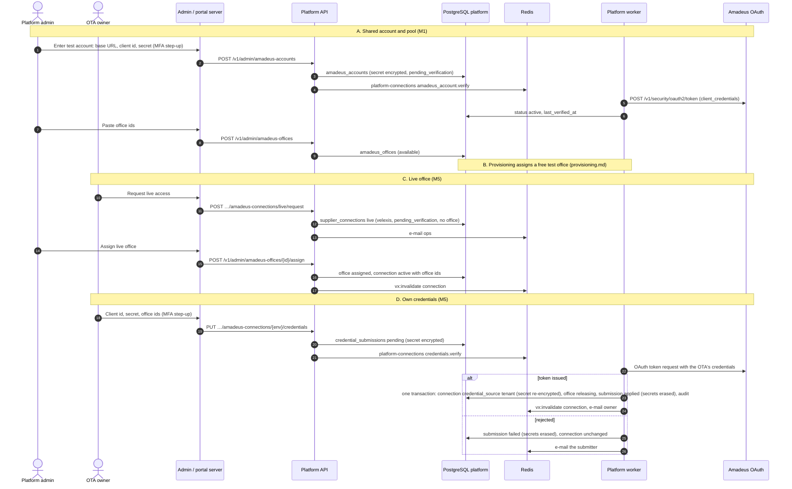

# Flow: Amadeus connection

This flow covers every way an OTA gets Amadeus access through the platform: Velexis staff configure the shared Velexis Amadeus account and its office pool; provisioning assigns a free test office (M1); an owner requests a live office that staff assign (M5); and an owner switches to the OTA's own Amadeus credentials, verified by a worker job (M5). The platform only stores and verifies credentials; every flight call is made by the OTA backend. It implements PF-50 to PF-53 and PF-90 of [`../scope.md`](../scope.md) and [ADR-0012](../../../docs/mvp/adr/0012-amadeus-account-model.md).

Related: [PADR-0012](../adr/0012-amadeus-office-pool.md) (office pool), [PADR-0010](../adr/0010-credential-submission-and-verification.md) (credential verification), [`provisioning.md`](provisioning.md), [`../api-inventory-resources.md`](../api-inventory-resources.md) §3, [`../api-inventory-admin.md`](../api-inventory-admin.md) §5.

## Sequence

## Steps

### A. Velexis shared account and office pool (platform admin, M1)

1. A platform admin creates one `amadeus_accounts` row per environment (`test` in M1, `live` before the first OTA goes live in M5). The secret is envelope-encrypted with associated data `platform.amadeus_accounts.client_secret_ciphertext:<id>`.
2. The `amadeus_account.verify` job decrypts the secret, requests an OAuth token from `{baseUrl}/v1/security/oauth2/token` with a 10 s timeout, discards the token, and sets `active` or `invalid_credentials` with a short `last_error` (HTTP status and Amadeus error code, never the body).
3. Rotating the secret is an update of the same row followed by verification and a `vx:invalidate` `{type: "amadeus_account", id}`. The OTA backend drops its cached account row; cached Amadeus access tokens expire on their own.
4. Offices are added in bulk (one id per line, 9 characters, upper-cased). Duplicates are skipped. The daily `amadeus.pool_level` job e-mails ops when fewer than 3 offices are `available` in an environment. In development, `pnpm --filter @velexis/platform-backend dev:seed` creates a test account pointing at the Amadeus stub (`http://127.0.0.1:4900`) and 20 offices, `DEV1A0001` to `DEV1A0020` (10 until 2026-10-30, lead decision (2f): whole e2e runs set up one OTA per journey).

### B. Test office at provisioning (M1)

The `assign_amadeus_office` post-step of [`provisioning.md`](provisioning.md) takes the oldest `available` test office with `FOR UPDATE SKIP LOCKED`, so two concurrent provisionings never get the same office, and creates the `velexis` connection: `office_ids = {office}`, `default_office_id = queuing_office_id = owner_office_id = office`, `ticketing_defaults = {}`, `monitored_queues = []`, `status = 'active'`. The portal's Amadeus page shows "Velexis test account, office NCE1A0955, active".

### C. Live office (M5)

1. The owner clicks **Request live access** on the Amadeus page. Preconditions: plan with `liveMode`, tenant `active`, no live connection yet. The API inserts the live `supplier_connections` row (`credential_source = 'velexis'`, `amadeus_account_id` = live account, `office_ids = {}`, `status = 'pending_verification'`) and e-mails ops.
2. Velexis completes the commercial onboarding outside the system (contract, ticketing agreement; [ADR-0012](../../../docs/mvp/adr/0012-amadeus-account-model.md) negative consequences). The admin records it in the office `notes`.
3. The admin assigns a live office (`adminAssignAmadeusOffice`): office `assigned`, connection `office_ids` and defaults set, `status = 'active'`, audit, `vx:invalidate connection`, e-mail to the owner. The live connection is a precondition of go-live ([PF-14](../scope.md#32-ota-lifecycle)).

Since PBE-054 (`platform/backend/src/supplier-connections/live-office.service.ts`): `requestLiveAmadeus` reads the tenant's row `FOR SHARE` with its plan's limits, so a suspension waits for the request or the request sees it. A plan without `limits.liveMode = true` answers `403 FEATURE_DISABLED` (`details.feature = live_switch`, as the switch does), then an OTA that is not `active` `409 TENANT_NOT_ACTIVE`. Under the tenant's connection lock of `live` (the advisory lock an admin's assignment and the own-credential verification take), any live connection answers `409 CONFLICT` (`live_connection_exists`, also a `tenant` one), so of two concurrent requests one inserts and the other is refused. Without a Velexis live account the request answers `409 CONFLICT` (`live_account_missing`) and ops still get an `ops.alert` (at most one per OTA and UTC day; nothing else is stored). Otherwise the live `velexis` connection is inserted without an office (`pending_verification`), with the audit row `amadeus.live_requested` (the owner's optional note in `details`), the `ops.alert` with the note and, after the commit, a `connection` invalidation (the OTA backend may hold a cached "no live connection"); the answer is `202` with the connection. Assigning a live office then completes it and queues `amadeus.live_ready` to every active owner, once per owner and connection version, in the assignment's transaction ([PADR-0013](../adr/0013-platform-email-outbox.md) item 5, note of 2026-10-31); a test office assignment e-mails nobody.

### D. OTA-owned credentials (M5)

1. On the Amadeus page the owner (or an admin) chooses **Use my own Amadeus credentials** for an environment and enters client id, client secret and office ids, plus default, queuing and owner offices (within the office ids). The action needs an MFA step-up.
2. `submitAmadeusCredentials` validates formats, supersedes any open submission for the same environment (its secrets are erased), inserts a `credential_submissions` row (`kind = 'amadeus'`, `public_data` with the non-secret fields, secret encrypted), audits `amadeus.credentials_submitted` (no secret), and enqueues `credentials.verify {submissionId}`.
3. The worker sets `verifying`, decrypts the secret and requests a token from the Amadeus host of that environment (`https://test.travel.api.amadeus.com` or `https://travel.api.amadeus.com`, overridable only in development). Then:
   - **Success**, in one transaction: update the tenant's `supplier_connections` row for that environment to `credential_source = 'tenant'`, `amadeus_account_id = NULL`, `base_url`, `client_id`, the secret **re-encrypted** with the connection's associated data, office fields, `status = 'active'`, `last_verified_at`, `version + 1`; set the previously assigned Velexis office of that environment to `releasing` with `release_requested_at`; mark the submission `applied` and erase its secrets; audit `amadeus.credentials_applied`. After commit: `vx:invalidate connection`, e-mail the submitter.
   - **Rejected** (HTTP 401 or `invalid_client`): submission `failed` with `AMADEUS_CREDENTIALS_INVALID`, secrets erased, connection unchanged, e-mail.
   - **Amadeus unavailable** (timeout, 5xx): the job retries (5 attempts, backoff); then `failed` with `PROVIDER_UNAVAILABLE`.
4. If no connection row exists yet for that environment (an OTA bringing its own live credentials before requesting a Velexis live office), the row is inserted instead of updated.
5. **Releasing the shared office.** While `releasing`, the office stays assigned to the tenant, so the OTA backend can still service orders created through it with the Velexis account ([PADR-0012](../adr/0012-amadeus-office-pool.md)). A platform admin releases it to the pool once the OTA confirms that no booking with future travel remains on that office (`adminReleaseAmadeusOffice` with `confirmNoOpenBookings`).

   Since PBE-054: the body needs `confirmNoOpenBookings: true` and a reason of 5–500 characters after trimming (`400 VALIDATION_FAILED` otherwise, nothing changes). A `releasing` office becomes `available` with `released_at` and no tenant, assignment or release request time (`version + 1`), with the audit row `amadeus_office.released` (the trimmed reason, the confirmation, the OTA it left) and an `amadeus_account` invalidation after the commit. An `assigned` office is released only when it backs no active `velexis` connection: the tenant's connection lock of the office's environment and its connection row are taken before the office row (the order of the own-credential apply, which moves the office to `releasing` under that lock), and an `active` `velexis` connection on the office's account whose `office_ids` hold the office answers `409 CONFLICT` (`connection_active`); one an admin disabled (PADR-0012 item 8) does not block it. An `available` or `retired` office answers `409 CONFLICT` (`not_assigned`).
6. Switching back from own credentials to the Velexis account is **not** self-service in the MVP. A platform admin assigns an office, which turns the connection back to `velexis` (audited).

Since PBE-053 (`submitAmadeusCredentials`; the `amadeus` verifier of `credentials.verify`, `platform/backend/src/supplier-connections/amadeus-credentials.verifier.ts`; the "Own Amadeus credentials" section of [`../../backend/README.md`](../../backend/README.md)):

- **Hosts.** The token request and the switched connection's `base_url` use `AMADEUS_BASE_URL_TEST` or `AMADEUS_BASE_URL_LIVE` of the platform backend: the official hosts by default, the Amadeus stub in development and tests, and nothing else with `APP_ENV=production` (item 3's "overridable only in development"). The request body has no host.
- **Verdicts.** HTTP 401 or the OAuth error `invalid_client` is `AMADEUS_CREDENTIALS_INVALID` at once. Every other answer that is not a token (a timeout, a network error, 5xx, 408, 429, another 4xx, a redirect, a 2xx without a token) proves nothing about the credentials and is retried like an unavailable Amadeus, then `PROVIDER_UNAVAILABLE`.
- **Apply guards** (proposed by PBE-053, not yet confirmed by the lead; [PADR-0010](../adr/0010-credential-submission-and-verification.md) item 6 note): an OTA that is no longer `active` when the job applies (suspended after it submitted; PADR-0014 item 5 makes its connections read-only) keeps its connection and the submission fails with `TENANT_NOT_ACTIVE`; a connection a platform admin disabled ([PADR-0012](../adr/0012-amadeus-office-pool.md) item 8) is not switched behind the admin's back, and the submission fails with `CONNECTION_DISABLED`. Both leave the connection and its office as they were, erase the secret and e-mail the submitter, as a rejection does.
- **Releasing.** Every Velexis office assigned to the OTA in that environment becomes `releasing` in the apply's transaction, each with an audit row `amadeus_office.released` (actor `system`, label `credentials.verify`, reason `own_credentials_applied`); after the commit the `connection` invalidation and an `amadeus_account` invalidation for each Velexis account concerned are published. The connection keeps its ticketing defaults and monitored queues (a queue of a `releasing` office stays usable for the old orders, item 5).
- **The portal's view.** `listAmadeusConnections` answers each connection's `pendingSubmission`: the latest submission of its environment while it is open or after it failed, so a rejection shows next to the connection it left untouched (`getCredentialSubmission` follows a single submission).

### E. Connection settings (M4)

`updateAmadeusConnection` edits default, queuing and owner offices (each must be in `office_ids`), `ticketing_defaults` (`{ticketingAgreement: {option, delay}, automatedProcess, issue}` as in the baseline comment) and `monitored_queues` (`[{officeId, queueId, category}]`), with `If-Match`, then publishes `vx:invalidate connection`.

Since PBE-040: the `officeId` of each `automatedProcess` entry and of each monitored queue must be in `office_ids` too ([ADR-0012](../../../docs/mvp/adr/0012-amadeus-account-model.md) office isolation; `400 VALIDATION_FAILED` at the field, as [`../api-inventory-resources.md`](../api-inventory-resources.md) §3 says). The tenant's row is read `FOR SHARE` before the connection is locked, so a suspension waits for the change or the change sees it (`409 TENANT_NOT_ACTIVE`, [PADR-0014](../adr/0014-tenant-suspension-and-resume.md) item 5); a body that changes nothing writes, audits and publishes nothing. The "Amadeus connection settings" section of [`../../backend/README.md`](../../backend/README.md) has the details.

Since PFE-018: the portal's Amadeus page holds the settings form of each connection for owners and admins (office selects that offer only the connection's `officeIds`, the ticketing defaults, the monitored queues as rows to add and remove, `If-Match` with the reload message on `412`), and shows finance members the same values read-only ([`../../frontend/README.md`](../../frontend/README.md) §2, "How the Amadeus connection settings behave").

## Failure handling

| Failure | Behaviour |
|---|---|
| Shared account credentials wrong | Account `invalid_credentials`; dashboard alert. Tenants on it keep their rows; the OTA backend reports `SUPPLIER_NOT_CONFIGURED` or Amadeus errors until fixed. |
| Amadeus unavailable while the shared account is verified (5xx, 429, timeout) | `last_error` set and the job retried (5 attempts, backoff); after the last one the account becomes `invalid_credentials`, except an `active` one, which stays `active` with the error, so an outage does not cut off every OTA on the shared account (PBE-020). |
| Pool empty at provisioning | Connection `pending_verification`; ops e-mail; admin assigns later (`AMADEUS_OFFICE_UNAVAILABLE` if still empty). |
| Two admins assign the same office | Row version and the `amadeus_offices_assignment_ck` / unique index reject the second. |
| Own credentials rejected | The working connection is untouched; the portal shows the error from the submission. |
| Worker crash during apply | The apply is one transaction; the job retries and finds the submission still `verifying`. |
| Verification job lost (Redis down at the submit, a worker that died with its job) | The `credentials.sweep` job, every 5 minutes, queues `credentials.verify` again for a submission `pending` for more than 10 minutes, and fails one `verifying` for more than an hour with `PROVIDER_UNAVAILABLE`, its secret erased, audited `amadeus.credentials_rejected` and the submitter e-mailed (2026-10-31, lead decision (2f), FIX-W38-PLATFORM; [PADR-0010](../adr/0010-credential-submission-and-verification.md) item 4 note). |
| Abuse on a shared office | Admin disables the connection (`adminSetConnectionStatus`), audited; the OTA backend stops calling Amadeus for that tenant. |

## Tables touched

`amadeus_accounts`, `amadeus_offices`, `supplier_connections`, `credential_submissions`, `tenants` (read), `email_outbox`, `platform_audit_log`. Redis: `platform-connections`, `vx:invalidate` (`connection`, `amadeus_account`).

## Tests that prove it

- Integration: verification success and failure against the Amadeus stub's token endpoint (no secret in logs or rows after the job); concurrent provisionings get different offices; the composite foreign key refuses a live connection on the test account; own-credential apply flips the source, re-encrypts, releases the office and erases the submission's secret; a rejected submission leaves the connection unchanged.
- Admin UI: pool view, assign and release.
- Integration (PBE-040, `platform/backend/test/integration/connections/amadeus-settings.int.test.ts`): a valid settings change writes `version + 1`, one `amadeus.settings_updated` audit row and one `connection` invalidation; an office outside `office_ids`, a stale `If-Match` and a suspended OTA change nothing.
- Integration (PBE-054, `platform/backend/test/integration/supplier-connections/live-office.int.test.ts`): an owner's live request gives the waiting live connection, its audit row, the ops alert and the `connection` invalidation, and the admin's live assignment makes it `active` and e-mails both owners (Mailpit); the switch, the plan, the role, a suspended OTA, an invalid body, an existing live connection (own credentials included), a missing live account and two concurrent requests are refused as above; a `releasing` office returns to the pool only with the confirmation and a reason, an `assigned` office of an active `velexis` connection answers `connection_active`, one of a disabled connection is released, and `available` or `retired` offices answer `not_assigned`. The invalidation coverage table (`platform/backend/test/integration/common/invalidation-coverage.int.test.ts`) holds both operations: exactly one `connection` event for the request and one `amadeus_account` event for the release.
- Portal UI (PFE-018, `platform/frontend/src/app/(app)/otas/[tenantId]/amadeus/settings-form.test.tsx`): the office selects offer only the connection's offices; a save sends `If-Match` and shows the saved values; a stale version shows the reload message; finance members read the values without a form.
