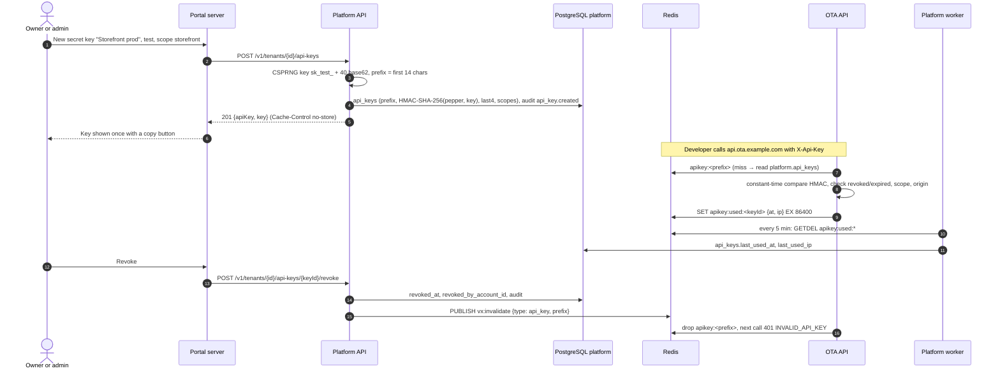

# Flow: API keys

This flow covers the API keys an OTA uses to call the OTA booking API from its own frontend or server: creating a publishable or secret key that is shown once, choosing origins or scopes, rolling and revoking keys, the test keys revealed after provisioning, and how usage reaches the portal. The platform creates and stores keys (HMAC only); the OTA backend verifies them on every request and reads them through its read-only role. It implements PF-30 of [`../scope.md`](../scope.md) and follows the key model of [db README §5](../../../docs/velexis-sdk/db/README.md) and the OTA contract's `ConsoleApiKeyScope`.

Related: [PADR-0005](../adr/0005-api-key-format-and-hashing.md), [`provisioning.md`](provisioning.md) (initial keys), [`../api-inventory-resources.md`](../api-inventory-resources.md) §1, [`../architecture.md`](../architecture.md) §6.

## Sequence

## Steps

1. **List.** The API keys page shows test and live tabs (live only once the OTA is live) with name, kind, prefix, `…last4`, origins or scopes, created by, last used (up to 5 minutes stale), expiry and revocation.
2. **Create.** Owners and admins choose:
   - **kind**: *publishable* (`pk_`, safe in a browser, customer scope only) or *secret* (`sk_`, server only);
   - **environment**: `test`, or `live` once `tenants.storefront_environment = 'live'` (`LIVE_MODE_NOT_ENABLED` before); a live secret key needs an MFA step-up;
   - **allowed origins** (publishable): exact origins such as `https://www.acme-travel.com`; `http://localhost:<port>` only for test keys; an empty list means the key works only without a browser `Origin` (server-side use);
   - **scopes** (secret): `storefront` (default; refused on every console operation), `console` (console calls with a staff token), or `console:automation` plus explicit `StaffPermission` values for key-only automation, as the OTA contract defines;
   - **expiry** (optional).

   The API checks `plans.limits.apiKeys` against non-revoked, non-expired keys, generates the key ([PADR-0005](../adr/0005-api-key-format-and-hashing.md)), retries generation on the rare prefix collision, stores only the HMAC, and audits `api_key.created` (prefix, kind, environment, scopes; never the key). The response is not stored for idempotent replay, because it holds the secret.
3. **Show once.** The portal server renders the key in the response page only (no cookie, no cache, `Cache-Control: no-store`), with a copy button and the warning that it cannot be shown again. Recommended setups, as in the OTA contract: storefront deployments use a secret key scoped `storefront`; a custom console uses one scoped `console`; each automation job gets its own `console:automation` key with the minimum permissions.
4. **Initial test keys.** Provisioning issues `pk_test_…` (no origins) and `sk_test_…` (scope `storefront`) and keeps them encrypted for a single reveal by an owner within 24 hours ([`provisioning.md`](provisioning.md) §4). After that they can only be rolled or revoked.
5. **Edit.** Name and allowed origins can change (`updateApiKey`, invalidates the prefix). Kind, environment and scopes cannot: create a new key instead.
6. **Roll.** `rollApiKey` creates a key with the same name, kind, environment, origins and scopes, shows it once, and sets `expires_at` on the old key to now, +1 h, +24 h or +7 days, so deployments can switch without downtime. Audit `api_key.rolled`.
7. **Revoke.** Sets `revoked_at` and `revoked_by_account_id`, audits `api_key.revoked`, and publishes `vx:invalidate {type: "api_key", prefix}` after commit. The OTA backend drops its cache; without the message the 60 s TTL bounds the delay.
8. **Usage.** The OTA backend records the last use per key in Redis (`apikey:used:<keyId>`); the platform worker's `api_keys.flush_usage` (every 5 minutes) moves it into `last_used_at` and `last_used_ip`. The OTA backend never writes the platform table ([ADR-0003](../../../docs/mvp/adr/0003-six-components-two-nestjs-backends.md)).
9. **Suspension.** Keys of a suspended tenant stay valid in the table; the OTA backend refuses requests with `TENANT_SUSPENDED` because it checks the tenant status.

## Failure handling

| Failure | Behaviour |
|---|---|
| Limit reached | `PLAN_LIMIT_REACHED` with `details.limit` and `details.used`. |
| Invalid scope combination | `VALIDATION_FAILED` with field errors (`scopes`). |
| Invalid origin | `VALIDATION_FAILED` (must be an origin, no path, no wildcard, https except localhost on test). |
| Invalidation lost | The OTA cache TTL (60 s) bounds the delay. |
| Redis down | Usage is not recorded for that period; keys keep working from PostgreSQL. |
| Leaked secret key | Revoke at once (or roll with "now"); the audit log shows who created it and when it was last used. |

## Tables touched

`api_keys` (insert, update, revoke, usage), `provisioning_jobs` (initial reveal), `plans` (limit), `tenants` (live check), `platform_audit_log`. Redis: `apikey:used:*`, `vx:invalidate`. `api_key_tenant_grants` is not used in the MVP (hosting keys are later).

## Tests that prove it

- Unit: key format and prefix; HMAC with the pepper; scope and origin validation matrix; roll expiry options.
- Integration: create shows the key once and stores no plain value (grep the row and the logs); revoke publishes the invalidation; the usage flush updates `last_used_at`; limit counting ignores revoked and expired keys.
- Cross-backend (M2): a key created here authenticates on the OTA API, and stops working within one second of revocation.
