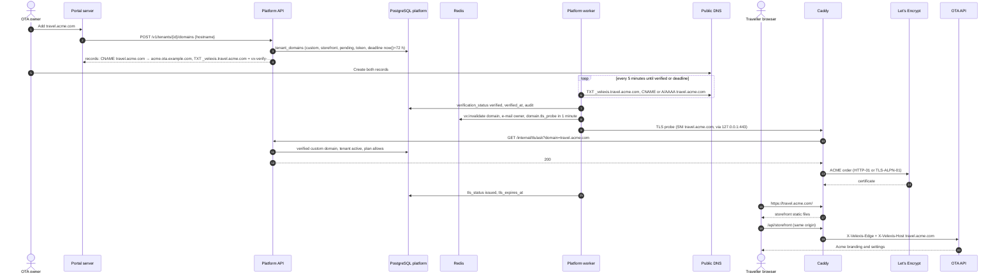

# Flow: custom domains

This flow lets an OTA serve the hosted storefront on its own host name, for example `travel.acme.com`, next to its sub-domain `acme.ota.example.com`: the owner adds the domain, creates two DNS records, the platform worker verifies them, Caddy obtains a certificate on the first HTTPS request after asking the platform's `ask` endpoint, and the domain can become primary. It also covers re-checks, removal and abuse handling. It implements PF-40 to PF-42 and PF-92 of [`../scope.md`](../scope.md), and refines [ADR-0018](../../../docs/mvp/adr/0018-hosted-storefront-custom-domains.md) and flow (e) of [`docs/mvp/architecture.md`](../../../docs/mvp/architecture.md#e-custom-domain-with-caddy-on-demand-tls).

Related: [PADR-0004](../adr/0004-custom-domain-verification.md), [`../api-inventory-resources.md`](../api-inventory-resources.md) §2, [`../api-inventory-admin.md`](../api-inventory-admin.md) §7 and §9.

## Sequence

## Steps

1. **Add.** Owners and admins add a host name when `F:custom_domains` is on and the plan has `limits.customDomains` greater than the number of custom domains already present. The API:
   - lower-cases the input, converts IDN labels to punycode, strips a trailing dot, and checks: valid host syntax, at least two labels, total length 253 or less, not an IP address, not a host under `STOREFRONT_BASE_DOMAIN` or any Velexis host of [`decisions.md`](../../../docs/mvp/decisions.md) §4, and not on a small deny list of shared suffixes (`github.io`, `herokuapp.com`, …) where the OTA cannot prove ownership;
   - inserts `tenant_domains` with `kind = 'custom'`, `purpose = 'storefront'`, `verification_status = 'pending'`, `verification_token = 'vx-verify-' + 32 base32 characters`, `verification_deadline_at = now() + 72 hours`, `created_by_account_id`; the unique host name index refuses a host used by any tenant (`DOMAIN_TAKEN`);
   - *Note (2026-11-03, lead decision (2a), FIX-W40-PLATFORM).* The Velexis hosts include the host of `PUBLIC_OTA_API_URL` (the OTA API, where Stripe sends the webhooks of an OTA's own keys) and every host below it, whatever its name, besides `STOREFRONT_BASE_DOMAIN`, the hosts of `PUBLIC_PORTAL_URL`, `PUBLIC_PLATFORM_ADMIN_URL` and `PUBLIC_OTA_ADMIN_URL` and the placeholder hosts of decisions.md §4 (`velexisHostsOf` in `hostname-rules.ts`), so no OTA can claim it as a custom domain (`422 DOMAIN_INVALID`);
   - returns the records to create: `TXT _velexis.<host> = <token>`, plus **either** `CNAME <host> → <key>.ota.example.com` (recommended, for hosts such as `travel.acme.com`) **or** `A`/`AAAA` to `STOREFRONT_IPV4`/`STOREFRONT_IPV6` (for an apex such as `acme.com`, which cannot have a CNAME). The portal shows both options; verification accepts either.
2. **Verify** (`domains.verify_pending` every 5 minutes → one `domain.verify` job per pending domain; or "Check now", 1 per minute). The job uses a `node:dns` `Resolver` set to `DNS_RESOLVERS` (public resolvers, 5 s timeout):
   - **ownership**: the TXT record set of `_velexis.<host>` contains the token;
   - **routing**: the CNAME chain of the host ends at `<key>.ota.example.com`, or its A/AAAA records are all among the VM's public addresses;
   - both must hold. Success: `verified`, `verified_at`, `check_failures = 0`, audit `domain.verified`, then `vx:invalidate {type: "domain", hostname}`, e-mail to the owners, and a `domain.tls_probe` job in one minute. Otherwise `last_checked_at` and a short `last_check_error` (`txt_missing`, `txt_mismatch`, `cname_missing`, `cname_wrong_target`, `a_wrong_address`, `dns_timeout`) are stored for the portal.
   - Past `verification_deadline_at`: `failed`, e-mail. "Check now" on a failed domain restarts the window with a new deadline and the same token.

   *Note (2026-11-02, lead decision (2h), FIX-W39-PLATFORM).* "Check now" (`checkDomain`) follows `addDomain`'s rule of step 1: `x-feature: custom_domains` (FeatureGuard answers `403 FEATURE_DISABLED` while the switch is off, before the handler), and a plan with `limits.customDomains` 0 (or no such limit) answers `403 FEATURE_DISABLED` with `details.feature = custom_domains`, read in the domain transaction after the tenant's status (`409 TENANT_NOT_ACTIVE` first); nothing is queued or written. The portal shows `last_check_error` as one of the six codes above (`Domain.lastCheckError` names them).
3. **Certificate.** Caddy's on-demand TLS calls `GET /internal/tls/ask?domain=<host>` on the first handshake for an unknown host. The endpoint answers `200` only for the rules of [`../api-inventory-admin.md`](../api-inventory-admin.md) §9. It rejects malformed or over-long hosts before any lookup, caches a `200` for 60 s in Redis `tlsask:<host>`, and keeps a `404` only in a bounded in-process cache, so names that random clients put in TLS handshakes never reach Redis ([PADR-0004](../adr/0004-custom-domain-verification.md) item 6). The proactive TLS probe triggers this right after verification, so the first traveller does not wait for issuance.
4. **TLS probe** (`domain.tls_probe`, after verification and daily): the worker opens a TLS connection to `127.0.0.1:443` with SNI = host, reads the peer certificate, and stores `tls_status` (`issued`, or `expired` if past `valid_to`, or `failed` on handshake error), `tls_expires_at` and `tls_checked_at`. Caddy renews certificates itself; the probe only reports.

   *Note (2026-11-03, PBE-051).* `issued` means the handshake succeeded with a certificate that names the host (wildcards included) and whose `valid_to` the Clock has not reached; a certificate for another name, no certificate or no answer within 30 seconds is `failed`, and `tls_expires_at` is then `null`. The issuer is not judged: the probe reports what Caddy serves, Let's Encrypt's staging CA of the M5 exit test included. Whenever a probe changes `tls_status`, the `domain` invalidation of the host follows the commit (lead decision (2d) of 2026-11-02), because the OTA backend uses a custom domain in links only once its certificate is issued; a probe with an unchanged status publishes nothing. The daily probe (`domains.tls_probe`, 04:40 UTC) asks for every verified storefront host, sub-domains included, of an OTA in `provisioning`, `active` or `suspended` (the tenants whose hosts `ask` may serve).

   *Note (2026-11-03, lead decision (2e), FIX-W40-PLATFORM; replaces "the issuer is not judged" of the note above for production).* With `APP_ENV=production` the peer's certificate chain must verify against the trust store of Node.js's TLS client (its root certificates, which follow the Mozilla CA list as the system trust store does, plus `NODE_EXTRA_CA_CERTS`), as `rejectUnauthorized` would require: a chain that does not (a self-signed certificate, Let's Encrypt's staging CA) stores `tls_status = failed` with `tls_expires_at = null`, so a certificate travellers' browsers would refuse never counts as issued; a certificate whose `valid_to` has passed stays `expired`. Outside production (development, tests, the M5 exit test against Let's Encrypt's staging CA on a non-production deployment) an unverified chain whose certificate names the host and has not expired still counts as `issued`.
5. **Primary.** `makeDomainPrimary` (verified domains only) clears `is_primary` on the other storefront host of the tenant and sets it on this one in one transaction (the partial unique index keeps one primary), then invalidates both hosts. The OTA backend uses the primary host in e-mail links. Redirecting the sub-domain to the primary host is a follow-up of ADR-0018.

   *Note (2026-11-04, lead decision (2c), FIX-W41-PLATFORM).* The whole-sub-domain 301 of that follow-up is superseded for the MVP by the dated note of 2026-11-03 under [ADR-0018](../../../docs/mvp/adr/0018-hosted-storefront-custom-domains.md)'s Follow-ups (lead decision (2j) of 2026-11-03, FIX-W40-OTA): Caddy sends no 301; the storefront's sign-in and sign-up pages on the sub-domain send the browser to the same path on the primary custom domain (OFE-021, `ota/frontend/src/lib/primary-host.js`), so sessions are created there, and every other page keeps working on both hosts. The primary host is the one this step makes primary once its certificate is issued (step 4).

   *Note (2026-10-31, lead decision (2e) of the second batch, FIX-W38-PLATFORM).* `makeDomainPrimary` follows `addDomain`'s rule of step 1: while `F:custom_domains` is off, or while the OTA's plan has `limits.customDomains` 0 (or no such limit), it answers `403 FEATURE_DISABLED` with `details.feature = custom_domains`, for a custom domain and for the sub-domain alike, and writes nothing (no flag moves, no audit row, no invalidation). The switch is the operation's `x-feature` (FeatureGuard, before any other check of the handler); the plan is read in the domain transaction after the tenant's status (`409 TENANT_NOT_ACTIVE` first) and before `409 DOMAIN_NOT_VERIFIED`. An OTA downgraded to a plan without custom domains keeps its primary custom domain until it removes it: `removeDomain` (step 7) still makes the sub-domain primary again.

   *Note (2026-11-02, lead decision (2a), FIX-W39-PLATFORM; replaces the sub-domain part of the note above).* Making the **sub-domain** primary again is always allowed, whatever the switch or the plan says: `makeDomainPrimary` has no `x-feature` any more, and the domain service reads the domain first (`404` when it is not the tenant's), then, for a **custom** domain only, answers `403 FEATURE_DISABLED` (`details.feature = custom_domains`) while `FEATURE_CUSTOM_DOMAINS` is off, then `409 TENANT_NOT_ACTIVE` for an OTA that is not active, then, for a custom domain, `403 FEATURE_DISABLED` while the plan has `limits.customDomains` 0, and nothing is written. So an OTA that lost custom domains can always move its primary host back to `<key>.<STOREFRONT_BASE_DOMAIN>` without removing the custom domain.
6. **Daily re-check** (`domains.recheck_verified`): the same DNS checks for verified domains. A failure increments `check_failures`; at **3 consecutive failures** the domain becomes `failed` (`ask` stops answering `200`, the OTA backend no longer maps the host), the primary flag moves back to the sub-domain, and the owners are e-mailed. A success resets the counter.

   *Note (2026-11-03, PBE-051).* Every failed check counts, `dns_timeout` included (a host whose DNS servers do not answer is not reachable by travellers either), and so does a platform admin's re-check of a verified domain (step 8), at most once per UTC day (since 2026-11-04 the re-check job counts one strike per domain and UTC day whoever queued it, note of lead decision (2b) under step 8). The third failure writes the audit row `domain.recheck_failed`, e-mails `domain.failed` to every active owner (its `failure` sentence says the daily checks failed three times in a row; once per owner and verification), publishes `domain` for the host and, when the flag moved, for the sub-domain, and deletes the cached `tlsask:<host>` answer. "Check now" restarts a failed domain's window as after a missed deadline (step 2).
7. **Remove.** `removeDomain` deletes the row (custom domains only), moves the primary flag back to the sub-domain if needed, invalidates, and audits. The host can then be added by another tenant that proves ownership. Caddy keeps the old certificate in its storage until expiry, but no request is served for the host because the OTA backend and `ask` no longer know it.
8. **Admin.** Platform admins see every domain, can re-check, and can remove an abusive one with a reason ([`platform-admin-operations.md`](platform-admin-operations.md)).

   *Note (2026-11-03, lead decision (2f), FIX-W40-PLATFORM).* An admin's re-check of a verified domain counts toward the 3-strike rule of step 6 at most once per UTC day: its `domain.recheck` takes the daily re-check's job id of the domain and the UTC day (`domain.recheck.<domainId>.<day>`), so while that day's check is queued, running or done (the 04:10 run's or an earlier click's), no second DNS check is queued that day and quick repeated clicks cannot fail a domain. The TLS probe is queued at every click.

   *Note (2026-11-04, lead decision (2b), FIX-W41-PLATFORM; replaces the note of lead decision (2f) above).* An admin's re-check of a verified domain always queues its DNS check, also after the day's 04:10 run: its `domain.recheck` has a job id of its own (`domain.recheck.admin.<domainId>.<slot>`, a slot of 10 seconds of the Clock, so a double click queues one check, not two), never the daily run's. The 3-strike rule of step 6 still counts at most one strike per domain and UTC day: the re-check job (the daily run's, a retry's or an admin's) adds a strike only when none was counted that UTC day, which it reads from the locked row (`last_checked_at` that day, `last_check_error` set and `check_failures` above zero: a failed re-check is the only write that leaves an error on a verified domain, and the day's first failure always counts), so no column was added; a failure that adds no strike still stores `last_checked_at` and `last_check_error`, and a pass resets `check_failures` as the daily run does. The TLS probe is queued at every click.

   *Note (2026-11-03, PBE-051).* The re-check queues the DNS check that fits the host's status (`domain.verify` for a pending custom domain, `domain.recheck` for a verified one; none for a failed one, whose owner restarts its window with "Check now", or for the sub-domain, which has no records) and the TLS probe at once, and writes the audit row `domain.recheck_requested`. The removal works as step 7 for a custom domain of any OTA in any status, keeps the trimmed reason in the audit row `domain.removed` (actor `platform_admin`), and e-mails every active owner `domain.removed` without the reason, which is written for the audit trail.

   *Note (2026-11-03, PAD-014).* The admin's `/domains` page lists every host with these filters in the URL, words `lastCheckError` and shows the TLS state; "Re-check" asks for a confirmation that says what is checked for the host, and "Remove" (custom domains only) asks for the reason ([`../../admin/README.md`](../../admin/README.md) §4, "Domains").

## Failure handling

| Failure | Behaviour |
|---|---|
| Records not created within 72 h | `failed`; restart with "Check now". Failed custom domains older than 7 days are deleted by `purge.daily` to free the host name: since 2026-11-02 (lead decision (2g), FIX-W39-PLATFORM) the 7 days count from the last check (else the last change), the sub-domain is never deleted, each deletion has its own transaction under the tenant's domain lock, one `domain.removed` audit row (actor `system`, label `purge.daily`, `details.reason = failed_expired`, no token) and a `domain` invalidation for the host after the commit. |
| DNS provider slow | `dns_timeout`; the next run retries. |
| Domain points elsewhere later | Three daily failures → `failed`; e-mail. |
| Let's Encrypt rate limit or outage | `ask` still answers; Caddy retries issuance with backoff; probe shows `failed`; existing certificates are unaffected ([ADR-0018](../../../docs/mvp/adr/0018-hosted-storefront-custom-domains.md)). |
| Platform API down | `ask` fails, so no new certificates; existing ones keep working. |
| Tenant suspended | `ask` refuses custom domains of non-active tenants (sub-domains of suspended tenants are still allowed so the "suspended" page can be shown over HTTPS). |
| Plan downgraded below the number of domains | Existing verified domains keep working until removed; adding is refused. `ask` checks `customDomains > 0` only. |

## Tables touched

`tenant_domains`, `tenants` (read), `plans` (read), `email_outbox`, `platform_audit_log`. Redis: `platform-domains`, `tlsask:*`, `vx:invalidate`.

## Tests that prove it

- Unit: host name validation (IDN, apex, Velexis hosts, shared suffixes); DNS check logic with a fake resolver for every error code.
- Integration: `ask` answers for sub-domains by tenant status, verified versus pending custom domains, plan without custom domains, feature switch off; the 60 s cache is invalidated on `domain` events; primary swap keeps one primary; three-strike failure.
- Manual (M5 exit): a real test domain verified, certificate issued by Let's Encrypt staging, storefront served on it.
